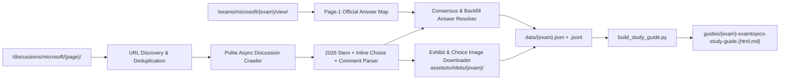

# F-01: AI-103, AI-300, and AI-500 ExamTopics Crawl & Offline Study Guides

## 1. Introduction & Scope

This specification defines the end-to-end data acquisition, normalization, answer consensus resolution, and offline HTML/Markdown study guide generation for Microsoft's modernized 2026 AI certification portfolio:

- **AI-103**: *Developing AI Apps and Agents on Azure* (Azure AI Apps and Agents Developer Associate)
- **AI-300**: *Operationalizing Machine Learning and Generative AI Solutions* (Machine Learning Operations Engineer Associate)
- **AI-500**: *Designing and Implementing Multi-Agent AI Solutions* (Multi-Agent AI Solutions Expert)

### In-Scope
- Extending the ExamTopics crawler (`azure/scripts/crawl_fabric_discussions.py`) to support arbitrary Microsoft exam slugs (`ai-103`, `ai-300`, `ai-500`, `dp-600`, `dp-700`) and late-2026 ExamTopics discussion markup changes.
- Downloading all exhibit images and choice images into `azure/assets/exhibits/{exam}/` with collision-safe filenames and portable repository-relative paths.
- Resolving community-voted and official answers across public exam view pages, `Selected Answer:` voter badges, explicit comment answer declarations, and loose-mode HOTSPOT/DRAG DROP consensus rules.
- Mapping exam topic numbers to official Microsoft Learn skill areas in `azure/scripts/build_study_guide.py` and generating standalone interactive HTML and Markdown study guides in `azure/guides/`.
- Archiving official Microsoft Learn study guides in `azure/references/microsoft/`.

### Out-of-Scope
- Bypassing login/PRO walls, CAPTCHAs, or `robots.txt` restrictions (`/*custom-view/$`, `/search/?query`, `/pro/`, `/login/`, `/user/`, `/checkout`).
- Altering historical `dp-600` or `dp-700` datasets.

---

## 2. Requirements & Traceability

### Business Rules
- **BR-01 (Polite & Sanctioned Crawling)**: Respect `examtopics.com/robots.txt`, enforce bounded concurrency and jittered request delays, retry transient `429`/`5xx` responses with exponential backoff, and never access disallowed paths.
- **BR-02 (Offline Self-Containment)**: Every downloaded exhibit and image choice must resolve via relative paths (`../assets/exhibits/{exam}/...`) when opening `azure/guides/*.html` offline or via a local static HTTP server.
- **BR-03 (JSON / JSONL Parity)**: `azure/data/{exam}.json` and `azure/data/{exam}.jsonl` must contain identical sorted records at rest.

### Functional Requirements
- **FR-CRL-001 (Multi-Exam & Absolute Link Discovery)**: `crawl_fabric_discussions.py` MUST accept `--exams` and match both relative (`/discussions/microsoft/view/...`) and absolute (`https://www.examtopics.com/discussions/microsoft/view/...`) discussion URLs, normalizing stored `path` values so `BASE_URL + path` never duplicates the origin, and gracefully terminating pagination on trailing HTTP `404` or `--stop-after-empty-pages`.
- **FR-CRL-002 (Unique Question Identity)**: When ExamTopics emits the static placeholder `data-id="825909"` on `.question-body`, the crawler MUST fall back to `discussion_id` for `question_id` so exhibit filenames (`{question_id}_{idx}.png`) and DOM anchors never collide. Duplicate discussions targeting the same `(exam, topic, question_number)` MUST deduplicate deterministically in favor of the richer discussion thread.
- **FR-CRL-003 (2026 Inline Choice & Image Extraction)**: When `div.question-choices-container` is absent on discussion pages, the crawler MUST extract trailing sequential inline choices (`A.`, `B.`, `C.`, ...) from `
`, strip those choice lines from `question_text` so they are not duplicated in the prompt card, and download any `` inside choices into `assets/exhibits/{exam}/`.
- **FR-CRL-004 (2026 Voter Badge, Upvote & Answer Consensus Resolution)**: Comment parsing MUST extract numeric upvote counts from `"N time(s)"` strings and `Selected Answer: X` badges, aggregate community votes into `voted_answers_tally` and `most_voted_answer`, enrich available page-1 official answers from `/exams/microsoft/{exam}/view/`, and populate MCQ `correct_answers` (with `choice.correct`) from verified lettered consensus when `correct-hidden` is absent so interactive study-guide grading functions end-to-end.
- **FR-BLD-001 (Official Skill Area Topic Mapping & Multi-Select Inference)**: `build_study_guide.py` MUST map `ai-103`, `ai-300`, and `ai-500` topic numbers to their ExamTopics/Microsoft Learn skill areas, infer multi-select (`checkbox`) inputs from prompt cues (e.g., `"Select two"`, `"Select three"`, `"Each correct answer presents part of the solution"`) in addition to `len(correct_answers) > 1`, render code exhibits cleanly from `code`, `text`, or sanitized `html`, resolve `assets/exhibits/...` existence relative to `azure/` regardless of working directory, and surface `most_voted_answer` in `.answer-status` upon HOTSPOT reveal when available.

---

## 3. Architecture & UI/UX Design

### UI/UX Design Specification
The three new HTML guides (`ai-103`, `ai-300`, `ai-500`) preserve the established editorial study workstation aesthetic (`Fraunces` display typography + `Source Sans 3` body, warm parchment light mode `#f4efe7` and deep slate dark mode `#10141f`):
- **Sticky Header & Hero Progress Orb**: Live `Reviewed`, `Attempted`, `Correct`, and `Remaining` counters persisted per-guide in `localStorage`.
- **Collapsible Topic & Chunk Rail (`#study-map`)**: Grouped by Microsoft skill area / case study topic in chunks of 25 questions, keyboard-navigable via `←` / `→`, `A` (reveal/hide answer), and `R` (mark reviewed).
- **Interactive Grading**: Radio inputs for single-answer MCQs, checkbox inputs with partial-credit amber feedback (`◐ Partially correct`) for multi-select MCQs, and community consensus surfacing for HOTSPOT and DRAG DROP questions.

---

## 4. Acceptance Criteria (`AC-*`)

- **AC-01 (`FR-CRL-001`)**: Given a discussion list HTML page containing absolute `https://www.examtopics.com/discussions/microsoft/view/...` anchors for `ai-103`, `ai-300`, and `ai-500`, discovery extracts normalized `/discussions/...` paths and terminates cleanly on HTTP `404` or empty-page cutoff without raising.
- **AC-02 (`FR-CRL-002`, `FR-CRL-003`)**: Given a 2026 discussion page with `data-id="825909"` and inline ` A. ...  B. ...` choices, `_parse_discussion_html` assigns `question_id == discussion_id`, populates `choices`, and removes choice text from `question_text`.
- **AC-03 (`FR-CRL-004`)**: Given comments containing `Selected Answer: BD` and `4 times`, parser records `upvotes == 4`, `selected_answer == "BD"`, computes `voted_answers_tally` and `most_voted_answer == "BD"`, and marks choices `B` and `D` as `correct`.
- **AC-04 (`FR-BLD-001`, `BR-02`, `BR-03`)**: Generated `ai-103`, `ai-300`, and `ai-500` `.json`/`.jsonl` pairs are byte-for-byte record-identical; HTML and Markdown guides build without warnings, pass JS syntax validation (`node --check`), resolve 100% of local exhibit images (`naturalWidth > 0`), and pass interactive Chrome E2E verification with 0 console errors.
