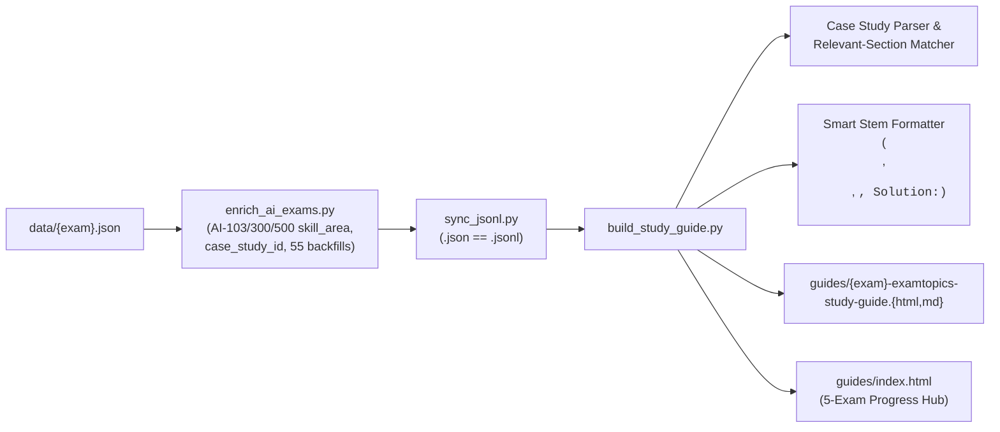
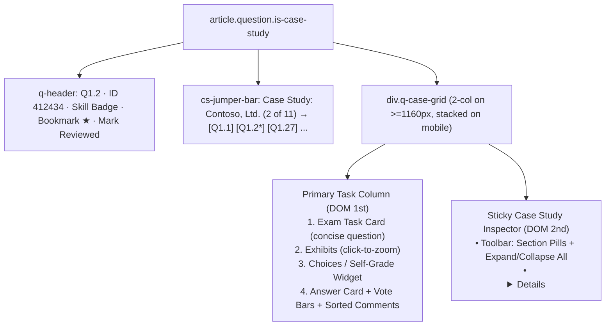

# F-02: Question Readability Engine, Structured Case Studies & Study App v2

## 1. Introduction & Scope

This specification defines the v2 readability, content enrichment, and interactive study-application upgrades across the offline ExamTopics study guides (`AI-103`, `AI-300`, `AI-500`, `DP-600`, `DP-700`), with targeted enhancements for the 2026 Azure AI portfolio (**AI-103**, **AI-300**, **AI-500**).

### Problem Statement
1. **Unreadable Case Study Walls (`AI-103 Q1.2` and 60 sibling case-study questions)**:
   - Upstream 2026 ExamTopics HTML emits standalone section titles without trailing hyphens (`Overview`, `Existing Environment`, `Security and Compliance Requirements`), causing `format_case_study_sections()` to match **0 headings** across AI-103, AI-300, and AI-500.
   - ~1,400 characters of Pearson VUE exam-screen boilerplate (*"This is a case study. Case studies are not timed separately..."*) are repeated verbatim atop every case-study question.
   - Placing the 7,150-character `Case context` above the 2-line `Exam task` buries the actual question below the fold, and scattered numbering (`Q1.1, Q1.2, Q1.27, ...`) forces learners to re-read identical scenarios repeatedly.
2. **Flat Stem Typography & Split Heuristics**:
   - Upstream `raw_html` strips `
`, `<ul>/<li>`, and `<code>` into raw ` ` lines, leaving requirement lists unbulleted (`78%` of AI-500, `25` questions in AI-103), code identifiers unstyled, short stems over-segmented into artificial `Case context` boxes, and multi-section case studies (`AI-500 Q1.3`, `DP-700` Litware) mis-split so 1,300–1,900 characters leak into the bold `Exam task` card.
3. **2026 AI Exam Content & Workflow Gaps**:
   - All `161` AI-103 questions sit in a single flat `Topic 1 ("Exam A")` bucket rather than Microsoft's 5 official AI-103 skill areas.
   - `55` HOTSPOT/DRAG DROP questions across AI-103 (`19`), AI-300 (`32`), and AI-500 (`4`) display `"Not provided"` despite 100% having substantive discussion comments, and `13` existing answers display double-escaped `&quot;`/`&gt;` HTML entities.
   - Non-MCQ items (`34%` of AI-103, `44%` of AI-300) cannot be self-graded, `voted_answers_tally` splits (`14 vs 12` on `AI-103 Q1.14`) are hidden, `comments[:3]` truncates higher-upvoted explanations (`18/29` multi-comment threads in AI-103), exhibits lack click-to-zoom, keyboard shortcut `A` fails to run grading feedback, and `location.pathname` storage keys lose progress across `file://` and `http://localhost`.

### Scope Boundaries
- **In-Scope**:
  - Structured Case Study parser, boilerplate stripper, relevant-section auto-disclosure, desktop split-pane / mobile prompt-first layout, and Case Study sibling jumper bar in `azure/scripts/build_study_guide.py`.
  - Smart stem formatter (`
`, semantic `<ul><li>` checklists, inline `<code>` pills, `Solution:` callouts, muted Pearson VUE footer notes, accurate `split_question_text()`).
  - AI exam enrichment script (`azure/scripts/enrich_ai_exams.py`) and enhanced `backfill_missing_answers.py` covering HTML entity unescaping, the 55 missing AI non-MCQ community notes, AI-103/300/500 official Microsoft skill-area metadata (`skill_area`, `skill_area_label`), and case-study group tags (`case_study_id`, `case_study_title`).
  - Study App v2 features: Search & Filter bar (`All`, `Unreviewed`, `Needs work`, `Bookmarked`, `Case Studies`, `Non-MCQ`, `Contested`), Sidebar Skill-Area / Topic / Case-Study grouping, Vote-Split distribution bars & `Contested` badges, upvote-sorted expandable comments + original thread links, Non-MCQ self-grading (`Got it ✓` / `Needs work ✕`), native `<dialog closedby="any">` exhibit zoom lightbox, keyboard shortcuts (`1–9`, `A`, `R`, `B`, `/`, `←`/`→`), portable `localStorage` migration + Reset dialog, offline font hygiene, and cross-exam hub `azure/guides/index.html`.
- **Out-of-Scope**:
  - Bypassing ExamTopics login/PRO walls, CAPTCHAs, or `robots.txt` rules.

---

## 2. Requirements & Traceability

### Business Rules
- **BR-01 (Non-Destructive Answer Reprocessing)**: Reprocessing `most_voted_answer` and comment HTML-entity normalization (`--reprocess --loose`) MUST preserve all crawled question stems, choices, exhibits, and official MCQ `correct_answers`, while `skill_area` enrichment targets `ai-103`, `ai-300`, and `ai-500`.
- **BR-02 (100% Offline Self-Containment)**: Generated HTML guides and `guides/index.html` MUST NOT issue external network requests (no Google Fonts `@import` or CDN scripts) when opened offline.
- **BR-03 (JSON / JSONL Parity & Stable Question Anchors)**: `data/{exam}.json` and `data/{exam}.jsonl` MUST remain record-identical, and question DOM anchors (`q-{exam}-t{topic}-n{num}-{qid}`) MUST NOT change when `skill_area` grouping is introduced.

### Functional Requirements
- **FR-CRL-005 (Crawler HTML Entity Decoding)**: `crawl_fabric_discussions.py` MUST decode single- and double-escaped HTML entities (`&amp;quot;`, `&quot;`, `&gt;`) when extracting stems, choices, and discussion comments.
- **FR-DAT-002 (Structured Slot Answer Extraction & Exhibit-Curated Overrides)**: `backfill_missing_answers.py` MUST support `--reprocess --loose` to extract concise `\n`-delimited slot pairs (`Label: Value`, `Label → Value`), numbered sequences, and `Yes, No` lists without pipe-flattening trailing commentary, apply `CURATED_ANSWERS` overrides for exhibit-verified multi-slot items, and reject wrong-thread MCQ pastes and bare meta-confirmations.
- **FR-APP-004 (Single-Column Non-MCQ `<dl>` Answer Cards & Semantic Landmarks)**: Non-MCQ questions (`choices == []` and `correct_answers == []`) MUST render a full-width `.answer-grid-single` card formatting slot pairs as `<dl class="answer-pairs">
<dt>…</dt><dd>…</dd>
</dl>` (and numbered/bullet sequences as `<ol>`/`<ul>`) without a redundant `"Correct answer"` column or duplicate status-line echo; search/filter controls MUST use `<search>`, and scrollable code exhibits MUST use `<pre role="region" aria-label="…" tabindex="0">`.
- **FR-RDB-001 (Case Study Parser, Boilerplate Strip & Auto-Section Disclosure)**: `build_study_guide.py` MUST strip standard Pearson VUE case-study instruction preambles, parse both hyphenated (`DP-600`/`DP-700`) and standalone-line (`AI-103`/`AI-300`/`AI-500`) headings into structured `
` panels with an `Expand all / Collapse all` control, auto-open and badge sections referenced by the question prompt (defaulting to the first section when none match specifically), and render a sibling jumper bar (`Case Study: <Title> · <k> of <N>`) linking all questions sharing that scenario.
- **FR-RDB-002 (Prompt-First & Split-Pane Case Study Layout)**: Case-study questions MUST place the `Exam task` first in reading/DOM order so the question is visible above the fold on mobile, and use a 2-column grid on wide viewports (`>= 1160px`) pairing the primary task/choices flow with a sticky scrollable Case Study reference column.
- **FR-RDB-003 (Smart Stem Typography & Accurate Task Segmentation)**: `split_question_text()` MUST segment case studies strictly after the final case-study section (preventing mid-scenario cues like `"When testing..."` from leaking into `Exam task`) and keep short non-case-study stems unified rather than creating 1-sentence `Case context` boxes. Stem formatting MUST convert `•` items and post-colon requirement blocks (`"following requirements:"`, `"following configurations:"`, `"following actions:"`, `"following issues:"`) into `<ul><li>` lists, wrap inline code/CLI/SDK/parameter tokens in `<code>`, isolate `"Solution: ..."` lines into a `.proposed-solution` callout, and style trailing Pearson VUE answer instructions (`"To answer, ..."`, `"NOTE: Each correct selection..."`) as muted metadata.
- **FR-DAT-001 (AI Exam Skill-Area Mapping, Entity Unescaping & Non-MCQ Backfill)**: `enrich_ai_exams.py` MUST unescape HTML entities in `most_voted_answer`, classify `ai-103` (`161` questions), `ai-300` (`107` questions), and `ai-500` (`18` questions) into their official Microsoft Learn skill areas (`skill_area`, `skill_area_label`), tag shared case studies (`case_study_id`, `case_study_title`), and backfill the 55 missing non-MCQ answers from substantive community comments with explicit `_backfill_source` confidence metadata (`consensus` vs `community_note`).
- **FR-APP-001 (Vote Distribution, Contested Badge & Full Sorted Comments)**: Revealed answers MUST display visual vote bars from `voted_answers_tally`, surface a `Contested` warning badge when runner-up votes reach `>= 35%` of total votes (with `>= 2` votes), unescape entities and format `|`-delimited slot answers cleanly, style `.answer-missing` per individual card rather than globally, sort comments by `upvotes` descending with a `
` expander for comments beyond the top 3, and link to the upstream ExamTopics thread (`url`).
- **FR-APP-002 (Non-MCQ Self-Grading & Exhibit Zoom Lightbox)**: Revealed HOTSPOT and DRAG DROP questions MUST provide `Got it right ✓` and `Needs work ✕` self-assessment buttons that persist in `localStorage` and integrate with `Attempted` / `Correct` / `Needs work` metrics. Clicking any exhibit image MUST open a native modal `<dialog closedby="any">` lightbox with `showModal()`, scroll containment, visible close control, and cross-browser backdrop light-dismiss fallback.
- **FR-APP-003 (Search, Filters, Bookmarks, Hotkeys, Portable Storage & Hub)**: Each HTML guide MUST provide live text search (`/`), filter chips (`All`, `Unreviewed`, `Needs work`, `Bookmarked ★`, `Case Studies`, `Hotspot / Drag-Drop`, `Contested`), sidebar grouping toggle (`Skill Area` vs `Question #` when applicable), compact collapsible overview header, bug-free keyboard shortcuts (`A` reveal with `updateAnswerFeedback()`, `1–9` choice select, `R` reviewed, `B` bookmark, `←`/`→` filtered prev/next), exam-slug `localStorage` keys with automatic migration from legacy `location.pathname` keys + `Reset progress` modal confirmation, unique DOM IDs (no duplicate `id="questions"`), and a generated `azure/guides/index.html` cross-exam hub + header switcher.

### Non-Functional & Web Platform Requirements
- **NFR-A11Y-001 (WCAG 2.1 AA & Modern Web Guidance Compliance)**:
  - Root/body typography uses `rem` (`1.0625rem`) and zoom-safe fluid `clamp(minRem, rem + vw, maxRem)` with `max <= 2.5 * min` so browser zoom scales to 200%+ (`typography`).
  - Accordion `
` elements MUST NOT wrap `<h1>`–`<h6>` headings and MUST place the disclosure indicator immediately before the label (`accordion`, `search-hidden-content`).
  - Modal `<dialog>` elements MUST omit redundant `role="dialog"`/`aria-modal`, scope `display` styles to `dialog[open]`, contain overscroll via `dialog:modal` and `dialog::backdrop` without `body { overflow: hidden }`, and include pointer-coordinate light-dismiss fallback where `HTMLDialogElement.prototype.closedBy` is absent (`dialog`, `light-dismiss-a-dialog`).
  - Sticky header stays single-row `< 12%` viewport height (`content-first-noise-reduction`).

---

## 3. UI/UX & Component Architecture

### 3.1 Case Study Layout Trade-Off Synthesis

| Paradigm | Speed to Task | Cross-Section Comparison | Find-in-Page Support | Verdict |
| :--- | :---: | :---: | :---: | :--- |
| **1. Top Scrolling Grey Box (v1)** | Low (buries prompt under 7,200 chars) | Manual scrolling | Native | Rejected |
| **2. Exclusive Horizontal Tabs** | High | Poor (only 1 tab visible at once) | Partial (`until-found` missing in Safari) | Rejected |
| **3. Prompt-First + Split-Pane `
` Inspector (v2)** | **High** (task visible immediately + relevant section auto-opened) | **High** (multi-open `
` + `Expand all`) | **100% Native** (`
` searchable across all browsers) | **Selected** |

### 3.2 Architecture & Rendering Pipeline

### 3.3 Case Study Question Card Anatomy (Desktop `>= 1160px` vs Mobile)

---

## 4. Acceptance Criteria & Verification Matrix

- **AC-01 (`FR-RDB-001`, `FR-RDB-002`)**: Given `AI-103 Q1.2`, rendering produces 0 lines of `"This is a case study. Case studies are not timed separately"` boilerplate, parses standalone headings (`Overview`, `Existing Environment`, `Problem Statements`, `Requirements`, `Security and Compliance Requirements`, `Business Requirements`) into `
` panels without heading tags inside `
`, auto-opens `Security and Compliance Requirements` with a `Relevant` badge, places `.prompt-card` before `.case-study-panel` in DOM order, and renders the 11-question Contoso sibling jumper bar.
- **AC-02 (`FR-RDB-003`)**: Given `AI-500 Q1.3` and `DP-700 Q2.22`, `split_question_text()` keeps `"When testing Claim Approval..."` / `"When the authors have new book releases..."` inside the case study and isolates only the final exam task (`< 350` chars) in `.prompt-card`. Given unbulleted post-colon lists (`AI-103 Q1.4`, `AI-500 Q1.2`), stem formatting emits `<ul><li>` items and wraps SDK/code tokens in `<code>`. Given `"Does this meet the goal?"` questions (`AI-103 Q1.23`), `"Solution: ..."` renders inside `.proposed-solution`.
- **AC-03 (`FR-DAT-001`, `FR-DAT-002`, `BR-01`, `BR-03`)**: Running `backfill_missing_answers.py --reprocess --loose --apply` + `enrich_ai_exams.py --apply` + `sync_jsonl.py` populates `skill_area` (`1..5`) across all 161 `ai-103` questions with all 5 official Microsoft skill areas represented, eliminates unescaped `&quot;`/`&gt;` entities in `most_voted_answer` and `comments`, extracts concise `\n`-delimited slot lines without ` | ` flattening, reduces `"Not provided"` non-MCQ answers across AI-103/300/500 to `<= 1` (rejecting meta-chatter comments like `"found in exam today"`), and preserves `JSON == JSONL` parity across all 5 exams.
- **AC-07 (`FR-CRL-005`, `FR-APP-004`)**: Crawler unescapes double-encoded comment entities (`&amp;quot;` → `"`), non-MCQ revealed cards render `.answer-grid-single` with `<dl class="answer-pairs">
<dt>…</dt><dd>…</dd>
</dl>` and no duplicate status-line echo, search toolbar uses `<search>`, and code exhibits render `<pre role="region" ... tabindex="0">`.
- **AC-04 (`FR-APP-001`)**: Given `AI-103 Q1.14` (`A: 14`, `D: 12`), the HTML card displays a `Contested` badge and vote-share bars, sorts discussion comments by `upvotes` descending with a `
` expander when `> 3` comments exist, and renders a link to `q["url"]`.
- **AC-05 (`FR-APP-002`, `NFR-A11Y-001`)**: Clicking an exhibit image opens `#exhibit-lightbox` via `showModal()` with `closedby="any"`, no `role="dialog"`/`aria-modal`, `overscroll-behavior: contain`, visible close button, and backdrop light-dismiss fallback. Revealing a HOTSPOT/DRAG DROP question exposes `Got it right` / `Needs work` buttons that update `Attempted` and `Correct` counters.
- **AC-06 (`FR-APP-003`, `BR-02`)**: Generated HTML guides contain zero duplicate `id` attributes, zero external font/script URLs, support search/filter chips, `1–9`/`A`/`R`/`B`/`/`/`←`/`→` keyboard shortcuts (with `A` calling `updateAnswerFeedback()`), migrate legacy `location.pathname` storage keys, generate `azure/guides/index.html`, and pass Python unit tests + live Chromium E2E verification with 0 console errors.
