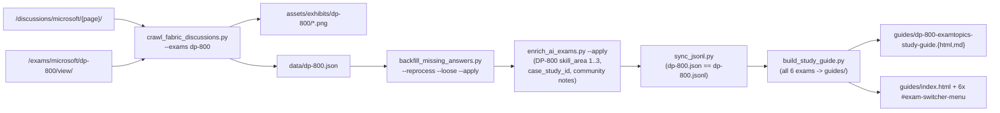

# F-03: DP-800 ExamTopics Crawl, Enrichment & Study App v2 Integration

## 1. Introduction & Scope

This specification defines the end-to-end public ExamTopics discussion crawl, offline exhibit downloading, Microsoft Learn skill-area and community-consensus enrichment, and Study App v2 HTML/Markdown guide + cross-exam hub integration for **Exam DP-800: Developing AI-Enabled Database Solutions** (*Microsoft Certified: SQL AI Developer Associate*).

### In-Scope
- Crawling all public ExamTopics `dp-800` discussion threads via `azure/scripts/crawl_fabric_discussions.py` into `azure/data/dp-800.{json,jsonl}` with checkpoint state in `azure/state/dp-800-state.json` and offline exhibit/choice images in `azure/assets/exhibits/dp-800/`.
- Archiving the official Microsoft Learn DP-800 study guide in `azure/references/microsoft/dp-800-study-guide.md`.
- Extending `backfill_missing_answers.py`, `enrich_ai_exams.py`, `sync_jsonl.py`, and `build_study_guide.py` to support `dp-800`:
  - Official exam title: `DP-800 Developing AI-Enabled Database Solutions Study Guide`.
  - Official Microsoft Learn skill areas (`1`: *Design and develop database solutions*, `2`: *Secure, optimize, and deploy database solutions*, `3`: *Implement AI capabilities in database solutions*), plus deterministic classification when ExamTopics places questions in case-study or flat topic buckets.
  - Structured multi-line slot answer backfill (`--reprocess --loose`), exhibit-verified curated overrides where needed, and `community_note` / `consensus` badging for non-MCQ (`HOTSPOT` / `DRAG DROP`) threads.
  - Cross-exam hub (`azure/guides/index.html` using semantic `<article>` card roots inside single-destination `<a>` links) and `#exam-switcher-menu` popover updated across all 6 certification guides (`AI-103`, `AI-300`, `AI-500`, `DP-600`, `DP-700`, `DP-800`).

### Out-of-Scope
- Bypassing login/PRO walls, CAPTCHAs, anti-bot challenges, or `robots.txt` restrictions (`/*custom-view/$`, `/search/?query`, `/pro/`, `/login/`, `/user/`, `/checkout`).
- Mutating historical crawled stems/answers in `dp-600` or `dp-700` data files (only their generated HTML guides are refreshed so the header `#exam-switcher-menu` includes `DP-800`).

---

## 2. Requirements & Traceability

### Business Rules
- **BR-01 (Polite & Sanctioned Crawling)**: Respect `examtopics.com/robots.txt`, enforce bounded concurrency (`<= 3`), jittered request delays, and graceful stop on trailing HTTP `404` or empty-page threshold.
- **BR-02 (100% Offline Self-Containment)**: Every exhibit and choice image in `dp-800` MUST resolve offline via `../assets/exhibits/dp-800/...`, and generated HTML files MUST issue zero external font/script requests.
- **BR-03 (JSON / JSONL Parity & Stable Question Anchors)**: `azure/data/dp-800.json` and `azure/data/dp-800.jsonl` MUST contain identical sorted records at rest, and DOM anchors (`q-dp-800-t{topic}-n{num}-{qid}`) MUST remain deterministic and unique.

### Functional Requirements
- **FR-CRL-006 (DP-800 Default Registry & Discovery)**: `crawl_fabric_discussions.py`, `backfill_missing_answers.py`, and `sync_jsonl.py` MUST register `dp-800` in their default exam lists alongside `dp-600`, `dp-700`, `ai-103`, `ai-300`, and `ai-500`, harvesting page-1 `/exams/microsoft/dp-800/view/` enrichment and deduplicating `(topic, question_number)` slots in favor of the richest discussion thread.
- **FR-DAT-003 (DP-800 Skill-Area Classification, Case-Study Grouping & Non-MCQ Enrichment)**: `enrich_ai_exams.py` MUST classify `dp-800` questions into Microsoft's 3 official DP-800 skill areas (`skill_area` `1..3`, `skill_area_label`), tag case studies (`case_study_id`, `case_study_title`), unescape HTML entities in `most_voted_answer`, and extract structured community notes for remaining non-MCQ threads while rejecting meta-chatter.
- **FR-BLD-002 (6-Exam Study Guide Builder & Semantic Hub Cards)**: `build_study_guide.py` MUST define `EXAM_TITLES["dp-800"]`, `TOPIC_LABELS["dp-800"]`, and `SKILL_AREA_LABELS["dp-800"]`, include `dp-800` in `guides/index.html` and `#exam-switcher-menu` across all 6 guides, dynamically format the hub subtitle count, and structure each single-destination hub card as `<a><article class="hub-card">…</article></a>` with `<header>` metadata, `<h2>` title, `
` summary, and progress region.

---

## 3. Architecture & UI/UX Blueprint

### Hub & Study Guide UX Integration
- **Study Hub (`guides/index.html`)**: Displays 6 certification cards (`AI-103`, `AI-300`, `AI-500`, `DP-600`, `DP-700`, `DP-800`) with `2026 SQL & Fabric AI` badge for `DP-800` and live `localStorage` progress (`examguide-v2-dp-800-*`).
- **DP-800 Study App v2 (`guides/dp-800-examtopics-study-guide.html`)**: Full parity with the existing 5 guides — prompt-first 2-column case-study inspector + sibling jumper bar, smart T-SQL/JSON/vector `<code>` & `<ul>` stem formatting, vote-split bars & `Contested` badges, `<dl class="answer-pairs">` non-MCQ cards + self-grading (`Got it right` / `Needs work`), `<dialog closedby="any">` exhibit zoom lightbox, search `/` & filter chips, and `1–9`/`A`/`R`/`B`/`←`/`→` keyboard shortcuts.

---

## 4. Acceptance Criteria (`AC-*`)

- **AC-01 (`FR-CRL-006`, `BR-01`, `BR-02`)**: Crawling `dp-800` discovers all public ExamTopics `dp-800` discussion threads, downloads 100% of referenced exhibit/choice images into `azure/assets/exhibits/dp-800/` (`size > 0`), and writes deduplicated sorted records to `azure/data/dp-800.{json,jsonl}`.
- **AC-02 (`FR-DAT-003`, `BR-03`)**: Running `backfill_missing_answers.py --reprocess --loose --apply`, `enrich_ai_exams.py --apply`, and `sync_jsonl.py` populates valid `skill_area` (`1..3`) and `skill_area_label` on 100% of `dp-800` questions, leaves zero unescaped `&quot;`/`&gt;`/`&amp;quot;` entities, backfills substantive non-MCQ community answers while rejecting meta-chatter, and maintains `dp-800.json == dp-800.jsonl` parity across all 6 exams.
- **AC-03 (`FR-BLD-002`, `BR-02`)**: `build_study_guide.py` renders `DP-800 Developing AI-Enabled Database Solutions Study Guide` in HTML (`<title>`, `<h1>`) and Markdown (`#`), renders semantic `<article class="hub-card">` cards inside `<a>` links in `guides/index.html` for all 6 exams, updates `#exam-switcher-menu` across all 6 HTML guides, passes `ast.parse`, `python3 -Werror -m unittest`, `node --check` on all 7 HTML inline scripts, 0 duplicate HTML IDs, and passes live browser E2E verification with `0` console/page errors and `naturalWidth > 0` on exhibits.
