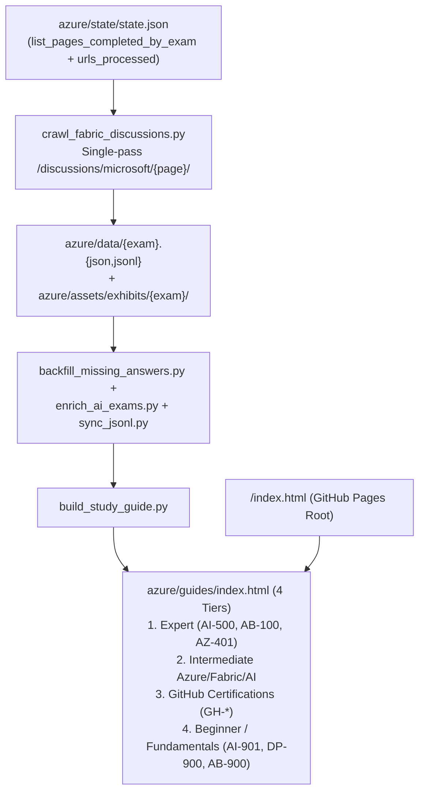

# F-04: Unified Crawler State & Tiered Microsoft AI, Data, and GitHub Study Portfolio

## 1. Introduction & Scope

This specification unifies ExamTopics crawler checkpointing into a single shared state file (`azure/state/state.json`) and expands the offline study workstation across the full Microsoft AI, Data, Agentic Business, Cloud/AI Security, GitHub, and Fundamentals certification portfolio with explicit 4-tier hierarchy on GitHub Pages.

### In-Scope
- **Unified Single-State Crawler (`azure/state/state.json`)**:
  - Losslessly merge `state/state.json`, `state/ai-exams-state.json`, and `state/dp-800-state.json` into `state/state.json` and remove the fragmented state files.
  - Track completed discussion-list pages per exam (`list_pages_completed_by_exam`) with per-exam empty-page retirement so `/discussions/microsoft/{page}/` is fetched **once** across any multi-exam crawl without skipping un-scanned pages for newly added exam slugs.
- **Expanded Exam Portfolio (28 Certifications)**:
  - **Tier 1 — Expert Level** *(Top section)*: `AI-500`, `AB-100`, `AZ-401`.
  - **Tier 2 — Associate / Intermediate — Azure, Fabric & Microsoft AI**: `AI-103`, `AI-200`, `AI-300`, `DP-600`, `DP-700`, `DP-750`, `DP-800`, `AB-620`, `AB-410`, `AB-400`, `AB-210`, `AB-250`, `AB-650`, `AB-730`, `AB-731`, `SC-500`.
  - **Tier 3 — GitHub Certifications** *(Under Azure/Microsoft certs)*: `GH-300`, `GH-600`, `GH-200`, `GH-500`, `GH-100`, `GH-900`.
  - **Tier 4 — Beginner / Fundamentals Level** *(Bottom section below all other certs)*: `AI-901`, `DP-900`, `AB-900`.
- **Official References, Enrichment & Root GitHub Pages Entry**:
  - Archive official Microsoft Learn study guides (`azure/references/microsoft/{slug}-study-guide.md`) and map official skill areas for all 22 newly added exams.
  - Run structured non-MCQ slot backfill, HTML entity cleanup, case-study detection, and `JSON == JSONL` sync across all crawled datasets.
  - Add root `/index.html` redirecting `https://khangnghiem.github.io/exams/` to `azure/guides/index.html`.

### Out-of-Scope
- Bypassing ExamTopics login/PRO walls, CAPTCHAs, or `robots.txt` rules.
- Altering historical crawled questions in `dp-600`, `dp-700`, `dp-800`, `ai-103`, `ai-300`, or `ai-500`.

---

## 2. Requirements & Traceability

### Business Rules
- **BR-01 (Lossless Unified State)**: Merging `state.json`, `ai-exams-state.json`, and `dp-800-state.json` MUST preserve 100% of existing `urls_collected` and `urls_processed` entries so zero previously crawled threads (`672` records across 6 exams) are re-fetched or lost.
- **BR-02 (Tier Ordering Invariant)**: Both `azure/guides/index.html` and `#exam-switcher-menu` MUST order certification tiers strictly as: `Expert` → `Associate / Intermediate (Azure, Fabric & Microsoft AI)` → `GitHub` → `Beginner / Fundamentals`.
- **BR-03 (100% Offline & JSON/JSONL Parity)**: Every downloaded exhibit/choice image MUST resolve locally via `../assets/exhibits/{exam}/...`, HTML guides MUST make zero external network requests, and `data/{exam}.json` MUST match `data/{exam}.jsonl`.

### Functional Requirements
- **FR-CRL-007 (Per-Exam List-Page Tracking & Empty-Streak Retirement)**: `Crawler` MUST maintain `list_pages_completed_by_exam[exam]` (migrating legacy global `list_pages_completed` automatically to exams already present in `urls_collected`), fetch list page `p` once whenever at least one active target exam has not yet scanned `p`, and retire each exam individually during `discover_urls()` once that exam reaches `stop_after_empty_pages` consecutive empty pages.
- **FR-DAT-004 (Portfolio Skill-Area Mapping & Non-MCQ Enrichment)**: `enrich_ai_exams.py`, `backfill_missing_answers.py`, and `sync_jsonl.py` MUST support all newly crawled exams, mapping ExamTopics topic tags (or stem keywords for flat `Exam A` topics such as `ai-901`) to official Microsoft Learn skill areas, tagging case studies, unescaping HTML entities, and extracting structured non-MCQ community answers.
- **FR-BLD-003 (4-Tier Study Hub, Search Filter & Root GitHub Pages Redirect)**: `build_study_guide.py` MUST group `guides/index.html` into 4 `<section aria-labelledby="tier-...">` landmarks with `<h1>` → `<h2>` → `<h3>` heading hierarchy, `text-wrap: balance` on headings, live `<search>` filtering across all cards, graceful `"Awaiting ExamTopics discussions"` status on `0`-question upcoming exams (such as `AZ-401`), grouped tier headings inside `#exam-switcher-menu`, and a root `index.html` entry page for GitHub Pages.
- **FR-BLD-004 (Official Microsoft Learn Certification & Registration Links)**: Every certification in `EXAM_CATALOG` MUST include its canonical Microsoft Learn registration URL (`https://learn.microsoft.com/en-us/credentials/certifications/<credential-slug>/?practice-assessment-type=certification`). On `guides/index.html`, each `<article class="hub-card">` MUST use the stretched-link pattern on `<h3><a class="hub-card-link">` (`::after` overlay) rather than wrapping the entire card in `<a>`, and expose a `<footer class="hub-card-footer">` secondary action `<a class="hub-reg-link" target="_blank" rel="noopener noreferrer">` elevated via `position: relative; z-index: 1` with a unique disambiguated accessible name (`Register for {CODE} on Microsoft Learn`) and ≥24×24 CSS px target sizing (`≥44px` on coarse pointers). Individual HTML and Markdown study guides MUST also surface the same official registration URL in their header metadata.

---

## 3. Architecture & UI Hierarchy

---

## 4. Acceptance Criteria (`AC-*`)

- **AC-01 (`FR-CRL-007`, `BR-01`)**: Given a unified `state.json` where `ai-103` has scanned pages `1..260` and `dp-750` has scanned `[]`, `discover_urls()` scans page `1` rather than skipping it, records completion per exam in `list_pages_completed_by_exam`, and retires `2026` exams early on empty streak while allowing `dp-900` to continue deeper in the same run.
- **AC-02 (`FR-DAT-004`, `BR-03`)**: All crawled exam `.json`/`.jsonl` pairs pass record parity, `0` unescaped `&quot;`/`&gt;`/`&amp;quot;` entities, and `100%` local exhibit existence (`size > 0`).
- **AC-03 (`FR-BLD-003`, `BR-02`)**: `guides/index.html` renders the 4 sections in exact order (`Expert` → `Associate / Intermediate` → `GitHub` → `Beginner / Fundamentals`) with `AI-500` in the top Expert section, `GH-*` in the GitHub section under Azure/Microsoft certs, and `AI-901` + `DP-900` in the bottom Beginner section; root `/index.html` resolves cleanly to `azure/guides/index.html`; all unit tests, `node --check`, duplicate-ID checks, and live browser E2E checks pass with `0` console errors.
- **AC-04 (`FR-BLD-004`)**: All 28 cards on `guides/index.html` render valid non-nested HTML (`<article class="hub-card">` with stretched `<h3><a class="hub-card-link">` + `<footer class="hub-card-footer"><a class="hub-reg-link">`), clicking the card body navigates to `{slug}-examtopics-study-guide.html`, and clicking `.hub-reg-link` opens the verified `https://learn.microsoft.com/en-us/credentials/certifications/.../?practice-assessment-type=certification` URL in a new tab (`target="_blank" rel="noopener noreferrer"`).
