# AB-100 Agentic AI Business Solutions Architect Study Guide

_124 questions generated from ExamTopics discussions._

## Table of contents

- [Q1.1](#q1-1)
- [Q1.2](#q1-2)
- [Q1.3](#q1-3)
- [Q1.4](#q1-4)
- [Q1.5](#q1-5)
- [Q1.6](#q1-6)
- [Q1.7](#q1-7)
- [Q1.8](#q1-8)
- [Q1.9](#q1-9)
- [Q1.10](#q1-10)
- [Q1.11](#q1-11)
- [Q1.12](#q1-12)
- [Q1.13](#q1-13)
- [Q1.14](#q1-14)
- [Q1.15](#q1-15)
- [Q1.16](#q1-16)
- [Q1.17](#q1-17)
- [Q1.18](#q1-18)
- [Q1.19](#q1-19)
- [Q1.20](#q1-20)
- [Q1.22](#q1-22)
- [Q1.23](#q1-23)
- [Q1.24](#q1-24)
- [Q1.25](#q1-25)
- [Q1.26](#q1-26)
- [Q1.27](#q1-27)
- [Q1.28](#q1-28)
- [Q1.29](#q1-29)
- [Q1.30](#q1-30)
- [Q1.31](#q1-31)
- [Q1.32](#q1-32)
- [Q1.33](#q1-33)
- [Q1.34](#q1-34)
- [Q1.35](#q1-35)
- [Q1.36](#q1-36)
- [Q1.37](#q1-37)
- [Q1.38](#q1-38)
- [Q1.39](#q1-39)
- [Q1.40](#q1-40)
- [Q1.41](#q1-41)
- [Q1.42](#q1-42)
- [Q1.43](#q1-43)
- [Q1.44](#q1-44)
- [Q1.45](#q1-45)
- [Q2.1](#q2-1)
- [Q2.2](#q2-2)
- [Q2.3](#q2-3)
- [Q2.4](#q2-4)
- [Q2.5](#q2-5)
- [Q2.6](#q2-6)
- [Q2.7](#q2-7)
- [Q2.8](#q2-8)
- [Q2.9](#q2-9)
- [Q2.10](#q2-10)
- [Q2.11](#q2-11)
- [Q2.12](#q2-12)
- [Q2.13](#q2-13)
- [Q2.14](#q2-14)
- [Q2.15](#q2-15)
- [Q2.16](#q2-16)
- [Q2.17](#q2-17)
- [Q2.18](#q2-18)
- [Q2.19](#q2-19)
- [Q2.20](#q2-20)
- [Q2.21](#q2-21)
- [Q2.22](#q2-22)
- [Q2.23](#q2-23)
- [Q2.24](#q2-24)
- [Q2.25](#q2-25)
- [Q2.26](#q2-26)
- [Q2.27](#q2-27)
- [Q2.28](#q2-28)
- [Q2.29](#q2-29)
- [Q2.30](#q2-30)
- [Q2.31](#q2-31)
- [Q2.33](#q2-33)
- [Q2.34](#q2-34)
- [Q3.1](#q3-1)
- [Q3.2](#q3-2)
- [Q3.3](#q3-3)
- [Q3.4](#q3-4)
- [Q3.5](#q3-5)
- [Q3.6](#q3-6)
- [Q3.7](#q3-7)
- [Q3.8](#q3-8)
- [Q3.9](#q3-9)
- [Q3.10](#q3-10)
- [Q3.11](#q3-11)
- [Q3.12](#q3-12)
- [Q3.13](#q3-13)
- [Q3.14](#q3-14)
- [Q3.15](#q3-15)
- [Q3.16](#q3-16)
- [Q3.17](#q3-17)
- [Q3.18](#q3-18)
- [Q3.19](#q3-19)
- [Q3.20](#q3-20)
- [Q3.21](#q3-21)
- [Q3.22](#q3-22)
- [Q3.23](#q3-23)
- [Q3.24](#q3-24)
- [Q3.25](#q3-25)
- [Q3.26](#q3-26)
- [Q3.27](#q3-27)
- [Q3.28](#q3-28)
- [Q3.29](#q3-29)
- [Q3.30](#q3-30)
- [Q3.31](#q3-31)
- [Q3.32](#q3-32)
- [Q3.33](#q3-33)
- [Q3.34](#q3-34)
- [Q3.35](#q3-35)
- [Q3.36](#q3-36)
- [Q3.37](#q3-37)
- [Q3.38](#q3-38)
- [Q3.39](#q3-39)
- [Q3.40](#q3-40)
- [Q3.41](#q3-41)
- [Q3.42](#q3-42)
- [Q3.43](#q3-43)
- [Q3.44](#q3-44)
- [Q3.45](#q3-45)
- [Q3.46](#q3-46)
- [Q3.47](#q3-47)

## Q1.1 (ID 384052)

HOTSPOT
Background
Fabrikam, Inc., is a global consumer goods company that is undergoing a digital transformation initiative to migrate its entire infrastructure to the Microsoft cloud. As a key element of this cloud migration, the company will implement Microsoft Dynamics 365 Sales, moving away from the current on-premises proprietary technologies used by its business-to-business (B2B) sales team.
As part of the cloud migration, Fabrikam will adopt an AI-first approach to its business solutions and implement AI solutions, wherever possible, to streamline operations.
Problem Statements
Fabrikam's infrastructure currently relies on various on-premises systems that require sales executives to use corporate computers with physical keyboards to access business information during customer interactions. Mobile phones cannot be used for these purposes, as the systems depend on keyboard input. As a result, the sales executives spend a lot of time using keyboards to search for data on several disparate systems and file servers, rather than focusing on the customers. This affects the customer experience.
Fabrikam stakeholders are concerned that users will be hesitant to adopt AI. If the AI initiatives are NOT adopted, cost savings will never be realized. Additionally, funding for future AI initiatives will depend on demonstrating an increase in AI adoption month over month. As the AI agent initiative for the sales team will be the first for Fabrikam, the rapid adoption of the agent is a high priority.
Planned Initiatives
General
Fabrikam management has prioritized AI-driven projects to improve efficiency, customer engagement, and responsible AI adoption. The current application infrastructure is on-premises and must be migrated to the cloud to support the adoption of these technologies.
Infrastructure Migration
Fabrikam plans to migrate from its current on-premises infrastructure to a completely cloud-based topology; this will include user authentication, the security framework, and, primarily, the adoption of the services by end users.
All the data from the different systems will be consolidated into a single data source - a common data model that will use a Microsoft Dataverse environment as a single source of truth (SSOT) for the sales team.
Sales Cycle Enablement
To achieve the company's objectives, Fabrikam intends to implement the following strategies to enhance the sales cycle:
Use low-code development to create a single AI agent that has Dataverse as its core component.
Ensure that sales managers can access unanswered correspondence from prospects and intervene as appropriate.
Replace the previous proprietary software with Dynamics 365 Sales to track sales cycles and customer interactions.
Have the sales executives use Dynamics 365 Sales to track interactions for open opportunities and send follow-up communications to prospects.
Have the sales executives use handsfree headsets to interact with an AI agent when they have questions about internal policies or customer data.
Requirements
Infrastructure Migration
Fabrikam has identified the following infrastructure migration requirements:
Azure must be used for all future infrastructure workloads.
The company must follow Microsoft-recommended methodologies for infrastructure migration to the cloud.
Any created AI agents must have their return on investment (ROI) calculated to ensure that the solution will save the company money.
Sales Cycle Enablement
Fabrikam has identified the following requirements for sales cycle enablement:
The final AI agent must follow Microsoft recommendations for a conversational user experience.
A designated checklist must be reviewed to ensure that the AI agent follows Microsoft deployment recommendations for a compliant solution.
Detailed telemetry must be logged for the first created AI agent to help troubleshoot and optimize the agent during the initial AI agent adoption process.
Unexpected AI agent actions must end in an escalation to a live representative. For example, a sales executive must be rerouted to a representative if the agent cannot answer a question after two failed attempts.
The return on investment (ROI) of switching from the current process to the future process is required for stakeholder sign off.
The sales team must use Dynamics 365 Sales to correspond with prospects more quickly and efficiently than currently.
Sales managers must report on the adoption of the AI agent to key Fabrikam stakeholders on a monthly basis.
Any sensitive information, such as user IDs and names, shared via the AI agent must be tracked for future auditing.
Which framework should you use to meet the AI agent requirements for the sales cycle enablement? To answer, select the appropriate options in the answer area.
NOTE: Each correct selection is worth one point.

**Exhibits**
- Exhibit 1: 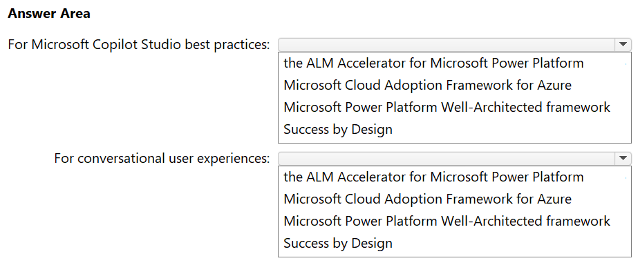

_HOTSPOT — the original ExamTopics question expects you to mark areas on the exhibit above; the correct hotspot coordinates are not published._

**Most voted:**
- Success by Design → Copilot Studio best practices
- Power Platform Well‑Architected Framework → Conversational UX

### Top explanations
- **rveney** (27 upvotes [Highly Voted]): Use the following frameworks:
  For Microsoft Copilot Studio best practices:
  Microsoft Power Platform Well-Architected framework
  For conversational user experiences:
  Success by Design
  The Well-Architected framework ensures the AI agent follows Microsoft-recommended design, deployment, security, telemetry, and compliance best practices.
  Success by Design provides structured guidance for delivering high-quality, user-centered solutions, including conversational experience best practices and governance reviews.
- **Srikantha** (5 upvotes): Explanation
  Microsoft Power Platform Well-Architected Framework: Provides the official guidance, principles, and best practices for building scalable, secure, and compliant Copilot Studio solutions (covering governance, security, operational excellence, reliability, and cost optimization).
  Success by Design: Offers structured, agent-assisted prescriptive guidance and methodologies for implementing Dynamics 365 and Power Platform solutions, which includes conversational design checklists, deployment recommendations, and user adoption strategies.
- **omath** (5 upvotes): 1. Success by Design → Copilot Studio best practices
  The case study explicitly requires:
  - A designated checklist for deployment
  - Compliance with Microsoft recommendations
  - Telemetry for the first AI agent
  - Auditing of sensitive information
  - These are all core SBD pillars.
  2. Power Platform Well‑Architected Framework → Conversational UX
  The case study requires:
  - The agent must follow Microsoft recommendations for conversational UX
  - Escalation after failed attempts
  - Optimization and telemetry
  These map directly to the Well‑Architected Framework.
- **Newb007** (5 upvotes): NVM 100% PPWAF for both!!!  https://learn.microsoft.com/en-ca/power-platform/well-architected/experience-optimization/conversation-design
- **Newb007** (5 upvotes): NVM 100% PPWAF for both!!!  https://learn.microsoft.com/en-ca/power-platform/well-architected/experience-optimization/conversation-design

## Q1.2 (ID 384377)

Background
Fabrikam, Inc., is a global consumer goods company that is undergoing a digital transformation initiative to migrate its entire infrastructure to the Microsoft cloud. As a key element of this cloud migration, the company will implement Microsoft Dynamics 365 Sales, moving away from the current on-premises proprietary technologies used by its business-to-business (B2B) sales team.
As part of the cloud migration, Fabrikam will adopt an AI-first approach to its business solutions and implement AI solutions, wherever possible, to streamline operations.
Problem Statements
Fabrikam's infrastructure currently relies on various on-premises systems that require sales executives to use corporate computers with physical keyboards to access business information during customer interactions. Mobile phones cannot be used for these purposes, as the systems depend on keyboard input. As a result, the sales executives spend a lot of time using keyboards to search for data on several disparate systems and file servers, rather than focusing on the customers. This affects the customer experience.
Fabrikam stakeholders are concerned that users will be hesitant to adopt AI. If the AI initiatives are NOT adopted, cost savings will never be realized. Additionally, funding for future AI initiatives will depend on demonstrating an increase in AI adoption month over month. As the AI agent initiative for the sales team will be the first for Fabrikam, the rapid adoption of the agent is a high priority.
Planned Initiatives
General
Fabrikam management has prioritized AI-driven projects to improve efficiency, customer engagement, and responsible AI adoption. The current application infrastructure is on-premises and must be migrated to the cloud to support the adoption of these technologies.
Infrastructure Migration
Fabrikam plans to migrate from its current on-premises infrastructure to a completely cloud-based topology; this will include user authentication, the security framework, and, primarily, the adoption of the services by end users.
All the data from the different systems will be consolidated into a single data source - a common data model that will use a Microsoft Dataverse environment as a single source of truth (SSOT) for the sales team.
Sales Cycle Enablement
To achieve the company's objectives, Fabrikam intends to implement the following strategies to enhance the sales cycle:
Use low-code development to create a single AI agent that has Dataverse as its core component.
Ensure that sales managers can access unanswered correspondence from prospects and intervene as appropriate.
Replace the previous proprietary software with Dynamics 365 Sales to track sales cycles and customer interactions.
Have the sales executives use Dynamics 365 Sales to track interactions for open opportunities and send follow-up communications to prospects.
Have the sales executives use handsfree headsets to interact with an AI agent when they have questions about internal policies or customer data.
Requirements
Infrastructure Migration
Fabrikam has identified the following infrastructure migration requirements:
Azure must be used for all future infrastructure workloads.
The company must follow Microsoft-recommended methodologies for infrastructure migration to the cloud.
Any created AI agents must have their return on investment (ROI) calculated to ensure that the solution will save the company money.
Sales Cycle Enablement
Fabrikam has identified the following requirements for sales cycle enablement:
The final AI agent must follow Microsoft recommendations for a conversational user experience.
A designated checklist must be reviewed to ensure that the AI agent follows Microsoft deployment recommendations for a compliant solution.
Detailed telemetry must be logged for the first created AI agent to help troubleshoot and optimize the agent during the initial AI agent adoption process.
Unexpected AI agent actions must end in an escalation to a live representative. For example, a sales executive must be rerouted to a representative if the agent cannot answer a question after two failed attempts.
The return on investment (ROI) of switching from the current process to the future process is required for stakeholder sign off.
The sales team must use Dynamics 365 Sales to correspond with prospects more quickly and efficiently than currently.
Sales managers must report on the adoption of the AI agent to key Fabrikam stakeholders on a monthly basis.
Any sensitive information, such as user IDs and names, shared via the AI agent must be tracked for future auditing.
Which framework should you use for the infrastructure migration?

✅ **A.** Microsoft Cloud Adoption Framework for Azure
⭕ **B.** Success by Design
⭕ **C.** Microsoft Power Platform Center of Excellence (CoE)
⭕ **D.** Microsoft Power Platform Project Setup Wizard

**Correct answer:** A
**Most voted:** A

### Top explanations
- **Newb007** (3 upvotes [Selected Answer: A]): A. Microsoft Cloud Adoption Framework for Azure
  Makes sense since it's about migration to Azure not CPS/D365/PP Deployment which would be Success by Design
- **omath** (2 upvotes [Selected Answer: A]): ✅ Correct answer: A. Microsoft Cloud Adoption Framework for Azure
  🧠 Why Microsoft Cloud Adoption Framework (CAF) is correct
  CAF is Microsoft’s official, end‑to‑end methodology for:
  - Migrating on‑premises infrastructure to Azure
  - Modernizing identity, security, networking, and governance
  - Establishing cloud landing zones
  - Guiding organizations through strategy → plan → ready → adopt → govern → manage
  Fabrikam’s requirements explicitly state:
  - “Azure must be used for all future infrastructure workloads.”
  - “The company must follow Microsoft‑recommended methodologies for infrastructure migration to the cloud.”
- **KathCha** (2 upvotes [Selected Answer: A]): A. Microsoft Cloud Adoption Framework for Azure
  Designed for:
  Cloud migration
  Infrastructure strategy
  Azure landing zones
  ROI justification
  Governance, security, operating model
- **Srikantha** (1 upvotes [Most Recent, Selected Answer: A]): Explanation
  Microsoft Cloud Adoption Framework for Azure: This framework provides the definitive, Microsoft-recommended guidance, methodologies, strategies, and best practices for migrating infrastructure workloads to the Microsoft cloud (Azure).
  Incorrect Options:
  Success by Design is focused on implementing Dynamics 365 and Power Platform business applications rather than general infrastructure cloud migration.
  Microsoft Power Platform Center of Excellence (CoE) and Project Setup Wizard govern low-code governance and environment setup rather than overall cloud infrastructure migration methodologies.

## Q1.3 (ID 384378)

A company uses Microsoft Dynamics 365 Sales to manage leads that are stored in a Microsoft Dataverse table named Lead and use non-standard terminology and custom columns.
You need to configure business terms in the Lead table so that Microsoft Copilot controls can summarize the leads efficiently. The solution must minimize administrative effort.
How should you configure the business terms?

⭕ **A.** Combine all the fields into one custom field.
✅ **B.** Map the field display names as business terms.
⭕ **C.** Add the schema names as business terms.
⭕ **D.** Create new business terms for each field.

**Correct answer:** B
**Most voted:** B

### Top explanations
- **Newb007** (6 upvotes [Selected Answer: B]): B. Map the field display names as business terms.
- **omath** (5 upvotes [Selected Answer: B]): Correct answer: B. Map the field display names as business terms.
  Takeaway:
  To let Microsoft Copilot summarize leads effectively with the least administrative effort, you should map the existing display names of the Lead table’s fields to business terms. This avoids creating new terms manually and aligns Copilot with the terminology already used in Dynamics 365 Sales.
- **NeneJung** (1 upvotes [Most Recent, Selected Answer: B]): This reuses existing business-friendly field names and requires the least administrative effort.
- **maxblack2099** (1 upvotes [Selected Answer: B]): orrect answer: B. Map the field display names as business ter
- **Sathish_PP** (1 upvotes [Selected Answer: D]): https://learn.microsoft.com/en-us/training/modules/design-ai-agents-business-solutions/3-design-business-terms-copilot-dynamics-365-apps-customer-experience-service

## Q1.4 (ID 384379)

DRAG DROP
You are designing two Microsoft Copilot Studio agents named Agent1 and Agent2. Each agent must meet the following requirements:
Each agent must use a standard model.
Each agent must NOT use generative orchestration.
Agent1 must support simple and short phrases for a given topic.
Agent2 must integrate with Microsoft Dynamics 365 Contact Center voice channel.
You need to recommend language models for the agents.
What should you recommend for each agent? To answer, drag the appropriate language models to the correct agents. Each language model may be used once, more than once, or not at all. You may need to drag the split bar between panes or scroll to view content.
NOTE: Each correct selection is worth one point.

**Exhibits**
- Exhibit 1: 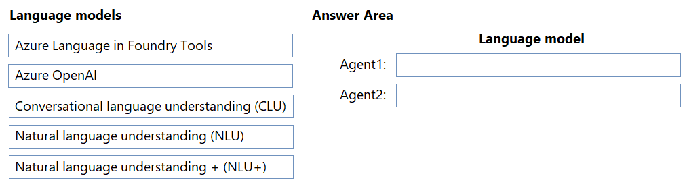

_DRAG DROP — the original ExamTopics question expects you to drag and drop items; the correct targets are not published._

**Most voted:**
- Agent1 → Conversational language understanding (CLU)
- Agent2 → Natural language understanding + (NLU+)

### Top explanations
- **Newb007** (14 upvotes [Highly Voted]): Agent 1 = NLU
  Agent 2 = NLU and NLU+
  https://learn.microsoft.com/en-us/microsoft-copilot-studio/nlu-overview
- **omath** (3 upvotes): Agent1 → Conversational language understanding (CLU)
  CLU is the lightweight, intent‑classification model used for short utterances and simple topic‑based interactions. It is the standard model for classic Copilot Studio bots.
  Agent2 → Natural language understanding + (NLU+)
  NLU+ is the only standard model designed for voice, telephony, and contact center scenarios. It supports barge‑in, speech patterns, and telephony‑grade intent recognition.
- **Luweho** (1 upvotes [Most Recent]): CLU requires a custom model, you're supposed to use a standard model
- **UAEFadi** (1 upvotes): Agree on Agent 2 = NLU+ (not NLU because it doesn't support dynamics)
  but i believe Agent1 = CLU  (because it meets requiremetns and NLU is legacy now.

## Q1.5 (ID 384053)

A company uses Microsoft Dynamics 365 finance and operations apps.
The company plans to use Microsoft Copilot in-app help and guidance to generate responses for internal business processes.
You need to add an additional knowledge source for the business processes. The solution must NOT add new topics to the Copilot agent for the finance and operations apps.
Which knowledge source should you add?

⭕ **A.** Microsoft Dataverse
⭕ **B.** a public website
⭕ **C.** Azure AI Search
✅ **D.** a file upload

**Correct answer:** D
**Most voted:** D

### Top explanations
- **Godfirst_E** (9 upvotes [Highly Voted, Selected Answer: D]): You can add knowledge to the Copilot help and guidance feature by uploading files to Copilot Studio (in file formats such as PDF, RTF, or Word). If you want to add other types of knowledge (such as from SharePoint or other data sources), then you must add your own topic in the Copilot for Finance and Operations apps agent in Copilot Studio. Reference article https://learn.microsoft.com/en-us/dynamics365/fin-ops-core/dev-itpro/copilot/extend-copilot-generative-help
- **madimad** (4 upvotes [Selected Answer: D]): The requirement says:
  Add an additional knowledge source
  Must NOT create new topics in the Copilot agent
  Used for Copilot in-app help and guidance in Dynamics 365 Finance and Operations
  In Microsoft Copilot, when you want to provide extra knowledge without building topics, the simplest approach is to add documents as knowledge sources.
  Uploading files allows Copilot to:
  Generate answers from internal business documentation
  Provide process guidance
  Avoid creating manual conversation topics
  Examples of files:
  Process documentation
  Internal manuals
  Training guides
  SOP documents
  This also minimizes configuration effort.
- **Newb007** (3 upvotes): Sorry It's D.  https://learn.microsoft.com/en-us/dynamics365/fin-ops-core/dev-itpro/copilot/extend-copilot-generative-help
- **Ninashnash** (2 upvotes [Selected Answer: D]): D. a file upload
  This is confirmed directly by Microsoft Learn: you can add knowledge to the Copilot help and guidance feature by uploading files to Copilot Studio (in file formats such as PDF, RTF, or Word). If you want to add other types of knowledge (such as from SharePoint or other data sources), then you must add your own topic in the Copilot for Finance and Operations apps agent in Copilot Studio.
- **omath** (2 upvotes [Selected Answer: C]): Correct answer: C. Azure AI Search
  To add an additional knowledge source for Microsoft Copilot in Dynamics 365 finance and operations apps without creating new topics, you must use a knowledge source that Copilot can index externally and retrieve from—not something that injects new conversational topics into the agent.
  Azure AI Search is the only option that:
  - Works as an external knowledge source
  - Supports retrieval‑augmented grounding for Copilot
  - Does not create new topics in the Copilot agent
  - Can index structured and unstructured business‑process documentation
  - Is the recommended method for extending in‑app help and guidance

## Q1.6 (ID 384380)

A company has an AI business solution.
You need to extend the solution so that Microsoft 365 Copilot can invoke external logic hosted in Azure services.
What should you include in the solution?

⭕ **A.** Microsoft Copilot Studio skills
✅ **B.** Microsoft Power Platform connectors
⭕ **C.** custom engine agents

**Correct answer:** B
**Most voted:** B

### Top explanations
- **madimad** (5 upvotes [Selected Answer: B]): To allow Microsoft 365 Copilot to invoke external logic hosted in Azure, you use skills created in Microsoft Copilot Studio.
  Copilot Studio skills allow:
  Calling external APIs
  Integrating Azure-hosted services
  Exposing business logic to Microsoft 365 Copilot
  Examples:
  Calling Azure Functions
  Accessing custom APIs
  Executing backend business workflows
  These skills act as extensions that Copilot can invoke when needed.
- **rveney** (4 upvotes [Selected Answer: B]): Power Platform connectors are the supported and required mechanism for exposing external services to Microsoft 365 Copilot.
  They can wrap:
  Azure Functions
  Logic Apps
  REST APIs
  Once exposed as a connector, Copilot can invoke the external logic securely and decoratively.
  These connectors are then consumable by:
  Microsoft 365 Copilot
  Copilot Studio skills
  Power Automate flows
- **Sathish_PP** (3 upvotes [Selected Answer: B]): I think option B to connect External
- **Xabia** (3 upvotes [Selected Answer: A]): Microsoft 365 Copilot cannot directly invoke connectors-> Connectors must be wrapped in a Copilot Studio skill to be callable by Copilot
- **K_in_the_Cloud** (3 upvotes [Selected Answer: A]): Skills (also called "actions" or "plugins") are the mechanism specifically designed to extend Microsoft 365 Copilot's capabilities by allowing it to call external APIs and Azure-hosted logic (Azure Functions, REST endpoints, Logic Apps). When you build a skill in Copilot Studio, it becomes directly discoverable and invocable by Microsoft 365 Copilot. This is the intended extensibility pattern for connecting M365 Copilot to external Azure services.

## Q1.7 (ID 384381)

HOTSPOT
You need to design a shared prompt library that will be used across multiple business units. The solution must meet the following requirements:
Ensure consistent AI responses with reusable formats.
Support governance and version control.
Minimize administrative effort.
Minimize ongoing costs.
What should you recommend for each requirement? To answer, select the appropriate options in the answer area.
NOTE: Each correct selection is worth one point.

**Exhibits**
- Exhibit 1: 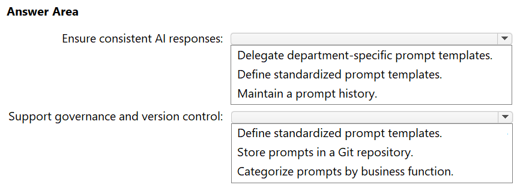

_HOTSPOT — the original ExamTopics question expects you to mark areas on the exhibit above; the correct hotspot coordinates are not published._

**Most voted:**
- Ensure consistent AI responses: → Define standardized prompt templates
- Support governance and version control: → Store prompts in a Git repository
- A Git repo provides: - Full version history

### Top explanations
- **Newb007** (11 upvotes [Highly Voted]): looks correct to me.
- **omath** (4 upvotes [Most Recent]): Ensure consistent AI responses:
  → Define standardized prompt templates
  Standardized templates give every business unit the same structure, tone, and expectations. This is the only option that guarantees consistent responses across teams.
  Support governance and version control:
  → Store prompts in a Git repository
  - A Git repo provides:
  - Full version history
  - Branching and approvals
  - Governance workflows
  - Minimal cost (often free with existing DevOps/GitHub)

## Q1.8 (ID 384382)

DRAG DROP
A company has a Microsoft Foundry project that uses a single agent and a single prompt to complete a series of tasks.
The agent encounters the following issues:
It frequently produces incomplete results.
It struggles with domain-specific reasoning.
Agent response times are remarkably slow.
You need to recommend a solution to improve the overall performance and accuracy of the agent.
What should you include in the recommendation? To answer, drag the appropriate actions to the correct requirements. Each action may be used once, more than once, or not at all. You may need to drag the split bar between panes or scroll to view content.
NOTE: Each correct selection is worth one point.

**Exhibits**
- Exhibit 1: 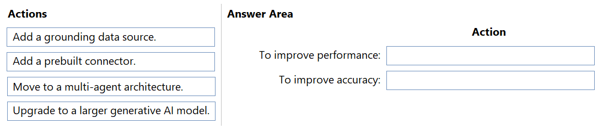

_DRAG DROP — the original ExamTopics question expects you to drag and drop items; the correct targets are not published._

**Most voted:**
- To improve performance: → Move to a multi-agent architecture
- To improve accuracy: → Add a grounding data source

### Top explanations
- **Newb007** (9 upvotes [Highly Voted]): looks correct to me
- **QueenShi** (4 upvotes): A single agent for a single prompt is the problem. No grounding data source for it to reference, and no methods for re-routing tasks it cannot perform, causing it to think for long periods of time. This answer looks correct to me too.
- **omath** (2 upvotes [Most Recent]): To improve performance:
  → Move to a multi-agent architecture
  ➡️ A multi-agent architecture distributes tasks across specialized agents.
  This reduces cognitive load on a single model and dramatically improves speed, task completion, and parallelization.
  To improve accuracy:
  → Add a grounding data source
  ➡️ Adding a grounding data source (Azure AI Search, SharePoint, Dataverse, etc.) gives the agent authoritative domain knowledge.
  This improves precision, reasoning, and completeness.

## Q1.9 (ID 384383)

A financial services company uses Microsoft Dynamics 365 Finance.
Currently, the company's support staff manually reviews customer transaction histories to detect potential fraud cases before escalating the cases.
You need to recommend an automation solution for the review process. The solution must ensure that escalations reach a human analyst for final decision making. What should you recommend?

⭕ **A.** Deploy an autonomous agent that closes non-fraud cases automatically.
⭕ **B.** Use Microsoft 365 Copilot in Word to automatically finalize fraud detection policies.
✅ **C.** Configure a task agent to generate fraud risk scores for the human analyst to review.
⭕ **D.** Export the data to a data lake for analysis in Microsoft Power BI.

**Correct answer:** C
**Most voted:** C

### Top explanations
- **omath** (2 upvotes [Selected Answer: C]): Correct answer:
  C. Configure a task agent to generate fraud risk scores for the human analyst to review.
  Explanation:
  The company needs automation, but not full autonomy. The requirement explicitly states:
  - Escalations must still reach a human analyst
  - The system should assist, not replace, human decision‑making
  - The process involves structured, repeatable analysis (transaction review → risk scoring → human review)
- **Newb007** (2 upvotes [Selected Answer: C]): C. Configure a task agent to generate fraud risk scores for the human analyst to review.
  This is the only option that fits all requirements: automation of the review process, but with human‑in‑the‑loop final decision making.
- **Srikantha** (1 upvotes [Most Recent, Selected Answer: C]): Why C is correct: The requirement specifies that escalations must ultimately reach a human analyst for final decision-making. A task agent streamlines the initial heavy lifting by analyzing transaction histories and generating structured risk scores. This automates the time-consuming review process while preserving a human-in-the-loop governance model for final fraud determinations.
- **Srikantha** (1 upvotes [Selected Answer: C]): A financial services company uses Microsoft Dynamics 365 Finance.
  Currently, the company's support staff manually reviews customer transaction histories to detect potential fraud cases before escalating the cases.
  You need to recommend an automation solution for the review process. The solution must ensure that escalations reach a human analyst for final decision making. What should you recommend?
  A. Deploy an autonomous agent that closes non-fraud cases automatically.
  B. Use Microsoft 365 Copilot in Word to automatically finalize fraud detection policies.
  C. Configure a task agent to generate fraud risk scores for the human analyst to review.
  D. Export the data to a data lake for analysis in Microsoft Power BI.

## Q1.10 (ID 384384)

A company plans to deploy a Microsoft Copilot Studio agent that will analyze historical business data to predict customer behavior.
The data is currently stored in an Azure SQL database, flat files, APIs, and logs.
You need to organize the data into a format that can be used as a knowledge source in Copilot Studio.
What should you include in the solution?

✅ **A.** Azure AI Search
⭕ **B.** Azure Data Lake Storage
⭕ **C.** Azure Cosmos DB
⭕ **D.** Azure Translator in Foundry Tools

**Correct answer:** A
**Most voted:** A

### Top explanations
- **24b8eec** (5 upvotes [Selected Answer: B]): Azure AI Search — This is a retrieval/indexing layer (and yes, it can be wired into Copilot Studio as a knowledge source), but it does not organize and consolidate raw data from heterogeneous sources.
- **Newb007** (5 upvotes [Selected Answer: A]): Azure AI Search is the correct choice.
  It’s the only option in the list that can index, chunk, and vectorize heterogeneous data (SQL tables, flat files, APIs, logs) into a searchable knowledge source that Copilot Studio can ground its responses on.
- **omath** (4 upvotes [Selected Answer: A]): Correct answer: A. Azure AI Search
  To make historical business data usable as a knowledge source in Microsoft Copilot Studio, the data must be indexed, chunked, and retrievable through a grounding mechanism.
  Among the options, Azure AI Search is the only service designed specifically for:
  - Indexing heterogeneous data sources (SQL, files, APIs, logs)
  - Converting them into a searchable knowledge index
  - Powering retrieval‑augmented generation (RAG) for Copilot Studio
  - Providing semantic search, vector search, and hybrid retrieval
  - Integrating natively as a knowledge source in Copilot Studio
- **sdnayak4** (2 upvotes [Selected Answer: A]): Azure AI Search is right
- **Srikantha** (1 upvotes [Most Recent, Selected Answer: A]): Why A is correct: When data is fragmented across multiple heterogeneous systems (such as an Azure SQL database, flat files, APIs, and logs), Azure AI Search serves as the central indexing and retrieval layer. It ingests data from these varied sources, indexes it, and formats it so that AI applications and Microsoft Copilot Studio agents can query and use it efficiently as a knowledge source. Copilot Studio also natively supports connecting to Azure AI Search as a primary enterprise knowledge source.

## Q1.11 (ID 384385)

A retail company plans to deploy Microsoft Copilot Studio agents to support:
Microsoft Dynamics 365 Commerce scenarios.
A Microsoft Power Apps inventory management solution.
You need to recommend a solution to organize product catalog data as a consistent source for multiple AI systems.
What should you recommend?

⭕ **A.** Let each agent scrape product details from Microsoft SharePoint Online libraries.
⭕ **B.** Store the product catalog data in a separate custom table for each agent.
⭕ **C.** Configure prompts to pull product details from the PDFs of external vendors.
✅ **D.** Centralize the product catalog data in Microsoft Dataverse and expose the data to both agents.

**Correct answer:** D
**Most voted:** D

### Top explanations
- **Newb007** (5 upvotes [Selected Answer: D]): Centralizing the catalog in Dataverse gives you a single source of truth that every Copilot Studio agent, Power Apps solution, and Dynamics 365 Commerce integration can reliably consume. This avoids duplication, drift, and inconsistent product attributes across systems.
- **omath** (4 upvotes [Selected Answer: D]): Correct answer: D. Centralize the product catalog data in Microsoft Dataverse and expose the data to both agents.
  You need one consistent product catalog that can be used by:
  - A Dynamics 365 Commerce Copilot Studio agent
  - A Power Apps inventory management Copilot Studio agent
  The only option that provides:
  - A single source of truth
  - Structured, governed, relational data
  - Native integration with both Dynamics 365 and Power Platform
  - Reusable knowledge across multiple AI systems
  - Low administrative overhead
  …is Microsoft Dataverse.
  Dataverse is the enterprise data backbone for Dynamics 365 and Power Apps, making it the natural place to centralize product catalog data.
- **AvneeshSharma** (2 upvotes [Most Recent, Selected Answer: D]): Microsoft Dataverse is designed to act as a single source of truth (SSOT) for business data across Power Platform, Dynamics 365 applications, and Copilot Studio agents. Both agents can access the same product catalog data, ensuring consistency and reducing maintenance.

## Q1.12 (ID 384386)

A company has a portfolio of AI initiatives at different stages of development.
You need to recommend a structured approach to evaluating the return on AI investment (ROAI) across all the initiatives. The solution must balance immediate results with long-term values and strategic innovations.
What should you include in the recommendation?

⭕ **A.** a simple cost and benefit analysis
✅ **B.** a horizon-based framework
⭕ **C.** the internal rate of return (IRR) function
⭕ **D.** a prioritization grid

**Correct answer:** B
**Most voted:** B

### Top explanations
- **Newb007** (6 upvotes [Selected Answer: B]): NOT 100% on this but I think it's B.
  B. a horizon-based framework.
  A horizon-based model (often Horizon 1–2–3) is designed specifically for evaluating short‑term ROI, mid‑term capability building, and long‑term strategic innovation in a single, coherent structure. It lets an organization compare AI initiatives that are at very different maturity levels without forcing them into the same ROI formula.
- **Srikantha** (2 upvotes [Most Recent, Selected Answer: B]): Why B is correct: A horizon-based framework (such as Horizon 1, 2, and 3) is specifically designed for evaluating portfolios of initiatives across different stages of maturity and development. It allows organizations to balance immediate, short-term operational savings (Horizon 1) with mid-term scalable growth (Horizon 2) and long-term transformational or strategic innovations (Horizon 3) without prematurely penalizing exploratory AI projects that don't yield immediate financial returns.
- **omath** (1 upvotes [Selected Answer: B]): The correct answer is: B. a horizon‑based framework
  When a company has multiple AI initiatives at different maturity levels, you need a framework that:
  - Evaluates short‑term ROI
  - Captures long‑term strategic value
  - Encourages innovation without ignoring immediate business impact
  - Provides a structured, portfolio‑level view
  A horizon‑based framework (Horizon 1 / Horizon 2 / Horizon 3) is specifically designed for this.
- **deca0d4** (1 upvotes [Selected Answer: B]): I think its the horizon-based framework...
  Horizon-based framework = strategy timing.
  Use it to group AI investments by maturity
  Use horizon framework for roadmap strategy, IRR for financial justification, and prioritization grid for selecting and sequencing use cases.

## Q1.13 (ID 384387)

You need to recommend a Microsoft Power Platform business solution that consolidates data from multiple internal and external data sources. The solution must meet the following requirements:
Provide the data as a centralized source for multiple AI systems, including Microsoft Copilot Studio agents, Dynamics 365 applications, and external AI models.
Support built-in data classification and protection policies.
Provide data for grounding and analytics.
What should you include in the recommendation?

✅ **A.** Microsoft Dataverse
⭕ **B.** Azure Data Lake Storage
⭕ **C.** a Microsoft Power BI semantic model
⭕ **D.** Azure Cosmos DB

**Correct answer:** A
**Most voted:** A

### Top explanations
- **Newb007** (4 upvotes [Selected Answer: A]): About 90% on this one...
  It is the only option in the list that natively provides centralized, governed, AI‑ready enterprise data with built‑in classification(With Purview Data Map), DLP, security, and integration across Copilot Studio, Dynamics 365, and external AI models.
- **24b8eec** (3 upvotes [Most Recent, Selected Answer: A]): Why not the others:
  B. Azure Data Lake Storage — Great for consolidating raw, large-scale historical data and analytics, but it lacks built-in data classification, security roles, and protection policies, and it isn't a native, governed knowledge source for Copilot Studio + Dynamics 365 the way Dataverse is.
  C. Power BI semantic model — An analytics/reporting layer, not a centralized operational data store that serves Dynamics 365 and external AI models for grounding.
  D. Azure Cosmos DB — A low-latency NoSQL operational database; no built-in data classification/protection governance and not a native Power Platform/Copilot knowledge source.
- **omath** (3 upvotes [Selected Answer: A]): The correct recommendation is: A. Microsoft Dataverse
  🎯 Why Dataverse is the right choice
  You need a centralized, governed, secure data platform that can:
  - Consolidate internal + external data sources
  - Serve as a single source of truth for multiple AI systems
  - Provide built‑in data classification, DLP, and security
  - Support grounding for Copilot Studio, Dynamics 365, and external AI models
  - Enable analytics across the organization
  Only Microsoft Dataverse satisfies all of these requirements.

## Q1.14 (ID 384388)

A company plans to deploy an AI-based customer service app that will autonomously manage interactions, escalate complex cases, and learn from historical ticket data.
You need to perform a return on AI investment (ROAI) analysis of the app deployment. The solution must ensure that the analysis is accurate.
What should you do first?

⭕ **A.** Establish the AI performance metrics.
⭕ **B.** Conduct an AI market benchmarking study.
⭕ **C.** Model the customer experience.
✅ **D.** Identify and quantify all the development, deployment, and operating costs.

**Correct answer:** D
**Most voted:** D

### Top explanations
- **Newb007** (5 upvotes [Selected Answer: D]): https://learn.microsoft.com/en-us/training/modules/forecast-agent-return-investment/2-forecast-return-investment
- **omath** (3 upvotes [Selected Answer: D]): The correct first step is: D. Identify and quantify all the development, deployment, and operating costs.
  A Return on AI Investment (ROAI) analysis must begin with a baseline financial understanding.
  Before you can measure value, performance, or customer impact, you must know:
  - What the AI solution will cost to build
  - What it will cost to run
  - What it will cost to maintain
  - What existing processes cost today
  Without this foundation, any ROI calculation would be incomplete or misleading.
- **sondrex** (2 upvotes [Selected Answer: A]): What should you do first? → Define goals, metrics and baseline.
  How to calculate total investment? → Identify and quantify TCO.
  How to calculate ROAI? → Compare measured or forecast benefits against TCO.
- **Wonderama** (1 upvotes [Most Recent, Selected Answer: D]): First calculate the costs.  Then, calculate the value of the benefits. Finally, calculate the ROI.
- **bridge_b** (1 upvotes): Great contributions omath, have you done the exam yet?

## Q1.15 (ID 406222)

DRAG DROP
You are designing end-to-end test scenarios for a business solution that uses Microsoft Dynamics 365 Sales and Dynamics 365 Finance.
You need to ensure that the business solution meets the following test requirements:
•	Properly exchanges data between the Dynamics 365 apps
•	Aligns with defined user workflows and business processes
Which type of testing should you use for each requirement? To answer, drag the appropriate testing types to the correct requirements. Each testing type may be used once, more than once, or not at all. You may need to drag the split bar between panes or scroll to view content.
NOTE: Each correct selection is worth one point.

**Exhibits**
- Exhibit 1: 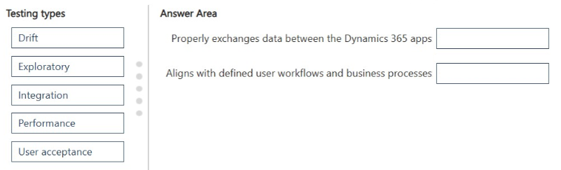

_DRAG DROP — the original ExamTopics question expects you to drag and drop items; the correct targets are not published._

**Most voted:**
- → Integration testing
- Integration testing validates that data flows correctly between systems—in this case, Dynamics 365 Sales and Dynamics 365 Finance. It ensures APIs, plugins, dual‑write, and synchronization behave as expected.
- → User acceptance testing (UAT)

### Top explanations
- **omath** (5 upvotes [Most Recent]): → Integration testing
  Integration testing validates that data flows correctly between systems—in this case, Dynamics 365 Sales and Dynamics 365 Finance. It ensures APIs, plugins, dual‑write, and synchronization behave as expected.
  → User acceptance testing (UAT)
  User acceptance testing ensures the solution matches real‑world business workflows, user expectations, and process requirements. It is the final validation before production.
- **deca0d4** (1 upvotes): Ensure proper exchanges data between Dynamics 365 apps
  👉 Integration testing
  🧠 Why?
  Because you are validating:
  Data exchange
  Interfaces
  Connectivity
  Synchronization between systems
  Align with defined workflows and business processes
  👉 User Acceptance Testing (UAT)
  Because UAT validates:
  Real business workflows
  End-user expectations
  Business process correctness

## Q1.16 (ID 406223)

A company has a Microsoft 365 tenant in Canada and multiple Microsoft Power Platform environments in Canada and the United States.
The company plans to deploy a Microsoft Copilot Studio agent to the Canadian environment that will use:
•	Microsoft Dataverse data stored in Canada
•	A connector that connects to an Azure OpenAI instance in the United States
You need to ensure that the agent adheres to data residency and data movement policies before being deployed.
What should you do?

⭕ **A.** Ensure that the data processed by Azure OpenAI is stored in the United States.
⭕ **B.** From the Microsoft Purview portal, validate the Data loss prevention settings.
⭕ **C.** Migrate the tenant to the United States.
✅ **D.** Ensure that cross-region data movement is enabled for the Canadian environment and connector dependencies.

**Correct answer:** D
**Most voted:** D

### Top explanations
- **omath** (3 upvotes [Most Recent, Selected Answer: D]): Correct answer: D. Ensure that cross‑region data movement is enabled for the Canadian environment and connector dependencies.
  Your Copilot Studio agent will run in Canada, but one of its dependencies—the Azure OpenAI connector—is located in the United States.
  This means the agent will send data across regions, which triggers Microsoft’s data residency and data movement policies.
  Before deploying the agent, you must explicitly enable cross‑region data movement for:
  - The Canadian Copilot Studio environment
  - The connector that calls Azure OpenAI in the U.S.
  This is the only option that ensures the solution is compliant before deployment.
- **deca0d4** (1 upvotes [Selected Answer: D]): You must review/configure the environment’s data movement settings and DLP/data policies before deployment, and ensure the connector path from Canadian Dataverse to US Azure OpenAI is explicitly permitted. If not permitted, use an in-region Azure OpenAI endpoint or redesign.

## Q1.17 (ID 406224)

HOTSPOT
A company has a Microsoft Copilot Studio agent for customer support.
You are reviewing and validating the following prompts:
•	A prompt that has instructions to "help the customer as best you can"
•	A prompt that helps retrieve product information from a knowledge base
You need to ensure that the agent delivers consistent and accurate responses.
What should you do for each prompt? To answer, select the appropriate options in the answer area.
NOTE: Each correct selection is worth one point.

**Exhibits**
- Exhibit 1: 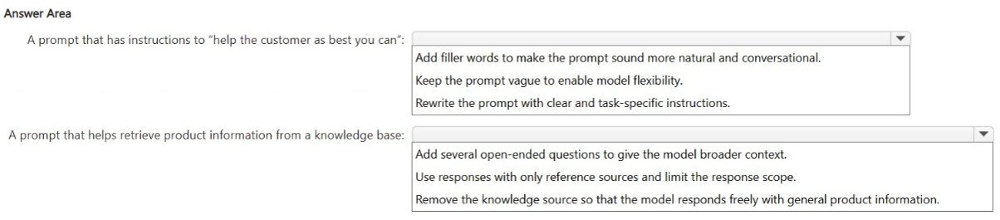

_HOTSPOT — the original ExamTopics question expects you to mark areas on the exhibit above; the correct hotspot coordinates are not published._

**Most voted:**
- Prompt: “help the customer as best you can”
- Prompt: Retrieve product information from a knowledge base
- When grounding to a knowledge base, the model must: - Stay within the retrieved content

### Top explanations
- **omath** (8 upvotes [Most Recent, Highly Voted]): Prompt: “help the customer as best you can”
  → Rewrite the prompt with clear and task‑specific instructions.
  A vague instruction like “help the customer as best you can” leads to inconsistent, unpredictable model behavior.
  Clear, scoped, task‑specific instructions produce repeatable, controlled, and aligned responses
  Prompt: Retrieve product information from a knowledge base
  → Use responses with only reference sources and limit the response scope.
  - When grounding to a knowledge base, the model must:
  - Stay within the retrieved content
  - Avoid hallucinating
  - Cite or reference the source
  - Limit the scope to the product information retrieved

## Q1.18 (ID 406225)

HOTSPOT
You are designing a testing solution for Microsoft Copilot Studio agents.
You need to validate prompt engineering best practices to ensure that the agents generate accurate and contextually relevant responses.
Which prompt validation techniques and metrics should you include in the solution? To answer, select the appropriate options in the answer area.
NOTE: Each correct selection is worth one point.

**Exhibits**
- Exhibit 1: 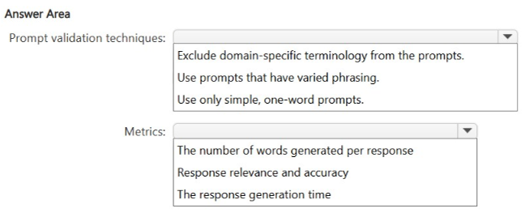

_HOTSPOT — the original ExamTopics question expects you to mark areas on the exhibit above; the correct hotspot coordinates are not published._

**Most voted:**
- Prompt validation techniques: → Use prompts that have varied phrasing
- Metrics: → Response relevance and accuracy

### Top explanations
- **omath** (7 upvotes [Most Recent, Highly Voted]): Prompt validation techniques:
  → Use prompts that have varied phrasing
  This is the correct technique because varied phrasing helps you test whether the agent responds consistently even when users express the same intent in different ways.
  It validates robustness, generalization, and prompt stability.
  Metrics:
  → Response relevance and accuracy
  This is the key metric for evaluating whether the agent is producing correct, contextually grounded, and useful responses.
  It directly measures the success of prompt engineering.

## Q1.19 (ID 406226)

A company has two Microsoft Power Platform environments named Dev1 and Prod1. A Microsoft Copilot Studio agent named Agent1 is built into a solution in the Dev1 environment.
You plan to deploy Agent1 to Prod1.
You need to make Agent1 available to the users in Prod1. The solution must minimize administrative effort.
What should you do?

⭕ **A.** Share Agent1 with the users in Prod1.
⭕ **B.** Export the solution as an unmanaged solution and import the solution into Prod1.
✅ **C.** Export the solution as a managed solution and import the solution into Prod1.
⭕ **D.** Create a new Copilot Studio agent in Prod1 by replicating the configuration of Agent1.

**Correct answer:** C
**Most voted:** C

### Top explanations
- **omath** (5 upvotes [Most Recent, Selected Answer: C]): The correct answer is: C. Export the solution as a managed solution and import the solution into Prod1.
  To move a Copilot Studio agent (or any Power Platform component) from Dev to Prod, the recommended and lowest‑effort approach is:
  - Package the agent inside a managed solution
  - Import that managed solution into Prod1
  This ensures:
  - Proper ALM (Application Lifecycle Management)
  - Controlled, locked‑down components in production
  - Easy updates through solution versioning
  - Minimal administrative overhead
  - No need to manually recreate or re‑share anything
  This is exactly how Microsoft expects Copilot Studio agents to be deployed across environments.
- **deca0d4** (1 upvotes [Selected Answer: C]): Microsoft’s ALM guidance says unmanaged solutions are used in development, while managed solutions are imported into downstream environments like test and production.

## Q1.20 (ID 406227)

A company has a Microsoft Power Platform environment that contains Microsoft Dataverse data.
You create a Microsoft Copilot Studio agent named Agent1 that processes the Dataverse data.
You discover that Agent1 fails to return relevant or accurate results.
You need to improve the quality and reliability of data grounding.
What should you do?

⭕ **A.** Retrain Agent1.
✅ **B.** Verify and cleanse the Dataverse data.
⭕ **C.** Use an adaptive card in Agent1.
⭕ **D.** Add example user inputs to the training data of Agent1.

**Correct answer:** B
**Most voted:** B

### Top explanations
- **omath** (6 upvotes [Most Recent, Selected Answer: B]): The right first step is B. Verify and cleanse the Dataverse data.
  When a Copilot Studio agent returns irrelevant or inaccurate results, the most common root cause is poor grounding data quality.
  Grounding only works if the underlying Dataverse tables contain:
  - Clean
  - Complete
  - Accurate
  - Well‑structured
  information.
  If the data is inconsistent, outdated, duplicated, or missing key fields, the agent will hallucinate or produce unreliable answers—even if the prompts and model are correct.
  So before retraining, rewriting prompts, or adding examples, you must fix the data.

## Q1.22 (ID 406229)

A manufacturing company wants to deploy an agent that will automate supplier invoice processing.
You are designing a solution to evaluate the financial implications of the deployment. The company is especially concerned about budget overruns.
You need to ensure that the solution considers the total cost of ownership (TCO), the expected savings from using automation, and whether to extend the existing AI capabilities.
What should you include in the design?

⭕ **A.** a break-even analysis only
⭕ **B.** adopting prebuilt agents to reduce the deployment time
⭕ **C.** training a custom model
✅ **D.** a return on AI investment (ROAI) analysis

**Correct answer:** D
**Most voted:** D

### Top explanations
- **omath** (5 upvotes [Most Recent, Selected Answer: D]): The correct answer is: D. a return on AI investment (ROAI) analysis
  The company wants to evaluate:
  - Total cost of ownership (TCO)
  - Expected savings from automation
  - Whether extending AI capabilities is financially justified
  - Risk of budget overruns
  A return on AI investment (ROAI) analysis is the only framework that covers all of these dimensions.
- **kinser123** (1 upvotes [Selected Answer: D]): D. a return on AI investment (ROAI) analysis
  - Total cost of ownership (TCO)

## Q1.23 (ID 406230)

A company has a Microsoft Power Platform solution that contains the following components:
•	Microsoft Dataverse tables
•	A Microsoft Power BI workspace named WS1
•	A canvas app named App1 that uses Dataverse
•	A Power BI semantic model that connects to Dataverse by using DirectQuery
You plan to use generative AI to provide answers to queries based on a subset of corporate data.
You need to ensure that the data is available as a grounding data source for AI systems.
What should you do?

✅ **A.** Populate a Dataverse table.
⭕ **B.** Share WS1.
⭕ **C.** Endorse the semantic model.
⭕ **D.** Export the semantic model.

**Correct answer:** A
**Most voted:** A

### Top explanations
- **Shufflee** (3 upvotes [Selected Answer: A]): The correct option is A. Populate a Dataverse table.
  Why This Option Is Correct
  • Native Grounding Source: Microsoft Dataverse acts as the native grounding data source for generative AI features across the Microsoft Power Platform (including Copilot Studio, canvas apps, and model-driven apps).
  • Data Availability: Loading or populating the relevant subset of corporate data directly into a Dataverse table ensures that AI systems can retrieve and ground their responses against it, while respecting Dataverse security and access roles.
- **moongang** (3 upvotes [Selected Answer: A]): Dataverse is the native grounding data source for Copilot and other generative AI features in Power Platform (Copilot Studio knowledge sources, Copilot in model-driven and canvas apps, AI Builder prompts). Loading the relevant subset of corporate data into a Dataverse table makes it directly available for retrieval and grounding, with Dataverse security roles controlling what the AI can see.
  Why the others don’t fit:
  Share WS1 only grants users access to the workspace; it doesn’t expose the data to AI systems as a grounding source.
  Endorse the semantic model (promote/certify) signals quality and trust for reuse in Power BI, but endorsement by itself doesn’t make the data a grounding source for the Power Platform AI scenario described.
  Export the semantic model moves the data out of the platform entirely, which is the opposite of what you want.
- **omath** (3 upvotes [Selected Answer: A]): The correct answer is: A. Populate a Dataverse table.
  To make data available as a grounding data source for generative AI systems (including Copilot Studio, Microsoft 365 Copilot, and other AI experiences), the data must live in a supported grounding store.
  From the options provided, the only store that AI systems can directly ground on is:
  Microsoft Dataverse
  The scenario already includes Dataverse, so the correct action is to populate a Dataverse table with the subset of corporate data you want to expose to AI.
- **deca0d4** (3 upvotes [Selected Answer: C]): To endorse a semantic model means marking it as a trusted, high-quality, reusable data source in Power BI/Fabric.
- **hi1011** (3 upvotes [Selected Answer: C]): "Consider using tags to label semantic models as ready for Copilot consumption. This method helps data consumers identify models that they can use with Copilot and expect better results. Alternatively, consider the readiness of a semantic model for use with Copilot as a criteria for its endorsement to promoted or even certified status."
  https://learn.microsoft.com/en-us/power-bi/create-reports/copilot-semantic-models

## Q1.24 (ID 406231)

DRAG DROP
A company plans to implement an AI business solution for a consumer goods company.
You need to create agents that meet the following requirements:
•	Orchestrate the sales order fulfillment and shipping of goods to customers.
•	Analyze historical data and trends to replenish stock.
Which type of agent should you use for each requirement? To answer, drag the appropriate agent types to the correct requirements. Each agent type may be used once, more than once, or not at all. You may need to drag the split bar between panes or scroll to view content.
NOTE: Each correct selection is worth one point.

**Exhibits**
- Exhibit 1: 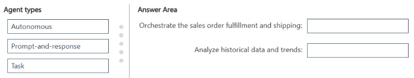

_DRAG DROP — the original ExamTopics question expects you to drag and drop items; the correct targets are not published._

**Most voted:**
- Orchestrate the sales order fulfillment and shipping
- → Autonomous agent
- This scenario requires an agent that can coordinate multi‑step workflows, make decisions, trigger actions across systems, and manage an end‑to‑end operational process.
- That is exactly what an autonomous agent is designed for.
- Analyze historical data and trends to replenish stock

### Top explanations
- **omath** (18 upvotes [Highly Voted]): Orchestrate the sales order fulfillment and shipping
  → Autonomous agent
  This scenario requires an agent that can coordinate multi‑step workflows, make decisions, trigger actions across systems, and manage an end‑to‑end operational process.
  That is exactly what an autonomous agent is designed for.
  Analyze historical data and trends to replenish stock
  → Task agent
  Task agents are built for bounded, well‑defined analytical or computational tasks, not ongoing orchestration.
- **Alicia_lili** (7 upvotes [Highly Voted]): Orchestrate the sales order fulfillment and shipping:
  Autonomous
  Analyze historical data and trends:
  Prompt-and-response
- **a5f05ea** (5 upvotes): Sales order fulfillment and shipping: Autonomous
  Historical data and trend analysis for stock replenishment: Task
- **93c84b0** (5 upvotes): Orchestrate the sales order fulfillment and shipping of goods to customers	✅ Autonomous
  Analyze historical data and trends to replenish stock	✅ Task
- **Joydeb.Das** (4 upvotes [Most Recent]): Sales order fulfillment & shipping → Autonomous
  Historical data & trends → Task

## Q1.25 (ID 406232)

A company has an AI agent that automates the review of customer feedback stored in a cloud database.
You plan to generate monthly reports from the agent's output to provide insights into customer sentiment and guide product development and marketing.
You need to ensure that the data ingested by the agent is clean and suitable for the intended use.
What should you do to prepare the data?

⭕ **A.** Create a workflow in Microsoft Power Automate.
✅ **B.** Identify and address biased data.
⭕ **C.** Create an agent flow in Microsoft Copilot Studio.
⭕ **D.** Sort the database by customer last name.

**Correct answer:** B
**Most voted:** B

### Top explanations
- **omath** (5 upvotes [Most Recent, Selected Answer: B]): The correct answer is B. Identify and address biased data.
  Before generating monthly sentiment reports, the company must ensure that the customer feedback data is clean, representative, and free of bias. This is a core requirement in responsible AI and data preparation.
  This step is explicitly emphasized in Microsoft’s AI readiness and data preparation guidance.
- **KathCha** (3 upvotes [Selected Answer: B]): I would go with B.
- **kinser123** (1 upvotes [Selected Answer: B]): I would go with B. - free of bias is first
- **Alicia_lili** (1 upvotes [Selected Answer: B]): It is B.

## Q1.26 (ID 406233)

A company is designing a Microsoft Power Platform solution to reduce the manual steps of a business process by deploying an existing AI model.
You need to calculate the return on AI investment (ROAI) by identifying the metadata and telemetry of the solution.
What should you use?

⭕ **A.** Microsoft Power Platform admin center
⭕ **B.** Success by Design
✅ **C.** the Business value toolkit
⭕ **D.** Microsoft Cloud Adoption Framework for Azure

**Correct answer:** C
**Most voted:** C

### Top explanations
- **wrak** (6 upvotes [Selected Answer: A]): The Power Platform CoE Starter Kit is no longer actively maintained. Its core capabilities are part of the Power Platform admin center.
- **omath** (5 upvotes [Selected Answer: C]): The correct answer is: C. the Business value toolkit
  The Business value toolkit is the only Microsoft tool designed specifically to:
  - Capture telemetry and metadata from Power Platform solutions
  - Model ROI and ROAI
  - Estimate TCO
  - Quantify expected savings
  - Support build vs buy vs extend decisions
  - Provide financial modeling templates for AI adoption
- **hi1011** (4 upvotes [Selected Answer: C]): "The Business value toolkit is a collection of sample apps and processes designed to address these challenges. It provides a comprehensive framework to capture and communicate the value of Power Platform solutions effectively."
  https://learn.microsoft.com/en-us/power-platform/guidance/coe/business-value-toolkit
- **slimexy** (1 upvotes [Most Recent, Selected Answer: A]): The Power Platform CoE Starter Kit is no longer actively maintained. Its core capabilities are part of the Power Platform admin center.
  https://learn.microsoft.com/en-us/power-platform/guidance/coe/business-value-toolkit
- **fa62dd5** (1 upvotes [Selected Answer: C]): The Business value toolkit
  The Business Value Toolkit is Microsoft's tool for calculating ROI (including return on AI investment) for Power Platform solutions by capturing solution metadata and telemetry. The admin center manages environments/governance, Success by Design is an architecture methodology, and the Cloud Adoption Framework applies to Azure, not Power Platform ROI calculation.

## Q1.27 (ID 406234)

HOTSPOT
A company has a Microsoft Power Platform environment.
You need to build two agents named Agent1 and Agent2. The solution must meet the following requirements:
•	Agent1 must be extendable by using the Semantic Kernel and must connect to multiple business apps and APIs.
•	Agent2 must connect directly to data stored in Microsoft Dataverse and must be embeddable in a Microsoft Power Apps canvas app.
What should you use to build each agent? To answer, select the appropriate options in the answer area.
NOTE: Each correct selection is worth one point.

**Exhibits**
- Exhibit 1: 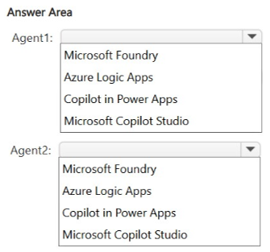

_HOTSPOT — the original ExamTopics question expects you to mark areas on the exhibit above; the correct hotspot coordinates are not published._

**Most voted:**
- Should be Agent1 → MS Foundry
- Agent 2 → Micorosoft Copilot Studio

### Top explanations
- **2db2984** (15 upvotes [Highly Voted]): Should be Agent1 -> MS Foundry
  Agent 2 -> Micorosoft Copilot Studio (enables building agents that natively connect to Dataverse and can be embedded into Power Apps.)
- **hi1011** (11 upvotes [Highly Voted]): Agent 1 -> MS Foundry
  Agent 2 -> Copilot in Power Apps
  https://learn.microsoft.com/en-us/power-apps/maker/canvas-apps/microsoft-365-copilot-canvas-app
- **NaiveDynamicsUser** (7 upvotes [Highly Voted]): Agent1 → Microsoft Foundry
  Agent2 → Copilot in Power Apps
- **Joselito79** (5 upvotes): Explanation
  Agent1 → Microsoft Foundry: Provides capabilities for building and extending AI agents, including integration with Semantic Kernel and connections to business applications and APIs.
  Agent2 → Copilot in Power Apps: Designed to work directly with Dataverse and can be embedded within Power Apps canvas apps.
- **ziggy1117** (5 upvotes): Agent 2 - copilot studio is right answer.
  Copilot in Power Apps is wrong.
  Copilot in Power Apps lets you quickly build apps using natural language. Describe your business needs, and the service generates an app and data model for you—no coding required. People interact with your app by asking questions or giving commands in everyday language, making the experience more intuitive and engaging.
  https://learn.microsoft.com/en-us/power-apps/maker/canvas-apps/ai-overview

## Q1.28 (ID 406235)

A company has an Azure environment that supports multiple business units.
The company plans to implement an AI solution that will perform sentiment analysis on customer product reviews.
You need to evaluate the potential cost of the solution to support return on AI investment (ROAI) analysis.
What should you use?

⭕ **A.** Cost Management + Billing
⭕ **B.** Microsoft Fabric SKU Estimator
✅ **C.** Total Cost of Ownership (TCO) Calculator
⭕ **D.** Azure Reservations

**Correct answer:** C
**Most voted:** C

### Top explanations
- **omath** (5 upvotes [Selected Answer: A]): ✅ Correct Answer: A. Cost Management + Billing
  To evaluate the potential cost of an AI solution running in Azure — especially for ROAI (Return on AI Investment) — you need visibility into:
  - Current Azure resource consumption
  - Forecasted costs
  - Cost trends
  - Service‑level spending
  - Budget alerts
  - Cost allocation by business unit
  Cost Management + Billing is the Azure-native tool that provides exactly this.
- **fa62dd5** (4 upvotes [Selected Answer: C]): C. Total Cost of Ownership (TCO) Calculator
  The TCO Calculator is designed to estimate the potential/projected cost of a planned solution before deployment — exactly what's needed to feed a ROAI analysis. Cost Management + Billing tracks actual costs of resources already running, the Fabric SKU Estimator is specific to Fabric capacity SKUs (not general Azure AI costs), and Azure Reservations is a discount-purchasing mechanism, not a cost-evaluation tool.
- **wrak** (3 upvotes [Selected Answer: C]): Question is asking for "potential cost", so C
- **Joydeb.Das** (2 upvotes [Selected Answer: A]): Cost Management + Billing should be correct answer since Azure pricing calculator is not given in the options.
- **Joselito79** (2 upvotes [Selected Answer: A]): The correct answer is always Azure pricing calculator when it's listed (it estimates the cost of a future Azure solution for ROAI); when it isn't listed, the intended answer is Cost Management + Billing.

## Q1.29 (ID 406236)

HOTSPOT
You need to recommend a Microsoft Power Platform solution for customer support. The solution must include AI capabilities in Microsoft Power Automate and must meet the following requirements:
•	Use a centralized workspace for AI models.
•	Generate short overviews from large amounts of unstructured text, such as case notes or transcripts, without requiring additional training or coding.
What should you include in the recommendation for each requirement? To answer, select the appropriate options in the answer area.
NOTE: Each correct selection is worth one point.

**Exhibits**
- Exhibit 1: 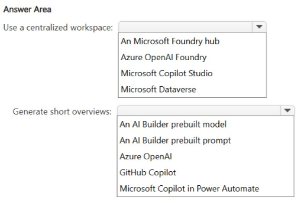

_HOTSPOT — the original ExamTopics question expects you to mark areas on the exhibit above; the correct hotspot coordinates are not published._

**Most voted:**
- Centralized workspace: Azure OpenAI Foundry
- Generate short overviews: An AI Builder prebuilt prompt

### Top explanations
- **Alicia_lili** (11 upvotes [Highly Voted]): Centralized workspace: Azure OpenAI Foundry
  Generate short overviews: An AI Builder prebuilt prompt
- **TheMCT** (8 upvotes [Highly Voted]): Centralized workspace: An Microsoft Foundry hub
  Short overviews: An AI Builder prebuilt prompt
- **Xabia** (5 upvotes): Azure AI Foundry
  AI Builder prebuilt prompt
- **Srikantha** (4 upvotes): The correct selections for each requirement are:
  Use a centralized workspace: An Microsoft Foundry hub
  Generate short overviews: An AI Builder prebuilt prompt
- **omath** (4 upvotes): ✔ Use a centralized workspace → Microsoft Dataverse
  In Power Platform, the AI Hub is built on Dataverse and acts as the centralized workspace for:
  - Managing AI models
  - Managing AI Builder models
  - Managing prompts
  - Managing AI assets used in Power Automate and Power Apps
  Neither Foundry option is part of Power Platform, and Copilot Studio is for agents, not centralized AI model management.
  ✔ Generate short overviews → AI Builder prebuilt prompt
  The requirement is:
  - Generate short overviews
  - From large unstructured text (case notes, transcripts)
  - Without training
  - Without coding
  This is exactly what AI Builder prebuilt prompts are designed for.

## Q1.30 (ID 406237)

HOTSPOT
A company uses Microsoft Dynamics 365 Finance for accounts payable and customer debt recovery.
You are designing an AI finance process that meets the following requirements:
•	Provides AI-driven details to help staff identify overdue vendor invoices and outstanding balances
•	Helps staff reduce how long it takes to review overdue invoices and payment history
You need to recommend which Microsoft Copilot features to include in the design.
What should you recommend for each requirement? To answer, select the appropriate options in the answer area.
NOTE: Each correct selection is worth one point.

**Exhibits**
- Exhibit 1: 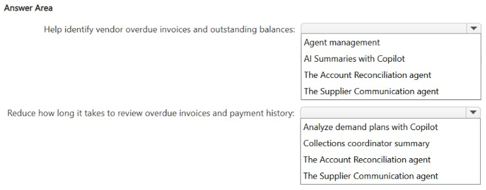

_HOTSPOT — the original ExamTopics question expects you to mark areas on the exhibit above; the correct hotspot coordinates are not published._

**Most voted:**
- Help Id Vendor Overdue: B (AI Summaries with Copilot)
- Reduce how long it takes sales: B

### Top explanations
- **hi1011** (15 upvotes [Highly Voted]): Help Id Vendor Overdue: B (AI Summaries with Copilot)
  https://learn.microsoft.com/en-us/dynamics365/supply-chain/get-started/copilot-summaries-overview
  Reduce how long it takes sales: B (collections coordinator summary)
  https://learn.microsoft.com/en-us/dynamics365/finance/accounts-receivable/collectionscoordinatorsummary
- **omath** (6 upvotes): 1. Help identify vendor overdue invoices and outstanding balances
  → The Supplier Communication agent
  This agent is designed for vendor-facing processes in Dynamics 365 Finance.
  - Identify overdue vendor invoices
  - Track outstanding balances
  - Communicate with suppliers
  - Automate follow-ups
  2. Reduce how long it takes to review overdue invoices and payment history
  → Collections coordinator summary
  The Collections Coordinator Copilot feature provides:
  - AI‑generated summaries of customer payment history
  - Overdue invoice insights
  - Quick review of aging and collection status
  - Faster decision‑making for debt recovery
- **Joselito79** (4 upvotes [Most Recent]): Vendor/AP information → AI Summaries with Copilot
  Customer debt/collections + payment history → Collections coordinator summary
  So your selections are:
  1️⃣ AI Summaries with Copilot
  2️⃣ Collections coordinator summary
- **297bbbc** (4 upvotes): Help identify vendor overdue invoices and outstanding balances: The Supplier Communication agent
  Why: In accounts payable scenarios, the Supplier Communication agent in Dynamics 365 Finance helps AP staff surface and act on vendor-related issues (e.g., overdue invoices, balances) and streamlines communications with suppliers.
  Reduce how long it takes to review overdue invoices and payment history: Collections coordinator summary
  Why: For customer debt recovery (accounts receivable), the Collections coordinator summary provides AI‑generated overviews of a customer’s overdue balances, payment history, and recommended actions, cutting review time.
- **Srikantha** (2 upvotes): Based on the capabilities of Microsoft Dynamics 365 Finance and Copilot features, here are the correct selections for the requirements
  Help identify vendor overdue invoices and outstanding balances: AI Summaries with Copilot
  Reasoning: AI summaries with Copilot provide quick, personalized overviews on key pages, including specific details like the number of overdue invoices and outstanding balances for a vendor.
  Reduce how long it takes to review overdue invoices and payment history: Collections coordinator summary
  Reasoning: The Collections coordinator summary is designed specifically for customer debt recovery. It displays AI-generated text in the Collections coordinator workspace to help users quickly review customer payment history and overdue invoice statuses.

## Q1.31 (ID 406238)

Overview
Contoso, Ltd. is a high-tech manufacturing company that uses Microsoft Dynamics 365 Finance. Dynamics 365 Supply Chain Management, and Dynamics 365 Commerce for its North American operations. The company designs and develops innovative products that have many patents and proprietary technologies. The patents and engineering designs are closely guarded secrets.
Contoso executives want to integrate and adopt AI solutions to help scale the company in preparation for an anticipated period of rapid growth.
The company has multiple legal entities and Azure subscriptions that will be used in the adopted AI solutions.
Requirements
AI Adoption
The following executives will have specific responsibilities in the overall AI adoption:
•	Chief Technology Officer (CTO): Select one Dynamics 365 Finance, Dynamics 365 Supply Chain Management or Dynamics 365 Commerce prebuilt AI agent and one custom Microsoft Copilot Studio AI agent to prioritize and deploy during the initial AI adoption phase.
•	Chief Information Officer (CIO): Ensure that appropriate security labels are assigned to the data used by the AI agents.
•	Chief Financial Officer (CFO): Analyze the return on investment (ROI) for the AI agents being deployed.
•	Chief Information Security Officer (CISO): Discover and inventory AI resources for auditing.
•	Chief Executive Officer (CEO): Ensure that all solutions adhere to industry-standard responsible AI practices.
All AI initiatives and agents will have a detailed business use case, a defined audience profile, and an estimated ROI that will compare the cost savings of the current process against the estimated costs of using the new AI solutions.
The company's research and development (R&D) department already has a custom Model Context Protocol (MCP) server that contains comprehensive product specifications and compliance data.
Prebuilt AI Agent
The CTO has NOT yet selected which prebuilt AI agent to use in Dynamics 365 Supply Chain Management. The CTO wants to view available agent templates to identify which agent will add the most business value.
Depending on which high-priority AI agents are identified, its agent capabilities must be previewed in a discovery meeting with the relevant business operation stakeholders.
Custom AI Agent
Contoso has identified the following custom AI agent requirements:
•	The custom AI agent will use data from Dynamics 365 Supply Chain Management to answer questions for the manufacturing team as a low-code solution.
•	The custom AI agent will be accessible from within Microsoft Teams.
•	The custom AI agent must be designed to eventually connect to other agents that can be selected based on their description.
•	The topics used in the custom AI agent will be selected based NOT on a trigger phrase, but on a description of the purpose of the query, to make the interactions more conversational.
•	The custom AI agent must be able to answer questions about product specifications by using existing technologies. The product specifications are maintained by the R&D department.
•	The custom AI agent must be integrated with and accessible from Dynamics 365 Supply Chain Management.
•	The custom AI agent must be able to use Dynamics 365 Supply Chain Management business logic that is stored outside of the application.
Analysis, Reporting, and Troubleshooting
Contoso has identified the following analysis, reporting, and troubleshooting requirements:
•	The CISO will audit all the AI solutions monthly for compliance and security.
•	The CFO will analyze all the AI solutions quarterly to compare the estimated ROI against actual measured efficiencies and adoption. The CFO will use the Copilot Studio agent usage estimator to perform this analysis.
•	The CISO wants to identify how much sensitive data was accessed for a given AI agent run and who accessed the data. Too much sensitive data accessed by a single user might indicate a high security risk.
•	The CTO wants to track user feedback on the quality of the AI agent responses during user interactions with the agents. Consistently poor feedback will trigger an escalated reengineering discussion.
•	The CEO wants a quarterly assessment of all the required metrics for their specific responsibilities. The tools used for the assessments must be Microsoft-recommended and must verify reliability, interpretability, fairness, and compliance.
•	The CFO wants to identify how many interactions with the AI agents are abandoned on a given day as compared to resolved conversations. Too many abandoned sessions might indicate that Copilot Studio credits are being used inefficiently by end users.
Which two components in the custom AI agent design should the CFO evaluate in the quarterly agent analysis? Each correct answer presents part of the solution.
NOTE: Each correct selection is worth one point.

✅ **A.** the GPT models used for the agent
⭕ **B.** the average characters in a chat message
✅ **C.** the agent orchestration method
⭕ **D.** the average session time per agent

**Correct answer:** A, C
**Most voted:** AC

### Top explanations
- **omath** (6 upvotes [Selected Answer: CD]): ✅ C. the agent orchestration method
  This affects how many model calls, how complex the reasoning steps are, and how many credits are consumed per interaction.
  - Multi-agent orchestration, tool calls, and reasoning depth all impact cost.
  - The usage estimator explicitly evaluates orchestration patterns because they change the total cost per session.
  ✅ D. the average session time per agent
  Session duration is a direct cost driver because longer sessions typically involve:
  - More turns
  - More model calls
  - More grounding queries
  - More tool invocations
- **atyachter** (5 upvotes [Selected Answer: AC]): These are the two components that directly drive Copilot Studio credit consumption, which is what the CFO's ROI analysis is built around.
  ---GPT models used: Different underlying models (e.g., GPT-4 vs. a lighter model) consume Copilot Studio credits at different rates. Since the scenario has the CFO comparing estimated ROI to actual measured cost/efficiency using the Copilot Studio agent usage estimator, the model choice is a direct cost driver worth reevaluating each quarter.
  ---Agent orchestration method: How the agent routes and resolves requests (e.g., classic trigger-phrase/topic-based orchestration vs. generative/autonomous orchestration that uses an LLM to select topics based on description) also has a material impact on credit usage per session, since generative orchestration typically consumes more credits per interaction than simple topic matching.
- **Xabia** (4 upvotes [Selected Answer: BD]): The CFO is focused on ROI analysis and efficiency of AI agent usage:
  B->Copilot Studio consumption is partly influenced by message size (tokens/characters)
  D->Session duration relates to Agent effectiveness
- **hi1011** (4 upvotes [Selected Answer: AC]): A. the GPT models used for the agent — Copilot Studio billing includes reasoning model billing rates, and Microsoft notes that Copilot Credit consumption depends on the agent’s design and the features it uses. That means the model choice affects quarterly usage/cost analysis.
  C. the agent orchestration method — Microsoft explicitly says the agent usage estimator creates estimates by selecting from agent type, traffic, orchestration, knowledge, and tools, so orchestration is a direct design factor the CFO should evaluate.
  https://learn.microsoft.com/en-us/microsoft-copilot-studio/requirements-messages-management
- **Luweho** (1 upvotes [Most Recent, Selected Answer: AC]): It's about "components in the ... agent design". B and D are metrics, not agent components.

## Q1.32 (ID 406239)

Overview
Contoso, Ltd. is a high-tech manufacturing company that uses Microsoft Dynamics 365 Finance. Dynamics 365 Supply Chain Management, and Dynamics 365 Commerce for its North American operations. The company designs and develops innovative products that have many patents and proprietary technologies. The patents and engineering designs are closely guarded secrets.
Contoso executives want to integrate and adopt AI solutions to help scale the company in preparation for an anticipated period of rapid growth.
The company has multiple legal entities and Azure subscriptions that will be used in the adopted AI solutions.
Requirements
AI Adoption
The following executives will have specific responsibilities in the overall AI adoption:
•	Chief Technology Officer (CTO): Select one Dynamics 365 Finance, Dynamics 365 Supply Chain Management or Dynamics 365 Commerce prebuilt AI agent and one custom Microsoft Copilot Studio AI agent to prioritize and deploy during the initial AI adoption phase.
•	Chief Information Officer (CIO): Ensure that appropriate security labels are assigned to the data used by the AI agents.
•	Chief Financial Officer (CFO): Analyze the return on investment (ROI) for the AI agents being deployed.
•	Chief Information Security Officer (CISO): Discover and inventory AI resources for auditing.
•	Chief Executive Officer (CEO): Ensure that all solutions adhere to industry-standard responsible AI practices.
All AI initiatives and agents will have a detailed business use case, a defined audience profile, and an estimated ROI that will compare the cost savings of the current process against the estimated costs of using the new AI solutions.
The company's research and development (R&D) department already has a custom Model Context Protocol (MCP) server that contains comprehensive product specifications and compliance data.
Prebuilt AI Agent
The CTO has NOT yet selected which prebuilt AI agent to use in Dynamics 365 Supply Chain Management. The CTO wants to view available agent templates to identify which agent will add the most business value.
Depending on which high-priority AI agents are identified, its agent capabilities must be previewed in a discovery meeting with the relevant business operation stakeholders.
Custom AI Agent
Contoso has identified the following custom AI agent requirements:
•	The custom AI agent will use data from Dynamics 365 Supply Chain Management to answer questions for the manufacturing team as a low-code solution.
•	The custom AI agent will be accessible from within Microsoft Teams.
•	The custom AI agent must be designed to eventually connect to other agents that can be selected based on their description.
•	The topics used in the custom AI agent will be selected based NOT on a trigger phrase, but on a description of the purpose of the query, to make the interactions more conversational.
•	The custom AI agent must be able to answer questions about product specifications by using existing technologies. The product specifications are maintained by the R&D department.
•	The custom AI agent must be integrated with and accessible from Dynamics 365 Supply Chain Management.
•	The custom AI agent must be able to use Dynamics 365 Supply Chain Management business logic that is stored outside of the application.
Analysis, Reporting, and Troubleshooting
Contoso has identified the following analysis, reporting, and troubleshooting requirements:
•	The CISO will audit all the AI solutions monthly for compliance and security.
•	The CFO will analyze all the AI solutions quarterly to compare the estimated ROI against actual measured efficiencies and adoption. The CFO will use the Copilot Studio agent usage estimator to perform this analysis.
•	The CISO wants to identify how much sensitive data was accessed for a given AI agent run and who accessed the data. Too much sensitive data accessed by a single user might indicate a high security risk.
•	The CTO wants to track user feedback on the quality of the AI agent responses during user interactions with the agents. Consistently poor feedback will trigger an escalated reengineering discussion.
•	The CEO wants a quarterly assessment of all the required metrics for their specific responsibilities. The tools used for the assessments must be Microsoft-recommended and must verify reliability, interpretability, fairness, and compliance.
•	The CFO wants to identify how many interactions with the AI agents are abandoned on a given day as compared to resolved conversations. Too many abandoned sessions might indicate that Copilot Studio credits are being used inefficiently by end users.
What should you configure for the custom AI agent?

⭕ **A.** AI-assisted evaluators
⭕ **B.** classic orchestration
✅ **C.** generative orchestration
⭕ **D.** Azure OpenAI reasoning models

**Correct answer:** C
**Most voted:** C

### Top explanations
- **omath** (5 upvotes [Most Recent, Selected Answer: C]): Answer: C. generative orchestration
  - Use topics selected based on a description, not a trigger phrase → this is a generative topic router capability.
  - Be conversational, selecting topics based on the purpose of the query → this is only supported by generative orchestration.
  - Connect to other agents selected by description → again, generative orchestration.
  Use Dynamics 365 Supply Chain Management business logic stored outside the application → generative orchestration can call actions, connectors, and external logic.
  - Answer questions using existing R&D product specifications → generative orchestration supports grounding and multi-source reasoning.

## Q1.33 (ID 411611)

A company has an AI agent that automates the review of customer feedback stored in a cloud database.
You plan to generate monthly reports from the agent's output to provide insights into customer sentiment and guide product development and marketing.
You need to ensure that the data ingested by the agent is clean and suitable for the intended use.
What should you do to prepare the data?

⭕ **A.** Ensure that the size of the database does not exceed 100 GB.
⭕ **B.** Translate the data into a single language.
✅ **C.** Identify and address biased data.
⭕ **D.** Sort the database by customer last name.

**Correct answer:** C
**Most voted:** C

### Top explanations
- **omath** (2 upvotes [Most Recent, Selected Answer: C]): The correct answer is C. Identify and address biased data.
  For an AI agent performing sentiment analysis on customer feedback, the most important data‑quality step is ensuring that the dataset is:
  - Representative
  - Unbiased
  - Fair
  - Suitable for downstream analytics

## Q1.34 (ID 411612)

A company has an Azure environment that supports multiple business units.
The company plans to implement an AI solution that will perform sentiment analysis on customer product reviews.
You need to evaluate the potential cost of the solution to support return on AI investment (ROAI) analysis.
What should you use?

⭕ **A.** Total Cost of Ownership (TCO) Calculator
⭕ **B.** Azure Reservations
✅ **C.** Azure pricing calculator
⭕ **D.** Azure Monitor

**Correct answer:** C
**Most voted:** C

### Top explanations
- **omath** (4 upvotes [Selected Answer: C]): ✅ Correct Answer: C. Azure pricing calculator
  To evaluate the potential cost of a new AI workload — before deployment — you need a tool that can:
  - Estimate the cost of Azure services you plan to use
  - Model different configurations
  - Forecast monthly and annual spend
  - Support early‑stage ROAI calculations
  - The Azure pricing calculator is specifically designed for pre‑deployment cost estimation.
- **Luweho** (1 upvotes [Most Recent, Selected Answer: C]): "The Total Cost of Ownership (TCO) Calculator will be deprecated by end of August 2025"

## Q1.35 (ID 411613)

A company has an Azure environment that supports multiple business units.
The company plans to implement an AI solution that will perform sentiment analysis on customer product reviews.
You need to evaluate the potential cost of the solution to support return on AI investment (ROAI) analysis.
What should you use?

⭕ **A.** Azure savings plans
⭕ **B.** Microsoft Fabric SKU Estimator
✅ **C.** Cost Management + Billing
⭕ **D.** Azure Monitor

**Correct answer:** C
**Most voted:** C

### Top explanations
- **omath** (4 upvotes [Selected Answer: C]): ✅ Correct Answer: Cost Management + Billing
  To evaluate potential cost for an AI workload (sentiment analysis on product reviews) across multiple business units, you need:
  - Forecasted Azure spend
  - Cost breakdown by resource, tag, or business unit
  - Budget alerts
  - Usage analytics
  - Chargeback/showback support
  Cost Management + Billing is the only option that provides all of this.
  It is specifically used for ongoing and projected Azure cost analysis, which is essential for ROAI.
- **Luweho** (2 upvotes [Most Recent, Selected Answer: B]): Cost Management and Billing can show the previous and projected future cost of EXISTING services. It cannot be used to estimate the cost of a solution that has not been developed yet. Same for Azure Monitor, it can show metrics for existing services.

## Q1.36 (ID 411614)

A company has an Azure environment that supports multiple business units.
The company plans to implement an AI solution that will perform sentiment analysis on customer product reviews.
You need to evaluate the potential cost of the solution to support return on AI investment (ROAI) analysis.
What should you use?

⭕ **A.** Azure Reservations
⭕ **B.** Microsoft Fabric SKU Estimator
⭕ **C.** Anomaly Detection in Azure Cost Management
✅ **D.** Azure pricing calculator

**Correct answer:** D
**Most voted:** D

### Top explanations
- **omath** (2 upvotes [Selected Answer: D]): The correct answer is D. Azure pricing calculator.
  To evaluate the potential cost of a new AI workload (sentiment analysis on product reviews), you need a tool that:
  - Estimates future Azure service costs
  - Models different configurations (compute, storage, AI services)
  - Supports pre‑deployment ROAI calculations
  - Works across multiple business units
  The Azure pricing calculator is the only option designed specifically for forecasting the cost of planned Azure services before you deploy anything.
  This is exactly what ROAI requires.
- **Luweho** (1 upvotes [Most Recent, Selected Answer: D]): B can help with the calculation, but D is more complete and comprehensive.

## Q1.37 (ID 424423)

A company has an Azure environment that supports multiple business units.
The company plans to implement an AI solution that will perform sentiment analysis on customer product reviews.
You need to evaluate the potential cost of the solution to support return on AI investment (ROAI) analysis.
What should you use?

⭕ **A.** Anomaly Detection in Azure Cost Management
✅ **B.** Azure pricing calculator
⭕ **C.** Azure savings plans
⭕ **D.** Microsoft Fabric SKU Estimator

**Correct answer:** B
**Most voted:** B

### Top explanations
- **Amelia233** (1 upvotes [Most Recent, Selected Answer: B]): Option B: Azure pricing calculator is correct.
  The Azure pricing calculator is designed specifically to estimate expected costs before deploying a solution. It allows you to model anticipated usage (e.g., number of API calls for AI sentiment analysis) to project overall expenditure, which is required to calculate expected Return on AI Investment (ROAI).

## Q1.38 (ID 424424)

A company has an Azure environment that supports multiple business units.
The company plans to implement an AI solution that will perform sentiment analysis on customer product reviews.
You need to evaluate the potential cost of the solution to support return on AI investment (ROAI) analysis.
What should you use?

⭕ **A.** Azure savings plans
⭕ **B.** Anomaly Detection in Azure Cost Management
⭕ **C.** Azure Monitor
✅ **D.** Cost Management + Billing

**Correct answer:** D
**Most voted:** D

### Top explanations
- **Amelia233** (1 upvotes [Most Recent, Selected Answer: D]): Cost Management + Billing in Azure is the best choice for evaluating the potential cost of an AI solution and supporting Return on AI Investment (ROAI) analysis.
  It helps organizations:
  Estimate and analyze Azure costs.
  Track spending across multiple business units.
  Understand resource usage and costs.
  Create budgets and monitor expenses.
  A. Azure savings plans → Helps reduce costs through committed usage.
  B. Anomaly Detection → Identifies unusual spending patterns.
  C. Azure Monitor → Monitors application and resource performance.
  D. Cost Management + Billing ✅ → Provides tools for analyzing and managing Azure costs.
  👉 Final Answer: D. Cost Management + Billing

## Q1.39 (ID 424425)

A company has an AI agent that automates the review of customer feedback stored in a cloud database.
You plan to generate monthly reports from the agent's output to provide insights into customer sentiment and guide product development and marketing.
You need to ensure that the data ingested by the agent is clean and suitable for the intended use.
What should you do to prepare the data?

✅ **A.** Identify and address missing or inconsistent data.
⭕ **B.** Sort the database by customer last name.
⭕ **C.** Ensure that the size of the database does not exceed 100 GB.
⭕ **D.** Verify data privacy and security compliance.

**Correct answer:** A
**Most voted:** A

### Top explanations
- **Amelia233** (1 upvotes [Most Recent, Selected Answer: A]): Before using customer feedback for AI analysis, the data should be clean, accurate, and consistent. Missing values, duplicate records, or inconsistent formats can affect the agent’s results and lead to inaccurate customer sentiment insights.
  Why not D? Privacy and security compliance is important, but the question specifically asks how to ensure the data is clean and suitable for use.
  In short: Clean data → Better AI analysis → More reliable reports and insights.
  ✅ Answer: A. Identify and address missing or inconsistent data.

## Q1.40 (ID 424426)

A company uses multiple Microsoft Copilot Studio agents across different channels.
You need to recommend a monitoring solution that provides comprehensive telemetry data and performance insights for the agents.
What should you include in the recommendation?

⭕ **A.** Azure DevOps
⭕ **B.** Microsoft Power BI
⭕ **C.** Microsoft Dynamics 365 Customer Voice
✅ **D.** Application Insights

**Correct answer:** D
**Most voted:** D

### Top explanations
- **Amelia233** (1 upvotes [Most Recent, Selected Answer: D]): Option D: Application Insights is correct.
  Option D (Correct): Microsoft Copilot Studio (formerly Power Virtual Agents) integrates natively with Azure Application Insights to capture comprehensive telemetry data, including bot events, user messages, custom traces, system errors, and overall performance metrics across channels.

## Q1.41 (ID 424427)

A company uses multiple Microsoft Copilot Studio agents across different channels.
You need to recommend a monitoring solution that provides comprehensive telemetry data and performance insights for the agents.
What should you include in the recommendation?

✅ **A.** the Analytics tab in Copilot Studio
⭕ **B.** Microsoft Power BI
⭕ **C.** Microsoft Dynamics 365 Customer Voice
⭕ **D.** Microsoft Purview

**Correct answer:** A
**Most voted:** A

### Top explanations
- **kevinirl** (3 upvotes [Selected Answer: A]): The question asks for a monitoring solution that provides comprehensive telemetry data and performance insights for Copilot Studio agents across channels.
  The Analytics overview - Microsoft Copilot Studio documentation states that the Analytics page in Copilot Studio shows comprehensive data for an agent, including key metrics, usage analytics, performance information, and detailed insights that can be drilled into for further analysis.
  Microsoft also states that the Analytics tab provides detailed insights into:
  Agent performance
  User interactions
  Usage trends
  Run outcomes
  Knowledge source usage
  Satisfaction scores
  These analytics are specifically designed for monitoring Copilot Studio agents.
- **AC888** (2 upvotes [Selected Answer: A]): revised the options: A looks more appropriate than D.
  Copilot Studio Analytics page provides comprehensive data for an agent, including key metrics and in-depth usage analytics.
- **67eaf51** (1 upvotes [Most Recent, Selected Answer: A]): The name of the tab for the Copilot Studio agent is nowadays "Monitor". I guess it used to be named "Analytics".
- **AC888** (1 upvotes [Selected Answer: D]): Microsoft Purview is primarily for compliance, auditing, governance and security, including auditing Copilot Studio activities. Microsoft documents that Purview can audit both agent authoring and agent usage.

## Q1.42 (ID 424428)

A company uses multiple Microsoft Copilot Studio agents across different channels.
You need to recommend a monitoring solution that provides comprehensive telemetry data and performance insights for the agents.
What should you include in the recommendation?

⭕ **A.** Azure Advisor
⭕ **B.** Microsoft Dynamics 365 Customer Voice
✅ **C.** Application Insights
⭕ **D.** Log Analytics

**Correct answer:** C
**Most voted:** C

### Top explanations
- **Joselito79** (2 upvotes [Most Recent, Selected Answer: C]): Rule of thumb: "comprehensive telemetry + performance insights" → Application Insights whenever it appears; if it doesn't, Log Analytics (also deep Azure Monitor telemetry) beats non-monitoring options; and when neither is offered, the Analytics tab in Copilot Studio is the built-in fallback. Power BI just visualizes, Customer Voice collects feedback, Purview is governance/compliance, Azure Advisor gives recommendations — none provide agent telemetry.
- **Amelia233** (1 upvotes [Selected Answer: D]): Diagnostic analysis helps identify why something happened by examining historical data and finding patterns or causes.
  Here, the analyst is reviewing employee retention data to identify patterns that can be studied further, making diagnostic analysis the best choice.
  A. Predictive → Predicts future outcomes.
  B. Prescriptive → Recommends actions to take.
  C. Diagnostic ✅ → Finds reasons, patterns, and causes.
  D. Descriptive → Summarizes what happened.
  👉 Final Answer: C. Diagnostic

## Q1.43 (ID 424429)

A company uses multiple Microsoft Copilot Studio agents across different channels.
You need to recommend a monitoring solution that provides comprehensive telemetry data and performance insights for the agents.
What should you include in the recommendation?

✅ **A.** the Analytics tab in Copilot Studio
⭕ **B.** Azure Advisor
⭕ **C.** Log Analytics
⭕ **D.** Microsoft Purview

**Correct answer:** A
**Most voted:** A

### Top explanations
- **Brody** (4 upvotes [Selected Answer: A]): The Analytics tab provides built-in monitoring for Copilot Studio agents, including:
  - Agent and conversation performance
  - Engagement and usage
  - Resolution and abandonment rates
  - User interactions across channels
  - Topic/agent effectiveness and performance trends
  The other choices don't provide the native, comprehensive agent-performance analytics being asked for:
  - B. Azure Advisor — Azure resource optimization recommendations
  - C. Log Analytics — useful for querying Azure Monitor logs, but isn't the primary built-in Copilot Studio monitoring solution
  - D. Microsoft Purview — governance, compliance, and data security
  ✅ Answer: A. the Analytics tab in Copilot Studio
  This question is subtly different from the previous one: Application Insights was the answer when it was available and the emphasis was on detailed telemetry. Here, among these choices, Copilot Studio Analytics is the correct monitoring/performance solution.
- **Joselito79** (4 upvotes [Selected Answer: C]): Rule of thumb: "comprehensive telemetry + performance insights" → Application Insights whenever it appears; if it doesn't, Log Analytics (also deep Azure Monitor telemetry) beats non-monitoring options; and when neither is offered, the Analytics tab in Copilot Studio is the built-in fallback. Power BI just visualizes, Customer Voice collects feedback, Purview is governance/compliance, Azure Advisor gives recommendations — none provide agent telemetry.
- **a5f05ea** (2 upvotes [Most Recent, Selected Answer: A]): For those answering option C, it's not a built-in for copilot studio, it is a general log store and requires KQL query engine used by Azure monitor and the question is about Copilot Studio, for which Analytics tab is correct.
- **Amelia233** (1 upvotes [Selected Answer: C]): Option C. Log Analytics is correct.
  Option C (Correct): Log Analytics (which stores Application Insights telemetry for Azure and Power Platform workloads) enables querying, aggregating, and monitoring telemetry across multiple Copilot Studio agents at scale using Kusto Query Language (KQL). It provides deep visibility into performance, execution logs, custom events, and agent runtime errors across channels.

## Q1.44 (ID 424430)

A company has an AI agent that automates the review of customer feedback stored in a cloud database.
You plan to generate monthly reports from the agent's output to provide insights into customer sentiment and guide product development and marketing.
You need to ensure that the data ingested by the agent is clean and suitable for the intended use.
What should you do to prepare the data?

✅ **A.** Identify and address biased data.
⭕ **B.** Ensure that the size of the database does not exceed 100 GB.
⭕ **C.** Verify data privacy and security compliance.
⭕ **D.** Translate the data into a single language.

**Correct answer:** A
**Most voted:** A

### Top explanations
- **Amelia233** (3 upvotes [Most Recent, Selected Answer: A]): The data should be clean, accurate, and representative before it is used by an AI agent. Identifying and addressing biased data helps ensure that the customer sentiment analysis produces fair and reliable results.
  A. Identify and address biased data ✅ → Improves the quality and reliability of AI results.
  B. Database size under 100 GB ❌ → Database size does not determine data quality.
  C. Privacy and security compliance ❌ → Important, but it focuses on protection and compliance rather than data cleanliness.
  D. Translate into one language ❌ → Not always necessary and does not itself ensure clean data.
  Answer: A. Identify and Address Biased Data

## Q1.45 (ID 433270)

HOTSPOT
You have a proposal for an AI claims handling solution.
Before the proposal is approved, the solution requires a return on investment (ROI) analysis that provides early indicators of value and a complete accounting of lifecycle costs.
You need to select the ROI category and the cost driver for total cost of ownership (TCO).
What should you select? To answer, select the appropriate options in the answer area.
NOTE: Each correct selection is worth one point.

**Exhibits**
- Exhibit 1: 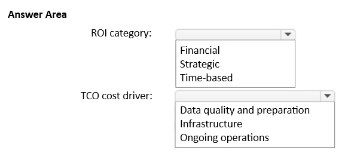

_HOTSPOT — the original ExamTopics question expects you to mark areas on the exhibit above; the correct hotspot coordinates are not published._

**Most voted:**
- Time savings—such as reducing the time needed to process a claim, can provide early indicators of value before actual financial savings are measured.
- Ongoing operations include post-deployment costs such as monitoring, maintenance, support, and solution updates. These costs are part of the solution’s total cost over its lifecycle

### Top explanations
- **buraph** (1 upvotes [Most Recent]): Time savings—such as reducing the time needed to process a claim, can provide early indicators of value before actual financial savings are measured.
  Ongoing operations include post-deployment costs such as monitoring, maintenance, support, and solution updates. These costs are part of the solution’s total cost over its lifecycle

## Q2.1 (ID 384389)

Background
Fabrikam, Inc., is a global consumer goods company that is undergoing a digital transformation initiative to migrate its entire infrastructure to the Microsoft cloud. As a key element of this cloud migration, the company will implement Microsoft Dynamics 365 Sales, moving away from the current on-premises proprietary technologies used by its business-to-business (B2B) sales team.
As part of the cloud migration, Fabrikam will adopt an AI-first approach to its business solutions and implement AI solutions, wherever possible, to streamline operations.
Problem Statements
Fabrikam's infrastructure currently relies on various on-premises systems that require sales executives to use corporate computers with physical keyboards to access business information during customer interactions. Mobile phones cannot be used for these purposes, as the systems depend on keyboard input. As a result, the sales executives spend a lot of time using keyboards to search for data on several disparate systems and file servers, rather than focusing on the customers. This affects the customer experience.
Fabrikam stakeholders are concerned that users will be hesitant to adopt AI. If the AI initiatives are NOT adopted, cost savings will never be realized. Additionally, funding for future AI initiatives will depend on demonstrating an increase in AI adoption month over month. As the AI agent initiative for the sales team will be the first for Fabrikam, the rapid adoption of the agent is a high priority.
Planned Initiatives
General
Fabrikam management has prioritized AI-driven projects to improve efficiency, customer engagement, and responsible AI adoption. The current application infrastructure is on-premises and must be migrated to the cloud to support the adoption of these technologies.
Infrastructure Migration
Fabrikam plans to migrate from its current on-premises infrastructure to a completely cloud-based topology; this will include user authentication, the security framework, and, primarily, the adoption of the services by end users.
All the data from the different systems will be consolidated into a single data source - a common data model that will use a Microsoft Dataverse environment as a single source of truth (SSOT) for the sales team.
Sales Cycle Enablement
To achieve the company's objectives, Fabrikam intends to implement the following strategies to enhance the sales cycle:
Use low-code development to create a single AI agent that has Dataverse as its core component.
Ensure that sales managers can access unanswered correspondence from prospects and intervene as appropriate.
Replace the previous proprietary software with Dynamics 365 Sales to track sales cycles and customer interactions.
Have the sales executives use Dynamics 365 Sales to track interactions for open opportunities and send follow-up communications to prospects.
Have the sales executives use handsfree headsets to interact with an AI agent when they have questions about internal policies or customer data.
Requirements
Infrastructure Migration
Fabrikam has identified the following infrastructure migration requirements:
Azure must be used for all future infrastructure workloads.
The company must follow Microsoft-recommended methodologies for infrastructure migration to the cloud.
Any created AI agents must have their return on investment (ROI) calculated to ensure that the solution will save the company money.
Sales Cycle Enablement
Fabrikam has identified the following requirements for sales cycle enablement:
The final AI agent must follow Microsoft recommendations for a conversational user experience.
A designated checklist must be reviewed to ensure that the AI agent follows Microsoft deployment recommendations for a compliant solution.
Detailed telemetry must be logged for the first created AI agent to help troubleshoot and optimize the agent during the initial AI agent adoption process.
Unexpected AI agent actions must end in an escalation to a live representative. For example, a sales executive must be rerouted to a representative if the agent cannot answer a question after two failed attempts.
The return on investment (ROI) of switching from the current process to the future process is required for stakeholder sign off.
The sales team must use Dynamics 365 Sales to correspond with prospects more quickly and efficiently than currently.
Sales managers must report on the adoption of the AI agent to key Fabrikam stakeholders on a monthly basis.
Any sensitive information, such as user IDs and names, shared via the AI agent must be tracked for future auditing.
Which template should you use for the AI agent to meet the requirements for the sales executives?

⭕ **A.** IT Helpdesk in Microsoft Copilot Studio
⭕ **B.** AI agents in Microsoft Foundry
✅ **C.** Voice in Microsoft Copilot Studio
⭕ **D.** AI chat in Microsoft Foundry

**Correct answer:** C
**Most voted:** C

### Top explanations
- **Newb007** (5 upvotes [Selected Answer: C]): C. Voice in Microsoft Copilot Studio is the only template that satisfies all of Fabrikam’s requirements:
  • Hands‑free voice interaction
  • Microsoft‑recommended conversational UX
  • Dataverse integration
  • Telemetry and auditing
  • Escalation logic
  • Supports rapid adoption and ROI tracking
  https://learn.microsoft.com/en-us/microsoft-copilot-studio/voice-build-from-template?utm_source=copilot.com
- **omath** (3 upvotes [Most Recent, Selected Answer: C]): ✅ Correct answer: C. Voice in Microsoft Copilot Studio
  The case study states that sales executives will use hands‑free headsets to interact with the AI agent.
  This template is specifically designed for:
  - Voice‑enabled conversational agents
  - Headset or microphone‑based interaction
  - Real‑time Q&A
  - Hands‑free workflows for field or sales scenarios
  Exactly what Fabrikam’s sales executives need.

## Q2.2 (ID 384390)

Background
Fabrikam, Inc., is a global consumer goods company that is undergoing a digital transformation initiative to migrate its entire infrastructure to the Microsoft cloud. As a key element of this cloud migration, the company will implement Microsoft Dynamics 365 Sales, moving away from the current on-premises proprietary technologies used by its business-to-business (B2B) sales team.
As part of the cloud migration, Fabrikam will adopt an AI-first approach to its business solutions and implement AI solutions, wherever possible, to streamline operations.
Problem Statements
Fabrikam's infrastructure currently relies on various on-premises systems that require sales executives to use corporate computers with physical keyboards to access business information during customer interactions. Mobile phones cannot be used for these purposes, as the systems depend on keyboard input. As a result, the sales executives spend a lot of time using keyboards to search for data on several disparate systems and file servers, rather than focusing on the customers. This affects the customer experience.
Fabrikam stakeholders are concerned that users will be hesitant to adopt AI. If the AI initiatives are NOT adopted, cost savings will never be realized. Additionally, funding for future AI initiatives will depend on demonstrating an increase in AI adoption month over month. As the AI agent initiative for the sales team will be the first for Fabrikam, the rapid adoption of the agent is a high priority.
Planned Initiatives
General
Fabrikam management has prioritized AI-driven projects to improve efficiency, customer engagement, and responsible AI adoption. The current application infrastructure is on-premises and must be migrated to the cloud to support the adoption of these technologies.
Infrastructure Migration
Fabrikam plans to migrate from its current on-premises infrastructure to a completely cloud-based topology; this will include user authentication, the security framework, and, primarily, the adoption of the services by end users.
All the data from the different systems will be consolidated into a single data source - a common data model that will use a Microsoft Dataverse environment as a single source of truth (SSOT) for the sales team.
Sales Cycle Enablement
To achieve the company's objectives, Fabrikam intends to implement the following strategies to enhance the sales cycle:
Use low-code development to create a single AI agent that has Dataverse as its core component.
Ensure that sales managers can access unanswered correspondence from prospects and intervene as appropriate.
Replace the previous proprietary software with Dynamics 365 Sales to track sales cycles and customer interactions.
Have the sales executives use Dynamics 365 Sales to track interactions for open opportunities and send follow-up communications to prospects.
Have the sales executives use handsfree headsets to interact with an AI agent when they have questions about internal policies or customer data.
Requirements
Infrastructure Migration
Fabrikam has identified the following infrastructure migration requirements:
Azure must be used for all future infrastructure workloads.
The company must follow Microsoft-recommended methodologies for infrastructure migration to the cloud.
Any created AI agents must have their return on investment (ROI) calculated to ensure that the solution will save the company money.
Sales Cycle Enablement
Fabrikam has identified the following requirements for sales cycle enablement:
The final AI agent must follow Microsoft recommendations for a conversational user experience.
A designated checklist must be reviewed to ensure that the AI agent follows Microsoft deployment recommendations for a compliant solution.
Detailed telemetry must be logged for the first created AI agent to help troubleshoot and optimize the agent during the initial AI agent adoption process.
Unexpected AI agent actions must end in an escalation to a live representative. For example, a sales executive must be rerouted to a representative if the agent cannot answer a question after two failed attempts.
The return on investment (ROI) of switching from the current process to the future process is required for stakeholder sign off.
The sales team must use Dynamics 365 Sales to correspond with prospects more quickly and efficiently than currently.
Sales managers must report on the adoption of the AI agent to key Fabrikam stakeholders on a monthly basis.
Any sensitive information, such as user IDs and names, shared via the AI agent must be tracked for future auditing.
Which tool should you use for the prospect communication requirements in Dynamics 365 Sales?

⭕ **A.** Azure AI Search
✅ **B.** Copilot email assist
⭕ **C.** the Voice template Microsoft Copilot Studio
⭕ **D.** Deep Research in Microsoft Foundry Agent Service

**Correct answer:** B
**Most voted:** B

### Top explanations
- **Newb007** (4 upvotes [Selected Answer: B]): https://learn.microsoft.com/en-us/dynamics365/copilot/ai-get-started#copilot-capabilities-in-dynamics-365-sales
- **omath** (3 upvotes [Most Recent, Selected Answer: B]): ✅ B. Copilot email assist
  Copilot email assist is built specifically for Dynamics 365 Sales and provides:
  - AI‑generated email drafts
  - Follow‑up suggestions
  - Context‑aware responses based on opportunity and lead data
  - Faster prospect communication directly inside the Sales workflow
  This aligns perfectly with the requirement

## Q2.3 (ID 384391)

HOTSPOT
Background
Fabrikam, Inc., is a global consumer goods company that is undergoing a digital transformation initiative to migrate its entire infrastructure to the Microsoft cloud. As a key element of this cloud migration, the company will implement Microsoft Dynamics 365 Sales, moving away from the current on-premises proprietary technologies used by its business-to-business (B2B) sales team.
As part of the cloud migration, Fabrikam will adopt an AI-first approach to its business solutions and implement AI solutions, wherever possible, to streamline operations.
Problem Statements
Fabrikam's infrastructure currently relies on various on-premises systems that require sales executives to use corporate computers with physical keyboards to access business information during customer interactions. Mobile phones cannot be used for these purposes, as the systems depend on keyboard input. As a result, the sales executives spend a lot of time using keyboards to search for data on several disparate systems and file servers, rather than focusing on the customers. This affects the customer experience.
Fabrikam stakeholders are concerned that users will be hesitant to adopt AI. If the AI initiatives are NOT adopted, cost savings will never be realized. Additionally, funding for future AI initiatives will depend on demonstrating an increase in AI adoption month over month. As the AI agent initiative for the sales team will be the first for Fabrikam, the rapid adoption of the agent is a high priority.
Planned Initiatives
General
Fabrikam management has prioritized AI-driven projects to improve efficiency, customer engagement, and responsible AI adoption. The current application infrastructure is on-premises and must be migrated to the cloud to support the adoption of these technologies.
Infrastructure Migration
Fabrikam plans to migrate from its current on-premises infrastructure to a completely cloud-based topology; this will include user authentication, the security framework, and, primarily, the adoption of the services by end users.
All the data from the different systems will be consolidated into a single data source - a common data model that will use a Microsoft Dataverse environment as a single source of truth (SSOT) for the sales team.
Sales Cycle Enablement
To achieve the company's objectives, Fabrikam intends to implement the following strategies to enhance the sales cycle:
Use low-code development to create a single AI agent that has Dataverse as its core component.
Ensure that sales managers can access unanswered correspondence from prospects and intervene as appropriate.
Replace the previous proprietary software with Dynamics 365 Sales to track sales cycles and customer interactions.
Have the sales executives use Dynamics 365 Sales to track interactions for open opportunities and send follow-up communications to prospects.
Have the sales executives use handsfree headsets to interact with an AI agent when they have questions about internal policies or customer data.
Requirements
Infrastructure Migration
Fabrikam has identified the following infrastructure migration requirements:
Azure must be used for all future infrastructure workloads.
The company must follow Microsoft-recommended methodologies for infrastructure migration to the cloud.
Any created AI agents must have their return on investment (ROI) calculated to ensure that the solution will save the company money.
Sales Cycle Enablement
Fabrikam has identified the following requirements for sales cycle enablement:
The final AI agent must follow Microsoft recommendations for a conversational user experience.
A designated checklist must be reviewed to ensure that the AI agent follows Microsoft deployment recommendations for a compliant solution.
Detailed telemetry must be logged for the first created AI agent to help troubleshoot and optimize the agent during the initial AI agent adoption process.
Unexpected AI agent actions must end in an escalation to a live representative. For example, a sales executive must be rerouted to a representative if the agent cannot answer a question after two failed attempts.
The return on investment (ROI) of switching from the current process to the future process is required for stakeholder sign off.
The sales team must use Dynamics 365 Sales to correspond with prospects more quickly and efficiently than currently.
Sales managers must report on the adoption of the AI agent to key Fabrikam stakeholders on a monthly basis.
Any sensitive information, such as user IDs and names, shared via the AI agent must be tracked for future auditing.
Which components should you use to meet the sales cycle enablement requirements? To answer, select the appropriate options in the answer area.
NOTE: Each correct selection is worth one point.

**Exhibits**
- Exhibit 1: 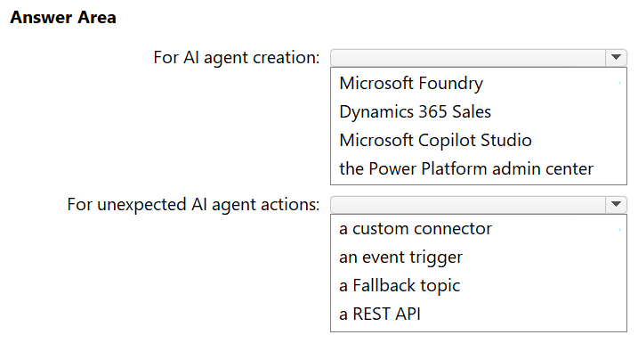

_HOTSPOT — the original ExamTopics question expects you to mark areas on the exhibit above; the correct hotspot coordinates are not published._

**Most voted:**
- Microsoft Copilot Studio → AI agent creation
- Fallback topic → Unexpected AI agent actions

### Top explanations
- **omath** (7 upvotes [Highly Voted]): 1. Microsoft Copilot Studio → AI agent creation
  The case study requires:
  - A low‑code AI agent
  - Built on Dataverse
  - Used by sales executives through voice/headset
  - With telemetry, governance, and adoption tracking
  This is exactly what Copilot Studio is designed for.
  Foundry is code‑first and not aligned with the low‑code requirement.
  2. Fallback topic → Unexpected AI agent actions
  The requirements state:
  - If the agent fails twice, it must escalate to a live representative
  - Unexpected actions must be handled gracefully
  In Copilot Studio, the Fallback topic is the built‑in mechanism for:
  - Handling unrecognized intents
  - Managing repeated failures
  - Triggering escalation workflows
- **Newb007** (4 upvotes): Looks correct.
- **24b8eec** (1 upvotes [Most Recent]): "Use low-code development to create a single AI agent that has Dataverse as its core component."
- **Eberd** (1 upvotes): Correcta
- **Hirowa** (1 upvotes): Why isn't the answer to question 1 Microsoft Foundry?

## Q2.4 (ID 384392)

You need to design a Microsoft 365 Copilot solution to optimize employee productivity. The solution must meet the following requirements:
Ensure that the employees can query content stored in a subset of Microsoft SharePoint Online sites and in Teams by using natural language-based prompt actions.
Ensure that employees receive contextually relevant responses in Microsoft 365 Copilot.
What should you include in the design?

⭕ **A.** Build a Microsoft Power Automate desktop flow to read the SharePoint content and post the responses to Teams.
⭕ **B.** Modify SharePoint settings.
⭕ **C.** Create a custom REST API that crawls the SharePoint content.
✅ **D.** Configure Microsoft Graph access.

**Correct answer:** D
**Most voted:** D

### Top explanations
- **Newb007** (5 upvotes [Selected Answer: D]): I love D ;)
- **omath** (4 upvotes [Selected Answer: D]): Correct answer: D. Configure Microsoft Graph access.
  To let Microsoft 365 Copilot query specific SharePoint Online sites and Teams content using natural language—and return contextually grounded responses—you must configure Microsoft Graph access.
  This is the mechanism Copilot uses to read organizational content securely and selectively.
- **Jedi** (4 upvotes [Selected Answer: B]): I thinking this might be B.  Restricted SharePoint Search: To limit Copilot to a specific subset of sites and Teams, you must use Restricted SharePoint Search in the SharePoint Admin Center. This allows you to define a "known" list of sites, ensuring Copilot only queries those specific locations, which directly addresses the requirement for a "subset of SharePoint Online sites".
- **Eberd** (3 upvotes [Selected Answer: D]): Microsoft 365 Copilot obtiene el contexto de los datos de la organización a través de Microsoft Graph.
- **Luweho** (2 upvotes [Most Recent, Selected Answer: D]): "If Restricted SharePoint Search is enabled, use of SharePoint is blocked."
  I think it's Graph API, and you just add this "subnet of sharepoint sites" as knowledge sources

## Q2.5 (ID 384393)

A company uses Microsoft Dynamics 365 Finance to manage accounts payable.
You are designing an AI invoice processing solution.
You need to recommend the prerequisites to configure a prebuilt copilot for accounts payable.
What should you recommend?

⭕ **A.** From Microsoft Copilot Studio, create an accounts payable agent.
⭕ **B.** Extend Microsoft 365 Copilot for Sales to an accounts payable agent.
⭕ **C.** Build an AI tool in Microsoft Foundry.
✅ **D.** From the Power Platform admin center, assign the Finance and Operations AI security role to users.

**Correct answer:** D
**Most voted:** D

### Top explanations
- **omath** (3 upvotes [Selected Answer: D]): Correct answer: D. From the Power Platform admin center, assign the Finance and Operations AI security role to users.
  To enable the prebuilt Copilot for Accounts Payable in Dynamics 365 Finance, users must be assigned the Finance and Operations AI security role.
  This is the documented prerequisite before the AP Copilot can access invoice data and perform AI‑assisted processing.
- **Newb007** (3 upvotes [Selected Answer: D]): Man I love D ;).  for real tho... it looks correct
- **Luweho** (2 upvotes [Most Recent]): But we are asked to "recommend the prerequisites (!) to configure a prebuilt copilot (!) for accounts payable". Not to build an agent.
- **Ninashnash** (1 upvotes [Selected Answer: D]): D  is correct. Dynamics 365 Finance ships with prebuilt Copilot capabilities for accounts payable that are built into the product itself — they don't need to be custom-built. The key prerequisite to actually enable and use these prebuilt AI features is security/role configuration, so that the AI capabilities are turned on and accessible for the right users. This is done through the Power Platform admin center, where you assign the Finance and Operations AI security role needed for users to access the built-in Copilot features in Dynamics 365 Finance.
- **jgg** (1 upvotes [Selected Answer: D]): MS Learn MCP and Claude agrees here, it's D :)

## Q2.6 (ID 384394)

A company plans to deploy a Microsoft Dynamics 365 Contact Center agent.
You need to ensure that the agent can transfer the conversation to a live customer service representative.
Which two components should you include in the solution? Each correct answer presents part of the solution.
NOTE: Each correct selection is worth one point.

⭕ **A.** Microsoft Foundry
✅ **B.** Microsoft Copilot Studio
⭕ **C.** Microsoft 365 Agents Toolkit
⭕ **D.** an Azure AI Bot Service skill
✅ **E.** Customer engagement hub

**Correct answer:** B, E
**Most voted:** BE

### Top explanations
- **Newb007** (9 upvotes [Highly Voted, Selected Answer: BE]): https://learn.microsoft.com/en-us/microsoft-copilot-studio/advanced-hand-off#prerequisites
- **omath** (3 upvotes [Selected Answer: BE]): ✅ B. Microsoft Copilot Studio
  Dynamics 365 Contact Center uses Copilot Studio to build and configure the conversational agent.
  The live‑agent transfer capability is implemented through:
  - handoff nodes
  - Omnichannel/Customer Service integration
  - routing rules
  ✅ E. Customer engagement hub
  The Customer Service workspace / Customer Engagement Hub is where human agents receive escalated conversations.
  The Contact Center agent must be able to:
  - transfer the session to a queue
  - route it to a human agent
  - allow the human agent to pick up the conversation in the Customer Engagement Hub
- **Ninashnash** (1 upvotes [Most Recent, Selected Answer: BE]): ✅ B. Dynamics 365 Contact Center agents are built and extended using Microsoft Copilot Studio. ✅ E. Customer engagement hub: The Customer engagement hub (Dynamics 365 Customer Service/Contact Center) is where live customer service representatives receive and continue conversations that are escalated from the AI agent.

## Q2.7 (ID 384395)

HOTSPOT
A company uses Microsoft Dynamics 365 Supply Chain Management.
You are designing an AI supply chain process that meets the following requirements:
Provides managers with AI-driven insights that surface key information from customer orders
Helps planners use AI to anticipate future product needs more accurately
You need to recommend which Microsoft Copilot features to include in the design.
What should you recommend for each requirement? To answer, select the appropriate options in the answer area.
NOTE: Each correct selection is worth one point.

**Exhibits**
- Exhibit 1: 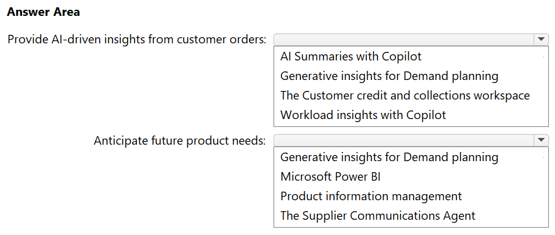

_HOTSPOT — the original ExamTopics question expects you to mark areas on the exhibit above; the correct hotspot coordinates are not published._

**Most voted:**
- Reason: AI Summaries in Supply Chain Management surface key information from operational records—such as customer orders, shipments, delays, exceptions, and fulfillment issues.
- Anticipate future product needs: ➡ Generative insights for Demand planning
- Reason: This Copilot feature uses AI to analyze historical demand, seasonality, supply constraints, and forecast signals to help planners predict future product needs more accurately.

### Top explanations
- **omath** (5 upvotes [Most Recent]): 1. Provide AI‑driven insights from customer orders:
  ➡ AI Summaries with Copilot
  Reason: AI Summaries in Supply Chain Management surface key information from operational records—such as customer orders, shipments, delays, exceptions, and fulfillment issues.
  They are designed to give managers quick, AI‑generated overviews of order activity.
  2. Anticipate future product needs:
  ➡ Generative insights for Demand planning
  Reason: This Copilot feature uses AI to analyze historical demand, seasonality, supply constraints, and forecast signals to help planners predict future product needs more accurately.
- **Newb007** (4 upvotes): Correct!
  https://learn.microsoft.com/en-us/dynamics365/copilot/ai-get-started#copilot-capabilities-in-dynamics-365-supply-chain-management
- **deca0d4** (1 upvotes): Correct: Uses generative AI to summarize large amounts of unstructured content.
  Case notes
  Email threads
  Meeting transcripts
  Support interactions
  Generative insights for demand planning
  Applies AI to analyze demand signals and generate insights/forecasts.
  Predict future product demand
  Identify trends or anomalies
  Recommend inventory adjustments
- **Eberd** (1 upvotes): La funcionalidad Demand Planning con generative AI usa modelos predictivos y AI para forecast de demanda futura, ayudando a planificadores a anticipar necesidades de productos.

## Q2.8 (ID 384527)

HOTSPOT
A company has a Microsoft 365 E5 subscription and uses Microsoft Copilot Studio.
The company has a Microsoft SharePoint Online library that contains 10,000 policy PDFs from various departments. The library contains a populated column named Department for each PDF.
You need to design a Copilot Studio agent that will use the SharePoint library as a knowledge source. The solution must meet the following requirements:
Enable the agent to answer user questions about company policies.
Ensure that the agent can identify which departments and policies are connected.
What should you include in the design for each requirement? To answer, select the appropriate options in the answer area.
NOTE: Each correct selection is worth one point.

**Exhibits**
- Exhibit 1: 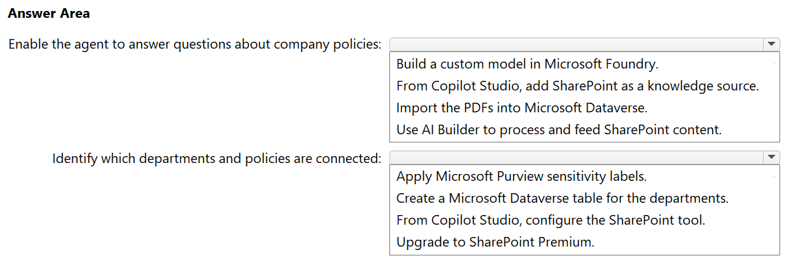

_HOTSPOT — the original ExamTopics question expects you to mark areas on the exhibit above; the correct hotspot coordinates are not published._

**Most voted:**
1. From Copilot Studio, add SharePoint as a knowledge source.
2. Create a Microsoft Dataverse table for the departments.

### Top explanations
- **omath** (9 upvotes [Highly Voted]): 1. From Copilot Studio, add SharePoint as a knowledge source.
  Copilot Studio can directly index a SharePoint library (including PDFs) as a knowledge source, enabling natural‑language Q&A over the content.
  No custom models, Dataverse imports, or AI Builder pipelines are required.
  2. Create a Microsoft Dataverse table for the departments.
  The agent must understand relationships between departments and policies.
  - A Dataverse table allows you to:
  - Represent departments as structured entities
  - Link policies to departments
  - Enable the agent to reason over relationships (e.g., “Which policies belong to HR?”)
- **Newb007** (4 upvotes): Looks correct.  Was thinking maybe upload to Dataverse but it's limited to 500 files. https://learn.microsoft.com/en-us/microsoft-copilot-studio/knowledge-add-file-upload
- **Ninashnash** (2 upvotes): There is no such thing as SharePoint tool to be configured. the only logical way I can think of is using Dataverse to hold SharePoint data mapping (document to department, somehow being synced to the actual SPO library) and be used to trim down the answers.
- **moongang** (1 upvotes [Most Recent]): Enable the agent to answer questions about company policies: From Copilot Studio, add SharePoint as a knowledge source.
  Identify which departments and policies are connected: From Copilot Studio, configure the SharePoint tool.
  Reasoning: Adding the SharePoint library as a knowledge source is the native way to let the agent ground answers in the 10,000 PDFs using the existing Microsoft 365 E5 licensing, with no custom model, Dataverse import, or AI Builder processing needed. The knowledge source, however, indexes document content only and does not expose library column metadata like Department. The SharePoint tool (connector actions such as Get items / Get files with properties) lets the agent query the library and read the Department column for each file, so it can report which policies belong to which department. Sensitivity labels classify confidentiality rather than department, a separate Dataverse table duplicates data that already exists in the column, and SharePoint Premium is not required for any of this.
- **zsedo** (1 upvotes): "An agent can include up to 500 files as knowledge."
  You don't upload the files to Dataverse. You only create a table with the labels and departments.

## Q2.9 (ID 384070)

DRAG DROP
You need to design a Microsoft Copilot Studio agent that meets the following requirements:
Supports interactive speech responses
Optimizes decision-making and the accuracy of responses
What should you include in the design for each requirement? To answer, drag the appropriate options to the correct requirements.  Each option may be used once, more than once, or not at all. You may need to drag the split bar between panes or scroll to view content.

**Exhibits**
- Exhibit 1: 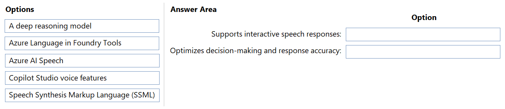

_DRAG DROP — the original ExamTopics question expects you to drag and drop items; the correct targets are not published._

**Most voted:**
- Copilot Studio voice features → Interactive speech responses
- Deep reasoning model → Decision‑making & accuracy

### Top explanations
- **Newb007** (8 upvotes [Highly Voted]): Correct since it's CPS Solution.
- **rveney** (5 upvotes): Supports interactive speech responses:
  ➡️ Copilot Studio voice features
  Why: Copilot Studio voice features are designed to enable voice-based, interactive conversations (speech input/output) within a Copilot Studio agent.
  Optimizes decision-making and the accuracy of responses:
  ➡️ A deep reasoning model
  Why: A deep reasoning model is intended to improve multi-step decision-making, reduce logical errors, and increase response accuracy—especially for complex queries and agent orchestration.
- **omath** (3 upvotes [Most Recent]): Copilot Studio voice features → Interactive speech responses
  Copilot Studio includes built‑in voice capabilities that allow an agent to:
  - Listen to user speech
  - Generate spoken responses
  - Support natural, interactive voice conversations
  This is the only option designed specifically for speech interaction.
  Deep reasoning model → Decision‑making & accuracy
  Deep reasoning models (like GPT‑4‑class reasoning models) are used in Copilot Studio to:
  - Improve multi‑step reasoning
  - Increase accuracy of responses
  - Handle complex decision logic
  - Produce more reliable, grounded answers
  This directly satisfies the requirement to optimize decision‑making and accuracy.

## Q2.10 (ID 384396)

You are designing a low-code AI business solution by using Microsoft Copilot Studio.
The solution must include an agent that automates tasks by simulating user interactions across third-party apps and websites, such as clicking buttons, entering text, and extracting information from screens.
You need to recommend what to include in the agent.
What should you recommend?

⭕ **A.** Model Context Protocol (MCP)
⭕ **B.** a natural language understanding + (NLU+) model in Copilot Studio
✅ **C.** Computer Use in Copilot Studio
⭕ **D.** Copilot skills

**Correct answer:** C
**Most voted:** C

### Top explanations
- **Newb007** (5 upvotes [Selected Answer: C]): Correct!
- **omath** (4 upvotes [Most Recent, Selected Answer: C]): ✅ Correct Answer: C. Computer Use in Copilot Studio
  Computer Use enables a Copilot Studio agent to:
  - Control a computer like a human
  - Click, type, scroll, select, and navigate
  - Read information from screens
  - Automate workflows across any app (web or desktop)
  - Handle UI automation without building custom connectors
  It is the low‑code way to give your agent real “hands‑on‑keyboard” abilities.
- **RICHARDALEX007** (2 upvotes [Selected Answer: C]): "Computer use is a tool in Copilot Studio that lets your agent interact with and automate tasks on a Windows computer. It works with websites and desktop apps by selecting buttons, choosing menus, and entering text into fields on the screen. Describe in natural language what you want computer use to do, and it performs the task on a computer you set up by using a virtual mouse and keyboard. By using computer use, agents can complete tasks even when there's no API to connect directly to the system. If a person can use an app or website, computer use can too. You can use computer use for tasks like automated data entry, invoice processing, and data extraction."
  Reference: https://learn.microsoft.com/en-us/microsoft-copilot-studio/computer-use

## Q2.11 (ID 384397)

You need to recommend a solution to integrate a Microsoft Copilot agent with a Microsoft Dynamics 365 Contact Center chat channel.
The agent must respond to customer questions and hand off the conversation to a live customer service representative when the customer requests an escalation.
What should you recommend?

⭕ **A.** Build an agent flow.
⭕ **B.** Configure the Conversation Start topic.
⭕ **C.** Configure a skill.
⭕ **D.** Call a Microsoft Power Automate connector.
✅ **E.** Configure the Escalate topic.

**Correct answer:** E
**Most voted:** E

### Top explanations
- **omath** (4 upvotes [Most Recent, Selected Answer: E]): The right choice is E. Configure the Escalate topic.
  In Copilot Studio, the Escalate topic is the built‑in mechanism that:
  - Detects when a customer asks for a human
  - Triggers the handoff flow
  - Connects to Dynamics 365 Customer Service / Contact Center queues
  - Transfers the conversation to a live representative
  This is the only option that directly supports the required escalation behavior.
- **RICHARDALEX007** (4 upvotes [Selected Answer: E]): "Configure the Escalate topic in Microsoft Copilot Studio by navigating to Topics > System, selecting Escalate, and adding a Transfer conversation node. This ensures a smooth hand-off to live agents (e.g., Dynamics 365) when the bot cannot resolve an issue, often triggered after the System Fallback topic runs"
  Reference: https://learn.microsoft.com/en-us/microsoft-copilot-studio/advanced-hand-off
- **Newb007** (4 upvotes [Selected Answer: E]): Correct!

## Q2.12 (ID 384398)

A company has a customer order system that creates sales orders manually.
You need to design an AI solution to automate the following tasks as part of the system:
Save the order details to a database.
Update the order status in the database.
Extract the order details from an order file.
Prepare and send a confirmation email to customers.
The solution must minimize development effort and support intelligent automation and solution integration.
What should you include in the design?

⭕ **A.** a workflow in Azure Logic Apps
⭕ **B.** a multi-agent solution that uses the Semantic Kernel SDK
⭕ **C.** a multi-agent solution that uses Microsoft Foundry Agent Service
✅ **D.** a Microsoft Copilot Studio agent that uses Microsoft Power Automate workflows

**Correct answer:** D
**Most voted:** D

### Top explanations
- **Newb007** (7 upvotes [Highly Voted, Selected Answer: D]): Man I love D ;). but ya the other options are overkill.
- **omath** (4 upvotes [Selected Answer: D]): The correct answer is: D. A Microsoft Copilot Studio agent that uses Microsoft Power Automate workflows.
  Your requirements are:
  - Save order details to a database
  - Update order status
  - Extract order details from an order file
  - Prepare and send confirmation emails
  - Minimize development effort
  - Support intelligent automation
  - Support integration across systems
  This is a textbook case for Copilot Studio + Power Automate.
- **deca0d4** (2 upvotes [Selected Answer: D]): Use Copilot Studio to create the agent and call a Power Automate cloud flow that uses AI Builder for document extraction, database connectors for order updates, and Outlook/Exchange connectors to send confirmation emails.
- **Ninashnash** (1 upvotes [Most Recent, Selected Answer: D]): The solution must minimize development effort and support intelligent automation and solution integration. That's exactly what Copilot Studio+Power Atomate flow do (low code, no code development)

## Q2.13 (ID 384054)

HOTSPOT
You are designing an AI strategy for Microsoft Dynamics 365 finance and operations apps. You are evaluating the use of Microsoft Copilot Studio to provide in-app help and guidance based on generative AI general knowledge.
You need to recommend which knowledge sources to include in the generative help and guidance agent. The solution must minimize the risk of generating inaccurate responses.
What should you recommend? To answer, select the appropriate options in the answer area.
NOTE: Each correct selection is worth one point.

**Exhibits**
- Exhibit 1: 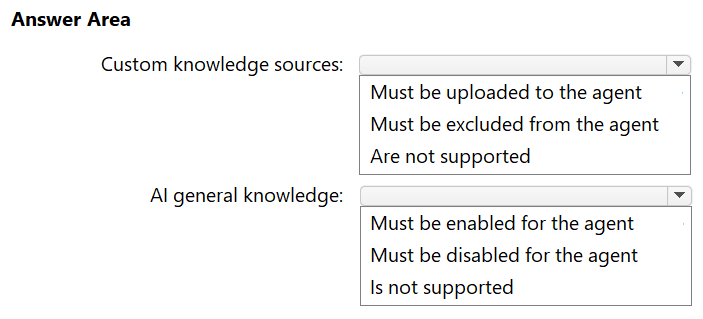

_HOTSPOT — the original ExamTopics question expects you to mark areas on the exhibit above; the correct hotspot coordinates are not published._

**Most voted:** First one is correct. Second answer should be to disable general knowledge... to prevent inaccurate responses

### Top explanations
- **Newb007** (15 upvotes [Highly Voted]): First one is correct. Second answer should be to disable general knowledge... to prevent inaccurate responses
- **omath** (10 upvotes [Highly Voted]): 1. Custom knowledge sources → Must be uploaded to the agent
  To minimize hallucinations, Copilot Studio agents used for in‑app help and guidance in Dynamics 365 must rely on trusted, organization‑controlled content.
  This includes:
  - Product documentation
  - Internal process guides
  - Policy documents
  - Standard operating procedures
  2. AI general knowledge → Must be disabled for the agent
  General knowledge models can introduce:
  - Hallucinations
  - Non‑compliant or inaccurate answers
  - Content unrelated to Dynamics 365 processes
- **2db2984** (5 upvotes): First one is correct. Fir Second correct answer is : disable general knowledge
  https://learn.microsoft.com/en-us/dynamics365/fin-ops-core/dev-itpro/copilot/extend-copilot-generative-help
- **rveney** (5 upvotes): Custom knowledge sources: Must be excluded from the agent
  AI general knowledge: Must be enabled for the agent
- **Eberd** (3 upvotes): Must be disabled for the agent

## Q2.14 (ID 384399)

HOTSPOT
You need to design a multi-agent solution that will include a custom agent. The solution must meet the following requirements:
Define the rules and constraints that the agent must follow.
Automate a backend process that involves data movement between services and runs independently of the agent's reasoning steps.
What should you include in the design for each requirement? To answer, select the appropriate options in the answer area.
NOTE: Each correct selection is worth one point.

**Exhibits**
- Exhibit 1: 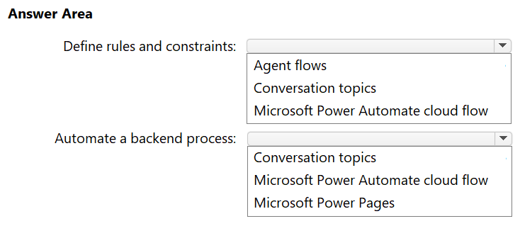

_HOTSPOT — the original ExamTopics question expects you to mark areas on the exhibit above; the correct hotspot coordinates are not published._

**Most voted:**
- Rules and constraints → Agent flows
- Agent flows are the mechanism used in Copilot Studio to: - Define policies, constraints, and guardrails
- Backend automation → Power Automate cloud flow
- A backend process that: - Moves data between services

### Top explanations
- **omath** (9 upvotes [Most Recent, Highly Voted]): 1. Rules and constraints → Agent flows
  Agent flows are the mechanism used in Copilot Studio to:
  - Define policies, constraints, and guardrails
  - Control how the agent reasons
  - Enforce rules such as allowed actions, restricted topics, or required steps
  - Shape the agent’s decision‑making and behavior
  They are part of the agent’s internal orchestration, not external automation.
  2. Backend automation → Power Automate cloud flow
  A backend process that:
  - Moves data between services
  - Runs independently of the agent’s reasoning
  - Executes reliably and asynchronously
  …is exactly what Power Automate cloud flows are designed for.
- **CertiMaster101912** (6 upvotes): 1: topics
  2: pa flow
- **Newb007** (5 upvotes): Hmmm first one might be agent flows... was expecting instructions to be an option..    Anyone else here? need some help on this one.    first one might be topics i dunno man.
- **janesb** (2 upvotes): @Newb007.Agent flow is not used to define the agent’s rules because it is meant for running actions and backend automation. For example, an agent is helping  to  fix the VPN connectivity issue, so the agent will ask for employee ID, device type, and deciding when to escalate are conversation rules, so they belong to a conversation topic. Tasks like creating a ticket, updating Dataverse, or sending notifications are backend actions, so they belong to an agent flow or Power Automate flow.
- **Eberd** (1 upvotes): Con topics podes controlar bien las restricciones.  A y B correctas

## Q2.15 (ID 384400)

Note: This section contains one or more sets of questions with the same scenario and problem. Each question presents a unique solution to the problem. You must determine whether the solution meets the stated goals. More than one solution in the set might solve the problem. It is also possible that none of the solutions in the set solve the problem.
After you answer a question in this section, you will NOT be able to return. As a result, these questions do not appear on the Review Screen.
A company uses Microsoft 365 and Dynamics 365.
You need to recommend a solution to automatically summarize email threads, generate suggested replies in Microsoft Outlook, and provide meeting preparation summaries that include relevant customer relationship management (CRM) data.
Solution: You recommend Microsoft 365 Copilot for Sales.
Does this meet the goal?

✅ **A.** Yes
⭕ **B.** No

**Correct answer:** A
**Most voted:** A

### Top explanations
- **Newb007** (5 upvotes [Selected Answer: A]): Correct
- **deca0d4** (3 upvotes [Selected Answer: A]): 👉 Sales agent (inside Microsoft 365 Copilot for Sales)
  Connects to CRM (Dynamics 365 or Salesforce)
  Uses Microsoft Graph (emails, meetings)
  Combines both into one experience
- **omath** (2 upvotes [Selected Answer: B]): Answer: B. No
  Microsoft 365 Copilot for Sales does enhance Outlook with CRM‑aware insights, but the scenario requires automatic email thread summaries, suggested replies, and meeting preparation summaries that include Dynamics 365 CRM data.
  The correct solution for those capabilities is Copilot for Microsoft 365 with Sales Copilot (formerly Viva Sales).
  Sales Copilot is an add‑on that enriches Copilot for Microsoft 365 with CRM context — but by itself, it does not provide the full Outlook and meeting‑prep generative AI experience.
  So recommending only Microsoft 365 Copilot for Sales does not meet the goal.
- **omath** (2 upvotes [Most Recent]): From all other options, this is the closest one to "Yes".

## Q2.16 (ID 384401)

Note: This section contains one or more sets of questions with the same scenario and problem. Each question presents a unique solution to the problem. You must determine whether the solution meets the stated goals. More than one solution in the set might solve the problem. It is also possible that none of the solutions in the set solve the problem.
After you answer a question in this section, you will NOT be able to return. As a result, these questions do not appear on the Review Screen.
A company uses Microsoft 365 and Dynamics 365.
You need to recommend a solution to automatically summarize email threads, generate suggested replies in Microsoft Outlook, and provide meeting preparation summaries that include relevant customer relationship management (CRM) data.
Solution: You recommend a classic Microsoft Dataverse workflow.
Does this meet the goal?

⭕ **A.** Yes
✅ **B.** No

**Correct answer:** B
**Most voted:** B

### Top explanations
- **omath** (3 upvotes [Most Recent, Selected Answer: B]): Answer: B. No
  A classic Microsoft Dataverse workflow cannot meet the goal because:
  - It does not generate AI‑based email summaries
  - It does not create suggested replies in Outlook
  - It does not produce meeting preparation summaries enriched with Dynamics 365 CRM data
  - It is a legacy automation engine focused on record updates, notifications, and simple logic — not generative AI
  The required capabilities come from Copilot for Microsoft 365 combined with Sales Copilot, not from Dataverse workflows.
- **Newb007** (2 upvotes [Selected Answer: B]): Correct

## Q2.17 (ID 384402)

Note: This section contains one or more sets of questions with the same scenario and problem. Each question presents a unique solution to the problem. You must determine whether the solution meets the stated goals. More than one solution in the set might solve the problem. It is also possible that none of the solutions in the set solve the problem.
After you answer a question in this section, you will NOT be able to return. As a result, these questions do not appear on the Review Screen.
A company uses Microsoft 365 and Dynamics 365.
You need to recommend a solution to automatically summarize email threads, generate suggested replies in Microsoft Outlook, and provide meeting preparation summaries that include relevant customer relationship management (CRM) data.
Solution: You recommend a Microsoft 365 Copilot agent template.
Does this meet the goal?

⭕ **A.** Yes
✅ **B.** No

**Correct answer:** B
**Most voted:** B

### Top explanations
- **omath** (3 upvotes [Most Recent, Selected Answer: B]): Answer: B. No
  A Microsoft 365 Copilot agent template does not meet the goal.
  Here’s the key issue:
  Agent templates are designed for building custom task‑oriented agents (e.g., workflow automation, domain‑specific copilots). They do not provide:
  - Automatic email thread summarization in Outlook
  - Suggested replies in Outlook
  - Meeting preparation summaries enriched with Dynamics 365 CRM data
- **Newb007** (1 upvotes [Selected Answer: B]): Correct

## Q2.18 (ID 406240)

You need to design an application lifecycle management (ALM) process for a Microsoft Power Platform environment that contains a solution named Solution1.
Solution1 must include a custom connector for Copilot in Microsoft Dynamics 365 Customer Service. Solution1 must meet the following requirements:
•	Ensure that the custom connector can be deployed consistently across environments as part of the ALM process.
•	Allow the custom connector to be edited only in the development environment.
What should you include in the design?

⭕ **A.** Add the custom connector to GitHub.
⭕ **B.** Share the custom connector.
⭕ **C.** Create the custom connector in the default solution.
✅ **D.** Add the custom connector to Solution1.

**Correct answer:** D
**Most voted:** D

### Top explanations
- **omath** (4 upvotes [Most Recent, Selected Answer: D]): The correct answer is D. Add the custom connector to Solution1.
  Custom connectors must be included inside a solution so they can be:
  - exported from Dev
  -imported into Test/Prod
  - versioned and transported through pipelines
  When a solution is exported as managed, all components—including the custom connector—become:
  - locked
  - read‑only
  - not editable in Test/Prod
- **deca0d4** (1 upvotes [Selected Answer: D]): Standard ALM Practice for this is...
  In Development, add/create the custom connector inside Solution1.
  Keep Solution1 unmanaged in Development so it can be edited.

## Q2.19 (ID 406241)

A company uses a Microsoft Copilot Studio agent to automate tasks in a web app.
During testing, you discover that the automation sometimes fails because of frequent changes to the app's user interface.
You need to recommend a solution to ensure that the agent successfully automates the tasks. The solution must minimize changes to the agent.
What should you include in the recommendation?

✅ **A.** Computer Use in Copilot Studio
⭕ **B.** custom models in Azure AI Studio
⭕ **C.** conversation topics in Copilot Studio
⭕ **D.** an agent flow in Copilot Studio

**Correct answer:** A
**Most voted:** A

### Top explanations
- **omath** (2 upvotes [Most Recent, Selected Answer: A]): The correct answer is A. Computer Use in Copilot Studio.
  Your scenario describes:
  - A Copilot Studio agent automating tasks in a web app
  - Automation failing because the UI changes frequently
  - You want a solution that minimizes changes to the agent
  This is exactly the problem Computer Use is designed to solve.
- **deca0d4** (2 upvotes [Selected Answer: A]): “Computer use” = ability for an agent to interact with applications like a human would. like: Clicking buttons, Entering text, Navigating UI
  When to use it: No API exists, Legacy systems, Desktop apps, UI-only workflows

## Q2.20 (ID 406242)

A company processes invoices stored across multiple systems in multiple formats.
You need to implement an AI solution to automate the invoice processing. The solution must meet the following requirements:
•	Automate multi-step invoice processing tasks, including document analysis, data validation, and approval routing.
•	Enable users to interact directly via Microsoft Teams to review and approve invoices.
•	Minimize development efforts to define and customize approval workflows.
What should you include in the solution?

⭕ **A.** Azure Document Intelligence in Foundry Tools and Azure Logic Apps
⭕ **B.** a SharePoint agent
✅ **C.** Microsoft Copilot Studio and AI Builder
⭕ **D.** Azure OpenAI and Azure Functions

**Correct answer:** C
**Most voted:** C

### Top explanations
- **omath** (4 upvotes [Most Recent, Selected Answer: C]): Correct answer: C. Microsoft Copilot Studio and AI Builder
  AI Builder provides prebuilt and customizable document processing models (Invoice Processing, Form Processing) that can extract structured data from invoices across formats and systems.
  Copilot Studio can orchestrate multi‑step workflows using:
  - Agent flows
  - Power Automate integration
  - Reasoning steps
  - Conditional logic
  This gives you intelligent automation with minimal custom code.
- **deca0d4** (1 upvotes [Selected Answer: C]): The process to meet the requirements are ...
  Build the agent in Copilot Studio.
  Add an action that calls a Power Automate cloud flow.
  In the flow, use AI Builder to extract invoice fields.
  Validate the invoice data.
  Route approval through Teams Approvals.
  Return status/results back to the Copilot agent.

## Q2.21 (ID 406243)

You need to design a Microsoft Copilot Studio agent for customer support.
The agent must securely retrieve product warranty data from a REST API. The solution must minimize development effort.
What should you include in the design?

⭕ **A.** Export the agent as a managed solution and customize the agent in Power Apps.
✅ **B.** Create a custom connector in Copilot Studio and use the connector to call the API.
⭕ **C.** Use a Microsoft Power Automate desktop flow to screen scrape the warranty data.
⭕ **D.** Add the warranty data to the Fallback topic.

**Correct answer:** B
**Most voted:** B

### Top explanations
- **omath** (7 upvotes [Most Recent, Highly Voted, Selected Answer: B]): ✅ Correct Answer: B. Create a custom connector in Copilot Studio
  To securely retrieve product warranty data from a REST API, the agent needs:
  - A secure authentication mechanism
  - A reusable, governed integration component
  - Low‑code configuration
  - ALM‑friendly deployment
  A custom connector provides exactly that.

## Q2.22 (ID 406244)

DRAG DROP
A company has an ecommerce support portal that uses Microsoft Dataverse.
You are designing a Microsoft Copilot Studio agent for the portal. The agent must meet the following requirements:
•	Respond with a default help message when the user input is unclear.
•	Initiate external processes, such as retrieving the order status, when users make specific requests.
Generative orchestration will be enabled for the solution.
You need to recommend a feature for each requirement.
What should you recommend? To answer, drag the appropriate features to the correct requirements. Each feature may be used once, more than once, or not at all. You may need to drag the split bar between panes or scroll to view content.
NOTE: Each correct selection is worth one point.

**Exhibits**
- Exhibit 1: 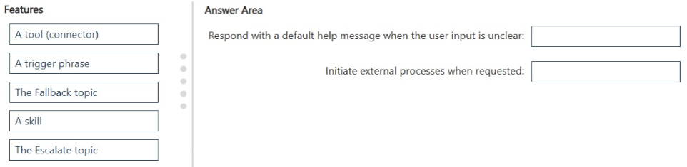

_DRAG DROP — the original ExamTopics question expects you to drag and drop items; the correct targets are not published._

**Most voted:**
- Fallback topic → Default help message
- Tool (connector) → Initiate external processes

### Top explanations
- **omath** (7 upvotes [Most Recent, Highly Voted]): 1. Fallback topic → Default help message
  When user input is unclear, incomplete, or outside the agent’s scope, the Fallback topic is the built‑in mechanism that:
  - Detects unrecognized intents
  - Responds with a default help or clarification message
  - Redirects the user back into a supported Flow
  2. Tool (connector) → Initiate external processes
  To retrieve order status or trigger any external system action, the agent must call a tool, which in Copilot Studio means:
  - A connector (custom or standard)
  - A Power Automate flow exposed as a tool
  - Any external API wrapped as a tool
- **hi1011** (4 upvotes): • Respond with a default help message when the user input is unclear. -> Fallback Topic
  https://learn.microsoft.com/en-us/microsoft-copilot-studio/authoring-system-fallback-topic
  • Initiate external processes, such as retrieving the order status, when users make specific requests. -> A tool(connector)
  https://learn.microsoft.com/en-us/microsoft-copilot-studio/add-tools-custom-agent

## Q2.23 (ID 406245)

A company uses Microsoft Dynamics 365 to manage service operations. Dispatchers coordinate service requests, and technicians perform scheduled on-site work.
You need to design a solution that will use Microsoft Copilot to improve the efficiency of the service operations. The solution must meet the following requirements:
•	Provide AI-driven assistance to help staff organize and resolve work orders.
•	Deliver contextual AI support to frontline workers as they prepare for and complete customer appointments.
Which two components should you include in the design? Each correct answer presents part of the solution.
NOTE: Each correct selection is worth one point.

⭕ **A.** Copilot Service workspace
⭕ **B.** Copilot in Outlook
⭕ **C.** Dynamics 365 Customer Service
⭕ **D.** Copilot in Customer Service
✅ **E.** Copilot in Field Service
✅ **F.** the Dynamics 365 Field Service mobile app

**Correct answer:** E, F
**Most voted:** EF

### Top explanations
- **omath** (4 upvotes [Selected Answer: EF]): E. Copilot in Field Service
  This provides:
  - AI‑driven insights for work orders
  - Assistance with scheduling, dispatching, and resolving service tasks
  - Summaries, recommendations, and automated updates for service operativos
  This directly supports dispatchers and back‑office service staff.
  F. Dynamics 365 Field Service mobile app
  This gives frontline technicians:
  - Contextual AI assistance during appointments
  - Work order summaries
  - Step‑by‑step guidance
  - Real‑time updates
  - Integrated Copilot experiences in the mobile workflow
  This is the only option that delivers AI support to technicians in the field.
- **deca0d4** (2 upvotes [Selected Answer: EF]): E. Copilot in Field Service
  Use for technician assistance and service operations.
  Work order summaries
  Troubleshooting help
  Service history insights
  👉 Think: AI helping field technicians do their job faster
  F. Dynamics 365 Field Service mobile app
  Use for on-site technicians in the field.
  View/update work orders
  Capture photos, notes
  Work offline
  Execute tasks on-site
  👉 Think: Execution tool for technicians (mobile-first)
- **297bbbc** (2 upvotes [Selected Answer: EF]): E. Copilot in Field Service
  Why: Copilot in Dynamics 365 Field Service provides AI-driven assistance for dispatchers and service managers—e.g., summarizing work orders, suggesting next steps, helping with scheduling, parts availability, and work order updates. This directly supports organizing and resolving work orders.
  F. The Dynamics 365 Field Service mobile app
  Why: Frontline technicians use the Field Service mobile app to prepare for and complete on-site appointments. With Copilot experiences integrated, it can deliver contextual guidance (summaries, checklists, notes drafting, and step suggestions) right where technicians work.
- **odigetti365** (1 upvotes [Most Recent, Selected Answer: EF]): Correct Answers:
  E. Copilot in Field Service
  F. the Dynamics 365 Field Service mobile app

## Q2.24 (ID 406246)

A company uses Microsoft Foundry agents.
You need to ensure that an agent can dynamically use external tools at runtime without updating the agent.
What should you include in the solution?

⭕ **A.** a Microsoft Foundry hub
✅ **B.** a Model Context Protocol (MCP) server
⭕ **C.** Azure AI Search
⭕ **D.** Microsoft Copilot Studio

**Correct answer:** B
**Most voted:** B

### Top explanations
- **omath** (5 upvotes [Selected Answer: B]): The right choice is B. a Model Context Protocol (MCP) server.
  You need the agent to:
  - Dynamically use external tools at runtime
  - Without updating or redeploying the agent
  That is exactly what Model Context Protocol (MCP) is designed for.
  MCP allows a Foundry agent to:
  - Discover tools dynamically
  - Load new tools without modifying the agent
  - Call external capabilities exposed by MCP servers
  - Extend functionality at runtime
  This is the only mechanism in Foundry that supports dynamic tool availability.
- **MsSana** (1 upvotes [Most Recent, Selected Answer: B]): Correct answer : B
  A. Foundry hub ❌ to organize AI projects/resources.
  B. MCP server ✅ Use to explore External tools
  C. Azure AI Search ❌ For Knowledge retrieval/search.
  D. Copilot Studio ❌ Different agent-building platform.
- **deca0d4** (1 upvotes [Selected Answer: B]): The Model Context Protocol (MCP) is a widely supported standard that lets agents request and execute tools in a consistent way

## Q2.25 (ID 406247)

Note: This section contains one or more sets of questions with the same scenario and problem. Each question presents a unique solution to the problem. You must determine whether the solution meets the stated goals. More than one solution in the set might solve the problem. It is also possible that none of the solutions in the set solve the problem.
After you answer a question in this section, you will NOT be able to return. As a result, these questions do not appear on the Review Screen.
A company has a Microsoft Dynamics 365 Sales environment that has Microsoft Copilot enabled.
You need to customize Copilot by tailoring how opportunity summaries are generated or how they are presented to users.
Solution: You add fields to the opportunity summary.
Does this meet the goal?

✅ **A.** Yes
⭕ **B.** No

**Correct answer:** A
**Most voted:** A

### Top explanations
- **CyrilleC** (7 upvotes [Most Recent, Highly Voted, Selected Answer: A]): The Microsoft Learn documentation states that it is possible to customize the fields used in Copilot Opportunity Summaries in Dynamics 365 Sales by:
  adding standard or custom fields,
  removing fields,
  rearranging the order of the information displayed in the summary.
- **297bbbc** (5 upvotes [Selected Answer: B]): Answer: B. No
  Adding fields to the opportunity form does not customize how Copilot generates or presents opportunity summaries.
  To customize Copilot summaries in Dynamics 365 Sales, you must use Copilot Studio plugins or Copilot customization settings, not simply add fields to the opportunity table.
- **Peter1972** (4 upvotes [Selected Answer: A]): Here is the explanation:
  https://learn.microsoft.com/en-us/dynamics365/sales/copilot-configure-summary-fields
- **Peter1972** (3 upvotes [Selected Answer: A]): The question here is not to ehance the DataModel. It is more related to the Copilot opportunity summary:
  So, the answer is Yes.
- **omath** (3 upvotes [Selected Answer: B]): Answer: B. No
  Adding fields to the opportunity entity does not customize how Copilot generates or presents opportunity summaries.
  Copilot’s opportunity summaries are controlled through Copilot Studio (custom prompts, plugins, grounding data, etc.), not by modifying Dynamics 365 fields.
  Adding fields only changes the data model — it does not change Copilot’s summarization behavior.

## Q2.26 (ID 406248)

Note: This section contains one or more sets of questions with the same scenario and problem. Each question presents a unique solution to the problem. You must determine whether the solution meets the stated goals. More than one solution in the set might solve the problem. It is also possible that none of the solutions in the set solve the problem.
After you answer a question in this section, you will NOT be able to return. As a result, these questions do not appear on the Review Screen.
A company has a Microsoft Dynamics 365 Sales environment that has Microsoft Copilot enabled.
You need to customize Copilot by tailoring how opportunity summaries are generated or how they are presented to users.
Solution: You build Microsoft Power Automate flows to trigger customized Copilot summaries.
Does this meet the goal?

⭕ **A.** Yes
✅ **B.** No

**Correct answer:** B
**Most voted:** B

### Top explanations
- **omath** (3 upvotes [Most Recent, Selected Answer: B]): Answer: B. No
  Power Automate flows cannot customize how Copilot generates or presents opportunity summaries in Dynamics 365 Sales.
  Flows can automate notifications, data updates, or downstream actions, but they do not modify Copilot’s summarization logic, prompt structure, or presentation layer.
  To customize Copilot summaries, you must use Copilot Studio—specifically custom prompts, plugins, or grounding data—not Power Automate.

## Q2.27 (ID 406249)

Note: This section contains one or more sets of questions with the same scenario and problem. Each question presents a unique solution to the problem. You must determine whether the solution meets the stated goals. More than one solution in the set might solve the problem. It is also possible that none of the solutions in the set solve the problem.
After you answer a question in this section, you will NOT be able to return. As a result, these questions do not appear on the Review Screen.
A company has a Microsoft Dynamics 365 Sales environment that has Microsoft Copilot enabled.
You need to customize Copilot by tailoring how opportunity summaries are generated or how they are presented to users.
Solution: You configure AI Builder lead scoring models to influence opportunity summaries.
Does this meet the goal?

⭕ **A.** Yes
✅ **B.** No

**Correct answer:** B
**Most voted:** B

### Top explanations
- **omath** (2 upvotes [Most Recent, Selected Answer: B]): Answer: B. No
  Configuring AI Builder lead scoring models does not influence how Copilot generates or presents opportunity summaries in Dynamics 365 Sales.
  Lead scoring affects qualification insights for leads, not:
  - Copilot’s summarization prompts
  - The structure or content of opportunity summaries
  - How Copilot interprets or presents opportunity data
  To customize Copilot summaries, you must adjust Copilot Studio custom prompts or Copilot grounding data, not AI Builder models.
- **Xabia** (2 upvotes [Selected Answer: B]): Copilot in Dynamics 365 Sales generates summaries natively using built-in AI capabilities

## Q2.28 (ID 406250)

Overview
Contoso, Ltd. is a high-tech manufacturing company that uses Microsoft Dynamics 365 Finance. Dynamics 365 Supply Chain Management, and Dynamics 365 Commerce for its North American operations. The company designs and develops innovative products that have many patents and proprietary technologies. The patents and engineering designs are closely guarded secrets.
Contoso executives want to integrate and adopt AI solutions to help scale the company in preparation for an anticipated period of rapid growth.
The company has multiple legal entities and Azure subscriptions that will be used in the adopted AI solutions.
Requirements
AI Adoption
The following executives will have specific responsibilities in the overall AI adoption:
•	Chief Technology Officer (CTO): Select one Dynamics 365 Finance, Dynamics 365 Supply Chain Management or Dynamics 365 Commerce prebuilt AI agent and one custom Microsoft Copilot Studio AI agent to prioritize and deploy during the initial AI adoption phase.
•	Chief Information Officer (CIO): Ensure that appropriate security labels are assigned to the data used by the AI agents.
•	Chief Financial Officer (CFO): Analyze the return on investment (ROI) for the AI agents being deployed.
•	Chief Information Security Officer (CISO): Discover and inventory AI resources for auditing.
•	Chief Executive Officer (CEO): Ensure that all solutions adhere to industry-standard responsible AI practices.
All AI initiatives and agents will have a detailed business use case, a defined audience profile, and an estimated ROI that will compare the cost savings of the current process against the estimated costs of using the new AI solutions.
The company's research and development (R&D) department already has a custom Model Context Protocol (MCP) server that contains comprehensive product specifications and compliance data.
Prebuilt AI Agent
The CTO has NOT yet selected which prebuilt AI agent to use in Dynamics 365 Supply Chain Management. The CTO wants to view available agent templates to identify which agent will add the most business value.
Depending on which high-priority AI agents are identified, its agent capabilities must be previewed in a discovery meeting with the relevant business operation stakeholders.
Custom AI Agent
Contoso has identified the following custom AI agent requirements:
•	The custom AI agent will use data from Dynamics 365 Supply Chain Management to answer questions for the manufacturing team as a low-code solution.
•	The custom AI agent will be accessible from within Microsoft Teams.
•	The custom AI agent must be designed to eventually connect to other agents that can be selected based on their description.
•	The topics used in the custom AI agent will be selected based NOT on a trigger phrase, but on a description of the purpose of the query, to make the interactions more conversational.
•	The custom AI agent must be able to answer questions about product specifications by using existing technologies. The product specifications are maintained by the R&D department.
•	The custom AI agent must be integrated with and accessible from Dynamics 365 Supply Chain Management.
•	The custom AI agent must be able to use Dynamics 365 Supply Chain Management business logic that is stored outside of the application.
Analysis, Reporting, and Troubleshooting
Contoso has identified the following analysis, reporting, and troubleshooting requirements:
•	The CISO will audit all the AI solutions monthly for compliance and security.
•	The CFO will analyze all the AI solutions quarterly to compare the estimated ROI against actual measured efficiencies and adoption. The CFO will use the Copilot Studio agent usage estimator to perform this analysis.
•	The CISO wants to identify how much sensitive data was accessed for a given AI agent run and who accessed the data. Too much sensitive data accessed by a single user might indicate a high security risk.
•	The CTO wants to track user feedback on the quality of the AI agent responses during user interactions with the agents. Consistently poor feedback will trigger an escalated reengineering discussion.
•	The CEO wants a quarterly assessment of all the required metrics for their specific responsibilities. The tools used for the assessments must be Microsoft-recommended and must verify reliability, interpretability, fairness, and compliance.
•	The CFO wants to identify how many interactions with the AI agents are abandoned on a given day as compared to resolved conversations. Too many abandoned sessions might indicate that Copilot Studio credits are being used inefficiently by end users.
What should you recommend to assist the CTO with the prebuilt agent selection process?

✅ **A.** Agent management
⭕ **B.** Copilot Studio
⭕ **C.** Lifecycle Services (LCS)
⭕ **D.** Immersive Home

**Correct answer:** A
**Most voted:** A

### Top explanations
- **Xabia** (4 upvotes [Selected Answer: D]): In Dynamics 365 Finance & Supply Chain Management, Immersive Home is the AI-first landing page that helps users work hand-in-hand with AI agents and explicitly links to the tools for enabling, monitoring, teaching, and interacting with AI agents—which is exactly what the CTO needs to browse/assess available prebuilt agent experiences and preview agent capabilities with stakeholders
- **Alicia_lili** (4 upvotes [Selected Answer: A]): The Agent management is specifically designed to:
  Discover available agents
  View and evaluate prebuilt agents
  Activate and manage them within the environment
- **2db2984** (4 upvotes [Selected Answer: B]): Copilot studio
- **deca0d4** (4 upvotes [Selected Answer: B]): Copilot Studio is where you:
  Browse and select prebuilt agent templates
  Customize and configure agents
  Define topics, actions, and integrations
  Build or extend agents (low-code)
- **TFOTHYL** (3 upvotes [Selected Answer: A]): Correct answer: A. Agent management
  Why?
  The case states:
  "The CTO wants to view available agent templates to identify which agent will add the most business value."
  According to Microsoft Learn, Agent management in Dynamics 365 Finance & Operations allows users to:
  -Discover available agents
  -Browse agent libraries and templates
  -Configure and activate agents
  -Manage deployed agents
  Microsoft specifically describes Agent management as the place where users can discover, configure, and manage AI-powered agents: https://learn.microsoft.com/en-us/dynamics365/fin-ops-core/fin-ops/copilot/agent-mgmt

## Q2.29 (ID 406251)

HOTSPOT
Overview
Contoso, Ltd. is a high-tech manufacturing company that uses Microsoft Dynamics 365 Finance. Dynamics 365 Supply Chain Management, and Dynamics 365 Commerce for its North American operations. The company designs and develops innovative products that have many patents and proprietary technologies. The patents and engineering designs are closely guarded secrets.
Contoso executives want to integrate and adopt AI solutions to help scale the company in preparation for an anticipated period of rapid growth.
The company has multiple legal entities and Azure subscriptions that will be used in the adopted AI solutions.
Requirements
AI Adoption
The following executives will have specific responsibilities in the overall AI adoption:
•	Chief Technology Officer (CTO): Select one Dynamics 365 Finance, Dynamics 365 Supply Chain Management or Dynamics 365 Commerce prebuilt AI agent and one custom Microsoft Copilot Studio AI agent to prioritize and deploy during the initial AI adoption phase.
•	Chief Information Officer (CIO): Ensure that appropriate security labels are assigned to the data used by the AI agents.
•	Chief Financial Officer (CFO): Analyze the return on investment (ROI) for the AI agents being deployed.
•	Chief Information Security Officer (CISO): Discover and inventory AI resources for auditing.
•	Chief Executive Officer (CEO): Ensure that all solutions adhere to industry-standard responsible AI practices.
All AI initiatives and agents will have a detailed business use case, a defined audience profile, and an estimated ROI that will compare the cost savings of the current process against the estimated costs of using the new AI solutions.
The company's research and development (R&D) department already has a custom Model Context Protocol (MCP) server that contains comprehensive product specifications and compliance data.
Prebuilt AI Agent
The CTO has NOT yet selected which prebuilt AI agent to use in Dynamics 365 Supply Chain Management. The CTO wants to view available agent templates to identify which agent will add the most business value.
Depending on which high-priority AI agents are identified, its agent capabilities must be previewed in a discovery meeting with the relevant business operation stakeholders.
Custom AI Agent
Contoso has identified the following custom AI agent requirements:
•	The custom AI agent will use data from Dynamics 365 Supply Chain Management to answer questions for the manufacturing team as a low-code solution.
•	The custom AI agent will be accessible from within Microsoft Teams.
•	The custom AI agent must be designed to eventually connect to other agents that can be selected based on their description.
•	The topics used in the custom AI agent will be selected based NOT on a trigger phrase, but on a description of the purpose of the query, to make the interactions more conversational.
•	The custom AI agent must be able to answer questions about product specifications by using existing technologies. The product specifications are maintained by the R&D department.
•	The custom AI agent must be integrated with and accessible from Dynamics 365 Supply Chain Management.
•	The custom AI agent must be able to use Dynamics 365 Supply Chain Management business logic that is stored outside of the application.
Analysis, Reporting, and Troubleshooting
Contoso has identified the following analysis, reporting, and troubleshooting requirements:
•	The CISO will audit all the AI solutions monthly for compliance and security.
•	The CFO will analyze all the AI solutions quarterly to compare the estimated ROI against actual measured efficiencies and adoption. The CFO will use the Copilot Studio agent usage estimator to perform this analysis.
•	The CISO wants to identify how much sensitive data was accessed for a given AI agent run and who accessed the data. Too much sensitive data accessed by a single user might indicate a high security risk.
•	The CTO wants to track user feedback on the quality of the AI agent responses during user interactions with the agents. Consistently poor feedback will trigger an escalated reengineering discussion.
•	The CEO wants a quarterly assessment of all the required metrics for their specific responsibilities. The tools used for the assessments must be Microsoft-recommended and must verify reliability, interpretability, fairness, and compliance.
•	The CFO wants to identify how many interactions with the AI agents are abandoned on a given day as compared to resolved conversations. Too many abandoned sessions might indicate that Copilot Studio credits are being used inefficiently by end users.
What should you include in the custom AI agent design to meet the R&D product specifications and the compliance information requirements? To answer, select the appropriate options in the answer area.
NOTE: Each correct selection is worth one point.

**Exhibits**
- Exhibit 1: 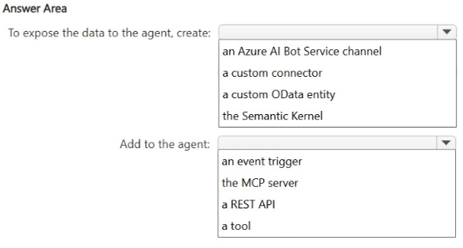

_HOTSPOT — the original ExamTopics question expects you to mark areas on the exhibit above; the correct hotspot coordinates are not published._

**Most voted:**
- Custom connector → Expose R&D product specifications + compliance data
- Add the MCP server → Provide product specifications + compliance data

### Top explanations
- **Juan_Covili** (6 upvotes [Most Recent]): To expose the data to the agent, createa custom connector
  Add to the agentthe MCP server
- **omath** (6 upvotes): 1. Custom connector → Expose R&D product specifications + compliance data
  The case study states:
  - R&D already has a custom MCP server containing product specifications and compliance data.
  - The custom AI agent must be able to answer questions using existing technologies.
  - The agent must access Dynamics 365 Supply Chain Management business logic stored outside the application.
  2. Add the MCP server → Provide product specifications + compliance data
  The R&D department already maintains:
  - A Model Context Protocol (MCP) server
  - Containing product specifications
  - And compliance information
  To make this data available to the agent, you must add the MCP server as a data source/tool inside the agent.
- **Az301301X** (2 upvotes): tricky...
  The key exam wording is Add to the agent. What is added at the agent level is "a tool". Model Context Protocol is the type of tool used to reach the MCP server.
- **Az301301X** (2 upvotes): The key exam wording is“Add to the agent.” What is added at the agent level is a tool. Model Context Protocol is the type of tool used to reach the MCP server.
- **omath** (1 upvotes): Answer: D. Immersive Home
  Takeaway:
  To help the CTO view available prebuilt AI agent templates in Dynamics 365 Supply Chain Management and preview their capabilities, the correct recommendation is Immersive Home.
  The case study states:
  - The CTO wants to view available prebuilt AI agent templates.
  - The CTO also wants to preview agent capabilities during discovery meetings.

## Q2.30 (ID 411615)

Note: This section contains one or more sets of questions with the same scenario and problem. Each question presents a unique solution to the problem. You must determine whether the solution meets the stated goals. More than one solution in the set might solve the problem. It is also possible that none of the solutions in the set solve the problem.
After you answer a question in this section, you will NOT be able to return. As a result, these questions do not appear on the Review Screen.
A company has a Microsoft Dynamics 365 Sales environment that has Microsoft Copilot enabled.
You need to customize Copilot by tailoring how opportunity summaries are generated or how they are presented to users.
Solution: You add the opportunity summary widget to the Opportunity form.
Does this meet the goal?

✅ **A.** Yes
⭕ **B.** No

**Correct answer:** A
**Most voted:** A

### Top explanations
- **omath** (4 upvotes [Selected Answer: B]): Answer: B. No
  Adding the opportunity summary widget to the Opportunity form only surfaces Copilot’s existing summary—it does not customize:
  - how Copilot generates the summary
  - what data Copilot includes
  - how the summary is structured or phrased
  It’s a UI placement action, not a customization of Copilot behavior.
  To actually tailor summaries, you must modify Copilot Studio prompts or Copilot grounding data.
- **Ninashnash** (2 upvotes [Selected Answer: A]): YES is correct. Although this solution doesn't customize "generation", but it does customize "presentation" — and since the requirement is an "or," that's sufficient to meet the goal.
- **Luweho** (1 upvotes [Most Recent, Selected Answer: A]): We should customize "how opportunity summaries are generated OR (!!!) how they are presented to users". Adding the summary widget to the opportunity form surely changes "how the summaries are presented to the users", it makes them visible.
- **zamper** (1 upvotes [Selected Answer: B]): The crucial distinction is what object you are customizing:
  Add fields to the opportunity summary → you're customizing Copilot's opportunity summary.
  Add the opportunity summary widget to the Opportunity form → you're customizing the Opportunity form, not Copilot itself.
  The widget is essentially a UI container/surface through which users see the Copilot-generated summary. Adding it determines where the Copilot experience appears, but doesn't change the logic or content of the summary.
- **Juan_Covili** (1 upvotes [Selected Answer: A]): Agregar el opportunity summary widget al formulario de Opportunity permite cambiar cómo se presenta el resumen de Copilot a los usuarios dentro del formulario de la oportunidad. Microsoft documenta que el widget de resumen de oportunidad muestra un resumen generado por IA y que puede agregarse a formularios personalizados.

## Q2.31 (ID 433330)

HOTSPOT
Your company is designing a Microsoft Copilot Studio solution for loan review specialists who use a model-driven app. The loan form contains a custom Microsoft Power Apps component framework (PCF) control that invokes a Copilot Studio agent by raising a custom event and passing the record ID, selected columns, and user context. The PCF control renders the returned recommendation inside the form.
The solution has the following requirements:
•	The specialists must be able to use the same agent in Microsoft Teams and SharePoint.
•	If the agent service is unavailable, the form must remain usable and display cached guidance or rule-based guidance.
•	Loan approval fields in Microsoft Dataverse must be updated only after a specialist reviews and accepts a recommendation.
•	Only the minimum required fields can be sent to the agent, and personal data must be excluded unless governance approves the data.
•	Separate development, test, and production environments must be used, and managed packages for controlled promotion must be deployed across each environment.
For each of the following statements, select Yes if the statement is true. Otherwise, select No.
NOTE: Each correct selection is worth one point.

**Exhibits**
- Exhibit 1: 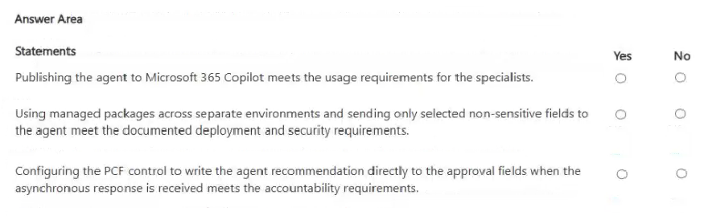

_HOTSPOT — the original ExamTopics question expects you to mark areas on the exhibit above; the correct hotspot coordinates are not published._

**Most voted:** Yes, Yes, No

### Top explanations
- **007edward007** (4 upvotes): Yes / Yes / No
  Yes: The “Teams and Microsoft 365 Copilot” channel publishes one agent that’s available in Teams and in Copilot Chat across M365 apps, including SharePoint. (Most debatable item, since a dedicated SharePoint channel also exists.)
  Yes: Managed solutions promoted Dev → Test → Prod meet the ALM requirement, and sending only non-sensitive fields meets data minimization.
  No: Writing to approval fields automatically skips the specialist’s review. Updates must happen only after an explicit Accept action.
- **vish9** (1 upvotes [Most Recent]): There are separate options for teams and M365 you need to choose both. No, Yes, No

## Q2.33 (ID 433240)

Your company uses an Azure OpenAI model to analyze customer feedback and generate responses. The model retrieves product information from Azure Blob Storage and responds to user queries.
You discover that users can use malicious prompts and inputs to manipulate the model by submitting text that contains hidden instructions.
You need to recommend a security control to mitigate the threat. The solution must minimize development effort.
What should you include in the recommendation?

⭕ **A.** content filters
✅ **B.** an Azure AI Content Safety policy
⭕ **C.** a data loss prevention (DLP) policy
⭕ **D.** Azure Content Understanding in Microsoft Foundry Tools

**Correct answer:** B
**Most voted:** B

### Top explanations
- **a5f05ea** (2 upvotes [Most Recent, Selected Answer: A]): Question specifically says “an Azure OpenAI model,” so A.
- **a5f05ea** (2 upvotes [Selected Answer: B]): This is a classic case of prompt shields which comes under Azure AI content safety.
- **odigetti365** (2 upvotes [Selected Answer: B]): ✅ Answer: B. an Azure AI Content Safety policy
  Why?
  The threat described is prompt injection, where users embed hidden instructions in prompts or retrieved content to manipulate the model's behavior.
  Azure AI Content Safety includes protections for generative AI applications, including detection and mitigation of prompt injection attacks, making it the most appropriate security control with minimal development effort.
- **azear20** (1 upvotes [Selected Answer: A]): It says "minimize development efforts" which fits better with content filters.

## Q2.34 (ID 433286)

You are designing a multi-agent solution to orchestrate a set of specialized agents.
You plan to include an agent that connects to a third-party data source. The agent must be discoverable and usable by users in Microsoft 365 Copilot and Microsoft Teams.
You need to recommend a development strategy for the agent.
Which two tools should you include in the recommendation? Each correct answer presents part of the solution.
NOTE: Each correct selection is worth one point.

⭕ **A.** Foundry Agent Service
⭕ **B.** the Assistants API in Azure OpenAI
⭕ **C.** the Foundry SDK
✅ **D.** Microsoft Copilot Studio
✅ **E.** the Microsoft 365 Agents SDK

**Correct answer:** D, E
**Most voted:** DE

### Top explanations
- **odigetti365** (4 upvotes [Most Recent, Selected Answer: DE]): Correct answers: D. Microsoft Copilot Studio and E. the Microsoft 365 Agents SDK

## Q3.1 (ID 384055)

Background
Fabrikam, Inc., is a global consumer goods company that is undergoing a digital transformation initiative to migrate its entire infrastructure to the Microsoft cloud. As a key element of this cloud migration, the company will implement Microsoft Dynamics 365 Sales, moving away from the current on-premises proprietary technologies used by its business-to-business (B2B) sales team.
As part of the cloud migration, Fabrikam will adopt an AI-first approach to its business solutions and implement AI solutions, wherever possible, to streamline operations.
Problem Statements
Fabrikam's infrastructure currently relies on various on-premises systems that require sales executives to use corporate computers with physical keyboards to access business information during customer interactions. Mobile phones cannot be used for these purposes, as the systems depend on keyboard input. As a result, the sales executives spend a lot of time using keyboards to search for data on several disparate systems and file servers, rather than focusing on the customers. This affects the customer experience.
Fabrikam stakeholders are concerned that users will be hesitant to adopt AI. If the AI initiatives are NOT adopted, cost savings will never be realized. Additionally, funding for future AI initiatives will depend on demonstrating an increase in AI adoption month over month. As the AI agent initiative for the sales team will be the first for Fabrikam, the rapid adoption of the agent is a high priority.
Planned Initiatives
General
Fabrikam management has prioritized AI-driven projects to improve efficiency, customer engagement, and responsible AI adoption. The current application infrastructure is on-premises and must be migrated to the cloud to support the adoption of these technologies.
Infrastructure Migration
Fabrikam plans to migrate from its current on-premises infrastructure to a completely cloud-based topology; this will include user authentication, the security framework, and, primarily, the adoption of the services by end users.
All the data from the different systems will be consolidated into a single data source - a common data model that will use a Microsoft Dataverse environment as a single source of truth (SSOT) for the sales team.
Sales Cycle Enablement
To achieve the company's objectives, Fabrikam intends to implement the following strategies to enhance the sales cycle:
Use low-code development to create a single AI agent that has Dataverse as its core component.
Ensure that sales managers can access unanswered correspondence from prospects and intervene as appropriate.
Replace the previous proprietary software with Dynamics 365 Sales to track sales cycles and customer interactions.
Have the sales executives use Dynamics 365 Sales to track interactions for open opportunities and send follow-up communications to prospects.
Have the sales executives use handsfree headsets to interact with an AI agent when they have questions about internal policies or customer data.
Requirements
Infrastructure Migration
Fabrikam has identified the following infrastructure migration requirements:
Azure must be used for all future infrastructure workloads.
The company must follow Microsoft-recommended methodologies for infrastructure migration to the cloud.
Any created AI agents must have their return on investment (ROI) calculated to ensure that the solution will save the company money.
Sales Cycle Enablement
Fabrikam has identified the following requirements for sales cycle enablement:
The final AI agent must follow Microsoft recommendations for a conversational user experience.
A designated checklist must be reviewed to ensure that the AI agent follows Microsoft deployment recommendations for a compliant solution.
Detailed telemetry must be logged for the first created AI agent to help troubleshoot and optimize the agent during the initial AI agent adoption process.
Unexpected AI agent actions must end in an escalation to a live representative. For example, a sales executive must be rerouted to a representative if the agent cannot answer a question after two failed attempts.
The return on investment (ROI) of switching from the current process to the future process is required for stakeholder sign off.
The sales team must use Dynamics 365 Sales to correspond with prospects more quickly and efficiently than currently.
Sales managers must report on the adoption of the AI agent to key Fabrikam stakeholders on a monthly basis.
Any sensitive information, such as user IDs and names, shared via the AI agent must be tracked for future auditing.
Which tool should you recommend to address the sensitive information concerns in the sales process?

⭕ **A.** the Analytics tab in Microsoft Copilot Studio
⭕ **B.** Model Context Protocol (MCP)
✅ **C.** Application Insights
⭕ **D.** Microsoft Foundry Tracing UI
⭕ **E.** Monitoring in Microsoft Foundry

**Correct answer:** C
**Most voted:** C

### Top explanations
- **janesb** (5 upvotes [Selected Answer: D]): Copilot Studio can send telemetry to Application Insights. Application Insights stores and exposes that telemetry for monitoring. Microsoft Foundry tracing is also integrated with Application Insights, and the Foundry Tracing UI provides an agent-focused view for inspecting traced runs in detail. So for an auditing requirement, the best answer is the tool that lets you inspect the run details, which is Foundry Tracing UI.
- **Newb007** (4 upvotes): NVM its C since all the other answers use CPS.
- **Newb007** (4 upvotes): NVM its C since all the other answers use CPS.
- **Newb007** (3 upvotes [Selected Answer: C]): Hmmmm thinking its C now?
- **CyrilleC** (2 upvotes [Selected Answer: D]): D is correct
  The recent Microsoft Foundry Tracing documentation explicitly states that traces can capture:
  user inputs and prompts,
  agent and model inputs and outputs,
  tool calls,
  personally identifiable information (PII).
  It also explains that this data is intended for observability, diagnostics, and auditing, with built-in access control and data protection mechanisms.
  https://learn.microsoft.com/en-us/azure/foundry/observability/concepts/trace-data

## Q3.2 (ID 384056)

HOTSPOT
Background
Fabrikam, Inc., is a global consumer goods company that is undergoing a digital transformation initiative to migrate its entire infrastructure to the Microsoft cloud. As a key element of this cloud migration, the company will implement Microsoft Dynamics 365 Sales, moving away from the current on-premises proprietary technologies used by its business-to-business (B2B) sales team.
As part of the cloud migration, Fabrikam will adopt an AI-first approach to its business solutions and implement AI solutions, wherever possible, to streamline operations.
Problem Statements
Fabrikam's infrastructure currently relies on various on-premises systems that require sales executives to use corporate computers with physical keyboards to access business information during customer interactions. Mobile phones cannot be used for these purposes, as the systems depend on keyboard input. As a result, the sales executives spend a lot of time using keyboards to search for data on several disparate systems and file servers, rather than focusing on the customers. This affects the customer experience.
Fabrikam stakeholders are concerned that users will be hesitant to adopt AI. If the AI initiatives are NOT adopted, cost savings will never be realized. Additionally, funding for future AI initiatives will depend on demonstrating an increase in AI adoption month over month. As the AI agent initiative for the sales team will be the first for Fabrikam, the rapid adoption of the agent is a high priority.
Planned Initiatives
General
Fabrikam management has prioritized AI-driven projects to improve efficiency, customer engagement, and responsible AI adoption. The current application infrastructure is on-premises and must be migrated to the cloud to support the adoption of these technologies.
Infrastructure Migration
Fabrikam plans to migrate from its current on-premises infrastructure to a completely cloud-based topology; this will include user authentication, the security framework, and, primarily, the adoption of the services by end users.
All the data from the different systems will be consolidated into a single data source - a common data model that will use a Microsoft Dataverse environment as a single source of truth (SSOT) for the sales team.
Sales Cycle Enablement
To achieve the company's objectives, Fabrikam intends to implement the following strategies to enhance the sales cycle:
Use low-code development to create a single AI agent that has Dataverse as its core component.
Ensure that sales managers can access unanswered correspondence from prospects and intervene as appropriate.
Replace the previous proprietary software with Dynamics 365 Sales to track sales cycles and customer interactions.
Have the sales executives use Dynamics 365 Sales to track interactions for open opportunities and send follow-up communications to prospects.
Have the sales executives use handsfree headsets to interact with an AI agent when they have questions about internal policies or customer data.
Requirements
Infrastructure Migration
Fabrikam has identified the following infrastructure migration requirements:
Azure must be used for all future infrastructure workloads.
The company must follow Microsoft-recommended methodologies for infrastructure migration to the cloud.
Any created AI agents must have their return on investment (ROI) calculated to ensure that the solution will save the company money.
Sales Cycle Enablement
Fabrikam has identified the following requirements for sales cycle enablement:
The final AI agent must follow Microsoft recommendations for a conversational user experience.
A designated checklist must be reviewed to ensure that the AI agent follows Microsoft deployment recommendations for a compliant solution.
Detailed telemetry must be logged for the first created AI agent to help troubleshoot and optimize the agent during the initial AI agent adoption process.
Unexpected AI agent actions must end in an escalation to a live representative. For example, a sales executive must be rerouted to a representative if the agent cannot answer a question after two failed attempts.
The return on investment (ROI) of switching from the current process to the future process is required for stakeholder sign off.
The sales team must use Dynamics 365 Sales to correspond with prospects more quickly and efficiently than currently.
Sales managers must report on the adoption of the AI agent to key Fabrikam stakeholders on a monthly basis.
Any sensitive information, such as user IDs and names, shared via the AI agent must be tracked for future auditing.
Which existing tool and data should you use to gather the required metrics for stakeholder signoff for the AI agents? To answer, select the appropriate options in the answer area.
NOTE: Each correct selection is worth one point.

**Exhibits**
- Exhibit 1: 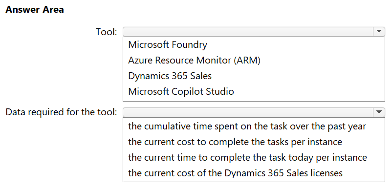

_HOTSPOT — the original ExamTopics question expects you to mark areas on the exhibit above; the correct hotspot coordinates are not published._

**Most voted:**
1. CPS
2. Task TODAY per instance

### Top explanations
- **Newb007** (15 upvotes [Highly Voted]): 1. CPS
  2. Task TODAY per instance
- **Alicia_lili** (7 upvotes [Highly Voted]): 1. Copilot Studio
  2. Task today per instance
- **omath** (5 upvotes [Most Recent]): 1 - Tool: Microsoft Copilot Studio
  The ROI calculation for AI agents is done using:
  - Telemetry from Copilot Studio
  - Task duration metrics
  - Usage analytics
  This aligns with the requirement to measure how long tasks currently take so the organization can compare:
  - Before AI agent vs. After AI agent
  Foundry, ARM, and Dynamics 365 Sales do not provide the required task‑level timing metrics for ROI.
  2 - Data required for the tool: the current time to complete the task today per instance
  ROI requires a baseline:
  - How long does the task take right now?
  - How much time will the AI agent save per instance?
  This is the only data point in the list that directly supports ROI modeling for AI agent adoption.
- **Eberd** (5 upvotes): Tool: Microsoft Copilot Studio
  Data: the current time to complete the task today per instance
- **rveney** (3 upvotes): Tool: Dynamics 365 Sales
  Data required for the tool: the current time to complete the task today per instance

## Q3.3 (ID 384403)

Background
Fabrikam, Inc., is a global consumer goods company that is undergoing a digital transformation initiative to migrate its entire infrastructure to the Microsoft cloud. As a key element of this cloud migration, the company will implement Microsoft Dynamics 365 Sales, moving away from the current on-premises proprietary technologies used by its business-to-business (B2B) sales team.
As part of the cloud migration, Fabrikam will adopt an AI-first approach to its business solutions and implement AI solutions, wherever possible, to streamline operations.
Problem Statements
Fabrikam's infrastructure currently relies on various on-premises systems that require sales executives to use corporate computers with physical keyboards to access business information during customer interactions. Mobile phones cannot be used for these purposes, as the systems depend on keyboard input. As a result, the sales executives spend a lot of time using keyboards to search for data on several disparate systems and file servers, rather than focusing on the customers. This affects the customer experience.
Fabrikam stakeholders are concerned that users will be hesitant to adopt AI. If the AI initiatives are NOT adopted, cost savings will never be realized. Additionally, funding for future AI initiatives will depend on demonstrating an increase in AI adoption month over month. As the AI agent initiative for the sales team will be the first for Fabrikam, the rapid adoption of the agent is a high priority.
Planned Initiatives
General
Fabrikam management has prioritized AI-driven projects to improve efficiency, customer engagement, and responsible AI adoption. The current application infrastructure is on-premises and must be migrated to the cloud to support the adoption of these technologies.
Infrastructure Migration
Fabrikam plans to migrate from its current on-premises infrastructure to a completely cloud-based topology; this will include user authentication, the security framework, and, primarily, the adoption of the services by end users.
All the data from the different systems will be consolidated into a single data source - a common data model that will use a Microsoft Dataverse environment as a single source of truth (SSOT) for the sales team.
Sales Cycle Enablement
To achieve the company's objectives, Fabrikam intends to implement the following strategies to enhance the sales cycle:
Use low-code development to create a single AI agent that has Dataverse as its core component.
Ensure that sales managers can access unanswered correspondence from prospects and intervene as appropriate.
Replace the previous proprietary software with Dynamics 365 Sales to track sales cycles and customer interactions.
Have the sales executives use Dynamics 365 Sales to track interactions for open opportunities and send follow-up communications to prospects.
Have the sales executives use handsfree headsets to interact with an AI agent when they have questions about internal policies or customer data.
Requirements
Infrastructure Migration
Fabrikam has identified the following infrastructure migration requirements:
Azure must be used for all future infrastructure workloads.
The company must follow Microsoft-recommended methodologies for infrastructure migration to the cloud.
Any created AI agents must have their return on investment (ROI) calculated to ensure that the solution will save the company money.
Sales Cycle Enablement
Fabrikam has identified the following requirements for sales cycle enablement:
The final AI agent must follow Microsoft recommendations for a conversational user experience.
A designated checklist must be reviewed to ensure that the AI agent follows Microsoft deployment recommendations for a compliant solution.
Detailed telemetry must be logged for the first created AI agent to help troubleshoot and optimize the agent during the initial AI agent adoption process.
Unexpected AI agent actions must end in an escalation to a live representative. For example, a sales executive must be rerouted to a representative if the agent cannot answer a question after two failed attempts.
The return on investment (ROI) of switching from the current process to the future process is required for stakeholder sign off.
The sales team must use Dynamics 365 Sales to correspond with prospects more quickly and efficiently than currently.
Sales managers must report on the adoption of the AI agent to key Fabrikam stakeholders on a monthly basis.
Any sensitive information, such as user IDs and names, shared via the AI agent must be tracked for future auditing.
Which tool should you recommend to help secure funding for future AI agent development?

⭕ **A.** Evaluations in Microsoft Foundry
⭕ **B.** the Azure Cost Optimization workbook
⭕ **C.** Azure Operator Insights
✅ **D.** the Analytics tab in Microsoft Copilot Studio
⭕ **E.** Direct Preference Optimization (DPO)

**Correct answer:** D
**Most voted:** D

### Top explanations
- **omath** (6 upvotes [Most Recent, Selected Answer: D]): ✅ Correct answer: D. the Analytics tab in Microsoft Copilot Studio
  The Analytics tab in Copilot Studio provides:
  - Usage metrics (how often the agent is used)
  - Adoption trends (month‑over‑month usage)
  - Conversation volume
  - Success vs. failure rates
  - Insights needed to justify ROI
  These metrics are exactly what stakeholders need to approve future funding.
- **Alicia_lili** (3 upvotes [Selected Answer: D]): Analytics in CPS
- **2db2984** (2 upvotes [Selected Answer: D]): D is right because the requirement is to increase AI adoption not to evaluate the AI response quality.
- **ppolychron** (2 upvotes [Selected Answer: D]): I don't think its Evaluations in Foundry since, in my knowledge, you use them to check if an agent meets quality and safety standards before deployment.
  I will go with Analytics tab in Copilot studio, where you can directly see the engagement and savings.
- **realexamguru** (1 upvotes [Selected Answer: D]): Analytics tab is correct. In the problem statement it says "funding for future AI initiatives will depend on demonstrating an increase in AI adoption month over month". To show that we can use analytics tab in CPS. Evaluations in Foundry is not right, it is used to evaluate models quality.

## Q3.4 (ID 384404)

You are designing a Microsoft Copilot Studio agent that uses a custom Microsoft Foundry model to generate responses.
You need to ensure that the agent can securely connect to and invoke the custom model during user interactions.
What should you include in the design?

⭕ **A.** Configure the agent to use classic orchestration.
✅ **B.** Create a connection to Microsoft Foundry in the agent.
⭕ **C.** Add the Microsoft Foundry model as a Copilot Studio skill.
⭕ **D.** Create a custom engine agent.

**Correct answer:** B
**Most voted:** B

### Top explanations
- **ppolychron** (3 upvotes [Selected Answer: B]): I am going with B. In Bring Your Own Model scenario in Copilot Studio, you connect a Foundry model when creating a prompt tool.
  https://learn.microsoft.com/en-us/microsoft-copilot-studio/bring-your-own-model-prompts#add-and-configure-a-prompt
- **omath** (2 upvotes [Most Recent, Selected Answer: B]): Correct answer: B. Create a connection to Microsoft Foundry in the agent.
  The key requirement in your scenario is securely connecting a Copilot Studio agent to a custom Microsoft Foundry model so the agent can invoke it during user interactions. That capability is enabled through connections, not orchestration modes, skills, or custom engine agents.
  To securely invoke a custom Microsoft Foundry model from a Copilot Studio agent, you must create a Foundry connection inside the agent.
- **Newb007** (2 upvotes [Selected Answer: B]): Could be B or D?  I love D ;)... but not sure.  I'll go with B.   I need sleep

## Q3.5 (ID 384405)

You are designing an AI business solution that contains the following components:
A Microsoft Power Automate workflow
A Microsoft Copilot Studio agent
A Microsoft Dataverse database
A Microsoft Power Apps app
As part of the application lifecycle management (ALM) process, you plan to package the components, so that they can be deployed to other environments as a group.
You need to recommend a solution that supports versioning, dependencies, and deployments.
What should you include in the recommendation?

⭕ **A.** GitHub Actions
⭕ **B.** Azure DevOps
✅ **C.** Microsoft Power Platform solutions

**Correct answer:** C
**Most voted:** C

### Top explanations
- **Newb007** (7 upvotes [Highly Voted, Selected Answer: C]): Why GitHub Actions and Azure DevOps are not the primary answer
  Both GitHub Actions and Azure DevOps can automate ALM pipelines, but they rely on solutions as the underlying deployment artifact.
  • They orchestrate CI/CD.
  • They do not provide versioning, dependency management, or packaging by themselves.
  • They require solutions to function in Power Platform ALM.
  So they are optional enhancements—not the core ALM mechanism.
- **omath** (3 upvotes [Selected Answer: C]): Correct answer: C. Microsoft Power Platform solutions
  The only option that provides versioning, dependency management, and environment‑to‑environment deployment for:
  - Power Automate flows
  - Copilot Studio agents
  - Dataverse tables
  - Power Apps applications
  is Power Platform solutions.
- **Eberd** (2 upvotes [Selected Answer: C]): Microsoft Power Platform solutions es correcto. En la solución se guardan todos los componentes para pasar entre ambientes.
- **Ninashnash** (1 upvotes [Most Recent, Selected Answer: C]): To package the components, they should be contained within a solution.

## Q3.6 (ID 384406)

A company has Microsoft 365 Copilot agents.
You need to design a security solution for the agents. The solution must meet the following requirements:
Identify and mitigate potential risks that relate to AI use.
Protect AI apps and the sensitive data processed or generated by the agents.
Support responsible AI governance by retaining and logging interactions, detecting policy violations, and investigating incidents.
Which two components should you include in the design? Each correct answer presents part of the solution.
NOTE: Each correct selection is worth one point.

✅ **A.** Microsoft Purview
⭕ **B.** Azure AI Content Safety
⭕ **C.** role-based access control (RBAC) in Microsoft Foundry
✅ **D.** Microsoft Defender

**Correct answer:** A, D
**Most voted:** AD

### Top explanations
- **ppolychron** (5 upvotes [Selected Answer: AD]): A and D for me since we are talking about M365 Copilot Agents.
  DSPM for AI ,DLP, M365 Audit Logs, Insider risk management, Communication Compliance, all valuable tools in Purview.
  Synching alerts from Purview to Microsoft Defender (XDR) will let you investigate incident from there.
- **Ninashnash** (2 upvotes [Selected Answer: AD]): Requirement1: Identify and mitigate potential risks that relate to AI use ---> Microsoft Defender
  Requirement2: Protect AI apps and the sensitive data processed or generated by the agents  ---> Microsoft Defender (Defender for Cloud Apps/Defender for AI services)
  Requirement3: Support responsible AI governance by retaining and logging interactions, detecting policy violations, and investigating incidents. ---->	Microsoft Purview
- **omath** (2 upvotes [Selected Answer: AB]): Correct answers: A. Microsoft Purview and B. Azure AI Content Safety
  These are the only two components that together satisfy all three requirements:
  risk identification, sensitive‑data protection, and responsible AI governance for Microsoft 365 Copilot agents.
  Purview provides the governance, auditing, and data‑protection controls that Copilot agents rely on.
  Purview is the only Microsoft product that logs Copilot interactions and enforces data‑protection policies across the Microsoft 365 ecosystem.
  Azure AI Content Safety provides AI‑specific risk detection.
  This directly satisfies the requirement to identify and mitigate AI‑related risks.
- **Jedi** (2 upvotes [Selected Answer: AD]): I think A and D are correct. B is aligned with Foundry.  Defender is aligned with Copilot Studio agents https://techcommunity.microsoft.com/blog/microsoftthreatprotectionblog/protect-copilot-studio-ai-agents-in-real-time-with-microsoft-defender/4446560
- **Luweho** (1 upvotes [Most Recent, Selected Answer: AD]): Content Safety is a very narrow solution to identify harmful or adult-only content etc.

## Q3.7 (ID 384407)

You are creating validation criteria for a custom generative AI model that produces business reports based on internal enterprise data.
You need to assess whether the model's outputs are appropriate and meaningful for the business reports.
Which metric should you use?

⭕ **A.** the number of active users interacting with the model
✅ **B.** alignment of the output to domain-specific tasks
⭕ **C.** the average system resource usage during inference
⭕ **D.** the model training duration

**Correct answer:** B
**Most voted:** B

### Top explanations
- **omath** (4 upvotes [Most Recent, Selected Answer: B]): Correct answer: B. alignment of the output to domain‑specific tasks
  The metric that determines whether a custom generative AI model produces appropriate and meaningful business reports is how well the model’s output aligns with the specific business tasks and domain requirements.
- **Newb007** (4 upvotes [Selected Answer: B]): B .... Final Answer
- **Eberd** (1 upvotes [Selected Answer: B]): Correcta

## Q3.8 (ID 384408)

A company has Microsoft Foundry agents that generate responses by using Azure OpenAI resources. The agents are deployed to both the United States and Europe.
A company mandate states that the agents and their grounding data must adhere to data residency and movement regulations.
You need to recommend a governance solution for the agents.
What should you include in the recommendation?

⭕ **A.** Microsoft Defender for Cloud
✅ **B.** Azure Policy
⭕ **C.** Azure Monitor
⭕ **D.** Microsoft Purview

**Correct answer:** B
**Most voted:** B

### Top explanations
- **Newb007** (11 upvotes [Highly Voted, Selected Answer: B]): Its B https://learn.microsoft.com/en-us/azure/governance/policy/overview
- **QueenShi** (6 upvotes [Selected Answer: D]): Yes, Azure Policy can enforce where resources are deployed, but it doesn't govern the data movement and classification layer. I would choose Purview as the best-of-breed governance solution: The scenario centers on data residency, data movement regulations, and governance of AI agents and their grounding data.
- **deca0d4** (4 upvotes [Selected Answer: D]): Microsoft Purview is specifically designed for:
  Data governance across environments and regions
  Data classification and sensitivity labeling
  Data residency and compliance enforcement
  Monitoring and auditing data movement
  Azure Policy is useful, but narrower:
  Enforces resource configuration rules
  Example:
  “Only deploy resources in Canada”
  “Require specific SKUs or regions”
- **timothy123** (3 upvotes [Most Recent, Selected Answer: D]): You would use Azure Policy to force developers to deploy the Azure OpenAI resource into a US or European data center, but you must use Microsoft Purview to ensure the actual information processed by those agents obeys regional data movement laws.
- **omath** (3 upvotes [Selected Answer: D]): Correct answer: D. Microsoft Purview
  For Microsoft Foundry agents and Azure OpenAI resources deployed across multiple regions (U.S. and Europe), the company must enforce data residency, data movement controls, governance, and auditing.
  Only Microsoft Purview provides the governance capabilities required for this scenario.

## Q3.9 (ID 384057)

A company has a Microsoft Copilot Studio agent that uses custom connectors to interact with enterprise APIs.
You need to recommend an application lifecycle management (ALM) process to ensure that the connectors are deployed consistently across development, test, and production environments and meet governance and traceability requirements.
What should you recommend?

⭕ **A.** Deploy the APIs as Azure Functions.
✅ **B.** Manage the connectors as solution components and deploy the components by using ALM pipelines.
⭕ **C.** Maintain connector definitions in environment variables.
⭕ **D.** Export and import the connectors between the environments as unmanaged solutions.

**Correct answer:** B
**Most voted:** B

### Top explanations
- **omath** (5 upvotes [Selected Answer: B]): Correct answer: B. Manage the connectors as solution components and deploy the components by using ALM pipelines.
  Here’s the concise reasoning first:
  To ensure consistent deployment, governance, and traceability for custom connectors used by a Copilot Studio agent, the connectors must be included in a Power Platform solution and moved through ALM pipelines (Dev → Test → Prod). This is the only option that satisfies all requirements.
- **QueenShi** (3 upvotes [Selected Answer: B]): B is the only answer that meets the requirements: consistent deployment, governance and traceability, and ALM pipelines in Power Platform enable this for solution-aware components like custom connectors.
- **Newb007** (3 upvotes [Selected Answer: B]): Going with B.   I'm 70% on this one.
- **rveney** (2 upvotes [Selected Answer: B]): Recommended answer: B. Manage the connectors as solution components and deploy the components by using ALM pipelines.
- **CyrilleC** (1 upvotes [Most Recent, Selected Answer: B]): Correct answer: B. Manage the connectors as solution components and deploy the components by using ALM pipelines

## Q3.10 (ID 384071)

HOTSPOT
A company plans to implement an AI solution that will contain a Microsoft Copilot Studio agent and a Microsoft Foundry agent. The solution will be stored in a source code repository.
You need to recommend a deployment method for each agent. The solution must meet the following requirements:
A test environment must be used before a deployment to production.
Production must be isolated from development and testing.
The deployment must be repeatable and fully automated.
The solution must NOT require manual intervention.
Which deployment method should you recommend for each agent? To answer, select the appropriate options in the answer area.
NOTE: Each correct selection is worth one point.

**Exhibits**
- Exhibit 1: 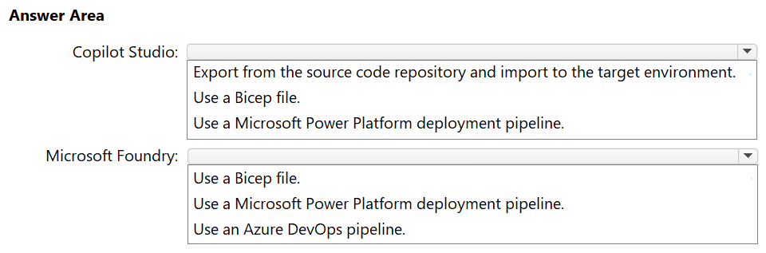

_HOTSPOT — the original ExamTopics question expects you to mark areas on the exhibit above; the correct hotspot coordinates are not published._

**Most voted:**
- Copilot Studio agent → Use a Microsoft Power Platform deployment pipeline
- Dev → Test → Prod stages
- Microsoft Foundry agent → Use an Azure DevOps pipeline
- To automate deployments from a source code repository with: - Infrastructure-as-code

### Top explanations
- **Newb007** (15 upvotes [Highly Voted]): CPS = Pipelines
  Foundry = Azure DevOps
- **Ninashnash** (4 upvotes [Most Recent]): Copilot Studio: Use a Microsoft Power Platform deployment pipeline.
  Microsoft Foundry: Use an Azure DevOps pipeline.
- **omath** (4 upvotes): 1) Copilot Studio agent → Use a Microsoft Power Platform deployment pipeline
  Power Platform deployment pipelines are the official ALM mechanism for Copilot Studio agents. They support:
  - Dev → Test → Prod stages
  - Managed solution deployment
  - Automated, repeatable deployments
  - Isolation between environments
  - No manual steps once configured
  2) Microsoft Foundry agent → Use an Azure DevOps pipeline
  Microsoft Foundry agents are deployed like Azure resources.
  To automate deployments from a source code repository with:
  - Infrastructure-as-code
  - CI/CD
  - Multi‑environment promotion
  - No manual intervention
  …the correct choice is Azure DevOps pipelines (or GitHub Actions, but that option is not available in your answer list).
- **Eberd** (4 upvotes): El despliegue automático se hace con:
  👉 Azure DevOps pipeline
- **rveney** (3 upvotes): Copilot Studio:
  ✅ Use a Microsoft Power Platform deployment pipeline.
  Why this fits: Power Platform pipelines are purpose-built for promoting Copilot Studio/Power Platform solutions across Dev → Test → Prod with environment isolation and automated, repeatable deployments from a controlled process.
  Microsoft Foundry:
  ✅ Use an Azure DevOps pipeline.
  Why this fits: Foundry (Azure AI Foundry / Foundry agents) aligns with CI/CD automation from source control, where Azure DevOps pipelines can deploy across separate test and production resources in a fully automated manner (including IaC steps if needed).

## Q3.11 (ID 384058)

HOTSPOT
A company has a Microsoft Copilot Studio prompt-and-response agent.
You need to ensure that the agent meets the following requirements:
Provides effective and relevant responses
Provides conversational outcomes
Which metric should you use for each requirement? To answer, select the appropriate options in the answer area.
NOTE: Each correct selection is worth one point.

**Exhibits**
- Exhibit 1: 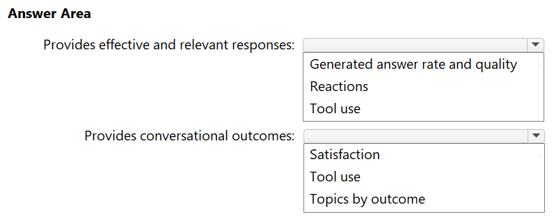

_HOTSPOT — the original ExamTopics question expects you to mark areas on the exhibit above; the correct hotspot coordinates are not published._

**Most voted:**
- 1 - Provides effective and relevant responses → Generated answer rate and quality
- 2 - Provides conversational outcomes → Topics by outcome

### Top explanations
- **madimad** (14 upvotes [Highly Voted]): 1.Generated answer rate and quality
  2.Topics by outcome
- **Newb007** (5 upvotes): Sorry second one is "Topics by Outcome" https://learn.microsoft.com/en-us/microsoft-copilot-studio/analytics-improve-agent-effectiveness#conversation-outcomes
- **CyrilleC** (4 upvotes [Most Recent]): 1 - Provides effective and relevant responses → Generated answer rate and quality
  2 - Provides conversational outcomes → Topics by outcome
  https://learn.microsoft.com/en-us/microsoft-copilot-studio/analytics-improve-agent-effectiveness#conversation-outcomes
- **omath** (3 upvotes): 1) Provides effective and relevant responses → Generated answer rate and quality
  This metric evaluates how well the agent produces accurate, grounded, and contextually relevant responses.
  It directly measures response quality, which is exactly what the requirement asks for.
  2) Provides conversational outcomes → Satisfaction
  Conversational outcomes are measured by user satisfaction, which reflects whether the interaction achieved the user’s intended goal and whether the conversation was successful overall.
- **Eberd** (3 upvotes): La métrica correcta es:
  Topics by outcome

## Q3.12 (ID 384484)

A company extends Copilot in Microsoft Dynamics 365 Customer Service.
You need to recommend an automated application lifecycle management (ALM) process so that the Copilot components can be safely developed, tested, and promoted to production.
Which two actions should you include in the ALM process? Each correct answer presents part of the solution.
NOTE: Each correct selection is worth one point.

⭕ **A.** Use an unmanaged solution in production.
⭕ **B.** Rebuild the agents in each environment.
✅ **C.** Use Microsoft Power Platform pipelines.
✅ **D.** Include the components in a solution.
⭕ **E.** Store the agent transcripts in source control.

**Correct answer:** C, D
**Most voted:** CD

### Top explanations
- **Newb007** (5 upvotes [Selected Answer: CD]): Correct
- **omath** (3 upvotes [Selected Answer: CD]): D. Include the components in a solution
  All Copilot extensions for Dynamics 365 Customer Service—custom actions, plugins, connectors, prompts, and Copilot Studio agents—must be packaged inside a Power Platform solution to support:
  - Versioning
  - Dependency tracking
  - Environment isolation
  -Managed deployments to Test/Prod
  C. Use Microsoft Power Platform pipelines
  Deployment pipelines provide:
  - Automated Dev → Test → Prod promotion
  - No manual intervention
  - Governance and approvals
  - Repeatable deployments
  - Managed solution enforcement in production
- **CyrilleC** (2 upvotes [Most Recent, Selected Answer: CD]): Correct Answers :
  C. Use Microsoft Power Platform pipelines
  D. Include the components in a solution
- **Eberd** (1 upvotes [Selected Answer: CD]): Correcto
- **madimad** (1 upvotes [Selected Answer: CD]): C & D are correct

## Q3.13 (ID 384485)

HOTSPOT
You are designing a testing solution for a Microsoft Copilot Studio agent that integrates with Microsoft Dynamics 365 Customer Service and Dynamics 365 Sales.
You need to design end-to-end scenarios to test the agent's ability to perform the following actions:
Coordinate tasks and data interactions across both Dynamics 365 apps.
Interpret user input and provide contextually relevant outputs.
Which test scenario and metric should you include in the design? To answer, select the appropriate options in the answer area.
NOTE: Each correct selection is worth one point.

**Exhibits**
- Exhibit 1: 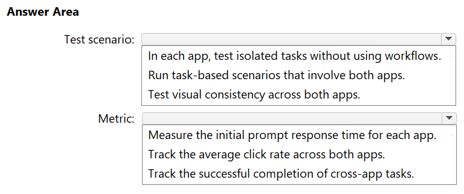

_HOTSPOT — the original ExamTopics question expects you to mark areas on the exhibit above; the correct hotspot coordinates are not published._

**Most voted:**
- Test scenario: Run task‑based scenarios that involve both apps
- Metric: Track the successful completion of cross‑app tasks

### Top explanations
- **Newb007** (7 upvotes [Highly Voted]): Correct
- **omath** (5 upvotes [Most Recent]): 1) Test scenario: Run task‑based scenarios that involve both apps
  You must simulate end‑to‑end workflows that span Customer Service and Sales—such as creating a case, updating an opportunity, or retrieving customer history across systems.
  This is exactly what task‑based scenarios involving both apps are designed for.
  2) Metric: Track the successful completion of cross‑app tasks
  The best metric is whether the agent can successfully complete the multi‑app tasks it was asked to perform.
  This validates:
  - Correct interpretation of user intent
  - Correct grounding
  - Correct orchestration across systems
  - Correct data retrieval and updates
- **Eberd** (1 upvotes): Correcto
- **madimad** (1 upvotes): Given answer is correct

## Q3.14 (ID 384059)

A company has multiple AI models that support generation of sales transactions.
Each release of the models must be reviewed by a security and compliance team before being deployed to the production environment. The security and compliance team must have access to prior versions to properly determine potential exposures introduced.
You need to recommend a solution to evaluate the impact of each deployment to production. The solution must enhance business continuity.
What should you recommend?

✅ **A.** Create a central model registry that uses version history.
⭕ **B.** Establish a promotion process by using a quality gate.
⭕ **C.** Implement version control for all the AI system components.
⭕ **D.** Track model retirement schedules to prevent service disruptions.

**Correct answer:** A
**Most voted:** A

### Top explanations
- **Newb007** (5 upvotes [Selected Answer: A]): A. Create a central model registry that uses version history.
- **omath** (2 upvotes [Selected Answer: A]): The correct answer is: A. Create a central model registry that uses version history.
  You described three key requirements:
  - Every model release must be reviewed by security and compliance before production.
  - Security must have access to prior versions to compare changes and detect new risks.
  - Business continuity must be protected — meaning controlled, traceable, reversible deployments.
  This is exactly the problem that a central model registry with versioning is designed to solve.
- **janesb** (2 upvotes [Selected Answer: A]): the Microsoft-native way is to create an Azure Machine Learning registry and then register each model version into it. Microsoft says registries decouple ML assets from workspaces so you can share models across dev, test, and prod.
- **Eberd** (2 upvotes [Selected Answer: A]): Create a central model registry that uses version history — permite almacenar y versionar modelos en un repositorio central para que seguridad revise cada release, compare versiones anteriores y habilite rollback, mejorando la continuidad del negocio.
- **rveney** (2 upvotes [Selected Answer: A]): A. Create a central model registry that uses version history.

## Q3.15 (ID 384060)

DRAG DROP
A company has an AI solution that uses a Microsoft Copilot Studio agent.
You need to monitor the agent's performance. The solution must meet the following requirements:
Monitor the agent's telemetry in near-real-time (NRT).
Download transcripts of full conversations.
Monitor the agent's usage and performance.
What should you use for each requirement? To answer, drag the appropriate options to the correct requirements. Each option may be used once, more than once, or not at all. You may need to drag the split bar between panes or scroll to view content.
NOTE: Each correct selection is worth one point.

**Exhibits**
- Exhibit 1: 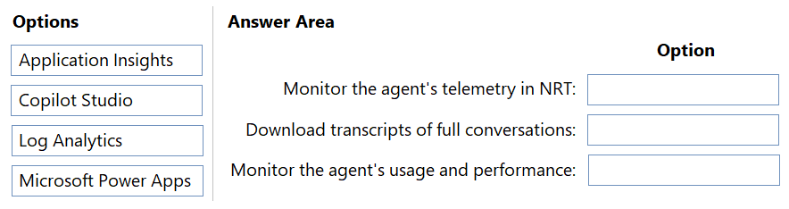

_DRAG DROP — the original ExamTopics question expects you to drag and drop items; the correct targets are not published._

**Most voted:**
- Near‑real‑time telemetry → Application Insights
- Full conversation transcripts → Copilot Studio
- Usage & performance monitoring → Copilot Studio

### Top explanations
- **Newb007** (15 upvotes [Highly Voted]): Near‑real‑time telemetry → Application Insights
  Application Insights is the only option that provides live metrics, NRT telemetry, and deep diagnostics (requests, dependencies, exceptions, traces). Copilot Studio can surface analytics, but not true NRT telemetry.
  Full conversation transcripts → Copilot Studio
  Copilot Studio includes the Transcripts area where you can export full conversations. Application Insights only stores event‑level telemetry, not full transcripts.
  Usage & performance monitoring → Copilot Studio
  Copilot Studio provides built‑in analytics dashboards for:
  • Session counts
  • Escalations
  • Resolution rates
  • Channel usage
  • CSAT
  • Topic performance
  These are the standard usage/performance KPIs for Copilot Studio agents.
- **Newb007** (9 upvotes [Highly Voted]): Second one could be Power Apps. https://learn.microsoft.com/en-us/microsoft-copilot-studio/analytics-transcripts-studio.
  "When you download session information from Copilot Studio, you get a subset of the information available for download from Power Apps, in the form of a comma-separated value (CSV) file. The CSV file includes the actual conversation and some metrics and information about the session (see Work with session transcripts for a list of metrics included in the CSV file). To see all activities, download transcripts through Power Apps."
- **madimad** (6 upvotes): 1.Application Insights
  2. Log Analytics
  3.Copilot Studio
- **rveney** (6 upvotes): Monitor the agent's telemetry in NRT: Application Insights
  Download transcripts of full conversations: Copilot Studio
  Monitor the agent's usage and performance: Copilot Studio
- **omath** (2 upvotes): 1) Log Analytics → Near‑real‑time telemetry
  Copilot Studio can stream telemetry (events, traces, errors, conversation signals) into Azure Monitor / Log Analytics
  This is the only option that meets the NRT requirement.
  2) Copilot Studio → Download full conversation transcripts
  Conversation transcripts are stored inside Copilot Studio analytics.
  No other option provides transcript export.
  3) Application Insights → Usage and performance monitoring
  Application Insights provides: Usage metrics, Performance metrics, Latency, Error rates, Dependency calls.
  This is the correct tool for monitoring overall agent performance.

## Q3.16 (ID 384061)

HOTSPOT
A company deploys a Microsoft Copilot Studio agent that integrates with a Microsoft Power Automate desktop flow.
You need to recommend a testing solution that meets the following requirements:
Test cases must validate the most recent changes to the agent before the agent is released.
The flow must be validated as part of the agent's orchestration.
What should you recommend for each requirement? To answer, select the appropriate options in the answer area.
NOTE: Each correct selection is worth one point.

**Exhibits**
- Exhibit 1: 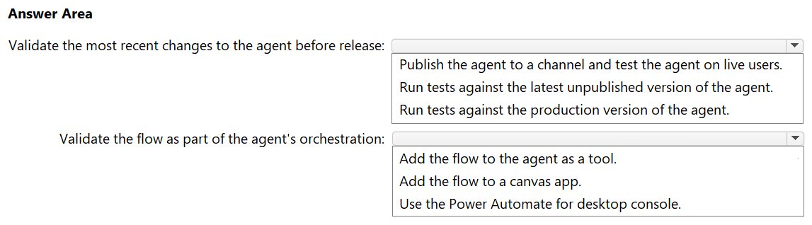

_HOTSPOT — the original ExamTopics question expects you to mark areas on the exhibit above; the correct hotspot coordinates are not published._

**Most voted:**
1) ➡ Run tests against the latest unpublished version of the agent
2) ➡ Add the flow to the agent as a tool

### Top explanations
- **Newb007** (15 upvotes [Highly Voted]): The correct pair is:
  Validate the most recent changes to the agent before release:
  Run tests against the latest unpublished version of the agent.
  This is the only option that ensures you are validating new changes before publishing.
  Testing on production or live users would not meet the requirement.
  Validate the flow as part of the agent’s orchestration:
  Add the flow to the agent as a tool.
  A Power Automate desktop flow must be exposed to Copilot Studio as a tool so the agent can call it during orchestration. Canvas apps and the PAD console do not integrate with Copilot Studio orchestration.
- **madimad** (9 upvotes [Highly Voted]): 1.Run tests against the latest unpublished version of the agent
  2.Add the flow to the agent as a tool
- **omath** (7 upvotes [Most Recent, Highly Voted]): 1) ➡ Run tests against the latest unpublished version of the agent
  To validate updates before publishing, Copilot Studio allows you to test the unpublished version of the agent.
  This ensures:
  - You test the latest changes
  - No impact on production
  - No need to publish to a channel
  - No exposure to live users
  2) ➡ Add the flow to the agent as a tool
  For the agent to orchestrate the desktop flow during testing, the flow must be added as a tool inside the agent.
  Adding it to a canvas app or using the desktop console does not integrate it into the agent’s orchestration.
- **rveney** (5 upvotes): Validate the most recent changes to the agent before release:
  Run tests against the latest unpublished version of the agent.
  Validate the flow as part of the agent's orchestration:
  Add the flow to the agent as a tool.

## Q3.17 (ID 384062)

A company has a Microsoft Copilot Studio agent that provides answers based on a knowledge base for customer support.
Users report that, occasionally, the agent provides inaccurate answers.
You need to use metrics from the Analytics tab in Copilot Studio to identify the cause of the inaccuracies.
Which two options should you use? Each correct answer presents part of the solution.
NOTE: Each correct selection is worth one point.

⭕ **A.** survey results
⭕ **B.** session information and session outcomes
✅ **C.** topic usage and topics with low resolution
⭕ **D.** engagement, resolution, and escalation rates
✅ **E.** quality of generated answers

**Correct answer:** C, E
**Most voted:** CE

### Top explanations
- **omath** (5 upvotes [Selected Answer: BE]): B. Session information and session outcomes
  This metric shows:
  - How conversations unfolded
  - Where the agent misunderstood the user
  - Whether the session ended in success, escalation, or failure
  - Patterns of incorrect grounding or mis‑routed topics
  This is essential for diagnosing why the agent produced an incorrect answer.
  E. quality of generated answers
  This metric evaluates:
  - Relevance
  - Accuracy
  - Grounding quality
  - Whether the answer aligns with the knowledge base
  If the agent is hallucinating or misusing the knowledge base, this metric exposes it.
- **Newb007** (5 upvotes): I was wrong it's this...
  The correct analytics areas to diagnose why a Copilot Studio agent sometimes gives inaccurate answers from a knowledge base are:
  ✔ C. topic usage and topics with low resolution
  ✔ E. quality of generated answers
  These two directly map to the root‑cause signals described in the Microsoft Learn page you have open.
- **Newb007** (4 upvotes [Selected Answer: CE]): IT's C and E !!!
- **Ninashnash** (3 upvotes [Selected Answer: BE]): keyword in question is "identify the cause of the inaccuracies." Only B and E can help to identify the root cause:
  B (session information and session outcomes) lets you inspect the actual query, the knowledge source used, and the conversation flow — which can reveal the cause (e.g., wrong knowledge source retrieved, user question misunderstood, missing content).
  E (quality of generated answers) directly gives a cause — Copilot Studio assigns a specific reason category to each poor-quality answer (e.g., irrelevant, incomplete, ungrounded), which is a textbook "cause."
- **madimad** (3 upvotes [Selected Answer: CE]): correct answer C & E

## Q3.18 (ID 384486)

A company uses a fine-tuned Microsoft Foundry model that requires frequent updates as new customer feedback becomes available.
You need to design an application lifecycle management (ALM) process that meets the following requirements:
Data changes must be tracked and versioned.
The model must be retrained consistently by using approved training data.
Which two actions should you include in the design? Each correct answer presents part of the solution.
NOTE: Each correct selection is worth one point.

✅ **A.** Associate the storage location to the fine-tuning job.
⭕ **B.** Create a content filter.
⭕ **C.** Store the training data in Azure Files.
⭕ **D.** Upload the training data to Microsoft Foundry data files
✅ **E.** Store the training data in Azure Blob Storage that has version control enabled.

**Correct answer:** A, E
**Most voted:** AE

### Top explanations
- **omath** (6 upvotes [Selected Answer: AE]): A. Associate the storage location to the fine‑tuning job
  Foundry fine‑tuning jobs support referencing a storage location (Blob Storage or Foundry data files).
  This ensures:
  - The model is always trained on the approved dataset
  - Retraining is consistent and repeatable
  - The job pulls data from a controlled, governed location
  This is essential for ALM.
  E. Store the training data in Azure Blob Storage with version control
  Blob Storage with versioning provides:
  - Automatic version history of every dataset change
  - Ability to roll back to prior versions
  - Full traceability for compliance and audits
  - A single source of truth for training data
  This directly satisfies the requirement to track and version data changes.
- **Newb007** (6 upvotes [Selected Answer: DE]): Going with D and E but only about 80% on this.  Any insights? Is anyone else here with me? Hello?
- **Joselito79** (2 upvotes [Selected Answer: AE]): ✅ Correct answers: A and E
  Requirement	Answer
  Data changes must be tracked and versioned	E. Store the training data in Azure Blob Storage that has version control enabled
  Model must be retrained consistently using approved training data	A. Associate the storage location to the fine-tuning job
  A. Associate the storage location to the fine-tuning job ✅
  This makes the designated training-data location the consistent source for the fine-tuning process.
  E. Azure Blob Storage + version control ✅
  Blob Storage versioning preserves previous versions of training data when files change, satisfying the ALM requirement to track data changes.
- **kevinirl** (2 upvotes [Selected Answer: AE]): https://learn.microsoft.com/en-us/azure/foundry-classic/how-to/fine-tune-serverless?tabs=chat-completion&pivots=foundry-portal
- **Ninashnash** (2 upvotes [Selected Answer: AE]): A is correct and this Ref confirms you can use Azure Blob storage for your training data in fine tuning your model in Foundry:
  https://learn.microsoft.com/en-us/azure/foundry-classic/how-to/fine-tune-serverless?tabs=chat-completion&pivots=foundry-portal

## Q3.19 (ID 384063)

HOTSPOT
A company deploys agents that generate responses by using Azure OpenAI resources. The agents are deployed to both the United States and Europe.
You need to recommend a governance solution that meets the following requirements:
Enforces the deployment of the resources to only approved Azure regions
Provides continuous compliance verification of the resources
What should you include in the recommendation for each requirement? To answer, select the appropriate options in the answer area.
NOTE: Each correct selection is worth one point.

**Exhibits**
- Exhibit 1: 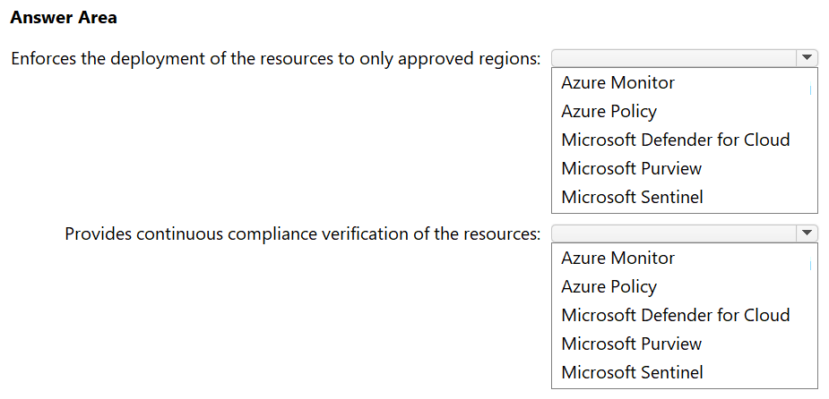

_HOTSPOT — the original ExamTopics question expects you to mark areas on the exhibit above; the correct hotspot coordinates are not published._

**Most voted:**
- Azure Policy → Restrict deployments to approved regions
- Azure Policy can enforce rules such as: - “Resources may only be deployed in East US and West Europe”
- Microsoft Defender for Cloud → Continuous compliance verification
- Defender for Cloud provides: - Continuous compliance assessments

### Top explanations
- **janesb** (13 upvotes [Highly Voted]): 1st part of the question is correct Azure policy , but for the 2nd part it should be Defender , not Purview. Purview is a data governance / compliance tool, but the requirement here is continuous compliance verification of Azure resources (Azure OpenAI accounts, storage, networking, logging, encryption settings, public access, etc.)
- **omath** (12 upvotes [Highly Voted]): 1. Azure Policy → Restrict deployments to approved regions
  Azure Policy can enforce rules such as:
  - “Resources may only be deployed in East US and West Europe”
  - “Deny creation of resources outside approved regions”
  This is the only tool designed for preventive governance.
  2. Microsoft Defender for Cloud → Continuous compliance verification
  Defender for Cloud provides:
  - Continuous compliance assessments
  - Regulatory standards mapping (ISO, SOC, GDPR, etc.)
  - Secure score
  - Alerts when resources drift out of compliance
  This satisfies the requirement for ongoing compliance monitoring.
- **rveney** (8 upvotes [Highly Voted]): Enforces the deployment of the resources to only approved Azure regions:
  ➡️ Azure Policy
  Use built-in or custom Azure Policy definitions such as “Allowed locations” to deny deployments outside approved US and EU regions.
  Provides continuous compliance verification of the resources:
  ➡️ Microsoft Defender for Cloud
  Defender for Cloud provides continuous security posture and compliance monitoring, including compliance dashboards and ongoing assessment against standards (it leverages policy evaluations and surfaces compliance status continuously).
- **Newb007** (3 upvotes): I'm about 90% sure it's Azure Policy for both
- **Joselito79** (1 upvotes [Most Recent]): . Approved regions → Azure Policy
  Azure Policy has a built-in Allowed locations policy that can restrict resource deployments to specified Azure regions. With a Deny effect, deployments outside the approved regions are blocked.
  2. Continuous compliance → Azure Policy
  Azure Policy evaluates resources for compliance when they're created/updated and through the ongoing compliance evaluation cycle (normally every 24 hours). It provides a compliance dashboard showing compliant/non-compliant resources

## Q3.20 (ID 384064)

A company has an AI solution that uses Azure OpenAI models.
You need to recommend a governance solution that monitors and audits changes to model configurations and data usage. The solution must minimize administrative effort.
What should you include in the recommendation?

⭕ **A.** Azure Monitor
⭕ **B.** Azure Stream Analytics
⭕ **C.** Azure API Management
⭕ **D.** Azure Policy
✅ **E.** Microsoft Purview

**Correct answer:** E
**Most voted:** E

### Top explanations
- **omath** (4 upvotes [Most Recent, Selected Answer: E]): ✅ Correct Answer: E. Microsoft Purview
  The requirement is clear:
  You need governance over model configuration changes and data usage, with minimal administrative effort.
  Among the options, only one service is designed specifically for:
  - Monitoring data access and usage
  - Auditing model‑related assets
  - Tracking sensitive data flows
  - Providing governance with minimal overhead
  That service is Microsoft Purview.
- **Newb007** (3 upvotes [Selected Answer: E]): Going with E about 90% on this
- **janesb** (2 upvotes [Selected Answer: D]): it should be D, Azure Policy
- **janesb** (2 upvotes [Selected Answer: A]): if the question were about models managed in Azure Machine Learning, the best governance choice would typically shift to Microsoft Purview (often together with Azure Monitor). For Azure Open AI resources, it all about those two things being implemented as resource configuration + telemetry:
- **Eberd** (2 upvotes [Selected Answer: E]): Microsoft Purview es la plataforma de data governance, compliance y auditoría para datos y aplicaciones de IA.

## Q3.21 (ID 384487)

HOTSPOT
A company uses Azure OpenAI models that use grounding data from Microsoft Fabric for agents. The models are fine-tuned by using proprietary datasets.
You need to design a governance solution that meets the following requirements:
Restricts access to the grounding data to only assigned roles
Restricts model fine-tuning to only the AI engineering team
What should you include in the design? To answer, select the appropriate options in the answer area.
NOTE: Each correct selection is worth one point.

**Exhibits**
- Exhibit 1: 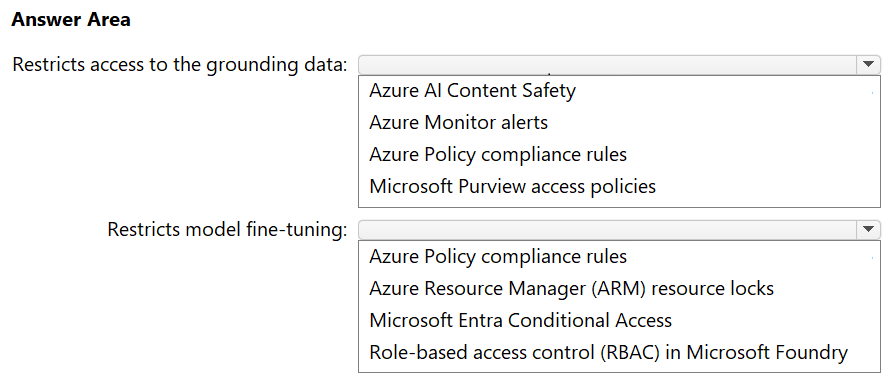

_HOTSPOT — the original ExamTopics question expects you to mark areas on the exhibit above; the correct hotspot coordinates are not published._

**Most voted:**
- Microsoft Purview access policies → Restrict access to grounding data
- Grounding data stored in Microsoft Fabric can be governed using: - Purview access policies
- RBAC in Microsoft Foundry → Restrict model fine‑tuning

### Top explanations
- **Newb007** (10 upvotes [Highly Voted]): Correct
- **omath** (3 upvotes [Most Recent]): 1. Microsoft Purview access policies → Restrict access to grounding data
  Grounding data stored in Microsoft Fabric can be governed using:
  - Purview access policies
  - Data‑level permissions
  - Role‑based access to sensitive datasets
  Purview is the only option that provides fine‑grained, centralized data access governance.
  RBAC in Microsoft Foundry → Restrict model fine‑tuning
  Fine‑tuning operations in Foundry are controlled through:
  - Foundry workspace roles
  - Model‑level permissions
  - Restricting fine‑tuning to specific security groups (e.g., AI engineering team)
  This ensures only authorized users can initiate fine‑tuning jobs.

## Q3.22 (ID 384488)

DRAG DROP
A company has a Microsoft Copilot Studio agent that has been in production for three months.
The agent has received positive feedback from users.
You need to identify the number of questions unanswered by the agent and the number of abandoned sessions between the users and the agent.
Which Copilot Studio insights should you use? To answer, drag the appropriate insights to the correct requirements. Each insight may be used once, more than once, or not at all. You may need to drag the split bar between panes or scroll to view content.
NOTE: Each correct selection is worth one point.

**Exhibits**
- Exhibit 1: 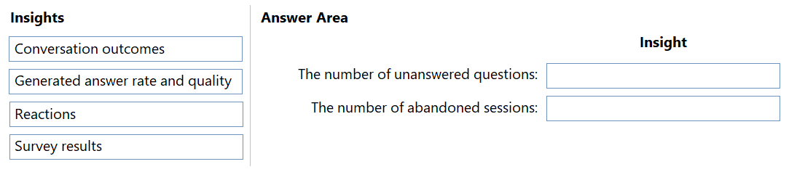

_DRAG DROP — the original ExamTopics question expects you to drag and drop items; the correct targets are not published._

**Most voted:**
- Generated answer rate and quality → Unanswered questions
- Conversation outcomes → Abandoned sessions
- Conversation outcomes include: - Completed sessions

### Top explanations
- **omath** (4 upvotes [Most Recent]): 1. Generated answer rate and quality → Unanswered questions
  This insight shows:
  - How often the agent generated an answer
  - How many times it failed to answer
  - Quality and grounding issues
  It is the only insight that directly exposes unanswered or low‑quality responses.
  2. Conversation outcomes → Abandoned sessions
  Conversation outcomes include:
  - Completed sessions
  - Escalated sessions
  - Failed sessions
  - Abandoned sessions
  This is the metric used to track when users leave before the agent completes the task.
- **Newb007** (3 upvotes): Correct

## Q3.23 (ID 384489)

You are evaluating a Microsoft Copilot Studio agent that supports Microsoft Dynamics 365 Customer Service representatives.
You need to recommend a testing solution that meets the following requirements:
Evaluates agent effectiveness during active sessions
Validates whether the agent delivers accurate and helpful responses
Provides measurable, actionable insights for continuous improvement
What should you recommend?

✅ **A.** Track resolution, deflection, and accuracy by using dashboards and use scripts to ensure consistent responses.
⭕ **B.** Perform load testing to validate how the agent scales under a high chat volume.
⭕ **C.** Review historical tickets to find agents that have the shortest resolution times.
⭕ **D.** Measure uptime and page load times.

**Correct answer:** A
**Most voted:** A

### Top explanations
- **omath** (4 upvotes [Most Recent, Selected Answer: A]): The correct recommendation is: A. Track resolution, deflection, and accuracy by using dashboards and use scripts to ensure consistent responses.
  Resolution, deflection, and accuracy dashboards provide:
  - Real‑time effectiveness metrics
  - How often the agent resolves vs. escalates
  - How many cases are deflected
  - Accuracy and grounding quality
  - Patterns of failure or misunderstanding
  Using scripts ensures consistent prompts and scenarios so you can measure improvements over time.
  This is the only option that meets all requirements.
- **Newb007** (2 upvotes [Selected Answer: A]): Correct

## Q3.24 (ID 384490)

A company uses multiple Microsoft Copilot Studio agents across different channels.
You need to recommend a monitoring solution that provides comprehensive telemetry data and performance insights for the agents.
What should you include in the recommendation?

✅ **A.** Application Insights
⭕ **B.** Azure Advisor
⭕ **C.** Azure DevOps
⭕ **D.** Microsoft Dynamics 365 Customer Voice

**Correct answer:** A
**Most voted:** A

### Top explanations
- **omath** (2 upvotes [Most Recent, Selected Answer: A]): The correct recommendation is: A. Application Insights
  When a company uses multiple Copilot Studio agents across different channels, you need a monitoring solution that can:
  - Collect centralized telemetry
  - Track performance, latency, failures, and usage patterns
  - Provide end‑to‑end observability
  - Support custom events, traces, and distributed logging
  - Scale across all agents and channels
  Application Insights is the only option that delivers this level of comprehensive monitoring.
- **madimad** (1 upvotes [Selected Answer: A]): Given answer is correct
- **Newb007** (1 upvotes [Selected Answer: A]): A. 100%

## Q3.25 (ID 384093)

A company has an AI solution built by using Microsoft Copilot Studio and Power Platform. The solution is used by the company's sales, marketing, and customer service teams.
You are performing a return on AI investment (ROAI) analysis to evaluate the impact of the solution.
You need to identify which measurable business drivers to include in the analysis.
Which two business drivers should you identify? Each correct answer presents part of the solution.
NOTE: Each correct selection is worth one point.

✅ **A.** the reduced average case resolution time
⭕ **B.** market capitalization
⭕ **C.** economic market predictability
✅ **D.** increased employee productivity
⭕ **E.** brand awareness

**Correct answer:** A, D
**Most voted:** AD

### Top explanations
- **omath** (5 upvotes [Most Recent, Selected Answer: AD]): A. the reduced average case resolution time
  This is a classic ROAI metric because it directly measures:
  - Faster customer service handling
  - Reduced operational cost per case
  - Higher customer satisfaction
  - Improved throughput for support teams
  It’s quantifiable, trackable, and directly impacted by AI assistance.
  D. increased employee productivity
  AI copilots improve productivity by:
  - Automating repetitive tasks
  - Drafting responses
  - Summarizing customer interactions
  - Reducing manual data entry
  This leads to measurable gains such as:
  - More cases handled per agent
  - More leads processed
  - More time spent on high‑value tasks
- **Newb007** (4 upvotes [Selected Answer: AD]): A and D.  You can't measure the rest in CPS.
- **Eberd** (1 upvotes [Selected Answer: AD]): Correcta
- **madimad** (1 upvotes [Selected Answer: AD]): given answer is correct

## Q3.26 (ID 406252)

A company has a Microsoft Foundry agent that summarizes customer feedback and recommends products to customers. The agent references data from multiple knowledge sources.
Users report that the agent response time is slow.
Telemetry data shows that the agent frequently reaches its token usage limit.
You need to recommend a solution to reduce token usage without degrading the quality of the generated responses.
What should you recommend?

✅ **A.** Chunk documents during indexing.
⭕ **B.** Reduce the number of knowledge sources used by the agent.
⭕ **C.** Reconfigure the prompts to limit the amount of retrieved content from the knowledge sources.
⭕ **D.** Lower the maximum token usage limit for the responses.

**Correct answer:** A
**Most voted:** A

### Top explanations
- **24b8eec** (8 upvotes [Highly Voted, Selected Answer: A]): Answer: A. Chunk documents during indexing.
  The key insight: the other three options all reduce tokens by removing information — fewer sources (B), less retrieved content (C), or a truncated response (D) — and each risks degrading quality. Chunking is the only option that cuts tokens by improving retrieval precision: smaller, semantically focused chunks mean the agent pulls in just the relevant content, so token usage drops while answer quality holds (or improves). That's exactly "reduce token usage without degrading quality."
- **omath** (6 upvotes [Selected Answer: C]): ✅ Correct Answer: C. Reconfigure the prompts to limit the amount of retrieved content from the knowledge sources
  This reduces token usage by:
  - Restricting how much grounding data is pulled into the prompt
  - Summarizing or chunking retrieved content before passing it to the model
  - Using more selective retrieval instructions
  - Reducing unnecessary context while keeping quality intact
  This is the standard optimization technique for Foundry and Azure OpenAI agents that hit token ceilings.
  It improves latency and reduces cost without degrading answer quality.
- **kevinirl** (4 upvotes [Selected Answer: A]): Reconfigure the prompts to limit the amount of retrieved content from the knowledge sources
  This sounds plausible but is not the best answer.
  Limiting retrieved content through prompt instructions can reduce tokens, but it may exclude important context needed for accurate answers. The question specifically asks for a solution that reduces token usage without degrading quality.
  Microsoft's guidance emphasizes solving this at the retrieval/indexing layer through chunking and retrieval optimisation rather than arbitrarily restricting context after retrieval.
- **timothy123** (4 upvotes [Selected Answer: C]): C. Reconfigure the prompts to limit the amount of retrieved content from the knowledge sources.
  Reduces Input Size: Limiting retrieved content directly decreases the number of tokens sent to the model per request.
  Improves Speed: Smaller prompts process faster, which fixes the slow response times.
  Preserves Quality: It filters out unnecessary background data while keeping the most relevant facts for accurate answers.
  Chunking documents helps with indexing, but does not actively constrain runtime token limits like prompt reconfiguration.
- **Joselito79** (3 upvotes [Most Recent, Selected Answer: C]): ✅ Correct answer: C. Reconfigure the prompts to limit the amount of retrieved content from the knowledge sources.
  Why C?
  The telemetry shows the agent is frequently hitting the token usage limit.
  The agent uses multiple knowledge sources, so excessive retrieved content is likely consuming tokens.
  Adjusting the prompts to limit the amount of retrieved content reduces token consumption while preserving the most relevant information and therefore response quality.

## Q3.27 (ID 406253)

HOTSPOT
A company has Microsoft Power Platform development, staging, and production environments. Each environment has its own Microsoft Dataverse tables and Azure AI Search index.
You are designing an application lifecycle management (AIM) process to deploy a Microsoft Copilot Studio agent between the environments.
The company has a Copilot Studio agent named Agent1 in development. Agent1 uses the following grounding data sources:
•	A Dataverse table named CustomerOrders
•	An Azure AI Search index named customer-knowledge
You need to deploy Agent1 to production. The solution must ensure that the agent uses the production grounding data sources, minimizes downtime, and handles credentials and endpoints securely.
What should you include in the deployment package solution, and what should you reconfigure after the deployment? To answer, select the appropriate options in the answer area.
NOTE: Each correct selection is worth one point.

**Exhibits**
- Exhibit 1: 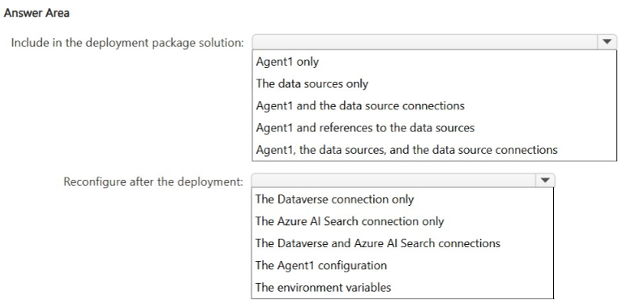

_HOTSPOT — the original ExamTopics question expects you to mark areas on the exhibit above; the correct hotspot coordinates are not published._

**Most voted:**
- Dataverse table: CustomerOrders
- Azure AI Search index: customer-knowledge
- Instead, you include: - Agent1
- Connections contain: - Environment‑specific endpoints
- Dataverse connection → point to production CustomerOrders
- Azure AI Search connection → point to production customer‑knowledge index

### Top explanations
- **omath** (11 upvotes [Highly Voted]): 1. Agent1 and references to the data sources
  You do not include actual data sources (Dataverse tables or Azure AI Search indexes) in the solution package.
  Each environment already has its own:
  - Dataverse table: CustomerOrders
  - Azure AI Search index: customer-knowledge
  Instead, you include:
  - Agent1
  - References to the data sources (not the data sources themselves)
  2. The Dataverse and Azure AI Search connections
  Connections contain:
  - Environment‑specific endpoints
  - Environment‑specific credentials
  - Environment‑specific indexes/tables
  Therefore, after deployment you must reconfigure:
  - Dataverse connection → point to production CustomerOrders
  - Azure AI Search connection → point to production customer‑knowledge index
- **Ninashnash** (1 upvotes [Most Recent]): Agent 1 and references to data sources: In Dev environment you configure Agent1 and (connection) references to the data sources
  The Dataverse and Azure AI Connections: In Prod env, you need to configure "connections" to both data sources

## Q3.28 (ID 406254)

A company has a Microsoft Copilot Studio agent that uses generative AI to assist Microsoft Dynamics 365 Customer Service representatives.
The agent currently exhibits a low resolution rate and a high escalation rate.
You need to identify the issue.
What should you use?

⭕ **A.** the Agent dashboard of Dynamics 365 Customer Service historical analytics
⭕ **B.** the Insights tab from the Search & intelligence settings of the Microsoft 365 admin center
⭕ **C.** the Copilot hub in the Power Platform admin center
✅ **D.** the Analytics tab in Copilot Studio

**Correct answer:** D
**Most voted:** D

### Top explanations
- **omath** (6 upvotes [Most Recent, Selected Answer: D]): ✅ Correct Answer: D. the Analytics tab in Copilot Studio
  The Analytics tab in Copilot Studio provides:
  - Resolution rate
  - Escalation rate
  - Abandoned sessions
  - Unanswered questions
  - Topic performance
  - Generated answer quality
  - Grounding effectiveness
  - Session outcomes
  This is exactly where you identify why the agent is failing to resolve cases and escalating too often.
- **deca0d4** (2 upvotes [Selected Answer: D]): The Analytics tab is used to monitor, evaluate, and improve agent performance by providing insights into conversation outcomes, topic effectiveness, user engagement, and response quality.

## Q3.29 (ID 406255)

A company has a Microsoft Foundry generative AI model.
You need to evaluate the model's output to measure the overall quality and coherence of generated responses. The evaluation must use GPT-4o as a judge and return a numeric score for each output.
Which type of metric should you use?

⭕ **A.** AI quality (NLP)
⭕ **B.** risk and safety
⭕ **C.** Groundedness
✅ **D.** AI quality (AI assisted)

**Correct answer:** D
**Most voted:** D

### Top explanations
- **24b8eec** (3 upvotes [Most Recent, Selected Answer: D]): The decisive clue is "GPT-4o as a judge." AI-assisted quality metrics are exactly the ones that use an LLM to score generation quality (coherence, fluency, relevance) and return a numeric score. The distractors each break one requirement: NLP metrics (BLEU/ROUGE) are math-based with no judge, risk and safety measures harm not quality, and Groundedness is a single metric rather than the metric type covering overall quality/coherence.
  Memory hook now in your notes:
  LLM-as-judge + quality/coherence + score → AI quality (AI assisted)
  BLEU/ROUGE/F1 → AI quality (NLP)
  Harm detection → risk and safety
- **omath** (3 upvotes [Selected Answer: D]): ✅ Correct Answer: D. AI quality (AI assisted)
  AI quality (AI assisted)
  This metric:
  - Uses an LLM (like GPT‑4o) as an evaluator
  - Scores each output numerically
  - Measures coherence, clarity, helpfulness, and correctness
  - Provides consistent, automated evaluation
  - Is the recommended approach for Foundry model quality assessment
  This is exactly what the question describes.
- **deca0d4** (2 upvotes [Selected Answer: D]): AI quality – AI-assisted
  This measures:
  How good the response is (after the agent understands the question)
  What it looks at:
  Relevance
  Accuracy
  Helpfulness
  Completeness

## Q3.30 (ID 406256)

HOTSPOT
You use Microsoft Copilot Studio analytics to analyze the performance of a deployed Copilot Studio agent.
You need to identify which performance metrics to use to measure the following:
•	The percentage of engaged sessions that are escalated to a live customer service representative
•	The number of agent queries that cause a knowledge source error
What should you identify for each requirement? To answer, select the appropriate options in the answer area.
NOTE: Each correct selection is worth one point.

**Exhibits**
- Exhibit 1: 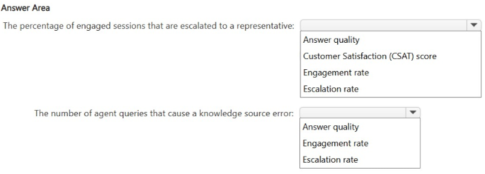

_HOTSPOT — the original ExamTopics question expects you to mark areas on the exhibit above; the correct hotspot coordinates are not published._

**Most voted:**
- Escalation rate → % of engaged sessions escalated
- Escalation rate measures: - How many engaged sessions required a human handoff
- Answer quality → Knowledge source errors

### Top explanations
- **omath** (7 upvotes [Most Recent, Highly Voted]): 1. Escalation rate → % of engaged sessions escalated
  Escalation rate measures:
  - How many engaged sessions required a human handoff
  - The percentage of conversations that the agent could not resolve
  - A key indicator of agent effectiveness
  This directly matches the first requirement.
  2. Answer quality → Knowledge source errors
  The Answer quality insight includes:
  - Knowledge source errors
  - Retrieval failures
  - Hallucinations
  - Poor grounding
  - Low‑quality or incomplete answers
  It is the only metric that reports knowledge source errors.

## Q3.31 (ID 406257)

A company plans to deploy a Microsoft Foundry agent.
You need to recommend an application lifecycle management (ALM) process to ensure that the agent evaluates against baseline accuracy metrics before being deployed.
What should you recommend?

⭕ **A.** Configure GitHub Actions for new agent versions.
⭕ **B.** Deploy each new agent version directly to production.
✅ **C.** Use Observability in Foundry Control Plane with evaluation and drift monitoring.
⭕ **D.** Enable Application Insights and use Azure Monitor.

**Correct answer:** C
**Most voted:** C

### Top explanations
- **omath** (9 upvotes [Highly Voted, Selected Answer: C]): ✅ Correct Answer: C. Use Observability in Foundry Control Plane with evaluation and drift monitoring
  Observability in Foundry Control Plane gives you:
  - Automated evaluation pipelines
  - Baseline accuracy scoring
  - LLM‑as‑a‑judge evaluations
  - Drift detection (data drift, behavior drift, quality drift)
  - Quality gates before deployment
  - Continuous monitoring after deployment
  This is exactly what an ALM process requires for safe, high‑quality AI deployment.
- **deca0d4** (2 upvotes [Selected Answer: A]): you can (and should) enforce this with GitHub Actions for every new agent version.
  ✅ Use a CI/CD workflow with an automated evaluation step + a quality gate that blocks deployment if the baseline isn’t met.
- **inboxofdt** (1 upvotes [Selected Answer: A]): Requirement Alignment: The scenario specifically asks for an application lifecycle management (ALM) process that enforces a quality check before the agent is deployed. GitHub Actions is a native CI/CD orchestration tool used for ALM.
- **Luweho** (1 upvotes [Most Recent]): But this is not what this question asks for. We shal make sure that "the agent evaluates against baseline accuracy metrics before (!) being deployed", nothing else.

## Q3.32 (ID 406258)

You need to recommend a security solution for agents in a Microsoft Power Platform environment.
The agents must use only approved connectors and services. The solution must prevent the agents from accessing sensitive data.
What should you recommend?

⭕ **A.** Configure Azure Monitor to capture connector activity logs.
⭕ **B.** Enable a Microsoft Dataverse audit.
✅ **C.** Deploy data loss prevention (DLP) policies in Power Platform.
⭕ **D.** Enable customer-managed keys in Microsoft Dataverse.

**Correct answer:** C
**Most voted:** C

### Top explanations
- **omath** (4 upvotes [Most Recent, Selected Answer: C]): ✅ Correct Answer: C. Deploy data loss prevention (DLP) policies in Power Platform
  Power Platform DLP policies allow you to:
  - Control which connectors agents are allowed to use
  - Block or restrict unapproved or risky connectors
  - Separate connectors into Business, Non‑Business, and Blocked categories
  - Prevent agents from accessing sensitive data sources
  - Apply policies at the environment, tenant, or solution level
  This is the official and recommended way to enforce connector governance for Copilot Studio agents, Power Automate flows, and Power Apps.

## Q3.33 (ID 406259)

A company has an AI business solution that uses Microsoft Copilot Studio agents.
You need to recommend prompt best practices to improve the effectiveness of agent interactions.
Which two actions should you include in the recommendation? Each correct answer presents part of the solution.
NOTE: Each correct selection is worth one point.

⭕ **A.** Track the duration of the average user session.
⭕ **B.** Analyze the prompt length distribution.
✅ **C.** Regularly test and refine the prompts based on user input.
✅ **D.** Use clear and specific instructions in the prompts.
⭕ **E.** Measure system resource usage during prompt processing.

**Correct answer:** C, D
**Most voted:** CD

### Top explanations
- **omath** (6 upvotes [Most Recent, Selected Answer: CD]): C. Regularly test and refine the prompts based on user input
  Clear prompts reduce ambiguity and help the agent:
  - Stay on topic
  - Produce more accurate responses
  - Follow business rules consistently
  This is one of the core principles of effective prompt engineering.
  D. Use clear and specific instructions in the prompts
  Prompts must evolve based on:
  - Real user interactions
  - Failure cases
  - Escalations
  - Low‑quality answers
  Iterative refinement is essential for improving agent performance over time.

## Q3.34 (ID 406260)

DRAG DROP
A company has a cloud-based AI solution that uses Azure OpenAI models.
You need to design a monitoring solution that meets the following requirements:
•	Monitors performance metrics and operational health for the models
•	Monitors AI apps and agents for compliance
•	Uses Azure-native capabilities
•	Minimizes development effort
What should you use for each requirement? To answer, drag the appropriate options to the correct requirements. Each option may be used once, more than once, or not at all. You may need to drag the split bar between panes or scroll to view content.
NOTE: Each correct selection is worth one point.

**Exhibits**
- Exhibit 1: 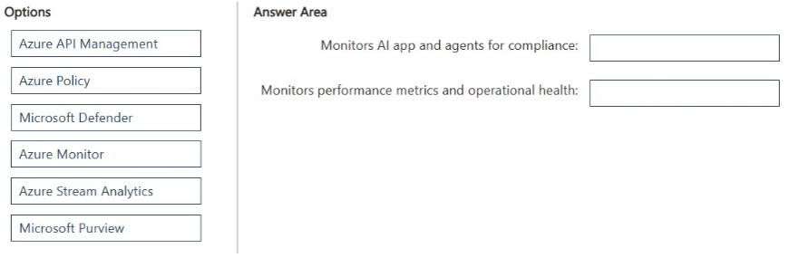

_DRAG DROP — the original ExamTopics question expects you to drag and drop items; the correct targets are not published._

**Most voted:**
- Microsoft Purview → Compliance monitoring
- Purview provides: - Data access governance
- Azure Monitor → Performance & operational health
- Azure Monitor provides: - Latency metrics

### Top explanations
- **omath** (6 upvotes [Most Recent]): 1. Microsoft Purview → Compliance monitoring
  Purview provides:
  - Data access governance
  - Sensitive data classification
  - Lineage tracking
  - Policy enforcement
  - Compliance insights for AI apps and agents
  It is the only Azure‑native service designed specifically for compliance monitoring.
  2. Azure Monitor → Performance & operational health
  Azure Monitor provides:
  - Latency metrics
  - Throughput
  - Token usage
  - Errors and exceptions
  - Dependency performance
  - Health dashboards
  It is the standard Azure‑native solution for operational monitoring of Azure OpenAI and AI applications.

## Q3.35 (ID 406261)

A company has Microsoft Copilot Studio agents.
The company plans to deploy custom connectors across development, test and production environments.
You need to design an application lifecycle management (ALM) process to ensure consistency and prevent direct editing in production.
Which two actions should you include in the design? Each correct answer presents part of the solution.
NOTE: Each correct selection is worth one point.

✅ **A.** Deploy managed solutions to production.
⭕ **B.** Deploy unmanaged solutions to production.
⭕ **C.** Manually rebuild the agents in each environment.
⭕ **D.** Move the agents between the environments by using data export and import.
✅ **E.** Include agents and connectors in a solution.

**Correct answer:** A, E
**Most voted:** AE

### Top explanations
- **deca0d4** (6 upvotes [Selected Answer: AE]): A: In the Power Platform (including Copilot Studio), custom connectors must be included in solutions to support proper ALM.
  Build and edit in Dev (unmanaged solution)
  Export and deploy as a managed solution to Test and Production
  Managed solutions are read-only in production, preventing direct edits
  E: In the Power Platform (including Copilot Studio), custom connectors must be included in solutions to support proper ALM.
- **omath** (3 upvotes [Most Recent, Selected Answer: AE]): A. Deploy managed solutions to production
  Managed solutions:
  - Prevent editing in production (a key requirement)
  - Lock down components so only dev/test can modify them
  - Ensure controlled, versioned deployments
  - Are the Microsoft‑recommended practice for production environments
  E. Include agents and connectors in a solution
  This is essential because:
  - Solutions are the ALM unit in Power Platform
  - Custom connectors must be packaged inside solutions for proper versioning
  - Copilot Studio agents are solution components and must be moved this way
  - Ensures consistent deployment across environments

## Q3.36 (ID 406262)

A company uses multiple Microsoft Copilot Studio agents across different channels.
You need to recommend a monitoring solution that provides comprehensive telemetry data and performance insights for the agents.
What should you include in the recommendation?

✅ **A.** Application Insights
⭕ **B.** Microsoft Dynamics 365 Customer Voice
⭕ **C.** Log Analytics
⭕ **D.** Microsoft Purview

**Correct answer:** A
**Most voted:** A

### Top explanations
- **deca0d4** (4 upvotes [Selected Answer: A]): Application Insights offers a unified view of agent performance, usage, and diagnostics across multiple sources
- **omath** (3 upvotes [Most Recent, Selected Answer: A]): ✅ Correct Answer: A. Application Insights
  🧠 Why Application Insights is the right choice
  Application Insights gives you:
  - End‑to‑end telemetry
  - Latency, token usage, failures, exceptions
  - Dependency tracking (Dataverse, connectors, APIs)
  - Custom events for agent interactions
  - Dashboards and alerts
  - Works across all channels (web, Dynamics, custom apps)
  This is the recommended monitoring solution for Copilot Studio agents at scale.

## Q3.37 (ID 406263)

A company has an AI solution named Solution1 that is deployed to the production environment. Solution1 uses an Azure OpenAI model to generate marketing emails for existing customers.
During an internal review, you identify that Solution1 creates different emails depending on the customers’ traits.
You need to recommend a strategy to mitigate the bias. The strategy must adhere to Microsoft responsible AI principles.
What should you recommend?

⭕ **A.** Modify Solution1 to randomly generate emails for different traits.
✅ **B.** Modify the system instructions of Solution1.
⭕ **C.** Retrain the model by using a larger dataset.
⭕ **D.** Modify the contents of the training dataset.

**Correct answer:** B
**Most voted:** B

### Top explanations
- **timothy123** (5 upvotes [Selected Answer: B]): Right answer is B: Modify the system instructions.
  By adding strict guidelines to the system prompt (e.g., "Ensure all marketing offers maintain equal value and tone across all demographic traits"), you directly enforce the Microsoft principle of Fairness, ensuring the AI treats all demographic groups equitably without rewriting the underlying model architecture.
  Azure OpenAI relies on large, pre-trained foundation models (like GPT-4). You cannot easily rewrite their core training data. System instructions (system prompts) are the primary tool for a developer to guide model behavior in real time.
  Answer A is definitely wrong. Introducing randomness does not remove bias; it only makes the bias unpredictable.
- **24b8eec** (5 upvotes [Selected Answer: A]): Answer: B. Modify the system instructions of Solution1
  The issue is output bias — the deployed model generates different emails based on customer traits (age, gender, location, etc.), which violates fairness principles. The fastest, most targeted responsible-AI mitigation for a deployed production solution is to modify the system prompt/instructions to explicitly instruct the model to generate consistent, trait-neutral marketing emails regardless of who the customer is. This is a direct, immediate fix that doesn't require retraining or data changes.
- **omath** (4 upvotes [Selected Answer: D]): ✅ Correct Answer: D. Modify the contents of the training dataset
  🧠 Why this is the correct choice
  Bias in model outputs typically originates from:
  - Biased or unbalanced training data
  - Over‑representation of certain traits
  - Patterns in the dataset that the model learns and amplifies
  Responsible AI guidance from Microsoft emphasizes:
  - Reviewing and correcting training data
  - Removing or balancing sensitive attributes
  - Ensuring datasets do not encode harmful or discriminatory patterns
  This is the most direct and effective way to mitigate bias.
- **Aarch** (3 upvotes [Selected Answer: B]): System instructions guide the model's behavior.
  You can add instructions that require fair and consistent treatment of customers and prevent the use of protected or sensitive traits when generating content.
  This aligns with Microsoft's Responsible AI principle of Fairness.
- **ziggy1117** (2 upvotes [Selected Answer: A]): Should be the system instructions.
  If D, that means doing a fine-tuned model. That doesn't make sense if the requirement is just to send out emails

## Q3.38 (ID 406264)

A company has a canvas app named App1 in a Microsoft Power Platform environment named Env1.
Env1 uses a customer-managed key for data encryption. App1 connects to multiple data sources to retrieve and update customer and order information.
You need to recommend a solution to add Microsoft Copilot components to App1. The solution must NOT modify the current security or encryption configurations of Env1.
What should you include in the recommendation?

⭕ **A.** Modify the data sources of App1 to make them compatible with Copilot.
⭕ **B.** Duplicate App1 and republish the app in Env1.
⭕ **C.** Enable Copilot features for Env1.
✅ **D.** Move App1 to a new environment that uses Microsoft-managed keys.

**Correct answer:** D
**Most voted:** D

### Top explanations
- **24b8eec** (8 upvotes [Highly Voted, Selected Answer: D]): Answer: D. This is a documented platform constraint. Microsoft Copilot components do not work in environments that use a customer-managed key (CMK) — this is stated explicitly in Power Apps documentation ("Copilot doesn't work in environments that use a customer-managed key or Customer Lockbox"). Since the requirement says the solution must NOT modify the current security/encryption configuration of Env1, you cannot simply enable Copilot in Env1. The only path forward is to move App1 to a new environment that uses Microsoft-managed keys, where Copilot components are supported.
- **Aronmb23** (3 upvotes [Most Recent, Selected Answer: C]): Copilot components in canvas apps rely on the Copilot generative AI features being enabled at the environment level. Since App1 already connects successfully to its data sources, and Env1's customer-managed key already governs encryption for whatever data the environment stores, turning on Copilot at the environment level doesn't touch the CMK configuration or the app's existing connections — it just makes the Copilot capability available for App1 to consume.
  The other options don't fit: A modifies data sources unnecessarily (Copilot doesn't require source-level compatibility changes); B duplicating the app does nothing to enable Copilot; D moving to a Microsoft-managed-key environment directly violates the "must not modify encryption configuration" constraint.
- **CyrilleC** (3 upvotes [Selected Answer: D]): his is a documented platform constraint. Microsoft Copilot components do not work in environments that use a customer-managed key (CMK)
  https://learn.microsoft.com/en-us/power-platform/release-plan/2025wave1/microsoft-copilot-studio/use-customer-managed-encryption-keys-protect-data
  https://learn.microsoft.com/en-us/power-apps/maker/canvas-apps/add-ai-copilot
- **omath** (3 upvotes [Selected Answer: C]): ✅ Correct Answer: C. Enable Copilot features for Env1
  🧠 Why this is correct
  Copilot features in Power Apps (Copilot control, Copilot answers, Copilot suggestions) are environment‑level capabilities.
  Enabling them:
  - Does NOT modify encryption settings (CMK remains untouched)
  - Does NOT require moving the app
  - Does NOT require changing data sources
  - Allows Copilot components to be added directly to App1
  Microsoft explicitly supports Copilot features in environments using customer‑managed keys.
- **Alicia_lili** (3 upvotes [Selected Answer: D]): D. Move App1 to a new environment that uses Microsoft-managed keys.

## Q3.39 (ID 406265)

Overview
Contoso, Ltd. is a high-tech manufacturing company that uses Microsoft Dynamics 365 Finance. Dynamics 365 Supply Chain Management, and Dynamics 365 Commerce for its North American operations. The company designs and develops innovative products that have many patents and proprietary technologies. The patents and engineering designs are closely guarded secrets.
Contoso executives want to integrate and adopt AI solutions to help scale the company in preparation for an anticipated period of rapid growth.
The company has multiple legal entities and Azure subscriptions that will be used in the adopted AI solutions.
Requirements
AI Adoption
The following executives will have specific responsibilities in the overall AI adoption:
•	Chief Technology Officer (CTO): Select one Dynamics 365 Finance, Dynamics 365 Supply Chain Management or Dynamics 365 Commerce prebuilt AI agent and one custom Microsoft Copilot Studio AI agent to prioritize and deploy during the initial AI adoption phase.
•	Chief Information Officer (CIO): Ensure that appropriate security labels are assigned to the data used by the AI agents.
•	Chief Financial Officer (CFO): Analyze the return on investment (ROI) for the AI agents being deployed.
•	Chief Information Security Officer (CISO): Discover and inventory AI resources for auditing.
•	Chief Executive Officer (CEO): Ensure that all solutions adhere to industry-standard responsible AI practices.
All AI initiatives and agents will have a detailed business use case, a defined audience profile, and an estimated ROI that will compare the cost savings of the current process against the estimated costs of using the new AI solutions.
The company's research and development (R&D) department already has a custom Model Context Protocol (MCP) server that contains comprehensive product specifications and compliance data.
Prebuilt AI Agent
The CTO has NOT yet selected which prebuilt AI agent to use in Dynamics 365 Supply Chain Management. The CTO wants to view available agent templates to identify which agent will add the most business value.
Depending on which high-priority AI agents are identified, its agent capabilities must be previewed in a discovery meeting with the relevant business operation stakeholders.
Custom AI Agent
Contoso has identified the following custom AI agent requirements:
•	The custom AI agent will use data from Dynamics 365 Supply Chain Management to answer questions for the manufacturing team as a low-code solution.
•	The custom AI agent will be accessible from within Microsoft Teams.
•	The custom AI agent must be designed to eventually connect to other agents that can be selected based on their description.
•	The topics used in the custom AI agent will be selected based NOT on a trigger phrase, but on a description of the purpose of the query, to make the interactions more conversational.
•	The custom AI agent must be able to answer questions about product specifications by using existing technologies. The product specifications are maintained by the R&D department.
•	The custom AI agent must be integrated with and accessible from Dynamics 365 Supply Chain Management.
•	The custom AI agent must be able to use Dynamics 365 Supply Chain Management business logic that is stored outside of the application.
Analysis, Reporting, and Troubleshooting
Contoso has identified the following analysis, reporting, and troubleshooting requirements:
•	The CISO will audit all the AI solutions monthly for compliance and security.
•	The CFO will analyze all the AI solutions quarterly to compare the estimated ROI against actual measured efficiencies and adoption. The CFO will use the Copilot Studio agent usage estimator to perform this analysis.
•	The CISO wants to identify how much sensitive data was accessed for a given AI agent run and who accessed the data. Too much sensitive data accessed by a single user might indicate a high security risk.
•	The CTO wants to track user feedback on the quality of the AI agent responses during user interactions with the agents. Consistently poor feedback will trigger an escalated reengineering discussion.
•	The CEO wants a quarterly assessment of all the required metrics for their specific responsibilities. The tools used for the assessments must be Microsoft-recommended and must verify reliability, interpretability, fairness, and compliance.
•	The CFO wants to identify how many interactions with the AI agents are abandoned on a given day as compared to resolved conversations. Too many abandoned sessions might indicate that Copilot Studio credits are being used inefficiently by end users.
Which two components for the custom AI agent should you include in the application lifecycle management (AIM) process? Each correct answer presents part of the solution.
NOTE: Each correct selection is worth one point.

⭕ **A.** an Azure package
⭕ **B.** a ZIP package
✅ **C.** a Microsoft Power Platform solution
⭕ **D.** a Cloud Scale Unit (CSU) package
✅ **E.** an X++model

**Correct answer:** C, E
**Most voted:** CE

### Top explanations
- **24b8eec** (5 upvotes [Selected Answer: CE]): Why not the others
  A. Azure package — a generic Azure deployment artifact; not the packaging mechanism for either a Copilot Studio agent or D365 F&O business logic.
  B. ZIP package — Power Platform solutions export as .zip files, but the component in the ALM process is the solution (C), not the raw ZIP. ZIP is the transport format, not the ALM component.
  D. Cloud Scale Unit (CSU) package — used specifically for Dynamics 365 Commerce headless commerce (store components, CDX, etc.). Contoso's agent is in SCM, not Commerce.
- **Ninashnash** (2 upvotes [Selected Answer: CE]): C. Microsoft Power Platform solution — The agent is built in Copilot Studio, part of the Power Platform. Power Platform solutions are the standard ALM packaging unit for Copilot Studio agents, enabling versioning and promotion across environments.
  E. an X++ model — The agent must use D365 SCM business logic stored outside the app. Custom business logic for D365 Finance & Operations apps is packaged as X++ models, the standard ALM unit deployed via LCS/Azure DevOps.
- **omath** (2 upvotes [Selected Answer: BC]): ✅ B. a ZIP package
  This is required because Copilot Studio exports agents as ZIP files when:
  - Moving between tenants
  - Backing up agents
  - Importing into another environment
  - Packaging custom connectors (OpenAPI definitions are also ZIP‑based)
  ✅ C. Microsoft Power Platform solution
  This is mandatory for ALM of Copilot Studio agents.
  Copilot Studio agents are packaged and moved between environments only through Power Platform solutions.
  Solutions provide:
  - Versioning
  - Dependency tracking
  - Managed/unmanaged deployment
  - Environment promotion (Dev → Test → Prod)
- **Ninashnash** (2 upvotes): B (A ZIP package) is not correct : While solution files or custom connectors are exported as .zip archive files during transit, the underlying operational ALM component used for environment management is the Power Platform solution itself. E should be selected not C
- **Luweho** (1 upvotes [Most Recent, Selected Answer: CE]): An X++ model is required "to use Dynamics 365 Supply Chain Management business logic that is stored outside of the application"

## Q3.40 (ID 406266)

DRAG DROP
Overview
Contoso, Ltd. is a high-tech manufacturing company that uses Microsoft Dynamics 365 Finance. Dynamics 365 Supply Chain Management, and Dynamics 365 Commerce for its North American operations. The company designs and develops innovative products that have many patents and proprietary technologies. The patents and engineering designs are closely guarded secrets.
Contoso executives want to integrate and adopt AI solutions to help scale the company in preparation for an anticipated period of rapid growth.
The company has multiple legal entities and Azure subscriptions that will be used in the adopted AI solutions.
Requirements
AI Adoption
The following executives will have specific responsibilities in the overall AI adoption:
•	Chief Technology Officer (CTO): Select one Dynamics 365 Finance, Dynamics 365 Supply Chain Management or Dynamics 365 Commerce prebuilt AI agent and one custom Microsoft Copilot Studio AI agent to prioritize and deploy during the initial AI adoption phase.
•	Chief Information Officer (CIO): Ensure that appropriate security labels are assigned to the data used by the AI agents.
•	Chief Financial Officer (CFO): Analyze the return on investment (ROI) for the AI agents being deployed.
•	Chief Information Security Officer (CISO): Discover and inventory AI resources for auditing.
•	Chief Executive Officer (CEO): Ensure that all solutions adhere to industry-standard responsible AI practices.
All AI initiatives and agents will have a detailed business use case, a defined audience profile, and an estimated ROI that will compare the cost savings of the current process against the estimated costs of using the new AI solutions.
The company's research and development (R&D) department already has a custom Model Context Protocol (MCP) server that contains comprehensive product specifications and compliance data.
Prebuilt AI Agent
The CTO has NOT yet selected which prebuilt AI agent to use in Dynamics 365 Supply Chain Management. The CTO wants to view available agent templates to identify which agent will add the most business value.
Depending on which high-priority AI agents are identified, its agent capabilities must be previewed in a discovery meeting with the relevant business operation stakeholders.
Custom AI Agent
Contoso has identified the following custom AI agent requirements:
•	The custom AI agent will use data from Dynamics 365 Supply Chain Management to answer questions for the manufacturing team as a low-code solution.
•	The custom AI agent will be accessible from within Microsoft Teams.
•	The custom AI agent must be designed to eventually connect to other agents that can be selected based on their description.
•	The topics used in the custom AI agent will be selected based NOT on a trigger phrase, but on a description of the purpose of the query, to make the interactions more conversational.
•	The custom AI agent must be able to answer questions about product specifications by using existing technologies. The product specifications are maintained by the R&D department.
•	The custom AI agent must be integrated with and accessible from Dynamics 365 Supply Chain Management.
•	The custom AI agent must be able to use Dynamics 365 Supply Chain Management business logic that is stored outside of the application.
Analysis, Reporting, and Troubleshooting
Contoso has identified the following analysis, reporting, and troubleshooting requirements:
•	The CISO will audit all the AI solutions monthly for compliance and security.
•	The CFO will analyze all the AI solutions quarterly to compare the estimated ROI against actual measured efficiencies and adoption. The CFO will use the Copilot Studio agent usage estimator to perform this analysis.
•	The CISO wants to identify how much sensitive data was accessed for a given AI agent run and who accessed the data. Too much sensitive data accessed by a single user might indicate a high security risk.
•	The CTO wants to track user feedback on the quality of the AI agent responses during user interactions with the agents. Consistently poor feedback will trigger an escalated reengineering discussion.
•	The CEO wants a quarterly assessment of all the required metrics for their specific responsibilities. The tools used for the assessments must be Microsoft-recommended and must verify reliability, interpretability, fairness, and compliance.
•	The CFO wants to identify how many interactions with the AI agents are abandoned on a given day as compared to resolved conversations. Too many abandoned sessions might indicate that Copilot Studio credits are being used inefficiently by end users.
Which tools should you recommend to assist the CISO and the CIO with their specific responsibilities? To answer, drag the appropriate tools to the correct executives. Each tool may be used once, more than once, or not at all. You may need to drag the split bar between panes or scroll to view content.
NOTE: Each correct selection is worth one point.

**Exhibits**
- Exhibit 1: 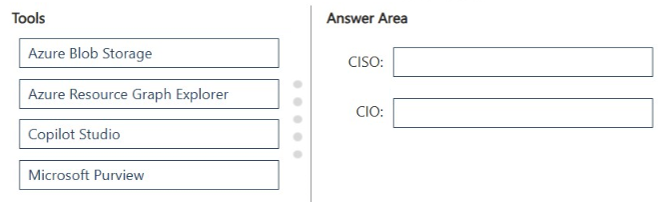

_DRAG DROP — the original ExamTopics question expects you to drag and drop items; the correct targets are not published._

**Most voted:** CISO → Azure Resource Graph Explorer. The CISO's responsibility is to "discover and inventory AI resources for auditing." Azure Resource Graph Explorer is exactly the tool for this — it queries and inventories Azure resources at scale across subscriptions, letting the CISO discover all AI resources (Azure OpenAI, Foundry projects, etc.) across Contoso's...

### Top explanations
- **24b8eec** (8 upvotes [Highly Voted]): CISO → Azure Resource Graph Explorer. The CISO's responsibility is to "discover and inventory AI resources for auditing." Azure Resource Graph Explorer is exactly the tool for this — it queries and inventories Azure resources at scale across subscriptions, letting the CISO discover all AI resources (Azure OpenAI, Foundry projects, etc.) across Contoso's multiple Azure subscriptions for compliance auditing.
  CIO → Microsoft Purview. The CIO's responsibility is to "ensure that appropriate security labels are assigned to the data used by the AI agents." Microsoft Purview is the data-governance platform that manages sensitivity labels and data classification — the CIO uses it to apply and verify security labels on the data the agents consume.
- **omath** (3 upvotes): 1. CISO → Microsoft Purview
  The CISO must:
  - Discover and inventory AI resources for auditing
  - Identify how much sensitive data was accessed
  - See who accessed sensitive data
  - Perform monthly compliance and security audits
  These responsibilities align exactly with Microsoft Purview.
  2. CIO → Copilot Studio
  The CIO must:
  - Ensure appropriate security labels are assigned to the data used by AI agents
  Security labels for AI agents are configured within Copilot Studio, where the CIO can:
  - Assign data classifications
  - Configure data access policies
  - Manage connectors and data sources
  - Apply environment-level governance
  Copilot Studio is the correct tool for managing data labeling and governance for AI agents.
- **Ninashnash** (1 upvotes [Most Recent]): CISO → Azure Resource Graph Explorer
  Why:
  CISO Requirement: Discover and inventory AI resources for auditing.
  Solution: Azure Resource Graph Explorer is designed to query and inventory Azure resources across multiple subscriptions, which fits:
  -multiple Azure subscriptions
  -discover AI resources
  -auditing and inventory

## Q3.41 (ID 406267)

Overview
Contoso, Ltd. is a high-tech manufacturing company that uses Microsoft Dynamics 365 Finance. Dynamics 365 Supply Chain Management, and Dynamics 365 Commerce for its North American operations. The company designs and develops innovative products that have many patents and proprietary technologies. The patents and engineering designs are closely guarded secrets.
Contoso executives want to integrate and adopt AI solutions to help scale the company in preparation for an anticipated period of rapid growth.
The company has multiple legal entities and Azure subscriptions that will be used in the adopted AI solutions.
Requirements
AI Adoption
The following executives will have specific responsibilities in the overall AI adoption:
•	Chief Technology Officer (CTO): Select one Dynamics 365 Finance, Dynamics 365 Supply Chain Management or Dynamics 365 Commerce prebuilt AI agent and one custom Microsoft Copilot Studio AI agent to prioritize and deploy during the initial AI adoption phase.
•	Chief Information Officer (CIO): Ensure that appropriate security labels are assigned to the data used by the AI agents.
•	Chief Financial Officer (CFO): Analyze the return on investment (ROI) for the AI agents being deployed.
•	Chief Information Security Officer (CISO): Discover and inventory AI resources for auditing.
•	Chief Executive Officer (CEO): Ensure that all solutions adhere to industry-standard responsible AI practices.
All AI initiatives and agents will have a detailed business use case, a defined audience profile, and an estimated ROI that will compare the cost savings of the current process against the estimated costs of using the new AI solutions.
The company's research and development (R&D) department already has a custom Model Context Protocol (MCP) server that contains comprehensive product specifications and compliance data.
Prebuilt AI Agent
The CTO has NOT yet selected which prebuilt AI agent to use in Dynamics 365 Supply Chain Management. The CTO wants to view available agent templates to identify which agent will add the most business value.
Depending on which high-priority AI agents are identified, its agent capabilities must be previewed in a discovery meeting with the relevant business operation stakeholders.
Custom AI Agent
Contoso has identified the following custom AI agent requirements:
•	The custom AI agent will use data from Dynamics 365 Supply Chain Management to answer questions for the manufacturing team as a low-code solution.
•	The custom AI agent will be accessible from within Microsoft Teams.
•	The custom AI agent must be designed to eventually connect to other agents that can be selected based on their description.
•	The topics used in the custom AI agent will be selected based NOT on a trigger phrase, but on a description of the purpose of the query, to make the interactions more conversational.
•	The custom AI agent must be able to answer questions about product specifications by using existing technologies. The product specifications are maintained by the R&D department.
•	The custom AI agent must be integrated with and accessible from Dynamics 365 Supply Chain Management.
•	The custom AI agent must be able to use Dynamics 365 Supply Chain Management business logic that is stored outside of the application.
Analysis, Reporting, and Troubleshooting
Contoso has identified the following analysis, reporting, and troubleshooting requirements:
•	The CISO will audit all the AI solutions monthly for compliance and security.
•	The CFO will analyze all the AI solutions quarterly to compare the estimated ROI against actual measured efficiencies and adoption. The CFO will use the Copilot Studio agent usage estimator to perform this analysis.
•	The CISO wants to identify how much sensitive data was accessed for a given AI agent run and who accessed the data. Too much sensitive data accessed by a single user might indicate a high security risk.
•	The CTO wants to track user feedback on the quality of the AI agent responses during user interactions with the agents. Consistently poor feedback will trigger an escalated reengineering discussion.
•	The CEO wants a quarterly assessment of all the required metrics for their specific responsibilities. The tools used for the assessments must be Microsoft-recommended and must verify reliability, interpretability, fairness, and compliance.
•	The CFO wants to identify how many interactions with the AI agents are abandoned on a given day as compared to resolved conversations. Too many abandoned sessions might indicate that Copilot Studio credits are being used inefficiently by end users.
What should you recommend to assist the CEO with their specific responsibilities?

⭕ **A.** the Microsoft Service Trust Portal
⭕ **B.** Microsoft Foundry Tools
⭕ **C.** Microsoft Purview
✅ **D.** the Responsible AI dashboard
⭕ **E.** Compliance Center

**Correct answer:** D
**Most voted:** D

### Top explanations
- **omath** (7 upvotes [Most Recent, Highly Voted, Selected Answer: D]): 👉 D. the Responsible AI dashboard
  The Responsible AI dashboard is the only option that provides:
  - Model fairness analysis
  - Error and bias detection
  - Explainability and interpretability reports
  - Safety and reliability evaluations
  - Compliance‑aligned assessments
  - A unified view of responsible AI metrics across agents and models
  This aligns perfectly with the CEO’s responsibilities.

## Q3.42 (ID 406268)

DRAG DROP
Overview
Contoso, Ltd. is a high-tech manufacturing company that uses Microsoft Dynamics 365 Finance. Dynamics 365 Supply Chain Management, and Dynamics 365 Commerce for its North American operations. The company designs and develops innovative products that have many patents and proprietary technologies. The patents and engineering designs are closely guarded secrets.
Contoso executives want to integrate and adopt AI solutions to help scale the company in preparation for an anticipated period of rapid growth.
The company has multiple legal entities and Azure subscriptions that will be used in the adopted AI solutions.
Requirements
AI Adoption
The following executives will have specific responsibilities in the overall AI adoption:
•	Chief Technology Officer (CTO): Select one Dynamics 365 Finance, Dynamics 365 Supply Chain Management or Dynamics 365 Commerce prebuilt AI agent and one custom Microsoft Copilot Studio AI agent to prioritize and deploy during the initial AI adoption phase.
•	Chief Information Officer (CIO): Ensure that appropriate security labels are assigned to the data used by the AI agents.
•	Chief Financial Officer (CFO): Analyze the return on investment (ROI) for the AI agents being deployed.
•	Chief Information Security Officer (CISO): Discover and inventory AI resources for auditing.
•	Chief Executive Officer (CEO): Ensure that all solutions adhere to industry-standard responsible AI practices.
All AI initiatives and agents will have a detailed business use case, a defined audience profile, and an estimated ROI that will compare the cost savings of the current process against the estimated costs of using the new AI solutions.
The company's research and development (R&D) department already has a custom Model Context Protocol (MCP) server that contains comprehensive product specifications and compliance data.
Prebuilt AI Agent
The CTO has NOT yet selected which prebuilt AI agent to use in Dynamics 365 Supply Chain Management. The CTO wants to view available agent templates to identify which agent will add the most business value.
Depending on which high-priority AI agents are identified, its agent capabilities must be previewed in a discovery meeting with the relevant business operation stakeholders.
Custom AI Agent
Contoso has identified the following custom AI agent requirements:
•	The custom AI agent will use data from Dynamics 365 Supply Chain Management to answer questions for the manufacturing team as a low-code solution.
•	The custom AI agent will be accessible from within Microsoft Teams.
•	The custom AI agent must be designed to eventually connect to other agents that can be selected based on their description.
•	The topics used in the custom AI agent will be selected based NOT on a trigger phrase, but on a description of the purpose of the query, to make the interactions more conversational.
•	The custom AI agent must be able to answer questions about product specifications by using existing technologies. The product specifications are maintained by the R&D department.
•	The custom AI agent must be integrated with and accessible from Dynamics 365 Supply Chain Management.
•	The custom AI agent must be able to use Dynamics 365 Supply Chain Management business logic that is stored outside of the application.
Analysis, Reporting, and Troubleshooting
Contoso has identified the following analysis, reporting, and troubleshooting requirements:
•	The CISO will audit all the AI solutions monthly for compliance and security.
•	The CFO will analyze all the AI solutions quarterly to compare the estimated ROI against actual measured efficiencies and adoption. The CFO will use the Copilot Studio agent usage estimator to perform this analysis.
•	The CISO wants to identify how much sensitive data was accessed for a given AI agent run and who accessed the data. Too much sensitive data accessed by a single user might indicate a high security risk.
•	The CTO wants to track user feedback on the quality of the AI agent responses during user interactions with the agents. Consistently poor feedback will trigger an escalated reengineering discussion.
•	The CEO wants a quarterly assessment of all the required metrics for their specific responsibilities. The tools used for the assessments must be Microsoft-recommended and must verify reliability, interpretability, fairness, and compliance.
•	The CFO wants to identify how many interactions with the AI agents are abandoned on a given day as compared to resolved conversations. Too many abandoned sessions might indicate that Copilot Studio credits are being used inefficiently by end users.
Which Copilot Studio analytics metrics should you recommend to assist the executives with their specific responsibilities? To answer, drag the appropriate metrics to the correct executives. Each metric may be used once, more than once, or not at all. You may need to drag the split bar between panes or scroll to view content.
NOTE: Each correct selection is worth one point.

**Exhibits**
- Exhibit 1: 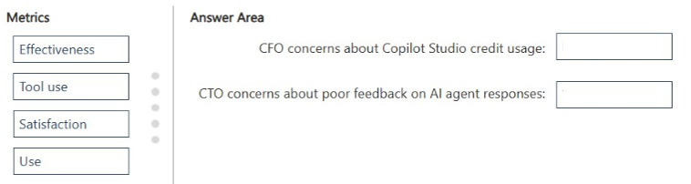

_DRAG DROP — the original ExamTopics question expects you to drag and drop items; the correct targets are not published._

**Most voted:**
- CFO → Use
- CTO → Satisfaction

### Top explanations
- **omath** (10 upvotes [Highly Voted]): 1. CFO → Use
  The CFO wants to analyze:
  - How many interactions are abandoned vs. resolved
  - Whether Copilot Studio credits are being used efficiently
  - Actual usage vs. estimated ROI
  These insights come from the Use metric, which includes:
  - Session counts
  - Abandonment rate
  - Resolution rate
  - Daily/weekly/monthly usage trends
  This directly reflects credit consumption efficiency.
  2. CTO → Satisfaction
  The CTO wants to:
  - Track user feedback on the quality of AI agent responses
  - Trigger reengineering discussions when feedback is consistently poor
  This is exactly what the Satisfaction metric measures:
  - User thumbs‑up / thumbs‑down
  - Feedback comments
  - Quality perception trends
  This is the only metric tied to response quality.
- **deca0d4** (5 upvotes): CFO concerns about credit usage: Use
  Sessions
  Conversations
  Message volume
  Activity/consumption
  That directly relates to:
  Credit consumption
  Resource usage
  Agent utilization
  Concern about poor feedback on AI responses: Satisfaction
  “Satisfaction” measures:
  User ratings
  Feedback
  Positive/negative response sentiment
  That directly maps to:
  Poor agent responses
  User dissatisfaction
  Quality perception
- **ziggy1117** (1 upvotes [Most Recent]): Effectiveness -> Conversation outcomes
  The CFO wants to identify how many interactions with the AI agents are abandoned on a given day as compared to resolved conversations. Too many abandoned sessions might indicate that Copilot Studio credits are being used inefficiently by end users.
  You can get Abandoned sessions there.

## Q3.43 (ID 411616)

Note: This section contains one or more sets of questions with the same scenario and problem. Each question presents a unique solution to the problem. You must determine whether the solution meets the stated goals. More than one solution in the set might solve the problem. It is also possible that none of the solutions in the set solve the problem.
After you answer a question in this section, you will NOT be able to return. As a result, these questions do not appear on the Review Screen.
A company has a team that analyzes its customers by using a manual process.
You are designing an AI-based agent to automate and improve the process.
You need to recommend on which platform to build the agent. The solution must meet the following requirements:
•	Use generative AI to answer common questions.
•	Provide analytics to review AI performance.
•	Identify customer demographics.
•	Minimize custom development.
Solution: You recommend GitHub Copilot.
Does this meet the goal?

⭕ **A.** Yes
✅ **B.** No

**Correct answer:** B
**Most voted:** B

### Top explanations
- **omath** (3 upvotes [Most Recent, Selected Answer: B]): Correct answer: B. No
  Why?
  GitHub Copilot is a developer productivity tool. It helps write code, generate functions, and accelerate software development. It does not meet the requirements of this scenario.
  ✔ Requirements vs. GitHub Copilot
  Use generative AI to answer common questions
  ❌ GitHub Copilot does not build conversational agents or customer‑facing AI.
  Provide analytics to review AI performance
  ❌ GitHub Copilot has no analytics for agent interactions, usage, or performance.
  Identify customer demographics
  ❌ GitHub Copilot cannot analyze customer data or build business workflows.
  Minimize custom development
  ❌ GitHub Copilot requires more custom development, not less.

## Q3.44 (ID 411617)

Note: This section contains one or more sets of questions with the same scenario and problem. Each question presents a unique solution to the problem. You must determine whether the solution meets the stated goals. More than one solution in the set might solve the problem. It is also possible that none of the solutions in the set solve the problem.
After you answer a question in this section, you will NOT be able to return. As a result, these questions do not appear on the Review Screen.
A company has a team that analyzes its customers by using a manual process.
You are designing an AI-based agent to automate and improve the process.
You need to recommend on which platform to build the agent. The solution must meet the following requirements:
•	Use generative AI to answer common questions.
•	Provide analytics to review AI performance.
•	Identify customer demographics.
•	Minimize custom development.
Solution: You recommend Microsoft Security Copilot.
Does this meet the goal?

⭕ **A.** Yes
✅ **B.** No

**Correct answer:** B
**Most voted:** B

### Top explanations
- **omath** (2 upvotes [Most Recent, Selected Answer: B]): Correct answer: B. No
  Microsoft Security Copilot is designed for cybersecurity operations, not for building customer‑analysis agents or business-facing AI workflows.
  Use generative AI to answer common questions
  ❌ Security Copilot answers security-related questions (incidents, threats, alerts).
  It is not a platform for customer-facing Q&A or business process automation.
  Provide analytics to review AI performance
  ❌ It provides security investigation analytics, not agent performance analytics.
  Identify customer demographics
  ❌ Security Copilot cannot analyze customer data or demographics.
  Minimize custom development
  ❌ It is not a low-code/no-code agent-building platform.

## Q3.45 (ID 412176)

Note: This section contains one or more sets of questions with the same scenario and problem. Each question presents a unique solution to the problem. You must determine whether the solution meets the stated goals. More than one solution in the set might solve the problem. It is also possible that none of the solutions in the set solve the problem.
After you answer a question in this section, you will NOT be able to return. As a result, these questions do not appear on the Review Screen.
A company has a team that analyzes its customers by using a manual process.
You are designing an AI-based agent to automate and improve the process.
You need to recommend on which platform to build the agent. The solution must meet the following requirements:
•	Use generative AI to answer common questions.
•	Provide analytics to review AI performance.
•	Identify customer demographics.
•	Minimize custom development.
Solution: You recommend Microsoft Copilot Studio.
Does this meet the goal?

✅ **A.** Yes
⭕ **B.** No

**Correct answer:** A
**Most voted:** A

### Top explanations
- **omath** (3 upvotes [Most Recent, Selected Answer: A]): Answer: A. Yes
  Recommending Microsoft Copilot Studio does meet the goal.
  Use generative AI to answer common questions
  ✔ Yes — Copilot Studio builds generative AI agents using GPT models, orchestration, and knowledge sources.
  Provide analytics to review AI performance
  ✔ Yes — Copilot Studio includes built‑in analytics dashboards.
  Identify customer demographics
  ✔ Yes — Copilot Studio can connect. This allows the agent to retrieve and analyze customer demographic data with minimal custom code.
  Minimize custom development
  ✔ Yes — Copilot Studio is a low‑code/no‑code platform designed for business AI agents.

## Q3.46 (ID 411299)

A company uses multiple Microsoft Copilot Studio agents across different channels.
You need to recommend a monitoring solution that provides comprehensive telemetry data and performance insights for the agents.
What should you include in the recommendation?

⭕ **A.** Microsoft Power BI
⭕ **B.** the Analytics tab in Copilot Studio
✅ **C.** Log Analytics
⭕ **D.** Azure Advisor

**Correct answer:** C
**Most voted:** C

### Top explanations
- **93c84b0** (4 upvotes [Selected Answer: C]): C. Log Analytics
  Because the key phrase is:
  “provides comprehensive telemetry data and performance insights”
- **omath** (1 upvotes [Most Recent, Selected Answer: C]): ✅ Correct Answer: C. Log Analytics
  🎯 Why Log Analytics is the right choice
  Log Analytics is the Azure‑native service that:
  - Collects comprehensive telemetry from Copilot Studio agents
  - Stores Application Insights data for querying
  - Enables Kusto Query Language (KQL) analysis
  - Supports dashboards, alerts, and cross‑agent monitoring
  - Works across all channels (web, Dynamics, Teams, custom apps)
  In Microsoft’s recommended architecture, Application Insights sends its telemetry to Log Analytics, and Log Analytics is the central monitoring layer for multi‑agent observability.
  So when the question asks for the monitoring solution you should include, the correct answer is Log Analytics.

## Q3.47 (ID 433236)

Your company extends Copilot capabilities in Microsoft Dynamics 365 Finance.
You plan to use Azure DevOps for application lifecycle management (ALM).
You need to recommend a management solution for the ALM process.
What should you include in the recommendation?

⭕ **A.** Lifecycle Services (LCS)
⭕ **B.** pipelines in Microsoft Power Platform
✅ **C.** solutions in Microsoft Power Platform
⭕ **D.** Azure DevOps test plans

**Correct answer:** C
**Most voted:** C

### Top explanations
- **pc_mex** (2 upvotes [Most Recent, Selected Answer: C]): The recommended management solution to include is C. solutions in Microsoft Power Platform. Solutions provide the proper packaging and ALM boundary for Copilot extensions in Dynamics 365 Finance when Azure DevOps is used for the overall process.
