# AB-210 Accelerating Sales Pipelines with AI in Dynamics 365 Study Guide

_35 questions generated from ExamTopics discussions._

## Table of contents

- [Q1.1](#q1-1)
- [Q1.2](#q1-2)
- [Q1.3](#q1-3)
- [Q1.4](#q1-4)
- [Q1.5](#q1-5)
- [Q1.6](#q1-6)
- [Q1.7](#q1-7)
- [Q1.8](#q1-8)
- [Q1.9](#q1-9)
- [Q1.10](#q1-10)
- [Q1.11](#q1-11)
- [Q1.12](#q1-12)
- [Q1.13](#q1-13)
- [Q1.14](#q1-14)
- [Q1.15](#q1-15)
- [Q1.16](#q1-16)
- [Q1.17](#q1-17)
- [Q1.18](#q1-18)
- [Q1.19](#q1-19)
- [Q1.20](#q1-20)
- [Q1.21](#q1-21)
- [Q1.22](#q1-22)
- [Q1.23](#q1-23)
- [Q1.24](#q1-24)
- [Q1.25](#q1-25)
- [Q1.26](#q1-26)
- [Q1.27](#q1-27)
- [Q2.1](#q2-1)
- [Q2.2](#q2-2)
- [Q2.3](#q2-3)
- [Q3.3](#q3-3)
- [Q3.8](#q3-8)
- [Q3.20](#q3-20)
- [Q4.23](#q4-23)
- [Q5.3](#q5-3)

## Q1.1 (ID 431449)

Background
Contoso Ltd. is a global technology distributor headquartered in Redmond, Washington and has enterprise customers across North America and Europe.
Contoso Ltd. currently manages its sales operations by using Microsoft Dynamics 365 Sales and plans to enable Sales Insights in the future.
The company has approximately 150 field sellers, 40 insider sellers, 20 sales managers, and a central IT team responsible for configuring the sales platform. Contoso Ltd.’s executive leadership has defined the following goals for the new sales platform implementation:
Improve seller productivity by reducing manual research and data entry.
Use AI insights to prioritize leads and opportunities.
Provide automated recommendations to sales representatives throughout the deal lifecycle.
Current environment
Sales platform
Contoso Ltd. uses Microsoft Dynamics 365 Sales integrated with Microsoft 365 services. The following components are currently deployed:
Business requirements
Contoso Ltd.’s executives have defined the following business requirements:
Lead management
Inside sellers must use a seller engagement workspace that prioritizes leads automatically based on predicted likelihood to convert.
All sellers are guided through a consistent set of qualification steps aligned to Contoso Ltd.’s sales strategy.
Leads cannot be advanced to the development stage until a decision maker has been confirmed.
Sales leadership requires flexibility in how leads are converted. Inside sales need automatic opportunity creation. Field sellers need the option to manually decide whether an opportunity should be created when a lead is qualified.
Lead scoring must be implemented to help sellers identify high potential leads automatically.
Lead scoring must continuously improve based on historical sales outcomes.
Opportunity development
Opportunities are tracked in Dynamics 365 Sales through a defined qualification-to-opportunity lifecycle to ensure accurate reporting.
The opportunity flow must be improved by using AI-driven research and automated insights.
Field sellers must be able to access contextual research about customers and competitors while working on opportunities.
All opportunity revenue must be calculated using opportunity line items based on selected Contoso Ltd.’s products and standard pricing
Sales managers must receive an external quarterly competitive intelligence brief to help with their research. This should be delivered as a PDF document.
Sales performance
Sales managers require improved pipeline and revenue forecasting capabilities. The managers need to report on their business performance and use insights, visuals, and recommended next actions.
The new solution must provide the following:
Notify the seller’s manager when a draft quote is created and requires approval.
Allow leadership to track performance against revenue goals.
Ask questions about Dynamics 365 Sales data to support executive analysis and decision making.
Technical requirements
Contoso Ltd.'s IT department defines the following priorities for the sales platform.
AI capabilities
The platform must support the following AI features:
Lead scoring to guide sellers to priority items.
Opportunity research insights to prepare deal analysis.
AI-powered research and analytics to aid leadership reporting.
Automation
Automation must be implemented to guide sellers through recommended next steps during the sales cycle.
Any approvals must use the Power Automate Approvals connector.
Field sellers use the existing Lead to Opportunity Business Process Flow to manage their leads.
A Power Automate desktop flow is used to process orders into a partner ordering application that completes fulfillment.
AI-driven insights
The company is deploying the Sales accelerator to guide seller activities.
The Sales Research Agent
Sales managers will use the Sales Research Agent to gather intelligence about customer organizations.
The sales managers have the following requirements:
Must be able to reuse visualizations after they are created; they don’t want to recreate them.
Must have a consistent method to quickly return to a blueprint that they frequently use.
Must be able to retain a library of questions to receive consistent responses based on definitions approved by the company.
Should have Bing search enabled on the environment for generative AI feature settings.
Platform extensions
The IT department plan to extend the platform by doing the following:
Create Power Automate flows to automate seller tasks.
Embed Power BI reports for sales analytics.
Testing
The IT department is testing predictive lead scoring with a small group of sellers.
The IT department edits the existing lead scoring model by adding new fields.
Issues
Users have reported the following issues:
Field sellers spend a significant amount of time researching customers before engaging with prospects.
Testers report they cannot access the field changes in the lead score.
A sales manager generated a blueprint but forgot the competitive intelligence brief.
You need to resolve the competitive intelligence brief issue for the sales manager.
What three actions should you do? Each correct answer presents part of the solution. Choose three.
NOTE: Each correct selection is worth one point.

**Exhibits**
- Exhibit 1: 

⭕ **A.** Upload the competitive intelligence brief as a CSV file.
✅ **B.** Add a data source.
⭕ **C.** Refresh the canvas.
✅ **D.** Upload the competitive intelligence brief as a PDF file.
✅ **E.** Regenerate the canvas.

**Correct answer:** B, D, E
**Most voted:** BDE

### Top explanations
- **mamicoelho** (1 upvotes [Most Recent, Selected Answer: BDE]): The correct answers are:
  ✅ B. Add a data source
  ✅ D. Upload the competitive intelligence brief as a PDF file
  ✅ E. Regenerate the canvas
  Why?
  The issue states:
  "A sales manager generated a blueprint but forgot the competitive intelligence brief."
  This refers to Sales Research Agent functionality. If content was missing from a generated blueprint, the manager must:
  Upload the competitive intelligence brief as a PDF file
  The case explicitly states that competitive intelligence briefs are delivered as PDF documents.
  PDF is a supported document source for grounding AI-generated outputs.
  Add a data source
  The PDF must be added as a source so the Sales Research Agent can use it during generation.
  Regenerate the canvas
  After adding the missing source, the blueprint/canvas must be regenerated so the agent incorporates the newly available information.
  Why not the others?
  ❌ A. Upload the competitive intelligence brief as a CSV file
  The requirement specifies a PDF brief, not structured CSV data.
  ❌ C. Refresh the canvas
  Refresh only reloads the current view.
  It does not regenerate AI-generated content using newly added sources.
- **Shaiii102500** (1 upvotes [Selected Answer: BDE]): answer is BDE
- **RominaT** (1 upvotes [Selected Answer: BDE]): A. Upload as a CSV file ❌
  The brief is a PDF document, not structured CSV data.
  C. Refresh the canvas ❌
  Refreshing does not re-run the analysis with the newly added information. The blueprint should be regenerated instead.
- **romero9801** (1 upvotes [Selected Answer: BDE]): the answer is BDE? why not BCD

## Q1.2 (ID 431433)

HOTSPOT
Background
AdventureWorks Cycles is a global manufacturer of high-performance bicycles headquartered in Seattle. The company sells products through distributors, specialty retailers, and a growing direct-to-consumer online channel. AdventureWorks Cycles recently expanded its product catalog to include the athlete package, which includes a cycle, connected devices and subscription-based analytics services.
The sales operations team is responsible for configuring the new Dynamics 365 Sales environment. Their goal is to implement AI-driven processes that streamline the lead-to-cash workflow while ensuring that sellers can easily identify the most promising opportunities.
Current Environment
Product managers maintain products and pricing in spreadsheets. Information regarding custom relationships, competitor analysis, and region-specific marketing content is stored in a SharePoint site called the sales portfolio.
The organization has identified reporting challenges they want to resolve:
Regional managers require in-depth reporting using information from the sales pipeline and seller activities, the point-of-sale solution, website analytics, and the accounting system.
Team leads require real-time information on active opportunities, as well as visibility of seller’s appointments and phone calls, without needing to navigate into multiple views.
Sellers must be able to quickly view their own opportunities by phase.
All sellers are assigned Dynamics 365 Sales Enterprise licenses, also, the CFO has requested that Copilot message packs are pre-purchased by using the Copilot Studio subscription license.
A Dynamics 365 sales sandbox environment has been in use for six months. There are 60 leads records with 30 records that are qualified and 20 that are disqualified. Ten of the qualified leads are over three months old.
Business Requirements
Sellers in all regions should be able to review the new mountaineer cycles. The cycles include economy and premium fittings. When creating opportunities, sellers should be able to select a metal type when adding a mountaineer cycle to an opportunity. The metal types include chrome, aluminum, and titanium.
Pricing managers must be able to create deals for the same products in their own currencies and at their own prices, without reference to the cost of the product.
Predictive scoring should be enabled for leads created within the last three months in the sandbox environment.
A segment of leads named Hot is needed that will contain all leads where the source is phone, employee referral or partner. Leads from this segment should be distributed to sellers using a round robin method.
Agents should not be able to take action on any data that is created in the production environment before they are started.
All sellers should be able to access leads disqualified by agents.
Technical Information & Requirements
Agents must use a dedicated service identity to execute write actions with a controlled security role in Dataverse.
The sales operations team lead must be assigned the Power Platform administrator role.
The lead pricing manager must be assigned to the Microsoft 365 billing admin role.
The vice president of sales must be assigned the AI admin role.
Both the sandbox and production environments must be enabled for AI capacity, but usage should be capped on the sandbox environment.
A trial environment must be created, with the sales qualification agent configured. Outreach emails must be automatically generated for leads but only sent when sellers deem it necessary.
All sellers must be assigned a customized version of the salesperson role on the production environment. This role should grant read access only to the leads that the sellers own.
The EnableRoleBasedSystemViews property must be set to true for the production environment.
No Azure subscriptions are available in the tenant.
Issues
The sales qualification agent has disqualified several leads in the trial environment. The vice president of sales has requested to understand the reason for the disqualified leads.
Sellers are not able to create agents in the production environment.
Agent consumption has been unreliable. The company requires that AI capacity is always available to sellers.
You need to configure the AdventureWorks Cycles product catalog.
How should you configure the product catalog? To answer, select the appropriate options in the answer area.
NOTE: Each correct selection is worth one point.

**Exhibits**
- Exhibit 1: 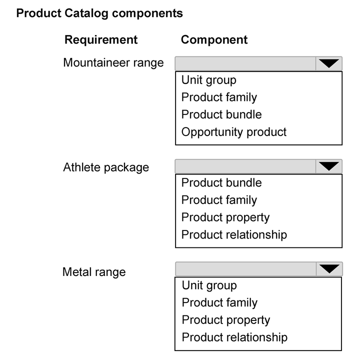

_HOTSPOT — the original ExamTopics question expects you to mark areas on the exhibit above; the correct hotspot coordinates are not published._

**Most voted:**
- Mountaineer cycles → Product family
- Economy and premium fittings → Product
- Metal type → Property

### Top explanations
- **mamicoelho** (1 upvotes [Most Recent]): Mountaineer cycles → Product family
  Economy and premium fittings → Product
  Metal type → Property
- **RominaT** (1 upvotes): Answer is correct.
  A Product Family is used to group related products (e.g., Mountaineer range containing Economy and Premium variants).
  A Product Bundle groups multiple products that are sold together as a package..
  A Product Property allows sellers to choose configurable characteristics of a product during sales transactions (color, size, material, type).
- **seoyeon_01** (1 upvotes [Selected Answer: A]): Could someone explain why this answer makes sense in this context?
- **seoyeon_01** (1 upvotes [Selected Answer: B]): I'm confused—why does this answer make sense?
- **seoyeon_01** (1 upvotes [Selected Answer: A]): Why does this answer fit? Can someone explain?

## Q1.3 (ID 431447)

Background
AdventureWorks Cycles is a global manufacturer of high-performance bicycles headquartered in Seattle. The company sells products through distributors, specialty retailers, and a growing direct-to-consumer online channel. AdventureWorks Cycles recently expanded its product catalog to include the athlete package, which includes a cycle, connected devices and subscription-based analytics services.
The sales operations team is responsible for configuring the new Dynamics 365 Sales environment. Their goal is to implement AI-driven processes that streamline the lead-to-cash workflow while ensuring that sellers can easily identify the most promising opportunities.
Current Environment
Product managers maintain products and pricing in spreadsheets. Information regarding custom relationships, competitor analysis, and region-specific marketing content is stored in a SharePoint site called the sales portfolio.
The organization has identified reporting challenges they want to resolve:
Regional managers require in-depth reporting using information from the sales pipeline and seller activities, the point-of-sale solution, website analytics, and the accounting system.
Team leads require real-time information on active opportunities, as well as visibility of seller’s appointments and phone calls, without needing to navigate into multiple views.
Sellers must be able to quickly view their own opportunities by phase.
All sellers are assigned Dynamics 365 Sales Enterprise licenses, also, the CFO has requested that Copilot message packs are pre-purchased by using the Copilot Studio subscription license.
A Dynamics 365 sales sandbox environment has been in use for six months. There are 60 leads records with 30 records that are qualified and 20 that are disqualified. Ten of the qualified leads are over three months old.
Business Requirements
Sellers in all regions should be able to review the new mountaineer cycles. The cycles include economy and premium fittings. When creating opportunities, sellers should be able to select a metal type when adding a mountaineer cycle to an opportunity. The metal types include chrome, aluminum, and titanium.
Pricing managers must be able to create deals for the same products in their own currencies and at their own prices, without reference to the cost of the product.
Predictive scoring should be enabled for leads created within the last three months in the sandbox environment.
A segment of leads named Hot is needed that will contain all leads where the source is phone, employee referral or partner. Leads from this segment should be distributed to sellers using a round robin method.
Agents should not be able to take action on any data that is created in the production environment before they are started.
All sellers should be able to access leads disqualified by agents.
Technical Information & Requirements
Agents must use a dedicated service identity to execute write actions with a controlled security role in Dataverse.
The sales operations team lead must be assigned the Power Platform administrator role.
The lead pricing manager must be assigned to the Microsoft 365 billing admin role.
The vice president of sales must be assigned the AI admin role.
Both the sandbox and production environments must be enabled for AI capacity, but usage should be capped on the sandbox environment.
A trial environment must be created, with the sales qualification agent configured. Outreach emails must be automatically generated for leads but only sent when sellers deem it necessary.
All sellers must be assigned a customized version of the salesperson role on the production environment. This role should grant read access only to the leads that the sellers own.
The EnableRoleBasedSystemViews property must be set to true for the production environment.
No Azure subscriptions are available in the tenant.
Issues
The sales qualification agent has disqualified several leads in the trial environment. The vice president of sales has requested to understand the reason for the disqualified leads.
Sellers are not able to create agents in the production environment.
Agent consumption has been unreliable. The company requires that AI capacity is always available to sellers.
You need to ensure that AdventureWorks Cycles pricing managers can make the products available for regional sellers.
What should you configure?

✅ **A.** Configure a price list per region and set the pricing method to currency amount.
⭕ **B.** Configure a single price list for all regions with a single price list item for each product.
⭕ **C.** Configure a price list per region and set the pricing method to percent of list.
⭕ **D.** Configure a single price list for all regions with multiple price list items for each product.

**Correct answer:** A
**Most voted:** A

### Top explanations
- **mamicoelho** (1 upvotes [Most Recent, Selected Answer: A]): The requirement states:
  "Pricing managers must be able to create deals for the same products in their own currencies and at their own prices, without reference to the cost of the product."
  In Dynamics 365 Sales:
  - Price Lists are tied to a single currency.
  - Different regions using different currencies require separate price lists.
  - Currency Amount pricing allows the manager to explicitly specify the product price, independent of cost.
- **RominaT** (1 upvotes [Selected Answer: A]): ❌ B. Single price list for all regions with a single price list item
  Doesn't support different regional currencies and pricing.
  ❌ C. Price list per region and Percent of List
  Prices would be calculated from another list price, which contradicts "at their own prices."
  ❌ D. Single price list with multiple price list items
  A product can only have one price per currency within a price list, and the requirement is regional autonomy with different currencies and prices.

## Q1.4 (ID 431507)

HOTSPOT
You are customizing a workspace in the sales accelerator.
The workspace must display the industry of a company.
You need to configure the work item appearance for a company.
Which two settings should you modify? To answer, select the appropriate UI element in the answer area.
NOTE: Each correct selection is worth one point.

**Exhibits**
- Exhibit 1: 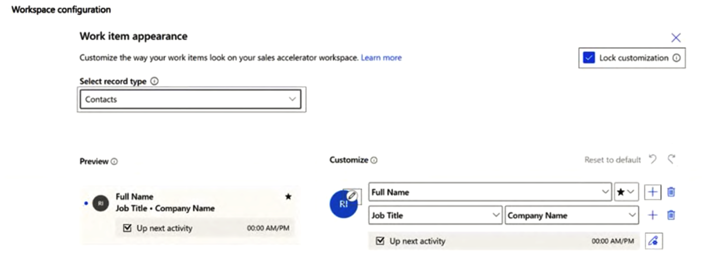

_HOTSPOT — the original ExamTopics question expects you to mark areas on the exhibit above; the correct hotspot coordinates are not published._

**Most voted:**
- Looking at the UI: Select record type determines which entity's work items you're customizing.
- UI Element: Action
- Select record: Company (Account)
- Customize: Replace/Add a displayed field with Industry

### Top explanations
- **mamicoelho** (1 upvotes [Most Recent]): For this Sales Accelerator workspace customization question, you're configuring how a Company work item is displayed and need to show the company's Industry.
  Looking at the UI:
  Select record type determines which entity's work items you're customizing.
  The Customize section contains the fields displayed on the card (currently Full Name, Job Title, Company Name, etc.).
  Correct selections
  UI Element	Action
  Select record	Company (Account)
  Customize	Replace/Add a displayed field with Industry
  Why?
  To display the industry of a company, you must:
  Select the Company/Account record type, because Industry is an Account field.
  Modify the displayed fields in the Customize area to include Industry.
  You do not need to change:
  Lock customization
  Preview
  Icons or activity settings
  ✅ Answer:
  Select record type → Company (Account)
  Customize → Industry field
- **Moonface** (1 upvotes): The previous comment referred to a scenario in which we assume that we are modifying the work item appearance for Contact. If we assume that we are changing the record type to Account (Company), then in this case the first step, “Select Record Type,” will be correct. However, if we change it to Account, the default fields in the “Customize” section will change to: Account Name, Primary Contract.Full Name, and Primary Contract.Job Title. To add an “Industry” field, you must either add a new field or modify an existing one. To add a field, click the “+” button. To modify a field, click the three dots (which appear to the right of the field). In both cases, we achieve our goal and display the “industry of company ” field. In all the scenarios discussed, selecting the pencil icon in the lower-right corner is incorrect, as it pertains to action configuration.
  URL: https://learn.microsoft.com/en-us/dynamics365/sales/customize-work-list-card#customize-work-items
- **Moonface** (1 upvotes): In my opinion, no one here is mentioning changing the record type to Account. The point is to implement changes to the existing record type. Changing it to Account would require adding the Account  record type in the Sales Accelerator settings. The goal is to modify the current work item appearance for Contact. In that case, in the “Customize” section, you need to add another field (using the “+” button) and and select the Company Name.Industry filed from the list of related fields list.
- **kstouthandel** (1 upvotes): But why is the black circle on the icon in the bottom right corner and not on the field dorp downs? This is why i got this wrong
- **seoyeon_01** (1 upvotes [Selected Answer: C]): I'm having difficulty understanding this answer—can someone help?

## Q1.5 (ID 431158)

HOTSPOT
A company plans to deploy AI agents in Dynamics 365 Sales to help sellers research accounts and summarize opportunity activity.
The company has the following requirements:
AI capabilities must be activated in the environment.
Administrators must be able to design, create, and manage AI agents.
Sellers must have permissions that allow them to interact with AI-generated insights in Sales.
AI agents must be able to read and analyze the organization’s sales data stored in the platform.
You need to configure platform capabilities required for AI agents.
Which configuration should you apply for each requirement? To answer, select the appropriate options in the answer area.
NOTE: Each correct selection is worth one point.

**Exhibits**
- Exhibit 1: 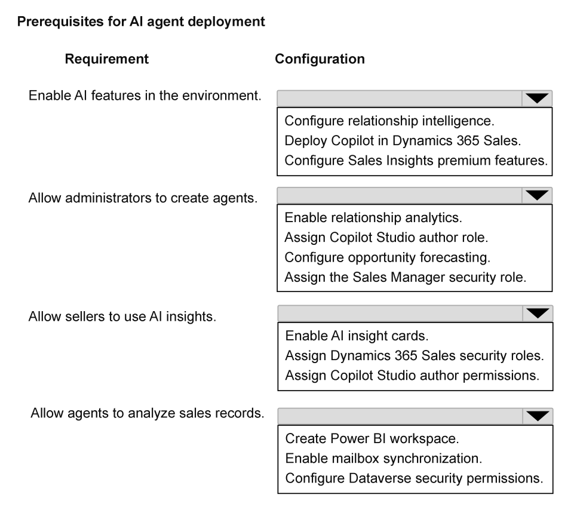

_HOTSPOT — the original ExamTopics question expects you to mark areas on the exhibit above; the correct hotspot coordinates are not published._

**Most voted:**
- Enable AI features in the environment: Deploy Copilot in Dynamics 365 Sales.
- Allow administrators to create agents: Assign Copilot Studio author role.
- Allow sellers to use AI insights: Assign Dynamics 365 Sales security roles.
- Allow agents to analyze sales records: Configure Dataverse security permissions.
- Deploy Copilot in Dynamics 365 Sales: Enables AI-powered capabilities, including account research and opportunity summarization, in the Sales environment.
- Assign Copilot Studio author role: Grants the agent-authoring capabilities required to create and manage AI agents. In actual Copilot Studio configuration, the Environment Maker role is commonly used for authoring.
- Assign Dynamics 365 Sales security roles: Sellers require appropriate roles, such as Salesperson or Sales Manager, to access sales data and AI-powered functionality.
- Configure Dataverse security permissions: AI agents must have appropriate permissions to access and analyze account, opportunity, and other sales records stored in Microsoft Dataverse.

### Top explanations
- **Evincible** (1 upvotes [Most Recent]): 1. Enable AI features in the environment.	Deploy Copilot in Dynamics 365 Sales.
  2. Allow administrators to create agents.	Assign Copilot Studio author role.
  3. Allow sellers to use AI insights.	Assign Dynamics 365 Sales security roles.
  4. Allow agents to analyze sales records.	Configure Dataverse security permissions.
  1. Deploy Copilot in Dynamics 365 Sales: Enables AI-powered capabilities, including account research and opportunity summarization, in the Sales environment.
  2. Assign Copilot Studio author role: Grants the agent-authoring capabilities required to create and manage AI agents. In actual Copilot Studio configuration, the Environment Maker role is commonly used for authoring.
  3. Assign Dynamics 365 Sales security roles: Sellers require appropriate roles, such as Salesperson or Sales Manager, to access sales data and AI-powered functionality.
  4. Configure Dataverse security permissions: AI agents must have appropriate permissions to access and analyze account, opportunity, and other sales records stored in Microsoft Dataverse.

## Q1.6 (ID 431248)

HOTSPOT
A company plans to deploy AI agents in Dynamics 365 Sales to assist sellers with opportunity research and account insights.
The company has the following requirements:
Must allocate AI processing capacity.
Must monitor AI credit consumption.
Must control credit usage for a single agent.
Administrators must configure billing and capacity settings before agents can operate.
You need to configure the appropriate billing or capacity setting for each requirement.
Which configuration should you apply for each requirement? To answer, select the appropriate options in the answer area.
NOTE: Each correct selection is worth one point.

**Exhibits**
- Exhibit 1: 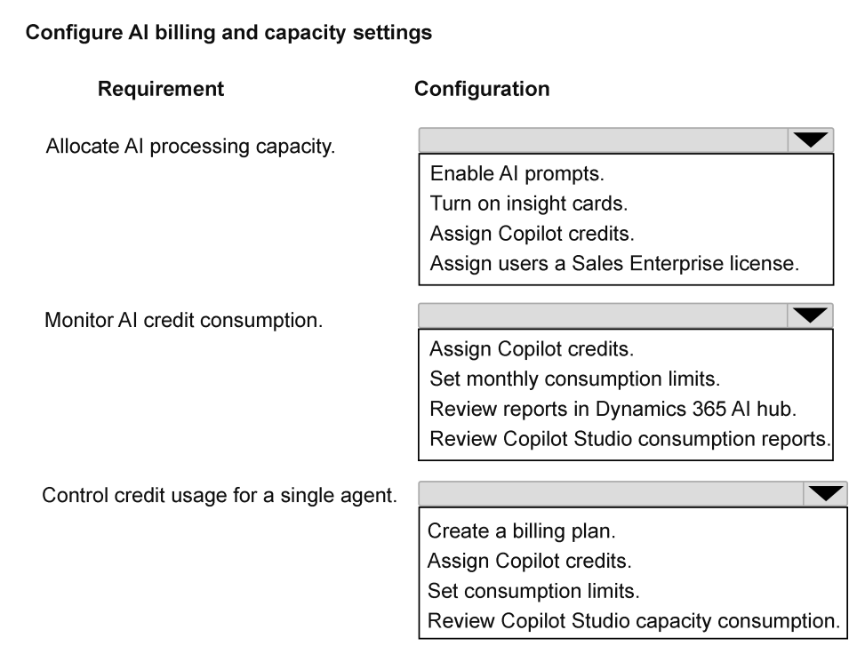

_HOTSPOT — the original ExamTopics question expects you to mark areas on the exhibit above; the correct hotspot coordinates are not published._

**Most voted:**
- Allocate AI processing capacity: Assign Copilot credits.
- Monitor AI credit consumption: Review Copilot Studio consumption reports.
- Control credit usage for a single agent: Set consumption limits.
- Assign Copilot credits: Allocates AI processing capacity to the environment so Copilot Studio agents can operate.
- Review Copilot Studio consumption reports: Allows administrators to monitor Copilot credit usage, identify consumption trends, and track credits consumed by individual agents or environments.
- Set consumption limits: Allows administrators to configure monthly credit limits for individual agents, helping control costs and prevent excessive usage.

### Top explanations
- **Evincible** (1 upvotes [Most Recent]): 1. Allocate AI processing capacity.	Assign Copilot credits.
  2. Monitor AI credit consumption.	Review Copilot Studio consumption reports.
  3. Control credit usage for a single agent.	Set consumption limits.
  1. Assign Copilot credits: Allocates AI processing capacity to the environment so Copilot Studio agents can operate.
  2. Review Copilot Studio consumption reports: Allows administrators to monitor Copilot credit usage, identify consumption trends, and track credits consumed by individual agents or environments.
  3. Set consumption limits: Allows administrators to configure monthly credit limits for individual agents, helping control costs and prevent excessive usage.

## Q1.7 (ID 431279)

HOTSPOT
You are creating a business process flow named “Onboard new pet” to support onboarding of new clients for a pet care business.
A partially completed business process flow is shown in the following exhibit.
Use the drop-down menus to select the answer choice that completes each statement based on the information presented in the exhibit.
NOTE: Each correct selection is worth one point.

**Exhibits**
- Exhibit 1: 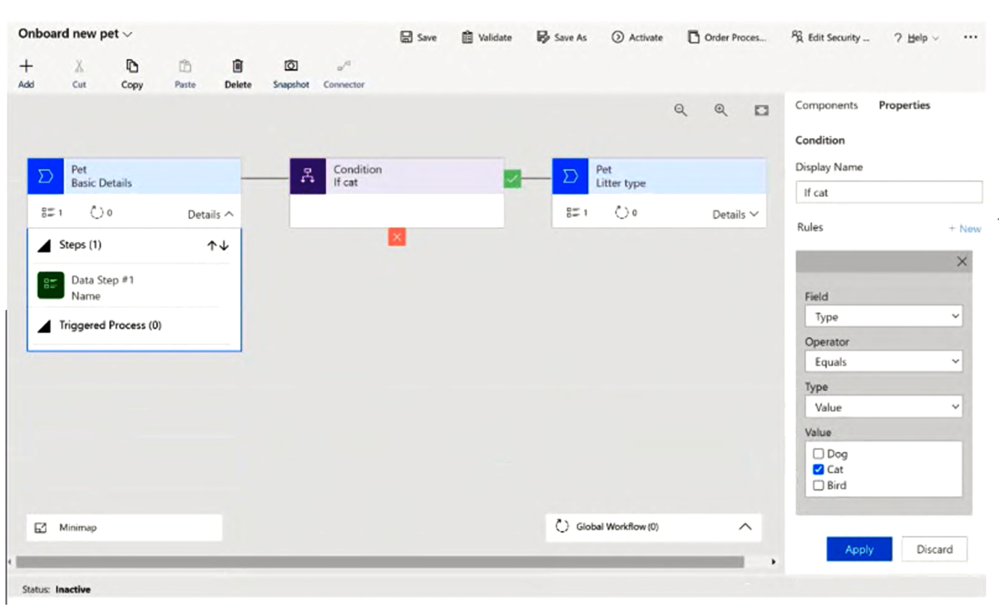
- Exhibit 2: 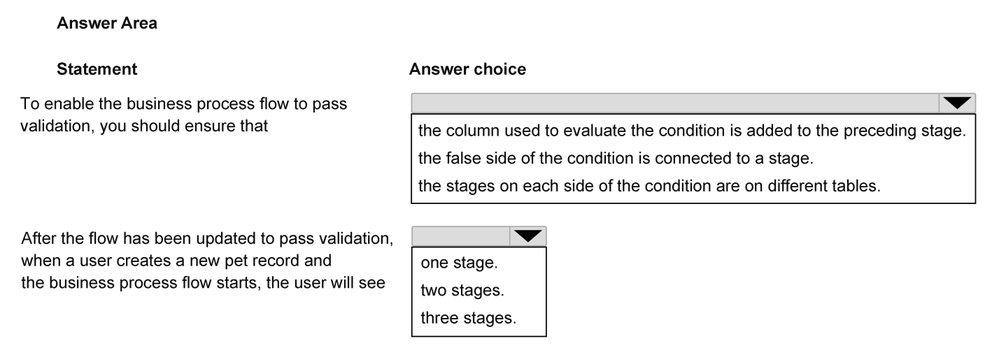

_HOTSPOT — the original ExamTopics question expects you to mark areas on the exhibit above; the correct hotspot coordinates are not published._

**Most voted:**
1. To enable the business process flow to pass validation: The column used to evaluate the condition is added to the preceding stage.
2. After validation, when a user creates a new pet record and the business process flow starts: One stage.

### Top explanations
- **Evincible** (2 upvotes [Most Recent]): 1. To enable the business process flow to pass validation:
  The column used to evaluate the condition is added to the preceding stage.
  Explanation: The condition If cat evaluates the Type column, but the preceding stage (Pet – Basic Details) contains only the Name step.
  Microsoft requires business process flow branching conditions to reference columns included in the immediately preceding stage.
  2. After validation, when a user creates a new pet record and the business process flow starts:
  One stage.
  Explanation: Initially, the user sees only Pet – Basic Details.
  The Pet – Litter type stage is conditional and becomes visible only when the Type = Cat condition is satisfied.

## Q1.8 (ID 431452)

You are working in Dynamics 365 Sales from within Microsoft Teams. You turn on the visibility of the Dynamics 365 Sales records in the channel.
A user working with leads is unable to pin the view into Teams.
You need to identify the issue.
What should you?

⭕ **A.** Enable the Turn on Enhanced Microsoft Teams Integration option.
✅ **B.** Add users to the correct security role.
⭕ **C.** Disable the Turn on the linking of Dynamics 365 records to Microsoft Teams channels option.
⭕ **D.** Enable the External links within Teams option.
⭕ **E.** Add users to the Teams channel.

**Correct answer:** B
**Most voted:** B

### Top explanations
- **RominaT** (2 upvotes [Selected Answer: B]): B -> When Dynamics 365 Sales records are visible in Microsoft Teams, users must have the appropriate Dynamics 365 security privileges to work with records and pin views in Teams.
  A is wrong because if records are already visible in the channel, the integration is already functioning.
- **mamicoelho** (1 upvotes [Most Recent, Selected Answer: B]): The scenario says:
  "You turn on the visibility of the Dynamics 365 Sales records in the channel."
  That means the Teams integration is already configured and working.
  The problem is:
  "A user working with leads is unable to pin the view into Teams."
  Pinning and accessing Dynamics 365 views/records in Teams still depends on the user's Dynamics 365 security privileges. If the user lacks permissions on Leads, views, or related entities, they may be unable to pin or interact with the view.

## Q1.9 (ID 431320)

DRAG DROP
A company uses Dynamics 365 Sales with the product catalog and multiple price lists.
The sales representatives create opportunities and add products. Some opportunity lines show incorrect unit prices, and the opportunity total is inaccurate. The company needs pricing to be calculated using the correct price list and totals to update automatically on the opportunity.
You need to ensure opportunity product pricing is calculated correctly.
Which three actions should you perform in sequence? To answer, move the appropriate actions from the list of actions to the answer area and arrange them in the correct order.

**Exhibits**
- Exhibit 1: 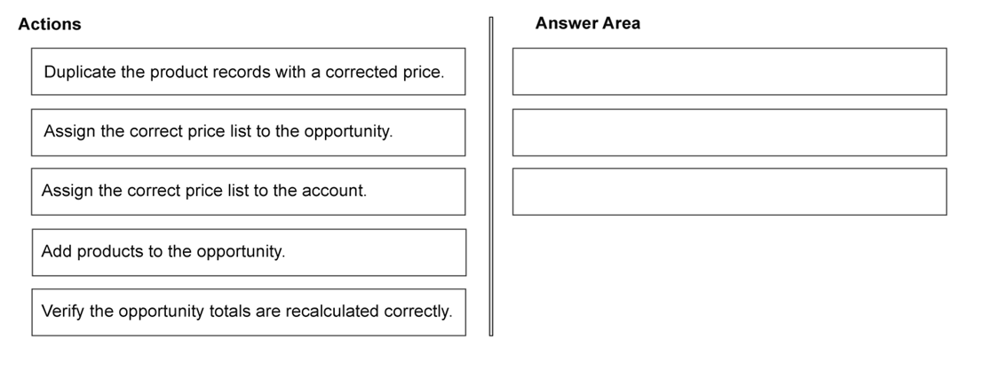

_DRAG DROP — the original ExamTopics question expects you to drag and drop items; the correct targets are not published._

**Most voted:**
- 1 Assign the correct price list to the opportunity.
- 2 Add products to the opportunity.
- 3 Verify the opportunity totals are recalculated correctly.

### Top explanations
- **Evincible** (1 upvotes [Most Recent]): 1 Assign the correct price list to the opportunity.
  2 Add products to the opportunity.
  3 Verify the opportunity totals are recalculated correctly.
  Explanation
  1. Assign the correct price list: The opportunity's price list determines which product prices Dynamics 365 Sales uses.
  2. Add products: Products added to the opportunity use the selected price list to determine unit prices.
  3. Verify totals: Ensure that Revenue is set to System Calculated so the opportunity total reflects product prices, quantities, discounts, and taxes. Recalculate if necessary.

## Q1.10 (ID 431413)

A company uses Microsoft SharePoint document management in Dynamics 365 Sales to store contracts.
The company wants only the contracts team to have access to the documents. The contracts team has a custom security role.
You need to restrict privileges to secure the documents.
What should you do?

⭕ **A.** Update the users list in the SharePoint site.
✅ **B.** Create a new group in the SharePoint site.
⭕ **C.** Create a new security role in Dynamics 365 Sales.
⭕ **D.** Update privileges in the Dynamics 365 Sales security role of the contract team.

**Correct answer:** B
**Most voted:** B

### Top explanations
- **tdatda** (2 upvotes [Selected Answer: A]): To secure the documents, you should update the users list or permissions in the SharePoint site where the documents are stored.
  Why This Action is Necessary
  • Separate Security Models: Dynamics 365 Sales and Microsoft SharePoint use completely independent security models.
  • Role Limitation: Updating privileges in a Dynamics 365 security role does not control or restrict access to files stored inside SharePoint.
  • Permission Management: You must configure permissions directly on the SharePoint site, document library, or folder to ensure only the contracts team has access.
- **mamicoelho** (1 upvotes [Most Recent, Selected Answer: B]): Reason:
  Documents are stored in SharePoint.
  SharePoint has its own security model.
  Access should be granted to a team rather than managed user-by-user.
  Creating a SharePoint group is the standard way to secure a document library for a specific team.
- **Shaiii102500** (1 upvotes [Selected Answer: B]): The correct answer is B. Create a new group in the SharePoint site. ✅
  Why B?
  The contracts are stored in SharePoint, so access to the actual documents must be secured using SharePoint permissions
  The reason B is the better exam answer is the scenario says access must be restricted to the contracts team, meaning the requirement is group-based rather than individual-user-based.
  A. Update the users list: You could grant/revoke permissions user by user, but this is individual permission management.
  B. Create a new SharePoint group: A SharePoint group is specifically designed to collect users who require the same permissions to sites and content. Microsoft recommends groups rather than assigning the same permissions one person at a time.

## Q1.11 (ID 431368)

HOTSPOT
You are implementing Dynamics 365 Sales for a company.
The company sells products globally and requires pricing to be managed for different currencies.
The company has the following requirements:
Must define the quantities in which a product can be sold.
Must group product pricing based on different currencies.
Must identify the sale price of a product.
You need to configure the product catalog.
How should each pricing requirement be configured? To answer, select the appropriate options in the answer area.
NOTE: Each correct selection is worth one point.

**Exhibits**
- Exhibit 1: 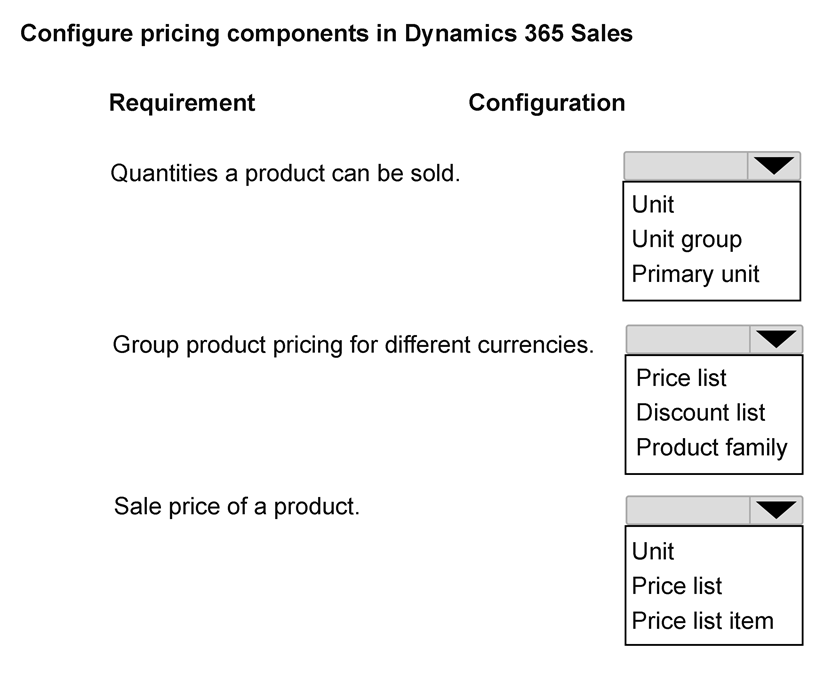

_HOTSPOT — the original ExamTopics question expects you to mark areas on the exhibit above; the correct hotspot coordinates are not published._

**Most voted:**
- Quantities a product can be sold: Unit
- Group product pricing for different currencies: Price list
- Sale price of a product: Price list item

### Top explanations
- **Evincible** (2 upvotes [Most Recent]): 1. Quantities a product can be sold.	Unit
  2. Group product pricing for different currencies.	Price list
  3. Sale price of a product.	Price list item
  Explanation
  1. Unit: Defines the quantity or measurement in which a product is sold, such as pieces, boxes, or pallets. A unit group is a collection of related units.
  2. Price list: Organizes product pricing for specific currencies, regions, or markets. Dynamics 365 Sales supports separate price lists for different currencies.
  3. Price list item: Defines the actual selling price of a specific product and unit within a price list. It includes pricing methods and amounts.

## Q1.12 (ID 431286)

You are implementing Dynamics 365 Sales for a company. The company sells the same products in the North America and Europe regions. Each region uses a different currency.
The sales team requires that product prices be managed separately for different currencies and regions.
You need to configure the pricing model so the same product can be sold with the price based on the region.
What should you do?

✅ **A.** Create a separate price list for each currency.
⭕ **B.** Configure business process flows for product pricing.
⭕ **C.** Create duplicate opportunity products for each region.
⭕ **D.** Create separate product bundles for each currency.

**Correct answer:** A
**Most voted:** A

### Top explanations
- **Estbert** (1 upvotes [Most Recent, Selected Answer: A]): A Price List is used to group product pricing, typically by currency, region, customer segment, or pricing strategy.

## Q1.13 (ID 431381)

DRAG DROP
You configure the product catalog for a company. The company sells drones, spare batteries, and accessories.
The company has the following requirements:
Must define shared properties for several drone models.
Must combine drones and accessories into a package.
Must represent a single drone model.
You need to determine how product catalog elements should be configured.
Which catalog configurations should you use? To answer, move the appropriate configurations to the correct requirements. You may use each configuration once, more than once, or not at all. You may need to move the split bar between panes or scroll to view content.
NOTE: Each correct selection is worth one point.

**Exhibits**
- Exhibit 1: 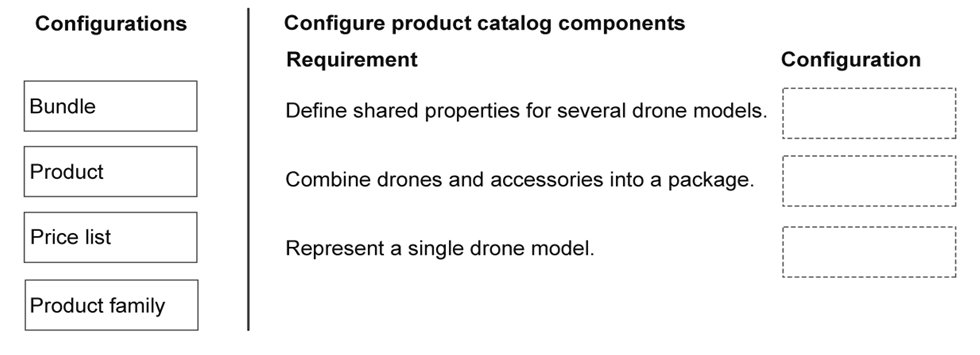

_DRAG DROP — the original ExamTopics question expects you to drag and drop items; the correct targets are not published._

**Most voted:**
- Product family: Used to group related products and define properties that are inherited by products in the family.
- Bundle: Used to sell multiple products together as a package
- Product: Represents an individual item that can be sold.

### Top explanations
- **Estbert** (1 upvotes [Most Recent]): Product family: Used to group related products and define properties that are inherited by products in the family.
  Bundle: Used to sell multiple products together as a package (for example, a drone plus batteries and accessories).
  Product: Represents an individual item that can be sold.
  Price list is not used for any of these requirements; it is used for pricing.
- **seoyeon_01** (1 upvotes): which option is correct here?

## Q1.14 (ID 431294)

You are creating a pricing list in Dynamics 365 Sales. All prices must end in $.98.
You need to select the function that controls how prices are adjusted to meet this requirement.
What should you use?

⭕ **A.** Rounding Amount
⭕ **B.** Percentage
✅ **C.** Rounding Policy
⭕ **D.** Pricing Method

**Correct answer:** C
**Most voted:** C

### Top explanations
- **marcelina50** (4 upvotes [Most Recent, Selected Answer: C]): Rounding Policy: If you selected a pricing method other than Currency Amount, you can set up a rounding policy. For example, if you want per unit prices to be in the form of $0.99, you can select a rounding policy where all prices per unit automatically have a price that ends in 99 cents. To do this, you select the rounding policy to round up the price, and then set the price to end in a certain amount, such as 99 cents.

## Q1.15 (ID 431353)

DRAG DROP
A company uses Dynamics 365 Sales to manage customer engagement.
The company wants sellers to access all customer interactions within a single location on the account form. The company has the following requirements for the form:
Must display the email and phone interactions on the account record.
Must allow sellers to add attachments to the timeline.
Must display the activity history in chronological order.
Must identify changes that are made to the activity records.
You need to configure the timeline control.
Which configuration should you use for each requirement? To answer, move the appropriate configurations to the correct requirements. You may use each configuration once, more than once, or not at all. You may need to move the split bar between panes or scroll to view content.
NOTE: Each correct selection is worth one point.

**Exhibits**
- Exhibit 1: 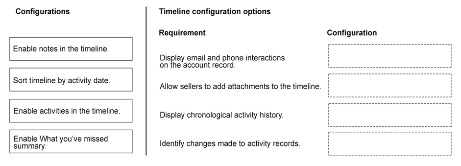

_DRAG DROP — the original ExamTopics question expects you to drag and drop items; the correct targets are not published._

**Most voted:**
- Display email and phone interactions on the account record: Enable activities in the timeline.
- Allow sellers to add attachments to the timeline: Enable notes in the timeline.
- Display chronological activity history: Sort timeline by activity date.
- Identify changes made to activity records: Enable What you've missed summary.

### Top explanations
- **Evincible** (2 upvotes [Most Recent]): 1. Display email and phone interactions on the account record.	Enable activities in the timeline.
  2. Allow sellers to add attachments to the timeline.	Enable notes in the timeline.
  3. Display chronological activity history.	Sort timeline by activity date.
  4. Identify changes made to activity records.	Enable What you've missed summary.
  Explanation
  1. Enable activities in the timeline: Displays customer interactions such as emails, phone calls, appointments, and tasks.
  2. Enable notes in the timeline: Allows sellers to create notes and attach files such as documents and images.
  3. Sort timeline by activity date: Displays activities in chronological order, making it easier to review customer interaction history.
  4. Enable What you've missed summary: Highlights recent updates and changes to timeline records so sellers can identify activities they haven't reviewed.

## Q1.16 (ID 431223)

HOTSPOT
You are configuring the product catalog for a company. The company sells several bicycle models that share common specifications.
The sales operations team has the following requirements:
Product attributes such as frame material and warranty period must automatically apply to multiple bicycle models.
Bicycle models must be able to be purchased individually.
Bicycles, accessories and warranties must be able to be purchased together at a discounted price.
You need to configure the product catalog.
How should each catalog requirement be configured? To answer, select the appropriate options in the answer area.
NOTE: Each correct selection is worth one point.

**Exhibits**
- Exhibit 1: 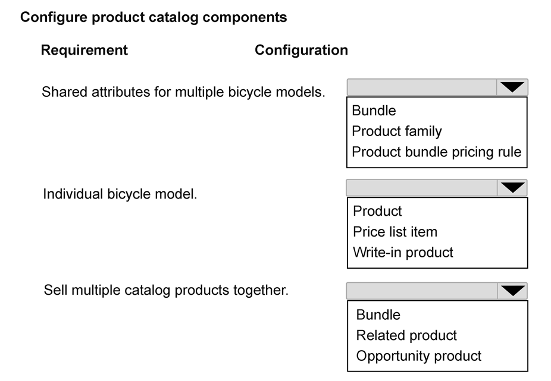

_HOTSPOT — the original ExamTopics question expects you to mark areas on the exhibit above; the correct hotspot coordinates are not published._

**Most voted:**
- Shared attributes for multiple bicycle models: Product family
- Individual bicycle model: Product
- Sell multiple catalog products together: Bundle

### Top explanations
- **Evincible** (1 upvotes [Most Recent]): 1. Shared attributes for multiple bicycle models.	Product family
  2. Individual bicycle model.	Product
  3. Sell multiple catalog products together.	Bundle
  Explanation
  1. Product family: Groups related products and allows them to inherit shared properties such as frame material and warranty period.
  2. Product: Represents an individual bicycle model that can be sold separately.
  3. Bundle: Combines multiple catalog products, such as a bicycle, accessories, and warranty, into a single offering with bundle pricing.

## Q1.17 (ID 431396)

You are implementing Dynamics 365 Sales for a company. The company sells the same products in the North America and Europe regions. Each region uses a different currency.
The sales team requires that product prices be managed separately for different currencies and regions.
You need to configure the pricing model so the same product can be sold with the price based on the region.
What should you do?

✅ **A.** Create a separate price list for each currency.
⭕ **B.** Create separate product bundles for each currency.
⭕ **C.** Create multiple product families to represent each currency.
⭕ **D.** Create duplicate opportunity products for each region.

**Correct answer:** A
**Most voted:** A

### Top explanations
- **Evincible** (1 upvotes [Most Recent, Selected Answer: A]): Explanation
  Dynamics 365 Sales supports multiple price lists, allowing the same product to have different prices based on currency and region.
  For example:
  - North America: Create a price list using USD.
  - Europe: Create a price list using EUR.
  Each price list contains price list items that define the selling price of products in the specified currency.
  Why the other options are incorrect
  - B. Product bundles: Used to sell multiple products together, not to manage regional currencies.
  - C. Product families: Used to group related products and inherit common properties.
  - D. Duplicate opportunity products: Unnecessary because the same product can be associated with multiple price lists.

## Q1.18 (ID 431324)

DRAG DROP
A company deploys Dynamics 365 Sales. The company is using Exchange Online.
The company requires that all user emails are automatically tracked in Dynamics 365.
You need to enable email tracking on the environment.
Which email configuration settings should you configure for outgoing and incoming email? To answer, move the appropriate configurations to the correct requirements. You may use each configuration once, more than once, or not at all. You may need to move the split bar between panes or scroll to view content.
NOTE: Each correct selection is worth one point.

**Exhibits**
- Exhibit 1: 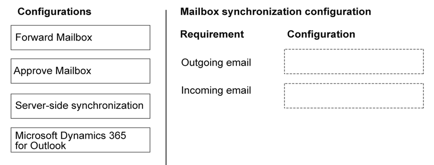

_DRAG DROP — the original ExamTopics question expects you to drag and drop items; the correct targets are not published._

**Most voted:**
- Outgoing email: Server-side synchronization
- Incoming email: Server-side synchronization

### Top explanations
- **Evincible** (1 upvotes [Most Recent]): 1. Outgoing email	Server-side synchronization
  2. Incoming email	Server-side synchronization
  Explanation
  Server-side synchronization integrates Dynamics 365 Sales with Exchange Online to synchronize incoming and outgoing emails automatically, subject to email tracking settings.
  - Outgoing email: Enables emails sent through Dynamics 365 to be processed using Exchange Online.
  - Incoming email: Enables Dynamics 365 to synchronize and track incoming Exchange Online emails according to the configured tracking rules.
  Why the other options are incorrect
  - Forward Mailbox: An alternative method for processing incoming emails, but not the preferred approach for Exchange Online.
  - Approve Mailbox: An administrative approval step, not an email synchronization method.
  - Microsoft Dynamics 365 for Outlook: A legacy Outlook integration approach, not the recommended method for Exchange Online synchronization.

## Q1.19 (ID 431196)

DRAG DROP
You are implementing Dynamics 365 Sales for a company that sells products in different markets.
The company has the following requirements:
Must define pricing for products.
Must automatically use a localized price list.
Must group product prices for each region.
You need to configure pricing.
What should you configure for each requirement? To answer, move the appropriate configurations to the correct requirements. You may use each configuration once, more than once, or not at all. You may need to move the split bar between panes or scroll to view content.
NOTE: Each correct selection is worth one point.

**Exhibits**
- Exhibit 1: 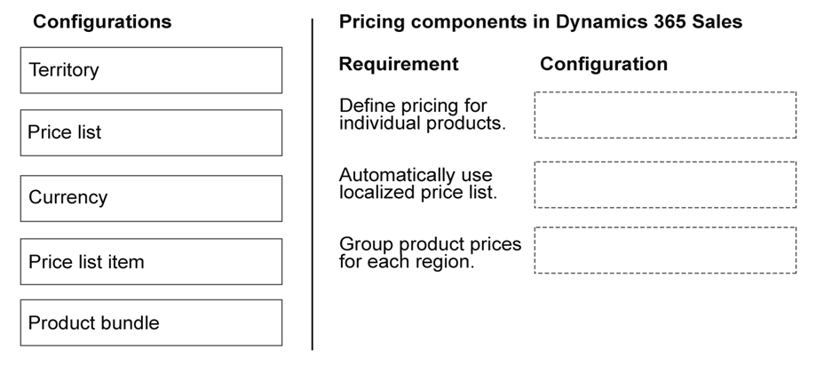

_DRAG DROP — the original ExamTopics question expects you to drag and drop items; the correct targets are not published._

**Most voted:**
- Define pricing for individual products → Price list item
- Automatically use localized price list → Currency
- Group product prices for each region → Price list

### Top explanations
- **Evincible** (2 upvotes): 1. Define pricing for individual products.	Price list item
  2. Automatically use localized price list.	Territory
  3. Group product prices for each region.	Price list
  Explanation
  1. Price list item: Defines the selling price of an individual product within a specific price list, including pricing method, unit, and currency.
  2. Territory: Allows price lists to be associated with sales territories so an appropriate regional price list can be selected automatically when default price list selection is configured.
  3. Price list: Groups product prices for different regions, markets, or currencies. Each region can have its own price list containing multiple products.
- **mamicoelho** (1 upvotes [Most Recent]): 1. Define pricing for individual products → Price list item
  2. Automatically use localized price list → Currency
  3. Group product prices for each region → Price list
  Why not the others?
  - Territory ❌ - Used for sales organization, assignments, forecasting, and regional management.; Does not store or group product pricing.
  - Product bundle ❌ - Combines products into a package; Not used for regional price management.

## Q1.20 (ID 431164)

You are configuring Copilot capabilities in Dynamics 365 Sales for a company.
After enabling Copilot, sellers report that the summary insight banner on Opportunities, Leads, and Accounts is missing key business context and history.
You need to ensure that the missing information is displayed.
Which action should you perform?

⭕ **A.** Configure the opportunity pipeline view settings.
⭕ **B.** Enable Bing search and provide Bing search consent.
⭕ **C.** Configure predictive scoring.
✅ **D.** Configure the table summary fields.

**Correct answer:** D
**Most voted:** D

### Top explanations
- **Evincible** (2 upvotes [Most Recent, Selected Answer: D]): Explanation
  In Dynamics 365 Sales, Copilot uses configured table summary fields to generate insights for Opportunities, Leads, and Accounts.
  Configuring these fields allows Copilot to include relevant business information, such as:
  - Customer history and account details.
  - Opportunity status, revenue, and expected close dates.
  - Lead information and qualification details.
  - Important business context from related records.
  Microsoft confirms that administrators can customize which fields Copilot uses to generate record summaries.
  Why the other options are incorrect
  - A. Opportunity pipeline view settings: Controls opportunity visualization, not Copilot summaries.
  - B. Bing search consent: Enables external web-based information, not internal CRM business context.
  - C. Predictive scoring: Calculates lead and opportunity scores, rather than controlling summary content.

## Q1.21 (ID 431232)

DRAG DROP
A company is using Dynamics 365 Sales.
The company wants sellers to use a repeatable sequence for opportunities. The company has the following requirements for the opportunity stages:
Must define the flow of work sellers must complete before closing an opportunity.
Must guide sellers through data entry at each stage.
Must report on the business process flow execution.
Must ensure background process occurs after stage changes.
You need to configure a solution for each requirement.
Which configuration should you use for each requirement? To answer, move the appropriate configurations to the correct requirements. You may use each configuration once, more than once, or not at all. You may need to move the split bar between panes or scroll to view content.
NOTE: Each correct selection is worth one point.

**Exhibits**
- Exhibit 1: 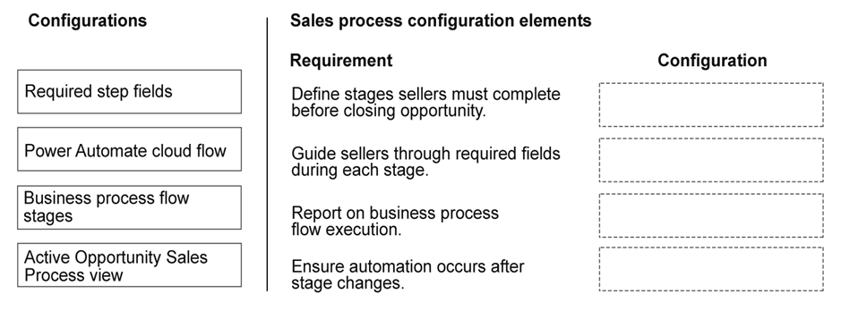

_DRAG DROP — the original ExamTopics question expects you to drag and drop items; the correct targets are not published._

**Most voted:**
- Define stages sellers must complete before closing opportunity → Business process flow stages
- Guide sellers through required fields during each stage → Required step fields
- Report on business process flow execution → Active Opportunity Sales Process view
- Ensure automation occurs after stage changes → Power Automate cloud flow
- Define the sequence of stages (Qualify → Develop → Propose → Close) that users must progress through before closing an opportunity.

### Top explanations
- **lonico2** (4 upvotes): would say 3 is active opty sales process view
- **mamicoelho** (1 upvotes [Most Recent]): 1. Define stages sellers must complete before closing opportunity → Business process flow stages
  2. Guide sellers through required fields during each stage → Required step fields
  3. Report on business process flow execution → Active Opportunity Sales Process view
  4. Ensure automation occurs after stage changes → Power Automate cloud flow
  Explanation
  ✅ Business process flow stages
  Define the sequence of stages (Qualify → Develop → Propose → Close) that users must progress through before closing an opportunity.
  ✅ Required step fields
  Specify the data that sellers must enter within each stage before moving forward.
  ✅ Active Opportunity Sales Process view
  Stores and exposes Business Process Flow instance data, enabling reporting on process progression and execution.
  ✅ Power Automate cloud flow
  Can be triggered when a Business Process Flow stage changes to perform background automation, such as creating tasks, sending notifications, or updating records.

## Q1.22 (ID 431347)

DRAG DROP
A company is migrating legacy customer data into Dynamics 365 Sales.
Data administrators prepare an Excel file and plan to use the standard Excel import experience.
You need to complete the import.
Which four actions should you perform in sequence? To answer, move the appropriate actions from the list of actions to the answer area and arrange them in the correct order.

**Exhibits**
- Exhibit 1: 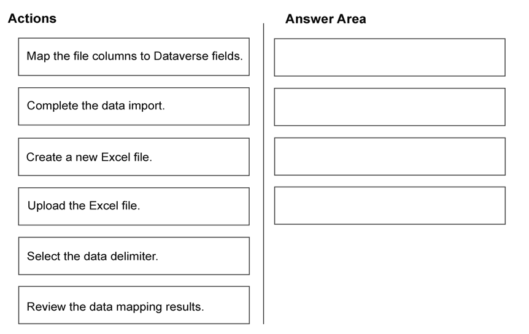

_DRAG DROP — the original ExamTopics question expects you to drag and drop items; the correct targets are not published._

**Most voted:**
- 3: Review the data mapping results.
- 4: Complete the data import.

### Top explanations
- **Evincible** (2 upvotes): 1:Upload the Excel file.
  2:Map the file columns to Dataverse fields.
  3: Review the data mapping results.
  4: Complete the data import.
  Explanation
  1. Upload the Excel file: Select the prepared Excel workbook containing the customer data.
  2. Map the file columns to Dataverse fields: Match Excel columns to the corresponding Dynamics 365 Sales fields. Some mappings may be automatic.
  3. Review the data mapping results: Verify that required fields are mapped correctly and resolve any errors.
  4. Complete the data import: Finish the import to load customer records into Dataverse.
- **mamicoelho** (1 upvotes [Most Recent]): 1 - Upload the Excel file
  2 - Map the file columns to Dataverse fields
  3 - Review the data mapping results
  4 - Complete the data import

## Q1.23 (ID 431428)

A company is using Dynamics 365 Sales to provide quotes to their customers.
Preferred customers must be granted a separate flat rate discount on specific products, depending on their countries or regions.
What should you create?

✅ **A.** A price list for the currency of each country/region.
⭕ **B.** A sequence command step.
⭕ **C.** A product bundle for each country/region.

**Correct answer:** A
**Most voted:** A

### Top explanations
- **Evincible** (1 upvotes [Most Recent, Selected Answer: A]): Explanation
  Dynamics 365 Sales allows you to create separate price lists for different currencies and regions. Each price list can contain product-specific pricing and associated discounts.
  However, the question specifically mentions flat-rate discounts. For that requirement, the more precise configuration is a Discount List with its discount type set to Amount, associated with the relevant price list items.
  Why the other options are incorrect
  - B. Sequence command step: Used for sales process automation, not product pricing.
  - C. Product bundle: Used to sell multiple products together, not to manage regional discounts.

## Q1.24 (ID 431373)

A company manufactures widgets. Widgets can be sold in the following ways:
The company discovers that customers in Europe want to purchase widgets individually. The company must update the EU price list to allow individual widget purchases.
You need to add a price list for the new unit named Each.
What should you do?

**Exhibits**
- Exhibit 1: 

✅ **A.** Set Each as the primary unit.
⭕ **B.** Update the unit Box with Each as the base unit
⭕ **C.** Create the unit Each with Box as the base unit.
⭕ **D.** Make Each the base unit for all units.

**Correct answer:** A
**Most voted:** A

### Top explanations
- **Shaiii102500** (3 upvotes [Selected Answer: A]): A. Set Each as the primary unit ✅
  B. Update Box with Each as base unit ❌ Not sufficient by itself because Each needs to become the lowest/primary unit.
  C. Create Each with Box as base unit ❌ Reverses the relationship because Each is smaller than Box.
  D. Make Each the base unit for all units ❌ Case can continue to use Box, and Pallet can continue to use Case.
- **mamicoelho** (1 upvotes [Most Recent, Selected Answer: A]): In Dynamics 365 Sales, price lists are used to define product prices and can be associated with specific currencies. To offer different pricing and discounts based on countries or regions, you typically create separate price lists for those markets and assign them to customers.
  Examples:
  EUR Price List (Portugal, Spain)
  GBP Price List (United Kingdom)
  USD Price List (United States)
  Preferred customers can then receive region-specific pricing through the appropriate price list and discount configuration.
  Why not the others?
  B. A sequence command step ❌
  Sequences automate sales activities (emails, calls, tasks). They do not control pricing or discounts.
  C. A product bundle for each country/region ❌
  Bundles group products together but do not provide regional pricing structures or flat-rate discounts by geography.

## Q1.25 (ID 431287)

DRAG DROP
You configure the product catalog for a company that sells coffee machines and accessories.
The company requires that new products be structured and made available to the sales team. The company also needs to group multiple products under a single parent item. Sellers need to be able to sell coffee machines, filters, and grinders together.
You need to determine the correct configuration for each catalog requirement.
Which configurations should you use? To answer, move the appropriate configurations to the correct requirements. You may use each configuration once, more than once, or not at all. You may need to move the split bar between panes or scroll to view content.
NOTE: Each correct selection is worth one point.

**Exhibits**
- Exhibit 1: 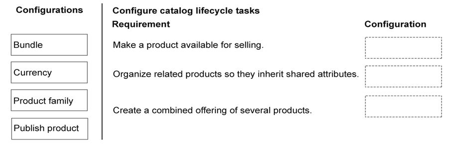

_DRAG DROP — the original ExamTopics question expects you to drag and drop items; the correct targets are not published._

**Most voted:**
- Make a product available for selling: Publish product
- Organize related products so they inherit shared attributes: Product family
- Create a combined offering of several products: Bundle

### Top explanations
- **Evincible** (1 upvotes [Most Recent]): 1. Make a product available for selling.	Publish product
  2. Organize related products so they inherit shared attributes.	Product family
  3. Create a combined offering of several products.	Bundle
  Explanation
  1. Publish product: Changes a product from Draft to Active, making it available for sales transactions such as opportunities, quotes, orders, and invoices.
  2. Product family: Groups related products under a parent structure and allows them to inherit shared attributes, such as brand, warranty, and specifications.
  3. Bundle: Combines multiple products, such as a coffee machine, filters, and grinder, into a single offering that sellers can sell together.

## Q1.26 (ID 431512)

A company plans to deploy a Dynamics 365 Sales Hub app.
An administrator creates a Power Platform environment with the following configuration:
The environment does not have a database.
The environment is a sandbox environment.
Access to the environment is restricted to a security group.
The administrator has the System Administrator role.
You need to ensure that the administrator can deploy Dynamics 365 Sales.
Which two actions should you perform? Each correct answer presents part of the solution.
NOTE: Each correct selection is worth one point.

⭕ **A.** Remove the security group restriction.
⭕ **B.** Create a new environment.
✅ **C.** Assign a Dynamics 365 Sales enterprise license to the administrator role.
✅ **D.** Add Dataverse and enable Dynamics 365 apps.
⭕ **E.** Enable server-side synchronization

**Correct answer:** C, D
**Most voted:** CD

### Top explanations
- **Evincible** (1 upvotes [Most Recent, Selected Answer: CD]): Explanation
  C. Assign a Dynamics 365 Sales Enterprise license - A valid Dynamics 365 license entitlement is required to enable Dynamics 365 apps during database provisioning.
  D. Add Dataverse and enable Dynamics 365 apps - Dynamics 365 Sales requires a Dataverse database. When provisioning the database, select Enable Dynamics 365 apps = Yes.
  Why the other options are incorrect
  - A. Remove security group restriction: Not necessary. Dynamics 365 Sales supports environments restricted to security groups.
  - B. Create a new environment: Not necessary because Dataverse can be added to the existing sandbox environment.
  - E. Enable server-side synchronization: Used for email integration, not Sales deployment.

## Q1.27 (ID 431446)

HOTSPOT
You manage the product catalog for a company that manufactures pet clothing and accessories.
The company decides to sell a new product line of collars that are available in different colors.
The company needs to ensure sellers can create opportunities for products from the existing line of collars, the new line, and the different color options for all collars.
Which configuration do you need to create to meet the requirements? To answer, select the appropriate options in the answer area.
NOTE: Each correct selection is worth one point.

**Exhibits**
- Exhibit 1: 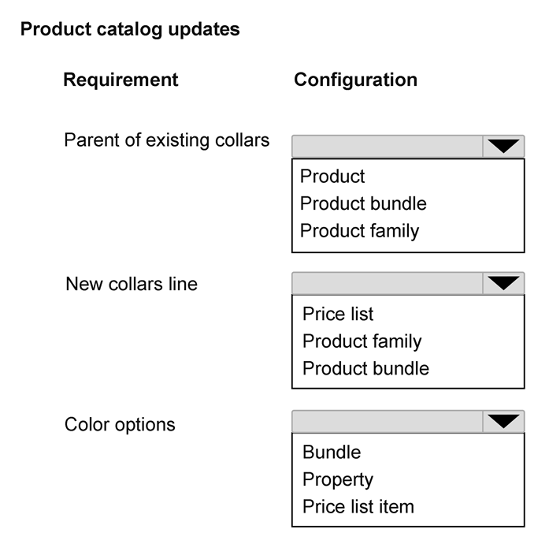

_HOTSPOT — the original ExamTopics question expects you to mark areas on the exhibit above; the correct hotspot coordinates are not published._

**Most voted:** A Product Family is used to group related products, so both existing and new collar lines need families. Color is a Product Property because it defines a characteristic, while a Bundle is used to sell multiple products together.

### Top explanations
- **Shafi Shah** (1 upvotes [Most Recent]): A Product Family is used to group related products, so both existing and new collar lines need families. Color is a Product Property because it defines a characteristic, while a Bundle is used to sell multiple products together.
- **seoyeon_01** (1 upvotes [Selected Answer: B]): Can anyone help me see why this is the right answer?

## Q2.1 (ID 431540)

You use document management in Dynamics 365 Sales. You use a single, parent SharePoint site collection with several child site records configured for each geographical region.
You make a change on SharePoint to rename one of the child sites.
You need to ensure the document management capabilities continue to function for all associated records.
What should you do?

⭕ **A.** Update the absolute URL.
⭕ **B.** Create a new document location.
⭕ **C.** Create a new site record.
✅ **D.** Update the relative URL.

**Correct answer:** D
**Most voted:** D

### Top explanations
- **Evincible** (1 upvotes [Most Recent, Selected Answer: D]): Explanation
  In Dynamics 365 Sales, when SharePoint document management uses a parent site collection with child site records, the child sites can be configured using relative URLs.
  If a child site's URL changes after renaming it, update the Relative URL in the corresponding SharePoint site record.
  This ensures that existing document locations continue to resolve correctly without creating new site records.
  Why the other options are incorrect
  - A. Update the absolute URL: Appropriate when the parent site's full URL changes, rather than a child site's relative path.
  - B. Create a new document location: Unnecessary because existing document locations can continue to be used.
  - C. Create a new site record: Unnecessary because the existing child site record can be updated.

## Q2.2 (ID 431257)

DRAG DROP
Background
Contoso Ltd. is a global technology distributor headquartered in Redmond, Washington and has enterprise customers across North America and Europe.
Contoso Ltd. currently manages its sales operations by using Microsoft Dynamics 365 Sales and plans to enable Sales Insights in the future.
The company has approximately 150 field sellers, 40 insider sellers, 20 sales managers, and a central IT team responsible for configuring the sales platform. Contoso Ltd.’s executive leadership has defined the following goals for the new sales platform implementation:
Improve seller productivity by reducing manual research and data entry.
Use AI insights to prioritize leads and opportunities.
Provide automated recommendations to sales representatives throughout the deal lifecycle.
Current environment
Sales platform
Contoso Ltd. uses Microsoft Dynamics 365 Sales integrated with Microsoft 365 services. The following components are currently deployed:
Business requirements
Contoso Ltd.’s executives have defined the following business requirements:
Lead management
Inside sellers must use a seller engagement workspace that prioritizes leads automatically based on predicted likelihood to convert.
All sellers are guided through a consistent set of qualification steps aligned to Contoso Ltd.’s sales strategy.
Leads cannot be advanced to the development stage until a decision maker has been confirmed.
Sales leadership requires flexibility in how leads are converted. Inside sales need automatic opportunity creation. Field sellers need the option to manually decide whether an opportunity should be created when a lead is qualified.
Lead scoring must be implemented to help sellers identify high potential leads automatically.
Lead scoring must continuously improve based on historical sales outcomes.
Opportunity development
Opportunities are tracked in Dynamics 365 Sales through a defined qualification-to-opportunity lifecycle to ensure accurate reporting.
The opportunity flow must be improved by using AI-driven research and automated insights.
Field sellers must be able to access contextual research about customers and competitors while working on opportunities.
All opportunity revenue must be calculated using opportunity line items based on selected Contoso Ltd.’s products and standard pricing
Sales managers must receive an external quarterly competitive intelligence brief to help with their research. This should be delivered as a PDF document.
Sales performance
Sales managers require improved pipeline and revenue forecasting capabilities. The managers need to report on their business performance and use insights, visuals, and recommended next actions.
The new solution must provide the following:
Notify the seller’s manager when a draft quote is created and requires approval.
Allow leadership to track performance against revenue goals.
Ask questions about Dynamics 365 Sales data to support executive analysis and decision making.
Technical requirements
Contoso Ltd.'s IT department defines the following priorities for the sales platform.
AI capabilities
The platform must support the following AI features:
Lead scoring to guide sellers to priority items.
Opportunity research insights to prepare deal analysis.
AI-powered research and analytics to aid leadership reporting.
Automation
Automation must be implemented to guide sellers through recommended next steps during the sales cycle.
Any approvals must use the Power Automate Approvals connector.
Field sellers use the existing Lead to Opportunity Business Process Flow to manage their leads.
A Power Automate desktop flow is used to process orders into a partner ordering application that completes fulfillment.
AI-driven insights
The company is deploying the Sales accelerator to guide seller activities.
The Sales Research Agent
Sales managers will use the Sales Research Agent to gather intelligence about customer organizations.
The sales managers have the following requirements:
Must be able to reuse visualizations after they are created; they don’t want to recreate them.
Must have a consistent method to quickly return to a blueprint that they frequently use.
Must be able to retain a library of questions to receive consistent responses based on definitions approved by the company.
Should have Bing search enabled on the environment for generative AI feature settings.
Platform extensions
The IT department plan to extend the platform by doing the following:
Create Power Automate flows to automate seller tasks.
Embed Power BI reports for sales analytics.
Testing
The IT department is testing predictive lead scoring with a small group of sellers.
The IT department edits the existing lead scoring model by adding new fields.
Issues
Users have reported the following issues:
Field sellers spend a significant amount of time researching customers before engaging with prospects.
Testers report they cannot access the field changes in the lead score.
A sales manager generated a blueprint but forgot the competitive intelligence brief.
You need to configure capabilities that guide the seller’s priorities and process in Dynamics 365 Sales.
Which configurations should be used for each capability? To answer, move the appropriate configurations to the correct requirements. You may use each configuration once, more than once, or not at all. You may need to move the split bar between panes or scroll to view content.
NOTE: Each correct selection is worth one point.

**Exhibits**
- Exhibit 1: 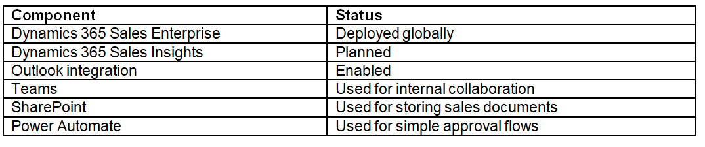
- Exhibit 2: 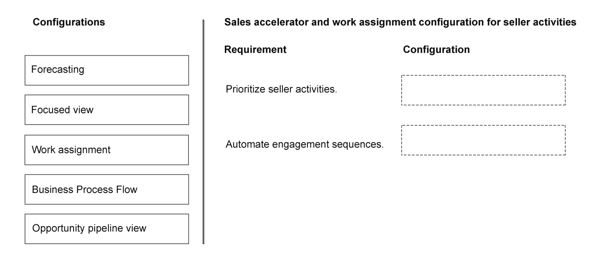

_DRAG DROP — the original ExamTopics question expects you to drag and drop items; the correct targets are not published._

**Most voted:**
- Prioritize seller activities: Focused view
- Automate engagement sequences: Work assignment

### Top explanations
- **Evincible** (1 upvotes [Most Recent]): 1. Prioritize seller activities.	Focused view
  2. Automate engagement sequences.	Work assignment
  Explanation
  1. Focused view — Prioritize seller activities
  Focused view provides sellers with a prioritized work list of leads, opportunities, and activities, helping them identify which customers to engage with next.
  2. Work assignment — Automate engagement sequences
  Work assignment is part of Sales accelerator and supports:
  - Creating segments to group leads and opportunities.
  - Connecting segments to engagement sequences.
  - Automatically assigning records to sellers based on defined rules

## Q2.3 (ID 431187)

DRAG DROP
Background
AdventureWorks Cycles is a global manufacturer of high-performance bicycles headquartered in Seattle. The company sells products through distributors, specialty retailers, and a growing direct-to-consumer online channel. AdventureWorks Cycles recently expanded its product catalog to include the athlete package, which includes a cycle, connected devices and subscription-based analytics services.
The sales operations team is responsible for configuring the new Dynamics 365 Sales environment. Their goal is to implement AI-driven processes that streamline the lead-to-cash workflow while ensuring that sellers can easily identify the most promising opportunities.
Current Environment
Product managers maintain products and pricing in spreadsheets. Information regarding custom relationships, competitor analysis, and region-specific marketing content is stored in a SharePoint site called the sales portfolio.
The organization has identified reporting challenges they want to resolve:
Regional managers require in-depth reporting using information from the sales pipeline and seller activities, the point-of-sale solution, website analytics, and the accounting system.
Team leads require real-time information on active opportunities, as well as visibility of seller’s appointments and phone calls, without needing to navigate into multiple views.
Sellers must be able to quickly view their own opportunities by phase.
All sellers are assigned Dynamics 365 Sales Enterprise licenses, also, the CFO has requested that Copilot message packs are pre-purchased by using the Copilot Studio subscription license.
A Dynamics 365 sales sandbox environment has been in use for six months. There are 60 leads records with 30 records that are qualified and 20 that are disqualified. Ten of the qualified leads are over three months old.
Business Requirements
Sellers in all regions should be able to review the new mountaineer cycles. The cycles include economy and premium fittings. When creating opportunities, sellers should be able to select a metal type when adding a mountaineer cycle to an opportunity. The metal types include chrome, aluminum, and titanium.
Pricing managers must be able to create deals for the same products in their own currencies and at their own prices, without reference to the cost of the product.
Predictive scoring should be enabled for leads created within the last three months in the sandbox environment.
A segment of leads named Hot is needed that will contain all leads where the source is phone, employee referral or partner. Leads from this segment should be distributed to sellers using a round robin method.
Agents should not be able to take action on any data that is created in the production environment before they are started.
All sellers should be able to access leads disqualified by agents.
Technical Information & Requirements
Agents must use a dedicated service identity to execute write actions with a controlled security role in Dataverse.
The sales operations team lead must be assigned the Power Platform administrator role.
The lead pricing manager must be assigned to the Microsoft 365 billing admin role.
The vice president of sales must be assigned the AI admin role.
Both the sandbox and production environments must be enabled for AI capacity, but usage should be capped on the sandbox environment.
A trial environment must be created, with the sales qualification agent configured. Outreach emails must be automatically generated for leads but only sent when sellers deem it necessary.
All sellers must be assigned a customized version of the salesperson role on the production environment. This role should grant read access only to the leads that the sellers own.
The EnableRoleBasedSystemViews property must be set to true for the production environment.
No Azure subscriptions are available in the tenant.
Issues
The sales qualification agent has disqualified several leads in the trial environment. The vice president of sales has requested to understand the reason for the disqualified leads.
Sellers are not able to create agents in the production environment.
Agent consumption has been unreliable. The company requires that AI capacity is always available to sellers.
You need to recommend the appropriate reporting tool for each group of users.
Which reporting tool should be used for each scenario? To answer, move the appropriate reporting options to the correct requirements. You may use each reporting option once, more than once, or not at all. You may need to move the split bar between panes or scroll to view content.
NOTE: Each correct selection is worth one point.

**Exhibits**
- Exhibit 1: 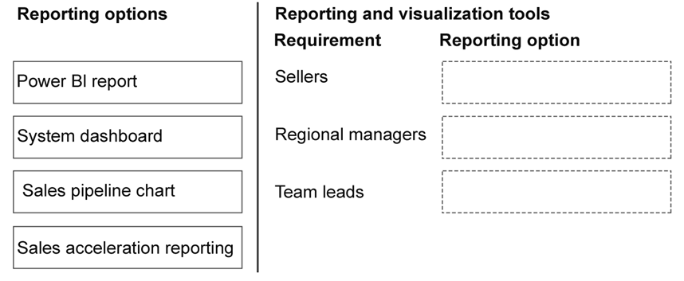

_DRAG DROP — the original ExamTopics question expects you to drag and drop items; the correct targets are not published._

**Most voted:**
- Sellers: Sales pipeline chart
- Regional managers: Power BI report
- Team leads: System dashboard

### Top explanations
- **Evincible** (1 upvotes [Most Recent]): 1. Sellers	Sales pipeline chart
  2. Regional managers	Power BI report
  3. Team leads	System dashboard
  Explanation
  1. Sellers → Sales pipeline chart
  Sellers need to quickly view their own opportunities by sales phase. The Sales pipeline chart displays opportunities across pipeline stages such as Qualify, Develop, Propose, and Close.
  2. Regional managers → Power BI report
  Regional managers require in-depth reporting that combines Dynamics 365 Sales data with point-of-sale transactions, website analytics, and accounting information. Power BI is the appropriate solution for reporting across multiple data sources.
  3. Team leads → System dashboard
  Team leads need a single place to monitor active opportunities, appointments, and phone calls. Dynamics 365 system dashboards combine charts, views, and activity information in one interface.
  Power BI can combine data from multiple business systems in a single reporting model.

## Q3.3 (ID 431291)

Background
Contoso Ltd. is a global technology distributor headquartered in Redmond, Washington and has enterprise customers across North America and Europe.
Contoso Ltd. currently manages its sales operations by using Microsoft Dynamics 365 Sales and plans to enable Sales Insights in the future.
The company has approximately 150 field sellers, 40 insider sellers, 20 sales managers, and a central IT team responsible for configuring the sales platform. Contoso Ltd.’s executive leadership has defined the following goals for the new sales platform implementation:
Improve seller productivity by reducing manual research and data entry.
Use AI insights to prioritize leads and opportunities.
Provide automated recommendations to sales representatives throughout the deal lifecycle.
Current environment
Sales platform
Contoso Ltd. uses Microsoft Dynamics 365 Sales integrated with Microsoft 365 services. The following components are currently deployed:
Business requirements
Contoso Ltd.’s executives have defined the following business requirements:
Lead management
Inside sellers must use a seller engagement workspace that prioritizes leads automatically based on predicted likelihood to convert.
All sellers are guided through a consistent set of qualification steps aligned to Contoso Ltd.’s sales strategy.
Leads cannot be advanced to the development stage until a decision maker has been confirmed.
Sales leadership requires flexibility in how leads are converted. Inside sales need automatic opportunity creation. Field sellers need the option to manually decide whether an opportunity should be created when a lead is qualified.
Lead scoring must be implemented to help sellers identify high potential leads automatically.
Lead scoring must continuously improve based on historical sales outcomes.
Opportunity development
Opportunities are tracked in Dynamics 365 Sales through a defined qualification-to-opportunity lifecycle to ensure accurate reporting.
The opportunity flow must be improved by using AI-driven research and automated insights.
Field sellers must be able to access contextual research about customers and competitors while working on opportunities.
All opportunity revenue must be calculated using opportunity line items based on selected Contoso Ltd.’s products and standard pricing
Sales managers must receive an external quarterly competitive intelligence brief to help with their research. This should be delivered as a PDF document.
Sales performance
Sales managers require improved pipeline and revenue forecasting capabilities. The managers need to report on their business performance and use insights, visuals, and recommended next actions.
The new solution must provide the following:
Notify the seller’s manager when a draft quote is created and requires approval.
Allow leadership to track performance against revenue goals.
Ask questions about Dynamics 365 Sales data to support executive analysis and decision making.
Technical requirements
Contoso Ltd.'s IT department defines the following priorities for the sales platform.
AI capabilities
The platform must support the following AI features:
Lead scoring to guide sellers to priority items.
Opportunity research insights to prepare deal analysis.
AI-powered research and analytics to aid leadership reporting.
Automation
Automation must be implemented to guide sellers through recommended next steps during the sales cycle.
Any approvals must use the Power Automate Approvals connector.
Field sellers use the existing Lead to Opportunity Business Process Flow to manage their leads.
A Power Automate desktop flow is used to process orders into a partner ordering application that completes fulfillment.
AI-driven insights
The company is deploying the Sales accelerator to guide seller activities.
The Sales Research Agent
Sales managers will use the Sales Research Agent to gather intelligence about customer organizations.
The sales managers have the following requirements:
Must be able to reuse visualizations after they are created; they don’t want to recreate them.
Must have a consistent method to quickly return to a blueprint that they frequently use.
Must be able to retain a library of questions to receive consistent responses based on definitions approved by the company.
Should have Bing search enabled on the environment for generative AI feature settings.
Platform extensions
The IT department plan to extend the platform by doing the following:
Create Power Automate flows to automate seller tasks.
Embed Power BI reports for sales analytics.
Testing
The IT department is testing predictive lead scoring with a small group of sellers.
The IT department edits the existing lead scoring model by adding new fields.
Issues
Users have reported the following issues:
Field sellers spend a significant amount of time researching customers before engaging with prospects.
Testers report they cannot access the field changes in the lead score.
A sales manager generated a blueprint but forgot the competitive intelligence brief.
You need to configure the new lead qualification experience in Dynamics 365 Sales for field sellers.
What should you configure?

**Exhibits**
- Exhibit 1: 

⭕ **A.** Allow Copilot to summarize key info.
⭕ **B.** Enable auto-create records for newly qualified leads.
✅ **C.** Use the Lead to Opportunity Business Process Flow.
⭕ **D.** Set related record creation to Seller.
⭕ **E.** Set related record creation to Automatic.

**Correct answer:** C
**Most voted:** C

### Top explanations
- **Elmira2132** (1 upvotes [Most Recent, Selected Answer: C]): states that field sellers use the existing Lead to Opportunity Business Process Flow (BPF) to manage leads.
  The BPF guides field sellers through consistent qualification stages and steps, ensuring they follow Contoso's sales strategy.

## Q3.8 (ID 431358)

Background
AdventureWorks Cycles is a global manufacturer of high-performance bicycles headquartered in Seattle. The company sells products through distributors, specialty retailers, and a growing direct-to-consumer online channel. AdventureWorks Cycles recently expanded its product catalog to include the athlete package, which includes a cycle, connected devices and subscription-based analytics services.
The sales operations team is responsible for configuring the new Dynamics 365 Sales environment. Their goal is to implement AI-driven processes that streamline the lead-to-cash workflow while ensuring that sellers can easily identify the most promising opportunities.
Current Environment
Product managers maintain products and pricing in spreadsheets. Information regarding custom relationships, competitor analysis, and region-specific marketing content is stored in a SharePoint site called the sales portfolio.
The organization has identified reporting challenges they want to resolve:
Regional managers require in-depth reporting using information from the sales pipeline and seller activities, the point-of-sale solution, website analytics, and the accounting system.
Team leads require real-time information on active opportunities, as well as visibility of seller’s appointments and phone calls, without needing to navigate into multiple views.
Sellers must be able to quickly view their own opportunities by phase.
All sellers are assigned Dynamics 365 Sales Enterprise licenses, also, the CFO has requested that Copilot message packs are pre-purchased by using the Copilot Studio subscription license.
A Dynamics 365 sales sandbox environment has been in use for six months. There are 60 leads records with 30 records that are qualified and 20 that are disqualified. Ten of the qualified leads are over three months old.
Business Requirements
Sellers in all regions should be able to review the new mountaineer cycles. The cycles include economy and premium fittings. When creating opportunities, sellers should be able to select a metal type when adding a mountaineer cycle to an opportunity. The metal types include chrome, aluminum, and titanium.
Pricing managers must be able to create deals for the same products in their own currencies and at their own prices, without reference to the cost of the product.
Predictive scoring should be enabled for leads created within the last three months in the sandbox environment.
A segment of leads named Hot is needed that will contain all leads where the source is phone, employee referral or partner. Leads from this segment should be distributed to sellers using a round robin method.
Agents should not be able to take action on any data that is created in the production environment before they are started.
All sellers should be able to access leads disqualified by agents.
Technical Information & Requirements
Agents must use a dedicated service identity to execute write actions with a controlled security role in Dataverse.
The sales operations team lead must be assigned the Power Platform administrator role.
The lead pricing manager must be assigned to the Microsoft 365 billing admin role.
The vice president of sales must be assigned the AI admin role.
Both the sandbox and production environments must be enabled for AI capacity, but usage should be capped on the sandbox environment.
A trial environment must be created, with the sales qualification agent configured. Outreach emails must be automatically generated for leads but only sent when sellers deem it necessary.
All sellers must be assigned a customized version of the salesperson role on the production environment. This role should grant read access only to the leads that the sellers own.
The EnableRoleBasedSystemViews property must be set to true for the production environment.
No Azure subscriptions are available in the tenant.
Issues
The sales qualification agent has disqualified several leads in the trial environment. The vice president of sales has requested to understand the reason for the disqualified leads.
Sellers are not able to create agents in the production environment.
Agent consumption has been unreliable. The company requires that AI capacity is always available to sellers.
You need to identify the capabilities the Sales Qualification Agent can extend to AdventureWorks cycles.
Which three capabilities should the agent use? Each correct answer presents part of the solution.
NOTE: Each correct selection is worth one point.

⭕ **A.** Evaluate intent based on email responses.
✅ **B.** Notify supervisors when a lead is disqualified.
✅ **C.** Use information from the sales portfolio for emails.
⭕ **D.** Use weighted Budget, Authority, Need, Timeline (BANT) criteria.
✅ **E.** Assign favorable leads to the correct seller.

**Correct answer:** B, C, E
**Most voted:** BCE

### Top explanations
- **DGee** (1 upvotes [Most Recent, Selected Answer: ACE]): The Sales Qualification Agent can be extended to:
  ✅ A. Evaluate intent based on email responses
  The agent can analyse prospect replies and determine buying intent.
  This helps refine lead qualification and prioritisation.
  ✅ C. Use information from the sales portfolio for emails
  The case study states that competitor analysis, custom relationships, and marketing content are stored in the sales portfolio SharePoint site.
  The agent can use grounded knowledge sources to generate more relevant outreach emails.
  ✅ E. Assign favorable leads to the correct seller
  The business requirement specifies that the Hot segment should be distributed using a round-robin method.
  The agent can route qualified leads to the appropriate seller.
  Why not the others?
  ❌ B. Notify supervisors when a lead is disqualified
  This is not a core Sales Qualification Agent capability.
  ❌ D. Use weighted Budget, Authority, Need, Timeline (BANT) criteria
  The Sales Qualification Agent does not rely on configurable weighted BANT scoring as a primary capability.
  Final Answer
  ✅ A. Evaluate intent based on email responses
  ✅ C. Use information from the sales portfolio for emails
  ✅ E. Assign favorable leads to the correct seller
- **JYC_0513** (1 upvotes [Selected Answer: BCE]): Because the AdventureWorks requirement uses the Sales Qualification Agent in Research-only mode, focus on capabilities available without autonomous email engagement.
  B. Notify supervisors when a lead is disqualified. ✅ The agent can disqualify a lead that doesn't fit the target customer profile and notify the supervisor.
  C. Use information from the sales portfolio for emails. ✅ The agent can generate draft outreach emails informed by configured research/content sources. In this case, the sales portfolio contains relevant customer, competitor, and marketing information.
  E. Assign favorable leads to the correct seller. ✅ In Research-only mode, leads that fit the target customer profile can be handed over to sellers according to the configured assignment rules.

## Q3.20 (ID 431220)

You manage Dynamics 365 Sales for a company.
The predictive opportunity scoring model was trained ten days ago.
Sales managers report that the scores no longer reflect current conversion patterns.
You need to manually retrain the model to improve predictive scoring accuracy.
Which two actions could you configure? Each correct answer presents a complete solution.
NOTE: Each correct selection is worth one point.

⭕ **A.** Increase the number of users in the environment.
⭕ **B.** Create additional models.
⭕ **C.** Enable Dataverse auditing.
✅ **D.** Use a smaller data set.
✅ **E.** Ignore empty values.

**Correct answer:** D, E
**Most voted:** DE

### Top explanations
- **DGee** (1 upvotes [Most Recent, Selected Answer: DE]): Creating more models does not retrain the existing opportunity scoring model.
  You can modify the training data used by the model.
  Using a more recent and relevant subset of data can help the model better reflect current sales conversion patterns.
  Missing or sparse data can negatively affect model quality.
  Configuring the model to ignore empty values can improve the effectiveness of the training process and resulting scores.

## Q4.23 (ID 431156)

Your company is preparing sellers for complex enterprise opportunities.
The company wants sellers to gather relevant insights before initial account engagement.
You need to determine when using the Sales Research Agent is appropriate.
In which two scenarios are you able to use the Sales Research Agent? Each correct answer is a complete solution.
NOTE: Each correct selection is worth one point.

⭕ **A.** Update opportunities with the results of the research that it does, including updating risk and importance criteria.
✅ **B.** Analyze business performance by asking questions and receiving an AI-generated blueprint and then iterating using follow-up questions on the canvas.
⭕ **C.** Engage automatically through emails to request information to allow you to research and understand the account.
✅ **D.** Analyze internal data sources only without querying the web if Bing search consent is disabled.

**Correct answer:** B, D
**Most voted:** BD

### Top explanations
- **DGee** (1 upvotes [Most Recent, Selected Answer: BD]): B. Analyze business performance by asking questions and receiving an AI-generated blueprint and then iterating using follow-up questions on the canvas.
  This is a core capability of the Sales Research Agent.
  It generates a research blueprint on the research canvas.
  Users can refine and expand the research by asking follow-up questions.
  D. Analyze internal data sources only without querying the web if Bing search consent is disabled.
  The agent uses available data sources according to organisational settings.
  If Bing/web search is disabled, the agent can still perform research using internal organisational data sources.

## Q5.3 (ID 431163)

DRAG DROP
Background
Contoso Ltd. is a global technology distributor headquartered in Redmond, Washington and has enterprise customers across North America and Europe.
Contoso Ltd. currently manages its sales operations by using Microsoft Dynamics 365 Sales and plans to enable Sales Insights in the future.
The company has approximately 150 field sellers, 40 insider sellers, 20 sales managers, and a central IT team responsible for configuring the sales platform. Contoso Ltd.’s executive leadership has defined the following goals for the new sales platform implementation:
Improve seller productivity by reducing manual research and data entry.
Use AI insights to prioritize leads and opportunities.
Provide automated recommendations to sales representatives throughout the deal lifecycle.
Current environment
Sales platform
Contoso Ltd. uses Microsoft Dynamics 365 Sales integrated with Microsoft 365 services. The following components are currently deployed:
Business requirements
Contoso Ltd.’s executives have defined the following business requirements:
Lead management
Inside sellers must use a seller engagement workspace that prioritizes leads automatically based on predicted likelihood to convert.
All sellers are guided through a consistent set of qualification steps aligned to Contoso Ltd.’s sales strategy.
Leads cannot be advanced to the development stage until a decision maker has been confirmed.
Sales leadership requires flexibility in how leads are converted. Inside sales need automatic opportunity creation. Field sellers need the option to manually decide whether an opportunity should be created when a lead is qualified.
Lead scoring must be implemented to help sellers identify high potential leads automatically.
Lead scoring must continuously improve based on historical sales outcomes.
Opportunity development
Opportunities are tracked in Dynamics 365 Sales through a defined qualification-to-opportunity lifecycle to ensure accurate reporting.
The opportunity flow must be improved by using AI-driven research and automated insights.
Field sellers must be able to access contextual research about customers and competitors while working on opportunities.
All opportunity revenue must be calculated using opportunity line items based on selected Contoso Ltd.’s products and standard pricing
Sales managers must receive an external quarterly competitive intelligence brief to help with their research. This should be delivered as a PDF document.
Sales performance
Sales managers require improved pipeline and revenue forecasting capabilities. The managers need to report on their business performance and use insights, visuals, and recommended next actions.
The new solution must provide the following:
Notify the seller’s manager when a draft quote is created and requires approval.
Allow leadership to track performance against revenue goals.
Ask questions about Dynamics 365 Sales data to support executive analysis and decision making.
Technical requirements
Contoso Ltd.'s IT department defines the following priorities for the sales platform.
AI capabilities
The platform must support the following AI features:
Lead scoring to guide sellers to priority items.
Opportunity research insights to prepare deal analysis.
AI-powered research and analytics to aid leadership reporting.
Automation
Automation must be implemented to guide sellers through recommended next steps during the sales cycle.
Any approvals must use the Power Automate Approvals connector.
Field sellers use the existing Lead to Opportunity Business Process Flow to manage their leads.
A Power Automate desktop flow is used to process orders into a partner ordering application that completes fulfillment.
AI-driven insights
The company is deploying the Sales accelerator to guide seller activities.
The Sales Research Agent
Sales managers will use the Sales Research Agent to gather intelligence about customer organizations.
The sales managers have the following requirements:
Must be able to reuse visualizations after they are created; they don’t want to recreate them.
Must have a consistent method to quickly return to a blueprint that they frequently use.
Must be able to retain a library of questions to receive consistent responses based on definitions approved by the company.
Should have Bing search enabled on the environment for generative AI feature settings.
Platform extensions
The IT department plan to extend the platform by doing the following:
Create Power Automate flows to automate seller tasks.
Embed Power BI reports for sales analytics.
Testing
The IT department is testing predictive lead scoring with a small group of sellers.
The IT department edits the existing lead scoring model by adding new fields.
Issues
Users have reported the following issues:
Field sellers spend a significant amount of time researching customers before engaging with prospects.
Testers report they cannot access the field changes in the lead score.
A sales manager generated a blueprint but forgot the competitive intelligence brief.
You need to automate the quote approval process.
Which four actions should you perform in sequence? To answer, move the appropriate actions from the list of actions to the answer area and arrange them in the correct order.

**Exhibits**
- Exhibit 1: 
- Exhibit 2: 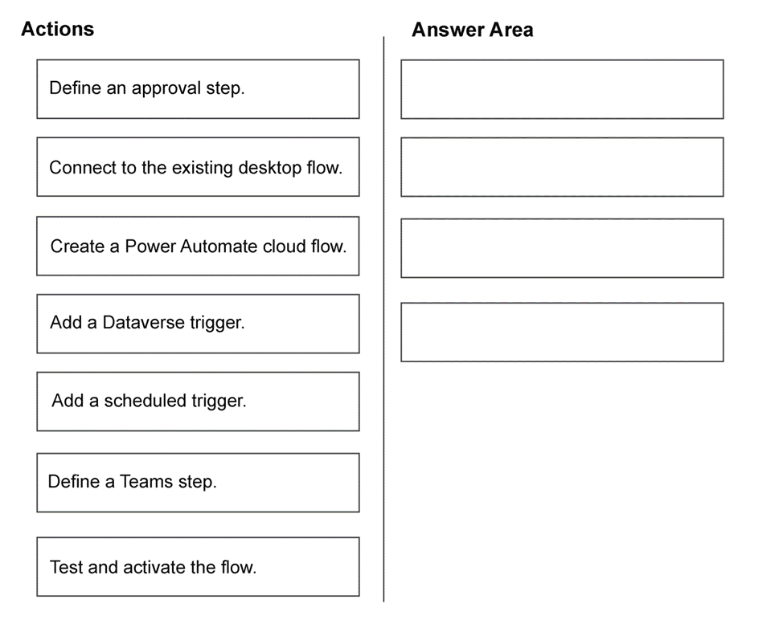

_DRAG DROP — the original ExamTopics question expects you to drag and drop items; the correct targets are not published._

**Most voted:** I would propose 1. Create a Power Automate cloud flow 2. Add a dataverse trigger 3. Define an approval step 4. Test and activate the flow.

### Top explanations
- **Franck56000** (1 upvotes [Most Recent]): I would propose 1. Create a Power Automate cloud flow 2. Add a dataverse trigger 3. Define an approval step 4. Test and activate the flow.
