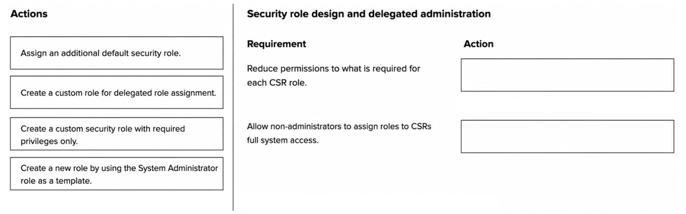
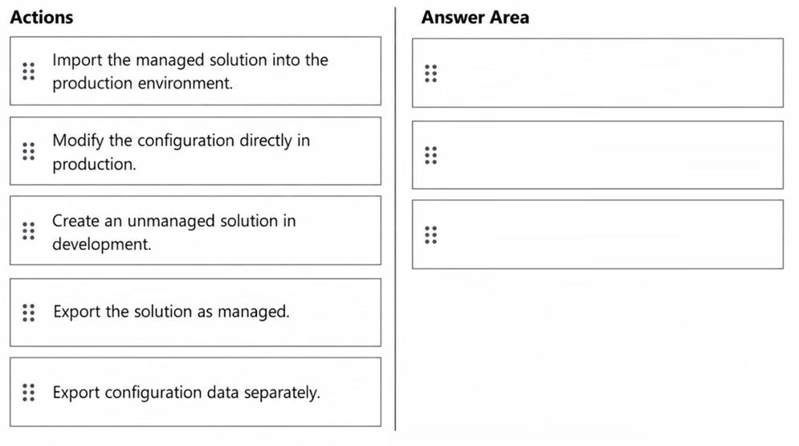
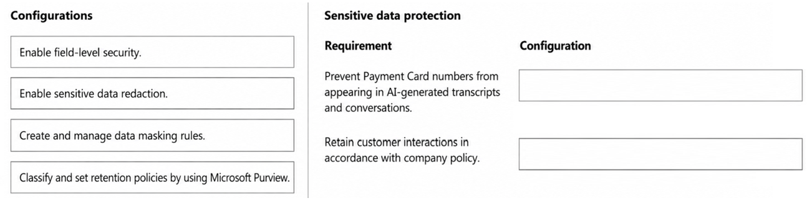
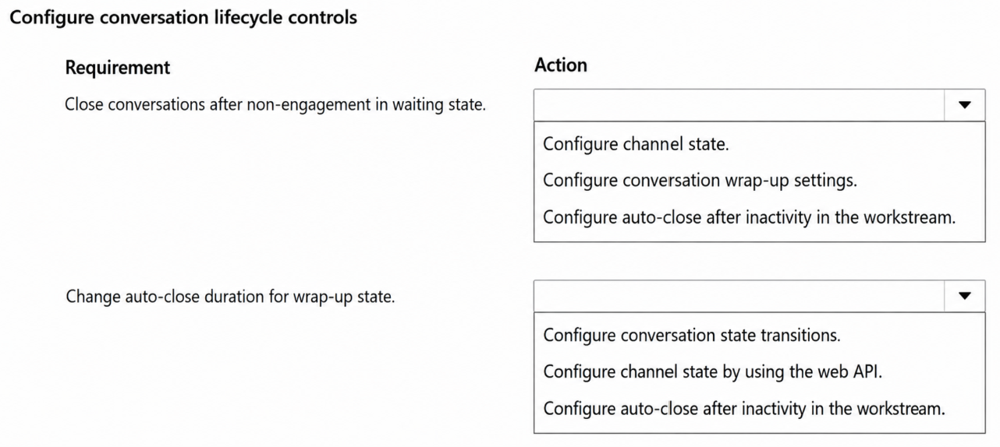
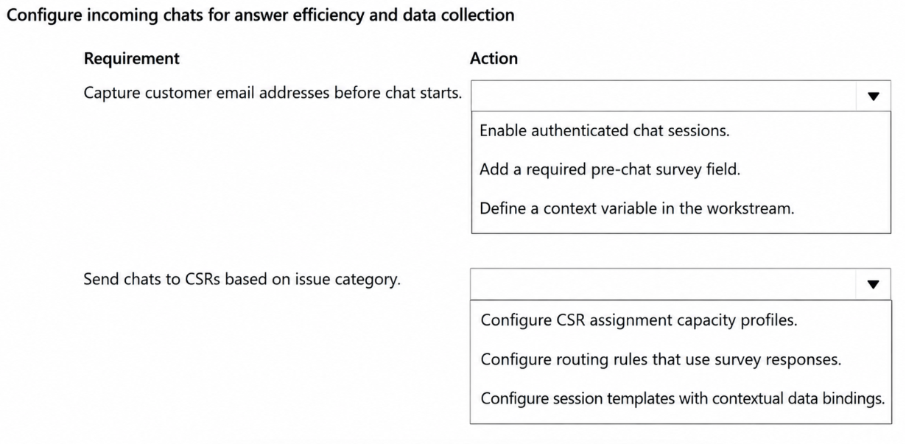

# AB-250 Transforming Contact Center Experiences with AI in Dynamics 365 Study Guide

_10 questions generated from ExamTopics discussions._

## Table of contents

- [Q1.1](#q1-1)
- [Q1.2](#q1-2)
- [Q1.7](#q1-7)
- [Q1.11](#q1-11)
- [Q1.12](#q1-12)
- [Q1.15](#q1-15)
- [Q2.3](#q2-3)
- [Q2.10](#q2-10)
- [Q2.16](#q2-16)
- [Q5.15](#q5-15)

## Q1.1 (ID 429726)

DRAG DROP
A company uses security roles to ensure that its customer service representatives (CSRs) have access only to the features and data required to perform their duties.
However, default roles currently grant excessive permissions to CSRs.
The company requires that access be limited as follows:
Reduce permissions to just the features and data that are required for each CSR role.
Allow non-administrators to assign roles to CSRs without full system access.
You need to configure the minimal security access for each requirement.
Which action should you perform first for each requirement? To answer, move the appropriate actions to the correct requirements. You may use each action once, more than once, or not at all. You may need to move the split bar between panes or scroll to view content.
NOTE: Each correct selection is worth one point.

**Exhibits**
- Exhibit 1: 

_DRAG DROP — the original ExamTopics question expects you to drag and drop items; the correct targets are not published._

**Most voted:** TELEGRAM: DRMIKE100 TO BUY ADDERALL IR AND XR  IN USA WITHOUT SCRIPT

### Top explanations
- **denzelscot7** (1 upvotes [Most Recent]): TELEGRAM: DRMIKE100 TO BUY ADDERALL IR AND XR  IN USA WITHOUT SCRIPT

## Q1.2 (ID 429729)

A company plans to deploy a new customized voice channel from development to test. The voice channel customizations include skills-based routing and a Copilot Studio voice agent.
The deployment package must:
Include only the components needed for the release.
Support controlled import into downstream environments.
You need to prepare to release the voice channel and all supported parts.
What should you do?

✅ **A.** Export a managed solution and deploy with configuration data by using the release pipeline.
⭕ **B.** Copy components and data directly between environments.
⭕ **C.** Export an unmanaged solution and update configurations directly after import.
⭕ **D.** Move configuration data only and recreate components manually.

**Correct answer:** A
**Most voted:** A

### Top explanations
- **RominaT** (2 upvotes [Most Recent, Selected Answer: A]): A is suggested solution.
  B. Not an ALM best practice and doesn't provide controlled deployment. ❌
  C. Unmanaged solutions are typically used in development, not for controlled downstream releases. ❌
  D. Manual recreation is error-prone and doesn't meet the requirement to package and deploy all necessary components. ❌

## Q1.7 (ID 429730)

A company synchronizes users from Microsoft Entra ID to the Dynamics 365 Contact Center environment.
Some users who have Microsoft Entra IDs cannot access Contact Center features.
You need to enable access for the users with the right permissions needed for Contact Center.
What should you do?

⭕ **A.** Assign a security role to the user’s team and restrict access using field-level security.
⭕ **B.** Assign a security role directly to the user.
⭕ **C.** Assign multiple security roles to ensure coverage of required privileges.
✅ **D.** Add the user to a team that has a security role assigned.

**Correct answer:** D
**Most voted:** D

### Top explanations
- **andrewL** (1 upvotes [Most Recent, Selected Answer: D]): As the new feature is GA. https://learn.microsoft.com/en-us/dynamics365/release-plan/2026wave1/service/dynamics365-contact-center/manage-users-through-entra-security-groups

## Q1.11 (ID 429736)

To start the case study.
Background
Fabrikam, Inc. is a mid-sized global company that provides outsourced customer support services for retail and telecommunications clients. The company operates multiple regional contact centers. Fabrikam, Inc. is transitioning to a unified cloud-based platform by implementing Microsoft Dynamics 365 Contact Center.
The goal is to improve customer satisfaction, reduce average handling time, and increase workforce productivity while enabling AI-assisted customer interactions.
Fabrikam, Inc. has an established Microsoft ecosystem, including Microsoft Azure and Microsoft Power Platform. The company requires that all implementations follow best practices for scalability, maintainability, and governance, while aligning with internal governance and security standards.
Current environment
Contact Center infrastructure
• Fabrikam, Inc. currently uses an outdated on-premises telephony system that does NOT integrate with modern CRM systems.
• The company is migrating to Dynamics 365 Contact Center to support voice-based interactions.
• Azure resources are centrally managed by the IT team.
• Azure Application Insights is provisioned but not yet connected to any contact center workload.
• Microsoft Entra ID is used for identity and access management.
Application lifecycle management (ALM)
• The company maintains separate development, test, and production environments in Microsoft Dataverse.
• Solutions are deployed as managed or unmanaged depending on the environment.
• Configuration data must be moved between environments without manual recreation.
• The IT team requires repeatable and governed deployment processes.
Users and roles
• Customer service representatives (CSRs) handle inbound customer calls.
• Supervisors monitor performance and manage workforce scheduling.
• Administrators configure and maintain the system.
• Roles are defined for CSRs, supervisors, and administrators, but permissions are not consistently enforced.
• Access must be restricted based on user responsibilities to enforce least privilege.
Business requirements
Voice channel
• Customers must be able to contact customer support through an inbound voice channel.
• Incoming calls must be routed to available CSRs based on predefined criteria.
• Customer input must be collected through an automated interaction before routing.
• Some inquiries must be resolved without involving a human representative.
• When escalation is required, CSRs must receive relevant information collected earlier in the interaction.
Workforce management (WFM)
• Supervisors must define shifts and assign schedules for CSRs.
• CSRs must receive interactions during their scheduled shifts only.
• Some shifts must allow for times that do NOT accept phone calls.
• WFM capabilities must be enabled within the contact center solution.
AI and automation
• The solution must support AI-driven capabilities to handle frequently asked customer questions.
• The system must support generative AI for natural, conversational interactions.
• When an issue cannot be resolved automatically, escalation paths must be defined.
Routing and work assignment
• Customer interactions must be managed through a structured process to ensure consistent handling.
• Information collected during the voice agent interactions must be available to CSRs.
• CSRs must be assigned to handle interactions based on their expertise.
Analytics and monitoring
• The company must monitor conversation performance and identify and troubleshoot issues affecting customer experience.
• The solution must provide detailed diagnostic information to support troubleshooting across the interaction lifecycle.
• Supervisors must be able to analyze interaction quality and identify trends and bottlenecks.
Technical requirements
Voice channel configuration
• Dynamics 365 Contact Center must be used to support voice-based customer interactions.
• The solution must support inbound calling through configured phone numbers.
• Voice interactions must be routed in a way that follows best practices for scalability and consistent performance.
IVR and voice agents
• IVR flows must support both naturally spoken input and keypad input.
• Voice agents must be configured by using Copilot Studio.• AI agents must be able to retrieve customer data from backend systems when needed.
Security and access
• Access must be restricted based on user responsibilities and follow the principle of least privilege.
• CSRs must access records relevant to only the interactions they handle.
• Supervisors must have visibility into CSR performance and schedules.
• Administrators must have full access to configure and manage the solution.
ALM and deployment
• Production deployments must use managed solutions.
• Configuration data must be moved between environments by using supported tools and without manual recreation.
• Deployment processes should be automated to ensure consistency and reliability.
Issues
• The current system lacks integration between voice interactions and CRM systems.• CSRs receive calls outside of their scheduled shifts.• Fabrikam, Inc. has no consistent process for deploying configurations across environments.• AI capabilities are underused, resulting in increased interaction volumes.• Some customers interact from a noisy environment, which makes it difficult for CSRs and agents to serve them efficiently.• Supervisors lack visibility into detailed conversation diagnostics.• Access permissions are not consistently aligned with user responsibilities, causing access inconsistencies.
You need to resolve inconsistent access across user personas.
What should you do?

⭕ **A.** Create Dataverse security roles aligned to defined personas
⭕ **B.** Configure access teams with automatic assignment rules
⭕ **C.** Apply field-level security to persona-specific tables
✅ **D.** Assign customer service representatives to queues based on persona

**Correct answer:** D
**Most voted:** D

### Top explanations
- **ola sou novo aqui** (1 upvotes [Most Recent, Selected Answer: D]): why is not D?
- **Nessaner** (1 upvotes [Selected Answer: A]): Security roles are the standard mechanism for defining permissions to job responsibilities

## Q1.12 (ID 429737)

DRAG DROP
To start the case study.
Background
Fabrikam, Inc. is a mid-sized global company that provides outsourced customer support services for retail and telecommunications clients. The company operates multiple regional contact centers. Fabrikam, Inc. is transitioning to a unified cloud-based platform by implementing Microsoft Dynamics 365 Contact Center.
The goal is to improve customer satisfaction, reduce average handling time, and increase workforce productivity while enabling AI-assisted customer interactions.
Fabrikam, Inc. has an established Microsoft ecosystem, including Microsoft Azure and Microsoft Power Platform. The company requires that all implementations follow best practices for scalability, maintainability, and governance, while aligning with internal governance and security standards.
Current environment
Contact Center infrastructure
• Fabrikam, Inc. currently uses an outdated on-premises telephony system that does NOT integrate with modern CRM systems.
• The company is migrating to Dynamics 365 Contact Center to support voice-based interactions.
• Azure resources are centrally managed by the IT team.
• Azure Application Insights is provisioned but not yet connected to any contact center workload.
• Microsoft Entra ID is used for identity and access management.
Application lifecycle management (ALM)
• The company maintains separate development, test, and production environments in Microsoft Dataverse.
• Solutions are deployed as managed or unmanaged depending on the environment.
• Configuration data must be moved between environments without manual recreation.
• The IT team requires repeatable and governed deployment processes.
Users and roles
• Customer service representatives (CSRs) handle inbound customer calls.
• Supervisors monitor performance and manage workforce scheduling.
• Administrators configure and maintain the system.
• Roles are defined for CSRs, supervisors, and administrators, but permissions are not consistently enforced.
• Access must be restricted based on user responsibilities to enforce least privilege.
Business requirements
Voice channel
• Customers must be able to contact customer support through an inbound voice channel.
• Incoming calls must be routed to available CSRs based on predefined criteria.
• Customer input must be collected through an automated interaction before routing.
• Some inquiries must be resolved without involving a human representative.
• When escalation is required, CSRs must receive relevant information collected earlier in the interaction.
Workforce management (WFM)
• Supervisors must define shifts and assign schedules for CSRs.
• CSRs must receive interactions during their scheduled shifts only.
• Some shifts must allow for times that do NOT accept phone calls.
• WFM capabilities must be enabled within the contact center solution.
AI and automation
• The solution must support AI-driven capabilities to handle frequently asked customer questions.
• The system must support generative AI for natural, conversational interactions.
• When an issue cannot be resolved automatically, escalation paths must be defined.
Routing and work assignment
• Customer interactions must be managed through a structured process to ensure consistent handling.
• Information collected during the voice agent interactions must be available to CSRs.
• CSRs must be assigned to handle interactions based on their expertise.
Analytics and monitoring
• The company must monitor conversation performance and identify and troubleshoot issues affecting customer experience.
• The solution must provide detailed diagnostic information to support troubleshooting across the interaction lifecycle.
• Supervisors must be able to analyze interaction quality and identify trends and bottlenecks.
Technical requirements
Voice channel configuration
• Dynamics 365 Contact Center must be used to support voice-based customer interactions.
• The solution must support inbound calling through configured phone numbers.
• Voice interactions must be routed in a way that follows best practices for scalability and consistent performance.
IVR and voice agents
• IVR flows must support both naturally spoken input and keypad input.
• Voice agents must be configured by using Copilot Studio.• AI agents must be able to retrieve customer data from backend systems when needed.
Security and access
• Access must be restricted based on user responsibilities and follow the principle of least privilege.
• CSRs must access records relevant to only the interactions they handle.
• Supervisors must have visibility into CSR performance and schedules.
• Administrators must have full access to configure and manage the solution.
ALM and deployment
• Production deployments must use managed solutions.
• Configuration data must be moved between environments by using supported tools and without manual recreation.
• Deployment processes should be automated to ensure consistency and reliability.
Issues
• The current system lacks integration between voice interactions and CRM systems.• CSRs receive calls outside of their scheduled shifts.• Fabrikam, Inc. has no consistent process for deploying configurations across environments.• AI capabilities are underused, resulting in increased interaction volumes.• Some customers interact from a noisy environment, which makes it difficult for CSRs and agents to serve them efficiently.• Supervisors lack visibility into detailed conversation diagnostics.• Access permissions are not consistently aligned with user responsibilities, causing access inconsistencies.
You need to deploy configuration changes across environments based on the technical requirements.
Which three actions should you perform in sequence? To answer, move the appropriate actions from the list of actions to the answer area and arrange them in the correct order.

**Exhibits**
- Exhibit 1: 

_DRAG DROP — the original ExamTopics question expects you to drag and drop items; the correct targets are not published._

**Most voted:**
- Question doesn't mention data, only configuration.
- The correct actions are: create a solution, export managed, and import to destination.

### Top explanations
- **lastcert** (1 upvotes [Most Recent]): Question doesn't mention data, only configuration.
  The correct actions are: create a solution, export managed, and import to destination.

## Q1.15 (ID 429740)

DRAG DROP
To start the case study.
Background
VanArsdel, Ltd. is a global company that provides outsourced customer support services for enterprise clients across multiple industries, including retail, healthcare, and financial services.
VanArsdel, Ltd. is implementing Microsoft Dynamics 365 Contact Center to modernize its contact center operations. The company aims to provide a unified omnichannel experience for customers and improve customer service representative (CSR) productivity through AI-driven tools and automation.
The implementation will support voice, chat, and digital messaging channels. The initial rollout focuses on voice capabilities and AI-assisted CSR experiences. The solution must be scalable and configurable using out-of-the-box functionality where possible.
The company employs approximately 500 CSRs, 50 supervisors, and a small team of system administrators responsible for configuration and maintenance. Some back-office CSRs are available for consultations with frontline CSRs.
VanArsdel, Ltd. currently operates multiple outdated CCaaS platforms across its divisions. The company is concerned about CSR adoption and therefore plans to adopt a phased approach. The company plans to use its existing CCaaS solution with Copilot Service workspace to enable adoption of the agent desktop while the voice channel and associated capabilities are developed.
Current environment
Contact Center channels
VanArsdel, Ltd. currently uses an outdated telephony system integrated with a third-party CRM. The system lacks support for modern APIs and does not provide advanced analytics or AI capabilities.
The company plans to replace the outdated system with Dynamics 365 Contact Center and Microsoft Teams Phone functionality.
Outbound communication capabilities are limited in the current system to SMS only and must be enhanced to support proactive engagement campaigns. A third-party tool is used to manage current campaigns.
CSR experience
CSRs currently rely on multiple disconnected systems to manage customer interactions. This results in inefficiencies and increased handling times.
The new solution must provide a unified interface with embedded productivity tools, including:
AI-powered suggestions during live interactions.
Suggested responses based on the CSR’s interaction with the agent desktop and the conversation context.
Real-time transcription and sentiment analysis.
Integration with company-owned knowledge bases.
CSRs must be able to interact with customers through voice and digital channels within a single workspace. The sales director requires CSRs to be able to collect orders from their third-party order management tool from the Productivity panel. CSRs must be prevented from accessing payment information.
Data protection and compliance
VanArsdel, Ltd. handles sensitive customer data, including personally identifiable information (PII) and payment details.
The company must comply with strict data protection regulations, including:
Masking sensitive data during live interactions.
Preventing National Identity and payment card information from being stored in transcripts and AI generated summaries.
Ensuring secure handling of customer information across all channels.
The current system does NOT provide adequate data masking capabilities.
Integration requirements
The company uses several internal systems, including:
A customer account management system.
A billing platform.
A knowledge management system.
These systems must be integrated with Dynamics 365 Contact Center to provide CSRs with relevant information during interactions.
The company also has a third-party marketing platform. However, the company currently does NOT plan to integrate the platform and instead is evaluating Customer Insights - Journeys.
Business requirements
Voice channel implementation
VanArsdel, Ltd. must implement a voice channel that meets the following requirements:
Support inbound and outbound voice calls by using Microsoft Teams Phone.
Enhance call controls by using SDK APIs.
Allow supervisors to monitor and manage live calls.
Provide real-time insights into call performance.
The solution must support scalability to handle peak call volumes during seasonal demand.
Proactive engagement
The company must implement proactive outbound engagement capabilities, including:
Proactive Dialer to adjust call pacing based on CSR availability and answer rates.
Trigger-based engagement based on customer actions.
Integration with customer data to personalize outreach.
Outbound campaigns must be configurable without requiring custom code.
Agent assist and AI capabilities
VanArsdel, Ltd. must enhance CSR productivity by implementing AI-powered assistance features, including:
Suggested responses during customer interactions.
Automated knowledge article recommendations.
Real-time transcription and summarization.
Real-time assistance sent to the CSR in the send message box during chat conversations.
The company also plans to extend Copilot capabilities by integrating custom plugins, tools, and connectors.
Additionally, a bot must be implemented to support CSRs by providing interactable contextual guidance during interactions.
Voice agent configuration
The company must configure voice agents to support natural and efficient customer interactions.
The solution must include:
Real-time speech recognition.
Accurate transcription of customer conversations.
Configurable voice settings to optimize performance.
Voice agents must follow best practices to ensure high-quality interactions and minimize errors.
Technical requirements
Channel Integration Framework
VanArsdel, Ltd. requires a phased approach to deploying the voice channel. The company plans to use its existing CCaaS solution with Copilot Service workspace to enable adoption of the agent desktop while the voice channel and associated capabilities are developed. The company requires the Channel Integration Framework to be built to:
Click-to-act functionality for outbound communication.
Integration with third-party applications.
A consistent user experience for CSRs.
Sensitive data masking
The solution must include sensitive data masking capabilities that:
Automatically detect and mask sensitive information during interactions.
Prevent exposure of sensitive data in logs and transcripts.
Allow administrators to configure masking rules.
Omnichannel JavaScript API
Custom extensions must be developed by using the Omnichannel JavaScript API to:
Provide enhanced automation during a conversation.
Display conversation dynamically based on the defined business process.
Provide contextual information during customer interactions.
These extensions must be maintainable and align with best practices.
Supervisor experience
Supervisors must have access to advanced analytics and monitoring tools, including:
Real-time dashboards for intraday CSR performance.
Historical insights into call volumes and trends.
Tools to manage and optimize CSR workloads.
The supervisor app must be used to provide actionable insights that improve operational efficiency.
Issues
VanArsdel, Ltd. has identified the following issues in the current environment:
CSRs experience delays due to switching between multiple systems.
Sensitive customer data is exposed during interactions.
Outbound engagement capabilities are limited and not automated.
Supervisors lack visibility into real-time performance metrics.
Voice interactions lack transcription and AI-assisted features.
Problem statement
VanArsdel, Ltd. must implement a modern contact center solution by using Dynamics 365 Contact Center to:
Improve CSR productivity through AI and automation.
Ensure compliance with data protection regulations.
Enhance customer engagement through proactive outreach.
Provide a unified and efficient CSR experience.
Enable supervisors to monitor and optimize operations effectively.
The solution must be scalable, secure, and aligned with best practices for configuring channels, AI capabilities, and integrations.
You need to configure the Dynamics 365 Contact Center solution based on the data protection and compliance requirements.
Which configurations should you apply? To answer, move the appropriate configurations to the correct contexts. You may use each configuration once, more than once, or not at all. You may need to move the split bar between panes or scroll to view content.
NOTE: Each correct selection is worth one point.

**Exhibits**
- Exhibit 1: 

_DRAG DROP — the original ExamTopics question expects you to drag and drop items; the correct targets are not published._

**Most voted:** First option is incorrect, the correct is "Enable sensitive data redaction". Why ?

### Top explanations
- **Yazan** (2 upvotes): First option is incorrect, the correct is "Enable sensitive data redaction". Why ?
  Sensitive data redaction in Dynamics 365 Customer Service detects and redacts configured sensitive information, including payment-card data, from conversation transcripts and AI-generated content. Microsoft Purview retention policies and retention labels support classifying content and retaining it for the organization’s required lifecycle period.
- **Yazan** (2 upvotes [Most Recent]): Correction for my above comment, the given answers are correct , my mistake sorry :
  Reference :-
  https://learn.microsoft.com/en-us/dynamics365/customer-service/administer/data-masking-settings

## Q2.3 (ID 429743)

A company uses Dynamics 365 live chat on its website.
The digital team wants the chat experience to use the existing brand kit and style guide of the company and support a more tailored web experience.
The company requires a solution that enables it to control the chat experience through customization.
You need to expand chat behavior beyond default capabilities.
What are two possible ways to achieve this goal? Each correct answer presents a complete solution.
NOTE: Each correct selection is worth one point.

✅ **A.** Modify functionality by using the live chat SDK.
⭕ **B.** Use the Omnichannel JavaScript API.
⭕ **C.** Configure workstream context variables.
✅ **D.** Modify chat widget configuration settings.

**Correct answer:** A, D
**Most voted:** AD

### Top explanations
- **RominaT** (1 upvotes [Most Recent, Selected Answer: AD]): I think it's not B because Omnichannel JavaScript API is primarily used for agent-side and conversation operations

## Q2.10 (ID 429795)

HOTSPOT
A company uses persistent chat and messaging channels in a contact center.
The company requires tighter conversation lifecycle control to keep queues clean and customer service representative workloads current.
The company has the following requirements:
• Conversations that remain in a waiting status without customer engagement must automatically close after a defined period.
• Chat conversations that move to wrap-up must automatically close after a business-defined custom time limit.
You need to configure the channels to meet the requirements.
Which action should you perform for each requirement? To answer, select the appropriate options in the answer area.
NOTE: Each correct selection is worth one point.

**Exhibits**
- Exhibit 1: 

_HOTSPOT — the original ExamTopics question expects you to mark areas on the exhibit above; the correct hotspot coordinates are not published._

**Most voted:** Configure auto-close after inactivity in the workstream.

### Top explanations
- **Dim1973** (1 upvotes [Most Recent]): Correct answer: Configure auto-close after inactivity in the workstream.
  Explanation:
  In Dynamics 365 Contact Center, the Auto-close after inactivity setting allows conversations to close automatically when customers do not respond within a specified period.
  This setting is configured at the workstream level and helps prevent inactive conversations from remaining in queues unnecessarily.
  Correct answer: Configure channel state by using the web API.
  Explanation:
  The wrap-up state is used when a customer service representative (CSR) has finished interacting with a customer but is still completing post-conversation activities.
  To customize the automatic closure duration for conversations in the wrap-up state, administrators can modify the channel state configuration through the Dataverse Web API.
  This provides more control over how long conversations remain in wrap-up before automatically closing.

## Q2.16 (ID 429801)

HOTSPOT
Customer service representatives (CSRs) at a company use a chat channel in Dynamics 365 Customer Service.
The company wants to improve how incoming chats are handled as follows:
• Email addresses must be captured for customer verification before engaging the customer.
• The reason for the contact must be captured before the chat starts and must be used for routing.
You need to configure the chat channel to meet the requirements.
Which action should you perform for each requirement? To answer, select the appropriate options in the answer area.
NOTE: Each correct selection is worth one point.

**Exhibits**
- Exhibit 1: 

_HOTSPOT — the original ExamTopics question expects you to mark areas on the exhibit above; the correct hotspot coordinates are not published._

**Most voted:** First one should be Add pre-chat survey question, context variable created automatically.

### Top explanations
- **lastcert** (1 upvotes [Most Recent]): First one should be Add pre-chat survey question, context variable created automatically.

## Q5.15 (ID 429775)

A company uses Dynamics 365 Contact Center to handle incoming interactions.
Customer service representatives (CSRs) report that when a new work item arrives, they cannot determine the type or context of the request until after accepting it.
CSRs must be able to determine key details about work items before accepting them to decide how to handle the interactions.
You need to configure how work items appear to CSRs.
What should you do?

⭕ **A.** Configure how work items are prioritized in queues
✅ **B.** Define the title and message shown for incoming conversations
⭕ **C.** Define rules for assigning work items to CSRs
⭕ **D.** Configure how sessions are arranged in the workspace

**Correct answer:** B
**Most voted:** B

### Top explanations
- **lastcert** (1 upvotes [Most Recent, Selected Answer: B]): The others have nothing to do with showing information.
