# AB-410 Building Intelligent Applications Study Guide

_156 questions generated from ExamTopics discussions._

**Official Exam & Registration:** [Register for AB-410 on Microsoft Learn](https://learn.microsoft.com/en-us/credentials/certifications/intelligent-applications-builder-associate/?practice-assessment-type=certification)

## Table of contents

- [Q1.1](#q1-1)
- [Q1.2](#q1-2)
- [Q1.3](#q1-3)
- [Q1.4](#q1-4)
- [Q1.5](#q1-5)
- [Q1.6](#q1-6)
- [Q1.7](#q1-7)
- [Q1.8](#q1-8)
- [Q1.9](#q1-9)
- [Q1.10](#q1-10)
- [Q1.11](#q1-11)
- [Q1.12](#q1-12)
- [Q1.13](#q1-13)
- [Q1.14](#q1-14)
- [Q1.15](#q1-15)
- [Q1.16](#q1-16)
- [Q1.17](#q1-17)
- [Q1.18](#q1-18)
- [Q1.19](#q1-19)
- [Q1.20](#q1-20)
- [Q1.21](#q1-21)
- [Q1.22](#q1-22)
- [Q1.23](#q1-23)
- [Q1.24](#q1-24)
- [Q1.25](#q1-25)
- [Q1.26](#q1-26)
- [Q1.27](#q1-27)
- [Q1.28](#q1-28)
- [Q1.29](#q1-29)
- [Q1.30](#q1-30)
- [Q1.31](#q1-31)
- [Q1.32](#q1-32)
- [Q1.33](#q1-33)
- [Q1.34](#q1-34)
- [Q1.35](#q1-35)
- [Q1.36](#q1-36)
- [Q1.37](#q1-37)
- [Q1.38](#q1-38)
- [Q1.39](#q1-39)
- [Q1.40](#q1-40)
- [Q1.41](#q1-41)
- [Q1.42](#q1-42)
- [Q1.43](#q1-43)
- [Q1.44](#q1-44)
- [Q1.45](#q1-45)
- [Q1.46](#q1-46)
- [Q1.47](#q1-47)
- [Q1.48](#q1-48)
- [Q1.49](#q1-49)
- [Q1.50](#q1-50)
- [Q1.51](#q1-51)
- [Q1.52](#q1-52)
- [Q1.53](#q1-53)
- [Q1.54](#q1-54)
- [Q1.55](#q1-55)
- [Q1.56](#q1-56)
- [Q1.57](#q1-57)
- [Q1.58](#q1-58)
- [Q1.59](#q1-59)
- [Q1.60](#q1-60)
- [Q1.61](#q1-61)
- [Q1.62](#q1-62)
- [Q1.68](#q1-68)
- [Q1.69](#q1-69)
- [Q1.70](#q1-70)
- [Q1.71](#q1-71)
- [Q1.72](#q1-72)
- [Q1.74](#q1-74)
- [Q1.75](#q1-75)
- [Q1.76](#q1-76)
- [Q1.77](#q1-77)
- [Q1.79](#q1-79)
- [Q1.80](#q1-80)
- [Q1.82](#q1-82)
- [Q1.83](#q1-83)
- [Q1.85](#q1-85)
- [Q1.86](#q1-86)
- [Q1.87](#q1-87)
- [Q1.88](#q1-88)
- [Q1.89](#q1-89)
- [Q1.90](#q1-90)
- [Q1.92](#q1-92)
- [Q1.93](#q1-93)
- [Q1.95](#q1-95)
- [Q1.98](#q1-98)
- [Q1.99](#q1-99)
- [Q1.100](#q1-100)
- [Q1.101](#q1-101)
- [Q1.102](#q1-102)
- [Q1.103](#q1-103)
- [Q1.104](#q1-104)
- [Q1.105](#q1-105)
- [Q1.106](#q1-106)
- [Q1.107](#q1-107)
- [Q1.110](#q1-110)
- [Q1.112](#q1-112)
- [Q1.113](#q1-113)
- [Q1.114](#q1-114)
- [Q1.115](#q1-115)
- [Q1.116](#q1-116)
- [Q1.117](#q1-117)
- [Q1.118](#q1-118)
- [Q1.119](#q1-119)
- [Q1.120](#q1-120)
- [Q1.121](#q1-121)
- [Q1.122](#q1-122)
- [Q1.123](#q1-123)
- [Q1.124](#q1-124)
- [Q1.125](#q1-125)
- [Q1.126](#q1-126)
- [Q1.127](#q1-127)
- [Q1.128](#q1-128)
- [Q1.129](#q1-129)
- [Q1.130](#q1-130)
- [Q1.131](#q1-131)
- [Q1.132](#q1-132)
- [Q1.133](#q1-133)
- [Q1.134](#q1-134)
- [Q1.135](#q1-135)
- [Q1.136](#q1-136)
- [Q1.137](#q1-137)
- [Q1.138](#q1-138)
- [Q1.139](#q1-139)
- [Q1.140](#q1-140)
- [Q1.141](#q1-141)
- [Q1.142](#q1-142)
- [Q1.143](#q1-143)
- [Q1.144](#q1-144)
- [Q1.145](#q1-145)
- [Q1.146](#q1-146)
- [Q1.147](#q1-147)
- [Q1.148](#q1-148)
- [Q1.149](#q1-149)
- [Q1.150](#q1-150)
- [Q1.151](#q1-151)
- [Q1.152](#q1-152)
- [Q1.153](#q1-153)
- [Q1.154](#q1-154)
- [Q1.155](#q1-155)
- [Q1.156](#q1-156)
- [Q1.157](#q1-157)
- [Q1.158](#q1-158)
- [Q1.159](#q1-159)
- [Q1.160](#q1-160)
- [Q1.161](#q1-161)
- [Q1.162](#q1-162)
- [Q1.163](#q1-163)
- [Q1.164](#q1-164)
- [Q1.165](#q1-165)
- [Q1.166](#q1-166)
- [Q1.167](#q1-167)
- [Q1.168](#q1-168)
- [Q1.169](#q1-169)
- [Q1.170](#q1-170)
- [Q1.171](#q1-171)
- [Q1.174](#q1-174)

## Q1.1 (ID 419356)

Background
Contoso Ltd. is a global renewable energy provider that operates wind farms and solar installations. The company is modernizing its maintenance and operations platform. The company plans to implement a Microsoft Power Platform solution for the operations team. The implementation will include Microsoft Dataverse, a model-driven app, and Power Automate cloud flows.
The company is building and testing a new model-driven app named Operations. The solution will support operations managers, regional coordinators, and field technicians. The app must integrate with an external cloud-based system that manages onboarding of field technicians.
Contoso Ltd. plans to improve data quality and enforce consistent business logic across the app and automation processes.
Technical environment
Contoso Ltd. has an Identity and Access Management (IDAM) department that manages security. The company has one Power Platform environment named Production, where all building and configuration take place. Auditing is disabled.
The Production environment has the following security configurations:
IDAM has a Microsoft Entra security group named Contoso Ltd. QA. This security group will assign all members a Power Apps license.
IDAM created a Quality Assurance security role that grants read and write access to all custom tables.
IDAM also created a team named Testers in Dataverse, of a Microsoft Entra group team type. The team is configured for the Contoso Ltd. QA security group. The Testers team is assigned the Quality Assurance security role.
Microsoft 365 environment
All Contoso Ltd. managers are included in a Microsoft 365 group named Managers. The group is NOT enabled for email.
The company shares a SharePoint list with a key customer: Alpine Ski House. Alpine Ski House staff members can add new maintenance requests, which are then checked and marked as reviewed by Contoso Ltd.
Current issue:
A new QA tester joins Contoso Ltd. The IDAM department adds the new tester to the Contoso Ltd. QA security group. However, the new tester is not listed in the Testers team as a member.
Other applications:
A separate software-as a-service (SaaS) solution named TechCheck manages technician onboarding. The TechCheck solution is set up as follows:
TechCheck assigns a unique number named Ref to all technicians.
Users cannot make changes to the TechCheck data model.
Users cannot use the same TechCheck ref on more than one Technician row.
Automation requirements
Contoso plans to use Power Automate to develop a Maintenance Request Approval flow. The flow must meet the following requirements:
Create a Maintenance Request row in Dataverse when either of the following occurs:
An item is added to the SharePoint list by the customer with the Priority property set to High.
Any item is checked and marked as reviewed by a Contoso Ltd. representative.
Seek maintenance request approvals from managers through both email and a Microsoft Teams message after they have been reviewed:
Requests require approval from all managers.
If one manager rejects the request, approval must not be granted.
The result of the approval request must be sent to the initial reviewer in an email. The subject line must set the response as either Approve or Reject.
Contoso Ltd. requires the following table logic:
If a user tries to enter a price greater than the cost on a new Asset row, the row must display an inline error message.
If a user tries to save changes to a Technician row where the TechCheck ref column is empty, the action must be prevented and a message explaining the action must be displayed.
Any updates made to Technician profiles in TechCheck must be mirrored in Dataverse by using a custom integration. The developers building the integration require an index for performant searches on the Technician table.
Data model and app design
Contoso Ltd. plans to use Dataverse as its central data platform. Log storage must be minimized.
Tables
The following tables are required for data modeling and the app design:
Assets: Stores information about solar panels and wind turbines
Maintenance Requests: Tracks issues and maintenance activities. The table must include the following columns:
Request ID (auto-number)
External Request Code (text)
Assigned
Technician (lookup to Technicians)
Report (lookup to Maintenance Reports)
Technician updated (Yes/No)
Maintenance Reports: Tracks the results of maintenance reports
Technicians: Stores technician assignment data. The table must include the following columns:
Full Name (Text)
Mobile phone number (Text)
Email (Text)
Seniority (Choice)
TechCheck ref (Text)
Data modeling
The data model must provide the following functionality:
Maintenance Requests must:
be uniquely identifiable across systems.
have two inactive statuses, Cancelled and Duplicate.
If a new option is added to an existing set of options, it must be made available automatically for selection on all columns that use the set.
A new column named Priority must be added to multiple tables. Users must be able to select only one option from the following set per row:
Low
Medium
High
Critical
Changes to the Technician column on Maintenance Requests must be tracked for compliance purposes. Rows must include the names of previous and current technicians and the time of the change.
Relationship requirements
One asset can be related to many maintenance requests. A maintenance request can have many assets.
A maintenance request can have only zero or one maintenance report.
Only one Technician can be related to a Maintenance Request at a time.
When a Maintenance Request is deleted, any Maintenance Reports associated with it must also be deleted, but this action should be prevented if there is value in the Technician lookup.
When a Maintenance Request is assigned to a different owner, the Maintenance Report associated with it must be reassigned to the new owner as well, but the associated Technician should stay with the current owner.
App design
The Technicians table contains the following public views:
Senior Technicians
Junior Technicians
The Senior Technician view must be available through the table list view selector to a set of specific users only.
A tester creates a personal view named Hot Assets on the Assets table. The tester recognizes that the view is useful for the entire testing team. The view must be made accessible to the team.
You need to add the Priority column to the Maintenance Request table.
Which column type should you use?

⭕ **A.** local choice
✅ **B.** global choice
⭕ **C.** status reason
⭕ **D.** formula

**Correct answer:** B
**Most voted:** B

### Top explanations
- **Evincible** (3 upvotes [Most Recent, Selected Answer: B]): The Priority column will be used on multiple tables, and any new option added to the option set must automatically become available to all columns using it.
  A global choice provides one reusable set of values—Low, Medium, High, Critical—that can be shared across multiple Dataverse tables.

## Q1.2 (ID 419402)

DRAG DROP
Background
Contoso Ltd. is a global renewable energy provider that operates wind farms and solar installations. The company is modernizing its maintenance and operations platform. The company plans to implement a Microsoft Power Platform solution for the operations team. The implementation will include Microsoft Dataverse, a model-driven app, and Power Automate cloud flows.
The company is building and testing a new model-driven app named Operations. The solution will support operations managers, regional coordinators, and field technicians. The app must integrate with an external cloud-based system that manages onboarding of field technicians.
Contoso Ltd. plans to improve data quality and enforce consistent business logic across the app and automation processes.
Technical environment
Contoso Ltd. has an Identity and Access Management (IDAM) department that manages security. The company has one Power Platform environment named Production, where all building and configuration take place. Auditing is disabled.
The Production environment has the following security configurations:
IDAM has a Microsoft Entra security group named Contoso Ltd. QA. This security group will assign all members a Power Apps license.
IDAM created a Quality Assurance security role that grants read and write access to all custom tables.
IDAM also created a team named Testers in Dataverse, of a Microsoft Entra group team type. The team is configured for the Contoso Ltd. QA security group. The Testers team is assigned the Quality Assurance security role.
Microsoft 365 environment
All Contoso Ltd. managers are included in a Microsoft 365 group named Managers. The group is NOT enabled for email.
The company shares a SharePoint list with a key customer: Alpine Ski House. Alpine Ski House staff members can add new maintenance requests, which are then checked and marked as reviewed by Contoso Ltd.
Current issue:
A new QA tester joins Contoso Ltd. The IDAM department adds the new tester to the Contoso Ltd. QA security group. However, the new tester is not listed in the Testers team as a member.
Other applications:
A separate software-as a-service (SaaS) solution named TechCheck manages technician onboarding. The TechCheck solution is set up as follows:
TechCheck assigns a unique number named Ref to all technicians.
Users cannot make changes to the TechCheck data model.
Users cannot use the same TechCheck ref on more than one Technician row.
Automation requirements
Contoso plans to use Power Automate to develop a Maintenance Request Approval flow. The flow must meet the following requirements:
Create a Maintenance Request row in Dataverse when either of the following occurs:
An item is added to the SharePoint list by the customer with the Priority property set to High.
Any item is checked and marked as reviewed by a Contoso Ltd. representative.
Seek maintenance request approvals from managers through both email and a Microsoft Teams message after they have been reviewed:
Requests require approval from all managers.
If one manager rejects the request, approval must not be granted.
The result of the approval request must be sent to the initial reviewer in an email. The subject line must set the response as either Approve or Reject.
Contoso Ltd. requires the following table logic:
If a user tries to enter a price greater than the cost on a new Asset row, the row must display an inline error message.
If a user tries to save changes to a Technician row where the TechCheck ref column is empty, the action must be prevented and a message explaining the action must be displayed.
Any updates made to Technician profiles in TechCheck must be mirrored in Dataverse by using a custom integration. The developers building the integration require an index for performant searches on the Technician table.
Data model and app design
Contoso Ltd. plans to use Dataverse as its central data platform. Log storage must be minimized.
Tables
The following tables are required for data modeling and the app design:
Assets: Stores information about solar panels and wind turbines
Maintenance Requests: Tracks issues and maintenance activities. The table must include the following columns:
Request ID (auto-number)
External Request Code (text)
Assigned
Technician (lookup to Technicians)
Report (lookup to Maintenance Reports)
Technician updated (Yes/No)
Maintenance Reports: Tracks the results of maintenance reports
Technicians: Stores technician assignment data. The table must include the following columns:
Full Name (Text)
Mobile phone number (Text)
Email (Text)
Seniority (Choice)
TechCheck ref (Text)
Data modeling
The data model must provide the following functionality:
Maintenance Requests must:
be uniquely identifiable across systems.
have two inactive statuses, Cancelled and Duplicate.
If a new option is added to an existing set of options, it must be made available automatically for selection on all columns that use the set.
A new column named Priority must be added to multiple tables. Users must be able to select only one option from the following set per row:
Low
Medium
High
Critical
Changes to the Technician column on Maintenance Requests must be tracked for compliance purposes. Rows must include the names of previous and current technicians and the time of the change.
Relationship requirements
One asset can be related to many maintenance requests. A maintenance request can have many assets.
A maintenance request can have only zero or one maintenance report.
Only one Technician can be related to a Maintenance Request at a time.
When a Maintenance Request is deleted, any Maintenance Reports associated with it must also be deleted, but this action should be prevented if there is value in the Technician lookup.
When a Maintenance Request is assigned to a different owner, the Maintenance Report associated with it must be reassigned to the new owner as well, but the associated Technician should stay with the current owner.
App design
The Technicians table contains the following public views:
Senior Technicians
Junior Technicians
The Senior Technician view must be available through the table list view selector to a set of specific users only.
A tester creates a personal view named Hot Assets on the Assets table. The tester recognizes that the view is useful for the entire testing team. The view must be made accessible to the team.
You need to configure the Maintenance Request relationships to the other tables.
Which type of relationship behavior should you set? To answer, move the appropriate behavior types to the correct tables. You may use each behavior type once, more than once, or not at all. You may need to move the split bar between panes or scroll to view content.
NOTE: Each correct selection is worth one point.

**Exhibits**
- Exhibit 1: 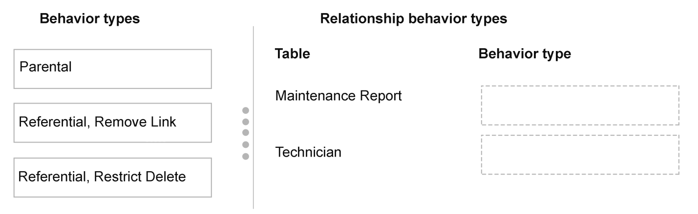

_DRAG DROP — the original ExamTopics question expects you to drag and drop items; the correct targets are not published._

**Most voted:**
- Maintenance Report: → Parental
- Technician: → Referential, Restrict Delete
- Parental → Delete parent → delete child
- Referential, Remove Link → Delete parent → keep child, clear lookup
- Referential, Restrict Delete → Don't let me delete parent if child/reference exists

### Top explanations
- **427ea93** (6 upvotes [Most Recent]): First one is Parental. The case says: When a Maintenance Request is deleted, any Maintenance Reports associated with it must also be deleted. That is done by Parental behavior
- **Antea** (3 upvotes): Maintenance Report: → Parental
  Technician: → Referential, Restrict Delete
  Parental → Delete parent → delete child
  Referential, Remove Link → Delete parent → keep child, clear lookup
  Referential, Restrict Delete → Don't let me delete parent if child/reference exists

## Q1.3 (ID 419357)

DRAG DROP
Background
Contoso Ltd. is a global renewable energy provider that operates wind farms and solar installations. The company is modernizing its maintenance and operations platform. The company plans to implement a Microsoft Power Platform solution for the operations team. The implementation will include Microsoft Dataverse, a model-driven app, and Power Automate cloud flows.
The company is building and testing a new model-driven app named Operations. The solution will support operations managers, regional coordinators, and field technicians. The app must integrate with an external cloud-based system that manages onboarding of field technicians.
Contoso Ltd. plans to improve data quality and enforce consistent business logic across the app and automation processes.
Technical environment
Contoso Ltd. has an Identity and Access Management (IDAM) department that manages security. The company has one Power Platform environment named Production, where all building and configuration take place. Auditing is disabled.
The Production environment has the following security configurations:
IDAM has a Microsoft Entra security group named Contoso Ltd. QA. This security group will assign all members a Power Apps license.
IDAM created a Quality Assurance security role that grants read and write access to all custom tables.
IDAM also created a team named Testers in Dataverse, of a Microsoft Entra group team type. The team is configured for the Contoso Ltd. QA security group. The Testers team is assigned the Quality Assurance security role.
Microsoft 365 environment
All Contoso Ltd. managers are included in a Microsoft 365 group named Managers. The group is NOT enabled for email.
The company shares a SharePoint list with a key customer: Alpine Ski House. Alpine Ski House staff members can add new maintenance requests, which are then checked and marked as reviewed by Contoso Ltd.
Current issue:
A new QA tester joins Contoso Ltd. The IDAM department adds the new tester to the Contoso Ltd. QA security group. However, the new tester is not listed in the Testers team as a member.
Other applications:
A separate software-as a-service (SaaS) solution named TechCheck manages technician onboarding. The TechCheck solution is set up as follows:
TechCheck assigns a unique number named Ref to all technicians.
Users cannot make changes to the TechCheck data model.
Users cannot use the same TechCheck ref on more than one Technician row.
Automation requirements
Contoso plans to use Power Automate to develop a Maintenance Request Approval flow. The flow must meet the following requirements:
Create a Maintenance Request row in Dataverse when either of the following occurs:
An item is added to the SharePoint list by the customer with the Priority property set to High.
Any item is checked and marked as reviewed by a Contoso Ltd. representative.
Seek maintenance request approvals from managers through both email and a Microsoft Teams message after they have been reviewed:
Requests require approval from all managers.
If one manager rejects the request, approval must not be granted.
The result of the approval request must be sent to the initial reviewer in an email. The subject line must set the response as either Approve or Reject.
Contoso Ltd. requires the following table logic:
If a user tries to enter a price greater than the cost on a new Asset row, the row must display an inline error message.
If a user tries to save changes to a Technician row where the TechCheck ref column is empty, the action must be prevented and a message explaining the action must be displayed.
Any updates made to Technician profiles in TechCheck must be mirrored in Dataverse by using a custom integration. The developers building the integration require an index for performant searches on the Technician table.
Data model and app design
Contoso Ltd. plans to use Dataverse as its central data platform. Log storage must be minimized.
Tables
The following tables are required for data modeling and the app design:
Assets: Stores information about solar panels and wind turbines
Maintenance Requests: Tracks issues and maintenance activities. The table must include the following columns:
Request ID (auto-number)
External Request Code (text)
Assigned
Technician (lookup to Technicians)
Report (lookup to Maintenance Reports)
Technician updated (Yes/No)
Maintenance Reports: Tracks the results of maintenance reports
Technicians: Stores technician assignment data. The table must include the following columns:
Full Name (Text)
Mobile phone number (Text)
Email (Text)
Seniority (Choice)
TechCheck ref (Text)
Data modeling
The data model must provide the following functionality:
Maintenance Requests must:
be uniquely identifiable across systems.
have two inactive statuses, Cancelled and Duplicate.
If a new option is added to an existing set of options, it must be made available automatically for selection on all columns that use the set.
A new column named Priority must be added to multiple tables. Users must be able to select only one option from the following set per row:
Low
Medium
High
Critical
Changes to the Technician column on Maintenance Requests must be tracked for compliance purposes. Rows must include the names of previous and current technicians and the time of the change.
Relationship requirements
One asset can be related to many maintenance requests. A maintenance request can have many assets.
A maintenance request can have only zero or one maintenance report.
Only one Technician can be related to a Maintenance Request at a time.
When a Maintenance Request is deleted, any Maintenance Reports associated with it must also be deleted, but this action should be prevented if there is value in the Technician lookup.
When a Maintenance Request is assigned to a different owner, the Maintenance Report associated with it must be reassigned to the new owner as well, but the associated Technician should stay with the current owner.
App design
The Technicians table contains the following public views:
Senior Technicians
Junior Technicians
The Senior Technician view must be available through the table list view selector to a set of specific users only.
A tester creates a personal view named Hot Assets on the Assets table. The tester recognizes that the view is useful for the entire testing team. The view must be made accessible to the team.
You need to configure the access requirements to the views.
Which configurations should you use? To answer, move the appropriate configurations to the correct views. You may use each configuration once, more than once, or not at all. You may need to move the split bar between panes or scroll to view content.
NOTE: Each correct selection is worth one point.

**Exhibits**
- Exhibit 1: 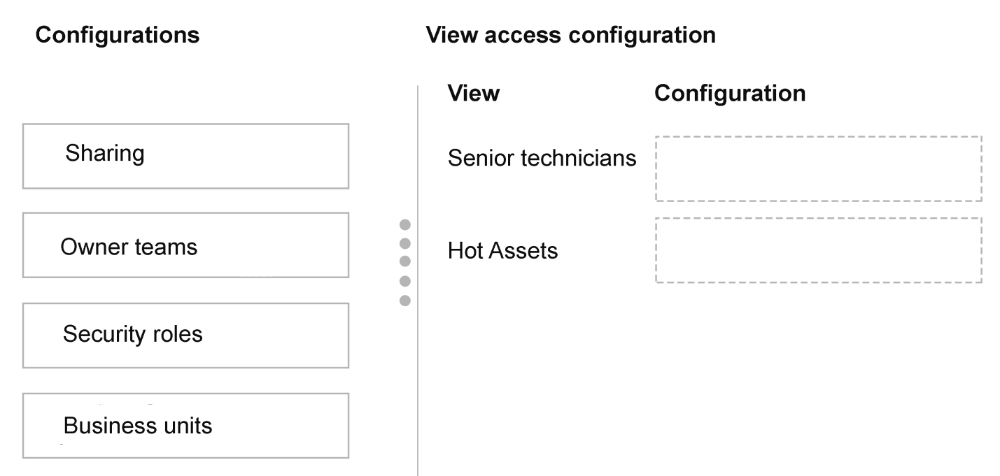

_DRAG DROP — the original ExamTopics question expects you to drag and drop items; the correct targets are not published._

**Most voted:**
- Senior Technicians: The view is public, so everyone sees it by default. Restricting it to a specific set of users is done by choosing which security roles can see the view, so only users holding those roles get it in the view selector.
- Hot Assets: A personal view belongs to the tester alone. Sharing it with the Testers team, the Dataverse team for the Contoso Ltd. QA group, gives the whole testing team access. Since the team already has the Quality Assurance role (read/write on custom tables), they can use the shared view.

### Top explanations
- **aed747e** (2 upvotes): To restrict a Public View like Senior technicians to a specific group, assign authorized Security roles within the Model-driven App Designer. Conversely, a Personal View created by a user, such as Hot Assets, cannot be managed via system permissions; it explicitly requires using the Sharing feature to make it accessible to the team.
- **Antea** (1 upvotes [Most Recent]): •	Senior Technicians: Security Roles
  •	Hot Assets: Sharing
  Senior Technicians: The view is public, so everyone sees it by default. Restricting it to a specific set of users is done by choosing which security roles can see the view, so only users holding those roles get it in the view selector.
  Hot Assets: A personal view belongs to the tester alone. Sharing it with the Testers team, the Dataverse team for the Contoso Ltd. QA group, gives the whole testing team access. Since the team already has the Quality Assurance role (read/write on custom tables), they can use the shared view.
- **freshbt** (1 upvotes): System View - Senior Technician - restrict access to Security Role user
  Personal View - Hot asset - group team access via owner team
  To supplement, best practice is share Personal View Hot Assets to Owner Team (QA AAD Security group type assumed) effectively.
  Rather than share Personal view to each user individually.

## Q1.4 (ID 419369)

Background
Contoso Ltd. is a global renewable energy provider that operates wind farms and solar installations. The company is modernizing its maintenance and operations platform. The company plans to implement a Microsoft Power Platform solution for the operations team. The implementation will include Microsoft Dataverse, a model-driven app, and Power Automate cloud flows.
The company is building and testing a new model-driven app named Operations. The solution will support operations managers, regional coordinators, and field technicians. The app must integrate with an external cloud-based system that manages onboarding of field technicians.
Contoso Ltd. plans to improve data quality and enforce consistent business logic across the app and automation processes.
Technical environment
Contoso Ltd. has an Identity and Access Management (IDAM) department that manages security. The company has one Power Platform environment named Production, where all building and configuration take place. Auditing is disabled.
The Production environment has the following security configurations:
IDAM has a Microsoft Entra security group named Contoso Ltd. QA. This security group will assign all members a Power Apps license.
IDAM created a Quality Assurance security role that grants read and write access to all custom tables.
IDAM also created a team named Testers in Dataverse, of a Microsoft Entra group team type. The team is configured for the Contoso Ltd. QA security group. The Testers team is assigned the Quality Assurance security role.
Microsoft 365 environment
All Contoso Ltd. managers are included in a Microsoft 365 group named Managers. The group is NOT enabled for email.
The company shares a SharePoint list with a key customer: Alpine Ski House. Alpine Ski House staff members can add new maintenance requests, which are then checked and marked as reviewed by Contoso Ltd.
Current issue:
A new QA tester joins Contoso Ltd. The IDAM department adds the new tester to the Contoso Ltd. QA security group. However, the new tester is not listed in the Testers team as a member.
Other applications:
A separate software-as a-service (SaaS) solution named TechCheck manages technician onboarding. The TechCheck solution is set up as follows:
TechCheck assigns a unique number named Ref to all technicians.
Users cannot make changes to the TechCheck data model.
Users cannot use the same TechCheck ref on more than one Technician row.
Automation requirements
Contoso plans to use Power Automate to develop a Maintenance Request Approval flow. The flow must meet the following requirements:
Create a Maintenance Request row in Dataverse when either of the following occurs:
An item is added to the SharePoint list by the customer with the Priority property set to High.
Any item is checked and marked as reviewed by a Contoso Ltd. representative.
Seek maintenance request approvals from managers through both email and a Microsoft Teams message after they have been reviewed:
Requests require approval from all managers.
If one manager rejects the request, approval must not be granted.
The result of the approval request must be sent to the initial reviewer in an email. The subject line must set the response as either Approve or Reject.
Contoso Ltd. requires the following table logic:
If a user tries to enter a price greater than the cost on a new Asset row, the row must display an inline error message.
If a user tries to save changes to a Technician row where the TechCheck ref column is empty, the action must be prevented and a message explaining the action must be displayed.
Any updates made to Technician profiles in TechCheck must be mirrored in Dataverse by using a custom integration. The developers building the integration require an index for performant searches on the Technician table.
Data model and app design
Contoso Ltd. plans to use Dataverse as its central data platform. Log storage must be minimized.
Tables
The following tables are required for data modeling and the app design:
Assets: Stores information about solar panels and wind turbines
Maintenance Requests: Tracks issues and maintenance activities. The table must include the following columns:
Request ID (auto-number)
External Request Code (text)
Assigned
Technician (lookup to Technicians)
Report (lookup to Maintenance Reports)
Technician updated (Yes/No)
Maintenance Reports: Tracks the results of maintenance reports
Technicians: Stores technician assignment data. The table must include the following columns:
Full Name (Text)
Mobile phone number (Text)
Email (Text)
Seniority (Choice)
TechCheck ref (Text)
Data modeling
The data model must provide the following functionality:
Maintenance Requests must:
be uniquely identifiable across systems.
have two inactive statuses, Cancelled and Duplicate.
If a new option is added to an existing set of options, it must be made available automatically for selection on all columns that use the set.
A new column named Priority must be added to multiple tables. Users must be able to select only one option from the following set per row:
Low
Medium
High
Critical
Changes to the Technician column on Maintenance Requests must be tracked for compliance purposes. Rows must include the names of previous and current technicians and the time of the change.
Relationship requirements
One asset can be related to many maintenance requests. A maintenance request can have many assets.
A maintenance request can have only zero or one maintenance report.
Only one Technician can be related to a Maintenance Request at a time.
When a Maintenance Request is deleted, any Maintenance Reports associated with it must also be deleted, but this action should be prevented if there is value in the Technician lookup.
When a Maintenance Request is assigned to a different owner, the Maintenance Report associated with it must be reassigned to the new owner as well, but the associated Technician should stay with the current owner.
App design
The Technicians table contains the following public views:
Senior Technicians
Junior Technicians
The Senior Technician view must be available through the table list view selector to a set of specific users only.
A tester creates a personal view named Hot Assets on the Assets table. The tester recognizes that the view is useful for the entire testing team. The view must be made accessible to the team.
You need to define the alternate key for the Technicians table by using the TechCheck ref column.
Which setting should you apply to the TechCheck ref column?

✅ **A.** Required
⭕ **B.** Searchable
⭕ **C.** Column security
⭕ **D.** Auditing

**Correct answer:** A
**Most voted:** A

### Top explanations
- **aed747e** (2 upvotes [Most Recent, Selected Answer: A]): The Alternate Key must be related to a required column.
- **Mirjalol_Rakhmonov** (2 upvotes): Please refer to "If a user tries to save changes to a Technician row where the TechCheck ref column is empty, the action must be prevented and a message explaining the action must be displayed."
- **Antea** (1 upvotes [Selected Answer: A]): A. Required.
  I tested it in my DEV, I created the Key using an optional field and got this error, but the only duplicates I had in df_preciselyid were the empty rows.
  "Index creation failed for Entity Key 'df_preciselyid' on Entity 'df_city' due to duplicate key records found in the database for the selected columns: 'df_preciselyid'."
- **seoyeon_01** (1 upvotes): I'm confused—can someone break down this answer for me?

## Q1.5 (ID 419220)

A company uses a model-driven app across multiple departments.
A public view intended only for managers currently exposes sensitive columns and filters to all users.
The view must meet the following requirements:
Restrict access to the specific public view to managers.
Display only context-relevant views for other users.
You need to configure view access.
What should you do?

✅ **A.** Restrict the view by assigning it to the manager security role.
⭕ **B.** Configure table-level permissions for managers only.
⭕ **C.** Remove the view from the app navigation.
⭕ **D.** Set up the quick find view.

**Correct answer:** A
**Most voted:** A

### Top explanations
- **exam_upskill** (1 upvotes [Most Recent, Selected Answer: A]): A. Restrict the view by assigning it to the manager security role.
- **Antea** (1 upvotes [Selected Answer: A]): A. Security Roles
  How to assign a public view to security roles In Microsoft Power Apps:
  Go to Solutions.
  Open the solution containing your table.
  Open the table.
  Select Views.
  Select the public view you want to restrict.
  On the command bar, select View settings.
  Change the option from Everyone to Specific security roles.
  Select the security roles that should see the view.
  Select Save and Publish.
- **Evincible** (1 upvotes [Selected Answer: A]): In model-driven apps, public views can be managed by security role. Assigning the sensitive view specifically to the manager security role ensures that only managers see that view in the view selector, while other users see only views appropriate to their roles

## Q1.6 (ID 419221)

You create a parent entity and a child entity. The parent entity has a 1:N relationship with the child entity.
You need to ensure that when the owner changes on the parent record that all child records are assigned to the new owner.
You need to configure the relationship behavior type.
What should you use?

⭕ **A.** Referential, Restrict Delete
⭕ **B.** Referential
⭕ **C.** Restrict
✅ **D.** Parental

**Correct answer:** D
**Most voted:** D

### Top explanations
- **Evincible** (2 upvotes [Most Recent, Selected Answer: D]): With a Parental relationship behavior, actions performed on the parent record can cascade to related child records. This includes Assign, so when the parent record’s owner changes, the child records are also assigned to the new owner.

## Q1.7 (ID 419377)

A company tracks order processing duration using a model-driven app.
The company requires a system that provides the following functionality:
The age of the order, based on the created date, must be displayed on forms and views.
The value must update dynamically when viewed without storing the result.
The value must NOT be stored in the database.
You need to configure the column types.
Which two column types should you use? Each correct answer presents part of the solution.
NOTE: Each correct selection is worth one point.

✅ **A.** Formula
✅ **B.** Calculated
⭕ **C.** BigInt
⭕ **D.** Prompt

**Correct answer:** A, B
**Most voted:** AB

### Top explanations
- **JoaoRyff** (3 upvotes [Selected Answer: AB]): Both Formula columns (using Power Fx expressions) and traditional Calculated columns in Dataverse compute values dynamically on the fly when requested (e.g., when rendering a form or a view).
- **Antea** (1 upvotes [Most Recent, Selected Answer: AB]): Answer: A. Formula and B. Calculated
  A. Formula (correct): Microsoft Learn says formula columns return values during fetch operations and are a dynamically calculated output, so the age can be computed from Created On each time the record is viewed.
  B. Calculated (correct, least certain): It can compute a date difference from Created On. Microsoft Learn’s column types page doesn’t say how calculated columns are stored, so it’s worth checking the calculated columns page. It’s the only remaining option that fits.
  C. BigInt (wrong): Microsoft Learn says Big/BigInt isn’t supported in canvas and model-driven apps, so it can’t display on the app’s forms and views. It’s also a plain stored number type, so it can’t calculate anything.
  D. Prompt (wrong): Microsoft Learn says prompt columns store AI-generated results persistently in the table, which breaks the “not stored” requirement. They also run on create or update, not on every view.
  https://learn.microsoft.com/en-us/power-apps/maker/data-platform/types-of-fields
  https://learn.microsoft.com/en-us/power-apps/maker/data-platform/prompt-column
- **Cupupis** (1 upvotes [Selected Answer: AB]): Formula and Calculated does not store the value.
  Prompt Column stores the value, therefore it cannot be correct.
  "The result is immediately stored in the prompt column, ready to be used in apps, workflows, or reports."
  https://learn.microsoft.com/en-us/power-apps/maker/data-platform/prompt-column
- **Pcorreia** (1 upvotes [Selected Answer: AD]): https://learn.microsoft.com/en-us/power-apps/maker/data-platform/prompt-column
- **seoyeon_01** (1 upvotes): I'm struggling to understand why this answer works—help?

## Q1.8 (ID 419352)

DRAG DROP
You are designing a data model for a company. The model uses only standard Microsoft Dataverse tables.
You must extend the existing Accounts and Contacts tables to support the following business requirements:
Store an additional classification value on the Accounts table.
Add a field that indicates a customer’s engagement tier on the Contacts table.
Create a mechanism to improve lookup performance and ensure uniqueness across selected fields.
You need to modify the tables to support the business requirements.
Which components should you use? To answer, move the appropriate components to the correct requirements. You may use each component once, more than once, or not at all. You may need to move the split bar between panes or scroll to view content.
NOTE: Each correct selection is worth one point.

**Exhibits**
- Exhibit 1: 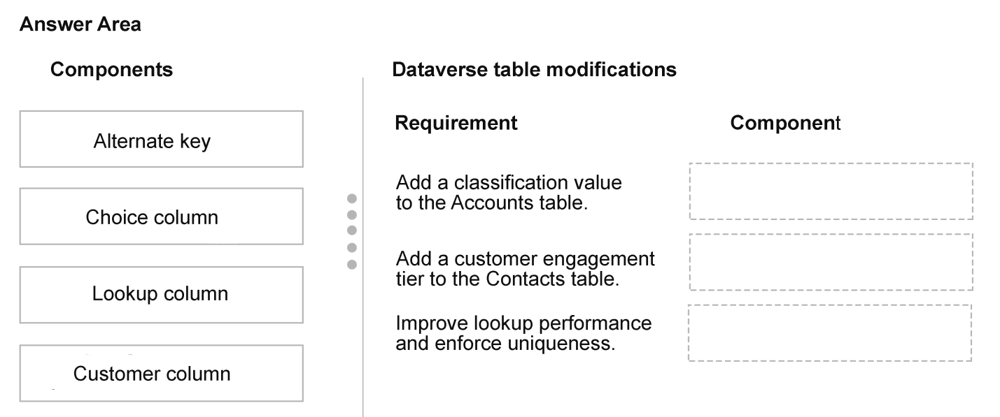

_DRAG DROP — the original ExamTopics question expects you to drag and drop items; the correct targets are not published._

**Most voted:**
1. Choice column
2. Choice column
3. Alternate key

### Top explanations
- **Mirjalol_Rakhmonov** (8 upvotes [Highly Voted]): "Add a customer engagement tier to the Contacts table" - why this one is not also Choice column?
- **exam_upskill** (4 upvotes [Most Recent]): 1. Choice column
  2. Choice column
  3. Alternate key
- **Mr. Jethalal** (1 upvotes): can you please provide me with the correct answer? I am confused
- **Cupupis** (1 upvotes): It doesn't make any sense to be customer. Since customer field is polymorphic field where you can select contact or account record. I don't see how that is related of customer engagement tier.
- **427ea93** (1 upvotes): Totally agree. Tier typically represents a select number of choices (gold, S-tier, etc). Therefore choice is correct

## Q1.9 (ID 419388)

A company maintains a Power Platform solution that includes prompts, cloud flows, and Dataverse components. Multiple development teams are responsible for different features within the solution.
The development teams have the following requirements:
Teams must develop and update the same features independently.
Updates must not overwrite changes made by other teams.
Production deployments must remain controlled and predictable.
You need to recommend an ALM approach that supports independent development and controlled deployment in line with Microsoft best practices.
What should you recommend?

⭕ **A.** Create and maintain separate solutions in a single development environment. Deploy independently as managed solutions.
⭕ **B.** Make changes in a single solution. Deploy updates directly to production.
✅ **C.** Create and maintain separate solutions in a separate development environment. Deploy independently as managed solutions.
⭕ **D.** Create unmanaged solutions in production. Merge changes during deployment.

**Correct answer:** C
**Most voted:** C

### Top explanations
- **exam_upskill** (2 upvotes [Most Recent, Selected Answer: C]): C. Create and maintain separate solutions in a separate development environment. Deploy independently as managed solutions.
- **aed747e** (1 upvotes [Selected Answer: C]): Microsoft recommends isolated development environments per team, each with its own solution, deploying as managed solutions to production for conflict-free, controlled, predictable ALM releases.
  https://learn.microsoft.com/en-us/power-platform/alm/team-development-alm

## Q1.10 (ID 419392)

A company is designing a Power Platform solution that includes a model-driven app used by customer service representatives to manage support cases.
The company is evaluating which solution component to include in the app. The solution must meet the following requirements:
Users must interact with system-generated responses while working within forms and views.
Responses must reflect the current data and context in the app.
Users must remain within the app while interacting with the solution.
You need to recommend solution components for the app.
Which two components should you recommend? Each correct answer presents a complete solution.
NOTE: Each correct selection is worth one point.

⭕ **A.** Business rules
✅ **B.** Copilot Studio agent
⭕ **C.** Smart assist
✅ **D.** App assistant agent

**Correct answer:** B, D
**Most voted:** BD

### Top explanations
- **exam_upskill** (1 upvotes [Most Recent, Selected Answer: BD]): B. Copilot Studio agent
  D. App assistant agent
- **aed747e** (1 upvotes [Selected Answer: BD]): The correct choices are B (Copilot Studio agent) and D (App assistant agent) because both provide modern, real-time generative AI assistance using record context directly inside model-driven apps. C (Smart assist) is incorrect because Microsoft deprecated it in June 2025.
  https://www.microsoft.com/en-us/dynamics-365/blog/it-professional/2025/01/28/end-of-support-for-smart-assist-case-and-knowledge-suggestions/
- **Cupupis** (1 upvotes [Selected Answer: BD]): Case says "Power Platform solution, Model Driven app".
  Smart Assist is available only in Dynamics products.
  Therefore Copilot & App Assistant that are power platform tools is correct.
  https://learn.microsoft.com/en-us/dynamics365/customer-service/administer/smart-assist
- **HNT1111** (1 upvotes [Selected Answer: CD]): C - Smart assist is designed for customer service scenarios in model‑driven apps.
  Shows AI‑generated suggestions inside the app
  Uses current case data to generate insights
  Appears in the Customer Service workspace
  Helps agents resolve cases faster without leaving the form
  This directly meets the requirement for contextual system‑generated responses.
  D - App assistant is the Copilot experience embedded inside model‑driven apps.
  Provides Copilot responses based on the record the user is viewing
  Works inside forms and views
  Uses the app’s current context and data
  Keeps the user inside the model‑driven app
  This is the modern Copilot‑in‑app experience Microsoft recommends.

## Q1.11 (ID 419413)

HOTSPOT
A company plans to use Microsoft Dataverse to manage sales opportunities. Records will contain confidential financial data that should only be accessible to specific groups of employees.
You have the following requirements:
Sales representatives must only view and update records they create.
Sales managers must have visibility into all opportunities within their organization.
You need to configure security.
Which configuration should you use? To answer, select the appropriate options in the answer area.
NOTE: Each correct selection is worth one point.

**Exhibits**
- Exhibit 1: 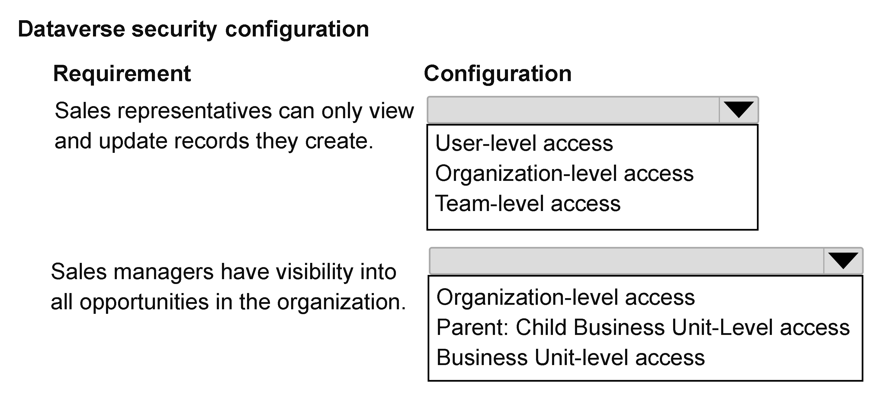

_HOTSPOT — the original ExamTopics question expects you to mark areas on the exhibit above; the correct hotspot coordinates are not published._

**Most voted:**
- User-level acces: Only access to owned records
- Organization-level access: All the records in the table

### Top explanations
- **aed747e** (3 upvotes): 1. User-level acces: Only access to owned records
  2. Organization-level access: All the records in the table
- **MeshMallow** (1 upvotes [Most Recent]): Sales representatives can only view and update records they create -> User-level access
  Sales manager have visibility into all opportunities in the organization -> Organization-level access
- **exam_upskill** (1 upvotes): 1. User-level access
  2. Organization-level access

## Q1.12 (ID 419381)

A company uses Power Apps.
Users must be able to view only the address1 columns in the Account table.
You need to ensure other address columns are not visible to users when creating views and filters.
What should you do?

⭕ **A.** Use column-level security to remove read access to all users.
⭕ **B.** Create business rules to hide the other address columns.
⭕ **C.** Delete the other address columns from the table.
✅ **D.** Disable the Search option for the columns.

**Correct answer:** D
**Most voted:** D

### Top explanations
- **aed747e** (4 upvotes [Selected Answer: D]): Disabling the Searchable property on specific columns removes them from Advanced Find, which prevents users from seeing, selecting, or filtering by them when constructing custom Views in Dataverse.
  Not A: Column security restricts data viewing, but columns still appear when building views or filters.
- **MeshMallow** (1 upvotes [Most Recent, Selected Answer: D]): In Dataverse, the Searchable property determines whether a column is available for use in search-related experiences and view/filter customization.
  - Setting Searchable = No prevents the unwanted address columns from appearing as available options when users create or customize views and filters.
  - Keep address1 columns searchable so users can use them.
- **exam_upskill** (1 upvotes [Selected Answer: D]): D. Disable the Search option for the columns.

## Q1.13 (ID 419398)

DRAG DROP
An insurance company is implementing a customer service solution in Microsoft Dataverse to track interactions and manage issue resolution. The data model includes tables for customer information, support cases, and agents.
The data model includes the following requirements:
Link each support case to a customer.
Provide information on the children of customers.
Record history of agents assigned to customers.
You need to configure table relationships.
Which relationships should you use? To answer, move the appropriate relationship to the correct requirement. You may use each relationship once, more than once, or not at all. You may need to move the split bar between panes or scroll to view content.
NOTE: Each correct selection is worth one point.

**Exhibits**
- Exhibit 1: 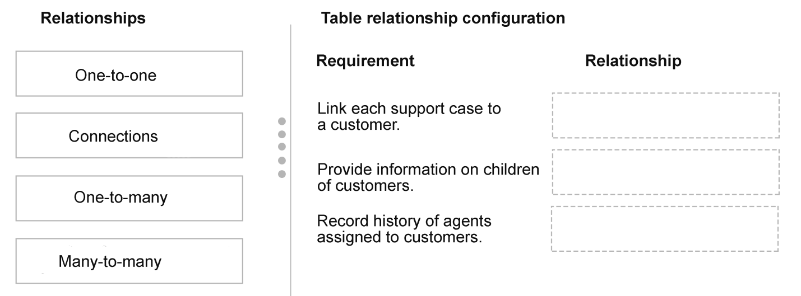

_DRAG DROP — the original ExamTopics question expects you to drag and drop items; the correct targets are not published._

**Most voted:**
- One-to-many: One customer can have multiple support cases, but each support case is linked to one customer.
- One-to-many: Use a self-referential one-to-many relationship on the Customer table. One customer (parent) can have multiple child customer records.
- Connections: Connections allow you to associate agents with customers and define connection roles. Multiple connection records can maintain a history of agent-customer associations.

### Top explanations
- **sanjaybhandekar** (5 upvotes): The third option is Many to Many, A customer can have multiple agents assigned over time, and an agent can be associated with multiple customers. This relationship can support tracking the assignment history.
- **MeshMallow** (2 upvotes): 1. One-to-many: One customer can have multiple support cases, but each support case is linked to one customer.
  2. One-to-many: Use a self-referential one-to-many relationship on the Customer table. One customer (parent) can have multiple child customer records.
  3. Connections: Connections allow you to associate agents with customers and define connection roles. Multiple connection records can maintain a history of agent-customer associations.
- **freshbt** (1 upvotes [Most Recent]): 1. One-to-Many
  2. One-to-Many
  3. Connections is best practice solution. It define relationship (agent history) between agents and customer
- **exam_upskill** (1 upvotes): 1. One-to-Many
  2. One-to-Many
  3. Connections

## Q1.14 (ID 419393)

DRAG DROP
A company develops and deploys AI-enabled Power Platform solutions across multiple environments. Environment access is controlled through security groups.
The development team requires Power Platform environments to store, manage, and share the solutions across the company.
All developers require access to the same environment. The environment must be subject to ALM controls.
You need to set up the environments.
Which environment types should you use? To answer, move the appropriate environment types to the correct requirements. You may use each environment type once, more than once, or not at all. You may need to move the split bar between panes or scroll to view content.
NOTE: Each correct selection is worth one point.

**Exhibits**
- Exhibit 1: 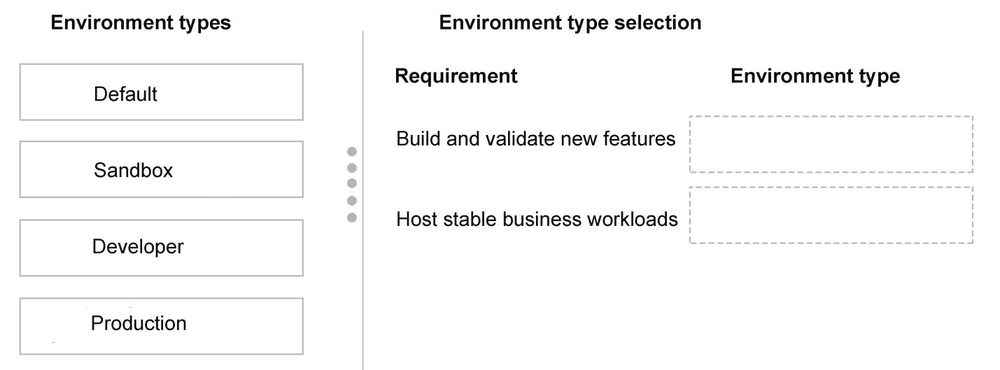

_DRAG DROP — the original ExamTopics question expects you to drag and drop items; the correct targets are not published._

**Most voted:**
- Build and validates new features → Sandbox
- Host stable business workloads → Production

### Top explanations
- **ah2006** (2 upvotes): Build and validates new features => Sandbox
  Host stable business workloads => Production
- **MeshMallow** (1 upvotes [Most Recent]): 1. Sandbox: Used for development, testing, and validating new features without affecting production workloads.
  2. Production: Used to host stable, live business applications and workloads.

## Q1.15 (ID 419407)

A company uses Microsoft Dataverse to manage prospects. The company has a business process flow named BPFA that is associated with the Prospect entity to streamline the prospect management process.
You add a field named Category to the Prospect entity. You create additional business process flows. You apply the business process flows to Prospect records based on the selected category. Users can switch to any other newly configured business process flows but must not use BPFA.
You need to configure the solution.
What are two possible ways to achieve this goal? Each correct answer presents a complete solution.
NOTE: Each correct selection is worth one point.

⭕ **A.** Change the display order of the business process flows to move BPFA to the bottom of the list.
⭕ **B.** Use a business rule.
✅ **C.** Deactivate BPFA.
✅ **D.** Remove all of the privileges for BPFA.

**Correct answer:** C, D
**Most voted:** CD

### Top explanations
- **MeshMallow** (2 upvotes [Most Recent, Selected Answer: CD]): C. Deactivate BPFA.
  - Deactivating BPFA prevents users from selecting it as an active business process flow.
  - Other active business process flows remain available.
  D. Remove all of the privileges for BPFA.
  - Removing the required security privileges prevents users from accessing and using BPFA.
  - Users can still use other business process flows for which they have permissions.
- **exam_upskill** (2 upvotes [Selected Answer: CD]): C. Deactivate BPFA.
  D. Remove all of the privileges for BPFA.
- **aed747e** (2 upvotes [Selected Answer: CD]): Deactivating BPFA (C) disables the process globally for all users. Removing all privileges (D) revokes Read permissions on the underlying BPFA custom table within Security Roles, hiding it completely. Conversely, changing Display Order (A) merely alters initial evaluation priority, and Business Rules (B) cannot control Business Process Flow availability or visibility.
- **philipssujin** (1 upvotes [Selected Answer: CD]): C and D because
  A. Change the display order: Only changes the order in which business process flows appear; users can still select BPFA.
  B. Use a business rule: Business rules control form logic and validation, not which business process flows users are allowed to select.
- **49c9343** (1 upvotes [Selected Answer: CD]): Deactivating BPFA (C) disables the process globally for all users. Removing all privileges (D) revokes Read permissions on the underlying BPFA custom table within Security Roles, hiding it completely. Conversely, changing Display Order (A) merely alters initial evaluation priority, and Business Rules (B) cannot control Business Process Flow availability or visibility.

## Q1.16 (ID 419391)

A company is building a prompt about product specifications. The company plans to use the prompt in Power Automate.
The prompt must use Retrieval-Augmented Generation to ground the model with additional business information.
You need to select the available knowledge source for the prompt.
What should you use?

⭕ **A.** PDF document
⭕ **B.** PNG image
✅ **C.** Dataverse table columns
⭕ **D.** Text

**Correct answer:** C
**Most voted:** C

### Top explanations
- **aed747e** (3 upvotes [Selected Answer: C]): In AI Builder, custom prompts use Retrieval-Augmented Generation (RAG) by configuring Dataverse grounding. Grounding links the prompt directly to live enterprise data stored in Dataverse table columns (and related tables), supplying necessary business context to the AI model before the prompt executes inside a Power Automate workflow.
- **MeshMallow** (1 upvotes [Most Recent, Selected Answer: C]): Microsoft Prompt Builder supports Retrieval-Augmented Generation (RAG) by using Dataverse tables as knowledge sources.

## Q1.17 (ID 419379)

A company uses Dataverse to manage customer accounts and related transaction records.
The company requires the following functionality:
Reference a single related record without performing any aggregations.
Store the relationship as part of the table definition, so the platform automatically maintains the link between records.
You need to configure a column.
Which type of column should you configure?

⭕ **A.** Formula
⭕ **B.** Calculated
⭕ **C.** Rollup
✅ **D.** Lookup

**Correct answer:** D
**Most voted:** D

### Top explanations
- **aed747e** (2 upvotes [Selected Answer: D]): A Lookup column references a single record from a target table and automatically creates and maintains a formal database relationship within the Dataverse schema, without performing any data aggregation.
- **MeshMallow** (1 upvotes [Most Recent, Selected Answer: D]): A Lookup column is used to reference a single related record in another Dataverse table.

## Q1.18 (ID 419418)

A company is using a model-driven app to process orders. The company uses a custom integration to add orders to Microsoft Dataverse from two separate point-of-sale solutions.
Order numbers are stored in a column on an Order table named Number. The order numbers are prefixed with the value POS1- or POS2- depending on which point-of-sale system they originated from.
The company creates a calculated text column to store the clean order number. The clean order number must remove the point-of-sale system prefix.
You need to configure the action on the calculated column.
Which formula should you use?

⭕ **A.** CONCAT(Number, “4”)
⭕ **B.** TRIMLEFT(Number, 4)
✅ **C.** TRIMLEFT(Number, 5)
⭕ **D.** TRIMRIGHT(Number, 5)
⭕ **E.** TRIMRIGHT(Number, 4)

**Correct answer:** C
**Most voted:** C

### Top explanations
- **aed747e** (3 upvotes [Selected Answer: C]): In Dataverse calculated columns, the TRIMLEFT function strips a specified number of characters from the left side of a string. Since both prefixes (POS1- and POS2-) consist of 5 characters, TRIMLEFT(Number, 5) removes the prefix completely.
- **MeshMallow** (1 upvotes [Most Recent, Selected Answer: C]): The prefix is at the start of the value, and it is 5 characters long: POS1- is P, O, S, 1 and the hyphen. Removing the first 5 characters from POS1-10234 leaves 10234, and the same works for POS2-10234.

## Q1.19 (ID 419361)

Note: This question is part of a series of questions that present the same scenario. Each question in the series contains a unique solution that might meet the stated goals. Some question sets might have more than one correct solution, while others might not have a correct solution.
After you answer a question in this section, you will NOT be able to return to it. As a result these questions will not appear on the review screen.
A company uses a model-driven app.
The company must be able to dynamically control how components of the form behave as users interact with it. The solution must modify the form in real time while the user interacts with the interface.
You need to enforce client-side behavior dynamically.
Solution: Use business rules to show inline error messages.
Does the solution meet the goal?

✅ **A.** Yes
⭕ **B.** No

**Correct answer:** A
**Most voted:** A

### Top explanations
- **Daeon** (8 upvotes [Highly Voted, Selected Answer: A]): Should be Yes. Since the proposed solution utilizes a native business rule to instantly control form behavior via inline validation while the user interacts with the app, it successfully meets the stated goal.
- **MeshMallow** (1 upvotes [Most Recent, Selected Answer: A]): Business Rules in model-driven apps can enforce client-side behavior dynamically.

## Q1.20 (ID 419354)

Note: This question is part of a series of questions that present the same scenario. Each question in the series contains a unique solution that might meet the stated goals. Some question sets might have more than one correct solution, while others might not have a correct solution.
After you answer a question in this section, you will NOT be able to return to it. As a result these questions will not appear on the review screen.
A company uses a model-driven app.
The company must be able to dynamically control how components of the form behave as users interact with it. The solution must modify the form in real time while the user interacts with the interface.
You need to enforce client-side behavior dynamically.
Solution: Use Power Automate cloud flows to update column values.
Does the solution meet the goal?

⭕ **A.** Yes
✅ **B.** No

**Correct answer:** B
**Most voted:** B

### Top explanations
- **49c9343** (3 upvotes [Selected Answer: B]): Power automate cloud flow run on server side and is not real time
- **MeshMallow** (1 upvotes [Most Recent, Selected Answer: B]): Power Automate cloud flows are server-side automation tools. They do not dynamically modify model-driven app form components while a user interacts with the form.

## Q1.21 (ID 419406)

Note: This question is part of a series of questions that present the same scenario. Each question in the series contains a unique solution that might meet the stated goals. Some question sets might have more than one correct solution, while others might not have a correct solution.
After you answer a question in this section, you will NOT be able to return to it. As a result these questions will not appear on the review screen.
A company uses a model-driven app.
The company must be able to dynamically control how components of the form behave as users interact with it. The solution must modify the form in real time while the user interacts with the interface.
You need to enforce client-side behavior dynamically.
Solution: Use JavaScript to dynamically show and hide columns.
Does the solution meet the goal?

✅ **A.** Yes
⭕ **B.** No

**Correct answer:** A
**Most voted:** A

### Top explanations
- **ABCTOC** (3 upvotes [Selected Answer: A]): JavaScript can control a model-driven app form in real time on the client side as the user interacts with it.
- **Ali_c411** (1 upvotes [Most Recent, Selected Answer: A]): Could someone explain. Whilst I know JSVA can why wouldn't you suggest using business rules here?

## Q1.22 (ID 419373)

Note: This question is part of a series of questions that present the same scenario. Each question in the series contains a unique solution that might meet the stated goals. Some question sets might have more than one correct solution, while others might not have a correct solution.
After you answer a question in this section, you will NOT be able to return to it. As a result these questions will not appear in the review screen.
You administer the Microsoft 365 and Microsoft Power Platform environments for Contoso, Ltd. The company has a model-driven app that is used to track customer interactions with employees. The app uses standard table types for customers. A user named Elisabeth Rice signs in to the app by using the following sign in name:
[email protected]
.
After marriage, Elisabeth changes her legal name to Elisabeth Mueller.
You need to update the sign in name for the user without losing any application history.
Solution: Ask the Microsoft 365 administrator to sign in to the admin portal and change the user name.
Does the solution meet the goal?

✅ **A.** Yes
⭕ **B.** No

**Correct answer:** A
**Most voted:** A

### Top explanations
- **aed747e** (3 upvotes [Selected Answer: B]): Updating the User Principal Name in Microsoft 365 admin center updates the user's login identity while preserving their underlying Microsoft Entra Object ID. This preserves all historical record ownership and data within Dataverse automatically.
- **FabiolaRT** (2 upvotes [Selected Answer: A]): Answer: A.   the Microsoft 365 admin portal updates the sign-in name while all related application history/records intac
- **seoyeon_01** (2 upvotes): I'm confused—why is this answer correct?
- **MeshMallow** (1 upvotes [Most Recent, Selected Answer: A]): Changing the user's sign-in name (UPN) through the Microsoft 365 admin center does not create a new user account.

## Q1.23 (ID 419384)

Note: This question is part of a series of questions that present the same scenario. Each question in the series contains a unique solution that might meet the stated goals. Some question sets might have more than one correct solution, while others might not have a correct solution.
After you answer a question in this section, you will NOT be able to return to it. As a result these questions will not appear in the review screen.
You administer the Microsoft 365 and Microsoft Power Platform environments for Contoso, Ltd. The company has a model-driven app that is used to track customer interactions with employees. The app uses standard table types for customers. A user named Elisabeth Rice signs in to the app by using the following sign in name:
[email protected]
.
After marriage, Elisabeth changes her legal name to Elisabeth Mueller.
You need to update the sign in name for the user without losing any application history.
Solution: Change Elizabeth’s username in the user record for the app.
Does the solution meet the goal?

⭕ **A.** Yes
✅ **B.** No

**Correct answer:** B
**Most voted:** B

### Top explanations
- **49c9343** (4 upvotes [Selected Answer: B]): In a model-driven app, the User record (the systemuser table) is synced from Microsoft Entra ID. Identity fields such as the username or UPN, the full name and the primary email are read-only in Dataverse because they’re managed at the source.
  Even if you could edit the username in the app, the next sync from Entra ID would overwrite it. Changing it in Dataverse also wouldn’t change how Elisabeth signs in, because sign-in is handled by Entra ID, not by the app.
  So this solution doesn’t update her sign-in name.
- **MeshMallow** (1 upvotes [Most Recent, Selected Answer: B]): Changing Elizabeth's username directly in the Dataverse user record is not the correct approach.
  Microsoft Learn confirms that standard user profile information, including the User Name (DomainName), is managed through Microsoft 365 / Microsoft Entra ID and synchronized with Dataverse.
- **seoyeon_01** (1 upvotes): Would someone be able to explain the reasoning behind this answer?

## Q1.24 (ID 419416)

Note: This question is part of a series of questions that present the same scenario. Each question in the series contains a unique solution that might meet the stated goals. Some question sets might have more than one correct solution, while others might not have a correct solution.
After you answer a question in this section, you will NOT be able to return to it. As a result these questions will not appear in the review screen.
You administer the Microsoft 365 and Microsoft Power Platform environments for Contoso, Ltd. The company has a model-driven app that is used to track customer interactions with employees. The app uses standard table types for customers. A user named Elisabeth Rice signs in to the app by using the following sign in name:
[email protected]
.
After marriage, Elisabeth changes her legal name to Elisabeth Mueller.
You need to update the sign in name for the user without losing any application history.
Solution: From Dynamics 365 Settings, select Email Configuration. In the active mailbox for the user, update the name.
Does the solution meet the goal?

⭕ **A.** Yes
✅ **B.** No

**Correct answer:** B
**Most voted:** B

### Top explanations
- **49c9343** (3 upvotes [Selected Answer: B]): Changing the name on the mailbox record only renames that mailbox configuration. It has nothing to do with Elisabeth’s sign-in name, which is her UPN in Microsoft Entra ID.
  Her sign-in name and user record stay exactly the same, so the goal isn’t met.
- **MeshMallow** (1 upvotes [Most Recent, Selected Answer: B]): Updating the name in the user's Active Mailbox record does not change the user's Microsoft 365 sign-in name (UPN).
  The mailbox configuration is used for email synchronization and processing, not for managing the user's identity.

## Q1.25 (ID 419364)

Background
Contoso Ltd. is a global renewable energy provider that operates wind farms and solar installations. The company is modernizing its maintenance and operations platform. The company plans to implement a Microsoft Power Platform solution for the operations team. The implementation will include Microsoft Dataverse, a model-driven app, and Power Automate cloud flows.
The company is building and testing a new model-driven app named Operations. The solution will support operations managers, regional coordinators, and field technicians. The app must integrate with an external cloud-based system that manages onboarding of field technicians.
Contoso Ltd. plans to improve data quality and enforce consistent business logic across the app and automation processes.
Technical environment
Contoso Ltd. has an Identity and Access Management (IDAM) department that manages security. The company has one Power Platform environment named Production, where all building and configuration take place. Auditing is disabled.
The Production environment has the following security configurations:
IDAM has a Microsoft Entra security group named Contoso Ltd. QA. This security group will assign all members a Power Apps license.
IDAM created a Quality Assurance security role that grants read and write access to all custom tables.
IDAM also created a team named Testers in Dataverse, of a Microsoft Entra group team type. The team is configured for the Contoso Ltd. QA security group. The Testers team is assigned the Quality Assurance security role.
Microsoft 365 environment
All Contoso Ltd. managers are included in a Microsoft 365 group named Managers. The group is NOT enabled for email.
The company shares a SharePoint list with a key customer: Alpine Ski House. Alpine Ski House staff members can add new maintenance requests, which are then checked and marked as reviewed by Contoso Ltd.
Current issue:
A new QA tester joins Contoso Ltd. The IDAM department adds the new tester to the Contoso Ltd. QA security group. However, the new tester is not listed in the Testers team as a member.
Other applications:
A separate software-as a-service (SaaS) solution named TechCheck manages technician onboarding. The TechCheck solution is set up as follows:
TechCheck assigns a unique number named Ref to all technicians.
Users cannot make changes to the TechCheck data model.
Users cannot use the same TechCheck ref on more than one Technician row.
Automation requirements
Contoso plans to use Power Automate to develop a Maintenance Request Approval flow. The flow must meet the following requirements:
Create a Maintenance Request row in Dataverse when either of the following occurs:
An item is added to the SharePoint list by the customer with the Priority property set to High.
Any item is checked and marked as reviewed by a Contoso Ltd. representative.
Seek maintenance request approvals from managers through both email and a Microsoft Teams message after they have been reviewed:
Requests require approval from all managers.
If one manager rejects the request, approval must not be granted.
The result of the approval request must be sent to the initial reviewer in an email. The subject line must set the response as either Approve or Reject.
Contoso Ltd. requires the following table logic:
If a user tries to enter a price greater than the cost on a new Asset row, the row must display an inline error message.
If a user tries to save changes to a Technician row where the TechCheck ref column is empty, the action must be prevented and a message explaining the action must be displayed.
Any updates made to Technician profiles in TechCheck must be mirrored in Dataverse by using a custom integration. The developers building the integration require an index for performant searches on the Technician table.
Data model and app design
Contoso Ltd. plans to use Dataverse as its central data platform. Log storage must be minimized.
Tables
The following tables are required for data modeling and the app design:
Assets: Stores information about solar panels and wind turbines
Maintenance Requests: Tracks issues and maintenance activities. The table must include the following columns:
Request ID (auto-number)
External Request Code (text)
Assigned
Technician (lookup to Technicians)
Report (lookup to Maintenance Reports)
Technician updated (Yes/No)
Maintenance Reports: Tracks the results of maintenance reports
Technicians: Stores technician assignment data. The table must include the following columns:
Full Name (Text)
Mobile phone number (Text)
Email (Text)
Seniority (Choice)
TechCheck ref (Text)
Data modeling
The data model must provide the following functionality:
Maintenance Requests must:
be uniquely identifiable across systems.
have two inactive statuses, Cancelled and Duplicate.
If a new option is added to an existing set of options, it must be made available automatically for selection on all columns that use the set.
A new column named Priority must be added to multiple tables. Users must be able to select only one option from the following set per row:
Low
Medium
High
Critical
Changes to the Technician column on Maintenance Requests must be tracked for compliance purposes. Rows must include the names of previous and current technicians and the time of the change.
Relationship requirements
One asset can be related to many maintenance requests. A maintenance request can have many assets.
A maintenance request can have only zero or one maintenance report.
Only one Technician can be related to a Maintenance Request at a time.
When a Maintenance Request is deleted, any Maintenance Reports associated with it must also be deleted, but this action should be prevented if there is value in the Technician lookup.
When a Maintenance Request is assigned to a different owner, the Maintenance Report associated with it must be reassigned to the new owner as well, but the associated Technician should stay with the current owner.
App design
The Technicians table contains the following public views:
Senior Technicians
Junior Technicians
The Senior Technician view must be available through the table list view selector to a set of specific users only.
A tester creates a personal view named Hot Assets on the Assets table. The tester recognizes that the view is useful for the entire testing team. The view must be made accessible to the team.
You need to run the App access-checker.
What should you use as the input?

⭕ **A.** Contoso Ltd. QA security group
⭕ **B.** Testers group team
✅ **C.** Email address of the new QA tester
⭕ **D.** Username of the manager

**Correct answer:** C
**Most voted:** C

### Top explanations
- **philipssujin** (2 upvotes [Selected Answer: C]): The App access checker in Power Apps helps administrators diagnose whether a specific user has access to an app and identify potential access issues.
  You provide the individual user's email address to check their access.
- **ABCTOC** (2 upvotes [Selected Answer: C]): The App access checker is used to check whether a specific user has access to a model-driven app and diagnose why they do or do not have access.
  In this scenario, the problem is specifically with the new QA tester, so you would provide that user's identity, using their email address, to check their access.
- **Antea** (1 upvotes [Most Recent, Selected Answer: C]): The Power Apps App access checker evaluates access for an individual user.
- **MeshMallow** (1 upvotes [Selected Answer: C]): The App access checker for model-driven apps requires an individual user's User Principal Name (UPN) or email address as input.
- **sanjaybhandekar** (1 upvotes [Selected Answer: B]): B. Testers group team — Correct; the team represents the users who need access.

## Q1.26 (ID 419374)

Background
Fabrikam Inc. is an energy provider that operates wind and solar farms across multiple countries and regions. The company uses Microsoft Power Platform to manage asset maintenance, technician workflows, and predictive analytics.
Field technicians use canvas apps on mobile devices to capture inspection and repair data. Operations managers use model-driven apps to monitor asset performance and maintenance history.
The company plans to enhance its platform by introducing AI-driven insights, improving reuse across applications, and establishing a formal application lifecycle management (ALM) strategy.
Current environment
Applications
Field technicians use an outdated mobile app to log maintenance activities and capture asset readings in SharePoint Online.
Operations managers use a model-driven app to review maintenance records and asset performance trends.
Development practices
Developers build and modify applications directly in the production environment.
There is NO structured ALM process.
Solutions are NOT consistently used to package or deploy application components.
Reusable components are inconsistently implemented across apps, leading to duplication.
AI integration
Fabrikam Inc. plans to actively explore generative AI usage as part of the next phase of work.
Business requirement
Application development
The outdated mobile app must be replaced with a new app that supports responsive design principles, provides full control over the UI, and allows technicians to take and upload photos directly from their mobile devices.
The new app for the field technicians requires the name of the technician to be persisted on the home screen only. In addition, work orders must be displayed within a gallery.
All new apps must connect to a scalable, cloud-based relational data store.
Apps must support efficient data entry for technicians in the field.
Reusable UI elements must be implemented to reduce duplication.
AI capabilities
The company requires a generative AI solution to manage customer complaint responses and create custom inspection reports that align to an existing template.
Customer complaint responses must be generated in applications and based on emails being sent to a mailbox.
Custom AI development must be minimized.
Generative AI reusability
Generative AI solutions must accept dynamic inputs to adapt to different scenarios.
Generative AI solutions must be reusable across different Power Platform services.
Extensibility
Custom UI form components must be reusable across applications.
Use of server-side custom code must be minimized where possible.
Technical requirements
Application lifecycle management (ALM)
Separate environments must be used for development, testing, and production.
Solutions must be used to package application components, segmented based on functional areas.
Managed solutions must be deployed to the production environment.
Validation must occur before deployment to production.
Data processing
Aggregated values across related rows must be displayed for reporting.
Calculations must update automatically as new data is entered. Calculation data must be limited to a maximum length of 10.
Issues
Duplicate logic exists across multiple canvas apps.
Developers frequently overwrite changes in production.
Generative AI solutions produce inconsistent outputs due to missing or inconsistent inputs.
Maintenance metrics are not consistently calculated across related rows.
You need to implement the extensibility requirements.
Which two options should you use? Each correct answer presents part of the solution.
NOTE: Each correct selection is worth one point.

⭕ **A.** Sitemap
✅ **B.** JavaScript web resource
⭕ **C.** Business rule
⭕ **D.** Plugin
✅ **E.** Power Apps component framework control

**Correct answer:** B, E
**Most voted:** BE

### Top explanations
- **427ea93** (3 upvotes [Selected Answer: BE]): I think B and E are more correct.
- **exam_upskill** (2 upvotes [Selected Answer: BE]): B. JavaScript web resource
  E. Power Apps component framework control
- **MeshMallow** (1 upvotes [Most Recent, Selected Answer: BE]): 1. B. JavaScript web resource
  - Allows custom client-side logic and UI behavior in model-driven apps.
  - Can be reused across applications.
  - Helps implement custom form behavior while minimizing server-side code.
  2. E. Power Apps Component Framework (PCF) control
  - Allows developers to create custom UI components.
  - PCF controls can be reused across multiple applications.
  - Provides greater control over the user interface.
- **philipssujin** (1 upvotes [Selected Answer: BE]): B. JavaScript web resource: Allows client-side customization in model-driven apps, minimizing the need for server-side custom code such as plug-ins.
  E. Power Apps component framework control: Enables developers to create reusable custom UI components that can be used across multiple applications.

## Q1.27 (ID 419417)

Background
Fabrikam Inc. is an energy provider that operates wind and solar farms across multiple countries and regions. The company uses Microsoft Power Platform to manage asset maintenance, technician workflows, and predictive analytics.
Field technicians use canvas apps on mobile devices to capture inspection and repair data. Operations managers use model-driven apps to monitor asset performance and maintenance history.
The company plans to enhance its platform by introducing AI-driven insights, improving reuse across applications, and establishing a formal application lifecycle management (ALM) strategy.
Current environment
Applications
Field technicians use an outdated mobile app to log maintenance activities and capture asset readings in SharePoint Online.
Operations managers use a model-driven app to review maintenance records and asset performance trends.
Development practices
Developers build and modify applications directly in the production environment.
There is NO structured ALM process.
Solutions are NOT consistently used to package or deploy application components.
Reusable components are inconsistently implemented across apps, leading to duplication.
AI integration
Fabrikam Inc. plans to actively explore generative AI usage as part of the next phase of work.
Business requirement
Application development
The outdated mobile app must be replaced with a new app that supports responsive design principles, provides full control over the UI, and allows technicians to take and upload photos directly from their mobile devices.
The new app for the field technicians requires the name of the technician to be persisted on the home screen only. In addition, work orders must be displayed within a gallery.
All new apps must connect to a scalable, cloud-based relational data store.
Apps must support efficient data entry for technicians in the field.
Reusable UI elements must be implemented to reduce duplication.
AI capabilities
The company requires a generative AI solution to manage customer complaint responses and create custom inspection reports that align to an existing template.
Customer complaint responses must be generated in applications and based on emails being sent to a mailbox.
Custom AI development must be minimized.
Generative AI reusability
Generative AI solutions must accept dynamic inputs to adapt to different scenarios.
Generative AI solutions must be reusable across different Power Platform services.
Extensibility
Custom UI form components must be reusable across applications.
Use of server-side custom code must be minimized where possible.
Technical requirements
Application lifecycle management (ALM)
Separate environments must be used for development, testing, and production.
Solutions must be used to package application components, segmented based on functional areas.
Managed solutions must be deployed to the production environment.
Validation must occur before deployment to production.
Data processing
Aggregated values across related rows must be displayed for reporting.
Calculations must update automatically as new data is entered. Calculation data must be limited to a maximum length of 10.
Issues
Duplicate logic exists across multiple canvas apps.
Developers frequently overwrite changes in production.
Generative AI solutions produce inconsistent outputs due to missing or inconsistent inputs.
Maintenance metrics are not consistently calculated across related rows.
You need to resolve the issues with the canvas apps.
Which two configurations should you use? Each correct answer presents part of the solution.
NOTE: Each correct selection is worth one point.

⭕ **A.** Named formula
✅ **B.** User-defined function
⭕ **C.** Collection
✅ **D.** Component library
⭕ **E.** Context variable

**Correct answer:** B, D
**Most voted:** BD

### Top explanations
- **ABCTOC** (3 upvotes [Selected Answer: BD]): “Duplicate logic exists across multiple canvas apps.”
  B. User-defined function ✅
  User-defined functions let you define reusable Power Fx logic rather than repeating the same formulas throughout an app. Microsoft documents them as part of the App object's Formulas capability.
  This addresses the duplicate logic side of the problem.
  D. Component library ✅
  Component libraries are specifically Microsoft's recommended way to reuse components across apps.
  They're ideal for Fabrikam's requirement that reusable UI elements reduce duplication across its canvas apps.
- **MeshMallow** (1 upvotes [Most Recent, Selected Answer: BD]): 1. B. User-defined function
  - Allows developers to create reusable functions in Power Apps.
  - Helps eliminate duplicate logic across multiple canvas apps.
  - Supports consistent business logic and easier maintenance.
  2. D. Component library
  - Stores reusable UI components.
  - Allows multiple canvas apps to use the same components.
  - Reduces duplication and simplifies maintenance.
- **exam_upskill** (1 upvotes [Selected Answer: BD]): B. User-defined function
  D. Component library

## Q1.28 (ID 419363)

Background
Fabrikam Inc. is an energy provider that operates wind and solar farms across multiple countries and regions. The company uses Microsoft Power Platform to manage asset maintenance, technician workflows, and predictive analytics.
Field technicians use canvas apps on mobile devices to capture inspection and repair data. Operations managers use model-driven apps to monitor asset performance and maintenance history.
The company plans to enhance its platform by introducing AI-driven insights, improving reuse across applications, and establishing a formal application lifecycle management (ALM) strategy.
Current environment
Applications
Field technicians use an outdated mobile app to log maintenance activities and capture asset readings in SharePoint Online.
Operations managers use a model-driven app to review maintenance records and asset performance trends.
Development practices
Developers build and modify applications directly in the production environment.
There is NO structured ALM process.
Solutions are NOT consistently used to package or deploy application components.
Reusable components are inconsistently implemented across apps, leading to duplication.
AI integration
Fabrikam Inc. plans to actively explore generative AI usage as part of the next phase of work.
Business requirement
Application development
The outdated mobile app must be replaced with a new app that supports responsive design principles, provides full control over the UI, and allows technicians to take and upload photos directly from their mobile devices.
The new app for the field technicians requires the name of the technician to be persisted on the home screen only. In addition, work orders must be displayed within a gallery.
All new apps must connect to a scalable, cloud-based relational data store.
Apps must support efficient data entry for technicians in the field.
Reusable UI elements must be implemented to reduce duplication.
AI capabilities
The company requires a generative AI solution to manage customer complaint responses and create custom inspection reports that align to an existing template.
Customer complaint responses must be generated in applications and based on emails being sent to a mailbox.
Custom AI development must be minimized.
Generative AI reusability
Generative AI solutions must accept dynamic inputs to adapt to different scenarios.
Generative AI solutions must be reusable across different Power Platform services.
Extensibility
Custom UI form components must be reusable across applications.
Use of server-side custom code must be minimized where possible.
Technical requirements
Application lifecycle management (ALM)
Separate environments must be used for development, testing, and production.
Solutions must be used to package application components, segmented based on functional areas.
Managed solutions must be deployed to the production environment.
Validation must occur before deployment to production.
Data processing
Aggregated values across related rows must be displayed for reporting.
Calculations must update automatically as new data is entered. Calculation data must be limited to a maximum length of 10.
Issues
Duplicate logic exists across multiple canvas apps.
Developers frequently overwrite changes in production.
Generative AI solutions produce inconsistent outputs due to missing or inconsistent inputs.
Maintenance metrics are not consistently calculated across related rows.
You need to implement a generative AI solution that meets the requirements.
Which two actions should you perform? Each correct answer presents part of the solution.
NOTE: Each correct selection is worth one point.

✅ **A.** Use a pre-built model.
⭕ **B.** Use a custom model.
⭕ **C.** Start from a blank prompt.
✅ **D.** Create a prompt from a template.

**Correct answer:** A, D
**Most voted:** AD

### Top explanations
- **aed747e** (4 upvotes [Selected Answer: AD]): Use a pre-built model: Meets the requirement to minimize custom AI development by utilizing out-of-the-box generative models.
  Create a prompt from a template: Generates standardized inspection reports and allows dynamic inputs across applications.
- **MeshMallow** (1 upvotes [Most Recent, Selected Answer: AD]): 1. A. Use a pre-built model
  - Minimizes custom AI development.
  - Uses existing generative AI capabilities.
  - Suitable for generating customer complaint responses and inspection reports.
  2. D. Create a prompt from a template
  - Provides a predefined structure for generating consistent outputs.
  - Allows dynamic inputs to adapt to different scenarios.
  - Helps generate inspection reports aligned with an existing template.
- **exam_upskill** (1 upvotes [Selected Answer: AD]): A. Use a pre-built model.
  D. Create a prompt from a template
- **ABCTOC** (1 upvotes [Selected Answer: AD]): Minimise AI development → think pre-built
  Standardised/reusable generative AI prompt → think prompt template

## Q1.29 (ID 419368)

DRAG DROP
Background
Fabrikam Inc. is an energy provider that operates wind and solar farms across multiple countries and regions. The company uses Microsoft Power Platform to manage asset maintenance, technician workflows, and predictive analytics.
Field technicians use canvas apps on mobile devices to capture inspection and repair data. Operations managers use model-driven apps to monitor asset performance and maintenance history.
The company plans to enhance its platform by introducing AI-driven insights, improving reuse across applications, and establishing a formal application lifecycle management (ALM) strategy.
Current environment
Applications
Field technicians use an outdated mobile app to log maintenance activities and capture asset readings in SharePoint Online.
Operations managers use a model-driven app to review maintenance records and asset performance trends.
Development practices
Developers build and modify applications directly in the production environment.
There is NO structured ALM process.
Solutions are NOT consistently used to package or deploy application components.
Reusable components are inconsistently implemented across apps, leading to duplication.
AI integration
Fabrikam Inc. plans to actively explore generative AI usage as part of the next phase of work.
Business requirement
Application development
The outdated mobile app must be replaced with a new app that supports responsive design principles, provides full control over the UI, and allows technicians to take and upload photos directly from their mobile devices.
The new app for the field technicians requires the name of the technician to be persisted on the home screen only. In addition, work orders must be displayed within a gallery.
All new apps must connect to a scalable, cloud-based relational data store.
Apps must support efficient data entry for technicians in the field.
Reusable UI elements must be implemented to reduce duplication.
AI capabilities
The company requires a generative AI solution to manage customer complaint responses and create custom inspection reports that align to an existing template.
Customer complaint responses must be generated in applications and based on emails being sent to a mailbox.
Custom AI development must be minimized.
Generative AI reusability
Generative AI solutions must accept dynamic inputs to adapt to different scenarios.
Generative AI solutions must be reusable across different Power Platform services.
Extensibility
Custom UI form components must be reusable across applications.
Use of server-side custom code must be minimized where possible.
Technical requirements
Application lifecycle management (ALM)
Separate environments must be used for development, testing, and production.
Solutions must be used to package application components, segmented based on functional areas.
Managed solutions must be deployed to the production environment.
Validation must occur before deployment to production.
Data processing
Aggregated values across related rows must be displayed for reporting.
Calculations must update automatically as new data is entered. Calculation data must be limited to a maximum length of 10.
Issues
Duplicate logic exists across multiple canvas apps.
Developers frequently overwrite changes in production.
Generative AI solutions produce inconsistent outputs due to missing or inconsistent inputs.
Maintenance metrics are not consistently calculated across related rows.
You need to create the new app based on the requirements.
Which configurations should you use? To answer, move the appropriate configurations to the correct requirements. You may use each configuration once, more than once, or not at all. You may need to move the split bar between panes or scroll to view content.
NOTE: Each correct selection is worth one point.

**Exhibits**
- Exhibit 1: 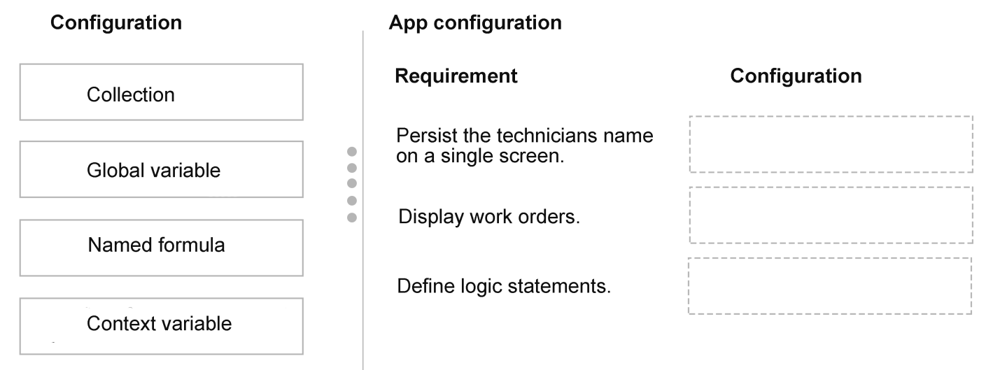

_DRAG DROP — the original ExamTopics question expects you to drag and drop items; the correct targets are not published._

**Most voted:**
1. Context Variable
2. Collections
3. Named Formula

### Top explanations
- **exam_upskill** (2 upvotes): 1. Context Variable
  2. Collections
  3. Named Formula
- **MeshMallow** (1 upvotes [Most Recent]): 1. Context variable: Stores values specific to a screen. Use it to retain the technician's name on a single screen.
  2. Collection: Stores data within the app's session. It can be used as the data source for a Gallery to display work orders.
  3. Named formula: Defines reusable Power Fx formulas at the app level. Values are recalculated automatically when their dependencies change.

## Q1.30 (ID 419367)

A company maintains an AI-enabled Power Platform solution that includes prompts, cloud flows, and Dataverse components. The solution is deployed to a production environment.
The company requires the following updates to the solution:
New features must be released regularly.
Updates must be validated before release.
Deployed updates must be able to be removed from production if necessary.
You need to update the solution while maintaining release control and following Microsoft best practices.
What should you do?

✅ **A.** Update the development environment. Deploy the solution as managed.
⭕ **B.** Update the development environment. Run solution checker.
⭕ **C.** Update the development environment. Deploy the solution as unmanaged.
⭕ **D.** Modify the development customizations file. Deploy to production.

**Correct answer:** A
**Most voted:** A

### Top explanations
- **exam_upskill** (3 upvotes [Selected Answer: A]): A. Update the development environment. Deploy the solution as managed.
- **MeshMallow** (1 upvotes [Most Recent, Selected Answer: A]): Update the development environment: All new features and customizations should be developed outside production.
  Deploy as a managed solution: Managed solutions are intended for downstream environments such as production.
  Remove updates if necessary: A managed solution can be uninstalled from production, removing its solution components.

## Q1.31 (ID 419375)

DRAG DROP
A company is designing a model-driven app for customer service representatives.
The app must:
Organize navigation into logical groupings based on business processes.
Ensure only required data is included in the app navigation.
You need to configure navigation and table availability.
Which actions should you perform? To answer, move the appropriate actions to the correct requirements. You may use each action once, more than once, or not at all. You may need to move the split bar between panes or scroll to view content.
NOTE: Each correct selection is worth one point.

**Exhibits**
- Exhibit 1: 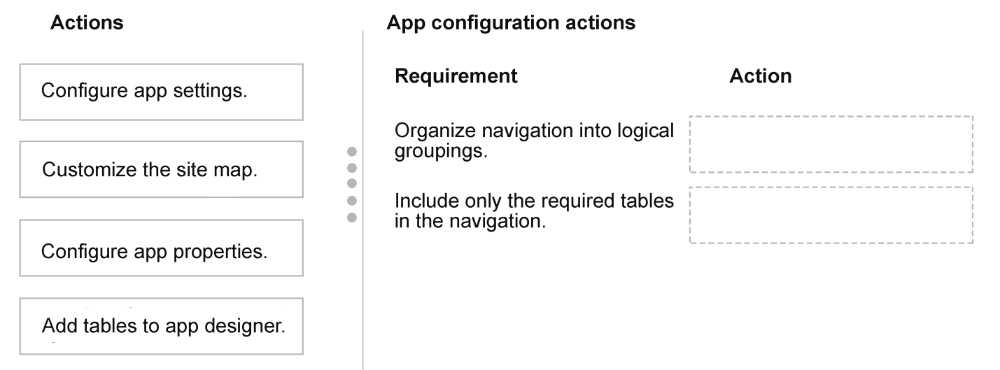

_DRAG DROP — the original ExamTopics question expects you to drag and drop items; the correct targets are not published._

**Most voted:**
1. Customize the site map
2. Add tables to app designer

### Top explanations
- **exam_upskill** (2 upvotes [Most Recent]): 1. Customize the site map
  2. Add tables to app designer

## Q1.32 (ID 419396)

HOTSPOT
A company deploys a model-driven app to multiple departments.
The company requires the following app functionality:
Enable users to open the app.
Determine why users cannot access the app.
You need to configure app access.
Which actions should you perform? To answer, select the appropriate options in the answer area.
NOTE: Each correct selection is worth one point.

**Exhibits**
- Exhibit 1: 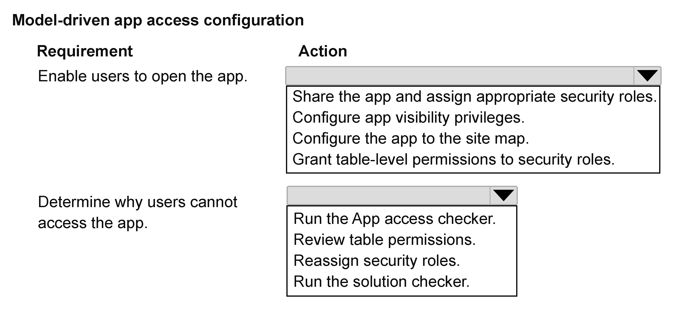

_HOTSPOT — the original ExamTopics question expects you to mark areas on the exhibit above; the correct hotspot coordinates are not published._

**Most voted:**
1. Share the app and assign appropriate security role
2. Run the App access checker

### Top explanations
- **exam_upskill** (2 upvotes [Most Recent]): 1. Share the app and assign appropriate security role
  2. Run the App access checker
- **FabiolaRT** (1 upvotes): https://learn.microsoft.com/en-us/power-apps/maker/model-driven-apps/app-access-checker

## Q1.33 (ID 419353)

HOTSPOT
You are configuring a dashboard in a model-driven app for sales managers. The dashboard displays opportunity pipeline data from the Opportunities table.
The company requires the following functionality:
Show how each sales stage contributes to the total pipeline for each sales region.
Ensure a newly created chart is available to users in the app.
Use the My Open Opportunities dataset when the dashboard component loads.
Prevent users from switching to a different chart at runtime.
You need to create and configure the chart and dashboard component.
How should you configure the requirements? To answer, select the appropriate options in the answer area.
NOTE: Each correct selection is worth one point.

**Exhibits**
- Exhibit 1: 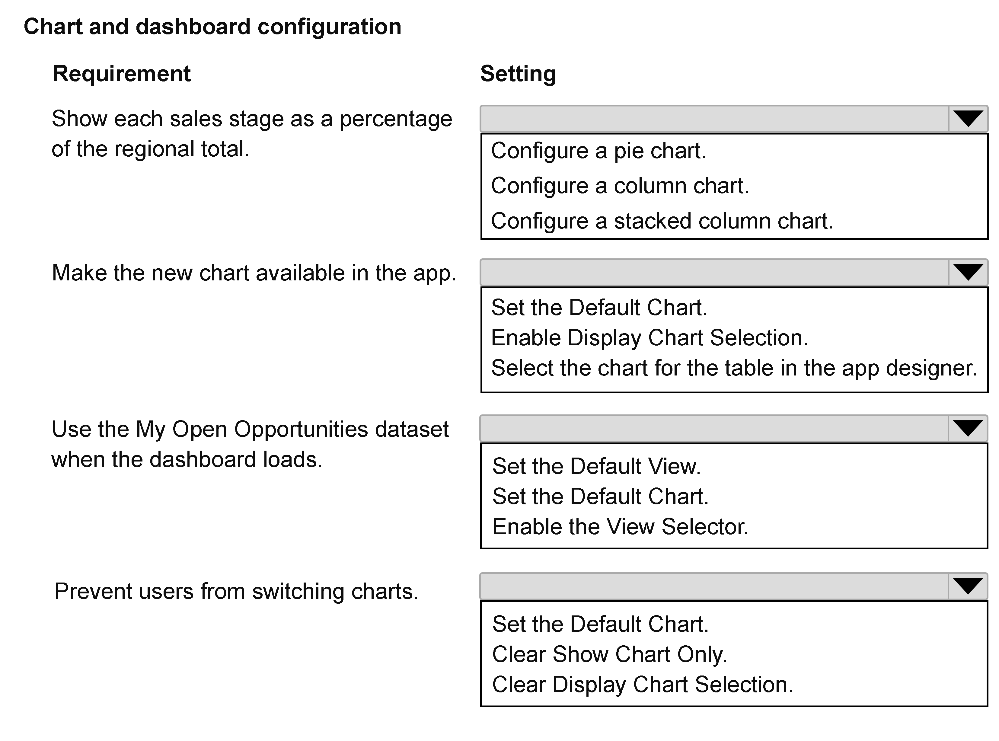

_HOTSPOT — the original ExamTopics question expects you to mark areas on the exhibit above; the correct hotspot coordinates are not published._

**Most voted:**
1. Configure a stacked column chart
2. Select the chart for the table in the app designer
3. Set the default View
4. Clear Display chart selection

### Top explanations
- **exam_upskill** (2 upvotes [Most Recent]): 1. Configure a stacked column chart
  2. Select the chart for the table in the app designer
  3. Set the default View
  4. Clear Display chart selection

## Q1.34 (ID 419395)

A company builds a canvas app to display and manipulate large datasets across multiple screens.
Users report the app takes a long time to load data when opened.
You need to optimize performance when the app is started.
What are three actions you can perform? Each correct answer presents a complete solution.
NOTE: Each correct selection is worth one point.

⭕ **A.** Move data transformation logic from the source to Power Fx.
✅ **B.** Remove data retrieval calls from the App.OnStart.
✅ **C.** Enable preloading in app settings.
✅ **D.** Use the Concurrent() function for data retrieval calls.
⭕ **E.** Use the ClearCollect() function to cache data.

**Correct answer:** B, C, D
**Most voted:** BCD

### Top explanations
- **exam_upskill** (3 upvotes [Most Recent, Selected Answer: BCD]): B. Remove data retrieval calls from the App.OnStart.
  C. Enable preloading in app settings.
  D. Use the Concurrent() function for data retrieval calls.

## Q1.35 (ID 419408)

HOTSPOT
A remote Power Apps user experiences an issue with a canvas app. The issue cannot be reproduced locally.
You must analyze the issue in near real-time. Session data must be available for later review.
You need to troubleshoot the canvas app by using Monitor.
How should you troubleshoot the app? To answer, select the appropriate options in the answer area.
NOTE: Each correct selection is worth one point.

**Exhibits**
- Exhibit 1: 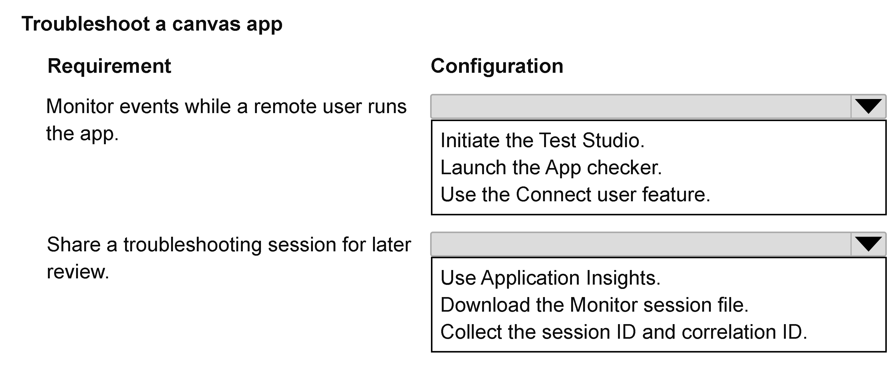

_HOTSPOT — the original ExamTopics question expects you to mark areas on the exhibit above; the correct hotspot coordinates are not published._

**Most voted:**
- 1: Use the Connect user feature
- 2: Download the Monitor session file

### Top explanations
- **ah2006** (1 upvotes [Most Recent]): 1: Use the Connect user feature
  2: Download the Monitor session file

## Q1.36 (ID 419387)

You are building a model-driven app that uses a Microsoft Dataverse table named Accounts. Sales representatives use the app to manage customer records.
Sales representatives report that too many records are displayed, including inactive and unrelated accounts where the sales representative isn't the record owner.
You need to ensure only relevant records are displayed for the users.
What are two ways to complete the goal? Each correct answer presents a complete solution.
NOTE: Each correct selection is worth one point.

⭕ **A.** Define view columns.
⭕ **B.** Configure app settings.
✅ **C.** Apply security roles to restrict view access.
⭕ **D.** Configure record status columns.
✅ **E.** Configure view filters.

**Correct answer:** C, E
**Most voted:** CE

### Top explanations
- **exam_upskill** (2 upvotes [Most Recent, Selected Answer: CE]): C. Apply security roles to restrict view access.
  E. Configure view filters.

## Q1.37 (ID 419382)

A company is building a canvas app that spans multiple screens.
The app must store selected values across screens and hold tabular data during a session.
You need to manage application state.
Which two components should you use? Each correct answer presents part of the solution.
NOTE: Each correct selection is worth one point.

✅ **A.** collections
⭕ **B.** context variables
⭕ **C.** data sources
✅ **D.** global variables

**Correct answer:** A, D
**Most voted:** AD

### Top explanations
- **exam_upskill** (3 upvotes [Most Recent, Selected Answer: AD]): A. Collections
  D. Global variables

## Q1.38 (ID 419376)

An accounting team is assigned to a model-driven app to manage financial data.
The app is currently visible in the app launcher but inaccessible to the accounting team.
Users must be able to:
Open the app.
Access and record financial data.
You need to resolve the access issues.
What should you do?

⭕ **A.** Configure app visibility privileges for the users.
⭕ **B.** Set the app as the default app for the users.
✅ **C.** Assign users the appropriate security roles.
⭕ **D.** Grant the users table-level permissions to the required tables.

**Correct answer:** C
**Most voted:** C

### Top explanations
- **exam_upskill** (2 upvotes [Most Recent, Selected Answer: C]): C. Assign users the appropriate security roles.

## Q1.39 (ID 419403)

A company is implementing uniform data validation across multiple forms.
The company has the following business logic requirements:
Enforce validation across multiple forms.
Minimize logic duplication.
You need to implement business logic.
What are three approaches you can use? Each correct answer presents a complete solution. (Choose three.)
NOTE: Each correct selection is worth one point.

✅ **A.** Business rules
✅ **B.** Power Fx functions
⭕ **C.** Automated cloud flows
✅ **D.** Client scripting
⭕ **E.** Instant cloud flows

**Correct answer:** A, B, D
**Most voted:** ABD

### Top explanations
- **exam_upskill** (2 upvotes [Most Recent, Selected Answer: ABD]): A. Business rules
  B. Power Fx functions
  D. Client scripting
- **aed747e** (2 upvotes [Selected Answer: ABD]): Business rules, Power Fx functions, and client scripting enable real-time, reusable form validation across interfaces without code duplication. Conversely, automated and instant cloud flows execute asynchronously in the background, making them unsuitable for immediate user-interface validation during form submission.

## Q1.40 (ID 419386)

DRAG DROP
A company is creating a canvas app and a model-driven app to manage their customer accounts.
The canvas app requires a business rule to set the Business Type column to large if the customer size is greater than a specific currency value.
The model-driven app requires a business rule to recommend the account rating be re-evaluated when the account goes on credit hold for this app only.
You need to configure the scope for the business rules.
Which scope should you use? To answer, drag the appropriate scopes to the correct business rules. Each scope may be used once, more than once, or not at all. You may need to drag the split bar between panes or scroll to view content.
NOTE: Each correct selection is worth one point.

**Exhibits**
- Exhibit 1: 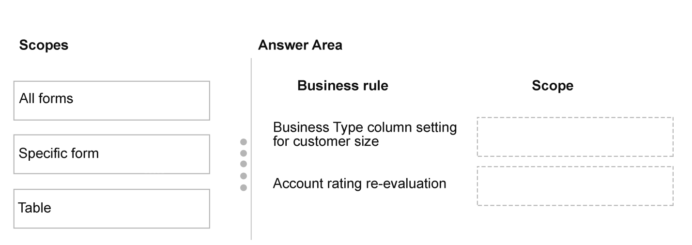

_DRAG DROP — the original ExamTopics question expects you to drag and drop items; the correct targets are not published._

**Most voted:**
1. Table
2. Specific form

### Top explanations
- **exam_upskill** (3 upvotes [Most Recent]): 1. Table
  2. Specific form
- **aed747e** (1 upvotes): For Dataverse Business Rules, Canvas Apps require the Table scope to execute server-side logic, whereas Model-driven Apps can use the Specific form scope to restrict client-side logic to a single form.

## Q1.41 (ID 419370)

Background
Fabrikam Inc. is an energy provider that operates wind and solar farms across multiple countries and regions. The company uses Microsoft Power Platform to manage asset maintenance, technician workflows, and predictive analytics.
Field technicians use canvas apps on mobile devices to capture inspection and repair data. Operations managers use model-driven apps to monitor asset performance and maintenance history.
The company plans to enhance its platform by introducing AI-driven insights, improving reuse across applications, and establishing a formal application lifecycle management (ALM) strategy.
Current environment
Applications
Field technicians use an outdated mobile app to log maintenance activities and capture asset readings in SharePoint Online.
Operations managers use a model-driven app to review maintenance records and asset performance trends.
Development practices
Developers build and modify applications directly in the production environment.
There is NO structured ALM process.
Solutions are NOT consistently used to package or deploy application components.
Reusable components are inconsistently implemented across apps, leading to duplication.
AI integration
Fabrikam Inc. plans to actively explore generative AI usage as part of the next phase of work.
Business requirement
Application development
The outdated mobile app must be replaced with a new app that supports responsive design principles, provides full control over the UI, and allows technicians to take and upload photos directly from their mobile devices.
The new app for the field technicians requires the name of the technician to be persisted on the home screen only. In addition, work orders must be displayed within a gallery.
All new apps must connect to a scalable, cloud-based relational data store.
Apps must support efficient data entry for technicians in the field.
Reusable UI elements must be implemented to reduce duplication.
AI capabilities
The company requires a generative AI solution to manage customer complaint responses and create custom inspection reports that align to an existing template.
Customer complaint responses must be generated in applications and based on emails being sent to a mailbox.
Custom AI development must be minimized.
Generative AI reusability
Generative AI solutions must accept dynamic inputs to adapt to different scenarios.
Generative AI solutions must be reusable across different Power Platform services.
Extensibility
Custom UI form components must be reusable across applications.
Use of server-side custom code must be minimized where possible.
Technical requirements
Application lifecycle management (ALM)
Separate environments must be used for development, testing, and production.
Solutions must be used to package application components, segmented based on functional areas.
Managed solutions must be deployed to the production environment.
Validation must occur before deployment to production.
Data processing
Aggregated values across related rows must be displayed for reporting.
Calculations must update automatically as new data is entered. Calculation data must be limited to a maximum length of 10.
Issues
Duplicate logic exists across multiple canvas apps.
Developers frequently overwrite changes in production.
Generative AI solutions produce inconsistent outputs due to missing or inconsistent inputs.
Maintenance metrics are not consistently calculated across related rows.
You need to configure the generative AI reusability requirements.
What should you do?

✅ **A.** Use an input variable.
⭕ **B.** Call the prompt from a Power Automate cloud flow.
⭕ **C.** Output results as JSON.
⭕ **D.** Call the prompt from a canvas app.

**Correct answer:** A
**Most voted:** A

### Top explanations
- **exam_upskill** (2 upvotes [Most Recent, Selected Answer: A]): A. Use an input variable.
- **7e4a230** (2 upvotes [Selected Answer: A]): Input variables allow an AI Builder prompt to receive dynamic runtime content, making the same prompt adaptable to different complaints, inspections, users, or applications. Saved prompts can then be reused from Power Apps, Power Automate, Copilot Studio, and other Power Platform components.
  B and D describe where the prompt is called, but do not configure its reusability.
  C structures the response but does not provide dynamic input.
- **Daeon** (2 upvotes [Selected Answer: A]): simply calling the prompt does not configure it to "accept dynamic inputs to adapt to different scenarios." Without first creating the input variable itself, the prompt would remain static and produce identical outputs regardless of where it is called from.

## Q1.42 (ID 419389)

Background
Fabrikam Inc. is an energy provider that operates wind and solar farms across multiple countries and regions. The company uses Microsoft Power Platform to manage asset maintenance, technician workflows, and predictive analytics.
Field technicians use canvas apps on mobile devices to capture inspection and repair data. Operations managers use model-driven apps to monitor asset performance and maintenance history.
The company plans to enhance its platform by introducing AI-driven insights, improving reuse across applications, and establishing a formal application lifecycle management (ALM) strategy.
Current environment
Applications
Field technicians use an outdated mobile app to log maintenance activities and capture asset readings in SharePoint Online.
Operations managers use a model-driven app to review maintenance records and asset performance trends.
Development practices
Developers build and modify applications directly in the production environment.
There is NO structured ALM process.
Solutions are NOT consistently used to package or deploy application components.
Reusable components are inconsistently implemented across apps, leading to duplication.
AI integration
Fabrikam Inc. plans to actively explore generative AI usage as part of the next phase of work.
Business requirement
Application development
The outdated mobile app must be replaced with a new app that supports responsive design principles, provides full control over the UI, and allows technicians to take and upload photos directly from their mobile devices.
The new app for the field technicians requires the name of the technician to be persisted on the home screen only. In addition, work orders must be displayed within a gallery.
All new apps must connect to a scalable, cloud-based relational data store.
Apps must support efficient data entry for technicians in the field.
Reusable UI elements must be implemented to reduce duplication.
AI capabilities
The company requires a generative AI solution to manage customer complaint responses and create custom inspection reports that align to an existing template.
Customer complaint responses must be generated in applications and based on emails being sent to a mailbox.
Custom AI development must be minimized.
Generative AI reusability
Generative AI solutions must accept dynamic inputs to adapt to different scenarios.
Generative AI solutions must be reusable across different Power Platform services.
Extensibility
Custom UI form components must be reusable across applications.
Use of server-side custom code must be minimized where possible.
Technical requirements
Application lifecycle management (ALM)
Separate environments must be used for development, testing, and production.
Solutions must be used to package application components, segmented based on functional areas.
Managed solutions must be deployed to the production environment.
Validation must occur before deployment to production.
Data processing
Aggregated values across related rows must be displayed for reporting.
Calculations must update automatically as new data is entered. Calculation data must be limited to a maximum length of 10.
Issues
Duplicate logic exists across multiple canvas apps.
Developers frequently overwrite changes in production.
Generative AI solutions produce inconsistent outputs due to missing or inconsistent inputs.
Maintenance metrics are not consistently calculated across related rows.
You need to provide a solution for field technicians to create custom inspection reports natively within the new app.
What should you do?

⭕ **A.** Use a paginated report.
⭕ **B.** Create a Word template.
✅ **C.** Use a custom prompt.

**Correct answer:** C
**Most voted:** C

### Top explanations
- **exam_upskill** (3 upvotes [Most Recent, Selected Answer: C]): C. Use a custom prompt.
- **Online** (1 upvotes [Selected Answer: B]): The company requires a generative AI solution to manage customer complaint responses and create custom inspection reports that align to an existing template.
- **aed747e** (1 upvotes [Selected Answer: C]): To create custom inspection reports natively within the app, use an AI Builder custom prompt. This satisfies Fabrikam's generative AI requirement by using natural language instructions and dynamic inputs to structure report content natively within the Canvas App.
- **sanjaybhandekar** (1 upvotes [Selected Answer: B]): For field technicians to create custom inspection reports natively within the Power Platform app, a Word template is the appropriate choice.

## Q1.43 (ID 419414)

A company plans to implement an automated process to retrieve and analyze customer feedback.
The company requires a solution that:
Autonomously analyzes feedback.
Stores results for reporting.
Triggers an escalation for negative sentiment.
You need to design the solution.
Which three components should you use? Each correct answer presents part of the solution. (Choose three.)
NOTE: Each correct selection is worth one point.

✅ **A.** AI builder prompt
✅ **B.** Cloud flow
⭕ **C.** Canvas app
⭕ **D.** Business rule
✅ **E.** Dataverse table

**Correct answer:** A, B, E
**Most voted:** ABE

### Top explanations
- **exam_upskill** (2 upvotes [Most Recent, Selected Answer: ABE]): A. AI builder prompt
  B. Cloud flow
  E. Dataverse table
- **aed747e** (2 upvotes [Selected Answer: ABE]): An AI Builder prompt autonomously analyzes customer feedback sentiment, while a Cloud flow orchestrates the end-to-end automation and triggers escalation workflows. Finally, a Dataverse table securely stores the generated analysis results for enterprise reporting.

## Q1.44 (ID 419372)

A company is using Microsoft Dataverse.
You must integrate Dataverse with a third-party AI service. The solution requires authentication and custom request handling to send and receive data.
You need to enable the integration.
What should you do?

⭕ **A.** Use Power Fx.
✅ **B.** Create a custom connector.
⭕ **C.** Use Microsoft 365 Copilot chat.
⭕ **D.** Configure an environment variable.

**Correct answer:** B
**Most voted:** B

### Top explanations
- **Daeon** (4 upvotes [Selected Answer: B]): Copilot chat is an end-user interface designed for conversational assistance and productivity. It is not an integration or development tool used to orchestrate custom backend API handshakes.
- **exam_upskill** (2 upvotes [Most Recent, Selected Answer: B]): B. Create a custom connector.
- **sanjaybhandekar** (1 upvotes [Selected Answer: B]): Why?
  A custom connector is designed to integrate Power Platform with a third-party API/AI service, especially when you need:
  Authentication configuration.
  Custom HTTP/API request and response handling.
  A reusable connection that can be consumed by Power Automate, Power Apps, and other Power Platform services.

## Q1.45 (ID 419383)

A company uses a Dataverse table to manage support cases.
You must provide employees with a summary of case information derived from multiple columns without requiring a manual review of the data.
The solution has the following requirements:
Generate a case summary following the given instructions.
Include the context of the current record in the generated output.
You need to configure the solution.
Which two actions should you perform? Each correct answer presents part of the solution.
NOTE: Each correct selection is worth one point.

✅ **A.** Define a prompt that references the case fields.
⭕ **B.** Configure a formula column to generate the response text.
⭕ **C.** Configure a business rule to populate the field automatically.
✅ **D.** Create the column by using the prompt data type.

**Correct answer:** A, D
**Most voted:** AD

### Top explanations
- **exam_upskill** (2 upvotes [Most Recent, Selected Answer: AD]): A. Define a prompt that references the case fields.
  D. Create the column by using the prompt data type.

## Q1.46 (ID 419409)

A company is designing an AI-enabled solution to help employees review and evaluate customer requests.
The company requires an AI summary to be generated at runtime by using instructions provided by the company, including tone, structure, and required data fields. The Prompt control will use these instructions on Power Apps forms across multiple tables.
You need to store the instructions.
Which component should you use?

✅ **A.** AI Builder custom prompt
⭕ **B.** Power Platform AI model
⭕ **C.** Dataverse prompt column
⭕ **D.** Dataverse business rule

**Correct answer:** A
**Most voted:** A

### Top explanations
- **aed747e** (2 upvotes [Selected Answer: A]): An AI Builder custom prompt centralizes instructions, tone, and dynamic variables as a reusable environment-level asset. This allows the Prompt control in Power Apps forms to execute the prompt dynamically across multiple Dataverse tables, unlike table-bound prompt columns.
- **exam_upskill** (1 upvotes [Most Recent, Selected Answer: A]): A. AI Builder custom prompt

## Q1.47 (ID 419366)

A company has a product report in PDF format. The report must be rewritten with formal vocabulary and cadence.
The company requires a prompt that can be used within a canvas app to rewrite the report as a Word document. The prompt must reference a business glossary stored in a SharePoint site.
You need to make a suggestion for the expectations portion of the prompt to generate a report summary correctly.
What should you suggest?

✅ **A.** The summary should highlight key themes, product features, and recurring feedback.
⭕ **B.** Use the PDF and the business glossary stored in the SharePoint site.
⭕ **C.** Format the summary as a list of bullet points, which should be clear and use short sentences.
⭕ **D.** Create a Microsoft Word document summary.

**Correct answer:** A
**Most voted:** A

### Top explanations
- **exam_upskill** (2 upvotes [Most Recent, Selected Answer: A]): A. The summary should highlight key themes, product features, and recurring feedback.

## Q1.48 (ID 419404)

A company is building prompts in Microsoft Copilot Studio to support multiple customer service scenarios.
The company requires prompts to:
Follow a consistent structure across use cases.
Be reusable across multiple topics.
Allow customization for different types of customer requests.
You need to build the prompts.
What should you do?

⭕ **A.** Configure prompt model settings to standardize response behavior across scenarios.
⭕ **B.** Store prompt text in variables and reuse the variables across topics.
⭕ **C.** Create prompts directly within each topic by using custom instructions for each scenario.
✅ **D.** Create prompts by selecting templates from the prompt library and customizing them for each scenario.

**Correct answer:** D
**Most voted:** D

### Top explanations
- **exam_upskill** (2 upvotes [Most Recent, Selected Answer: D]): D. Create prompts by selecting templates from the prompt library and customizing them for each scenario.
- **exam_upskill** (1 upvotes [Selected Answer: D]): D. Create prompts by selecting templates from the prompt library and customizing them for each scenario.

## Q1.49 (ID 419401)

DRAG DROP
A company uses a business process flow to manage case resolution.
The business process flow has the following requirements:
Users must complete required data before progressing to the next stage.
Before exiting a stage, a background process must create an approval, assign it to the record owner, and send the approval by using Microsoft Teams.
Mandatory data entry enforcement must be part of only the business process flow itself.
You need to enforce the stage progression requirements.
How should you configure the business process flow? To answer, move the appropriate configurations to the correct requirements. You may use each configuration once, more than once, or not at all. You may need to move the split bar between panes or scroll to view content.
NOTE: Each correct selection is worth one point.

**Exhibits**
- Exhibit 1: 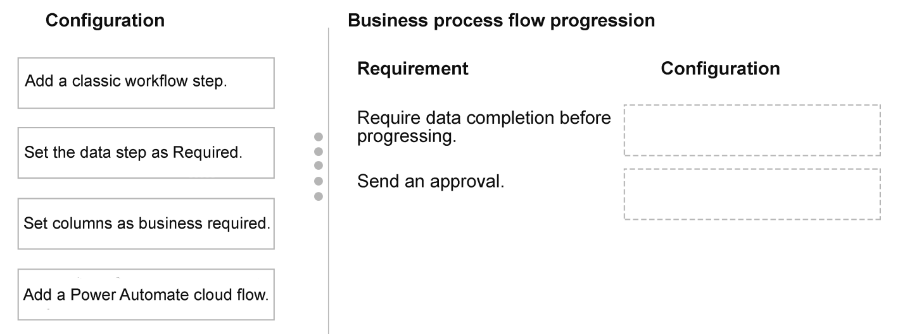

_DRAG DROP — the original ExamTopics question expects you to drag and drop items; the correct targets are not published._

**Most voted:**
- Require data completion before progressing: Set the data step as Required, so users must enter the required data before moving to the next stage.
- Send an approval: Add a classic workflow step, because an on-demand workflow can be triggered specifically when the user exits the BPF stage

### Top explanations
- **ah2006** (1 upvotes [Most Recent]): 1. Require data completion before progressing: Set the data step as Required, so users must enter the required data before moving to the next stage.
  2. Send an approval: Add a classic workflow step, because an on-demand workflow can be triggered specifically when the user exits the BPF stage
- **exam_upskill** (1 upvotes): 1. Set the data step as required.
  2. Add a Power Automate cloud flow

## Q1.50 (ID 419360)

A company uses a model-driven app to enforce data quality standards.
The company requires the following app functionality:
Ensure users enter a value in a specific column when a condition is met.
Prevent users from saving the record until they complete the field.
The solution must be implemented without using code or automation.
You need to configure a business rule to meet the requirements.
What should you do?

⭕ **A.** Show a recommendation.
⭕ **B.** Set field visibility.
⭕ **C.** Set a default value.
✅ **D.** Set the requirement level.

**Correct answer:** D
**Most voted:** D

### Top explanations
- **exam_upskill** (2 upvotes [Most Recent, Selected Answer: D]): D. Set the requirement level.

## Q1.51 (ID 419355)

A company uses Dataverse to configure derived values for sales records.
The company requires the following functionality:
Evaluate an expression by using numerical columns in the same row.
Calculate the result dynamically when accessed.
Ensure the result is NOT stored as part of the table data.
The solution must minimize use of custom code.
You need to configure the app.
What should you do?

✅ **A.** Create a formula column.
⭕ **B.** Use a real-time workflow to update the value.
⭕ **C.** Use a business rule to populate the value.
⭕ **D.** Use a plugin to calculate.

**Correct answer:** A
**Most voted:** A

### Top explanations
- **ah2006** (1 upvotes [Most Recent, Selected Answer: A]): Formula column

## Q1.52 (ID 419415)

A company builds a canvas app for support agents to enter customer notes and generate a summarized response by using a custom prompt.
The company requires the following functionality built into the prompt:
Generate the summary immediately when the agent selects a button in the app.
Supply current user-entered data to the prompt.
You need to execute the prompt.
Which two actions should you perform? Each correct answer presents part of the solution.
NOTE: Each correct selection is worth one point.

⭕ **A.** Run the prompt through a cloud flow from the button.
✅ **B.** Pass user input as parameters to the prompt.
✅ **C.** Invoke the prompt directly from app logic.
⭕ **D.** Publish the prompt for reuse in the environment.
⭕ **E.** Update the app settings.

**Correct answer:** B, C
**Most voted:** BC

### Top explanations
- **exam_upskill** (3 upvotes [Most Recent, Selected Answer: BC]): B. Pass user input as parameters to the prompt.
  C. Invoke the prompt directly from app logic.

## Q1.53 (ID 419362)

HOTSPOT
A company runs Power Automate cloud flows in production.
You observe many duplicate executions and 401 error codes when you review the flow runs.
You need to resolve the errors.
How should you address each error? To answer, select the appropriate options in the answer area.
NOTE: Each correct selection is worth one point.

**Exhibits**
- Exhibit 1: 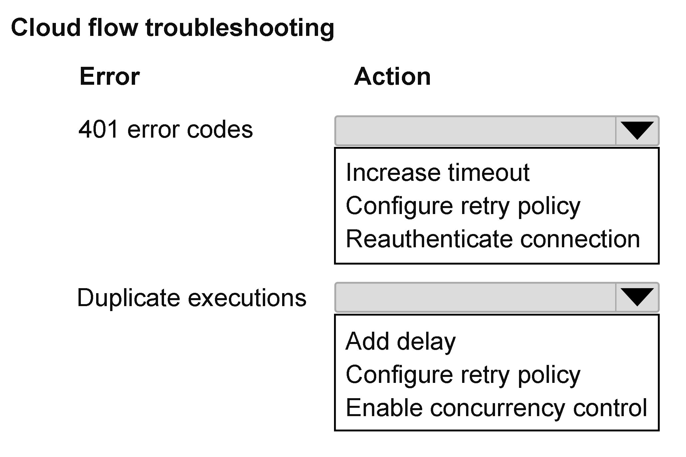

_HOTSPOT — the original ExamTopics question expects you to mark areas on the exhibit above; the correct hotspot coordinates are not published._

**Most voted:**
1. Reauthenticate connection
2. Enable concurrency control

### Top explanations
- **exam_upskill** (2 upvotes [Most Recent]): 1. Reauthenticate connection
  2. Enable concurrency control

## Q1.54 (ID 419371)

A company uses a Power Automate cloud flow to manage purchase approvals. Purchase orders will always be approved, rejected, or marked as escalated to a manager.
The company has the following requirements:
Multiple approvers must be included in each approval request.
Once approved, an email must be sent to the purchasing team that confirms the outcome.
The flow must not wait for remaining approvers after a decision is reached.
You need to configure the approval.
Which three configurations should you use? Each correct answer presents part of the solution.
NOTE: Each correct selection is worth one point.

⭕ **A.** Configure the approval type as Approve/Reject - First to respond.
⭕ **B.** Create separate approval actions for each approver in parallel branches.
✅ **C.** Configure the approval type as Custom Responses - Wait for one response.
✅ **D.** Evaluate the approval outcome by using a condition.
✅ **E.** Assign multiple approvers in a single approval action.

**Correct answer:** C, D, E
**Most voted:** CDE

### Top explanations
- **aed747e** (3 upvotes [Selected Answer: CDE]): To support custom choices like escalating to a manager while continuing upon the first response, use Custom Responses - Wait for one response. Assign multiple approvers in a single action and evaluate the outcome using a Condition to send confirmation emails.
- **exam_upskill** (1 upvotes [Most Recent, Selected Answer: CDE]): C. Configure the approval type as Custom Responses - Wait for one response.
  D. Evaluate the approval outcome by using a condition.
  E. Assign multiple approvers in a single approval action.

## Q1.55 (ID 419397)

A company uses a prompt to generate responses based on internal support knowledge.
The company requires the prompt to minimize generation of unsupported and incorrect information while ensuring responses remain useful.
You need to tune the prompt model settings.
How should you configure the model settings?

⭕ **A.** Decrease the content moderation level.
⭕ **B.** Increase the content moderation level.
✅ **C.** Decrease the temperature.
⭕ **D.** Increase the temperature.

**Correct answer:** C
**Most voted:** C

### Top explanations
- **aed747e** (3 upvotes [Selected Answer: C]): To minimize unsupported or incorrect information, decrease the temperature setting. Lowering the temperature makes the AI model more deterministic and conservative, forcing it to generate factual responses strictly based on the provided internal support knowledge.
- **exam_upskill** (1 upvotes [Most Recent, Selected Answer: C]): C. Decrease the temperature.

## Q1.56 (ID 419380)

DRAG DROP
A company processes transaction records by using a Power Automate cloud flow.
The company has the following requirements:
Continue processing records until a status field changes to Complete, even if new records are added during execution.
Process a fixed list of records retrieved at the start of the flow, ensuring each record is processed exactly once.
You need to configure the flow control logic.
Which controls should you use? To answer, move the appropriate controls to the correct requirements. You may use each control once, more than once, or not at all. You may need to move the split bar between panes or scroll to view content.
NOTE: Each correct selection is worth one point.

**Exhibits**
- Exhibit 1: 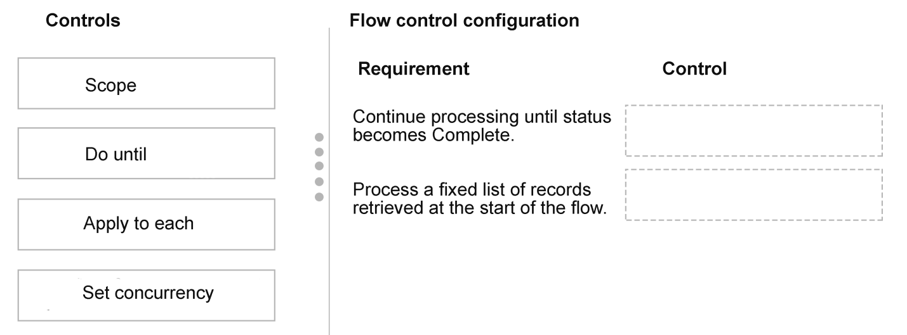

_DRAG DROP — the original ExamTopics question expects you to drag and drop items; the correct targets are not published._

**Most voted:**
1. Do until
2. Apply to each

### Top explanations
- **aed747e** (2 upvotes): Use a Do until loop to continuously process records until a dynamic condition (status = Complete) evaluates to true. Use an Apply to each loop to iterate over a fixed, pre-retrieved array of records, ensuring every record in the initial dataset is executed exactly once.
- **exam_upskill** (1 upvotes [Most Recent]): 1. Do until
  2. Apply to each
- **seoyeon_01** (1 upvotes): Why is this considered the correct answer? Any explanation would help.

## Q1.57 (ID 419390)

HOTSPOT
A company processes customer orders by using a cloud flow.
The flow must evaluate the following conditions:
Route orders for approval when the OrderTotal exceeds 1,000.
Flag orders when the CustomerName identifies the string “VIP”.
You need to configure flow conditions.
Which expressions should you use? To answer, select the appropriate options in the answer area.
NOTE: Each correct selection is worth one point.

**Exhibits**
- Exhibit 1: 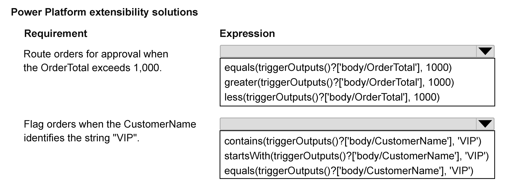

_HOTSPOT — the original ExamTopics question expects you to mark areas on the exhibit above; the correct hotspot coordinates are not published._

**Most voted:**
1. Greater()
2. Contains()

### Top explanations
- **aed747e** (2 upvotes): Use the greater() expression function to verify if OrderTotal exceeds 1,000. Use the contains() expression function to check if the substring "VIP" is present anywhere within the CustomerName string.
- **exam_upskill** (1 upvotes [Most Recent]): 1. Greater()
  2. Contains()

## Q1.58 (ID 419378)

DRAG DROP
You are modifying a model-driven app. You set up a customer table in Microsoft Power Platform to retrieve user data.
You set up a form with the following columns for users to enter their data. The form includes the following columns:
The form must do the following:
The Country/region column must automatically populate with US when English is chosen as a language. If the user selects Other for this column, the column must remain blank so that user can enter a value.
The Passport expiration date column must appear only if the user selects Yes in the Passport ownership column.
You need to configure the app with the least amount of effort.
What should you configure? To answer, drag the appropriate solution component to the correct requirements. Each solution component may be used once, more than once, or not at all. You may need to drag the split bar between panes or scroll to view content.
NOTE: Each correct selection is worth one point.

**Exhibits**
- Exhibit 1: 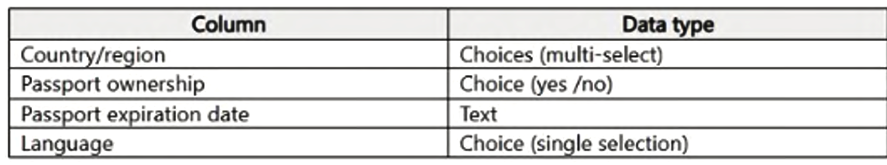
- Exhibit 2: 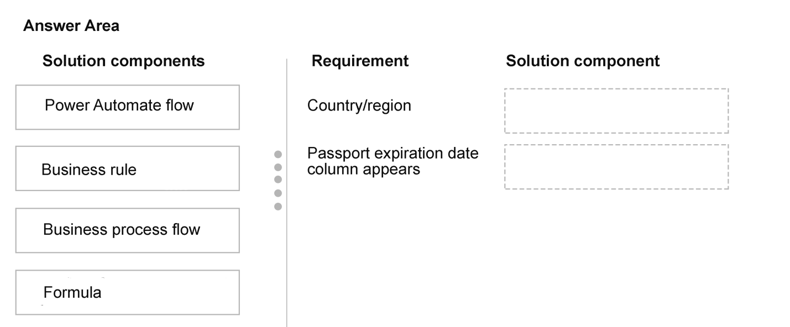

_DRAG DROP — the original ExamTopics question expects you to drag and drop items; the correct targets are not published._

**Most voted:**
1. Power Automate Flow
2. Business rule

### Top explanations
- **Daeon** (6 upvotes): Country/region can't be Business rule as business rules can't set multi-choice columns. Only component that is able to do this is Power Automate flow.
- **exam_upskill** (1 upvotes [Most Recent]): 1. Power Automate Flow
  2. Business rule
- **FabiolaRT** (1 upvotes): However, the "Language" column never mentions that it is multi-choice. So "Business rule" is the answer.
  If  the "Language" column is anything other than "English" set blank. Otherwise it is "English" set "US"

## Q1.59 (ID 419411)

A company uses Microsoft Dataverse to store customer records on the Account table. A business process flow is configured for the table.
The company requires a Power Automate cloud flow that validates and corrects the format of the customer account number. The Power Automate flow must run whenever data in this field changes.
You need to recommend a trigger for the cloud flow.
Which trigger should you recommend?

⭕ **A.** When a row is selected
⭕ **B.** When a flow step is run from a business process flow
⭕ **C.** When an action is performed
✅ **D.** When a row is added, modified or deleted

**Correct answer:** D
**Most voted:** D

### Top explanations
- **exam_upskill** (2 upvotes [Most Recent, Selected Answer: D]): D. When a row is added, modified or deleted

## Q1.60 (ID 419359)

DRAG DROP
A company uses a cloud flow to process customer records in Dataverse.
The flow must:
Retrieve a customer record.
Store the customer email address for later use.
Use the stored value in an email action.
You need to configure flow actions.
Which four actions should you perform in sequence? To answer, move the appropriate actions from the list of actions to the answer area and arrange them in the correct order.
NOTE: More than one order of answer choices is correct. You will receive credit for any of the correct orders you select.

**Exhibits**
- Exhibit 1: 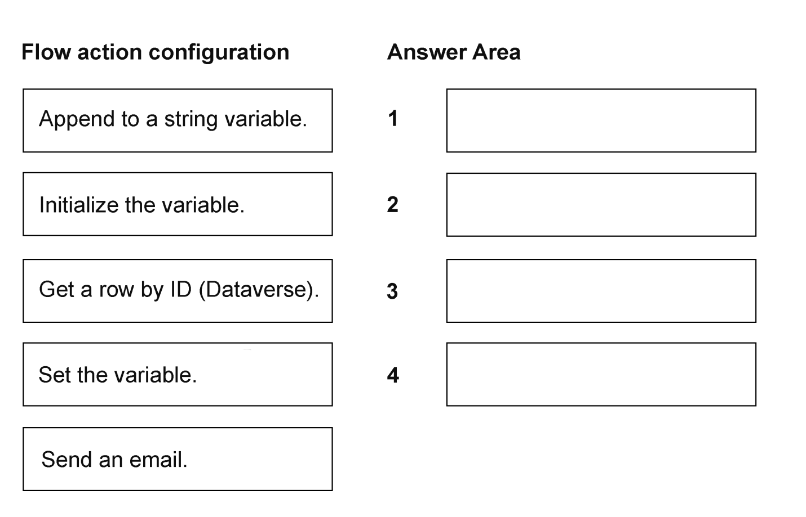

_DRAG DROP — the original ExamTopics question expects you to drag and drop items; the correct targets are not published._

**Most voted:**
1. Get a row by ID (Dataverse)
2. Initialize the variable
3. Set the Variable
4. Send an email

### Top explanations
- **exam_upskill** (2 upvotes [Most Recent]): 1. Get a row by ID (Dataverse)
  2. Initialize the variable
  3. Set the Variable
  4. Send an email

## Q1.61 (ID 419412)

A company uses a cloud flow to analyze incoming order form PDFs attached to emails.
The cloud flow must use an AI model to extract information from each order. The information must then be added to the enterprise resource planning (ERP) system.
You need to configure the flow.
Which two actions should you perform? Each correct answer presents part of the solution.
NOTE: Each correct selection is worth one point.

⭕ **A.** Add the Extract standard entities action.
⭕ **B.** Specify the language and text.
✅ **C.** Specify the model, document type, and document.
⭕ **D.** Add the Classify into standard categories action.
✅ **E.** Add the Process documents action.

**Correct answer:** C, E
**Most voted:** CE

### Top explanations
- **exam_upskill** (2 upvotes [Most Recent, Selected Answer: CE]): C. Specify the model, document type, and document.
  E. Add the Process documents action.

## Q1.62 (ID 419399)

A company builds a canvas app that processes images submitted by users and must classify them using an existing AI Builder model.
The app must generate predictions during user interaction.
You need to consume the AI model natively.
What should you do?

✅ **A.** Invoke the model by using Power Fx.
⭕ **B.** Replace the model with a static formula.
⭕ **C.** Refine the model with additional images.
⭕ **D.** Export the solution which contains the model.

**Correct answer:** A
**Most voted:** A

### Top explanations
- **freshbt** (1 upvotes [Most Recent, Selected Answer: A]): A. Invoke the model by using Power Fx directly from the app.

## Q1.68 (ID 419410)

A company uses Dataverse to configure derived values for sales records.
The company requires the following functionality:
Evaluate an expression by using numerical columns in the same row.
Calculate the result dynamically when accessed.
Ensure the result is NOT stored as part of the table data.
The solution must minimize use of custom code.
You need to configure the app.
What should you do?

⭕ **A.** Use a business rule to populate the value.
⭕ **B.** Create a JavaScript function.
⭕ **C.** Configure a dataflow.
✅ **D.** Create a calculated column.

**Correct answer:** D
**Most voted:** D

### Top explanations
- **exam_upskill** (1 upvotes [Most Recent, Selected Answer: D]): D. Create a calculated column.

## Q1.69 (ID 419400)

A company is using Microsoft Dataverse.
You must integrate Dataverse with a third-party AI service. The solution requires authentication and custom request handling to send and receive data.
You need to enable the integration.
What should you do?

⭕ **A.** Configure an environment variable.
⭕ **B.** Use an AI Builder model.
✅ **C.** Create a custom connector.
⭕ **D.** Use a classic workflow.

**Correct answer:** C
**Most voted:** C

### Top explanations
- **exam_upskill** (1 upvotes [Most Recent, Selected Answer: C]): C. Create a custom connector.

## Q1.70 (ID 433197)

Background
Contoso Ltd. is a global renewable energy provider that operates wind farms and solar installations. The company is modernizing its maintenance and operations platform. The company plans to implement a Microsoft Power Platform solution for the operations team. The implementation will include Microsoft Dataverse, a model-driven app, and Power Automate cloud flows.
The company is building and testing a new model-driven app named Operations. The solution will support operations managers, regional coordinators, and field technicians. The app must integrate with an external cloud-based system that manages onboarding of field technicians.
Contoso Ltd. plans to improve data quality and enforce consistent business logic across the app and automation processes.
Technical environment
Contoso Ltd. has an Identity and Access Management (IDAM) department that manages security. The company has one Power Platform environment named Production, where all building and configuration take place. Auditing is disabled.
The Production environment has the following security configurations:
•	IDAM has a Microsoft Entra security group named Contoso Ltd. QA. This security group will assign all members a Power Apps license.
•	IDAM created a Quality Assurance security role that grants read and write access to all custom tables.
•	IDAM also created a team named Testers in Dataverse, of a Microsoft Entra group team type. The team is configured for the Contoso Ltd. QA security group. The Testers team is assigned the Quality Assurance security role.
Microsoft 365 environment:
All Contoso Ltd. managers are included in a Microsoft 365 group named Managers. The group is NOT enabled for email.
The company shares a SharePoint list with a key customer: Alpine Ski House. Alpine Ski House staff members can add new maintenance requests, which are then checked and marked as reviewed by Contoso Ltd.
Current issue:
A new QA tester joins Contoso Ltd. The IDAM department adds the new tester to the Contoso Ltd. QA security group. However, the new tester is not listed in the Testers team as a member.
Other applications:
A separate software-as a-service (SaaS) solution named TechCheck manages technician onboarding. The TechCheck solution is set up as follows:
•	TechCheck assigns a unique number named Ref to all technicians.
•	Users cannot make changes to the TechCheck data model.
•	Users cannot use the same TechCheck ref on more than one Technician row.
Automation requirements
Contoso plans to use Power Automate to develop a Maintenance Request Approval flow. The flow must meet the following requirements:
•	Create a Maintenance Request row in Dataverse when either of the following occurs:
o	An item is added to the SharePoint list by the customer with the Priority property set to High.
o	Any item is checked and marked as reviewed by a Contoso Ltd. representative.
•	Seek maintenance request approvals from managers through both email and a Microsoft Teams message after they have been reviewed:
o	Requests require approval from all managers.
o	If one manager rejects the request, approval must not be granted.
o	The result of the approval request must be sent to the initial reviewer in an email. The subject line must set the response as either Approve or Reject.
Contoso Ltd. requires the following table logic:
•	If a user tries to enter a price greater than the cost on a new Asset row, the row must display an inline error message.
•	If a user tries to save changes to a Technician row where the TechCheck ref column is empty, the action must be prevented and a message explaining the action must be displayed.
o	Any updates made to Technician profiles in TechCheck must be mirrored in Dataverse by using a custom integration. The developers building the integration require an index for performant searches on the Technician table.
Data model and app design
Contoso Ltd. plans to use Dataverse as its central data platform. Log storage must be minimized.
Tables
The following tables are required for data modeling and the app design:
•	Assets: Stores information about solar panels and wind turbines
•	Maintenance Requests: Tracks issues and maintenance activities. The table must include the following columns:
o	Request ID (auto-number)
o	External Request Code (text)
o	Assigned
o	Technician (lookup to Technicians)
o	Report (lookup to Maintenance Reports)
o	Technician updated (Yes/No)
•	Maintenance Reports: Tracks the results of maintenance reports
•	Technicians: Stores technician assignment data. The table must include the following columns:
•	Full Name (Text)
•	Mobile phone number (Text)
•	Email (Text)
•	Seniority (Choice)
•	TechCheck ref (Text)
Data modeling
The data model must provide the following functionality:
•	Maintenance Requests must:
o	be uniquely identifiable across systems.
o	have two inactive statuses, Cancelled and Duplicate.
•	If a new option is added to an existing set of options, it must be made available automatically for selection on all columns that use the set.
•	A new column named Priority must be added to multiple tables. Users must be able to select only one option from the following set per row:
o	Low
o	Medium
o	High
o	Critical
Changes to the Technician column on Maintenance Requests must be tracked for compliance purposes. Rows must include the names of previous and current technicians and the time of the change.
Relationship requirements
•	One asset can be related to many maintenance requests. A maintenance request can have many assets.
•	A maintenance request can have only zero or one maintenance report.
•	Only one Technician can be related to a Maintenance Request at a time.
•	When a Maintenance Request is deleted, any Maintenance Reports associated with it must also be deleted, but this action should be prevented if there is value in the Technician lookup.
•	When a Maintenance Request is assigned to a different owner, the Maintenance Report associated with it must be reassigned to the new owner as well, but the associated Technician should stay with the current owner.
App design
The Technicians table contains the following public views:
•	Senior Technicians
•	Junior Technicians
The Senior Technician view must be available through the table list view selector to a set of specific users only.
A tester creates a personal view named Hot Assets on the Assets table. The tester recognizes that the view is useful for the entire testing team. The view must be made accessible to the team.
You need to enable auditing requirements.
Which three auditing areas should you enable? Each correct answer presents part of the solution.
NOTE: Each correct selection is worth one point.

⭕ **A.** Technician table
⭕ **B.** Fullname column
✅ **C.** Technician column
✅ **D.** Maintenance Request table
⭕ **E.** Technician updated column
⭕ **F.** Environment, Audit settings
✅ **G.** Environment, Global audit settings

**Correct answer:** C, D, G
**Most voted:** CDG

### Top explanations
- **exam_upskill** (2 upvotes [Most Recent, Selected Answer: CDG]): C. Technician column
  D. Maintenance Request table
  G. Environment, Global audit settings

## Q1.71 (ID 433224)

HOTSPOT
Background
Contoso Ltd. is a global renewable energy provider that operates wind farms and solar installations. The company is modernizing its maintenance and operations platform. The company plans to implement a Microsoft Power Platform solution for the operations team. The implementation will include Microsoft Dataverse, a model-driven app, and Power Automate cloud flows.
The company is building and testing a new model-driven app named Operations. The solution will support operations managers, regional coordinators, and field technicians. The app must integrate with an external cloud-based system that manages onboarding of field technicians.
Contoso Ltd. plans to improve data quality and enforce consistent business logic across the app and automation processes.
Technical environment
Contoso Ltd. has an Identity and Access Management (IDAM) department that manages security. The company has one Power Platform environment named Production, where all building and configuration take place. Auditing is disabled.
The Production environment has the following security configurations:
•	IDAM has a Microsoft Entra security group named Contoso Ltd. QA. This security group will assign all members a Power Apps license.
•	IDAM created a Quality Assurance security role that grants read and write access to all custom tables.
•	IDAM also created a team named Testers in Dataverse, of a Microsoft Entra group team type. The team is configured for the Contoso Ltd. QA security group. The Testers team is assigned the Quality Assurance security role.
Microsoft 365 environment:
All Contoso Ltd. managers are included in a Microsoft 365 group named Managers. The group is NOT enabled for email.
The company shares a SharePoint list with a key customer: Alpine Ski House. Alpine Ski House staff members can add new maintenance requests, which are then checked and marked as reviewed by Contoso Ltd.
Current issue:
A new QA tester joins Contoso Ltd. The IDAM department adds the new tester to the Contoso Ltd. QA security group. However, the new tester is not listed in the Testers team as a member.
Other applications:
A separate software-as a-service (SaaS) solution named TechCheck manages technician onboarding. The TechCheck solution is set up as follows:
•	TechCheck assigns a unique number named Ref to all technicians.
•	Users cannot make changes to the TechCheck data model.
•	Users cannot use the same TechCheck ref on more than one Technician row.
Automation requirements
Contoso plans to use Power Automate to develop a Maintenance Request Approval flow. The flow must meet the following requirements:
•	Create a Maintenance Request row in Dataverse when either of the following occurs:
o	An item is added to the SharePoint list by the customer with the Priority property set to High.
o	Any item is checked and marked as reviewed by a Contoso Ltd. representative.
•	Seek maintenance request approvals from managers through both email and a Microsoft Teams message after they have been reviewed:
o	Requests require approval from all managers.
o	If one manager rejects the request, approval must not be granted.
o	The result of the approval request must be sent to the initial reviewer in an email. The subject line must set the response as either Approve or Reject.
Contoso Ltd. requires the following table logic:
•	If a user tries to enter a price greater than the cost on a new Asset row, the row must display an inline error message.
•	If a user tries to save changes to a Technician row where the TechCheck ref column is empty, the action must be prevented and a message explaining the action must be displayed.
o	Any updates made to Technician profiles in TechCheck must be mirrored in Dataverse by using a custom integration. The developers building the integration require an index for performant searches on the Technician table.
Data model and app design
Contoso Ltd. plans to use Dataverse as its central data platform. Log storage must be minimized.
Tables
The following tables are required for data modeling and the app design:
•	Assets: Stores information about solar panels and wind turbines
•	Maintenance Requests: Tracks issues and maintenance activities. The table must include the following columns:
o	Request ID (auto-number)
o	External Request Code (text)
o	Assigned
o	Technician (lookup to Technicians)
o	Report (lookup to Maintenance Reports)
o	Technician updated (Yes/No)
•	Maintenance Reports: Tracks the results of maintenance reports
•	Technicians: Stores technician assignment data. The table must include the following columns:
•	Full Name (Text)
•	Mobile phone number (Text)
•	Email (Text)
•	Seniority (Choice)
•	TechCheck ref (Text)
Data modeling
The data model must provide the following functionality:
•	Maintenance Requests must:
o	be uniquely identifiable across systems.
o	have two inactive statuses, Cancelled and Duplicate.
•	If a new option is added to an existing set of options, it must be made available automatically for selection on all columns that use the set.
•	A new column named Priority must be added to multiple tables. Users must be able to select only one option from the following set per row:
o	Low
o	Medium
o	High
o	Critical
Changes to the Technician column on Maintenance Requests must be tracked for compliance purposes. Rows must include the names of previous and current technicians and the time of the change.
Relationship requirements
•	One asset can be related to many maintenance requests. A maintenance request can have many assets.
•	A maintenance request can have only zero or one maintenance report.
•	Only one Technician can be related to a Maintenance Request at a time.
•	When a Maintenance Request is deleted, any Maintenance Reports associated with it must also be deleted, but this action should be prevented if there is value in the Technician lookup.
•	When a Maintenance Request is assigned to a different owner, the Maintenance Report associated with it must be reassigned to the new owner as well, but the associated Technician should stay with the current owner.
App design
The Technicians table contains the following public views:
•	Senior Technicians
•	Junior Technicians
The Senior Technician view must be available through the table list view selector to a set of specific users only.
A tester creates a personal view named Hot Assets on the Assets table. The tester recognizes that the view is useful for the entire testing team. The view must be made accessible to the team.
A Power Platform developer is configuring the trigger for the Maintenance Request approval workflow.
The developer adds the following trigger condition.
For each of the following statements, select Yes if the statement is true. Otherwise, select No.
NOTE: Each correct selection is worth one point.

**Exhibits**
- Exhibit 1: 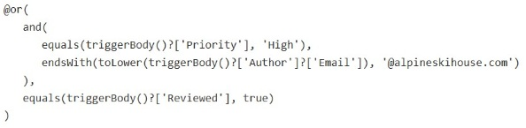
- Exhibit 2: 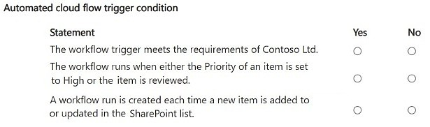

_HOTSPOT — the original ExamTopics question expects you to mark areas on the exhibit above; the correct hotspot coordinates are not published._

**Most voted:** Yes, No, No

### Top explanations
- **exam_upskill** (2 upvotes [Most Recent]): YNN
  1.Y
  2.N (and condition)
  3. N

## Q1.72 (ID 433205)

HOTSPOT
Background
Contoso Ltd. is a global renewable energy provider that operates wind farms and solar installations. The company is modernizing its maintenance and operations platform. The company plans to implement a Microsoft Power Platform solution for the operations team. The implementation will include Microsoft Dataverse, a model-driven app, and Power Automate cloud flows.
The company is building and testing a new model-driven app named Operations. The solution will support operations managers, regional coordinators, and field technicians. The app must integrate with an external cloud-based system that manages onboarding of field technicians.
Contoso Ltd. plans to improve data quality and enforce consistent business logic across the app and automation processes.
Technical environment
Contoso Ltd. has an Identity and Access Management (IDAM) department that manages security. The company has one Power Platform environment named Production, where all building and configuration take place. Auditing is disabled.
The Production environment has the following security configurations:
•	IDAM has a Microsoft Entra security group named Contoso Ltd. QA. This security group will assign all members a Power Apps license.
•	IDAM created a Quality Assurance security role that grants read and write access to all custom tables.
•	IDAM also created a team named Testers in Dataverse, of a Microsoft Entra group team type. The team is configured for the Contoso Ltd. QA security group. The Testers team is assigned the Quality Assurance security role.
Microsoft 365 environment:
All Contoso Ltd. managers are included in a Microsoft 365 group named Managers. The group is NOT enabled for email.
The company shares a SharePoint list with a key customer: Alpine Ski House. Alpine Ski House staff members can add new maintenance requests, which are then checked and marked as reviewed by Contoso Ltd.
Current issue:
A new QA tester joins Contoso Ltd. The IDAM department adds the new tester to the Contoso Ltd. QA security group. However, the new tester is not listed in the Testers team as a member.
Other applications:
A separate software-as a-service (SaaS) solution named TechCheck manages technician onboarding. The TechCheck solution is set up as follows:
•	TechCheck assigns a unique number named Ref to all technicians.
•	Users cannot make changes to the TechCheck data model.
•	Users cannot use the same TechCheck ref on more than one Technician row.
Automation requirements
Contoso plans to use Power Automate to develop a Maintenance Request Approval flow. The flow must meet the following requirements:
•	Create a Maintenance Request row in Dataverse when either of the following occurs:
o	An item is added to the SharePoint list by the customer with the Priority property set to High.
o	Any item is checked and marked as reviewed by a Contoso Ltd. representative.
•	Seek maintenance request approvals from managers through both email and a Microsoft Teams message after they have been reviewed:
o	Requests require approval from all managers.
o	If one manager rejects the request, approval must not be granted.
o	The result of the approval request must be sent to the initial reviewer in an email. The subject line must set the response as either Approve or Reject.
Contoso Ltd. requires the following table logic:
•	If a user tries to enter a price greater than the cost on a new Asset row, the row must display an inline error message.
•	If a user tries to save changes to a Technician row where the TechCheck ref column is empty, the action must be prevented and a message explaining the action must be displayed.
o	Any updates made to Technician profiles in TechCheck must be mirrored in Dataverse by using a custom integration. The developers building the integration require an index for performant searches on the Technician table.
Data model and app design
Contoso Ltd. plans to use Dataverse as its central data platform. Log storage must be minimized.
Tables
The following tables are required for data modeling and the app design:
•	Assets: Stores information about solar panels and wind turbines
•	Maintenance Requests: Tracks issues and maintenance activities. The table must include the following columns:
o	Request ID (auto-number)
o	External Request Code (text)
o	Assigned
o	Technician (lookup to Technicians)
o	Report (lookup to Maintenance Reports)
o	Technician updated (Yes/No)
•	Maintenance Reports: Tracks the results of maintenance reports
•	Technicians: Stores technician assignment data. The table must include the following columns:
•	Full Name (Text)
•	Mobile phone number (Text)
•	Email (Text)
•	Seniority (Choice)
•	TechCheck ref (Text)
Data modeling
The data model must provide the following functionality:
•	Maintenance Requests must:
o	be uniquely identifiable across systems.
o	have two inactive statuses, Cancelled and Duplicate.
•	If a new option is added to an existing set of options, it must be made available automatically for selection on all columns that use the set.
•	A new column named Priority must be added to multiple tables. Users must be able to select only one option from the following set per row:
o	Low
o	Medium
o	High
o	Critical
Changes to the Technician column on Maintenance Requests must be tracked for compliance purposes. Rows must include the names of previous and current technicians and the time of the change.
Relationship requirements
•	One asset can be related to many maintenance requests. A maintenance request can have many assets.
•	A maintenance request can have only zero or one maintenance report.
•	Only one Technician can be related to a Maintenance Request at a time.
•	When a Maintenance Request is deleted, any Maintenance Reports associated with it must also be deleted, but this action should be prevented if there is value in the Technician lookup.
•	When a Maintenance Request is assigned to a different owner, the Maintenance Report associated with it must be reassigned to the new owner as well, but the associated Technician should stay with the current owner.
App design
The Technicians table contains the following public views:
•	Senior Technicians
•	Junior Technicians
The Senior Technician view must be available through the table list view selector to a set of specific users only.
A tester creates a personal view named Hot Assets on the Assets table. The tester recognizes that the view is useful for the entire testing team. The view must be made accessible to the team.
A developer is configuring the Maintenance Request Approval workflow. The developer names the Start and wait for an approval step Approve and the Send an email notification (V3) step Email.
How should the developer configure the Power Automate cloud flow steps? To answer, select the appropriate options in the answer area.
NOTE: Each correct selection is worth one point.

**Exhibits**
- Exhibit 1: 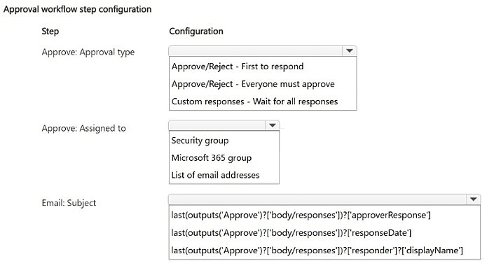

_HOTSPOT — the original ExamTopics question expects you to mark areas on the exhibit above; the correct hotspot coordinates are not published._

**Most voted:**
- Approve/Reject - Everyone must approve
- List of email addresses
- Last(output('Approve')?['body/response'])?['ApproverResponse']

### Top explanations
- **exam_upskill** (2 upvotes [Most Recent]): Approve/Reject - Everyone must approve
  List of email addresses
  Last(output('Approve')?['body/response'])?['ApproverResponse']

## Q1.74 (ID 433268)

Background
Contoso Ltd. is a global renewable energy provider that operates wind farms and solar installations. The company is modernizing its maintenance and operations platform. The company plans to implement a Microsoft Power Platform solution for the operations team. The implementation will include Microsoft Dataverse, a model-driven app, and Power Automate cloud flows.
The company is building and testing a new model-driven app named Operations. The solution will support operations managers, regional coordinators, and field technicians. The app must integrate with an external cloud-based system that manages onboarding of field technicians.
Contoso Ltd. plans to improve data quality and enforce consistent business logic across the app and automation processes.
Technical environment
Contoso Ltd. has an Identity and Access Management (IDAM) department that manages security. The company has one Power Platform environment named Production, where all building and configuration take place. Auditing is disabled.
The Production environment has the following security configurations:
•	IDAM has a Microsoft Entra security group named Contoso Ltd. QA. This security group will assign all members a Power Apps license.
•	IDAM created a Quality Assurance security role that grants read and write access to all custom tables.
•	IDAM also created a team named Testers in Dataverse, of a Microsoft Entra group team type. The team is configured for the Contoso Ltd. QA security group. The Testers team is assigned the Quality Assurance security role.
Microsoft 365 environment:
All Contoso Ltd. managers are included in a Microsoft 365 group named Managers. The group is NOT enabled for email.
The company shares a SharePoint list with a key customer: Alpine Ski House. Alpine Ski House staff members can add new maintenance requests, which are then checked and marked as reviewed by Contoso Ltd.
Current issue:
A new QA tester joins Contoso Ltd. The IDAM department adds the new tester to the Contoso Ltd. QA security group. However, the new tester is not listed in the Testers team as a member.
Other applications:
A separate software-as a-service (SaaS) solution named TechCheck manages technician onboarding. The TechCheck solution is set up as follows:
•	TechCheck assigns a unique number named Ref to all technicians.
•	Users cannot make changes to the TechCheck data model.
•	Users cannot use the same TechCheck ref on more than one Technician row.
Automation requirements
Contoso plans to use Power Automate to develop a Maintenance Request Approval flow. The flow must meet the following requirements:
•	Create a Maintenance Request row in Dataverse when either of the following occurs:
o	An item is added to the SharePoint list by the customer with the Priority property set to High.
o	Any item is checked and marked as reviewed by a Contoso Ltd. representative.
•	Seek maintenance request approvals from managers through both email and a Microsoft Teams message after they have been reviewed:
o	Requests require approval from all managers.
o	If one manager rejects the request, approval must not be granted.
o	The result of the approval request must be sent to the initial reviewer in an email. The subject line must set the response as either Approve or Reject.
Contoso Ltd. requires the following table logic:
•	If a user tries to enter a price greater than the cost on a new Asset row, the row must display an inline error message.
•	If a user tries to save changes to a Technician row where the TechCheck ref column is empty, the action must be prevented and a message explaining the action must be displayed.
o	Any updates made to Technician profiles in TechCheck must be mirrored in Dataverse by using a custom integration. The developers building the integration require an index for performant searches on the Technician table.
Data model and app design
Contoso Ltd. plans to use Dataverse as its central data platform. Log storage must be minimized.
Tables
The following tables are required for data modeling and the app design:
•	Assets: Stores information about solar panels and wind turbines
•	Maintenance Requests: Tracks issues and maintenance activities. The table must include the following columns:
o	Request ID (auto-number)
o	External Request Code (text)
o	Assigned
o	Technician (lookup to Technicians)
o	Report (lookup to Maintenance Reports)
o	Technician updated (Yes/No)
•	Maintenance Reports: Tracks the results of maintenance reports
•	Technicians: Stores technician assignment data. The table must include the following columns:
•	Full Name (Text)
•	Mobile phone number (Text)
•	Email (Text)
•	Seniority (Choice)
•	TechCheck ref (Text)
Data modeling
The data model must provide the following functionality:
•	Maintenance Requests must:
o	be uniquely identifiable across systems.
o	have two inactive statuses, Cancelled and Duplicate.
•	If a new option is added to an existing set of options, it must be made available automatically for selection on all columns that use the set.
•	A new column named Priority must be added to multiple tables. Users must be able to select only one option from the following set per row:
o	Low
o	Medium
o	High
o	Critical
Changes to the Technician column on Maintenance Requests must be tracked for compliance purposes. Rows must include the names of previous and current technicians and the time of the change.
Relationship requirements
•	One asset can be related to many maintenance requests. A maintenance request can have many assets.
•	A maintenance request can have only zero or one maintenance report.
•	Only one Technician can be related to a Maintenance Request at a time.
•	When a Maintenance Request is deleted, any Maintenance Reports associated with it must also be deleted, but this action should be prevented if there is value in the Technician lookup.
•	When a Maintenance Request is assigned to a different owner, the Maintenance Report associated with it must be reassigned to the new owner as well, but the associated Technician should stay with the current owner.
App design
The Technicians table contains the following public views:
•	Senior Technicians
•	Junior Technicians
The Senior Technician view must be available through the table list view selector to a set of specific users only.
A tester creates a personal view named Hot Assets on the Assets table. The tester recognizes that the view is useful for the entire testing team. The view must be made accessible to the team.
You need to ensure the new QA tester can access the app to perform testing.
What should you do?

⭕ **A.** Add the new tester to the production environment.
⭕ **B.** Assign the new tester a Power Apps license.
⭕ **C.** Send the new tester a web link to the Operations app.
✅ **D.** Assign the new tester the Quality Assurance security role.

**Correct answer:** D
**Most voted:** D

### Top explanations
- **exam_upskill** (1 upvotes [Selected Answer: D]): D. Assign the new tester the Quality Assurance security role.
- **ah2006** (1 upvotes [Most Recent]): Not necessary - since:  The Testers team is assigned the Quality Assurance security role

## Q1.75 (ID 433269)

DRAG DROP
You are designing an app for a bank.
You must create tables for the app and configure relationships between the tables:
Which relationship types should you use? To answer, move the appropriate relationship types to the correct requirements. Each relationship type may be used once, more than once, or not at all. You may need to move the split bar between panes or scroll to view content.
NOTE: Each correct selection is worth one point.

**Exhibits**
- Exhibit 1: 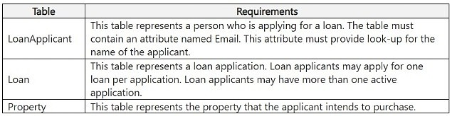
- Exhibit 2: 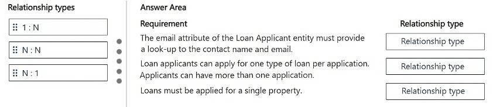

_DRAG DROP — the original ExamTopics question expects you to drag and drop items; the correct targets are not published._

**Most voted:**
1. N: 1
2. 1: N
3. N: 1

### Top explanations
- **exam_upskill** (4 upvotes [Most Recent]): 1. N:1
  2. 1:N
  3. N:1

## Q1.76 (ID 433414)

You are building a canvas app for users to submit incident reports from their mobile devices.
When a user submits an incident form, the app must run a Power Automate cloud flow that sends a notification email.
You need to configure the canvas app to trigger the cloud flow after the user selects the Submit button.
What should you do?

✅ **A.** Use the OnSelect property of the Submit button to call the flow by using the Run() function.
⭕ **B.** Use the OnSelect property of the Submit button to call the flow by using the SubmitForm() function.
⭕ **C.** Use the OnVisible property of the screen to call the flow by using the Run() function.
⭕ **D.** Use the OnSuccess property of the form control to call the flow by using Launch() and pass the necessary parameters.

**Correct answer:** A
**Most voted:** A

### Top explanations
- **exam_upskill** (2 upvotes [Most Recent, Selected Answer: A]): A. Use the OnSelect property of the Submit button to call the flow by using the Run() function.

## Q1.77 (ID 433475)

DRAG DROP
A company is configuring charts in a model-driven app to analyze sales opportunity data stored in Dataverse.
The solution must meet the following requirements:
•	Show how total opportunity revenue changes month over month.
•	Display the proportion of opportunities by status for a selected view.
•	Highlight the progression of opportunities through defined sales stages.
You need to recommend chart types for the app requirements
Which chart types should you recommend? To answer, move the appropriate chart types to the correct requirements. You may use each chart type once, more than once, or not at all. You may need to move the split bar between panes or scroll to view content.
NOTE: Each correct selection is worth one point.

**Exhibits**
- Exhibit 1: 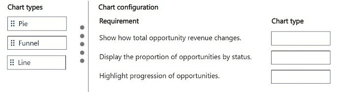

_DRAG DROP — the original ExamTopics question expects you to drag and drop items; the correct targets are not published._

**Most voted:**
1. Line
2. Pie
3. Funnel

### Top explanations
- **exam_upskill** (1 upvotes [Most Recent]): 1. Line
  2. Pie
  3. Funnel

## Q1.79 (ID 433306)

DRAG DROP
A company uses a canvas app to assign tasks to field workers.
Field workers must receive a notification when tasks are assigned. The notification must be:
•	Called from the app when a button is selected.
•	Delivered as a mobile app notification.
You need to configure the notification.
Which three actions should you perform in sequence? To answer, move the appropriate actions from the list of actions to the answer area and arrange them in the correct order.

**Exhibits**
- Exhibit 1: 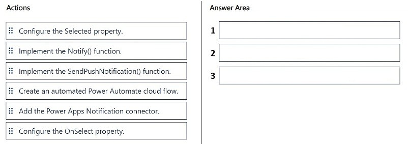

_DRAG DROP — the original ExamTopics question expects you to drag and drop items; the correct targets are not published._

**Most voted:**
1. Add the Power Apps Notification Connector
2. Configure the OnSelect Property
3. Implement the SendPushNotification() function

### Top explanations
- **exam_upskill** (2 upvotes [Most Recent]): 1. Add the Power Apps Notification Connector
  2. Configure the OnSelect Property
  3. Implement the SendPushNotification() function

## Q1.80 (ID 433389)

HOTSPOT
A company develops a Power Apps canvas app. The app logs events and performs data operations.
You review the following formula used during app execution.
You need to determine how the formula behaves during execution. For each of the following statements, select Yes if the statement is true. Otherwise, select No.
NOTE: Each correct selection is worth one point.

**Exhibits**
- Exhibit 1: 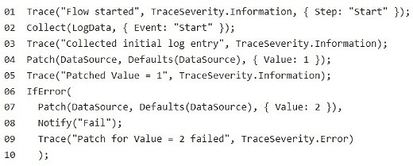
- Exhibit 2: 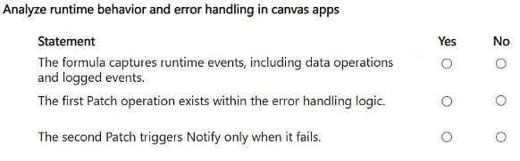

_HOTSPOT — the original ExamTopics question expects you to mark areas on the exhibit above; the correct hotspot coordinates are not published._

**Most voted:** Yes, No, Yes

### Top explanations
- **exam_upskill** (2 upvotes [Most Recent]): YNY
  1.Y
  2.N
  3.Y

## Q1.82 (ID 433212)

HOTSPOT
You are building a canvas app that connects to a third-party system by using a connector.
The third-party system returns customer-specific, eight-digit reference numbers embedded in alphabetic characters of varying length.
You need to create a formula to extract the customer reference numbers in a single string value.
How should you complete the Power Fx formula? To answer, select the appropriate options in the answer area.
NOTE: Each correct selection is worth one point.

**Exhibits**
- Exhibit 1: 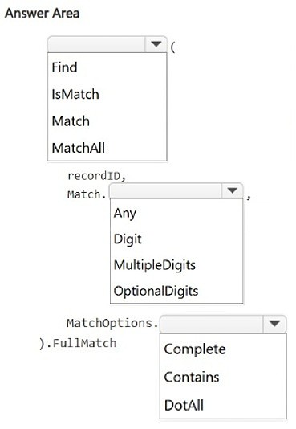

_HOTSPOT — the original ExamTopics question expects you to mark areas on the exhibit above; the correct hotspot coordinates are not published._

**Most voted:**
1. MatchAll
2. MultipleDigits
3. Contains

### Top explanations
- **exam_upskill** (2 upvotes [Most Recent]): 1. MatchAll
  2. MultipleDigits
  3. Contains

## Q1.83 (ID 433450)

DRAG DROP
A company is designing a model-driven app for internal operations.
You must configure the app without using custom code to provide the following functionality:
•	Edit an account.
•	Display an interface that has a third-party data source.
You need to add page types while minimizing development effort.
Which page types should you use? To answer, move the appropriate page type to the correct requirement. You may use each page type once, more than once, or not at all. You may need to move the split bar between panes or scroll to view content.
NOTE: Each correct selection is worth one point.

**Exhibits**
- Exhibit 1: 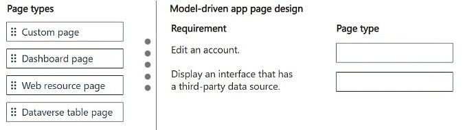

_DRAG DROP — the original ExamTopics question expects you to drag and drop items; the correct targets are not published._

**Most voted:**
1. Dataverse table page
2. Custom Page

### Top explanations
- **exam_upskill** (1 upvotes [Most Recent]): 1. Dataverse table page
  2. Custom Page

## Q1.85 (ID 433194)

DRAG DROP
You make the following customizations to a Microsoft Dataverse environment:
•	Create a new table.
•	Add data to the new table.
•	Delete an unused area from the site map.
The components must be transported to a different environment.
You need to determine the method required to transport each component.
Which method should you use? To answer, move the appropriate methods to the correct components. Each method may be used once, more than once, or not at all. You may need to move the split bar between panes or scroll to view content.
NOTE: Each correct selection is worth one point.

**Exhibits**
- Exhibit 1: 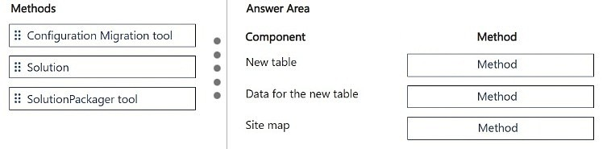

_DRAG DROP — the original ExamTopics question expects you to drag and drop items; the correct targets are not published._

**Most voted:**
1. Solution
2. Configuration Migration tool
3. Solution

### Top explanations
- **exam_upskill** (3 upvotes [Most Recent]): 1. Solution
  2. Configuration Migration tool
  3. Solution
- **FabiolaRT** (2 upvotes): -Solution
  -Configuration Migration tool
  -Solution
  (SolutionPackager tool  is a tool that can reversibly decompose a Microsoft Dataverse compressed solution file into multiple XML files)
  https://learn.microsoft.com/en-us/power-platform/alm/solution-packager-tool

## Q1.86 (ID 433250)

A company is implementing Power Apps and Power Automate.
Several components are created within Power Apps, Microsoft Dataverse, and Power Automate. These components must be promoted from the development environment to the user acceptance test environment in a single solution package.
You need to create the solution package for promotion.
Where should you create the package?

⭕ **A.** Office 365 admin center
✅ **B.** Power Apps maker portal
⭕ **C.** Azure portal
⭕ **D.** Microsoft Power Platform admin center

**Correct answer:** B
**Most voted:** B

### Top explanations
- **exam_upskill** (1 upvotes [Most Recent, Selected Answer: B]): B. Power Apps maker portal

## Q1.87 (ID 433255)

DRAG DROP
A company is updating a Power Apps solution that contains two tables named Services and Equipment.
The company is creating a new solution to update the current solution for the following requirements:
•	The Services table must be updated to include change tracking.
•	The Equipment table must be updated to include four new columns.
•	The solution must update only the components that need to be added or changed.
You need to create the solution.
Which table option should you use? To answer, move the appropriate options to the correct tables. Each option may be used once, more than once, or not at all. You may need to move the split bar between panes or scroll to view content.
NOTE: Each correct selection is worth one point.

**Exhibits**
- Exhibit 1: 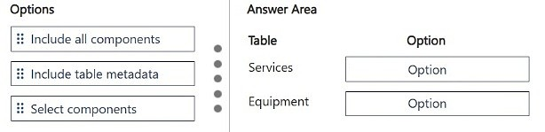

_DRAG DROP — the original ExamTopics question expects you to drag and drop items; the correct targets are not published._

**Most voted:**
1. Include table metadata
2. Selected Components

### Top explanations
- **exam_upskill** (2 upvotes [Most Recent]): 1. Include table metadata
  2. Selected Components

## Q1.88 (ID 433233)

HOTSPOT
A company is implementing a data model by using Dataverse.
The company requires the following columns in a new custom table:
You need to choose the column type that uses the least amount of database storage for each column.
Which column types should you choose? To answer, select the appropriate options in the answer area.
NOTE: Each correct selection is worth one point.

**Exhibits**
- Exhibit 1: 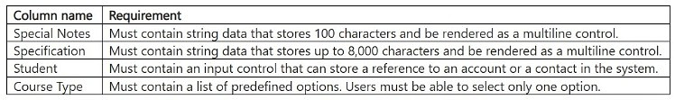
- Exhibit 2: 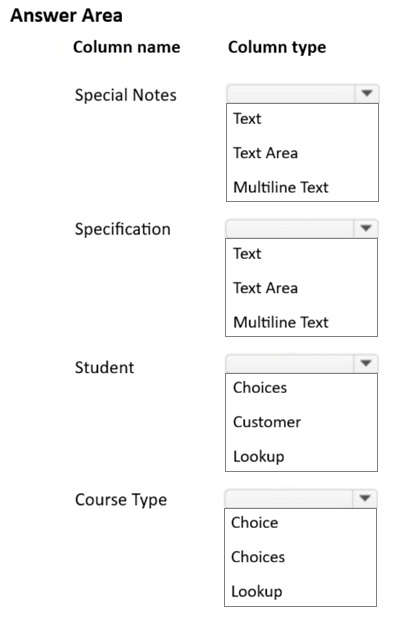

_HOTSPOT — the original ExamTopics question expects you to mark areas on the exhibit above; the correct hotspot coordinates are not published._

**Most voted:**
1. Text Area
2. Multiline Text
3. Customer
4. Choice

### Top explanations
- **exam_upskill** (2 upvotes [Most Recent]): 1. Text Area
  2. Multiline Text
  3. Customer
  4. Choice

## Q1.89 (ID 433252)

DRAG DROP
You plan to add a new column to a system table in Dataverse and then move the changes to a test environment when they are complete. You create a new development environment to make the changes.
The changes must meet the following requirements:
•	Must be clearly identified so that they are not confused with system components and components from other solutions.
•	Must not affect any existing components in the test environment.
You need to prepare a solution for deployment to the test environment.
Which four actions should you perform in sequence? To answer, move the appropriate actions from the list of actions to the answer area and arrange them in the correct order.

**Exhibits**
- Exhibit 1: 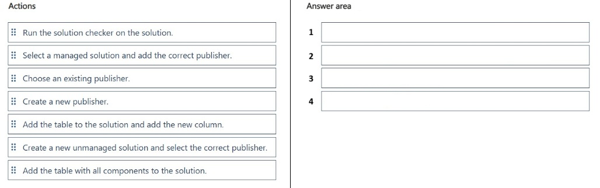

_DRAG DROP — the original ExamTopics question expects you to drag and drop items; the correct targets are not published._

**Most voted:**
1. Create a new publisher
2. Create a new unmanage solution and select correct publisher
3. Add the table to the solution and add the new column
4. Run the solution checker on the solution

### Top explanations
- **exam_upskill** (2 upvotes [Most Recent]): 1. Create a new publisher
  2. Create a new unmanage solution and select correct publisher
  3. Add the table to the solution and add the new column
  4. Run the solution checker on the solution

## Q1.90 (ID 433308)

HOTSPOT
You are creating a relationship between two Dataverse tables.
You need to configure a one-to-many relationship between the Vendor and Shipment tables and ensure that all child records are deleted when the parent record is deleted.
Which configuration methods should you use? To answer, select the appropriate options in the answer area.
NOTE: Each correct selection is worth one point.

**Exhibits**
- Exhibit 1: 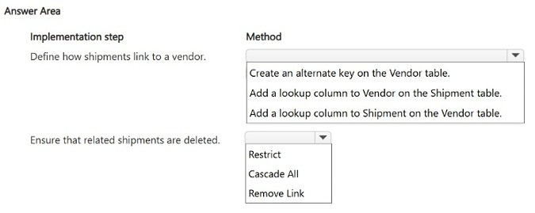

_HOTSPOT — the original ExamTopics question expects you to mark areas on the exhibit above; the correct hotspot coordinates are not published._

**Most voted:**
1. Add a lookup column to Vendor on the Shipment table
2. Cascade All

### Top explanations
- **exam_upskill** (3 upvotes [Most Recent]): 1. Add a lookup column to Vendor on the Shipment table
  2. Cascade All

## Q1.92 (ID 433195)

DRAG DROP
A company uses Microsoft Copilot Studio to generate responses for customer support scenarios.
The solution must meet the following requirements:
•	The prompt must accept customer name and case description.
•	The prompt must receive values captured from responses.
You need to configure the prompt action.
Which configurations should you use? To answer, move the appropriate configurations to the correct requirements. You may use each configuration once, more than once, or not at all. You may need to move the split bar between panes or scroll to view content.
NOTE: Each correct selection is worth one point.

**Exhibits**
- Exhibit 1: 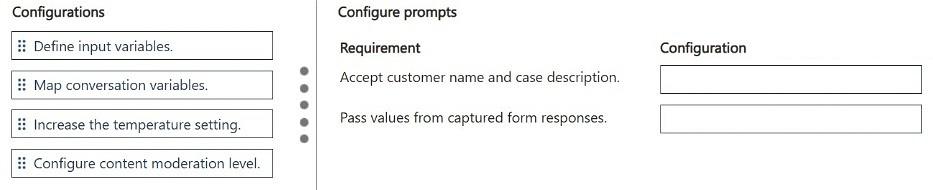

_DRAG DROP — the original ExamTopics question expects you to drag and drop items; the correct targets are not published._

**Most voted:**
1. Define input variables
2. Map conversation variables

### Top explanations
- **exam_upskill** (2 upvotes [Most Recent]): 1. Define input variables
  2. Map conversation variables

## Q1.93 (ID 433299)

HOTSPOT
A company uses a cloud flow to synchronize systems.
The company reports the following cloud flow issues:
•	Intermittent failures caused by temporary service issues
•	Action failures caused by execution time limits
You need to troubleshoot the cloud flows.
Which configurations should you use? To answer, select the appropriate options in the answer area.
NOTE: Each correct selection is worth one point.

**Exhibits**
- Exhibit 1: 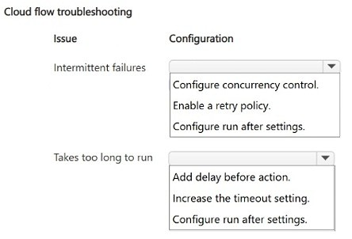

_HOTSPOT — the original ExamTopics question expects you to mark areas on the exhibit above; the correct hotspot coordinates are not published._

**Most voted:**
1. Enable a retry policy
2. Increase the timeout setting

### Top explanations
- **exam_upskill** (3 upvotes [Most Recent]): 1. Enable a retry policy
  2. Increase the timeout setting

## Q1.95 (ID 433315)

DRAG DROP
A company builds a cloud flow that analyzes customer messages by using a custom prompt.
You must build the following functionality into the prompt:
•	Start the workflow process.
•	Prepare message data for the prompt.
•	Evaluate the data by using the prompt.
•	Store the analysis results.
You need to configure the prompt execution.
Which actions should you perform? To answer, move the appropriate actions to the correct requirements. You may use each action once, more than once, or not at all. You may need to move the split bar between panes or scroll to view content.
NOTE: Each correct selection is worth one point.

**Exhibits**
- Exhibit 1: 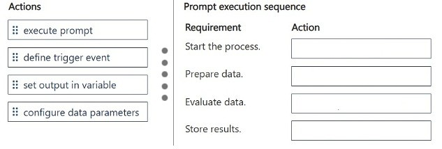

_DRAG DROP — the original ExamTopics question expects you to drag and drop items; the correct targets are not published._

**Most voted:**
1. Define trigger event
2. Configure data parameters
3. Execute prompt
4. Set output in variable

### Top explanations
- **exam_upskill** (4 upvotes [Most Recent]): 1. Define trigger event
  2. Configure data parameters
  3. Execute prompt
  4. Set output in variable
- **FabiolaRT** (1 upvotes): -Define trigger event
  -Configure data parameters
  -Execute prompt
  -Set ouput in variable

## Q1.98 (ID 433284)

A company requires configuration of an automated process.
The process must run synchronously in response to a row change in Microsoft Dataverse.
You need to recommend components to implement the requirement.
Which two approaches should you recommend? Each correct answer presents a complete solution.
NOTE: Each correct selection is worth one point.

⭕ **A.** automated cloud flow
⭕ **B.** instant cloud flow
✅ **C.** low-code plugin
✅ **D.** real-time workflow
⭕ **E.** business rule

**Correct answer:** C, D
**Most voted:** CD

### Top explanations
- **exam_upskill** (2 upvotes [Most Recent, Selected Answer: CD]): C. low-code plugin
  D. real-time workflow

## Q1.99 (ID 433293)

You plan to implement Microsoft Dataverse.
You must track changes for two columns in the Account table. You must maintain a historical log of changes for the two columns and track only what is necessary. You configure the appropriate organization settings.
You need to configure the system to track changes for the two columns.
Which two actions should you perform? Each correct answer presents part of the solution.
NOTE: Each correct selection is worth one point.

⭕ **A.** Enable change tracking for the two specific columns.
⭕ **B.** Enable change tracking for the Account table.
✅ **C.** Enable auditing for the Account table.
✅ **D.** Enable auditing for the two specific columns.

**Correct answer:** C, D
**Most voted:** CD

### Top explanations
- **exam_upskill** (3 upvotes [Most Recent, Selected Answer: CD]): C. Enable auditing for the Account table.
  D. Enable auditing for the two specific columns
- **FabiolaRT** (2 upvotes [Selected Answer: CD]): Correct answer:
  C. Enable auditing for the Account table
  D. Enable auditing for the thow specific columns

## Q1.100 (ID 433267)

Background
ADatum Corporation provides verification and investigation services that are used by insurance companies, law firms, and other organizations in the public sector. Services include verifying an individual’s background, qualifications, and specific scenarios that require onsite visits.
The thorough work ADatum Corporation performs results in highly accurate cases with minimal critical information missing. Because of these high-quality results, ADatum Corporation is quickly proving itself as one of the best in the industry. In recent months, business has significantly increased, with most new business coming from high-profile companies and individuals.
Management has decided to create a new qualification verification (QV) role to help ensure that clients get the most accurate results. This role examines completed work to ensure that nothing is missed.
Current environment
Data storage and retention
•	All information sent by clients for services is stored in Microsoft Dataverse with a model-driven app as the interface.
•	Clients enter their data in a website, which then uses a service account to create the records in the Dataverse database.
•	Team members currently have full access to all Service Request records.
Service requests
•	The Service Request table includes header information about the individual or organization that is the subject of verification.
•	New Service Request records are assigned to a queue. All potential users who will be performing the verifications have access to these records.
•	A service request is assigned to a single user who will ensure that all qualifications are verified. This single user is the only one able to process Qualification records related to their own service requests.
•	Many required tasks when performing verification services are currently done by using manual processes.
•	To keep up with demand, ADatum Corporation identifies several processes that can be replaced by using Power flows to hire fewer new staff and keep costs down.
Qualification verification
•	The qualification table contains details about an individual school degree, professional qualifications, and other qualifications that must be verified.
•	A service request can have one or more Qualification records associated with it.
•	Record status is pending verification until the initial team member finishes, at which point the member changes the status to Complete.
•	When all qualification records related to a service request are verified either by manual or automated processes, the results are made available to ADatum Corporation’s client.
•	In the rare event that results are questioned, a new service request is created and verified independently of the previous work that took place.
•	To complete a service request, users perform the following actions:
o	Send a templated email by using Microsoft Outlook to the client after all qualifications for a service request are checked.
o	Change the service request status to Completed. Currently, service requests do not indicate when all Qualification records are addressed.
Microsoft Power Platform environment
•	The following environments exist: development, testing, user acceptance testing (UAT), and production.
•	Managed solutions are used to move customizations from the development environment to other higher-level environments. These solutions are created and maintained by the power users and provided to internal IT for deployment when they are ready.
•	Two managed solutions, Verification Process Automation and Onsite Visit, share several components.
•	All customizations to Power Platform components are performed by several power users who have received training and are certified as subject matter experts.
•	Power users have been granted the System Administrator security role in the development environment.
•	Corporate policy prohibits power users from writing code due to lack of a formal code review process.
•	Internal IT will not be able to supply any development resources for this project due to a lack of staff. This means that any customizations and automation created for this project must be low-code/no-code for the power users to implement them.
•	Customizations created by power users are deployed by internal IT.
Requirements
Process automation
ADatum Corporation plans to establish a new QV department to verify completed work so that the quality of work is maintained. The new process for verifying professional qualifications must automate the following:
•	Enter data and navigate the authority’s website. The authority website UI changes frequently because the company constantly improves the user experience.
•	Search page contents for a specified value to determine validity.
•	Update the corresponding Qualification record in Dataverse.
The new process for completing a service request must automate the following:
•	Set the Service Request record status to Complete when work on all Qualification records is finished.
•	Send an email to the client with the results when the service request is completed. The email must list each qualification as either Valid or Not Valid, depending on the verification.
Qualification verification
•	Service request results will not be released to clients until all related Qualification records are set to a Complete status.
•	To check work done by a wide array of users, 10 percent of Qualification records must be double checked.
•	Qualification records must be automatically assigned to a queue.
•	Qualification records must be flagged with a new status field named Assigned to ensure that records are rechecked.
•	Ensure that only QV team members can change the status from Assigned to In Progress to Complete.
•	Record the name of the QV team member who performed the work and the date completed.
Governance and security
•	All components required for the verification process must be included in a new solution.
•	Corporate security requires that deployments to non-development environments must be automated using service accounts.
•	User security and data access must also be consistent across environments, except for the elevated access of the power users in the development environment.
•	The Onsite Visit managed solution has a table that is not in the Verification Process Automation managed solution. This table must be upgraded prior to the go-live date without the other shared components.
•	A VP of sales requires a test environment to demonstrate to potential clients the security policies that are included in their initial offering.
Issues
•	More employees than are required can access individual client information and continue to have access after a service request is completed.
•	When users go on vacation, all their outstanding Service Request records are assigned to a substitute employee. The substitute employees are unable to see all the qualifications related to their service requests.
•	Currently, testing the new QV functionality outside the development environment is not possible due to corporate security policies requiring the same security role across all environments.
•	Internal IT reports that the solution import to the test environment failed because of missing dependencies related to the flow for completing service requests.
You need to implement the requirement for the VP of sales.
What should you do?

✅ **A.** Use a test account with a base security role with QV security added.
⭕ **B.** Use a test account with only QV security added.
⭕ **C.** Add QV security to your user account.
⭕ **D.** Add the System Administrator security role to your user account.

**Correct answer:** A
**Most voted:** A

### Top explanations
- **exam_upskill** (2 upvotes [Most Recent, Selected Answer: A]): A. Use a test account with a base security role with QV security added.

## Q1.101 (ID 433202)

HOTSPOT
Background
ADatum Corporation provides verification and investigation services that are used by insurance companies, law firms, and other organizations in the public sector. Services include verifying an individual’s background, qualifications, and specific scenarios that require onsite visits.
The thorough work ADatum Corporation performs results in highly accurate cases with minimal critical information missing. Because of these high-quality results, ADatum Corporation is quickly proving itself as one of the best in the industry. In recent months, business has significantly increased, with most new business coming from high-profile companies and individuals.
Management has decided to create a new qualification verification (QV) role to help ensure that clients get the most accurate results. This role examines completed work to ensure that nothing is missed.
Current environment
Data storage and retention
•	All information sent by clients for services is stored in Microsoft Dataverse with a model-driven app as the interface.
•	Clients enter their data in a website, which then uses a service account to create the records in the Dataverse database.
•	Team members currently have full access to all Service Request records.
Service requests
•	The Service Request table includes header information about the individual or organization that is the subject of verification.
•	New Service Request records are assigned to a queue. All potential users who will be performing the verifications have access to these records.
•	A service request is assigned to a single user who will ensure that all qualifications are verified. This single user is the only one able to process Qualification records related to their own service requests.
•	Many required tasks when performing verification services are currently done by using manual processes.
•	To keep up with demand, ADatum Corporation identifies several processes that can be replaced by using Power flows to hire fewer new staff and keep costs down.
Qualification verification
•	The qualification table contains details about an individual school degree, professional qualifications, and other qualifications that must be verified.
•	A service request can have one or more Qualification records associated with it.
•	Record status is pending verification until the initial team member finishes, at which point the member changes the status to Complete.
•	When all qualification records related to a service request are verified either by manual or automated processes, the results are made available to ADatum Corporation’s client.
•	In the rare event that results are questioned, a new service request is created and verified independently of the previous work that took place.
•	To complete a service request, users perform the following actions:
o	Send a templated email by using Microsoft Outlook to the client after all qualifications for a service request are checked.
o	Change the service request status to Completed. Currently, service requests do not indicate when all Qualification records are addressed.
Microsoft Power Platform environment
•	The following environments exist: development, testing, user acceptance testing (UAT), and production.
•	Managed solutions are used to move customizations from the development environment to other higher-level environments. These solutions are created and maintained by the power users and provided to internal IT for deployment when they are ready.
•	Two managed solutions, Verification Process Automation and Onsite Visit, share several components.
•	All customizations to Power Platform components are performed by several power users who have received training and are certified as subject matter experts.
•	Power users have been granted the System Administrator security role in the development environment.
•	Corporate policy prohibits power users from writing code due to lack of a formal code review process.
•	Internal IT will not be able to supply any development resources for this project due to a lack of staff. This means that any customizations and automation created for this project must be low-code/no-code for the power users to implement them.
•	Customizations created by power users are deployed by internal IT.
Requirements
Process automation
ADatum Corporation plans to establish a new QV department to verify completed work so that the quality of work is maintained. The new process for verifying professional qualifications must automate the following:
•	Enter data and navigate the authority’s website. The authority website UI changes frequently because the company constantly improves the user experience.
•	Search page contents for a specified value to determine validity.
•	Update the corresponding Qualification record in Dataverse.
The new process for completing a service request must automate the following:
•	Set the Service Request record status to Complete when work on all Qualification records is finished.
•	Send an email to the client with the results when the service request is completed. The email must list each qualification as either Valid or Not Valid, depending on the verification.
Qualification verification
•	Service request results will not be released to clients until all related Qualification records are set to a Complete status.
•	To check work done by a wide array of users, 10 percent of Qualification records must be double checked.
•	Qualification records must be automatically assigned to a queue.
•	Qualification records must be flagged with a new status field named Assigned to ensure that records are rechecked.
•	Ensure that only QV team members can change the status from Assigned to In Progress to Complete.
•	Record the name of the QV team member who performed the work and the date completed.
Governance and security
•	All components required for the verification process must be included in a new solution.
•	Corporate security requires that deployments to non-development environments must be automated using service accounts.
•	User security and data access must also be consistent across environments, except for the elevated access of the power users in the development environment.
•	The Onsite Visit managed solution has a table that is not in the Verification Process Automation managed solution. This table must be upgraded prior to the go-live date without the other shared components.
•	A VP of sales requires a test environment to demonstrate to potential clients the security policies that are included in their initial offering.
Issues
•	More employees than are required can access individual client information and continue to have access after a service request is completed.
•	When users go on vacation, all their outstanding Service Request records are assigned to a substitute employee. The substitute employees are unable to see all the qualifications related to their service requests.
•	Currently, testing the new QV functionality outside the development environment is not possible due to corporate security policies requiring the same security role across all environments.
•	Internal IT reports that the solution import to the test environment failed because of missing dependencies related to the flow for completing service requests.
You need to configure a Power Automate flow to send the email with the results to the client.
What should you use? To answer, select the appropriate options in the answer area.
NOTE: Each correct selection is worth one point.

**Exhibits**
- Exhibit 1: 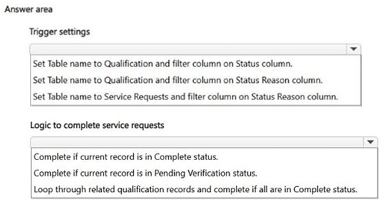

_HOTSPOT — the original ExamTopics question expects you to mark areas on the exhibit above; the correct hotspot coordinates are not published._

**Most voted:**
1. Set Table name to Qualification and filter column on Status column
2. Loop through related qualification records and complete if all are in Complete status.

### Top explanations
- **exam_upskill** (2 upvotes [Most Recent]): 1. Set Table name to Qualification and filter column on Status column
  2. Loop through related qualification records and complete if all are in Complete status.

## Q1.102 (ID 433199)

HOTSPOT
Background
ADatum Corporation provides verification and investigation services that are used by insurance companies, law firms, and other organizations in the public sector. Services include verifying an individual’s background, qualifications, and specific scenarios that require onsite visits.
The thorough work ADatum Corporation performs results in highly accurate cases with minimal critical information missing. Because of these high-quality results, ADatum Corporation is quickly proving itself as one of the best in the industry. In recent months, business has significantly increased, with most new business coming from high-profile companies and individuals.
Management has decided to create a new qualification verification (QV) role to help ensure that clients get the most accurate results. This role examines completed work to ensure that nothing is missed.
Current environment
Data storage and retention
•	All information sent by clients for services is stored in Microsoft Dataverse with a model-driven app as the interface.
•	Clients enter their data in a website, which then uses a service account to create the records in the Dataverse database.
•	Team members currently have full access to all Service Request records.
Service requests
•	The Service Request table includes header information about the individual or organization that is the subject of verification.
•	New Service Request records are assigned to a queue. All potential users who will be performing the verifications have access to these records.
•	A service request is assigned to a single user who will ensure that all qualifications are verified. This single user is the only one able to process Qualification records related to their own service requests.
•	Many required tasks when performing verification services are currently done by using manual processes.
•	To keep up with demand, ADatum Corporation identifies several processes that can be replaced by using Power flows to hire fewer new staff and keep costs down.
Qualification verification
•	The qualification table contains details about an individual school degree, professional qualifications, and other qualifications that must be verified.
•	A service request can have one or more Qualification records associated with it.
•	Record status is pending verification until the initial team member finishes, at which point the member changes the status to Complete.
•	When all qualification records related to a service request are verified either by manual or automated processes, the results are made available to ADatum Corporation’s client.
•	In the rare event that results are questioned, a new service request is created and verified independently of the previous work that took place.
•	To complete a service request, users perform the following actions:
o	Send a templated email by using Microsoft Outlook to the client after all qualifications for a service request are checked.
o	Change the service request status to Completed. Currently, service requests do not indicate when all Qualification records are addressed.
Microsoft Power Platform environment
•	The following environments exist: development, testing, user acceptance testing (UAT), and production.
•	Managed solutions are used to move customizations from the development environment to other higher-level environments. These solutions are created and maintained by the power users and provided to internal IT for deployment when they are ready.
•	Two managed solutions, Verification Process Automation and Onsite Visit, share several components.
•	All customizations to Power Platform components are performed by several power users who have received training and are certified as subject matter experts.
•	Power users have been granted the System Administrator security role in the development environment.
•	Corporate policy prohibits power users from writing code due to lack of a formal code review process.
•	Internal IT will not be able to supply any development resources for this project due to a lack of staff. This means that any customizations and automation created for this project must be low-code/no-code for the power users to implement them.
•	Customizations created by power users are deployed by internal IT.
Requirements
Process automation
ADatum Corporation plans to establish a new QV department to verify completed work so that the quality of work is maintained. The new process for verifying professional qualifications must automate the following:
•	Enter data and navigate the authority’s website. The authority website UI changes frequently because the company constantly improves the user experience.
•	Search page contents for a specified value to determine validity.
•	Update the corresponding Qualification record in Dataverse.
The new process for completing a service request must automate the following:
•	Set the Service Request record status to Complete when work on all Qualification records is finished.
•	Send an email to the client with the results when the service request is completed. The email must list each qualification as either Valid or Not Valid, depending on the verification.
Qualification verification
•	Service request results will not be released to clients until all related Qualification records are set to a Complete status.
•	To check work done by a wide array of users, 10 percent of Qualification records must be double checked.
•	Qualification records must be automatically assigned to a queue.
•	Qualification records must be flagged with a new status field named Assigned to ensure that records are rechecked.
•	Ensure that only QV team members can change the status from Assigned to In Progress to Complete.
•	Record the name of the QV team member who performed the work and the date completed.
Governance and security
•	All components required for the verification process must be included in a new solution.
•	Corporate security requires that deployments to non-development environments must be automated using service accounts.
•	User security and data access must also be consistent across environments, except for the elevated access of the power users in the development environment.
•	The Onsite Visit managed solution has a table that is not in the Verification Process Automation managed solution. This table must be upgraded prior to the go-live date without the other shared components.
•	A VP of sales requires a test environment to demonstrate to potential clients the security policies that are included in their initial offering.
Issues
•	More employees than are required can access individual client information and continue to have access after a service request is completed.
•	When users go on vacation, all their outstanding Service Request records are assigned to a substitute employee. The substitute employees are unable to see all the qualifications related to their service requests.
•	Currently, testing the new QV functionality outside the development environment is not possible due to corporate security policies requiring the same security role across all environments.
•	Internal IT reports that the solution import to the test environment failed because of missing dependencies related to the flow for completing service requests.
You need to resolve the issue reported by substitute employees after they are assigned service requests.
How should you update the relationship? To answer, select the appropriate options in the answer area.
NOTE: Each correct selection is worth one point.

**Exhibits**
- Exhibit 1: 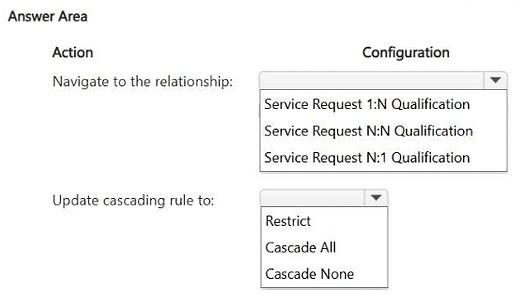

_HOTSPOT — the original ExamTopics question expects you to mark areas on the exhibit above; the correct hotspot coordinates are not published._

**Most voted:**
- Navigate to the relationship: Service Request 1:N Qualification
- Update cascading rule to: Cascade All

### Top explanations
- **ah2006** (1 upvotes [Most Recent]): 1) Navigate to the relationship: Service Request 1:N Qualification
  2) Update cascading rule to: Cascade All

## Q1.103 (ID 433213)

Background
ADatum Corporation provides verification and investigation services that are used by insurance companies, law firms, and other organizations in the public sector. Services include verifying an individual’s background, qualifications, and specific scenarios that require onsite visits.
The thorough work ADatum Corporation performs results in highly accurate cases with minimal critical information missing. Because of these high-quality results, ADatum Corporation is quickly proving itself as one of the best in the industry. In recent months, business has significantly increased, with most new business coming from high-profile companies and individuals.
Management has decided to create a new qualification verification (QV) role to help ensure that clients get the most accurate results. This role examines completed work to ensure that nothing is missed.
Current environment
Data storage and retention
•	All information sent by clients for services is stored in Microsoft Dataverse with a model-driven app as the interface.
•	Clients enter their data in a website, which then uses a service account to create the records in the Dataverse database.
•	Team members currently have full access to all Service Request records.
Service requests
•	The Service Request table includes header information about the individual or organization that is the subject of verification.
•	New Service Request records are assigned to a queue. All potential users who will be performing the verifications have access to these records.
•	A service request is assigned to a single user who will ensure that all qualifications are verified. This single user is the only one able to process Qualification records related to their own service requests.
•	Many required tasks when performing verification services are currently done by using manual processes.
•	To keep up with demand, ADatum Corporation identifies several processes that can be replaced by using Power flows to hire fewer new staff and keep costs down.
Qualification verification
•	The qualification table contains details about an individual school degree, professional qualifications, and other qualifications that must be verified.
•	A service request can have one or more Qualification records associated with it.
•	Record status is pending verification until the initial team member finishes, at which point the member changes the status to Complete.
•	When all qualification records related to a service request are verified either by manual or automated processes, the results are made available to ADatum Corporation’s client.
•	In the rare event that results are questioned, a new service request is created and verified independently of the previous work that took place.
•	To complete a service request, users perform the following actions:
o	Send a templated email by using Microsoft Outlook to the client after all qualifications for a service request are checked.
o	Change the service request status to Completed. Currently, service requests do not indicate when all Qualification records are addressed.
Microsoft Power Platform environment
•	The following environments exist: development, testing, user acceptance testing (UAT), and production.
•	Managed solutions are used to move customizations from the development environment to other higher-level environments. These solutions are created and maintained by the power users and provided to internal IT for deployment when they are ready.
•	Two managed solutions, Verification Process Automation and Onsite Visit, share several components.
•	All customizations to Power Platform components are performed by several power users who have received training and are certified as subject matter experts.
•	Power users have been granted the System Administrator security role in the development environment.
•	Corporate policy prohibits power users from writing code due to lack of a formal code review process.
•	Internal IT will not be able to supply any development resources for this project due to a lack of staff. This means that any customizations and automation created for this project must be low-code/no-code for the power users to implement them.
•	Customizations created by power users are deployed by internal IT.
Requirements
Process automation
ADatum Corporation plans to establish a new QV department to verify completed work so that the quality of work is maintained. The new process for verifying professional qualifications must automate the following:
•	Enter data and navigate the authority’s website. The authority website UI changes frequently because the company constantly improves the user experience.
•	Search page contents for a specified value to determine validity.
•	Update the corresponding Qualification record in Dataverse.
The new process for completing a service request must automate the following:
•	Set the Service Request record status to Complete when work on all Qualification records is finished.
•	Send an email to the client with the results when the service request is completed. The email must list each qualification as either Valid or Not Valid, depending on the verification.
Qualification verification
•	Service request results will not be released to clients until all related Qualification records are set to a Complete status.
•	To check work done by a wide array of users, 10 percent of Qualification records must be double checked.
•	Qualification records must be automatically assigned to a queue.
•	Qualification records must be flagged with a new status field named Assigned to ensure that records are rechecked.
•	Ensure that only QV team members can change the status from Assigned to In Progress to Complete.
•	Record the name of the QV team member who performed the work and the date completed.
Governance and security
•	All components required for the verification process must be included in a new solution.
•	Corporate security requires that deployments to non-development environments must be automated using service accounts.
•	User security and data access must also be consistent across environments, except for the elevated access of the power users in the development environment.
•	The Onsite Visit managed solution has a table that is not in the Verification Process Automation managed solution. This table must be upgraded prior to the go-live date without the other shared components.
•	A VP of sales requires a test environment to demonstrate to potential clients the security policies that are included in their initial offering.
Issues
•	More employees than are required can access individual client information and continue to have access after a service request is completed.
•	When users go on vacation, all their outstanding Service Request records are assigned to a substitute employee. The substitute employees are unable to see all the qualifications related to their service requests.
•	Currently, testing the new QV functionality outside the development environment is not possible due to corporate security policies requiring the same security role across all environments.
•	Internal IT reports that the solution import to the test environment failed because of missing dependencies related to the flow for completing service requests.
You need to set up the new service request completion process.
Which two components should you include in the solution? Each correct answer presents a complete solution.
NOTE: Each correct selection is worth one point.

⭕ **A.** Connection
⭕ **B.** Business process flow
✅ **C.** Connection reference
✅ **D.** Power Automate flow

**Correct answer:** C, D
**Most voted:** CD

### Top explanations
- **exam_upskill** (2 upvotes [Most Recent, Selected Answer: CD]): C. Connection reference
  D. Power Automate flow

## Q1.104 (ID 433237)

HOTSPOT
Background
ADatum Corporation provides verification and investigation services that are used by insurance companies, law firms, and other organizations in the public sector. Services include verifying an individual’s background, qualifications, and specific scenarios that require onsite visits.
The thorough work ADatum Corporation performs results in highly accurate cases with minimal critical information missing. Because of these high-quality results, ADatum Corporation is quickly proving itself as one of the best in the industry. In recent months, business has significantly increased, with most new business coming from high-profile companies and individuals.
Management has decided to create a new qualification verification (QV) role to help ensure that clients get the most accurate results. This role examines completed work to ensure that nothing is missed.
Current environment
Data storage and retention
•	All information sent by clients for services is stored in Microsoft Dataverse with a model-driven app as the interface.
•	Clients enter their data in a website, which then uses a service account to create the records in the Dataverse database.
•	Team members currently have full access to all Service Request records.
Service requests
•	The Service Request table includes header information about the individual or organization that is the subject of verification.
•	New Service Request records are assigned to a queue. All potential users who will be performing the verifications have access to these records.
•	A service request is assigned to a single user who will ensure that all qualifications are verified. This single user is the only one able to process Qualification records related to their own service requests.
•	Many required tasks when performing verification services are currently done by using manual processes.
•	To keep up with demand, ADatum Corporation identifies several processes that can be replaced by using Power flows to hire fewer new staff and keep costs down.
Qualification verification
•	The qualification table contains details about an individual school degree, professional qualifications, and other qualifications that must be verified.
•	A service request can have one or more Qualification records associated with it.
•	Record status is pending verification until the initial team member finishes, at which point the member changes the status to Complete.
•	When all qualification records related to a service request are verified either by manual or automated processes, the results are made available to ADatum Corporation’s client.
•	In the rare event that results are questioned, a new service request is created and verified independently of the previous work that took place.
•	To complete a service request, users perform the following actions:
o	Send a templated email by using Microsoft Outlook to the client after all qualifications for a service request are checked.
o	Change the service request status to Completed. Currently, service requests do not indicate when all Qualification records are addressed.
Microsoft Power Platform environment
•	The following environments exist: development, testing, user acceptance testing (UAT), and production.
•	Managed solutions are used to move customizations from the development environment to other higher-level environments. These solutions are created and maintained by the power users and provided to internal IT for deployment when they are ready.
•	Two managed solutions, Verification Process Automation and Onsite Visit, share several components.
•	All customizations to Power Platform components are performed by several power users who have received training and are certified as subject matter experts.
•	Power users have been granted the System Administrator security role in the development environment.
•	Corporate policy prohibits power users from writing code due to lack of a formal code review process.
•	Internal IT will not be able to supply any development resources for this project due to a lack of staff. This means that any customizations and automation created for this project must be low-code/no-code for the power users to implement them.
•	Customizations created by power users are deployed by internal IT.
Requirements
Process automation
ADatum Corporation plans to establish a new QV department to verify completed work so that the quality of work is maintained. The new process for verifying professional qualifications must automate the following:
•	Enter data and navigate the authority’s website. The authority website UI changes frequently because the company constantly improves the user experience.
•	Search page contents for a specified value to determine validity.
•	Update the corresponding Qualification record in Dataverse.
The new process for completing a service request must automate the following:
•	Set the Service Request record status to Complete when work on all Qualification records is finished.
•	Send an email to the client with the results when the service request is completed. The email must list each qualification as either Valid or Not Valid, depending on the verification.
Qualification verification
•	Service request results will not be released to clients until all related Qualification records are set to a Complete status.
•	To check work done by a wide array of users, 10 percent of Qualification records must be double checked.
•	Qualification records must be automatically assigned to a queue.
•	Qualification records must be flagged with a new status field named Assigned to ensure that records are rechecked.
•	Ensure that only QV team members can change the status from Assigned to In Progress to Complete.
•	Record the name of the QV team member who performed the work and the date completed.
Governance and security
•	All components required for the verification process must be included in a new solution.
•	Corporate security requires that deployments to non-development environments must be automated using service accounts.
•	User security and data access must also be consistent across environments, except for the elevated access of the power users in the development environment.
•	The Onsite Visit managed solution has a table that is not in the Verification Process Automation managed solution. This table must be upgraded prior to the go-live date without the other shared components.
•	A VP of sales requires a test environment to demonstrate to potential clients the security policies that are included in their initial offering.
Issues
•	More employees than are required can access individual client information and continue to have access after a service request is completed.
•	When users go on vacation, all their outstanding Service Request records are assigned to a substitute employee. The substitute employees are unable to see all the qualifications related to their service requests.
•	Currently, testing the new QV functionality outside the development environment is not possible due to corporate security policies requiring the same security role across all environments.
•	Internal IT reports that the solution import to the test environment failed because of missing dependencies related to the flow for completing service requests.
You need to configure a Power Automate flow to send the email with the results to the client.
What should you use? To answer, select the appropriate options in the answer area.
NOTE: Each correct selection is worth one point.

**Exhibits**
- Exhibit 1: 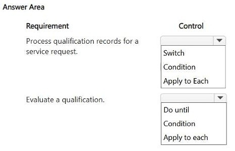

_HOTSPOT — the original ExamTopics question expects you to mark areas on the exhibit above; the correct hotspot coordinates are not published._

**Most voted:**
1. Apply to each
2. Condition

### Top explanations
- **exam_upskill** (6 upvotes [Most Recent]): 1. Apply to each
  2. Condition

## Q1.105 (ID 433209)

Background
ADatum Corporation provides verification and investigation services that are used by insurance companies, law firms, and other organizations in the public sector. Services include verifying an individual’s background, qualifications, and specific scenarios that require onsite visits.
The thorough work ADatum Corporation performs results in highly accurate cases with minimal critical information missing. Because of these high-quality results, ADatum Corporation is quickly proving itself as one of the best in the industry. In recent months, business has significantly increased, with most new business coming from high-profile companies and individuals.
Management has decided to create a new qualification verification (QV) role to help ensure that clients get the most accurate results. This role examines completed work to ensure that nothing is missed.
Current environment
Data storage and retention
•	All information sent by clients for services is stored in Microsoft Dataverse with a model-driven app as the interface.
•	Clients enter their data in a website, which then uses a service account to create the records in the Dataverse database.
•	Team members currently have full access to all Service Request records.
Service requests
•	The Service Request table includes header information about the individual or organization that is the subject of verification.
•	New Service Request records are assigned to a queue. All potential users who will be performing the verifications have access to these records.
•	A service request is assigned to a single user who will ensure that all qualifications are verified. This single user is the only one able to process Qualification records related to their own service requests.
•	Many required tasks when performing verification services are currently done by using manual processes.
•	To keep up with demand, ADatum Corporation identifies several processes that can be replaced by using Power flows to hire fewer new staff and keep costs down.
Qualification verification
•	The qualification table contains details about an individual school degree, professional qualifications, and other qualifications that must be verified.
•	A service request can have one or more Qualification records associated with it.
•	Record status is pending verification until the initial team member finishes, at which point the member changes the status to Complete.
•	When all qualification records related to a service request are verified either by manual or automated processes, the results are made available to ADatum Corporation’s client.
•	In the rare event that results are questioned, a new service request is created and verified independently of the previous work that took place.
•	To complete a service request, users perform the following actions:
o	Send a templated email by using Microsoft Outlook to the client after all qualifications for a service request are checked.
o	Change the service request status to Completed. Currently, service requests do not indicate when all Qualification records are addressed.
Microsoft Power Platform environment
•	The following environments exist: development, testing, user acceptance testing (UAT), and production.
•	Managed solutions are used to move customizations from the development environment to other higher-level environments. These solutions are created and maintained by the power users and provided to internal IT for deployment when they are ready.
•	Two managed solutions, Verification Process Automation and Onsite Visit, share several components.
•	All customizations to Power Platform components are performed by several power users who have received training and are certified as subject matter experts.
•	Power users have been granted the System Administrator security role in the development environment.
•	Corporate policy prohibits power users from writing code due to lack of a formal code review process.
•	Internal IT will not be able to supply any development resources for this project due to a lack of staff. This means that any customizations and automation created for this project must be low-code/no-code for the power users to implement them.
•	Customizations created by power users are deployed by internal IT.
Requirements
Process automation
ADatum Corporation plans to establish a new QV department to verify completed work so that the quality of work is maintained. The new process for verifying professional qualifications must automate the following:
•	Enter data and navigate the authority’s website. The authority website UI changes frequently because the company constantly improves the user experience.
•	Search page contents for a specified value to determine validity.
•	Update the corresponding Qualification record in Dataverse.
The new process for completing a service request must automate the following:
•	Set the Service Request record status to Complete when work on all Qualification records is finished.
•	Send an email to the client with the results when the service request is completed. The email must list each qualification as either Valid or Not Valid, depending on the verification.
Qualification verification
•	Service request results will not be released to clients until all related Qualification records are set to a Complete status.
•	To check work done by a wide array of users, 10 percent of Qualification records must be double checked.
•	Qualification records must be automatically assigned to a queue.
•	Qualification records must be flagged with a new status field named Assigned to ensure that records are rechecked.
•	Ensure that only QV team members can change the status from Assigned to In Progress to Complete.
•	Record the name of the QV team member who performed the work and the date completed.
Governance and security
•	All components required for the verification process must be included in a new solution.
•	Corporate security requires that deployments to non-development environments must be automated using service accounts.
•	User security and data access must also be consistent across environments, except for the elevated access of the power users in the development environment.
•	The Onsite Visit managed solution has a table that is not in the Verification Process Automation managed solution. This table must be upgraded prior to the go-live date without the other shared components.
•	A VP of sales requires a test environment to demonstrate to potential clients the security policies that are included in their initial offering.
Issues
•	More employees than are required can access individual client information and continue to have access after a service request is completed.
•	When users go on vacation, all their outstanding Service Request records are assigned to a substitute employee. The substitute employees are unable to see all the qualifications related to their service requests.
•	Currently, testing the new QV functionality outside the development environment is not possible due to corporate security policies requiring the same security role across all environments.
•	Internal IT reports that the solution import to the test environment failed because of missing dependencies related to the flow for completing service requests.
You need to assign 10 percent of the Qualification rows to the QV queue through table configuration by using a Power Automate flow.
What should you do?

⭕ **A.** Create an autonumber column on the Service Request table. Configure the Power Automate flow to assign qualification rows if the number cleanly divides by 10.
⭕ **B.** Create a formula column on the Service Request table that sums the number of qualification rows and generates a random number between zero and the number from the new column. Configure the Power Automate flow to assign each qualification row if the number generated is 10 percent or less of the value of the new column.
✅ **C.** Create an autonumber column on the Qualification table. Configure the Power Automate flow to assign qualification rows if the number cleanly divides by 10.
⭕ **D.** Create a roll-up column on the Service Request table that is the count of qualification rows and generates a random number between zero and the number from the new column. Configure the Power Automate flow to assign each qualification row if the number generated is 10 percent or less of the value of the new column.

**Correct answer:** C
**Most voted:** C

### Top explanations
- **Pathik007** (4 upvotes [Most Recent, Selected Answer: C]): C. Create an autonumber column on the Qualification table. Configure the Power Automate flow to assign qualification rows if the number cleanly divides by 10.
- **exam_upskill** (1 upvotes [Selected Answer: D]): D. Create a roll-up column on the Service Request table that is the count of qualification rows and generates a random number between zero and the number from the new column. Configure the Power Automate flow to assign each qualification row if the number generated is 10 percent or less of the value of the new column.

## Q1.106 (ID 433245)

HOTSPOT
Background
ADatum Corporation provides verification and investigation services that are used by insurance companies, law firms, and other organizations in the public sector. Services include verifying an individual’s background, qualifications, and specific scenarios that require onsite visits.
The thorough work ADatum Corporation performs results in highly accurate cases with minimal critical information missing. Because of these high-quality results, ADatum Corporation is quickly proving itself as one of the best in the industry. In recent months, business has significantly increased, with most new business coming from high-profile companies and individuals.
Management has decided to create a new qualification verification (QV) role to help ensure that clients get the most accurate results. This role examines completed work to ensure that nothing is missed.
Current environment
Data storage and retention
•	All information sent by clients for services is stored in Microsoft Dataverse with a model-driven app as the interface.
•	Clients enter their data in a website, which then uses a service account to create the records in the Dataverse database.
•	Team members currently have full access to all Service Request records.
Service requests
•	The Service Request table includes header information about the individual or organization that is the subject of verification.
•	New Service Request records are assigned to a queue. All potential users who will be performing the verifications have access to these records.
•	A service request is assigned to a single user who will ensure that all qualifications are verified. This single user is the only one able to process Qualification records related to their own service requests.
•	Many required tasks when performing verification services are currently done by using manual processes.
•	To keep up with demand, ADatum Corporation identifies several processes that can be replaced by using Power flows to hire fewer new staff and keep costs down.
Qualification verification
•	The qualification table contains details about an individual school degree, professional qualifications, and other qualifications that must be verified.
•	A service request can have one or more Qualification records associated with it.
•	Record status is pending verification until the initial team member finishes, at which point the member changes the status to Complete.
•	When all qualification records related to a service request are verified either by manual or automated processes, the results are made available to ADatum Corporation’s client.
•	In the rare event that results are questioned, a new service request is created and verified independently of the previous work that took place.
•	To complete a service request, users perform the following actions:
o	Send a templated email by using Microsoft Outlook to the client after all qualifications for a service request are checked.
o	Change the service request status to Completed. Currently, service requests do not indicate when all Qualification records are addressed.
Microsoft Power Platform environment
•	The following environments exist: development, testing, user acceptance testing (UAT), and production.
•	Managed solutions are used to move customizations from the development environment to other higher-level environments. These solutions are created and maintained by the power users and provided to internal IT for deployment when they are ready.
•	Two managed solutions, Verification Process Automation and Onsite Visit, share several components.
•	All customizations to Power Platform components are performed by several power users who have received training and are certified as subject matter experts.
•	Power users have been granted the System Administrator security role in the development environment.
•	Corporate policy prohibits power users from writing code due to lack of a formal code review process.
•	Internal IT will not be able to supply any development resources for this project due to a lack of staff. This means that any customizations and automation created for this project must be low-code/no-code for the power users to implement them.
•	Customizations created by power users are deployed by internal IT.
Requirements
Process automation
ADatum Corporation plans to establish a new QV department to verify completed work so that the quality of work is maintained. The new process for verifying professional qualifications must automate the following:
•	Enter data and navigate the authority’s website. The authority website UI changes frequently because the company constantly improves the user experience.
•	Search page contents for a specified value to determine validity.
•	Update the corresponding Qualification record in Dataverse.
The new process for completing a service request must automate the following:
•	Set the Service Request record status to Complete when work on all Qualification records is finished.
•	Send an email to the client with the results when the service request is completed. The email must list each qualification as either Valid or Not Valid, depending on the verification.
Qualification verification
•	Service request results will not be released to clients until all related Qualification records are set to a Complete status.
•	To check work done by a wide array of users, 10 percent of Qualification records must be double checked.
•	Qualification records must be automatically assigned to a queue.
•	Qualification records must be flagged with a new status field named Assigned to ensure that records are rechecked.
•	Ensure that only QV team members can change the status from Assigned to In Progress to Complete.
•	Record the name of the QV team member who performed the work and the date completed.
Governance and security
•	All components required for the verification process must be included in a new solution.
•	Corporate security requires that deployments to non-development environments must be automated using service accounts.
•	User security and data access must also be consistent across environments, except for the elevated access of the power users in the development environment.
•	The Onsite Visit managed solution has a table that is not in the Verification Process Automation managed solution. This table must be upgraded prior to the go-live date without the other shared components.
•	A VP of sales requires a test environment to demonstrate to potential clients the security policies that are included in their initial offering.
Issues
•	More employees than are required can access individual client information and continue to have access after a service request is completed.
•	When users go on vacation, all their outstanding Service Request records are assigned to a substitute employee. The substitute employees are unable to see all the qualifications related to their service requests.
•	Currently, testing the new QV functionality outside the development environment is not possible due to corporate security policies requiring the same security role across all environments.
•	Internal IT reports that the solution import to the test environment failed because of missing dependencies related to the flow for completing service requests.
You need to address the unnecessary data access.
Which security changes should you make? To answer, select the appropriate options in the answer area.
NOTE: Each correct selection is worth one point.

**Exhibits**
- Exhibit 1: 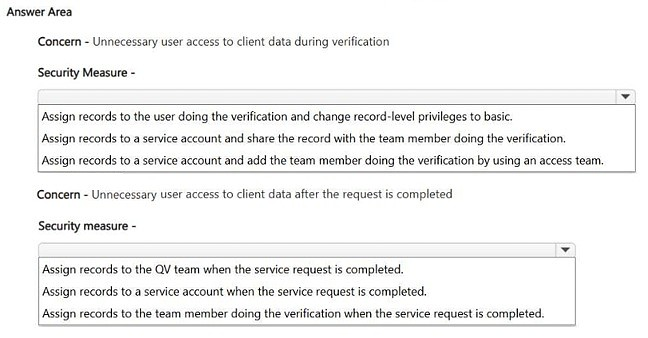

_HOTSPOT — the original ExamTopics question expects you to mark areas on the exhibit above; the correct hotspot coordinates are not published._

**Most voted:**
1. Assign records to a service account and add the team member doing the verification by using an access team.
2. Assign records to the QV tam when the service request is completed.

### Top explanations
- **exam_upskill** (2 upvotes): 1. Assign records to a service account and add the team member doing the verification by using an access team.
  2. Assign records to the QV tam when the service request is completed.
- **ah2006** (1 upvotes [Most Recent]): Unnecessary user access to client data during verification
  → Assign records to the user doing the verification and change record-level privileges to basic.
  Unnecessary user access to client data after the request is completed
  → Assign records to a service account when the service request is completed.

## Q1.107 (ID 433215)

Note: This question is part of a series of questions that present the same scenario. Each question in the series contains a unique solution that might meet the stated goals. Some question sets might have more than one correct solution, while others might not have a correct solution.
After you answer a question in this section, you will NOT be able to return to it. As a result, these questions will not appear in the review screen.
A company integrates external systems into Power Automate by using cloud flows.
The company must connect to external services with different characteristics and determine whether a custom connector is required.
You need to propose a solution to meet the requirements.
Solution: Create a custom connector to integrate with an internal web service that is used across multiple flows and requires reusable actions.
Does the solution meet the goal?

✅ **A.** Yes
⭕ **B.** No

**Correct answer:** A
**Most voted:** A

### Top explanations
- **ah2006** (1 upvotes [Most Recent, Selected Answer: A]): Yes => Internal Webservice, multiple flows => Custom Connector

## Q1.110 (ID 433246)

Background
Contoso Suites is an animal shelter that specializes in finding homes for dogs that have been given up by their owners. The shelter can house up to 20 dogs.
The shelter is implementing one model-driven Power Apps app to track the dogs and schedule meetings with potential adopters. No other apps will be created.
The model-driven app uses Dataverse with out-of-the-box functionality when possible. Dataverse is set up with the following configuration:
•	The solution prefix “cs” is used for all new components.
•	Only the root business unit is used.
•	All tables are stored in Dataverse and do not require rapid scaling.
•	Exchange server-side sync is not configured.
Adopters
•	Adopter information is stored in a Contact table.
•	Contacts are considered to be duplicates if they have the same email address and last name.
•	Adopters are often late to meetings, so a reminder email is sent to them two hours before their meeting.
•	The email reminders must not be tracked in the system.
Dogs
•	Dog information is stored in a Dog table, which is organization owned.
•	Breed, size, and weight are fields in the table.
Dog residency
•	A Resident table tracks the stay of each dog.
•	Each resident record has a lookup for the dog and its food.
•	The food type and amount are logged on each resident record. Auto-posting is not configured for changes to food type and amount.
•	A fee of $120 is in a currency column named Adoption Fee. This fee can be changed depending on the adoption circumstances.
•	A formula column named Deposit is automatically populated with 20% of the adoption fee.
•	A resident record is generated automatically when a dog record is created. This is the only way a resident record can be created.
Exercise and feedings
•	Exercise for the dogs is tracked in an Exercise table.
•	Feedings are tracked in a Feeding table.
•	Exercise and feeding records appear in a resident record timeline.
Care staff
•	The care staff must be able to view who changed the food type and the amount that was given, for up to three months ago.
•	The staff must be able to update the weight of a dog on the resident record.
•	The staff report that the buttons are too small on the touch screen they use to log exercise and feeding.
•	The staff must be able to view who the adopters are for upcoming meetings. The staff must not be able to update adopter information.
Administrative staff
•	Administrative staff must receive a weekly list of duplicate contacts. Duplicate alerts must not appear when a staff member saves a new contact.
•	When an adopter wants to adopt a dog, the staff must perform a series of adoption duties in order. The following duty list must be displayed on the screen:
o	Commitment:
-	Obtain adopter signature in a commitment document.
-	Collect deposit.
o	Pre-pickup:
-	Document spay or neutering date.
-	Perform spay or neutering.
-	Document pickup date.
o	Pickup:
-	Collect full payment.
-	Verify dog is picked up.
o	A dog must be picked up no sooner than two days after spaying or neutering.
o	A pop-up window must appear with an error message if the Pickup date is too soon.
o	Only administrative staff must be able to add new adopters and dogs.
You need to configure the Deposit column.
How should you write the formula?

⭕ **A.** ‘Adoption Fee’ * 0.20
⭕ **B.** Decimal(‘Adoption Fee’ * 20%)
⭕ **C.** ‘Adoption Fee’ * 20%
✅ **D.** Decimal(‘Adoption Fee’) * 0.20

**Correct answer:** D
**Most voted:** D

### Top explanations
- **exam_upskill** (4 upvotes [Most Recent, Selected Answer: D]): D. Decimal(‘Adoption Fee’) * 0.20

## Q1.112 (ID 433242)

DRAG DROP
Background
Contoso Suites is an animal shelter that specializes in finding homes for dogs that have been given up by their owners. The shelter can house up to 20 dogs.
The shelter is implementing one model-driven Power Apps app to track the dogs and schedule meetings with potential adopters. No other apps will be created.
The model-driven app uses Dataverse with out-of-the-box functionality when possible. Dataverse is set up with the following configuration:
•	The solution prefix “cs” is used for all new components.
•	Only the root business unit is used.
•	All tables are stored in Dataverse and do not require rapid scaling.
•	Exchange server-side sync is not configured.
Adopters
•	Adopter information is stored in a Contact table.
•	Contacts are considered to be duplicates if they have the same email address and last name.
•	Adopters are often late to meetings, so a reminder email is sent to them two hours before their meeting.
•	The email reminders must not be tracked in the system.
Dogs
•	Dog information is stored in a Dog table, which is organization owned.
•	Breed, size, and weight are fields in the table.
Dog residency
•	A Resident table tracks the stay of each dog.
•	Each resident record has a lookup for the dog and its food.
•	The food type and amount are logged on each resident record. Auto-posting is not configured for changes to food type and amount.
•	A fee of $120 is in a currency column named Adoption Fee. This fee can be changed depending on the adoption circumstances.
•	A formula column named Deposit is automatically populated with 20% of the adoption fee.
•	A resident record is generated automatically when a dog record is created. This is the only way a resident record can be created.
Exercise and feedings
•	Exercise for the dogs is tracked in an Exercise table.
•	Feedings are tracked in a Feeding table.
•	Exercise and feeding records appear in a resident record timeline.
Care staff
•	The care staff must be able to view who changed the food type and the amount that was given, for up to three months ago.
•	The staff must be able to update the weight of a dog on the resident record.
•	The staff report that the buttons are too small on the touch screen they use to log exercise and feeding.
•	The staff must be able to view who the adopters are for upcoming meetings. The staff must not be able to update adopter information.
Administrative staff
•	Administrative staff must receive a weekly list of duplicate contacts. Duplicate alerts must not appear when a staff member saves a new contact.
•	When an adopter wants to adopt a dog, the staff must perform a series of adoption duties in order. The following duty list must be displayed on the screen:
o	Commitment:
-	Obtain adopter signature in a commitment document.
-	Collect deposit.
o	Pre-pickup:
-	Document spay or neutering date.
-	Perform spay or neutering.
-	Document pickup date.
o	Pickup:
-	Collect full payment.
-	Verify dog is picked up.
o	A dog must be picked up no sooner than two days after spaying or neutering.
o	A pop-up window must appear with an error message if the Pickup date is too soon.
o	Only administrative staff must be able to add new adopters and dogs.
You need to enable the care staff to update a dog’s weight.
Which three actions should you perform in sequence? To answer, move the appropriate actions from the list of actions to the answer area and arrange them in the correct order.

**Exhibits**
- Exhibit 1: 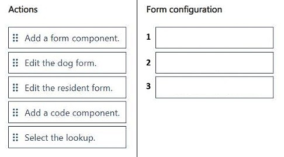

_DRAG DROP — the original ExamTopics question expects you to drag and drop items; the correct targets are not published._

**Most voted:**
1. Edit the resident form.
2. Select the lookup.
3. Add a form component.

### Top explanations
- **Pathik007** (3 upvotes [Most Recent]): 1. Edit the resident form.
  2. Select the lookup.
  3. Add a form component.
- **exam_upskill** (2 upvotes): 1. Edit the resident form
  2. Add a form component.
  3. Select the lookup

## Q1.113 (ID 433220)

DRAG DROP
Background
Contoso Suites is an animal shelter that specializes in finding homes for dogs that have been given up by their owners. The shelter can house up to 20 dogs.
The shelter is implementing one model-driven Power Apps app to track the dogs and schedule meetings with potential adopters. No other apps will be created.
The model-driven app uses Dataverse with out-of-the-box functionality when possible. Dataverse is set up with the following configuration:
•	The solution prefix “cs” is used for all new components.
•	Only the root business unit is used.
•	All tables are stored in Dataverse and do not require rapid scaling.
•	Exchange server-side sync is not configured.
Adopters
•	Adopter information is stored in a Contact table.
•	Contacts are considered to be duplicates if they have the same email address and last name.
•	Adopters are often late to meetings, so a reminder email is sent to them two hours before their meeting.
•	The email reminders must not be tracked in the system.
Dogs
•	Dog information is stored in a Dog table, which is organization owned.
•	Breed, size, and weight are fields in the table.
Dog residency
•	A Resident table tracks the stay of each dog.
•	Each resident record has a lookup for the dog and its food.
•	The food type and amount are logged on each resident record. Auto-posting is not configured for changes to food type and amount.
•	A fee of $120 is in a currency column named Adoption Fee. This fee can be changed depending on the adoption circumstances.
•	A formula column named Deposit is automatically populated with 20% of the adoption fee.
•	A resident record is generated automatically when a dog record is created. This is the only way a resident record can be created.
Exercise and feedings
•	Exercise for the dogs is tracked in an Exercise table.
•	Feedings are tracked in a Feeding table.
•	Exercise and feeding records appear in a resident record timeline.
Care staff
•	The care staff must be able to view who changed the food type and the amount that was given, for up to three months ago.
•	The staff must be able to update the weight of a dog on the resident record.
•	The staff report that the buttons are too small on the touch screen they use to log exercise and feeding.
•	The staff must be able to view who the adopters are for upcoming meetings. The staff must not be able to update adopter information.
Administrative staff
•	Administrative staff must receive a weekly list of duplicate contacts. Duplicate alerts must not appear when a staff member saves a new contact.
•	When an adopter wants to adopt a dog, the staff must perform a series of adoption duties in order. The following duty list must be displayed on the screen:
o	Commitment:
-	Obtain adopter signature in a commitment document.
-	Collect deposit.
o	Pre-pickup:
-	Document spay or neutering date.
-	Perform spay or neutering.
-	Document pickup date.
o	Pickup:
-	Collect full payment.
-	Verify dog is picked up.
o	A dog must be picked up no sooner than two days after spaying or neutering.
o	A pop-up window must appear with an error message if the Pickup date is too soon.
o	Only administrative staff must be able to add new adopters and dogs.
You need to set up a security role for the care staff.
Which privileges should you set? To answer, move the appropriate privileges to the correct create, read, write tables. You may use each create, read, write privileges once, more than once, or not at all. You may need to move the split bar between panes or scroll to view content.
NOTE: Each correct selection is worth one point.

**Exhibits**
- Exhibit 1: 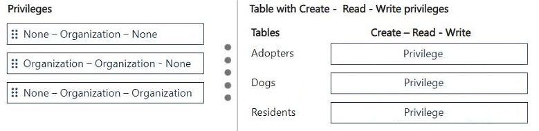

_DRAG DROP — the original ExamTopics question expects you to drag and drop items; the correct targets are not published._

**Most voted:**
- Adopters: None – Organization – None
- Dogs: None – Organization – Organization
- Residents: None – Organization – Organization

### Top explanations
- **Pathik007** (6 upvotes [Most Recent]): Adopters	None – Organization – None
  Dogs	None – Organization – Organization
  Residents	None – Organization – Organization
- **exam_upskill** (2 upvotes): 1. None - Organization - None
  2. None - Organization - None
  3. None - Organization - Organization

## Q1.114 (ID 433256)

Background
Contoso Suites is an animal shelter that specializes in finding homes for dogs that have been given up by their owners. The shelter can house up to 20 dogs.
The shelter is implementing one model-driven Power Apps app to track the dogs and schedule meetings with potential adopters. No other apps will be created.
The model-driven app uses Dataverse with out-of-the-box functionality when possible. Dataverse is set up with the following configuration:
•	The solution prefix “cs” is used for all new components.
•	Only the root business unit is used.
•	All tables are stored in Dataverse and do not require rapid scaling.
•	Exchange server-side sync is not configured.
Adopters
•	Adopter information is stored in a Contact table.
•	Contacts are considered to be duplicates if they have the same email address and last name.
•	Adopters are often late to meetings, so a reminder email is sent to them two hours before their meeting.
•	The email reminders must not be tracked in the system.
Dogs
•	Dog information is stored in a Dog table, which is organization owned.
•	Breed, size, and weight are fields in the table.
Dog residency
•	A Resident table tracks the stay of each dog.
•	Each resident record has a lookup for the dog and its food.
•	The food type and amount are logged on each resident record. Auto-posting is not configured for changes to food type and amount.
•	A fee of $120 is in a currency column named Adoption Fee. This fee can be changed depending on the adoption circumstances.
•	A formula column named Deposit is automatically populated with 20% of the adoption fee.
•	A resident record is generated automatically when a dog record is created. This is the only way a resident record can be created.
Exercise and feedings
•	Exercise for the dogs is tracked in an Exercise table.
•	Feedings are tracked in a Feeding table.
•	Exercise and feeding records appear in a resident record timeline.
Care staff
•	The care staff must be able to view who changed the food type and the amount that was given, for up to three months ago.
•	The staff must be able to update the weight of a dog on the resident record.
•	The staff report that the buttons are too small on the touch screen they use to log exercise and feeding.
•	The staff must be able to view who the adopters are for upcoming meetings. The staff must not be able to update adopter information.
Administrative staff
•	Administrative staff must receive a weekly list of duplicate contacts. Duplicate alerts must not appear when a staff member saves a new contact.
•	When an adopter wants to adopt a dog, the staff must perform a series of adoption duties in order. The following duty list must be displayed on the screen:
o	Commitment:
-	Obtain adopter signature in a commitment document.
-	Collect deposit.
o	Pre-pickup:
-	Document spay or neutering date.
-	Perform spay or neutering.
-	Document pickup date.
o	Pickup:
-	Collect full payment.
-	Verify dog is picked up.
o	A dog must be picked up no sooner than two days after spaying or neutering.
o	A pop-up window must appear with an error message if the Pickup date is too soon.
o	Only administrative staff must be able to add new adopters and dogs.
You need to create adoption duties for the administrative staff.
What should you create?

✅ **A.** business process flow
⭕ **B.** business rule
⭕ **C.** business unit

**Correct answer:** A
**Most voted:** A

### Top explanations
- **exam_upskill** (5 upvotes [Most Recent, Selected Answer: A]): A. business process flow

## Q1.115 (ID 433312)

HOTSPOT
Background
Contoso Suites is an animal shelter that specializes in finding homes for dogs that have been given up by their owners. The shelter can house up to 20 dogs.
The shelter is implementing one model-driven Power Apps app to track the dogs and schedule meetings with potential adopters. No other apps will be created.
The model-driven app uses Dataverse with out-of-the-box functionality when possible. Dataverse is set up with the following configuration:
•	The solution prefix “cs” is used for all new components.
•	Only the root business unit is used.
•	All tables are stored in Dataverse and do not require rapid scaling.
•	Exchange server-side sync is not configured.
Adopters
•	Adopter information is stored in a Contact table.
•	Contacts are considered to be duplicates if they have the same email address and last name.
•	Adopters are often late to meetings, so a reminder email is sent to them two hours before their meeting.
•	The email reminders must not be tracked in the system.
Dogs
•	Dog information is stored in a Dog table, which is organization owned.
•	Breed, size, and weight are fields in the table.
Dog residency
•	A Resident table tracks the stay of each dog.
•	Each resident record has a lookup for the dog and its food.
•	The food type and amount are logged on each resident record. Auto-posting is not configured for changes to food type and amount.
•	A fee of $120 is in a currency column named Adoption Fee. This fee can be changed depending on the adoption circumstances.
•	A formula column named Deposit is automatically populated with 20% of the adoption fee.
•	A resident record is generated automatically when a dog record is created. This is the only way a resident record can be created.
Exercise and feedings
•	Exercise for the dogs is tracked in an Exercise table.
•	Feedings are tracked in a Feeding table.
•	Exercise and feeding records appear in a resident record timeline.
Care staff
•	The care staff must be able to view who changed the food type and the amount that was given, for up to three months ago.
•	The staff must be able to update the weight of a dog on the resident record.
•	The staff report that the buttons are too small on the touch screen they use to log exercise and feeding.
•	The staff must be able to view who the adopters are for upcoming meetings. The staff must not be able to update adopter information.
Administrative staff
•	Administrative staff must receive a weekly list of duplicate contacts. Duplicate alerts must not appear when a staff member saves a new contact.
•	When an adopter wants to adopt a dog, the staff must perform a series of adoption duties in order. The following duty list must be displayed on the screen:
o	Commitment:
-	Obtain adopter signature in a commitment document.
-	Collect deposit.
o	Pre-pickup:
-	Document spay or neutering date.
-	Perform spay or neutering.
-	Document pickup date.
o	Pickup:
-	Collect full payment.
-	Verify dog is picked up.
o	A dog must be picked up no sooner than two days after spaying or neutering.
o	A pop-up window must appear with an error message if the Pickup date is too soon.
o	Only administrative staff must be able to add new adopters and dogs.
You need to ensure that an appropriate date is selected for dog pickup.
What should you configure? To answer, select the appropriate options in the answer area.
NOTE: Each correct selection is worth one point.

**Exhibits**
- Exhibit 1: 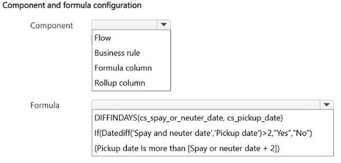

_HOTSPOT — the original ExamTopics question expects you to mark areas on the exhibit above; the correct hotspot coordinates are not published._

**Most voted:**
- Component: Business rule
- Formula: DIFFINDAYS

### Top explanations
- **Pathik007** (2 upvotes [Most Recent]): Component: Business rule
  Formula: DIFFINDAYS(cs_spay_or_neuter_date, cs_pickup_date)
- **exam_upskill** (2 upvotes): 1. Business rule
  2. If(Datediff('Spay and neuter date','Pickup date')>2,"Yes","No")

## Q1.116 (ID 433278)

A company uses a cloud flow to manage purchase requests. Each request must be reviewed by a manager before processing.
The company requires the following approval functionality:
•	Requests must be sent to the appropriate manager for approval.
•	The flow must continue only after a decision is made.
•	Approved and rejected requests must follow different paths.
You need to design the approval flow.
Which three actions should you perform? Each correct answer presents part of the solution.
NOTE: Each correct selection is worth one point.

✅ **A.** Configure approvers within the approval action.
✅ **B.** Add a condition to evaluate the approval outcome.
⭕ **C.** Configure run after settings on the approval action.
⭕ **D.** Enable secure inputs for the approval action.
✅ **E.** Add a Start and wait for an approval action.

**Correct answer:** A, B, E
**Most voted:** ABE

### Top explanations
- **exam_upskill** (3 upvotes [Most Recent, Selected Answer: ABE]): A. Configure approvers within the approval action.
  B. Add a condition to evaluate the approval outcome.
  E. Add a Start and wait for an approval action.

## Q1.117 (ID 433248)

DRAG DROP
You must create a form for team members to use. The form must provide the ability to:
•	Lock a field on a form.
•	Trigger business logic based on a field value.
•	Use existing business information to enhance data entry.
You need to implement business rule components to create the form.
Which components should you use? To answer, move the appropriate components to the correct requirements. Each component may be used once, more than once, or not at all. You may need to move the split bar between panes or scroll to view content.
NOTE: Each correct selection is worth one point.

**Exhibits**
- Exhibit 1: 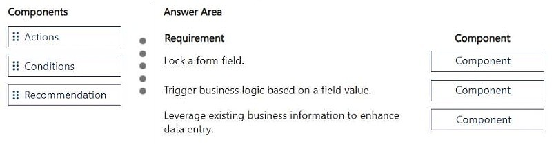

_DRAG DROP — the original ExamTopics question expects you to drag and drop items; the correct targets are not published._

**Most voted:**
1. Action
2. Conditions
3. Recommendation

### Top explanations
- **exam_upskill** (2 upvotes [Most Recent]): 1. Action
  2. Conditions
  3. Recommendation

## Q1.118 (ID 433229)

DRAG DROP
You are troubleshooting multiple production Power Automate cloud flows for a company. The cloud flows connect to Microsoft Dataverse by using Microsoft Entra ID authentication.
You analyze the following issues:
•	A flow that has not executed for more than 90 days fails when performing actions that rely on an existing connection configuration.
•	A flow fails for records containing incomplete data.
You need to resolve flow failures.
Which actions should you perform? To answer, move the appropriate actions to the correct issues. You may use each action once, more than once, or not at all. You may need to move the split bar between panes or scroll to view content.
NOTE: Each correct selection is worth one point.

**Exhibits**
- Exhibit 1: 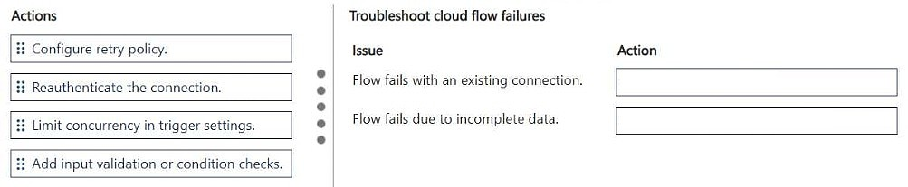

_DRAG DROP — the original ExamTopics question expects you to drag and drop items; the correct targets are not published._

**Most voted:**
1. Reauthenticate the connection
2. Add input validation or condition checks

### Top explanations
- **exam_upskill** (3 upvotes [Most Recent]): 1. Reauthenticate the connection
  2. Add input validation or condition checks

## Q1.119 (ID 433217)

A company builds a canvas app that processes images submitted by users and must classify them using an existing AI Builder model.
The app must generate predictions during user interaction.
You need to consume the AI model natively.
What should you do?

⭕ **A.** Refine the model with additional images.
✅ **B.** Invoke the model by using Power Fx.
⭕ **C.** Export the solution which contains the model.
⭕ **D.** Retrain the model for each submission.

**Correct answer:** B
**Most voted:** B

### Top explanations
- **exam_upskill** (3 upvotes [Most Recent, Selected Answer: B]): B. Invoke the model by using Power Fx.

## Q1.120 (ID 433211)

DRAG DROP
You are configuring the Accounts table in Microsoft Dataverse for a company.
When users create a new account, the category must automatically be set to Standard when the form loads.
You need to implement the configuration.
Which three actions should you perform in sequence? To answer, move the appropriate actions from the list of actions to the answer area and arrange them in the correct order.

**Exhibits**
- Exhibit 1: 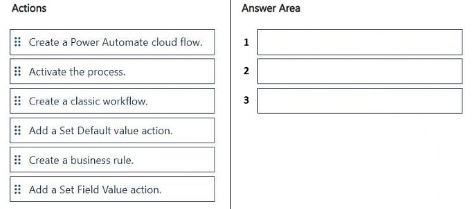

_DRAG DROP — the original ExamTopics question expects you to drag and drop items; the correct targets are not published._

**Most voted:**
1. Create a business rule
2. Add a Set Default value action
3. Activate the Process

### Top explanations
- **exam_upskill** (3 upvotes): 1. Create a business rule
  2. Add a Set Default value action
  3. Activate the Process
- **Pathik007** (1 upvotes [Most Recent]): 1. Create a classic workflow.
  2. Add a Set Field Value action.
  3. Activate the process.

## Q1.121 (ID 433272)

DRAG DROP
A company uses a business process flow to manage sales opportunities.
The business process flow has the following requirements:
•	The process must follow one path when the estimated revenue is below a threshold and a different path when the estimated revenue meets or exceeds that threshold.
•	If the estimated revenue is above a certain threshold, users must be able to enter data into additional columns and trigger a Power Automate cloud flow before moving forward.
You need to configure the business process flow.
What should you add for each requirement? To answer, move the appropriate configurations to the correct requirements. You may use each configuration once, more than once, or not at all. You may need to move the split bar between panes or scroll to view content.
NOTE: Each correct selection is worth one point.

**Exhibits**
- Exhibit 1: 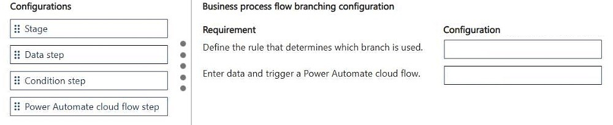

_DRAG DROP — the original ExamTopics question expects you to drag and drop items; the correct targets are not published._

**Most voted:**
1. Condition step
2. Power automate cloud flow step

### Top explanations
- **exam_upskill** (2 upvotes [Most Recent]): 1. Condition step
  2. Power automate cloud flow step

## Q1.122 (ID 433234)

HOTSPOT
A company builds a canvas app that users use to enter customer feedback. The company plans to use a preexisting custom prompt to summarize the feedback within the app.
The company must be able to:
•	Use the prompt in the app.
•	Access the result of the prompt by using Power Fx.
You need to add the prompt to the app and retrieve the results.
Which configurations should you use? To answer, select the appropriate options in the answer area.
NOTE: Each correct selection is worth one point.

**Exhibits**
- Exhibit 1: 

_HOTSPOT — the original ExamTopics question expects you to mark areas on the exhibit above; the correct hotspot coordinates are not published._

**Most voted:**
1. Data
2. Predict()

### Top explanations
- **exam_upskill** (4 upvotes [Most Recent]): 1. Data
  2. Predict()

## Q1.123 (ID 433231)

A company is deploying multiple AI-enabled Power Platform solutions across teams.
Company administrators have the following requirements:
•	Administrators require centralized insights and governance.
•	Solutions must follow automated lifecycle practices without reliance on external tooling.
•	Existing and new environments must enforce governance policies.
You need to recommend an environment type that meets the requirements.
What environment type should you recommend?

⭕ **A.** Sandbox
⭕ **B.** Developer
✅ **C.** Managed
⭕ **D.** Production

**Correct answer:** C
**Most voted:** C

### Top explanations
- **Jeffson_LXJ** (2 upvotes [Most Recent, Selected Answer: C]): Yes, it should be managed as it enforces governance policies.

## Q1.124 (ID 433230)

DRAG DROP
An organization wants to enhance a model-driven app with Copilot capabilities to improve user productivity, provide contextual guidance, and automate selected business processes.
The solution must meet the following requirements:
•	Provide contextual assistance to users that is aware of the current record and page they are working with.
•	Automatically execute business processes when predefined trigger conditions are met.
You need to select the appropriate AI component for each requirement.
Which component should you use for each requirement? To answer, move the appropriate capabilities to the correct requirements. You may use each capability once, more than once, or not at all. You may need to move the split bar between panes or scroll to view content.
NOTE: Each correct selection is worth one point.

**Exhibits**
- Exhibit 1: 

_DRAG DROP — the original ExamTopics question expects you to drag and drop items; the correct targets are not published._

**Most voted:**
1. App assistant agent
2. Agent flow

### Top explanations
- **exam_upskill** (2 upvotes [Most Recent]): 1. App assistant agent
  2. Agent flow

## Q1.125 (ID 433249)

A company is building an AI-enabled solution that includes prompts, cloud flows, and Dataverse components.
The solution must be released to production through a controlled process to include the following requirements:
•	Validate changes before production release.
•	Ensure production stability.
•	Ensure that release steps are repeatable and governed.
•	Ensure that the production environment reflects only controlled and traceable changes.
You need to determine the appropriate deployment strategy.
What should you do?

⭕ **A.** Export an unmanaged solution from development to test. After validating, apply required fixes in test and deploy a managed solution to production.
✅ **B.** Export a managed solution from development to test. After validating, deploy the solution to production.
⭕ **C.** Export an unmanaged solution from development. Import the solution into production after testing.
⭕ **D.** Export an unmanaged solution from development to test. After validating, deploy a managed solution to production.

**Correct answer:** B
**Most voted:** B

### Top explanations
- **exam_upskill** (3 upvotes [Most Recent, Selected Answer: B]): B. Export a managed solution from development to test. After validating, deploy the solution to production.

## Q1.126 (ID 433277)

DRAG DROP
A company that manufactures medical devices uses Power Apps to manage their sales and device maintenance.
A table named Devices in Microsoft Dataverse has a column named Status. The Status column must have a new status value of Review added to the existing Choice values of Active and Inactive.
The table must be added to a solution to be promoted once the change is made.
Only this change must be promoted to the test environment. The changes must not be able to be changed once promoted.
You need to add the change to a solution for promotion.
Which option should you use? To answer, move the appropriate options to the correct actions. Each option may be used once, more than once, or not at all. You may need to move the split bar between panes or scroll to view content.
NOTE: Each correct selection is worth one point.

**Exhibits**
- Exhibit 1: 

_DRAG DROP — the original ExamTopics question expects you to drag and drop items; the correct targets are not published._

**Most voted:**
- Add the Devices table to the solution → Add existing
- Add the status column changes only to the solution → Add object

### Top explanations
- **exam_upskill** (3 upvotes): 1. Add existing
  2. Add required components
- **ah2006** (1 upvotes [Most Recent]): Add the Devices table to the solution → Add existing
  Add the status column changes only to the solution → Add object

## Q1.127 (ID 433266)

DRAG DROP
Employees have difficulty distinguishing custom tables used in a model-driven app.
You are updating the model-driven app to improve usability and user experience.
You have the following requirements:
•	Display a distinct icon for each custom table.
•	Ensure icons appear consistently for the related tables.
•	Apply the configuration without causing missing resource references.
You need to configure each table.
In which order should you perform the actions? To answer, move all actions from the list of actions to the answer area and arrange them in the correct order.
NOTE: More than one order of answer choices is correct. You will receive credit for any of the correct orders you select.

**Exhibits**
- Exhibit 1: 

_DRAG DROP — the original ExamTopics question expects you to drag and drop items; the correct targets are not published._

**Most voted:**
1. Add images resources to a solution
2. Open a table definition in a solution
3. Choose an image under a table image property
4. Save changes to a table configuration
5. Publish all customizations

### Top explanations
- **exam_upskill** (3 upvotes [Most Recent]): 1. Add images resources to a solution
  2. Open a table definition in a solution
  3. Choose an image under a table image property
  4. Save changes to a table configuration
  5. Publish all customizations

## Q1.128 (ID 433261)

DRAG DROP
A company plans to improve the efficiency and consistency of reviewing internal requests.
The company requires a solution that uses AI to evaluate submissions before they enter the approval process.
The solution must:
•	Capture user input by using business logic.
•	Autonomously evaluate input.
•	Route only qualifying submissions.
You need to select the Power Platform components for the solution.
Which components should you use? To answer, move the appropriate components to the correct requirements. You may use each component once, more than once, or not at all. You may need to move the split bar between panes or scroll to view content.
NOTE: Each correct selection is worth one point.

**Exhibits**
- Exhibit 1: 

_DRAG DROP — the original ExamTopics question expects you to drag and drop items; the correct targets are not published._

**Most voted:**
1. Canvas app
2. AI Builder
3. Cloud flow

### Top explanations
- **exam_upskill** (4 upvotes [Most Recent]): 1. Canvas app
  2. AI Builder
  3. Cloud flow

## Q1.129 (ID 433243)

You create functionality for a company. The functionality includes a Microsoft Dataverse table with a form for data entry. The functionality will be distributed to other lines of business in the company, each with its own Dataverse environment.
New forms must not be created in order for updates to the functionality to work correctly.
You need to package the new functionality for distribution.
What should you do?

✅ **A.** Use a managed solution and disable the ability to create new forms for the table.
⭕ **B.** Use an unmanaged solution and include only the needed form.
⭕ **C.** Use a patch solution and disable the ability to create new forms for the table.
⭕ **D.** Use a managed solution and include only the needed form.

**Correct answer:** A
**Most voted:** A

### Top explanations
- **exam_upskill** (3 upvotes [Most Recent, Selected Answer: A]): A. Use a managed solution and disable the ability to create new forms for the table.

## Q1.130 (ID 433342)

HOTSPOT
You manage a canvas app for a company.
The company requires the app to notify users when an operation fails.
You review the following formula used in the canvas app.
You need to verify whether the formula handles errors correctly. For each of the following statements, select Yes if the statement is true. Otherwise, select No.
NOTE: Each correct selection is worth one point.

**Exhibits**
- Exhibit 1: 
- Exhibit 2: 

_HOTSPOT — the original ExamTopics question expects you to mark areas on the exhibit above; the correct hotspot coordinates are not published._

**Most voted:** Yes, No, Yes

### Top explanations
- **exam_upskill** (4 upvotes [Most Recent]): YNY
  1.Y
  2.N
  3. Y

## Q1.131 (ID 433283)

A company wants to provide managers with visual insights into business performance data.
Managers require aggregated and visual representations of data directly within the app to be viewed in parallel with a list of rows.
You need to configure the visual representation of data.
What should you do?

⭕ **A.** Configure app navigation.
✅ **B.** Add a dashboard.
⭕ **C.** Add a custom page to the app.
⭕ **D.** Create a Power BI semantic model.

**Correct answer:** B
**Most voted:** B

### Top explanations
- **exam_upskill** (4 upvotes [Most Recent, Selected Answer: B]): B. Add a dashboard.

## Q1.132 (ID 433218)

DRAG DROP
You are modifying a canvas app for a company.
The app must store both a single value and tabular data.
You need to manage application state.
Which configurations should you use? To answer, move the appropriate configurations to the correct requirements. You may use each configuration once, more than once, or not at all. You may need to move the split bar between panes or scroll to view content.
NOTE: Each correct selection is worth one point.

**Exhibits**
- Exhibit 1: 

_DRAG DROP — the original ExamTopics question expects you to drag and drop items; the correct targets are not published._

**Most voted:**
1. Global Variable
2. Multicolumn Collection

### Top explanations
- **exam_upskill** (3 upvotes [Most Recent]): 1. Global Variable
  2. Multicolumn Collection

## Q1.133 (ID 433241)

DRAG DROP
You are creating multiple forms for a table in a model-driven app. The app will be used by different user roles.
The app must provide the following functionality:
•	Ensure different roles have access to different forms.
•	Ensure the correct form displays by default for each role.
You need to configure the forms.
Which four actions should you perform in sequence? To answer, move the appropriate actions from the list of actions to the answer area and arrange them in the correct order.

**Exhibits**
- Exhibit 1: 

_DRAG DROP — the original ExamTopics question expects you to drag and drop items; the correct targets are not published._

**Most voted:**
1. Open the table in the maker portal
2. Create the forms
3. Assign security roles to a form
4. Publish customizations

### Top explanations
- **exam_upskill** (3 upvotes [Most Recent]): 1. Open the table in the maker portal
  2. Create the forms
  3. Assign security roles to a form
  4. Publish customizations

## Q1.134 (ID 433307)

DRAG DROP
A company uses a model-driven app that has multiple forms and system views for the same table.
You must restrict specific users from accessing:
•	A specific form
•	A specific system view
You need to configure the access restrictions.
How should you complete the configurations? To answer, move the appropriate configurations to the correct requirements. You may use each configuration once, more than once, or not at all. You may need to move the split bar between panes or scroll to view content.
NOTE: Each correct selection is worth one point.

**Exhibits**
- Exhibit 1: 

_DRAG DROP — the original ExamTopics question expects you to drag and drop items; the correct targets are not published._

**Most voted:**
1. Assign security roles.
2. Assign security roles.

### Top explanations
- **exam_upskill** (3 upvotes [Most Recent]): 1. Assign security roles.
  2. Assign security roles.

## Q1.135 (ID 433503)

A company builds a canvas app that processes images submitted by users and must classify them using an existing AI Builder model.
The app must generate predictions during user interaction.
You need to consume the AI model natively.
What should you do?

⭕ **A.** Add a PCF code component.
⭕ **B.** Refine the model with additional images.
⭕ **C.** Reuse a previously stored prediction.
✅ **D.** Call the model from app logic.

**Correct answer:** D
**Most voted:** D

### Top explanations
- **exam_upskill** (3 upvotes [Most Recent, Selected Answer: D]): D. Call the model from app logic.

## Q1.136 (ID 433222)

A company uses a model-driven app across multiple departments.
A public view intended only for managers currently exposes sensitive columns and filters to all users.
The view must restrict access to the specific public view to managers.
You need to configure view access.
What should you do?

✅ **A.** Assign the view to a manager security role.
⭕ **B.** Remove the view from the app navigation.
⭕ **C.** Setup the quick find view.
⭕ **D.** Configure table-level permissions for managers only.

**Correct answer:** A
**Most voted:** A

### Top explanations
- **exam_upskill** (3 upvotes [Most Recent, Selected Answer: A]): A. Assign the view to a manager security role.

## Q1.137 (ID 433377)

HOTSPOT
A company must be able to monitor changes to records and support integration with external systems. The solution must provide the following functionality:
•	Maintain a history of changes to records.
•	Allow external systems to detect data updates.
You need to configure table properties.
How should you configure the properties? To answer, select the appropriate options in the answer area.
NOTE: Each correct selection is worth one point.

**Exhibits**
- Exhibit 1: 

_HOTSPOT — the original ExamTopics question expects you to mark areas on the exhibit above; the correct hotspot coordinates are not published._

**Most voted:**
1. Enable auditing at the table level
2. Enable change tracking at the table level

### Top explanations
- **exam_upskill** (4 upvotes [Most Recent]): 1. Enable auditing at the table level
  2. Enable change tracking at the table level

## Q1.138 (ID 433301)

A company wants to provide managers with visual insights into business performance data.
Managers require aggregated and visual representations of data directly within the app to be viewed in parallel with a list of rows.
You need to configure the visual representation of data.
What should you do?

✅ **A.** Create a system chart.
⭕ **B.** Create a Power BI semantic model.
⭕ **C.** Configure app navigation.
⭕ **D.** Modify app settings.

**Correct answer:** A
**Most voted:** A

### Top explanations
- **exam_upskill** (3 upvotes [Most Recent, Selected Answer: A]): A. Create a system chart.

## Q1.139 (ID 433208)

HOTSPOT
You are setting up Power Apps security for a company. The company has a CEO, two vice presidents, and 10 managers. Five support representatives report to each manager.
You set up Manager Hierarchy so managers are able to view data only for the representatives who report to them. The CEO must be able to view all data for everyone. All support representatives must be able to view customer information in each other’s data across all managers.
You need to resolve issues that arise during testing.
What should you do? To answer, select the appropriate options in the answer area.
NOTE: Each correct selection is worth one point.

**Exhibits**
- Exhibit 1: 

_HOTSPOT — the original ExamTopics question expects you to mark areas on the exhibit above; the correct hotspot coordinates are not published._

**Most voted:**
1. Add the Managers name to the representatives user record
2. Change manager Hierarchy depth to 3
3. Setup a position hierarchy

### Top explanations
- **exam_upskill** (4 upvotes [Most Recent]): 1. Add the Managers name to the representatives user record
  2. Change manager Hierarchy depth to 3
  3. Setup a position hierarchy

## Q1.140 (ID 433207)

A company is using Microsoft Dataverse.
You must integrate Dataverse with a third-party AI service. The solution requires authentication and custom request handling to send and receive data.
You need to enable the integration.
What should you do?

⭕ **A.** Use a classic workflow.
✅ **B.** Create a custom connector.
⭕ **C.** Use Power Fx.
⭕ **D.** Use a dataflow.

**Correct answer:** B
**Most voted:** B

### Top explanations
- **ah2006** (1 upvotes [Most Recent, Selected Answer: B]): B. Create a custom connector.

## Q1.141 (ID 433258)

Note: This question is part of a series of questions that present the same scenario. Each question in the series contains a unique solution that might meet the stated goals. Some question sets might have more than one correct solution, while others might not have a correct solution.
After you answer a question in this section, you will NOT be able to return to it. As a result, these questions will not appear in the review screen.
A company integrates external systems into Power Automate by using cloud flows.
The company must connect to external services with different characteristics and determine whether a custom connector is required.
You need to propose a solution to meet the requirements.
Solution: Create a custom connector to retrieve data from SharePoint Online lists.
Does the solution meet the goal?

⭕ **A.** Yes
✅ **B.** No

**Correct answer:** B
**Most voted:** B

### Top explanations
- **ah2006** (1 upvotes [Most Recent, Selected Answer: B]): SharePoint = Standard Connector

## Q1.142 (ID 433214)

Background
Fabrikam Inc. is an energy provider that operates wind and solar farms across multiple countries and regions. The company uses Microsoft Power Platform to manage asset maintenance, technician workflows, and predictive analytics.
Field technicians use canvas apps on mobile devices to capture inspection and repair data. Operations managers use model-driven apps to monitor asset performance and maintenance history.
The company plans to enhance its platform by introducing AI-driven insights, improving reuse across applications, and establishing a formal application lifecycle management (ALM) strategy.
Current environment
Applications
•	Field technicians use an outdated mobile app to log maintenance activities and capture asset readings in SharePoint Online.
•	Operations managers use a model-driven app to review maintenance records and asset performance trends.
Development practices
•	Developers build and modify applications directly in the production environment.
•	There is NO structured ALM process.
•	Solutions are NOT consistently used to package or deploy application components.
•	Reusable components are inconsistently implemented across apps, leading to duplication.
AI integration
•	Fabrikam Inc. plans to actively explore generative AI usage as part of the next phase of work.
Business requirement
Application development
•	The outdated mobile app must be replaced with a new app that supports responsive design principles, provides full control over the UI, and allows technicians to take and upload photos directly from their mobile devices.
•	The new app for the field technicians requires the name of the technician to be persisted on the home screen only. In addition, work orders must be displayed within a gallery.
•	All new apps must connect to a scalable, cloud-based relational data store.
•	Apps must support efficient data entry for technicians in the field.
•	Reusable UI elements must be implemented to reduce duplication.
AI capabilities
•	The company requires a generative AI solution to manage customer complaint responses and create custom inspection reports that align to an existing template.
•	Customer complaint responses must be generated in applications and based on emails being sent to a mailbox.
•	Custom AI development must be minimized.
Generative AI reusability
•	Generative AI solutions must accept dynamic inputs to adapt to different scenarios.
•	Generative AI solutions must be reusable across different Power Platform services.
Extensibility
•	Custom UI form components must be reusable across applications.
•	Use of server-side custom code must be minimized where possible.
Technical requirements
Application lifecycle management (ALM)
•	Separate environments must be used for development, testing, and production.
•	Solutions must be used to package application components, segmented based on functional areas.
•	Managed solutions must be deployed to the production environment.
•	Validation must occur before deployment to production.
Data processing
•	Aggregated values across related rows must be displayed for reporting.
•	Calculations must update automatically as new data is entered. Calculation data must be limited to a maximum length of 10.
Issues
•	Duplicate logic exists across multiple canvas apps.
•	Developers frequently overwrite changes in production.
•	Generative AI solutions produce inconsistent outputs due to missing or inconsistent inputs.
•	Maintenance metrics are not consistently calculated across related rows.
You need to generate the customer complaint response based on Fabrikam Inc.’s requirements.
Which action should you use?

⭕ **A.** Populate a Microsoft Word template
✅ **B.** Run a prompt
⭕ **C.** Process documents
⭕ **D.** Generate key phases

**Correct answer:** B
**Most voted:** B

### Top explanations
- **ah2006** (1 upvotes [Most Recent, Selected Answer: B]): Dynamic text gegeneration => Run a prompt

## Q1.143 (ID 433235)

HOTSPOT
Background
Fabrikam Inc. is an energy provider that operates wind and solar farms across multiple countries and regions. The company uses Microsoft Power Platform to manage asset maintenance, technician workflows, and predictive analytics.
Field technicians use canvas apps on mobile devices to capture inspection and repair data. Operations managers use model-driven apps to monitor asset performance and maintenance history.
The company plans to enhance its platform by introducing AI-driven insights, improving reuse across applications, and establishing a formal application lifecycle management (ALM) strategy.
Current environment
Applications
•	Field technicians use an outdated mobile app to log maintenance activities and capture asset readings in SharePoint Online.
•	Operations managers use a model-driven app to review maintenance records and asset performance trends.
Development practices
•	Developers build and modify applications directly in the production environment.
•	There is NO structured ALM process.
•	Solutions are NOT consistently used to package or deploy application components.
•	Reusable components are inconsistently implemented across apps, leading to duplication.
AI integration
•	Fabrikam Inc. plans to actively explore generative AI usage as part of the next phase of work.
Business requirement
Application development
•	The outdated mobile app must be replaced with a new app that supports responsive design principles, provides full control over the UI, and allows technicians to take and upload photos directly from their mobile devices.
•	The new app for the field technicians requires the name of the technician to be persisted on the home screen only. In addition, work orders must be displayed within a gallery.
•	All new apps must connect to a scalable, cloud-based relational data store.
•	Apps must support efficient data entry for technicians in the field.
•	Reusable UI elements must be implemented to reduce duplication.
AI capabilities
•	The company requires a generative AI solution to manage customer complaint responses and create custom inspection reports that align to an existing template.
•	Customer complaint responses must be generated in applications and based on emails being sent to a mailbox.
•	Custom AI development must be minimized.
Generative AI reusability
•	Generative AI solutions must accept dynamic inputs to adapt to different scenarios.
•	Generative AI solutions must be reusable across different Power Platform services.
Extensibility
•	Custom UI form components must be reusable across applications.
•	Use of server-side custom code must be minimized where possible.
Technical requirements
Application lifecycle management (ALM)
•	Separate environments must be used for development, testing, and production.
•	Solutions must be used to package application components, segmented based on functional areas.
•	Managed solutions must be deployed to the production environment.
•	Validation must occur before deployment to production.
Data processing
•	Aggregated values across related rows must be displayed for reporting.
•	Calculations must update automatically as new data is entered. Calculation data must be limited to a maximum length of 10.
Issues
•	Duplicate logic exists across multiple canvas apps.
•	Developers frequently overwrite changes in production.
•	Generative AI solutions produce inconsistent outputs due to missing or inconsistent inputs.
•	Maintenance metrics are not consistently calculated across related rows.
You need to configure Dataverse columns to support the data processing requirements.
Which column types should you use? To answer, select the appropriate options in the answer area.
NOTE: Each correct selection is worth one point.

**Exhibits**
- Exhibit 1: 

_HOTSPOT — the original ExamTopics question expects you to mark areas on the exhibit above; the correct hotspot coordinates are not published._

**Most voted:**
- Aggregate maintenance values → Rollup
- Update automatically as new data is entered → Formula

### Top explanations
- **ah2006** (1 upvotes): Aggregate maintenance values → Rollup
  Update automatically as new data is entered → Formula
- **906fd84** (1 upvotes [Most Recent]): Can a formula limit the calculation data to a maximum length of 10?
  I don't think so...

## Q1.144 (ID 433456)

Background
Fabrikam Inc. is an energy provider that operates wind and solar farms across multiple countries and regions. The company uses Microsoft Power Platform to manage asset maintenance, technician workflows, and predictive analytics.
Field technicians use canvas apps on mobile devices to capture inspection and repair data. Operations managers use model-driven apps to monitor asset performance and maintenance history.
The company plans to enhance its platform by introducing AI-driven insights, improving reuse across applications, and establishing a formal application lifecycle management (ALM) strategy.
Current environment
Applications
•	Field technicians use an outdated mobile app to log maintenance activities and capture asset readings in SharePoint Online.
•	Operations managers use a model-driven app to review maintenance records and asset performance trends.
Development practices
•	Developers build and modify applications directly in the production environment.
•	There is NO structured ALM process.
•	Solutions are NOT consistently used to package or deploy application components.
•	Reusable components are inconsistently implemented across apps, leading to duplication.
AI integration
•	Fabrikam Inc. plans to actively explore generative AI usage as part of the next phase of work.
Business requirement
Application development
•	The outdated mobile app must be replaced with a new app that supports responsive design principles, provides full control over the UI, and allows technicians to take and upload photos directly from their mobile devices.
•	The new app for the field technicians requires the name of the technician to be persisted on the home screen only. In addition, work orders must be displayed within a gallery.
•	All new apps must connect to a scalable, cloud-based relational data store.
•	Apps must support efficient data entry for technicians in the field.
•	Reusable UI elements must be implemented to reduce duplication.
AI capabilities
•	The company requires a generative AI solution to manage customer complaint responses and create custom inspection reports that align to an existing template.
•	Customer complaint responses must be generated in applications and based on emails being sent to a mailbox.
•	Custom AI development must be minimized.
Generative AI reusability
•	Generative AI solutions must accept dynamic inputs to adapt to different scenarios.
•	Generative AI solutions must be reusable across different Power Platform services.
Extensibility
•	Custom UI form components must be reusable across applications.
•	Use of server-side custom code must be minimized where possible.
Technical requirements
Application lifecycle management (ALM)
•	Separate environments must be used for development, testing, and production.
•	Solutions must be used to package application components, segmented based on functional areas.
•	Managed solutions must be deployed to the production environment.
•	Validation must occur before deployment to production.
Data processing
•	Aggregated values across related rows must be displayed for reporting.
•	Calculations must update automatically as new data is entered. Calculation data must be limited to a maximum length of 10.
Issues
•	Duplicate logic exists across multiple canvas apps.
•	Developers frequently overwrite changes in production.
•	Generative AI solutions produce inconsistent outputs due to missing or inconsistent inputs.
•	Maintenance metrics are not consistently calculated across related rows.
You need to meet the ALM requirements.
What should you do?

⭕ **A.** Use the Common Data Services Default Solution.
⭕ **B.** Use the Configuration Migration Tool.
⭕ **C.** Create a single unmanaged solution.
✅ **D.** Create multiple unmanaged solutions.

**Correct answer:** D
**Most voted:** D

### Top explanations
- **ah2006** (1 upvotes [Most Recent, Selected Answer: D]): Development Env: unmanaged solution, packaging per funcitons

## Q1.145 (ID 433887)

DRAG DROP
Background
Fabrikam Inc. is an energy provider that operates wind and solar farms across multiple countries and regions. The company uses Microsoft Power Platform to manage asset maintenance, technician workflows, and predictive analytics.
Field technicians use canvas apps on mobile devices to capture inspection and repair data. Operations managers use model-driven apps to monitor asset performance and maintenance history.
The company plans to enhance its platform by introducing AI-driven insights, improving reuse across applications, and establishing a formal application lifecycle management (ALM) strategy.
Current environment
Applications
•	Field technicians use an outdated mobile app to log maintenance activities and capture asset readings in SharePoint Online.
•	Operations managers use a model-driven app to review maintenance records and asset performance trends.
Development practices
•	Developers build and modify applications directly in the production environment.
•	There is NO structured ALM process.
•	Solutions are NOT consistently used to package or deploy application components.
•	Reusable components are inconsistently implemented across apps, leading to duplication.
AI integration
•	Fabrikam Inc. plans to actively explore generative AI usage as part of the next phase of work.
Business requirement
Application development
•	The outdated mobile app must be replaced with a new app that supports responsive design principles, provides full control over the UI, and allows technicians to take and upload photos directly from their mobile devices.
•	The new app for the field technicians requires the name of the technician to be persisted on the home screen only. In addition, work orders must be displayed within a gallery.
•	All new apps must connect to a scalable, cloud-based relational data store.
•	Apps must support efficient data entry for technicians in the field.
•	Reusable UI elements must be implemented to reduce duplication.
AI capabilities
•	The company requires a generative AI solution to manage customer complaint responses and create custom inspection reports that align to an existing template.
•	Customer complaint responses must be generated in applications and based on emails being sent to a mailbox.
•	Custom AI development must be minimized.
Generative AI reusability
•	Generative AI solutions must accept dynamic inputs to adapt to different scenarios.
•	Generative AI solutions must be reusable across different Power Platform services.
Extensibility
•	Custom UI form components must be reusable across applications.
•	Use of server-side custom code must be minimized where possible.
Technical requirements
Application lifecycle management (ALM)
•	Separate environments must be used for development, testing, and production.
•	Solutions must be used to package application components, segmented based on functional areas.
•	Managed solutions must be deployed to the production environment.
•	Validation must occur before deployment to production.
Data processing
•	Aggregated values across related rows must be displayed for reporting.
•	Calculations must update automatically as new data is entered. Calculation data must be limited to a maximum length of 10.
Issues
•	Duplicate logic exists across multiple canvas apps.
•	Developers frequently overwrite changes in production.
•	Generative AI solutions produce inconsistent outputs due to missing or inconsistent inputs.
•	Maintenance metrics are not consistently calculated across related rows.
You need to develop an app that meets the business requirements.
Which three actions should you perform in sequence? To answer, move the appropriate actions from the list of actions to the answer area and arrange them in the correct order.

**Exhibits**
- Exhibit 1: 

_DRAG DROP — the original ExamTopics question expects you to drag and drop items; the correct targets are not published._

**Most voted:**
1) Create a canvas app
2) Use Dataverse as the data source
3) Publish the app.

### Top explanations
- **ah2006** (2 upvotes [Most Recent]): 1) Create a canvas app
  2) Use Dataverse as the data source
  3) Publish the app.

## Q1.146 (ID 433232)

You are creating tables for use with Microsoft Power Platform components.
The display names of the tables must not be changed when the solution is promoted to the user acceptance testing environment.
You need to apply this restriction to the solution.
Where should you make the changes?

⭕ **A.** Unmanaged solution
✅ **B.** Managed solution
⭕ **C.** Default solution

**Correct answer:** B
**Most voted:** B

### Top explanations
- **exam_upskill** (3 upvotes [Selected Answer: B]): B. Managed solution
- **ah2006** (1 upvotes [Most Recent, Selected Answer: A]): A. Unmanaged solution. Set Display name can be modified = False (IsRenameable = False) for the table there; after the solution is deployed as managed to UAT, this restriction takes effect

## Q1.147 (ID 433264)

HOTSPOT
A customer uses Power Apps to view and maintain their contacts that are stored in Microsoft Dataverse.
Several columns must be configured to ensure the security settings for sales associates are view only.
You need to configure the access restrictions.
Which component for field-level security should you use? To answer, select the appropriate options in the answer area.
NOTE: Each correct selection is worth one point.

**Exhibits**
- Exhibit 1: 

_HOTSPOT — the original ExamTopics question expects you to mark areas on the exhibit above; the correct hotspot coordinates are not published._

**Most voted:**
1. Power Apps Maker Portal
2. Column security profiles

### Top explanations
- **exam_upskill** (3 upvotes [Most Recent]): 1. Power Apps Maker Portal
  2. Column security profiles

## Q1.148 (ID 433204)

HOTSPOT
A company is configuring a main form for customer data entry in a model-driven app.
The company requires the following form functionality:
•	Ensure that user completion is enforced for specific columns before saving a record.
•	Display additional columns only when a specified condition is met.
You need to configure conditional form behavior.
Which configuration should you use? To answer, select the appropriate options in the answer area.
NOTE: Each correct selection is worth one point.

**Exhibits**
- Exhibit 1: 

_HOTSPOT — the original ExamTopics question expects you to mark areas on the exhibit above; the correct hotspot coordinates are not published._

**Most voted:**
1. Set the column to Business required
2. Configure a business rule

### Top explanations
- **exam_upskill** (3 upvotes [Most Recent]): 1. Set the column to Business required
  2. Configure a business rule

## Q1.149 (ID 433280)

You create a new independent software vendor (ISV) solution for a Power Apps app.
The Power Apps solution will be imported into multiple customer environments. The environments will have a large variety of solutions and publishers.
You need to avoid naming conflicts during solution import.
Which element should you configure?

⭕ **A.** Marketplace
✅ **B.** Prefix
⭕ **C.** Package type
⭕ **D.** Version
⭕ **E.** Configuration page

**Correct answer:** B
**Most voted:** B

### Top explanations
- **ah2006** (1 upvotes [Most Recent, Selected Answer: B]): Prefix. A unique solution publisher prefix is applied to component names and helps prevent naming conflicts across customer environments.

## Q1.150 (ID 433281)

HOTSPOT
You are designing the organization structure for a company that has 5,000 users.
You need to configure security roles for the company while minimizing administrative effort.
What should you do? To answer, select the appropriate options in the answer area.
NOTE: Each correct selection is worth one point.

**Exhibits**
- Exhibit 1: 

_HOTSPOT — the original ExamTopics question expects you to mark areas on the exhibit above; the correct hotspot coordinates are not published._

**Most voted:**
1. Assign the security role to the default business unit team.
2. Grant the user the Parent: Child Business units security permission.

### Top explanations
- **exam_upskill** (7 upvotes [Most Recent, Highly Voted]): 1. Assign the security role to the default business unit team.
  2. Grant the user the Parent: Child Business units security permission.

## Q1.151 (ID 433206)

You must create a new table to support a new feature for an app. Records for the table must be associated with a business unit. The table must be visible when specifying a security role.
You need to configure table ownership.
Which table ownership type should you use?

⭕ **A.** organization-owned
⭕ **B.** none
⭕ **C.** business-owned
✅ **D.** user or team owned

**Correct answer:** D
**Most voted:** D

### Top explanations
- **FabiolaRT** (5 upvotes [Most Recent, Selected Answer: D]): It only exists
  -User or Team owned  & Organization-owned.
  So the answer is D: User or team owned (when you create a business unit automatically create a team)
- **exam_upskill** (2 upvotes [Selected Answer: C]): C. business-owned

## Q1.152 (ID 433196)

DRAG DROP
You are designing forms for a model-driven app. Account managers use the app to access customer records.
The account managers require the following app functionality:
•	Allow users to edit the row directly within the form.
•	Access information from a row on a related table.
You need to configure form components.
Which actions should you perform? To answer, move the appropriate actions to the correct requirements. You may use each action once, more than once, or not at all. You may need to move the split bar between panes or scroll to view content.
NOTE: Each correct selection is worth one point.

**Exhibits**
- Exhibit 1: 

_DRAG DROP — the original ExamTopics question expects you to drag and drop items; the correct targets are not published._

**Most voted:**
- Allow users to edit the row directly within the form: Configure the main form layout
- Access information from a row on a related table: Add a quick view form component

### Top explanations
- **Pathik007** (5 upvotes [Most Recent]): Allow users to edit the row directly within the form.	Configure the main form layout
  Access information from a row on a related table.	Add a quick view form component
- **exam_upskill** (5 upvotes): 1. Add a sub-grid for related rows
  2. Add a quick view form component

## Q1.153 (ID 433273)

In a Microsoft Power Platform environment multiple canvas apps are maintained. The goal is consistency for the canvas apps. Two requirements: 1) create a reusable component for use across apps, 2) make sure components receive updates automatically. You enable the Power Apps component framework for canvas apps. What further action is appropriate?
You need to implement reusable components.
Which two actions should you perform? Each correct answer presents part of the solution.
NOTE: Each correct selection is worth one point.

⭕ **A.** Enable the Power Apps component framework for canvas apps.
✅ **B.** Add the component library as a data source to each app.
✅ **C.** Create and publish a component library.
⭕ **D.** Create code component packages.

**Correct answer:** B, C
**Most voted:** BC

### Top explanations
- **exam_upskill** (4 upvotes [Selected Answer: BC]): B. Add the component library as a data source to each app.
  C. Create and publish a component library.
- **FabiolaRT** (2 upvotes [Selected Answer: BC]): B & C .because the paragraph already say "enable power apps component framework..."
- **906fd84** (1 upvotes [Most Recent, Selected Answer: CD]): C. Create and publish a component library.
  D. Create code component packages.

## Q1.154 (ID 433216)

A company uses a model-driven app to manage customer records.
You need to restrict specific groups of users to view only a subset of customer rows based on business criteria.
Which two actions should you perform? Each correct answer presents part of the solution.
NOTE: Each correct selection is worth one point.

⭕ **A.** Assign a user to a column security profile.
⭕ **B.** Define columns in the view.
✅ **C.** Assign security roles to the view.
✅ **D.** Configure view filters based on row ownership.

**Correct answer:** C, D
**Most voted:** CD

### Top explanations
- **exam_upskill** (4 upvotes [Most Recent, Selected Answer: CD]): C. Assign security roles to the view.
  D. Configure view filters based on row ownership.

## Q1.155 (ID 433226)

DRAG DROP
A company uses Power Apps to create maintenance requests. The maintenance manager emails the manager of the department noted in the request.
The maintenance manager wants to automate the email process when a new maintenance request is created.
You need to build a Power Automate flow to automate the email process.
Which three components should you add to the flow in sequence? To answer, move the appropriate components from the list of components to the answer area and arrange them in the correct order.

**Exhibits**
- Exhibit 1: 

_DRAG DROP — the original ExamTopics question expects you to drag and drop items; the correct targets are not published._

**Most voted:**
1. Trigger
2. Data step
3. Action

### Top explanations
- **exam_upskill** (6 upvotes [Most Recent]): 1. Trigger
  2. Data step
  3. Action

## Q1.156 (ID 433251)

You have a form that displays a custom field from an entity.
A customer wants to restrict users from filtering on the custom field.
You need to prevent users from filtering the field in Advanced Find.
What should you modify?

⭕ **A.** Fields in the Edit Filter Criteria option of the Quick Find view
✅ **B.** a searchable field on the Field Properties form
⭕ **C.** Fields in the Add Find Columns option of the Quick Find view

**Correct answer:** B
**Most voted:** B

### Top explanations
- **exam_upskill** (3 upvotes [Most Recent, Selected Answer: B]): B. a searchable field on the Field Properties form

## Q1.157 (ID 435143)

You are creating a Power Automate flow for an automation targeting Dataverse.
When a new account is created in Dataverse, the name of the account must be updated based on the following logic:
•	If the Account Category Code equals Preferred Customer (1), pre-append the value Preferred | to the name.
•	If the Account Category Code equals Standard (2), pre-append Standard | to the name.
You need to define the correct formula to use for the automation.
Which formula should you use?

⭕ **A.** if(equals(outputs(‘trigger’)?[‘body/accountcategorycode’], 1), concat(‘Standard | ’, outputs(‘trigger’)?[‘body/name’]), concat(‘Preferred | ’, outputs(‘trigger’)?[‘body/name’]))
⭕ **B.** if(equals(triggerOutputs()?[‘body/accountcategorycode’], 1), concat(‘Standard | ’, triggerOutputs()?[‘body/name’), concat(‘Preferred | ’, triggerOutputs()?[‘body/name’]))
✅ **C.** if(equals(triggerOutputs()?[‘body/accountcategorycode’], 2), concat(‘Standard | ’, triggerOutputs()?[‘body/name’]), concat(‘Preferred | ’, triggerOutputs()?[‘body/name’]))
⭕ **D.** if(equals(outputs(‘trigger’)?[‘body/accountcategorycode’], 2), concat(‘Standard | ’, outputs(‘trigger’)?[‘body/name’]), concat(‘Preferred | ’, outputs(‘trigger’)?[‘body/name’]))

**Correct answer:** C
**Most voted:** C

### Top explanations
- **jonnyboy89** (1 upvotes [Most Recent, Selected Answer: C]): C. B is the wrong way around, C = "Standard |" as per requirement.
  and uses correct syntax: triggerOutputs()

## Q1.158 (ID 433265)

A company builds a custom prompt to summarize customer feedback and categorize responses by customer tier.
The company requires the prompt to be modified to be reused across multiple records without requiring manual updates.
You need to modify the prompt.
How should you configure the prompt?

⭕ **A.** Use your own model.
✅ **B.** Add input parameters.
⭕ **C.** Use a connector.
⭕ **D.** Publish the prompt for reuse.

**Correct answer:** B
**Most voted:** B

### Top explanations
- **ah2006** (1 upvotes [Most Recent, Selected Answer: B]): Same Prompt + different answers per record -> Input paramters

## Q1.159 (ID 433259)

You are creating a business rule to implement new business logic.
You must apply the business logic to a canvas app that has a single screen named Screen1. The business rule is scoped to a custom table, with a single form named Form1.
You need to configure the scope for the business rule.
Which scope should you use?

⭕ **A.** Form1
⭕ **B.** Global
⭕ **C.** All Forms
✅ **D.** Entity

**Correct answer:** D
**Most voted:** D

### Top explanations
- **ah2006** (1 upvotes [Most Recent, Selected Answer: D]): Only Busines Rules on Entity can have effect on Canvas Apps

## Q1.160 (ID 433276)

DRAG DROP
A company is using the Account table and a main form named Account Main.
The company defines the following requirements for the Account Main form:
•	Evaluate a single value selected as part of a drop-down list.
•	Display a message and suggestion based on business intelligence if the drop-down list value equals a specific value.
•	Logic must run against this form only.
You need to implement the logic.
Which four actions should you perform in sequence? To answer, move the appropriate actions from the list of actions to the answer area and arrange them in the correct order.
NOTE: More than one order of answer choices is correct. You will receive credit for any of the correct orders you select.

**Exhibits**
- Exhibit 1: 

_DRAG DROP — the original ExamTopics question expects you to drag and drop items; the correct targets are not published._

**Most voted:**
1) Create a choice column.
2) Create a business rule.
3) Set scope to Account Main form.
4) Add a Recommendation action.

### Top explanations
- **Pathik007** (3 upvotes): first one should be  Create a choice column NOT choices.
- **ah2006** (2 upvotes [Most Recent]): 1) Create a choice column.
  2) Create a business rule.
  3) Set scope to Account Main form.
  4) Add a Recommendation action.
- **exam_upskill** (1 upvotes): 1. Create a choices column
  2. Create a business rule
  3. Set scope to Account Main Form
  4. Add a recommendation action

## Q1.161 (ID 433221)

A company implements a Microsoft Dataverse custom API named SubmitForReview.
This action:
•	Runs complex business logic to create a record.
•	Is used by multiple apps and services.
The company requires a Power Automate cloud flow that:
•	Runs every time the SubmitForReview action is run.
•	Avoids triggering on unrelated record updates.
You need to recommend a trigger change type.
Which trigger change type should you recommend?

✅ **A.** When an action is performed
⭕ **B.** When a row is added, modified, or deleted
⭕ **C.** When a row is selected
⭕ **D.** When a row is added

**Correct answer:** A
**Most voted:** A

### Top explanations
- **exam_upskill** (3 upvotes [Most Recent, Selected Answer: A]): When an action is performed

## Q1.162 (ID 433291)

HOTSPOT
You are creating a business process flow for a Power Apps app.
The business process flow must meet the following requirements:
•	Must be available offline.
•	Send an email to the team when a row is created.
You need to set up the business process flow.
What should you do? To answer, select the appropriate options in the answer area.
NOTE: Each correct selection is worth one point.

**Exhibits**
- Exhibit 1: 

_HOTSPOT — the original ExamTopics question expects you to mark areas on the exhibit above; the correct hotspot coordinates are not published._

**Most voted:**
- Ensure that the business process flow is referencing one table.
- Create a step

### Top explanations
- **exam_upskill** (3 upvotes [Most Recent]): Ensure that the business process flow is referencing one table.
  Create a step

## Q1.163 (ID 433223)

HOTSPOT
You have a business process flow (BPF) that interacts with the Account entity.
You modify the BPF and add a new stage at the beginning.
You need to identify the impact of the new version on the existing account records.
What is the outcome in each scenario? To answer, select the appropriate options in the answer area.
NOTE: Each correct selection is worth one point.

**Exhibits**
- Exhibit 1: 

_HOTSPOT — the original ExamTopics question expects you to mark areas on the exhibit above; the correct hotspot coordinates are not published._

**Most voted:**
- What happens to existing accounts?: Existing accounts show the new BPF.
- What happens to new accounts?: The new BPF is showing in a new account.

### Top explanations
- **exam_upskill** (2 upvotes): Existing accounts show the old BPF
  The new BPF is Showing in a new account
- **Pathik007** (1 upvotes [Most Recent]): What happens to existing accounts?: Existing accounts show the new BPF.
  What happens to new accounts? : The new BPF is showing in a new account.

## Q1.164 (ID 433263)

You are building a Power Automate cloud flow for an approval process that includes multiple dependent actions.
You must meet the following requirements:
•	Notify the support team if any step fails.
•	Configure error handling for the approval process.
You need to configure error handling.
Which action should you use?

⭕ **A.** Create an approval
⭕ **B.** Parallel branch
✅ **C.** Scope
⭕ **D.** Terminate

**Correct answer:** C
**Most voted:** C

### Top explanations
- **ah2006** (1 upvotes [Most Recent, Selected Answer: C]): Scope + Configure run after

## Q1.165 (ID 433198)

DRAG DROP
You are configuring the Invoice table in Dataverse for a billing application. Each invoice has multiple associated invoice line records.
You need to display columns with the following values:
•	Total Handling Cost that is the sum of the Handling Cost column on all related invoice lines
•	Remaining Balance that subtracts the Payment Received column from the Total Amount column
You need to implement the Total Handling Cost and Remaining Balance columns on the Invoice table.
Which column types should you use? To answer, move the appropriate column types to the correct calculations. You may use each column type once, more than once, or not at all. You may need to move the split bar between panes or scroll to view content.
NOTE: Each correct selection is worth one point.

**Exhibits**
- Exhibit 1: 

_DRAG DROP — the original ExamTopics question expects you to drag and drop items; the correct targets are not published._

**Most voted:**
- Total Handling Cost → Rollup
- Remaining Balance → Formula

### Top explanations
- **ah2006** (1 upvotes [Most Recent]): Total Handling Cost → Rollup
  Remaining Balance → Formula

## Q1.166 (ID 433201)

You are creating a Power Automate cloud flow. The cloud flow will create several SharePoint Online list items based on a variety of conditions.
If any of the dependent SharePoint Online actions fail, you must revert the changes while the automation runs.
You need to design the cloud flow to meet the requirement.
Which two actions should you implement for the design? Each correct answer presents part of the solution.
NOTE: Each correct selection is worth one point.

✅ **A.** Add a scope.
✅ **B.** Set Run After to Has failed.
⭕ **C.** Perform a changeset request action.
⭕ **D.** Retrigger the flow run.

**Correct answer:** A, B
**Most voted:** AB

### Top explanations
- **exam_upskill** (3 upvotes [Most Recent, Selected Answer: AB]): A. Add a scope.
  B. Set Run After to Has failed.

## Q1.167 (ID 433513)

HOTSPOT
You are creating a Microsoft Power Platform solution.
You need to help end users understand which actions to take next and ensure that user interaction occurs in manageable steps.
Which actions should you perform? To answer, select the appropriate options in the answer area.
NOTE: Each correct selection is worth one point.

**Exhibits**
- Exhibit 1: 

_HOTSPOT — the original ExamTopics question expects you to mark areas on the exhibit above; the correct hotspot coordinates are not published._

**Most voted:**
- Configure BPF
- Configure each stage with the actions that needs to be completed

### Top explanations
- **exam_upskill** (2 upvotes [Most Recent]): Configure BPF
  Configure each stage with the actions that needs to be completed

## Q1.168 (ID 433402)

A company is using Microsoft Dataverse.
You must integrate Dataverse with a third-party AI service. The solution requires authentication and custom request handling to send and receive data.
You need to enable the integration.
What should you do?

⭕ **A.** Use Power Fx.
⭕ **B.** Use a dataflow.
⭕ **C.** Use Microsoft 365 Copilot chat.
✅ **D.** Develop a plugin.

**Correct answer:** D
**Most voted:** D

### Top explanations
- **exam_upskill** (3 upvotes [Most Recent, Selected Answer: D]): D. Develop a plugin.

## Q1.169 (ID 433353)

A company builds a canvas app that processes images submitted by users and must classify them using an existing AI Builder model.
The app must generate predictions during user interaction.
You need to consume the AI model natively.
What should you do?

⭕ **A.** Reuse a previously stored prediction.
⭕ **B.** Add a PCF code component.
✅ **C.** Invoke the model by using Power Fx.
⭕ **D.** Retrain the model for each submission.

**Correct answer:** C
**Most voted:** C

### Top explanations
- **exam_upskill** (3 upvotes [Most Recent, Selected Answer: C]): C. Invoke the model by using Power Fx.

## Q1.170 (ID 433275)

You are implementing the Dataverse security model for an environment.
The environment has two users: User1 and User2. User1 works in the finance department and reports directly to User2.
The users must be able to perform the following:
•	User1: Work only with data relevant to the finance department
•	User2: Work with the data of direct reports only; requires access to data across multiple departments
You need to finalize the security model implementation by using the principle of least privilege at all times.
Which three actions should you perform? Each correct answer presents part of the solution.
NOTE: Each correct selection is worth one point.

✅ **A.** Navigate to the Power Platform admin center.
⭕ **B.** Change the positions of User1 and User2.
✅ **C.** Modify the manager and business unit of User1.
✅ **D.** Enable manager hierarchy with a depth of 1.
⭕ **E.** Enable position hierarchy with a depth of 2.

**Correct answer:** A, C, D
**Most voted:** ACD

### Top explanations
- **exam_upskill** (3 upvotes [Most Recent, Selected Answer: ACD]): A. Navigate to the Power Platform admin center.
  C. Modify the manager and business unit of User1.
  D. Enable manager hierarchy with a depth of 1.

## Q1.171 (ID 433262)

A company wants to provide managers with visual insights into business performance data.
Managers require aggregated and visual representations of data directly within the app to be viewed in parallel with a list of rows.
You need to configure the visual representation of data.
What should you do?

⭕ **A.** Modify app settings.
⭕ **B.** Configure app navigation.
✅ **C.** Create a system chart.
⭕ **D.** Add a custom page to the app.

**Correct answer:** C
**Most voted:** C

### Top explanations
- **exam_upskill** (3 upvotes [Most Recent, Selected Answer: C]): C. Create a system chart.

## Q1.174 (ID 433354)

A company wants to provide managers with visual insights into business performance data.
Managers require aggregated and visual representations of data directly within the app to be viewed in parallel with a list of rows.
You need to configure the visual representation of data.
What should you do?

⭕ **A.** Add a custom page to the app.
⭕ **B.** Specify a default view for the table.
⭕ **C.** Create a Power BI semantic model.
✅ **D.** Create a system chart.

**Correct answer:** D
**Most voted:** D

### Top explanations
- **exam_upskill** (2 upvotes [Most Recent, Selected Answer: D]): D. Create a system chart.
