# AB-620 Designing and Building Integrated AI Solutions in Copilot Studio Study Guide

_55 questions generated from ExamTopics discussions._

## Table of contents

- [Q1.1](#q1-1)
- [Q1.2](#q1-2)
- [Q1.3](#q1-3)
- [Q1.27](#q1-27)
- [Q1.28](#q1-28)
- [Q1.29](#q1-29)
- [Q1.30](#q1-30)
- [Q1.31](#q1-31)
- [Q1.32](#q1-32)
- [Q1.34](#q1-34)
- [Q1.35](#q1-35)
- [Q2.1](#q2-1)
- [Q2.2](#q2-2)
- [Q2.3](#q2-3)
- [Q2.4](#q2-4)
- [Q2.5](#q2-5)
- [Q2.6](#q2-6)
- [Q2.7](#q2-7)
- [Q2.8](#q2-8)
- [Q2.9](#q2-9)
- [Q2.10](#q2-10)
- [Q2.14](#q2-14)
- [Q2.15](#q2-15)
- [Q2.17](#q2-17)
- [Q2.18](#q2-18)
- [Q2.19](#q2-19)
- [Q2.21](#q2-21)
- [Q2.22](#q2-22)
- [Q2.23](#q2-23)
- [Q2.26](#q2-26)
- [Q2.30](#q2-30)
- [Q2.31](#q2-31)
- [Q2.32](#q2-32)
- [Q2.34](#q2-34)
- [Q2.35](#q2-35)
- [Q2.37](#q2-37)
- [Q2.40](#q2-40)
- [Q2.41](#q2-41)
- [Q2.43](#q2-43)
- [Q2.44](#q2-44)
- [Q2.46](#q2-46)
- [Q2.53](#q2-53)
- [Q2.54](#q2-54)
- [Q3.1](#q3-1)
- [Q4.1](#q4-1)
- [Q4.3](#q4-3)
- [Q4.11](#q4-11)
- [Q4.12](#q4-12)
- [Q4.14](#q4-14)
- [Q4.16](#q4-16)
- [Q4.18](#q4-18)
- [Q4.21](#q4-21)
- [Q4.22](#q4-22)
- [Q4.23](#q4-23)
- [Q4.25](#q4-25)

## Q1.1 (ID 419311)

DRAG DROP
Background
Blue Yonder Airlines is a global carrier headquartered in Los Angeles, California, operating domestic and international flights. The company serves millions of passengers annually through its website, mobile app, and call centers. To improve customer service efficiency and reduce call center volume, Blue Yonder is deploying an AI agent in Microsoft Copilot Studio.
The agent will handle customer inquiries across multiple channels – web chat, mobile app, and Microsoft Teams (for internal support staff). It will answer questions, retrieve data from enterprise systems, and escalate to human agents when needed.
The project is led by a cross-function team:
Product manager: Defines requirements and success metrics.
Lead agent author: Designs topics, intents, and generative behavior.
Flow designers: Build agent flows and integrations.
IT/security and compliance: Oversees identity, data protection, and Responsible AI (RAI) compliance.
Current environment
Channels
Public website: Embedded web chat
Mobile app: In-app chatbot
Microsoft Teams: Internal support agent access
Identity and access
Customers: Anonymous access for general inquiries (e.g., flight status, baggage policy).
Authentication is required for personal data access (e.g., bookings, loyalty points).
Internal staff: Authenticate via Microsoft Entra ID.
Data sources
Reservation and Ticketing System (internal): REST API, no prebuilt connector with custom enterprise database.
Flight Status and Weather APIs (external): REST APIs with API keys.
Customer Support Knowledge Base: SharePoint library with PDFs and policy documents.
Loyalty Program Data: Stored in Dynamics 365 and Dataverse.
Travel Advisory Content: Uses REST API with partner services.
Integration mechanisms
Custom connectors must be used for internal APIs that lack prebuilt connectors.
HTTP request nodes may be used for lightweight external APIs.
Knowledge sources must be used for unstructured content.
Agent flows must be used to encapsulate reusable logic (e.g., rebooking).
Business requirements
Omnichannel support
Deploy the agent across web, mobile, and Teams with a consistent user experience. The Teams deployment must also support internal staff.
Self-service capabilities
The agent must handle common inquiries such as:
Flight status
Booking and rebooking
Loyalty program questions
Travel policies and baggage rules
Human escalation
If the agent cannot resolve an issue or the user requests help, it must:
Escalate to a human agent.
Transfer the conversation transcript and relevant context.
Redact any sensitive personal data before escalation.
Knowledge integration
The agent must use scalable methods for knowledge integration and must not rely on manually authored Q&A topics for each document.
Performance metrics
First-contact resolution: +25%
Tier-1 call deflection: ≥20%
Response time: 90% of queries answered within 30 seconds
Accuracy: ≥95% for known FAQs
CSAT: ≥85% for AI-handled interactions
Technical requirements
Platform constraints
No custom code is permitted; only Copilot Studio's built-in tools may be used.
All backend logic must be implemented using agent flows.
Markdown must be used for formatting (e.g., bold, bullet points); HTML is not supported.
Authentication
Sign-in is required for personal data access.
Anonymous access is allowed for general inquiries.
User identity must be used for data access; shared or builder credentials must not be used.
Compliance and security
Power Platform DLP policies must be enforced to block unauthorized data flows.
Responsible AI content moderation filters must be enabled.
Prompt modifications must be added to enforce tone, disclaimers, and refusal behavior.
Disclaimers must be applied consistently across all generative responses. Manual edits to individual topics must be avoided.
Monitoring and maintenance
All conversations and actions must be logged for auditing.
Weekly reviews of transcripts and metrics must be conducted.
Issues and constraints
API rate limits: External APIs (e.g., flight status) have usage limits. Agent flows must handle retries and caching to avoid exceeding quotas.
Knowledge base limits: Copilot Studio has limits on the number and size of indexed documents. Large files must be split or summarized.
Generative answer risks: Generative responses must be constrained to avoid policy violations. Prompt modifications and filters must be used to enforce tone, safety, and compliance.
User input variability: Users phrase questions in diverse ways. Topics must include varied trigger phrases and fallback handling.
Authentication UX: The agent must clearly explain when sign-in is required and handle transitions smoothly across channels.
Problem statement
Blue Yonder Airlines must deploy a secure, scalable, and policy-compliant AI agent using Microsoft Copilot Studio. The agent must deliver accurate, helpful, and safe responses across multiple channels, integrate with enterprise systems, and support both anonymous and authenticated users. It must adhere to strict data protection and Responsible AI standards while improving customer service efficiency and satisfaction.
You need to configure the agent in Copilot Studio to meet Blue Vender's Responsible AI and data protection requirements.
Which three actions should you perform in sequence? To answer, move the appropriate actions from the list of actions to the answer area and arrange them in the correct order.

**Exhibits**
- Exhibit 1: 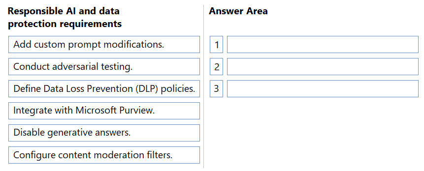

_DRAG DROP — the original ExamTopics question expects you to drag and drop items; the correct targets are not published._

**Most voted:**
1.	Define Data Loss Prevention (DLP) policies.	Prevent unauthorized data flows between connectors and enforce data protection requirements.
2.	Configure content moderation filters.	Filter harmful or inappropriate AI-generated content to ensure Responsible AI compliance.
3. Add custom prompt modifications.: Enforce consistent tone, disclaimers, and refusal behavior across all generative responses.

### Top explanations
- **Hatsapatsa** (8 upvotes [Highly Voted]): I think 3 should be Configure content moderation filters as stated in the case study.
- **jessecollin** (5 upvotes): The correct answers are:
  Define Data Loss Prevention (DLP) policies.
  Add custom prompt modifications.
  Conduct adversarial testing.
  I passed my exam as well, and ExamsPilot helped me with extra practice and revision. Hope this helps others preparing for the exam!
- **vishnu1812** (4 upvotes): The correct sequence should be:
  Define Data Loss Prevention (DLP) policies
  Configure content moderation filters
  Add custom prompt modifications
- **msrao83** (3 upvotes): Define Data Loss Prevention (DLP) policies
  Configure content moderation filters
  Add custom prompt modifications
- **JamesM9** (2 upvotes): 1.	DLP policies prevent unauthorized data flows and protect sensitive information.
  2.	Content moderation filters help enforce Responsible AI and prevent unsafe or inappropriate responses.
  3.	Custom prompt modifications/notifications enforce the required tone, disclaimers, and refusal behaviour consistently across generative responses.

## Q1.2 (ID 431900)

A company uses an agent in Copilot Studio that produces structured responses using a reusable instruction template. The responses follow the required tone and format. During a compliance review, the team discovers that the responses were generated using a model that is not on the approved list.
The company requires that the reusable instruction template continues to be used and the model used for prompt-driven responses meets governance requirements.
The solution must ensure that prompt-driven responses are generated using an approved model.
You need to configure the solution that meets the requirements.
Which two actions should you perform? Each correct answer presents part of the solution.
NOTE: Each correct selection is worth one point.

✅ **A.** Select an approved model from the Microsoft Foundry model catalog in the configuration that is used for prompt-driven response generation.
⭕ **B.** Configure Azure AI Search as the grounding source so the approved model requirement is enforced during response generation.
✅ **C.** Ensure the reusable instruction template is the one applied to the agent that generates the structured response.
⭕ **D.** Publish the agent so that the model used by prompt-driven responses is updated automatically.
⭕ **E.** Enable citations so generated responses can be traced and comply with governance requirements.
⭕ **F.** Add a line to the instruction template that requires the agent to use only approved models when generating responses.

**Correct answer:** A, C
**Most voted:** AC

### Top explanations
- **nnitivv** (2 upvotes [Most Recent, Selected Answer: AC]): You first choose what one of the approved models and then ensure that the reusable instruction is being used.
- **Rami7** (2 upvotes): so F is incorrect
- **Rami7** (2 upvotes [Selected Answer: AC]): F. Add a line to the instruction template requiring approved models
  Prompts cannot control which underlying model is selected. Model governance is configured administratively, not through prompt text.
- **8bb6cf1** (1 upvotes [Selected Answer: CF]): C + F.
  F - Prompts can't enforce which model is actually used. Model selection is a configuration setting, not a prompt instruction.

## Q1.3 (ID 432523)

DRAG DROP
A company needs to ground an agent in Copilot Studio answers using live enterprise data from a supported system via a Microsoft Power Platform connector. To meet the business needs, the builder must meet the following requirements:
•	Authenticate using a valid connection.
•	Add the connector as a real-time knowledge source.
•	Select the tables for knowledge grounding.
You need to add a Power Platform connector as a real-time knowledge source for the agent.
In which order should you perform the actions? To answer, move all actions from the list of actions to the answer area and arrange them in the correct order.

**Exhibits**
- Exhibit 1: 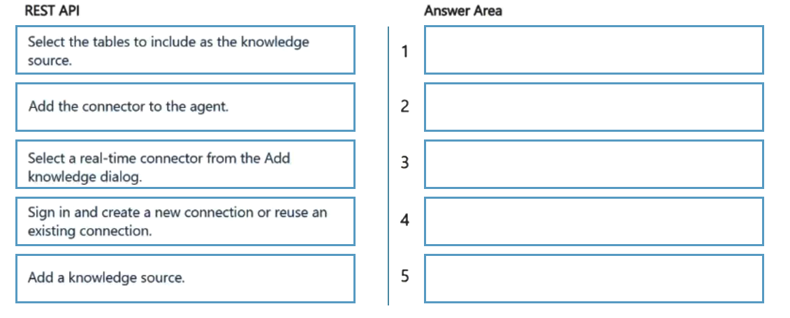

_DRAG DROP — the original ExamTopics question expects you to drag and drop items; the correct targets are not published._

**Most voted:**
- Add a knowledge source.
- Select a real-time connector from the Add knowledge dialog.
- Sign in and create a new connection or reuse an existing connection.
- Select the tables to include as the knowledge source.
- Add the connector to the agent.

### Top explanations
- **harshagracy** (2 upvotes [Most Recent]): Add a knowledge source.
  Select a real-time connector from the Add knowledge dialog.
  Sign in and create a new connection or reuse an existing connection.
  Select the tables to include as the knowledge source.
  Add the connector to the agent.

## Q1.27 (ID 433137)

Note: This question is part of a series of questions that present the same scenario. Each question in the series contains a unique solution that might meet the stated goals. Some question sets might have more than one correct solution, while others might not have a correct solution.
After you answer a question in this section, you will NOT be able to return to it. As a result, these questions will not appear on the review screen.
An agent uses a flow that calls an external service which can occasionally fail or time out.
When a failure occurs, the agent must meet the following requirements:
•	Must not terminate silently.
•	Must send a notification containing the error details.
You need to configure the agent flow so that failures are handled in a controlled and predictable way.
Solution: Terminate the flow immediately on error.
Does the solution meet the goal?

⭕ **A.** Yes
✅ **B.** No

**Correct answer:** B
**Most voted:** B

### Top explanations
- **MeshMallow** (1 upvotes [Most Recent, Selected Answer: B]): Terminating the flow immediately on error fails both requirements.

## Q1.28 (ID 433141)

A company requires an agent in Copilot Studio to answer questions using content stored in a third-party knowledge base system and reuse that content for knowledge grounding.
The agent must ground answers using indexed enterprise knowledge from a non-Microsoft system.
You need to choose the correct integration approach.
What should you use?

⭕ **A.** Call the third-party API from a topic for each question.
⭕ **B.** Add a Copilot Studio tool as a real-time knowledge source.
⭕ **C.** Add a Copilot Studio tool and call it from a topic.
✅ **D.** Add a Copilot connector knowledge source for authorized content.

**Correct answer:** D
**Most voted:** D

### Top explanations
- **Arcadiuz** (1 upvotes [Most Recent, Selected Answer: D]): ✅ Correct Answer: D. Add a Copilot connector knowledge source for authorized content.
  Why D is correct:
  Copilot connectors allow Copilot Studio agents to access indexed enterprise knowledge from third-party systems. They support knowledge grounding while respecting source permissions and access controls.
  ❌ Why the other answers are incorrect
  A. Call the third-party API from a topic: Retrieves data through individual API calls but does not provide indexed enterprise knowledge for grounding.
  B. Add a Copilot Studio tool as a real-time knowledge source: Tools can retrieve live information, but this scenario specifically requires indexed enterprise content.
  C. Add a Copilot Studio tool and call it from a topic: Enables topic-specific API interactions rather than reusable, indexed knowledge grounding.
- **Arcadiuz** (1 upvotes [Selected Answer: D]): D. Add a Copilot connector knowledge source for authorized content.
  Explanation:
  A Copilot connector can index external enterprise content into Microsoft Graph.
  This enables the agent to retrieve relevant information from third-party systems while respecting the applicable source permissions.
  Why the other options are wrong:
  • Manually creating individual Q&A topics is not scalable.
  • Unrestricted web search does not provide the same controlled enterprise knowledge integration.
  A transactional connector is not the preferred mechanism when the requirement is to index and retrieve external enterprise content.
- **MeshMallow** (1 upvotes [Selected Answer: D]): D. Add a Copilot connector knowledge source for authorized content.

## Q1.29 (ID 433145)

DRAG DROP
A company uses a supported Power Platform connector to provide real-time access to enterprise records for knowledge grounding in an agent in Copilot Studio.
To meet the business needs, the knowledge source must provide the following functionality:
•	Avoid copying enterprise data into an index.
•	Keep source-system access controls enforced.
•	Access data by calling the system at runtime.
You need to configure the connector knowledge source.
What should you configure for each requirement? To answer, move the appropriate configurations to the correct requirements. You may use each configuration once, more than once, or not at all. You may need to move the split bar between panes or scroll to view content.
NOTE: Each correct selection is worth one point.

**Exhibits**
- Exhibit 1: 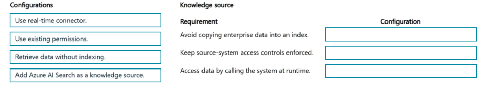

_DRAG DROP — the original ExamTopics question expects you to drag and drop items; the correct targets are not published._

**Most voted:**
- Avoid copying enterprise data into an index.: → Retrieve data without indexing.
- Keep source-system access controls enforced → : Use existing permissions.
- Access data by calling the system at runtime.: → Use real-time connector.

### Top explanations
- **harshagracy** (4 upvotes [Most Recent]): Avoid copying enterprise data into an index.Retrieve data without indexing. (By fetching data on demand, you avoid duplicating or indexing enterprise data in Copilot Studio's storage).   Keep source-system access controls enforced.Use existing permissions. (The connector uses the authenticated user's credentials to execute the query, ensuring that users only receive data they are authorized to see in the source system).   Access data by calling the system at runtime.Use real-time connector. (A real-time connector executes queries directly against the external system's API the moment a user asks a question, rather than relying on a pre-synced database).
- **MeshMallow** (4 upvotes): 1. Avoid copying enterprise data into an index.	 -> Retrieve data without indexing.
  2. Keep source-system access controls enforced. ->	Use existing permissions.
  3. Access data by calling the system at runtime.	-> Use real-time connector.

## Q1.30 (ID 433140)

A tenant administrator configures a Copilot connector that indexes content from an external knowledge system into Microsoft Graph.
A builder is building an agent that must:
•	Use the indexed enterprise knowledge during answer generation.
•	Avoid duplicating or manually uploading the same content.
•	Avoid invoking the system as a transactional tool.
You need to configure the agent so that responses are grounded in the authorized knowledge sources.
What should you do?

✅ **A.** Add the configured enterprise knowledge source to the agent’s knowledge.
⭕ **B.** Create a new custom connector inside the agent configuration.
⭕ **C.** Add the connector as a tool and invoke it from a topic.
⭕ **D.** Upload documents from the external system directly into the agent’s file knowledge store.

**Correct answer:** A
**Most voted:** A

### Top explanations
- **MeshMallow** (2 upvotes [Most Recent, Selected Answer: A]): A. Add the configured enterprise knowledge source to the agent’s knowledge.
  The tenant admin has already set up a Copilot connector that indexes the external content into Microsoft Graph. The builder only needs to add that existing knowledge source to the agent, so responses are grounded in the indexed, permission-trimmed content. This satisfies all three requirements.

## Q1.31 (ID 433142)

DRAG DROP
A solution containing an agent in Copilot Studio is deployed to multiple environments that require different configuration values.
Configuration values must vary by environment without modifying the solution contents.
Configuration values must meet the following requirements:
•	Allow values to be set during import.
•	Exclude values from the agent definition.
•	Run a dedicated agent instance for each individual environment.
You need to associate each requirement with the configuration approach.
What should you configure for each requirement? To answer, move the appropriate configurations to the correct requirements. You may use each configuration once, more than once, or not at all. You may need to move the split bar between panes or scroll to view content.
NOTE: Each correct selection is worth one point.

**Exhibits**
- Exhibit 1: 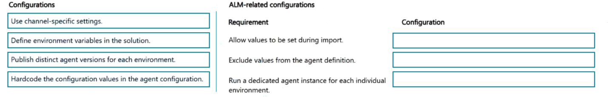

_DRAG DROP — the original ExamTopics question expects you to drag and drop items; the correct targets are not published._

**Most voted:**
- Allow values to be set during import → Define environment variables in the solution.
- Exclude values from the agent definition → Define environment variables in the solution.
- Run a dedicated agent instance for each environment → Publish distinct agent versions for each environment.

### Top explanations
- **Snoopy70** (2 upvotes): for me the correct answers are:
  Environment variables
  Environment variables
  agent deployed through a solution to each environment
- **Arcadiuz** (1 upvotes [Most Recent]): Allow values to be set during import → Define environment variables in the solution.
  Exclude values from the agent definition → Define environment variables in the solution.
  Run a dedicated agent instance for each environment → Publish distinct agent versions for each environment.
  Explanation
  Environment Variables: Allow environment-specific configuration without modifying the solution or hardcoding values.
  Distinct Agent Versions: The likely intended exam answer for running separate agent instances in different environments.
  Channel-Specific Settings: Control communication channels, not environment-specific configuration.
  Hardcoded Values: Prevent flexible configuration during solution deployment.

## Q1.32 (ID 433139)

HOTSPOT
A team uses environment variables to separate configuration from an agent so that the same solution can be moved between environments.
The team requires the following scenarios to be addressed:
•	An administrator updates a sensitive configuration value and needs the change to take effect at runtime without republishing the agent.
•	A builder needs to confirm a configuration value but must not be able to modify it from Copilot Studio.
•	An administrator updates a non-secret configuration value and needs the updated value to be used by the published agent at runtime.
You need to apply the correct handling behavior for different environment-variable scenarios.
Which behavior should you apply for each scenario? To answer, select the appropriate options in the answer area.
NOTE: Each correct selection is worth one point.

**Exhibits**
- Exhibit 1: 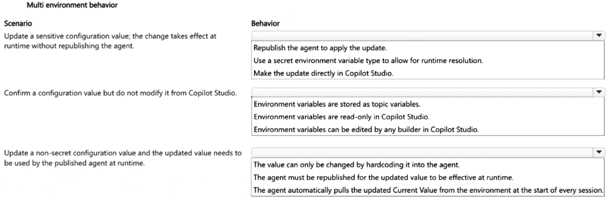

_HOTSPOT — the original ExamTopics question expects you to mark areas on the exhibit above; the correct hotspot coordinates are not published._

**Most voted:**
- I think: (2) Use a secret environment variable type to allow runtime resolution
- Republish a secret value: Not required for secret environment variables.
- Store environment variables as topic variables: They are a separate Power Platform configuration mechanism.
- Allow builders to edit values in Copilot Studio: Environment variables are read-only in Copilot Studio.
- Automatically retrieve every non-secret Current Value at the start of every session: This is not the documented behavior.

### Top explanations
- **Arcadiuz** (1 upvotes [Most Recent]): I think:
  (2) Use a secret environment variable type to allow runtime resolution
  (2) Environment variables are read-only in Copilot Studio
  (2) The agent must be republished for the updated value to be effective at runtime
  Microsoft Learn explicitly distinguishes between secret and non-secret environment variables.
  1. Secret environment variables
  Secret values are retrieved at runtime.
  When an administrator changes the secret value, the published agent can use the updated value without republishing.
  2. Read-only in Copilot Studio
  Environment variables are read-only for agent authors in Copilot Studio.
  Administrators can manage their values through Power Apps.
  3. Non-secret environment variables
  The published version of an agent includes the environment-variable values that were present when it was published.
  If an administrator changes a non-secret value, the agent must be republished before the updated value takes effect.
  Why the other options are wrong
  • Republish a secret value: Not required for secret environment variables.
  • Store environment variables as topic variables: They are a separate Power Platform configuration mechanism.
  • Allow builders to edit values in Copilot Studio: Environment variables are read-only in Copilot Studio.
  • Automatically retrieve every non-secret Current Value at the start of every session: This is not the documented behavior.

## Q1.34 (ID 433146)

A company has agents in Copilot Studio.
The company needs to prevent the agents from using disallowed connectors and insecure data flows. Administrators must be able to enforce the governance controls to prevent and report violations.
You need to enforce governance controls for agents.
What should you do?

⭕ **A.** Configure Application Insights to collect runtime telemetry.
⭕ **B.** Review security FAQs to understand default protections.
⭕ **C.** Review agent analytics to detect risky connector usage.
✅ **D.** Configure data policies.

**Correct answer:** D
**Most voted:** D

### Top explanations
- **Arcadiuz** (1 upvotes [Most Recent, Selected Answer: D]): Power Platform data policies, also known as Data Loss Prevention (DLP) policies, allow administrators to govern which connectors can be used and how data can flow between services.
  They can be used to:
  • Block unauthorized connectors.
  • Restrict combinations of connectors.
  • Prevent insecure data flows.
  • Enforce organizational governance requirements.
  Why the other options are wrong
  • A. Application Insights: Collects telemetry and diagnostic information. It does not enforce connector restrictions.
  • B. Security FAQs: Documentation does not enforce technical controls.
  • C. Agent analytics: Provides insights into agent usage and performance, not preventive connector governance.

## Q1.35 (ID 433143)

DRAG DROP
A company is designing an agent flow that includes human in the loop stages during execution.
The company requires that the agent flow perform the following actions:
•	Must wait for a human decision before it resumes.
•	Must collect information and then continue execution.
You need to configure the flow behavior.
Which flow behavior should you configure for each stage? To answer, move the appropriate flow behaviors to the correct stages. You may use each flow behavior once, more than once, or not at all. You may need to move the split bar between panes or scroll to view content.
NOTE: Each correct selection is worth one point.

**Exhibits**
- Exhibit 1: 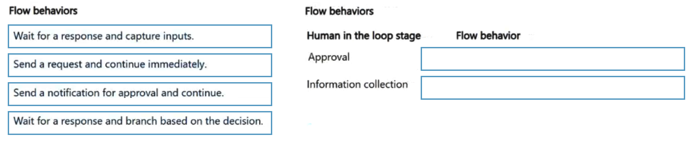

_DRAG DROP — the original ExamTopics question expects you to drag and drop items; the correct targets are not published._

**Most voted:**
- Send a request and continue immediately: Does not wait for the human decision.
- Send a notification for approval and continue: A notification is not equivalent to waiting for and capturing an approval decision.

### Top explanations
- **Arcadiuz** (1 upvotes [Most Recent]): 1.Wait for a response and branch based on the decision
  2.Wait for a response and capture inputs
  An approval process requires the flow to wait for a decision before continuing.
  The result can be used to determine which branch of the flow should execute.
  For information collection, the flow waits for the human response and captures the submitted values.
  Why the other options are wrong:
  - Send a request and continue immediately: Does not wait for the human decision.
  - Send a notification for approval and continue: A notification is not equivalent to waiting for and capturing an approval decision.

## Q2.1 (ID 419312)

DRAG DROP
Background
Blue Yonder Airlines is a global carrier headquartered in Los Angeles, California, operating domestic and international flights. The company serves millions of passengers annually through its website, mobile app, and call centers. To improve customer service efficiency and reduce call center volume, Blue Yonder is deploying an AI agent in Microsoft Copilot Studio.
The agent will handle customer inquiries across multiple channels – web chat, mobile app, and Microsoft Teams (for internal support staff). It will answer questions, retrieve data from enterprise systems, and escalate to human agents when needed.
The project is led by a cross-function team:
Product manager: Defines requirements and success metrics.
Lead agent author: Designs topics, intents, and generative behavior.
Flow designers: Build agent flows and integrations.
IT/security and compliance: Oversees identity, data protection, and Responsible AI (RAI) compliance.
Current environment
Channels
Public website: Embedded web chat
Mobile app: In-app chatbot
Microsoft Teams: Internal support agent access
Identity and access
Customers: Anonymous access for general inquiries (e.g., flight status, baggage policy).
Authentication is required for personal data access (e.g., bookings, loyalty points).
Internal staff: Authenticate via Microsoft Entra ID.
Data sources
Reservation and Ticketing System (internal): REST API, no prebuilt connector with custom enterprise database.
Flight Status and Weather APIs (external): REST APIs with API keys.
Customer Support Knowledge Base: SharePoint library with PDFs and policy documents.
Loyalty Program Data: Stored in Dynamics 365 and Dataverse.
Travel Advisory Content: Uses REST API with partner services.
Integration mechanisms
Custom connectors must be used for internal APIs that lack prebuilt connectors.
HTTP request nodes may be used for lightweight external APIs.
Knowledge sources must be used for unstructured content.
Agent flows must be used to encapsulate reusable logic (e.g., rebooking).
Business requirements
Omnichannel support
Deploy the agent across web, mobile, and Teams with a consistent user experience. The Teams deployment must also support internal staff.
Self-service capabilities
The agent must handle common inquiries such as:
Flight status
Booking and rebooking
Loyalty program questions
Travel policies and baggage rules
Human escalation
If the agent cannot resolve an issue or the user requests help, it must:
Escalate to a human agent.
Transfer the conversation transcript and relevant context.
Redact any sensitive personal data before escalation.
Knowledge integration
The agent must use scalable methods for knowledge integration and must not rely on manually authored Q&A topics for each document.
Performance metrics
First-contact resolution: +25%
Tier-1 call deflection: ≥20%
Response time: 90% of queries answered within 30 seconds
Accuracy: ≥95% for known FAQs
CSAT: ≥85% for AI-handled interactions
Technical requirements
Platform constraints
No custom code is permitted; only Copilot Studio's built-in tools may be used.
All backend logic must be implemented using agent flows.
Markdown must be used for formatting (e.g., bold, bullet points); HTML is not supported.
Authentication
Sign-in is required for personal data access.
Anonymous access is allowed for general inquiries.
User identity must be used for data access; shared or builder credentials must not be used.
Compliance and security
Power Platform DLP policies must be enforced to block unauthorized data flows.
Responsible AI content moderation filters must be enabled.
Prompt modifications must be added to enforce tone, disclaimers, and refusal behavior.
Disclaimers must be applied consistently across all generative responses. Manual edits to individual topics must be avoided.
Monitoring and maintenance
All conversations and actions must be logged for auditing.
Weekly reviews of transcripts and metrics must be conducted.
Issues and constraints
API rate limits: External APIs (e.g., flight status) have usage limits. Agent flows must handle retries and caching to avoid exceeding quotas.
Knowledge base limits: Copilot Studio has limits on the number and size of indexed documents. Large files must be split or summarized.
Generative answer risks: Generative responses must be constrained to avoid policy violations. Prompt modifications and filters must be used to enforce tone, safety, and compliance.
User input variability: Users phrase questions in diverse ways. Topics must include varied trigger phrases and fallback handling.
Authentication UX: The agent must clearly explain when sign-in is required and handle transitions smoothly across channels.
Problem statement
Blue Yonder Airlines must deploy a secure, scalable, and policy-compliant AI agent using Microsoft Copilot Studio. The agent must deliver accurate, helpful, and safe responses across multiple channels, integrate with enterprise systems, and support both anonymous and authenticated users. It must adhere to strict data protection and Responsible AI standards while improving customer service efficiency and satisfaction.
You need to evaluate whether the current configuration decisions for the Blue Yonder Copilot agent comply with the company's security and governance policies.
Which compliance status should you assign to each configuration decision? To answer, move the appropriate compliance statuses to the correct configuration decisions. You may use each compliance status once, more than once, or not at all. You may need to move the split bar between panes or scroll to view content.
NOTE: Each correct selection is worth one point.

**Exhibits**
- Exhibit 1: 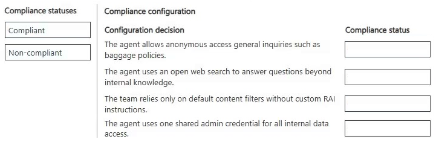

_DRAG DROP — the original ExamTopics question expects you to drag and drop items; the correct targets are not published._

**Most voted:**
- Compliant (The case study states: "Anonymous access is allowed for general inquiries.")
- Non-compliant (The case study states: "Prompt modifications must be added to enforce tone, disclaimers, and refusal behavior.")
- Non-compliant (The case study explicitly states: "User identity must be used for data access; shared or builder credentials must not be used.")

### Top explanations
- **harshagracy** (1 upvotes [Most Recent]): The agent allows anonymous access general inquiries such as baggage policies.
  Compliant (The case study states: "Anonymous access is allowed for general inquiries.")
  The agent uses an open web search to answer questions beyond internal knowledge.
  Non-compliant (The case study requires the agent to be grounded in specific enterprise systems and knowledge sources, not open web search, which violates data protection and RAI standards.)
  The team relies only on default content filters without custom RAI instructions.
  Non-compliant (The case study states: "Prompt modifications must be added to enforce tone, disclaimers, and refusal behavior.")
  The agent uses one shared admin credential for all internal data access.
  Non-compliant (The case study explicitly states: "User identity must be used for data access; shared or builder credentials must not be used.")
- **JamesM9** (1 upvotes): Compliant: Anonymous access for general inquiries.
  Non compliant: Open web search; default filters without custom RAI instructions; shared admin credential.
  The case explicitly permits anonymous access for general inquiries, while requiring authenticated, user-specific identity for personal/internal data access and additional RAI controls.
- **Sweden2022** (1 upvotes): The agent allows anonymous access for general inquiries such as baggage policies — Compliant
  The agent uses an open web search to answer questions beyond internal knowledge — Non-compliant
  The team relies only on default content filters without custom RAI instructions — Non-compliant
  The agent uses one shared admin credential for all internal data access — Non-compliant
- **lucas_0102** (1 upvotes): I'm struggling with this—why is this the correct answer?

## Q2.2 (ID 419277)

Background
Blue Yonder Airlines is a global carrier headquartered in Los Angeles, California, operating domestic and international flights. The company serves millions of passengers annually through its website, mobile app, and call centers. To improve customer service efficiency and reduce call center volume, Blue Yonder is deploying an AI agent in Microsoft Copilot Studio.
The agent will handle customer inquiries across multiple channels – web chat, mobile app, and Microsoft Teams (for internal support staff). It will answer questions, retrieve data from enterprise systems, and escalate to human agents when needed.
The project is led by a cross-function team:
Product manager: Defines requirements and success metrics.
Lead agent author: Designs topics, intents, and generative behavior.
Flow designers: Build agent flows and integrations.
IT/security and compliance: Oversees identity, data protection, and Responsible AI (RAI) compliance.
Current environment
Channels
Public website: Embedded web chat
Mobile app: In-app chatbot
Microsoft Teams: Internal support agent access
Identity and access
Customers: Anonymous access for general inquiries (e.g., flight status, baggage policy).
Authentication is required for personal data access (e.g., bookings, loyalty points).
Internal staff: Authenticate via Microsoft Entra ID.
Data sources
Reservation and Ticketing System (internal): REST API, no prebuilt connector with custom enterprise database.
Flight Status and Weather APIs (external): REST APIs with API keys.
Customer Support Knowledge Base: SharePoint library with PDFs and policy documents.
Loyalty Program Data: Stored in Dynamics 365 and Dataverse.
Travel Advisory Content: Uses REST API with partner services.
Integration mechanisms
Custom connectors must be used for internal APIs that lack prebuilt connectors.
HTTP request nodes may be used for lightweight external APIs.
Knowledge sources must be used for unstructured content.
Agent flows must be used to encapsulate reusable logic (e.g., rebooking).
Business requirements
Omnichannel support
Deploy the agent across web, mobile, and Teams with a consistent user experience. The Teams deployment must also support internal staff.
Self-service capabilities
The agent must handle common inquiries such as:
Flight status
Booking and rebooking
Loyalty program questions
Travel policies and baggage rules
Human escalation
If the agent cannot resolve an issue or the user requests help, it must:
Escalate to a human agent.
Transfer the conversation transcript and relevant context.
Redact any sensitive personal data before escalation.
Knowledge integration
The agent must use scalable methods for knowledge integration and must not rely on manually authored Q&A topics for each document.
Performance metrics
First-contact resolution: +25%
Tier-1 call deflection: ≥20%
Response time: 90% of queries answered within 30 seconds
Accuracy: ≥95% for known FAQs
CSAT: ≥85% for AI-handled interactions
Technical requirements
Platform constraints
No custom code is permitted; only Copilot Studio's built-in tools may be used.
All backend logic must be implemented using agent flows.
Markdown must be used for formatting (e.g., bold, bullet points); HTML is not supported.
Authentication
Sign-in is required for personal data access.
Anonymous access is allowed for general inquiries.
User identity must be used for data access; shared or builder credentials must not be used.
Compliance and security
Power Platform DLP policies must be enforced to block unauthorized data flows.
Responsible AI content moderation filters must be enabled.
Prompt modifications must be added to enforce tone, disclaimers, and refusal behavior.
Disclaimers must be applied consistently across all generative responses. Manual edits to individual topics must be avoided.
Monitoring and maintenance
All conversations and actions must be logged for auditing.
Weekly reviews of transcripts and metrics must be conducted.
Issues and constraints
API rate limits: External APIs (e.g., flight status) have usage limits. Agent flows must handle retries and caching to avoid exceeding quotas.
Knowledge base limits: Copilot Studio has limits on the number and size of indexed documents. Large files must be split or summarized.
Generative answer risks: Generative responses must be constrained to avoid policy violations. Prompt modifications and filters must be used to enforce tone, safety, and compliance.
User input variability: Users phrase questions in diverse ways. Topics must include varied trigger phrases and fallback handling.
Authentication UX: The agent must clearly explain when sign-in is required and handle transitions smoothly across channels.
Problem statement
Blue Yonder Airlines must deploy a secure, scalable, and policy-compliant AI agent using Microsoft Copilot Studio. The agent must deliver accurate, helpful, and safe responses across multiple channels, integrate with enterprise systems, and support both anonymous and authenticated users. It must adhere to strict data protection and Responsible AI standards while improving customer service efficiency and satisfaction.
You need to deploy the Blue Yonder Copilot agent to the public website and Microsoft Teams while ensuring compliance with the company's security and Responsible AI requirements.
Which two actions should you perform before making the agent available on both channels? Each correct answer presents part of the solution.
NOTE: Each correct selection is worth one point.

✅ **A.** Configure prompt modifications to enforce tone, disclaimers, and refusal behavior at the system level.
⭕ **B.** Manually add disclaimers to each topic before publishing.
⭕ **C.** Embed the web channel and then rely on channel-level settings to enforce content moderation.
✅ **D.** Configure Power Platform DLP policies to restrict unauthorized data connectors.
⭕ **E.** Publish the agent and then enable Responsible AI filters individually for each channel.

**Correct answer:** A, D
**Most voted:** AD

### Top explanations
- **690471c** (2 upvotes [Selected Answer: AD]): las políticas DLP de Power Platform permiten bloquear conectores, canales o fuentes de datos no autorizados. Es una medida esencial antes de publicar un agente conectado a sistemas empresariales.
- **harshagracy** (1 upvotes [Most Recent, Selected Answer: AD]): A. Configure prompt modifications to enforce tone, disclaimers, and refusal behavior at the system level: The case study requirements explicitly mandate that "Prompt modifications must be added to enforce tone, disclaimers, and refusal behavior" and that "Manual edits to individual topics must be avoided." Configuring these at the system or agent level (e.g., in the generative AI settings) ensures consistent compliance across all generated outputs without requiring per-topic changes.
  D. Configure Power Platform DLP policies to restrict unauthorized data connectors: The compliance and security requirements dictate that "Power Platform DLP policies must be enforced to block unauthorized data flows." These policies govern which connectors (such as external APIs or internal systems) the agent can use, ensuring data security before the agent is exposed on public or internal channels.
- **msrao83** (1 upvotes [Selected Answer: A]): A:  Configure prompt modifications to enforce tone, disclaimers, and refusal behavior at the system level.
  D: Configure Power Platform DLP
- **Sweden2022** (1 upvotes [Selected Answer: AD]): A. Configure prompt modifications to enforce tone, disclaimers, and refusal behavior at the system level.
  D. Configure Power Platform DLP policies to restrict unauthorized data connectors.
- **moodin** (1 upvotes [Selected Answer: AD]): Brief states "Power Platform DLP policies must be enforced to block unauthorized data flows." Additionally, E is configuring per-channel rather than system level, bad practice.

## Q2.3 (ID 419306)

Background
Blue Yonder Airlines is a global carrier headquartered in Los Angeles, California, operating domestic and international flights. The company serves millions of passengers annually through its website, mobile app, and call centers. To improve customer service efficiency and reduce call center volume, Blue Yonder is deploying an AI agent in Microsoft Copilot Studio.
The agent will handle customer inquiries across multiple channels – web chat, mobile app, and Microsoft Teams (for internal support staff). It will answer questions, retrieve data from enterprise systems, and escalate to human agents when needed.
The project is led by a cross-function team:
Product manager: Defines requirements and success metrics.
Lead agent author: Designs topics, intents, and generative behavior.
Flow designers: Build agent flows and integrations.
IT/security and compliance: Oversees identity, data protection, and Responsible AI (RAI) compliance.
Current environment
Channels
Public website: Embedded web chat
Mobile app: In-app chatbot
Microsoft Teams: Internal support agent access
Identity and access
Customers: Anonymous access for general inquiries (e.g., flight status, baggage policy).
Authentication is required for personal data access (e.g., bookings, loyalty points).
Internal staff: Authenticate via Microsoft Entra ID.
Data sources
Reservation and Ticketing System (internal): REST API, no prebuilt connector with custom enterprise database.
Flight Status and Weather APIs (external): REST APIs with API keys.
Customer Support Knowledge Base: SharePoint library with PDFs and policy documents.
Loyalty Program Data: Stored in Dynamics 365 and Dataverse.
Travel Advisory Content: Uses REST API with partner services.
Integration mechanisms
Custom connectors must be used for internal APIs that lack prebuilt connectors.
HTTP request nodes may be used for lightweight external APIs.
Knowledge sources must be used for unstructured content.
Agent flows must be used to encapsulate reusable logic (e.g., rebooking).
Business requirements
Omnichannel support
Deploy the agent across web, mobile, and Teams with a consistent user experience. The Teams deployment must also support internal staff.
Self-service capabilities
The agent must handle common inquiries such as:
Flight status
Booking and rebooking
Loyalty program questions
Travel policies and baggage rules
Human escalation
If the agent cannot resolve an issue or the user requests help, it must:
Escalate to a human agent.
Transfer the conversation transcript and relevant context.
Redact any sensitive personal data before escalation.
Knowledge integration
The agent must use scalable methods for knowledge integration and must not rely on manually authored Q&A topics for each document.
Performance metrics
First-contact resolution: +25%
Tier-1 call deflection: ≥20%
Response time: 90% of queries answered within 30 seconds
Accuracy: ≥95% for known FAQs
CSAT: ≥85% for AI-handled interactions
Technical requirements
Platform constraints
No custom code is permitted; only Copilot Studio's built-in tools may be used.
All backend logic must be implemented using agent flows.
Markdown must be used for formatting (e.g., bold, bullet points); HTML is not supported.
Authentication
Sign-in is required for personal data access.
Anonymous access is allowed for general inquiries.
User identity must be used for data access; shared or builder credentials must not be used.
Compliance and security
Power Platform DLP policies must be enforced to block unauthorized data flows.
Responsible AI content moderation filters must be enabled.
Prompt modifications must be added to enforce tone, disclaimers, and refusal behavior.
Disclaimers must be applied consistently across all generative responses. Manual edits to individual topics must be avoided.
Monitoring and maintenance
All conversations and actions must be logged for auditing.
Weekly reviews of transcripts and metrics must be conducted.
Issues and constraints
API rate limits: External APIs (e.g., flight status) have usage limits. Agent flows must handle retries and caching to avoid exceeding quotas.
Knowledge base limits: Copilot Studio has limits on the number and size of indexed documents. Large files must be split or summarized.
Generative answer risks: Generative responses must be constrained to avoid policy violations. Prompt modifications and filters must be used to enforce tone, safety, and compliance.
User input variability: Users phrase questions in diverse ways. Topics must include varied trigger phrases and fallback handling.
Authentication UX: The agent must clearly explain when sign-in is required and handle transitions smoothly across channels.
Problem statement
Blue Yonder Airlines must deploy a secure, scalable, and policy-compliant AI agent using Microsoft Copilot Studio. The agent must deliver accurate, helpful, and safe responses across multiple channels, integrate with enterprise systems, and support both anonymous and authenticated users. It must adhere to strict data protection and Responsible AI standards while improving customer service efficiency and satisfaction.
You need to configure the Blue Yonder Copilot agent's responses in accordance with the company's content control and platform requirements.
Which two actions should you perform? Each correct answer presents part of the solution.
NOTE: Each correct selection is worth one point.

⭕ **A.** Add required disclaimer text inside each individual topic.
✅ **B.** Configure prompt instructions that include disclaimer text.
✅ **C.** Use Markdown syntax within response content.
⭕ **D.** Insert HTML formatting directly into topic responses.
⭕ **E.** Duplicate disclaimer text across reusable topics.

**Correct answer:** B, C
**Most voted:** BC

### Top explanations
- **moodin** (2 upvotes [Selected Answer: BC]): "Disclaimers must be applied consistently across all generative responses" for B, and "Markdown must be used for formatting (e.g., bold, bullet points); HTML is not supported" for C
- **Arcadiuz** (1 upvotes [Most Recent, Selected Answer: BC]): The case study explicitly states that:
  • Markdown must be used for formatting.
  • HTML is not supported.
  • Disclaimers must be applied consistently across generative responses.
  • Prompt modifications must be used to enforce disclaimers.
  So:
  (B) Including the disclaimer in the prompt instructions addresses the content requirement.
  (C) Using Markdown ensures that the generated response follows the supported formatting approach.
- **MeshMallow** (1 upvotes [Selected Answer: BC]): B. Configure prompt instructions that include disclaimer text. Putting the disclaimer in the agent's instructions applies it consistently to every response from one central place. This meets the content control requirement without editing each topic.
  C. Use Markdown syntax within response content. Copilot Studio's message formatting supports Markdown across channels, so it's the platform-appropriate way to format responses.
- **Sweden2022** (1 upvotes [Selected Answer: BC]): B. Configure prompt instructions that include disclaimer text.
  C. Use Markdown syntax within response content.

## Q2.4 (ID 419274)

Background
Blue Yonder Airlines is a global carrier headquartered in Los Angeles, California, operating domestic and international flights. The company serves millions of passengers annually through its website, mobile app, and call centers. To improve customer service efficiency and reduce call center volume, Blue Yonder is deploying an AI agent in Microsoft Copilot Studio.
The agent will handle customer inquiries across multiple channels – web chat, mobile app, and Microsoft Teams (for internal support staff). It will answer questions, retrieve data from enterprise systems, and escalate to human agents when needed.
The project is led by a cross-function team:
Product manager: Defines requirements and success metrics.
Lead agent author: Designs topics, intents, and generative behavior.
Flow designers: Build agent flows and integrations.
IT/security and compliance: Oversees identity, data protection, and Responsible AI (RAI) compliance.
Current environment
Channels
Public website: Embedded web chat
Mobile app: In-app chatbot
Microsoft Teams: Internal support agent access
Identity and access
Customers: Anonymous access for general inquiries (e.g., flight status, baggage policy).
Authentication is required for personal data access (e.g., bookings, loyalty points).
Internal staff: Authenticate via Microsoft Entra ID.
Data sources
Reservation and Ticketing System (internal): REST API, no prebuilt connector with custom enterprise database.
Flight Status and Weather APIs (external): REST APIs with API keys.
Customer Support Knowledge Base: SharePoint library with PDFs and policy documents.
Loyalty Program Data: Stored in Dynamics 365 and Dataverse.
Travel Advisory Content: Uses REST API with partner services.
Integration mechanisms
Custom connectors must be used for internal APIs that lack prebuilt connectors.
HTTP request nodes may be used for lightweight external APIs.
Knowledge sources must be used for unstructured content.
Agent flows must be used to encapsulate reusable logic (e.g., rebooking).
Business requirements
Omnichannel support
Deploy the agent across web, mobile, and Teams with a consistent user experience. The Teams deployment must also support internal staff.
Self-service capabilities
The agent must handle common inquiries such as:
Flight status
Booking and rebooking
Loyalty program questions
Travel policies and baggage rules
Human escalation
If the agent cannot resolve an issue or the user requests help, it must:
Escalate to a human agent.
Transfer the conversation transcript and relevant context.
Redact any sensitive personal data before escalation.
Knowledge integration
The agent must use scalable methods for knowledge integration and must not rely on manually authored Q&A topics for each document.
Performance metrics
First-contact resolution: +25%
Tier-1 call deflection: ≥20%
Response time: 90% of queries answered within 30 seconds
Accuracy: ≥95% for known FAQs
CSAT: ≥85% for AI-handled interactions
Technical requirements
Platform constraints
No custom code is permitted; only Copilot Studio's built-in tools may be used.
All backend logic must be implemented using agent flows.
Markdown must be used for formatting (e.g., bold, bullet points); HTML is not supported.
Authentication
Sign-in is required for personal data access.
Anonymous access is allowed for general inquiries.
User identity must be used for data access; shared or builder credentials must not be used.
Compliance and security
Power Platform DLP policies must be enforced to block unauthorized data flows.
Responsible AI content moderation filters must be enabled.
Prompt modifications must be added to enforce tone, disclaimers, and refusal behavior.
Disclaimers must be applied consistently across all generative responses. Manual edits to individual topics must be avoided.
Monitoring and maintenance
All conversations and actions must be logged for auditing.
Weekly reviews of transcripts and metrics must be conducted.
Issues and constraints
API rate limits: External APIs (e.g., flight status) have usage limits. Agent flows must handle retries and caching to avoid exceeding quotas.
Knowledge base limits: Copilot Studio has limits on the number and size of indexed documents. Large files must be split or summarized.
Generative answer risks: Generative responses must be constrained to avoid policy violations. Prompt modifications and filters must be used to enforce tone, safety, and compliance.
User input variability: Users phrase questions in diverse ways. Topics must include varied trigger phrases and fallback handling.
Authentication UX: The agent must clearly explain when sign-in is required and handle transitions smoothly across channels.
Problem statement
Blue Yonder Airlines must deploy a secure, scalable, and policy-compliant AI agent using Microsoft Copilot Studio. The agent must deliver accurate, helpful, and safe responses across multiple channels, integrate with enterprise systems, and support both anonymous and authenticated users. It must adhere to strict data protection and Responsible AI standards while improving customer service efficiency and satisfaction.
You need to configure the agent in Copilot Studio to use internal and external partner knowledge sources to answer user questions about the airline services.
Which two actions should you perform? Each correct answer presents part of the solution.
NOTE: Each correct selection is worth one point.

✅ **A.** Use a Microsoft Graph connector to index the partner's travel advisory content.
⭕ **B.** Write individual Q&A pairs for each document as separate topics.
⭕ **C.** Enable unrestricted web search for the agent.
✅ **D.** Add the internal policy documents as a knowledge source.

**Correct answer:** A, D
**Most voted:** AD

### Top explanations
- **Sweden2022** (3 upvotes [Most Recent, Selected Answer: AD]): A. Use a Microsoft Graph connector to index the partner's travel advisory content.
  D. Add the internal policy documents as a knowledge source.
- **faisalronnie** (1 upvotes [Selected Answer: AD]): Travel Advisory Content: Uses REST API with partner services.> if this is true then A cannot be the option

## Q2.5 (ID 419280)

Background
Blue Yonder Airlines is a global carrier headquartered in Los Angeles, California, operating domestic and international flights. The company serves millions of passengers annually through its website, mobile app, and call centers. To improve customer service efficiency and reduce call center volume, Blue Yonder is deploying an AI agent in Microsoft Copilot Studio.
The agent will handle customer inquiries across multiple channels – web chat, mobile app, and Microsoft Teams (for internal support staff). It will answer questions, retrieve data from enterprise systems, and escalate to human agents when needed.
The project is led by a cross-function team:
Product manager: Defines requirements and success metrics.
Lead agent author: Designs topics, intents, and generative behavior.
Flow designers: Build agent flows and integrations.
IT/security and compliance: Oversees identity, data protection, and Responsible AI (RAI) compliance.
Current environment
Channels
Public website: Embedded web chat
Mobile app: In-app chatbot
Microsoft Teams: Internal support agent access
Identity and access
Customers: Anonymous access for general inquiries (e.g., flight status, baggage policy).
Authentication is required for personal data access (e.g., bookings, loyalty points).
Internal staff: Authenticate via Microsoft Entra ID.
Data sources
Reservation and Ticketing System (internal): REST API, no prebuilt connector with custom enterprise database.
Flight Status and Weather APIs (external): REST APIs with API keys.
Customer Support Knowledge Base: SharePoint library with PDFs and policy documents.
Loyalty Program Data: Stored in Dynamics 365 and Dataverse.
Travel Advisory Content: Uses REST API with partner services.
Integration mechanisms
Custom connectors must be used for internal APIs that lack prebuilt connectors.
HTTP request nodes may be used for lightweight external APIs.
Knowledge sources must be used for unstructured content.
Agent flows must be used to encapsulate reusable logic (e.g., rebooking).
Business requirements
Omnichannel support
Deploy the agent across web, mobile, and Teams with a consistent user experience. The Teams deployment must also support internal staff.
Self-service capabilities
The agent must handle common inquiries such as:
Flight status
Booking and rebooking
Loyalty program questions
Travel policies and baggage rules
Human escalation
If the agent cannot resolve an issue or the user requests help, it must:
Escalate to a human agent.
Transfer the conversation transcript and relevant context.
Redact any sensitive personal data before escalation.
Knowledge integration
The agent must use scalable methods for knowledge integration and must not rely on manually authored Q&A topics for each document.
Performance metrics
First-contact resolution: +25%
Tier-1 call deflection: ≥20%
Response time: 90% of queries answered within 30 seconds
Accuracy: ≥95% for known FAQs
CSAT: ≥85% for AI-handled interactions
Technical requirements
Platform constraints
No custom code is permitted; only Copilot Studio's built-in tools may be used.
All backend logic must be implemented using agent flows.
Markdown must be used for formatting (e.g., bold, bullet points); HTML is not supported.
Authentication
Sign-in is required for personal data access.
Anonymous access is allowed for general inquiries.
User identity must be used for data access; shared or builder credentials must not be used.
Compliance and security
Power Platform DLP policies must be enforced to block unauthorized data flows.
Responsible AI content moderation filters must be enabled.
Prompt modifications must be added to enforce tone, disclaimers, and refusal behavior.
Disclaimers must be applied consistently across all generative responses. Manual edits to individual topics must be avoided.
Monitoring and maintenance
All conversations and actions must be logged for auditing.
Weekly reviews of transcripts and metrics must be conducted.
Issues and constraints
API rate limits: External APIs (e.g., flight status) have usage limits. Agent flows must handle retries and caching to avoid exceeding quotas.
Knowledge base limits: Copilot Studio has limits on the number and size of indexed documents. Large files must be split or summarized.
Generative answer risks: Generative responses must be constrained to avoid policy violations. Prompt modifications and filters must be used to enforce tone, safety, and compliance.
User input variability: Users phrase questions in diverse ways. Topics must include varied trigger phrases and fallback handling.
Authentication UX: The agent must clearly explain when sign-in is required and handle transitions smoothly across channels.
Problem statement
Blue Yonder Airlines must deploy a secure, scalable, and policy-compliant AI agent using Microsoft Copilot Studio. The agent must deliver accurate, helpful, and safe responses across multiple channels, integrate with enterprise systems, and support both anonymous and authenticated users. It must adhere to strict data protection and Responsible AI standards while improving customer service efficiency and satisfaction.
You need to ensure that every AI-generated response from the agent in Copilot Studio includes a disclaimer that complies with the company's security and governance policies.
Which two actions should you perform? Each correct answer presents part of the solution.
NOTE: Each correct selection is worth one point.

⭕ **A.** Add a greeting message that includes the disclaimer.
✅ **B.** Add a prompt modification in the generative answers node settings.
✅ **C.** Create a disclaimer topic that always runs first.
⭕ **D.** Disable generative answers and use only pre-authored responses.
⭕ **E.** Edit every topic's first message to include the disclaimer.

**Correct answer:** B, C
**Most voted:** BC

### Top explanations
- **Hatsapatsa** (5 upvotes [Selected Answer: BC]): I would say 'B and C' because A only runs once, case study requires it to be added to each generative response and therefore a reusable separate topic would be the better option.
- **Sweden2022** (1 upvotes [Most Recent, Selected Answer: BC]): B. Add a prompt modification in the generative answers node settings.
  C. Create a disclaimer topic that always runs first.
- **HelloItsSam** (1 upvotes [Selected Answer: BC]): I'd go for B and C, Microsoft cert wordings are always grammatically confused! Now word "Every" changes the whole context of this question

## Q2.6 (ID 419276)

DRAG DROP
Background
Blue Yonder Airlines is a global carrier headquartered in Los Angeles, California, operating domestic and international flights. The company serves millions of passengers annually through its website, mobile app, and call centers. To improve customer service efficiency and reduce call center volume, Blue Yonder is deploying an AI agent in Microsoft Copilot Studio.
The agent will handle customer inquiries across multiple channels – web chat, mobile app, and Microsoft Teams (for internal support staff). It will answer questions, retrieve data from enterprise systems, and escalate to human agents when needed.
The project is led by a cross-function team:
Product manager: Defines requirements and success metrics.
Lead agent author: Designs topics, intents, and generative behavior.
Flow designers: Build agent flows and integrations.
IT/security and compliance: Oversees identity, data protection, and Responsible AI (RAI) compliance.
Current environment
Channels
Public website: Embedded web chat
Mobile app: In-app chatbot
Microsoft Teams: Internal support agent access
Identity and access
Customers: Anonymous access for general inquiries (e.g., flight status, baggage policy).
Authentication is required for personal data access (e.g., bookings, loyalty points).
Internal staff: Authenticate via Microsoft Entra ID.
Data sources
Reservation and Ticketing System (internal): REST API, no prebuilt connector with custom enterprise database.
Flight Status and Weather APIs (external): REST APIs with API keys.
Customer Support Knowledge Base: SharePoint library with PDFs and policy documents.
Loyalty Program Data: Stored in Dynamics 365 and Dataverse.
Travel Advisory Content: Uses REST API with partner services.
Integration mechanisms
Custom connectors must be used for internal APIs that lack prebuilt connectors.
HTTP request nodes may be used for lightweight external APIs.
Knowledge sources must be used for unstructured content.
Agent flows must be used to encapsulate reusable logic (e.g., rebooking).
Business requirements
Omnichannel support
Deploy the agent across web, mobile, and Teams with a consistent user experience. The Teams deployment must also support internal staff.
Self-service capabilities
The agent must handle common inquiries such as:
Flight status
Booking and rebooking
Loyalty program questions
Travel policies and baggage rules
Human escalation
If the agent cannot resolve an issue or the user requests help, it must:
Escalate to a human agent.
Transfer the conversation transcript and relevant context.
Redact any sensitive personal data before escalation.
Knowledge integration
The agent must use scalable methods for knowledge integration and must not rely on manually authored Q&A topics for each document.
Performance metrics
First-contact resolution: +25%
Tier-1 call deflection: ≥20%
Response time: 90% of queries answered within 30 seconds
Accuracy: ≥95% for known FAQs
CSAT: ≥85% for AI-handled interactions
Technical requirements
Platform constraints
No custom code is permitted; only Copilot Studio's built-in tools may be used.
All backend logic must be implemented using agent flows.
Markdown must be used for formatting (e.g., bold, bullet points); HTML is not supported.
Authentication
Sign-in is required for personal data access.
Anonymous access is allowed for general inquiries.
User identity must be used for data access; shared or builder credentials must not be used.
Compliance and security
Power Platform DLP policies must be enforced to block unauthorized data flows.
Responsible AI content moderation filters must be enabled.
Prompt modifications must be added to enforce tone, disclaimers, and refusal behavior.
Disclaimers must be applied consistently across all generative responses. Manual edits to individual topics must be avoided.
Monitoring and maintenance
All conversations and actions must be logged for auditing.
Weekly reviews of transcripts and metrics must be conducted.
Issues and constraints
API rate limits: External APIs (e.g., flight status) have usage limits. Agent flows must handle retries and caching to avoid exceeding quotas.
Knowledge base limits: Copilot Studio has limits on the number and size of indexed documents. Large files must be split or summarized.
Generative answer risks: Generative responses must be constrained to avoid policy violations. Prompt modifications and filters must be used to enforce tone, safety, and compliance.
User input variability: Users phrase questions in diverse ways. Topics must include varied trigger phrases and fallback handling.
Authentication UX: The agent must clearly explain when sign-in is required and handle transitions smoothly across channels.
Problem statement
Blue Yonder Airlines must deploy a secure, scalable, and policy-compliant AI agent using Microsoft Copilot Studio. The agent must deliver accurate, helpful, and safe responses across multiple channels, integrate with enterprise systems, and support both anonymous and authenticated users. It must adhere to strict data protection and Responsible AI standards while improving customer service efficiency and satisfaction.
You need to determine which authentication model should be applied to each Blue Yonder Copilot interaction scenario to comply with the company's security and governance requirements.
Which authentication requirement should you apply to each scenario? To answer, move the appropriate authentication requirements to the correct user scenarios. You may use each authentication requirement once, more than once, or not at all. You may need to move the split bar between panes or scroll to view content.
NOTE: Each correct selection is worth one point.

**Exhibits**
- Exhibit 1: 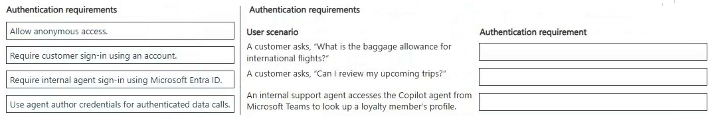

_DRAG DROP — the original ExamTopics question expects you to drag and drop items; the correct targets are not published._

**Most voted:**
- Allow anonymous access. (The case study states: "Anonymous access for general inquiries (e.g., flight status, baggage policy).")
- Require customer sign-in using an account. (The case study states: "Authentication is required for personal data access (e.g., bookings, loyalty points).")
- Require internal agent sign-in using Microsoft Entra ID. (The case study states: "Internal staff: Authenticate via Microsoft Entra ID.")

### Top explanations
- **harshagracy** (1 upvotes [Most Recent]): A customer asks, "What is the baggage allowance for international flights?"
  Allow anonymous access. (The case study states: "Anonymous access for general inquiries (e.g., flight status, baggage policy).")
  A customer asks, "Can I review my upcoming trips?"
  Require customer sign-in using an account. (The case study states: "Authentication is required for personal data access (e.g., bookings, loyalty points).")
  An internal support agent accesses the Copilot agent from Microsoft Teams to look up a loyalty member's profile.
  Require internal agent sign-in using Microsoft Entra ID. (The case study states: "Internal staff: Authenticate via Microsoft Entra ID.")

## Q2.7 (ID 419317)

DRAG DROP
A company has an existing custom connector that is approved and available in the environment. A builder wants an agent in Copilot Studio to call the connector during a conversation to retrieve information from an internal system.
To meet the business needs, the solution must meet the following requirements:
The agent must make the connector available for topic steps.
The agent must run the connector call with a valid connection.
The connector call must receive the required input values at runtime.
You need to configure the agent so the custom connector can be used as a tool.
What should you configure for each requirement? To answer, move the appropriate configurations to the correct requirements. You may use each configuration once, more than once, or not at all. You may need to move the split bar between panes or scroll to view content.
NOTE: Each correct selection is worth one point.

**Exhibits**
- Exhibit 1: 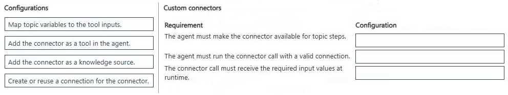

_DRAG DROP — the original ExamTopics question expects you to drag and drop items; the correct targets are not published._

**Most voted:**
- → Add the connector as a tool in the agent.
- → Create or reuse a connection for the connector.
- → Map topic variables to the tool inputs.

### Top explanations
- **Exam Topics Bob** (2 upvotes [Most Recent]): 1. The agent must make the connector available for topic steps.
  - -> Add the connector as a tool in the agent.
  2. The agent must run the connector call with a valid connection.
  - -> Create or reuse a connection for the connector.
  3. The connector call must receive the required input values at runtime.
  - -> Map topic variables to the tool inputs.

## Q2.8 (ID 419310)

DRAG DROP
A company needs to ground an agent in Copilot Studio answers using live enterprise data from a supported system via a Microsoft Power Platform connector.
To meet the business needs, the builder must meet the following requirements:
Authenticate using a valid connection.
Add the connector as a real-time knowledge source.
Select the tables for knowledge grounding.
You need to add a Power Platform connector as a real-time knowledge source for the agent.
In which order should you perform the actions? To answer, move all actions from the list of actions to the answer area and arrange them in the correct order.

**Exhibits**
- Exhibit 1: 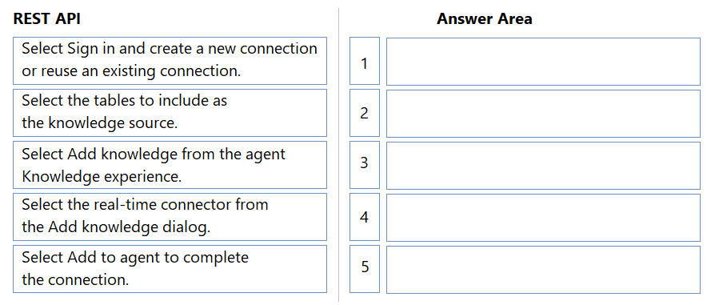

_DRAG DROP — the original ExamTopics question expects you to drag and drop items; the correct targets are not published._

**Most voted:**
1. Select Add knowledge from the agent Knowledge experience.
2. Select the real-time connector from the Add knowledge dialog.
3. Sign in and create a new connection or reuse an existing connection.
4. Select the tables to include as the knowledge source.
5. Select Add to agent to complete the connection.

### Top explanations
- **harshagracy** (2 upvotes): Select Add knowledge from the agent Knowledge experience.
  Select the real-time connector from the Add knowledge dialog.
  Select Sign in and create a new connection or reuse an existing connection.
  Select the tables to include as the knowledge source.
  Select Add to agent to complete the connection.
- **Arcadiuz** (1 upvotes [Most Recent]): 1. Select Add knowledge from the agent Knowledge experience.
  2. Select the real-time connector from the Add knowledge dialog.
  3. Sign in and create a new connection or reuse an existing connection.
  4. Select the tables to include as the knowledge source.
  5. Select Add to agent to complete the connection.
  Sequence Power Platform Connector as Real-Time Knowledge Source:
  Add knowledge → Select connector → Authenticate → Select tables → Add to agent
  Source: https://learn.microsoft.com/en-in/microsoft-copilot-studio/knowledge-real-time-connectors

## Q2.9 (ID 419268)

HOTSPOT
You deploy an agent in Microsoft Copilot Studio that triggers a cloud flow to update customer records in Microsoft Dataverse.
You observe the following after deploying the agent:
Several runs fail due to a temporary authentication issue.
The flow continues to trigger and generate additional failed runs.
You must:
Stop additional failed executions while troubleshooting.
Process a failed execution after resolving the authentication issue.
Validate if the most recent executions succeeded immediately after resolution.
You need to use the appropriate monitoring and management actions to restore normal flow operation and validate successful execution.
Which action should you perform for each requirement? To answer, select the appropriate options in the answer area.
NOTE: Each correct selection is worth one point.

**Exhibits**
- Exhibit 1: 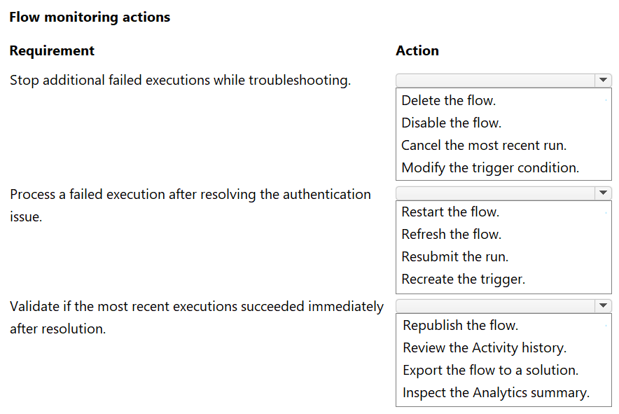

_HOTSPOT — the original ExamTopics question expects you to mark areas on the exhibit above; the correct hotspot coordinates are not published._

**Most voted:** disable flow, resubmit, review activity history

### Top explanations
- **madhuece** (1 upvotes [Most Recent]): disable flow, resubmit, review activity history
- **lucas_0102** (1 upvotes): Could someone help me understand the logic behind this answer?

## Q2.10 (ID 419304)

DRAG DROP
A company is preparing an agent flow so that it can be invoked by an agent during conversations.
The agent flow must meet the following requirements:
The agent must be able to trigger the flow.
The agent flow must be verified.
You need to prepare an agent flow so that it can be used by the agent.
In which order should you perform the actions to prepare the agent flow? To answer, move all actions from the list of actions to the answer area and arrange them in the correct order.

**Exhibits**
- Exhibit 1: 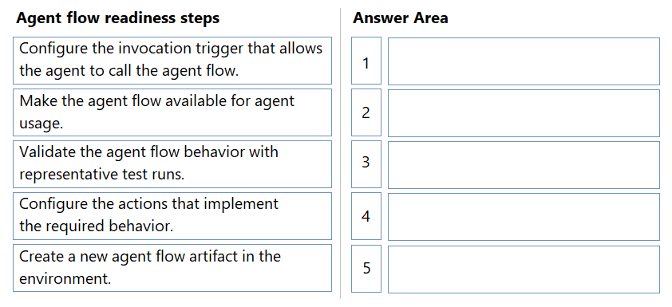

_DRAG DROP — the original ExamTopics question expects you to drag and drop items; the correct targets are not published._

**Most voted:**
- The order is correct
- Create → Trigger → Actions → Validate → Publish

### Top explanations
- **Snoopy70** (2 upvotes): I have found the answer > https://learn.microsoft.com/en-us/microsoft-copilot-studio/advanced-flow-create#create-a-new-agent-flow-from-the-flows-page
  The order is correct
- **Arcadiuz** (1 upvotes [Most Recent]): The order is correct
  Create → Trigger → Actions → Validate → Publish
- **harshagracy** (1 upvotes): Create a new agent flow artifact in the environment.
  Configure the invocation trigger that allows the agent to call the agent flow.
  Configure the actions that implement the required behavior.
  Validate the agent flow behavior with representative test runs.
  Make the agent flow available for agent usage.
- **Snoopy70** (1 upvotes): Can someone confirm if the provide order is correct? From my view, and checking in my dev env, I configure the action, then I configure the invocation.

## Q2.14 (ID 419326)

An agent calls a flow. The agent requires structured output values to be returned.
The agent receives unexpected or empty values.
You need to configure the agent so that data is exchanged correctly between the agent and the flow.
What should you do?

✅ **A.** Validate parameter definitions.
⭕ **B.** Change the trigger schema.
⭕ **C.** Review the flow run history.
⭕ **D.** Add a Parse JSON inside the flow.
⭕ **E.** Republish the agent.

**Correct answer:** A
**Most voted:** A

### Top explanations
- **faisalronnie** (3 upvotes [Most Recent]): A. Validate parameter definitions ✅
  The problem is about data being exchanged between the agent and the flow. If the agent receives empty or unexpected values, the first thing to check is that:
  Agent inputs match flow inputs
  Flow outputs are properly defined
  Parameter names and data types match
  Returned values are mapped correctly
- **lucas_0102** (2 upvotes): Why is this answer justified? Can someone elaborate?

## Q2.15 (ID 419279)

A company is building an agent in Copilot Studio.
The agent must meet the following requirements:
Responses must be grounded in approved internal content.
The agent must be able to retrieve information from configured data sources in a topic.
You need to configure the agent so that topic responses are grounded from custom data sources.
What should you configure?

⭕ **A.** Enable analytics to review which topics users trigger most often.
⭕ **B.** Add a custom prompt that tells the agent to answer only from company data.
✅ **C.** Configure knowledge sources in a generative answers node.
⭕ **D.** Add SharePoint as a knowledge source only at the agent level.
⭕ **E.** Increase the response length limit to improve answer completeness.

**Correct answer:** C
**Most voted:** C

### Top explanations
- **harshagracy** (3 upvotes [Selected Answer: C]): Correct answer: C. Configure knowledge sources in a generative answers node.
  Why? A generative answers node in Copilot Studio allows you to specify the knowledge sources used to ground responses within a particular topic. You can configure approved internal sources and control which sources the node searches. 
  [image](https://www.google.com/s2/favicons?domain=https://learn.microsoft.com\&sz=32)
  Microsoft Learn
  +1
  Why not D? Adding SharePoint only at the agent level configures general knowledge for the agent, but the question specifically requires retrieving configured data sources within a topic.
- **Arcadiuz** (1 upvotes [Most Recent, Selected Answer: C]): ✅ Correct Answer: C. Configure knowledge sources in a generative answers node.
  A Generative Answers node allows the agent to retrieve information from specific knowledge sources within a topic. This ensures responses are grounded in approved internal content.
  ❌ Why the other answers are incorrect
  A. Analytics: Tracks topic usage but does not configure knowledge sources or grounding.
  B. Custom prompt: Instructions can guide agent behavior but cannot configure data retrieval or guarantee grounded responses.
  D. Agent-level SharePoint: Provides knowledge at the agent level, but the requirement specifically asks for knowledge sources configured within a topic.
  E. Response length: Controls answer length but has no impact on knowledge retrieval or grounding.

## Q2.17 (ID 419325)

A company is deploying an agent for employees.
The company has the following requirements:
Access must be restricted to the internal employees only.
End-user authentication must be enforced.
You need to configure the agent based on the company requirements.
What should you do?

✅ **A.** Select Authenticate with Microsoft Entra ID for the agent.
⭕ **B.** Enable Require Secure Access in the Web channel security.
⭕ **C.** Publish the agent as a public website experience.
⭕ **D.** Select Authenticate with personal account for the agent.

**Correct answer:** A
**Most voted:** A

### Top explanations
- **harshagracy** (1 upvotes [Most Recent, Selected Answer: A]): Correct answer: A. Select Authenticate with Microsoft Entra ID for the agent.
  Why? Microsoft Entra ID enables employees to authenticate using their organizational accounts. This meets both requirements: restricting access to internal employees and enforcing end-user authentication.
  Why not B? Require Secure Access in Web channel security is not the primary authentication setting asked for here.
- **lucas_0102** (1 upvotes): Can someone explain why this answer is correct?

## Q2.18 (ID 419308)

DRAG DROP
A company is integrating an agent in Copilot Studio into a custom application by using the Microsoft 365 Agents SDK.
The company has the following requirements for the application:
The deployment workflow must follow a dependency driven sequence.
The agent must be published before configuration values are retrieved.
End-to-end validation must occur before production deployment.
You need to plan the deployment workflow to integrate the agent.
In which order should you perform the actions? To answer, move all actions from the list of actions to the answer area and arrange them in the correct order.

**Exhibits**
- Exhibit 1: 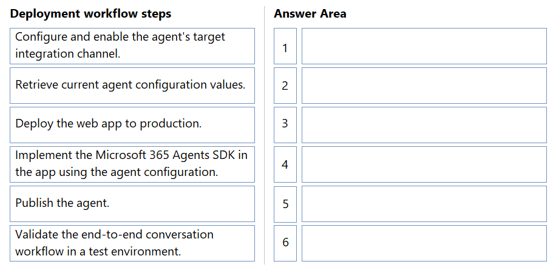

_DRAG DROP — the original ExamTopics question expects you to drag and drop items; the correct targets are not published._

**Most voted:**
2. Configure and enable the agent's target integration channel.
3. Retrieve current agent configuration values.
4. Implement the Microsoft 365 Agents SDK in the app using the agent configuration.
5. Validate the end-to-end conversation workflow in a test environment.
6. Deploy the web app to production.

### Top explanations
- **MeshMallow** (7 upvotes [Highly Voted]): Order:
  1. Publish the agent.
  2. Configure and enable the agent's target integration channel.
  3. Retrieve current agent configuration values.
  4. Implement the Microsoft 365 Agents SDK in the app using the agent configuration.
  5. Validate the end-to-end conversation workflow in a test environment.
  6. Deploy the web app to production.
- **faisalronnie** (7 upvotes [Highly Voted]): Order	Action
  1	Publish the agent.
  2	Configure and enable the agent's target integration channel.
  3	Retrieve current agent configuration values.
  4	Implement the Microsoft 365 Agents SDK in the app using the agent configuration.
  5	Validate the end-to-end conversation workflow in a test environment.
  6	Deploy the web app to production.
- **Arcadiuz** (1 upvotes [Most Recent]): Publish → Configure integration Channel → Retrieve Configuration → Implement SDK → Validate → Deploy
  The important distinction is:
  Publishing makes the agent available for integration.
  Channel configuration establishes the integration endpoint.
  SDK implementation connects your custom application.
  Validation confirms everything works before production.
- **49c9343** (1 upvotes): Step	Action
  1	✅ Publish the agent.
  2	✅ Retrieve current agent configuration values.
  3	✅ Implement the Microsoft 365 Agents SDK in the app using the agent configuration.
  4	✅ Configure and enable the agent's target integration channel.
  5	✅ Validate the end-to-end conversation workflow in a test environment.
  6	✅ Deploy the web app to production.
- **ageansea** (1 upvotes): my prefer order is:
  (1)Retrieve the agent's current configuration values.
  (2)Implement the Microsoft 365 Agents SDK in the app using the agent configuration.
  (3)Validate the end-to-end conversation workflow in a test environment.
  (4)Deploy the web app to production.
  (5)Configure and enable the agent's target integration channel.
  (6)Publish the agent.

## Q2.19 (ID 419333)

An agent in Copilot Studio already exists in a development environment.
You need to prepare the agent so it can be moved to a production environment using the supported solution-based approach.
You need to create an exportable package that contains the existing agent.
Which two actions should you perform? Each correct answer presents part of the solution.
NOTE: Each correct selection is worth one point.

⭕ **A.** Remove agent topics directly from the solution to prevent export errors.
⭕ **B.** Convert the solution to a managed solution so it can be exported.
✅ **C.** Export the unmanaged solution that contains the agent.
⭕ **D.** Publish the agent to a channel and export the channel configuration.
✅ **E.** Create a custom solution and add the existing agent to the solution.

**Correct answer:** C, E
**Most voted:** CE

### Top explanations
- **blissy** (2 upvotes [Selected Answer: BE]): Export managed to Production
- **Joselito79** (2 upvotes [Selected Answer: CE]): ✅ C. Export the unmanaged solution that contains the agent.
  ✅ E. Create a custom solution and add the existing agent to the solution.
- **faisalronnie** (2 upvotes [Selected Answer: CE]): The supported ALM process is:
  Create/Open an unmanaged solution.
  Add Existing → Copilot Agent to the solution.
  Include dependencies (flows, connectors, environment variables, etc.).
  Export the unmanaged solution (or later export as managed for production deployment depending on the scenario).
- **harshagracy** (1 upvotes [Most Recent, Selected Answer: CE]): E. Create a custom solution and add the existing agent to the solution: To use the Application Lifecycle Management (ALM) capabilities of the Power Platform, you must first create a custom unmanaged solution in your development environment and add your existing Copilot Studio agent (along with its required components) into it.
  C. Export the unmanaged solution that contains the agent: Once the agent is packaged in your custom solution, you initiate the export process from that unmanaged solution. (During the export wizard, you will choose to export it as a managed package to import into your production environment, but the solution you select to export must be unmanaged).

## Q2.21 (ID 419283)

Note: This question is part of a series of questions that present the same scenario. Each question in the series contains a unique solution that might meet the stated goals. Some question sets might have more than one correct solution, while others might not have a correct solution.
After you answer a question in this section, you will NOT be able to return to it. As a result, these questions will not appear on the review screen.
An agent uses a flow that calls an external service which can occasionally fail or time out.
When a failure occurs, the agent must meet the following requirements:
Must not terminate silently.
Must send a notification containing the error details.
You need to configure the agent flow so that failures are handled in a controlled and predictable way.
Solution: Retry the failing action without handling failure.
Does the solution meet the goal?

⭕ **A.** Yes
✅ **B.** No

**Correct answer:** B
**Most voted:** B

### Top explanations
- **harshagracy** (1 upvotes [Most Recent, Selected Answer: B]): Simply retrying the failing action without implementing explicit error handling does not meet the requirement to "send a notification containing the error details." If the retries are exhausted and the action ultimately fails, the flow will terminate without capturing the error context or proactively notifying anyone.
- **harshagracy** (1 upvotes [Selected Answer: B]): Simply retrying the failing action without implementing explicit error handling does not meet the requirement to "send a notification containing the error details." If the retries are exhausted and the action ultimately fails, the flow will terminate without capturing the error context or proactively notifying anyone.
- **MeshMallow** (1 upvotes [Selected Answer: B]): First we need to handle the failure condition then retry the failing action

## Q2.22 (ID 419269)

Note: This question is part of a series of questions that present the same scenario. Each question in the series contains a unique solution that might meet the stated goals. Some question sets might have more than one correct solution, while others might not have a correct solution.
After you answer a question in this section, you will NOT be able to return to it. As a result, these questions will not appear on the review screen.
An agent uses a flow that calls an external service which can occasionally fail or time out.
When a failure occurs, the agent must meet the following requirements:
Must not terminate silently.
Must send a notification containing the error details.
You need to configure the agent flow so that failures are handled in a controlled and predictable way.
Solution: Configure run after conditions for failure paths.
Does the solution meet the goal?

✅ **A.** Yes
⭕ **B.** No

**Correct answer:** A
**Most voted:** A

### Top explanations
- **Arcadiuz** (1 upvotes [Most Recent, Selected Answer: A]): A notification action can send the required message, but only if the flow is configured to execute that action when the preceding action fails.
  The notification must be connected to the failure path.
  Important condition
  The notification action must use the appropriate Configure run after settings, such as:
  • Has failed.
  • Has timed out.
  A notification action that only runs after successful completion does not satisfy the requirement.

## Q2.23 (ID 419271)

Note: This question is part of a series of questions that present the same scenario. Each question in the series contains a unique solution that might meet the stated goals. Some question sets might have more than one correct solution, while others might not have a correct solution.
After you answer a question in this section, you will NOT be able to return to it. As a result, these questions will not appear on the review screen.
An agent uses a flow that calls an external service which can occasionally fail or time out.
When a failure occurs, the agent must meet the following requirements:
Must not terminate silently.
Must send a notification containing the error details.
You need to configure the agent flow so that failures are handled in a controlled and predictable way.
Solution: Send a notification with relevant error details.
Does the solution meet the goal?

✅ **A.** Yes
⭕ **B.** No

**Correct answer:** A
**Most voted:** A

### Top explanations
- **faisalronnie** (5 upvotes [Most Recent, Selected Answer: A]): Sending a notification with the error details explicitly alerts someone that the failure occurred, so the failure is not silent, and it also satisfies the requirement to send a notification containing the error details.

## Q2.26 (ID 419342)

DRAG DROP
Background
Blue Yonder Airlines is a global carrier headquartered in Los Angeles, California, operating domestic and international flights. The company serves millions of passengers annually through its website, mobile app, and call centers. To improve customer service efficiency and reduce call center volume, Blue Yonder is deploying an AI agent in Microsoft Copilot Studio.
The agent will handle customer inquiries across multiple channels – web chat, mobile app, and Microsoft Teams (for internal support staff). It will answer questions, retrieve data from enterprise systems, and escalate to human agents when needed.
The project is led by a cross-function team:
Product manager: Defines requirements and success metrics.
Lead agent author: Designs topics, intents, and generative behavior.
Flow designers: Build agent flows and integrations.
IT/security and compliance: Oversees identity, data protection, and Responsible AI (RAI) compliance.
Current environment
Channels
Public website: Embedded web chat
Mobile app: In-app chatbot
Microsoft Teams: Internal support agent access
Identity and access
Customers: Anonymous access for general inquiries (e.g., flight status, baggage policy).
Authentication is required for personal data access (e.g., bookings, loyalty points).
Internal staff: Authenticate via Microsoft Entra ID.
Data sources
Reservation and Ticketing System (internal): REST API, no prebuilt connector with custom enterprise database.
Flight Status and Weather APIs (external): REST APIs with API keys.
Customer Support Knowledge Base: SharePoint library with PDFs and policy documents.
Loyalty Program Data: Stored in Dynamics 365 and Dataverse.
Travel Advisory Content: Uses REST API with partner services.
Integration mechanisms
Custom connectors must be used for internal APIs that lack prebuilt connectors.
HTTP request nodes may be used for lightweight external APIs.
Knowledge sources must be used for unstructured content.
Agent flows must be used to encapsulate reusable logic (e.g., rebooking).
Business requirements
Omnichannel support
Deploy the agent across web, mobile, and Teams with a consistent user experience. The Teams deployment must also support internal staff.
Self-service capabilities
The agent must handle common inquiries such as:
Flight status
Booking and rebooking
Loyalty program questions
Travel policies and baggage rules
Human escalation
If the agent cannot resolve an issue or the user requests help, it must:
Escalate to a human agent.
Transfer the conversation transcript and relevant context.
Redact any sensitive personal data before escalation.
Knowledge integration
The agent must use scalable methods for knowledge integration and must not rely on manually authored Q&A topics for each document.
Performance metrics
First-contact resolution: +25%
Tier-1 call deflection: ≥20%
Response time: 90% of queries answered within 30 seconds
Accuracy: ≥95% for known FAQs
CSAT: ≥85% for AI-handled interactions
Technical requirements
Platform constraints
No custom code is permitted; only Copilot Studio's built-in tools may be used.
All backend logic must be implemented using agent flows.
Markdown must be used for formatting (e.g., bold, bullet points); HTML is not supported.
Authentication
Sign-in is required for personal data access.
Anonymous access is allowed for general inquiries.
User identity must be used for data access; shared or builder credentials must not be used.
Compliance and security
Power Platform DLP policies must be enforced to block unauthorized data flows.
Responsible AI content moderation filters must be enabled.
Prompt modifications must be added to enforce tone, disclaimers, and refusal behavior.
Disclaimers must be applied consistently across all generative responses. Manual edits to individual topics must be avoided.
Monitoring and maintenance
All conversations and actions must be logged for auditing.
Weekly reviews of transcripts and metrics must be conducted.
Issues and constraints
API rate limits: External APIs (e.g., flight status) have usage limits. Agent flows must handle retries and caching to avoid exceeding quotas.
Knowledge base limits: Copilot Studio has limits on the number and size of indexed documents. Large files must be split or summarized.
Generative answer risks: Generative responses must be constrained to avoid policy violations. Prompt modifications and filters must be used to enforce tone, safety, and compliance.
User input variability: Users phrase questions in diverse ways. Topics must include varied trigger phrases and fallback handling.
Authentication UX: The agent must clearly explain when sign-in is required and handle transitions smoothly across channels.
Problem statement
Blue Yonder Airlines must deploy a secure, scalable, and policy-compliant AI agent using Microsoft Copilot Studio. The agent must deliver accurate, helpful, and safe responses across multiple channels, integrate with enterprise systems, and support both anonymous and authenticated users. It must adhere to strict data protection and Responsible AI standards while improving customer service efficiency and satisfaction.
You need to determine an appropriate implementation related to the use of agent flows that is based on Blue Vender's design and compliance standards.
Which implementation method should you use for each scenario? To answer, move the appropriate implementation methods to the correct scenarios. You may use each implementation method once, more than once, or not at all. You may need to move the split bar between panes or scroll to view content.
NOTE: Each correct selection is worth one point.

**Exhibits**
- Exhibit 1: 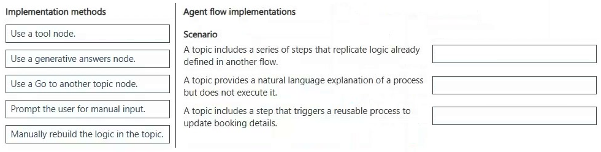

_DRAG DROP — the original ExamTopics question expects you to drag and drop items; the correct targets are not published._

**Most voted:**
- Scenario: Implementation method
- A topic includes a series of steps that replicate logic already defined in another flow.: Use a tool node.
- A topic provides a natural language explanation of a process but does not execute it.: Use a generative answers node.
- A topic includes a step that triggers a reusable process to update booking details.: Use a tool node.

### Top explanations
- **faisalronnie** (3 upvotes): Scenario	Implementation method
  A topic includes a series of steps that replicate logic already defined in another flow.	Use a tool node.
  A topic provides a natural language explanation of a process but does not execute it.	Use a generative answers node.
  A topic includes a step that triggers a reusable process to update booking details.	Use a tool node.
- **Snoopy70** (2 upvotes [Most Recent]): A topic includes a series of steps that replicate logic already defined in another flow: Use a tool node
  A topic provides a natural language explanation of a process but does not execute it: Use a generative answers node
  A topic includes a step that triggers a reusable process to update booking details: Use a tool node

## Q2.30 (ID 419278)

Background
Fabrikam Inc. is a Canada-based manufacturer with a growing service organization that supports field technicians and internal operations teams. Fabrikam Inc. plans to launch a new internal agent solution named Operations Concierge to reduce time spent searching policy content, retrieving operational metrics, and executing routine transactions.
The agent will be used by three groups:
Service coordinators who triage incoming service requests
Field technicians who need guided procedures and parts availability
Operations managers who monitor KPIs and exceptions
The agent solution must work in real-world operational conditions. Users often ask questions mid-call with a customer or while coordinating parts shipments. The agents require quick, reliable outcomes. As a result, Fabrikam Inc. requires the solution to:
Provide grounded answers with traceability when it provides guidance.
Retrieve real-time metrics when users ask for operational status.
Execute authenticated updates when users initiate a flow (such as creating a parts request).
Fabrikam Inc. also expects the solution to be maintained by multiple makers and developers across the year. The company has experienced duplicated logic and inconsistent behavior across different agents. This project emphasizes reuse, governance, and maintainability across teams.
Current environment
Fabrikam Inc. runs three Microsoft Power Platform environments for agent development and release: Dev, Test, and Prod.
The team plans to build the agent and validate it in Dev and Test, then promote to Prod by using a controlled release process that supports repeatable deployments.
Fabrikam Inc. already has two assets the team wants to reuse:
A partially completed Copilot Studio agent named Service Desk Agent, used by IT to create internal tickets and route requests
A Microsoft Foundry agent created by a central AI team that performs specialized summarization and classification for long-form text (for example, summarizing call transcripts into an incident narrative)
Fabrikam Inc. also has operational and knowledge data sources:
A curated policy library (internal SOPs, service warranty rules, escalation criteria, and standard operating procedures)
A set of indexed documents and procedures in an Azure AI Search service that supports vector search for the policy library
A Microsoft Fabric workspace that includes a semantic model used by operations leadership for reporting
Business requirements
Fabrikam Inc. requires Operations Concierge to meet the following business requirements:
Traceability requirement: When the agent provides policy guidance or procedural recommendations, users must be able to see where the answer came from.
Metrics requirement: When users ask about service performance (backlog, SLA risk, parts shortages, dispatch delays), the solution must return up-to-date metrics in a structured format that operations managers can use in weekly reviews.
Transaction requirement: The solution must support authenticated updates initiated during conversations, including creating a parts request and updating a service case status.
In addition, Fabrikam Inc. wants to avoid duplicating common assets across agents:
The team must reuse the same set of escalation topics, MCP tool definitions, and a standard safety disclaimer across three different agents.
Only the platform engineering group as allowed to edit shared assets. However, all agent authors must be able to use them.
Technical requirements
The Fabrikam Inc. solution architecture uses a multi-agent approach so that specialist responsibilities are isolated and can evolve independently.
The Operations Concierge (primary agent) must coordinate the following specialist capabilities:
Policy and procedure Q&A: Use an enterprise knowledge source that supports indexed retrieval across the curated policy library and service procedures.
Operational metrics: Delegate metric queries to a Fabric Data Agent that reads governed business data through the Fabric semantic model.
Authenticated updates: Use tools exposed by an existing internal Model Context Protocol (MCP) server that provides transactional operations for the service organization.
Specialized processing: Delegate summarization and classification requests to an existing Microsoft Foundry agent.
Fabrikam Inc. will onboard two MCP servers as tools:
PartsOps MCP server: exposes tools for parts availability checks and parts request creation. The server requires per-user authentication because actions must be traceable to the requesting user.
WarrantyRules MCP server: exposes a read-only tool for validating warranty coverage. The server uses an API key shared by the agent team.
Fabrikam Inc. has also defined a collaboration requirement with the existing Service Desk Agent:
The primary agent must delegate IT-specific requests to the existing Service Desk Agent rather than reimplement ticket creation logic.
Finally, Fabrikarn Inc. plans to support a partner integration:
For shipment tracking inquiries, Fabrikam Inc. will delegate to a partner-provided agent that is only available through a standardized agent-to-agent endpoint.
Issues and constraints
During early testing, Fabrikam Inc. found three recurring problems:
Makers are copying and modifying the same components across agents, resulting in inconsistent disclaimers and duplicated tools.
Users can obtain a correct answer, but the response is not consistently traceable to a source when the agent uses knowledge.
The primary agent can route some requests, but specialist capabilities are not consistently delegated (for example, some metric questions are answered generatively instead of being routed to the Fabric Data Agent).
You are part of the engineering team responsible for correcting the design and configuration to meet the preceding requirements and constraints.
You need to configure Operations Concierge so that prompt-driven summarization behavior aligns with Fabrikam Inc.'s architectural requirements.
Which two actions should you perform? Each correct answer presents part of the solution.
NOTE: Each correct selection is worth one point.

⭕ **A.** Configure Azure AI Search as the grounding source for summarization prompts.
⭕ **B.** Publish the agent to ensure the selected model is enforced for summarization.
✅ **C.** Select a model from the Foundry model catalog in the custom prompt configuration.
⭕ **D.** Enable citations to control how summarization output is generated.
✅ **E.** Create a reusable custom prompt template and apply it where summarization responses are generated.

**Correct answer:** C, E
**Most voted:** CE

### Top explanations
- **Snoopy70** (2 upvotes [Selected Answer: CE]): C. Select a model from the Foundry model catalog in the custom prompt configuration
  E. Create a reusable custom prompt template and apply it where summarization responses are generated
- **Joselito79** (2 upvotes [Selected Answer: CE]): The correct answers are:
  ✅ C. Select a model from the Foundry model catalog in the custom prompt configuration.
  ✅ E. Create a reusable custom prompt template and apply it where summarization responses are generated.
  Why?
  C — Select a Foundry model
  The case explicitly says Fabrikam already has a Microsoft Foundry agent for specialized summarization and classification. The requirement is for prompt-driven summarization to use an approved model from the Foundry model catalog.
  E — Reusable custom prompt template
  The company wants reusable, maintainable behavior across its agents. A custom prompt template provides consistent instructions for how summarization should be performed and can be applied wherever those summarization responses are generated.
- **Arcadiuz** (1 upvotes [Most Recent, Selected Answer: CE]): ✅ C. Select a model from the Foundry model catalog.
  Allows you to select the appropriate AI model for summarization within a custom prompt.
  ✅ E. Create a reusable custom prompt template.
  Ensures consistent summarization instructions, output formatting, and reusable behavior across the solution.
  ❌ Why are the others incorrect?
  A. Azure AI Search: Used for retrieving indexed knowledge, not configuring summarization behavior.
  B. Publish the agent: Makes agent changes available but does not determine which model performs summarization.
  D. Enable citations: Provides source traceability but does not control summarization instructions or model selection.

## Q2.31 (ID 419285)

DRAG DROP
Background
Fabrikam Inc. is a Canada-based manufacturer with a growing service organization that supports field technicians and internal operations teams. Fabrikam Inc. plans to launch a new internal agent solution named Operations Concierge to reduce time spent searching policy content, retrieving operational metrics, and executing routine transactions.
The agent will be used by three groups:
Service coordinators who triage incoming service requests
Field technicians who need guided procedures and parts availability
Operations managers who monitor KPIs and exceptions
The agent solution must work in real-world operational conditions. Users often ask questions mid-call with a customer or while coordinating parts shipments. The agents require quick, reliable outcomes. As a result, Fabrikam Inc. requires the solution to:
Provide grounded answers with traceability when it provides guidance.
Retrieve real-time metrics when users ask for operational status.
Execute authenticated updates when users initiate a flow (such as creating a parts request).
Fabrikam Inc. also expects the solution to be maintained by multiple makers and developers across the year. The company has experienced duplicated logic and inconsistent behavior across different agents. This project emphasizes reuse, governance, and maintainability across teams.
Current environment
Fabrikam Inc. runs three Microsoft Power Platform environments for agent development and release: Dev, Test, and Prod.
The team plans to build the agent and validate it in Dev and Test, then promote to Prod by using a controlled release process that supports repeatable deployments.
Fabrikam Inc. already has two assets the team wants to reuse:
A partially completed Copilot Studio agent named Service Desk Agent, used by IT to create internal tickets and route requests
A Microsoft Foundry agent created by a central AI team that performs specialized summarization and classification for long-form text (for example, summarizing call transcripts into an incident narrative)
Fabrikam Inc. also has operational and knowledge data sources:
A curated policy library (internal SOPs, service warranty rules, escalation criteria, and standard operating procedures)
A set of indexed documents and procedures in an Azure AI Search service that supports vector search for the policy library
A Microsoft Fabric workspace that includes a semantic model used by operations leadership for reporting
Business requirements
Fabrikam Inc. requires Operations Concierge to meet the following business requirements:
Traceability requirement: When the agent provides policy guidance or procedural recommendations, users must be able to see where the answer came from.
Metrics requirement: When users ask about service performance (backlog, SLA risk, parts shortages, dispatch delays), the solution must return up-to-date metrics in a structured format that operations managers can use in weekly reviews.
Transaction requirement: The solution must support authenticated updates initiated during conversations, including creating a parts request and updating a service case status.
In addition, Fabrikam Inc. wants to avoid duplicating common assets across agents:
The team must reuse the same set of escalation topics, MCP tool definitions, and a standard safety disclaimer across three different agents.
Only the platform engineering group as allowed to edit shared assets. However, all agent authors must be able to use them.
Technical requirements
The Fabrikam Inc. solution architecture uses a multi-agent approach so that specialist responsibilities are isolated and can evolve independently.
The Operations Concierge (primary agent) must coordinate the following specialist capabilities:
Policy and procedure Q&A: Use an enterprise knowledge source that supports indexed retrieval across the curated policy library and service procedures.
Operational metrics: Delegate metric queries to a Fabric Data Agent that reads governed business data through the Fabric semantic model.
Authenticated updates: Use tools exposed by an existing internal Model Context Protocol (MCP) server that provides transactional operations for the service organization.
Specialized processing: Delegate summarization and classification requests to an existing Microsoft Foundry agent.
Fabrikam Inc. will onboard two MCP servers as tools:
PartsOps MCP server: exposes tools for parts availability checks and parts request creation. The server requires per-user authentication because actions must be traceable to the requesting user.
WarrantyRules MCP server: exposes a read-only tool for validating warranty coverage. The server uses an API key shared by the agent team.
Fabrikam Inc. has also defined a collaboration requirement with the existing Service Desk Agent:
The primary agent must delegate IT-specific requests to the existing Service Desk Agent rather than reimplement ticket creation logic.
Finally, Fabrikarn Inc. plans to support a partner integration:
For shipment tracking inquiries, Fabrikam Inc. will delegate to a partner-provided agent that is only available through a standardized agent-to-agent endpoint.
Issues and constraints
During early testing, Fabrikam Inc. found three recurring problems:
Makers are copying and modifying the same components across agents, resulting in inconsistent disclaimers and duplicated tools.
Users can obtain a correct answer, but the response is not consistently traceable to a source when the agent uses knowledge.
The primary agent can route some requests, but specialist capabilities are not consistently delegated (for example, some metric questions are answered generatively instead of being routed to the Fabric Data Agent).
You are part of the engineering team responsible for correcting the design and configuration to meet the preceding requirements and constraints.
You need to connect Operations Concierge to Fabrikam Inc.'s Azure AI Search knowledge index while complying with security requirements.
Which configuration should you use for each requirement? To answer, move the appropriate configurations to the correct requirements. You may use each configuration once, more than once, or not at all. You may need to move the split bar between panes or scroll to view content.
NOTE: Each correct selection is worth one point.

**Exhibits**
- Exhibit 1: 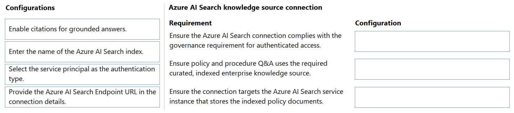

_DRAG DROP — the original ExamTopics question expects you to drag and drop items; the correct targets are not published._

**Most voted:**
- Ensure the Azure AI Search connection complies with the governance requirement for authenticated access:  Select the service principal as the authentication type.
- Ensure policy and procedure Q&A uses the required curated, indexed enterprise knowledge source:  Enter the name of the Azure AI Search index.

### Top explanations
- **massnonn** (3 upvotes [Most Recent]): Ensure the Azure AI Search connection complies with the governance requirement for authenticated access:  Select the service principal as the authentication type.
  Ensure policy and procedure Q&A uses the required curated, indexed enterprise knowledge source:  Enter the name of the Azure AI Search index.
  Ensure the connection targets the Azure AI Search service instance that stores the indexed policy documents:  Provide the Azure AI Search Endpoint URL in the connection details.
- **faisalronnie** (3 upvotes): RequirementConfigurationEnsure the Azure AI Search connection complies with the governance requirement for authenticated access.Select the service principal as the authentication type.Ensure policy and procedure Q&A uses the required curated, indexed enterprise knowledge source.Enter the name of the Azure AI Search index.Ensure the connection targets the Azure AI Search service instance that stores the indexed policy documents.Provide the Azure AI Search Endpoint URL in the connection details.

## Q2.32 (ID 419292)

DRAG DROP
A company is building a Copilot Studio solution that must answer policy questions, retrieve operational metrics from structured data, and execute authenticated updates in backend systems. The company decides to use multiple specialized agents rather than a single monolithic agent. Custom agents for each action already exist.
To meet the business needs, the solution must meet the following requirements:
The solution must retrieve up to date metrics from structured data.
The solution must answer policy questions using curated knowledge.
The solution must execute authenticated updates during conversations.
You need to select the appropriate agent design for each requirement.
Which approach should you use for each requirement? To answer, move the appropriate configurations to the correct requirements. You may use each configuration once, more than once, or not at all. You may need to move the split bar between panes or scroll to view content.
NOTE: Each correct selection is worth one point.

**Exhibits**
- Exhibit 1: 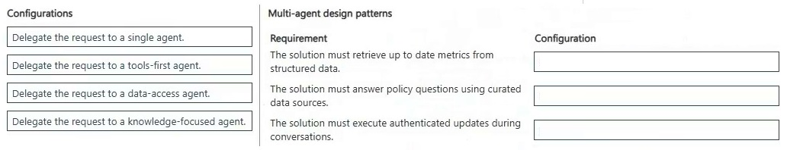

_DRAG DROP — the original ExamTopics question expects you to drag and drop items; the correct targets are not published._

**Most voted:**
- Retrieve up-to-date metrics → Delegate to a data-access agent
- Answer policy questions → Delegate to a knowledge-focused agent
- Execute authenticated updates → Delegate to a tools-first agent

### Top explanations
- **faisalronnie** (10 upvotes [Highly Voted]): should it not be:
  Retrieve up-to-date metrics → Delegate to a data-access agent
  Answer policy questions → Delegate to a knowledge-focused agent
  Execute authenticated updates → Delegate to a tools-first agent
- **Arcadiuz** (1 upvotes [Most Recent]): I Think:
  1.Delegate to a data-access agent
  2.Delegate to a knowledge-focused agent
  3. Delegate to a tools-first agent
  Data-access agent: Designed to retrieve structured information from governed data sources.
  Example: operational metrics from a Fabric semantic model.
  Knowledge-focused agent:  Designed to retrieve and answer questions using curated enterprise knowledge.
  Example: internal procedures and warranty policies.
  Tools-first agent: Designed to perform actions and operations.
  Example: create a parts request or update a service case.

## Q2.34 (ID 419291)

DRAG DROP
A company has an Azure AI Search vector index that contains enterprise content and wants to use it as a knowledge source for an agent in Copilot Studio.
To meet business needs, the knowledge source must meet the following requirements:
The agent must connect to the Azure AI Search service.
The agent must use a supported authentication method for the connection.
The agent must ensure answers are grounded using the specified Azure AI Search index.
You need to connect to Azure AI Search as a knowledge source for the agent.
In which order should you perform the actions? To answer, move all actions from the list of actions to the answer area and arrange them in the correct order.

**Exhibits**
- Exhibit 1: 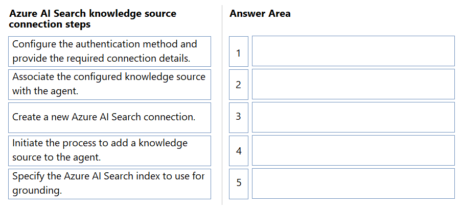

_DRAG DROP — the original ExamTopics question expects you to drag and drop items; the correct targets are not published._

**Most voted:**
- 1️⃣ Initiate the process to add a knowledge source to the agent
- 2️⃣ Create a new Azure AI Search connection
- 3️⃣ Configure the authentication method and provide the required connection details
- 4️⃣ Specify the Azure AI Search index to use for grounding
- 5️⃣ Associate the configured knowledge source with the agent

### Top explanations
- **massnonn** (2 upvotes [Most Recent]): 1️⃣ Initiate the process to add a knowledge source to the agent
  2️⃣ Create a new Azure AI Search connection
  3️⃣ Configure the authentication method and provide the required connection details
  4️⃣ Specify the Azure AI Search index to use for grounding
  5️⃣ Associate the configured knowledge source with the agent

## Q2.35 (ID 419294)

DRAG DROP
A company uses a primary agent in Copilot Studio to handle user intake.
For some requests, the company wants the primary agent to delegate work to another Copilot Studio agent that already exists.
To meet the business needs, the solution must allow agents to perform the following on the connected agent:
Must allow calls from other agents.
Must allow agents to use the connected agent for collaboration.
Must allow agents to invoke the connected agent in conversations.
You need to integrate the existing Copilot Studio agent with the connected agent.
Which setting should you configure for each requirement? To answer, move the appropriate configurations to the correct requirements. You may use each configuration once, more than once, or not at all. You may need to move the split bar between panes or scroll to view content.
NOTE: Each correct selection is worth one point.

**Exhibits**
- Exhibit 1: 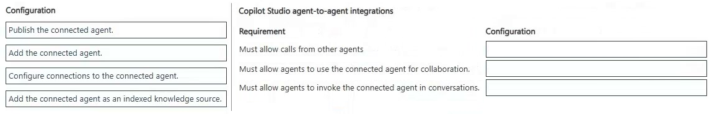

_DRAG DROP — the original ExamTopics question expects you to drag and drop items; the correct targets are not published._

**Most voted:**
- Requirement: Configuration
- Must allow calls from other agents: Publish the connected agent.
- Must allow agents to use the connected agent for collaboration: Add the connected agent.
- Must allow agents to invoke the connected agent in conversations: Configure connections to the connected agent.

### Top explanations
- **faisalronnie** (2 upvotes): RequirementConfigurationMust allow calls from other agentsPublish the connected agentMust allow agents to use the connected agent for collaborationConfigure connections to the connected agentMust allow agents to invoke the connected agent in conversationsAdd the connected agent
- **Snoopy70** (1 upvotes [Most Recent]): Must allow calls from other agents > Publish the connected agent
  Must allow agents to use the connected agent for collaboration > Add the connected agent
  Must allow agents to invoke the connected agent in conversations > Configure connections to the connected agent
- **massnonn** (1 upvotes): Requirement	Configuration
  Must allow calls from other agents: Publish the connected agent.
  Must allow agents to use the connected agent for collaboration: Add the connected agent.
  Must allow agents to invoke the connected agent in conversations: Configure connections to the connected agent.

## Q2.37 (ID 419328)

A company uses an agent in Copilot Studio that produces structured responses using a reusable instruction template. The responses follow the required tone and format. During a compliance review, the team discovers that the responses were generated using a model that is not on the approved list.
The company requires that the reusable instruction template continues to be used and the model used for prompt-driven responses meets governance requirements.
The solution must ensure that prompt-driven responses are generated using an approved model.
You need to configure the solution that meets the requirements.
Which two actions should you perform? Each correct answer presents part of the solution.
NOTE: Each correct selection is worth one point.

⭕ **A.** Publish the agent so that the model used by prompt-driven responses is updated automatically.
⭕ **B.** Enable citations so generated responses can be traced and comply with governance requirements.
✅ **C.** Add a line to the instruction template that requires the agent to use only approved models when generating responses.
⭕ **D.** Configure Azure AI Search as the grounding source so the approved model requirement is enforced during response generation.
✅ **E.** Ensure the reusable instruction template is the one applied to the agent that generates the structured response.

**Correct answer:** C, E
**Most voted:** CE

### Top explanations
- **Snoopy70** (1 upvotes [Most Recent, Selected Answer: CE]): C. Add a line to the instruction template that requires the agent to use only approved models when generating responses.
  ✅ E. Ensure the reusable instruction template is the one applied to the agent that generates the structured response.
- **Joselito79** (1 upvotes [Selected Answer: CE]): The correct answers are:
  C. Add a line to the instruction template that requires the agent to use only approved models when generating responses. ✅
  E. Ensure the reusable instruction template is the one applied to the agent that generates the structured response. ✅
  Why: The reusable instruction template must remain in use, and adding the model-governance instruction ensures prompt-driven responses are directed to approved models. Citations, grounding, or publishing do not enforce the approved-model requirement.
- **massnonn** (1 upvotes [Selected Answer: CE]): it' the correct answer

## Q2.40 (ID 419351)

DRAG DROP
A company needs an agent to answer questions using live enterprise records and to execute a limited set of operations in the same system.
To meet the business needs, the agent must meet the following requirements:
The agent must update a record using authenticated access.
The agent must answer questions using live data at runtime.
The agent must avoid indexing enterprise data into a search index.
You need to select the correct Power Platform connector approach for each requirement.
Which option should you use for each requirement? To answer, move the appropriate solutions to the correct requirements. You may use each solution once, more than once, or not at all. You may need to move the split bar between panes or scroll to view content.
NOTE: Each correct selection is worth one point.

**Exhibits**
- Exhibit 1: 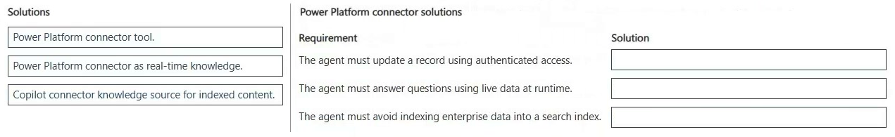

_DRAG DROP — the original ExamTopics question expects you to drag and drop items; the correct targets are not published._

**Most voted:**
- The agent must update a record using authenticated access: Power Platform connector tool.
- The agent must answer questions using live data at runtime: Power Platform connector as real-time knowledge.
- The agent must avoid indexing enterprise data into a search index: Power Platform connector as real-time knowledge.

### Top explanations
- **faisalronnie** (9 upvotes [Highly Voted]): RequirementCorrect solutionThe agent must update a record using authenticated access.Power Platform connector toolThe agent must answer questions using live data at runtime.Power Platform connector as real-time knowledgeThe agent must avoid indexing enterprise data into a search index.Power Platform connector as real-time knowledge
- **massnonn** (2 upvotes [Most Recent]): The agent must update a record using authenticated access: Power Platform connector tool.
  The agent must answer questions using live data at runtime:  Power Platform connector as real-time knowledge.
  The agent must avoid indexing enterprise data into a search index: Power Platform connector as real-time knowledge.

## Q2.41 (ID 419302)

A company uses an agent in Copilot Studio to coordinate user interactions.
The company wants the agent to delegate requests to a Microsoft Fabric Data Agent that accesses governed business data.
The agent must retrieve structured analytical data while enforcing data security and scope controls.
You need to select the integration approach that meets the requirements.
What should you use?

✅ **A.** A Microsoft Fabric Data Agent and bind it to the model.
⭕ **B.** A REST API action that queries Fabric tables directly.
⭕ **C.** A Power Automate flow and call it from a topic.
⭕ **D.** A Copilot connector knowledge source that indexes Fabric data.

**Correct answer:** A
**Most voted:** A

### Top explanations
- **Arcadiuz** (1 upvotes [Most Recent, Selected Answer: A]): ✅ A. Microsoft Fabric Data Agent
  A Fabric Data Agent retrieves real-time, structured analytical data from governed business sources while respecting existing security permissions and access controls.
  ❌ Why are the others incorrect?
  B. REST API action: Can query Fabric data directly but requires custom implementation of queries, authentication, and security controls. It lacks the built-in analytical capabilities of a Fabric Data Agent.
  C. Power Automate flow: Can retrieve data through predefined workflows but is not designed for flexible, natural-language analytical queries.
  D. Copilot connector knowledge source: Provides indexed content for knowledge grounding rather than live queries against governed analytical data.
  Key takeaway:
  Fabric Data Agent = Query live business data.
  Copilot Connector = Search indexed knowledge.

## Q2.43 (ID 419332)

DRAG DROP
A company is extending agents in Copilot Studio with both external capabilities and enterprise content access. Some user requests require grounded answers, while other requests require executing actions.
To meet the business needs, the agent must meet the following requirements:
Ground answers using results from enterprise data.
Invoke callable functions exposed through a standardized tool interface.
Write an update to a system by using an authenticated action during the conversation.
You need to integrate the correct approach to meet the requirements.
What should you integrate for each requirement? To answer, move the appropriate integrations to the correct requirements. You may use each integration once, more than once, or not at all. You may need to move the split bar between panes or scroll to view content.
NOTE: Each correct selection is worth one point.

**Exhibits**
- Exhibit 1: 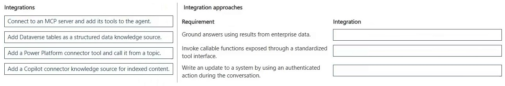

_DRAG DROP — the original ExamTopics question expects you to drag and drop items; the correct targets are not published._

**Most voted:**
- Ground answers using results from enterprise data: Add a Copilot connector knowledge source for indexed content.
- Invoke callable functions exposed through a standardized tool interface: Connect to an MCP server and add its tools to the agent.

### Top explanations
- **massnonn** (3 upvotes [Most Recent]): Ground answers using results from enterprise data:   Add a Copilot connector knowledge source for indexed content.
  Invoke callable functions exposed through a standardized tool interface:  Connect to an MCP server and add its tools to the agent.
  Write an update to a system by using an authenticated action during the conversation:  Add a Power Platform connector tool and call it from a topic.
- **kevinirl** (1 upvotes): Ground answers using results from enterprise data → Add Dataverse tables as a structured data knowledge source.

## Q2.44 (ID 419318)

DRAG DROP
A company plans to use Copilot connectors to ground answers from a third-party system for an agent in Copilot Studio.
To meet the business needs, responsibilities for configuring and using Copilot connectors must be separated, based on the following requirements:
For tenant administration, the connector must be available at the tenant level.
For agent runtime behavior, answers must be grounded from authorized sources.
For builder configuration, you must add the connector to the agent.
You need to determine how Copilot connector set-up responsibilities are handled across tenant, runtime, and builder stages.
What should you configure for each requirement? To answer, move the appropriate configuration to the correct requirements. You may use each configuration once, more than once, or not at all. You may need to move the split bar between panes or scroll to view content.
NOTE: Each correct selection is worth one point.

**Exhibits**
- Exhibit 1: 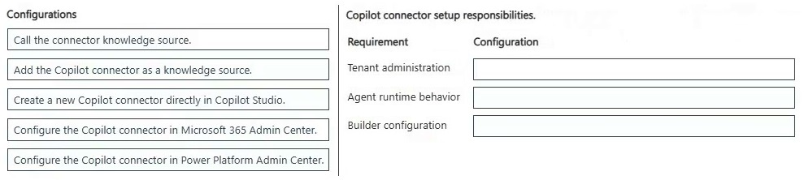

_DRAG DROP — the original ExamTopics question expects you to drag and drop items; the correct targets are not published._

**Most voted:**
- Tenant administration: Configure the Copilot connector in Microsoft 365 Admin Center.
- Agent runtime behavior: Call the connector knowledge source.
- Builder configuration: Add the Copilot connector as a knowledge source.

### Top explanations
- **faisalronnie** (7 upvotes [Highly Voted]): Tenant administrationConfigure the Copilot connector in Microsoft 365 Admin CenterAgent runtime behaviorCall the connector knowledge sourceBuilder configurationAdd the Copilot connector as a knowledge source
- **massnonn** (2 upvotes [Most Recent]): Tenant administration: Configure the Copilot connector in Microsoft 365 Admin Center.
  Agent runtime behavior: Call the connector knowledge source.
  Builder configuration: Add the Copilot connector as a knowledge source.

## Q2.46 (ID 433203)

Background
Fabrikam Inc. is a Canada-based manufacturer with a growing service organization that supports field technicians and internal operations teams. Fabrikam Inc. plans to launch a new internal agent solution named Operations Concierge to reduce time spent searching policy content, retrieving operational metrics, and executing routine transactions.
The agent will be used by three groups:
•	Service coordinators who triage incoming service requests
•	Field technicians who need guided procedures and parts availability
•	Operations managers who monitor KPIs and exceptions
The agent solution must work in real-world operational conditions. Users often ask questions mid-call with a customer or while coordinating parts shipments. The agents require quick, reliable outcomes. As a result, Fabrikam Inc. requires the solution to:
•	Provide grounded answers with traceability when it provides guidance.
•	Retrieve real-time metrics when users ask for operational status.
•	Execute authenticated updates when users initiate a flow (such as creating a parts request).
Fabrikam Inc. also expects the solution to be maintained by multiple makers and developers across the year. The company has experienced duplicated logic and inconsistent behavior across different agents. This project emphasizes reuse, governance, and maintainability across teams.
Current environment
Fabrikam Inc. runs three Microsoft Power Platform environments for agent development and release: Dev, Test, and Prod.
The team plans to build the agent and validate it in Dev and Test, then promote to Prod by using a controlled release process that supports repeatable deployments.
Fabrikam Inc. already has two assets the team wants to reuse:
•	A partially completed Copilot Studio agent named Service Desk Agent, used by IT to create internal tickets and route requests
•	A Microsoft Foundry agent created by a central AI team that performs specialized summarization and classification for long-form text (for example, summarizing call transcripts into an incident narrative)
Fabrikam Inc. also has operational and knowledge data sources:
•	A curated policy library (internal SOPs, service warranty rules, escalation criteria, and standard operating procedures)
•	A set of indexed documents and procedures in an Azure AI Search service that supports vector search for the policy library
•	A Microsoft Fabric workspace that includes a semantic model used by operations leadership for reporting
Business requirements
Fabrikam Inc. requires Operations Concierge to meet the following business requirements:
•	Traceability requirement: When the agent provides policy guidance or procedural recommendations, users must be able to see where the answer came from.
•	Metrics requirement: When users ask about service performance (backlog, SLA risk, parts shortages, dispatch delays), the solution must return up-to-date metrics in a structured format that operations managers can use in weekly reviews.
•	Transaction requirement: The solution must support authenticated updates initiated during conversations, including creating a parts request and updating a service case status.
In addition, Fabrikam Inc. wants to avoid duplicating common assets across agents:
•	The team must reuse the same set of escalation topics, MCP tool definitions, and a standard safety disclaimer across three different agents.
•	Only the platform engineering group as allowed to edit shared assets. However, all agent authors must be able to use them.
Technical requirements
The Fabrikam Inc. solution architecture uses a multi-agent approach so that specialist responsibilities are isolated and can evolve independently.
The Operations Concierge (primary agent) must coordinate the following specialist capabilities:
•	Policy and procedure Q&A: Use an enterprise knowledge source that supports indexed retrieval across the curated policy library and service procedures.
•	Operational metrics: Delegate metric queries to a Fabric Data Agent that reads governed business data through the Fabric semantic model.
•	Authenticated updates: Use tools exposed by an existing internal Model Context Protocol (MCP) server that provides transactional operations for the service organization.
•	Specialized processing: Delegate summarization and classification requests to an existing Microsoft Foundry agent.
Fabrikam Inc. will onboard two MCP servers as tools:
•	PartsOps MCP server: exposes tools for parts availability checks and parts request creation. The server requires per-user authentication because actions must be traceable to the requesting user.
•	WarrantyRules MCP server: exposes a read-only tool for validating warranty coverage. The server uses an API key shared by the agent team.
Fabrikam Inc. has also defined a collaboration requirement with the existing Service Desk Agent:
•	The primary agent must delegate IT-specific requests to the existing Service Desk Agent rather than reimplement ticket creation logic.
Finally, Fabrikam Inc. plans to support a partner integration:
•	For shipment tracking inquiries, Fabrikam Inc. will delegate to a partner-provided agent that is only available through a standardized agent-to-agent endpoint.
Issues and constraints
During early testing, Fabrikam Inc. found three recurring problems:
•	Makers are copying and modifying the same components across agents, resulting in inconsistent disclaimers and duplicated tools.
•	Users can obtain a correct answer, but the response is not consistently traceable to a source when the agent uses knowledge.
•	The primary agent can route some requests, but specialist capabilities are not consistently delegated (for example, some metric questions are answered generatively instead of being routed to the Fabric Data Agent).
You are part of the engineering team responsible for correcting the design and configuration to meet the preceding requirements and constraints.
You need to enable collaboration requirements for Operations Concierge.
Which two actions should you perform? Each correct answer presents part of the solution.
NOTE: Each correct selection is worth one point.

✅ **A.** Enable allow connections from other agents on the Service Desk Agent.
⭕ **B.** Replace the Service Desk Agent with an MCP server.
⭕ **C.** Publish Operations Concierge to enable delegation automatically.
⭕ **D.** Add the Service Desk Agent as an indexed knowledge source.
✅ **E.** Publish the Service Desk Agent.

**Correct answer:** A, E
**Most voted:** AE

### Top explanations
- **Snoopy70** (1 upvotes [Most Recent, Selected Answer: AE]): https://learn.microsoft.com/en-us/microsoft-copilot-studio/add-agent-copilot-studio-agent

## Q2.53 (ID 419324)

A company is configuring generative answers for an agent in Copilot Studio agent.
The agent must use Azure AI Search to retrieve enterprise content, and all responses must be generated by a Microsoft Foundry model.
The agent sometimes generates answers that are not grounded in Azure AI Search content. The company requires that the agent only generate responses when relevant indexed content is retrieved.
You need to configure the agent so that its generative answer behavior meets the organization's requirements.
What should you do?

⭕ **A.** Use Azure AI Search as a tailback source and enable answer expansion.
⭕ **B.** Upload documents into the agent and disable fallback responses.
✅ **C.** Require grounding for generative answers and use Azure AI Search as the retrieval source.
⭕ **D.** Enable citations and configure a public model endpoint.
⭕ **E.** Enable conversational boosting and select a Foundry-approved model.

**Correct answer:** C
**Most voted:** C

### Top explanations
- **faisalronnie** (3 upvotes [Selected Answer: C]): Require grounding for generative answers and use Azure AI Search as the retrieval source.
- **Joselito79** (2 upvotes [Selected Answer: C]): C. Require grounding for generative answers and use Azure AI Search as the retrieval source. ✅
  This ensures the agent only generates responses when relevant content is retrieved from Azure AI Search, preventing ungrounded responses and satisfying the enterprise-content requirement.
- **BolDeFruits** (2 upvotes [Selected Answer: C]): Proper answer is C
  Source: https://learn.microsoft.com/en-us/microsoft-copilot-studio/guidance/retrieval-augmented-generation
- **Snoopy70** (1 upvotes [Most Recent, Selected Answer: C]): Require grounding for generative answers and use Azure AI Search as the retrieval source

## Q2.54 (ID 419289)

DRAG DROP
A company wants to extend an agent in Copilot Studio by calling an external REST API to retrieve and update data.
To meet the business needs, the REST API must be added following a correct dependency order.
You need to add a REST API to the agent so it can be invoked during conversations.
In which order should you perform the actions? To answer, move all actions from the list of actions to the answer area and arrange them in the correct order.

**Exhibits**
- Exhibit 1: 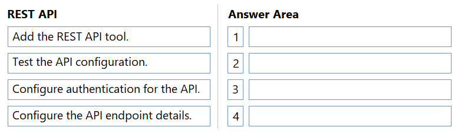

_DRAG DROP — the original ExamTopics question expects you to drag and drop items; the correct targets are not published._

**Most voted:** Correct answer is here => https://learn.microsoft.com/en-us/microsoft-copilot-studio/agent-extend-action-rest-api#add-a-rest-api-tool-to-your-agent

### Top explanations
- **faisalronnie** (11 upvotes [Highly Voted]): Add the REST API tool
  Configure the API endpoint details
  Configure authentication for the API
  Test the API configuration
- **Snoopy70** (1 upvotes [Most Recent]): Correct answer is here => https://learn.microsoft.com/en-us/microsoft-copilot-studio/agent-extend-action-rest-api#add-a-rest-api-tool-to-your-agent

## Q3.1 (ID 419319)

DRAG DROP
Background
Blue Yonder Airlines is a global carrier headquartered in Los Angeles, California, operating domestic and international flights. The company serves millions of passengers annually through its website, mobile app, and call centers. To improve customer service efficiency and reduce call center volume, Blue Yonder is deploying an AI agent in Microsoft Copilot Studio.
The agent will handle customer inquiries across multiple channels – web chat, mobile app, and Microsoft Teams (for internal support staff). It will answer questions, retrieve data from enterprise systems, and escalate to human agents when needed.
The project is led by a cross-function team:
Product manager: Defines requirements and success metrics.
Lead agent author: Designs topics, intents, and generative behavior.
Flow designers: Build agent flows and integrations.
IT/security and compliance: Oversees identity, data protection, and Responsible AI (RAI) compliance.
Current environment
Channels
Public website: Embedded web chat
Mobile app: In-app chatbot
Microsoft Teams: Internal support agent access
Identity and access
Customers: Anonymous access for general inquiries (e.g., flight status, baggage policy).
Authentication is required for personal data access (e.g., bookings, loyalty points).
Internal staff: Authenticate via Microsoft Entra ID.
Data sources
Reservation and Ticketing System (internal): REST API, no prebuilt connector with custom enterprise database.
Flight Status and Weather APIs (external): REST APIs with API keys.
Customer Support Knowledge Base: SharePoint library with PDFs and policy documents.
Loyalty Program Data: Stored in Dynamics 365 and Dataverse.
Travel Advisory Content: Uses REST API with partner services.
Integration mechanisms
Custom connectors must be used for internal APIs that lack prebuilt connectors.
HTTP request nodes may be used for lightweight external APIs.
Knowledge sources must be used for unstructured content.
Agent flows must be used to encapsulate reusable logic (e.g., rebooking).
Business requirements
Omnichannel support
Deploy the agent across web, mobile, and Teams with a consistent user experience. The Teams deployment must also support internal staff.
Self-service capabilities
The agent must handle common inquiries such as:
Flight status
Booking and rebooking
Loyalty program questions
Travel policies and baggage rules
Human escalation
If the agent cannot resolve an issue or the user requests help, it must:
Escalate to a human agent.
Transfer the conversation transcript and relevant context.
Redact any sensitive personal data before escalation.
Knowledge integration
The agent must use scalable methods for knowledge integration and must not rely on manually authored Q&A topics for each document.
Performance metrics
First-contact resolution: +25%
Tier-1 call deflection: ≥20%
Response time: 90% of queries answered within 30 seconds
Accuracy: ≥95% for known FAQs
CSAT: ≥85% for AI-handled interactions
Technical requirements
Platform constraints
No custom code is permitted; only Copilot Studio's built-in tools may be used.
All backend logic must be implemented using agent flows.
Markdown must be used for formatting (e.g., bold, bullet points); HTML is not supported.
Authentication
Sign-in is required for personal data access.
Anonymous access is allowed for general inquiries.
User identity must be used for data access; shared or builder credentials must not be used.
Compliance and security
Power Platform DLP policies must be enforced to block unauthorized data flows.
Responsible AI content moderation filters must be enabled.
Prompt modifications must be added to enforce tone, disclaimers, and refusal behavior.
Disclaimers must be applied consistently across all generative responses. Manual edits to individual topics must be avoided.
Monitoring and maintenance
All conversations and actions must be logged for auditing.
Weekly reviews of transcripts and metrics must be conducted.
Issues and constraints
API rate limits: External APIs (e.g., flight status) have usage limits. Agent flows must handle retries and caching to avoid exceeding quotas.
Knowledge base limits: Copilot Studio has limits on the number and size of indexed documents. Large files must be split or summarized.
Generative answer risks: Generative responses must be constrained to avoid policy violations. Prompt modifications and filters must be used to enforce tone, safety, and compliance.
User input variability: Users phrase questions in diverse ways. Topics must include varied trigger phrases and fallback handling.
Authentication UX: The agent must clearly explain when sign-in is required and handle transitions smoothly across channels.
Problem statement
Blue Yonder Airlines must deploy a secure, scalable, and policy-compliant AI agent using Microsoft Copilot Studio. The agent must deliver accurate, helpful, and safe responses across multiple channels, integrate with enterprise systems, and support both anonymous and authenticated users. It must adhere to strict data protection and Responsible AI standards while improving customer service efficiency and satisfaction.
You need to implement tool usage in topics that meet the Blue Yonder design and governance requirements.
Which implementation method should you use for each requirement? To answer, move the appropriate implementation methods to the correct requirements. You may use each implementation method once, more than once, or not at all. You may need to move the split bar between panes or scroll to view content.
NOTE: Each correct selection is worth one point.

**Exhibits**
- Exhibit 1: 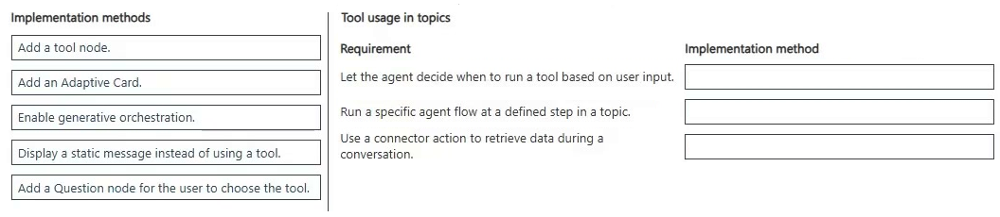

_DRAG DROP — the original ExamTopics question expects you to drag and drop items; the correct targets are not published._

**Most voted:**
- Let the agent decide when to run a tool based on user input → Enable generative orchestration
- Run a specific agent flow at a defined step in a topic → Add a tool node
- Use a connector action to retrieve data during a conversation → Add a tool node

### Top explanations
- **faisalronnie** (10 upvotes [Highly Voted]): Let the agent decide when to run a tool based on user input. → Enable generative orchestration
  Run a specific agent flow at a defined step in a topic. → Add a tool node
  Use a connector action to retrieve data during a conversation. → Add a tool node
- **Joselito79** (3 upvotes): ✅ Enable generative orchestration
  Why?
  Generative orchestration allows Copilot Studio to determine which tool to use and when, based on what the user asks.
  ✅ Add a tool node
  Why?
  A tool node is used when the topic author wants to explicitly tell the topic:
  ✅ Add a tool node
  Why?
  A connector action can be exposed as a tool, and a tool node lets you invoke that action from the topic.
- **Arcadiuz** (1 upvotes [Most Recent]): - Enable generative orchestration
  - Add a tool node
  - Add a tool node
  Generative orchestration allows the agent to decide which available tool to invoke based on the user's request and the tool descriptions.
  A tool node allows a topic to invoke a specific tool or action at a defined point in the conversation.
  This is useful when the workflow must execute a particular operation at a predictable point.
  Why the other options are wrong
  -Adaptive Card: Collects structured user input; it does not orchestrate tools.
  -Static message: Displays information but does not execute a tool.
  -Question node: Collects user input but does not replace tool invocation.

## Q4.1 (ID 419273)

Note: This question is part of a series of questions that present the same scenario. Each question in the series contains a unique solution that might meet the stated goals. Some question sets might have more than one correct solution, while others might not have a correct solution.
After you answer a question in this section, you will NOT be able to return to it. As a result, these questions will not appear on the review screen.
A company is configuring an agent in Copilot Studio that uses a generative answers node inside multiple topics.
The company requires responses to meet the following requirements:
Must use an executive summary format.
Must apply only within a specific topic.
Must continue using configured knowledge sources.
Must comply with connector security controls.
You need to configure a custom prompt to meet the formatting requirements.
Solution: Configure the custom prompt tool at the topic level so that other topics are not affected.
Does the solution meet the goal?

✅ **A.** Yes
⭕ **B.** No

**Correct answer:** A
**Most voted:** A

### Top explanations
- **faisalronnie** (2 upvotes [Selected Answer: B]): Separate custom prompt tool
  Is topic-specific
  Can format output
  But does not inherently guarantee that the answer is still being generated by the existing Generative Answers node and its configured knowledge sources
  Introduces a separate prompt execution path
- **BolDeFruits** (2 upvotes [Selected Answer: A]): Because the custom prompt is configured at the topic level, it provides the required executive-summary formatting for that topic only, while continuing to use the existing knowledge sources and preserving security controls.
  Source:
  https://learn.microsoft.com/en-us/microsoft-copilot-studio/nlu-boost-node
- **Snoopy70** (1 upvotes [Most Recent, Selected Answer: A]): Executive summary format✅ Yes, a custom prompt can instruct the generative answers node to return an executive summary.
  Apply only within a specific topic✅ Yes, configuring the custom prompt at the topic level limits its scope to that topic.
  Continue using configured knowledge sources✅ Yes, prompt modification works with the generative answers node and does not replace the knowledge sources being used.
  Comply with connector security controls✅ Yes, prompt modification changes the response instructions only; it doesn't alter the configured knowledge sources or their authentication/security model.
- **massnonn** (1 upvotes [Selected Answer: B]): missing generative node
- **Joselito79** (1 upvotes [Selected Answer: A]): Yes. ✅
  Configuring the custom prompt at the topic level ensures the executive-summary formatting applies only to that specific topic, while the agent can continue using its configured knowledge sources and connector security controls.
  Answer: Yes, the solution meets the goal.

## Q4.3 (ID 419347)

DRAG DROP
A company builds agents in Copilot Studio in a development environment.
The agents are packaged inside a solution and deployed by using Power Platform Pipelines to test and production environments.
The company has the following requirements that must be met:
Production deployments are limited to a defined set of users who are responsible for that stage.
The same solution is reused across all environments without editing its components.
The production environment always receives a locked-down version of the solution.
You need to configure the pipeline and solution behavior to meet the requirements.
What should you configure? To answer, move the appropriate configurations to the correct requirements. You may use each configuration once, more than once, or not at all. You may need to move the split bar between panes or scroll to view content.
NOTE: Each correct selection is worth one point.

**Exhibits**
- Exhibit 1: 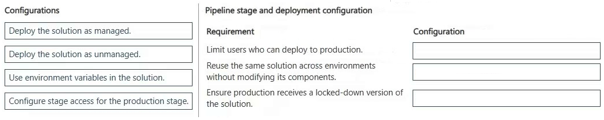

_DRAG DROP — the original ExamTopics question expects you to drag and drop items; the correct targets are not published._

**Most voted:**
- Limit users who can deploy to production: Configure stage access for the production stage.
- Reuse the same solution across environments without modifying its components: Use environment variables in the solution.
- Ensure production receives a locked-down version of the solution: Deploy the solution as managed.

### Top explanations
- **massnonn** (3 upvotes [Most Recent]): Limit users who can deploy to production:  Configure stage access for the production stage.
  Reuse the same solution across environments without modifying its components: Use environment variables in the solution.
  Ensure production receives a locked-down version of the solution: Deploy the solution as managed.
- **faisalronnie** (1 upvotes): Use environment variablesChange environment-specific values without changing solution componentsDeploy as unmanagedAllow solution components to be edited in the target environmentDeploy as managedPrevent solution components from being edited in the target environment

## Q4.11 (ID 419282)

A team is standardizing ALM for agents in Copilot Studio.
The team requires a custom solution that includes agents. The solution must support ALM scenarios, such as managing and transporting agent assets across environments and pipeline deployments.
You need to create an ALM-ready custom solution in Copilot Studio.
What should you do?

⭕ **A.** Publish the agent to a channel and use that channel configuration as the ALM container.
✅ **B.** Create a new custom solution from the Solutions area.
⭕ **C.** Export the custom solution as a managed solution and import it into production.
⭕ **D.** Export the agent directly and then import it into another environment.

**Correct answer:** B
**Most voted:** B

### Top explanations
- **Arcadiuz** (1 upvotes [Most Recent, Selected Answer: B]): The first step in solution-based ALM is to create a custom solution.
  Why the other answers are incorrect:
  A: A channel configuration is not an ALM container.
  C: Exporting a managed solution is a deployment step, not the initial creation of a custom solution.
  D: Agents are transported through solutions, rather than by relying on a standalone agent export for standard web-app ALM.

## Q4.12 (ID 419297)

DRAG DROP
You run the same fixed test set three times in Copilot Studio.
During evaluation, you observe the following:
The same interaction fails in all three runs.
Score values range from 0.58 to 0.61.
The reasoning states that the response partially matches the expected answer.
The knowledge source that is used is internal documentation.
No tools are invoked.
You need to determine which conclusions are supported based on the evaluation results.
Which conclusions should you make? To answer, move the appropriate conclusions to the correct evaluation results. You may use each conclusion once, more than once, or not at all. You may need to move the split bar between panes or scroll to view content.
NOTE: Each correct selection is worth one point.

**Exhibits**
- Exhibit 1: 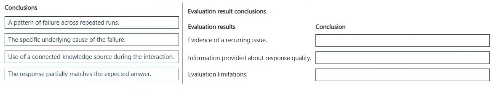

_DRAG DROP — the original ExamTopics question expects you to drag and drop items; the correct targets are not published._

**Most voted:**
- Evidence of a recurring issue: A pattern of failure across repeated runs.
- Information provided about response quality: The response partially matches the expected answer.
- Evaluation limitations: The specific underlying cause of the failure.

### Top explanations
- **massnonn** (5 upvotes [Most Recent]): Evidence of a recurring issue:  A pattern of failure across repeated runs.
  Information provided about response quality:  The response partially matches the expected answer.
  Evaluation limitations: The specific underlying cause of the failure.

## Q4.14 (ID 419341)

A company needs an agent in Copilot Studio to complete tasks by interacting with a legacy desktop application that does not use APIs. The builder needs to validate that UI automation can run in the supported execution context and needs a way to inspect how the automation behaves during testing conversations.
To meet the business needs, the solution must meet the following requirements:
Enable the agent to perform UI automation against the legacy application.
Inspect execution details for the automation during conversations.
You need to configure the agent based on the requirements.
Which two actions should you perform? Each correct answer presents part of the solution.
NOTE: Each correct selection is worth one point.

⭕ **A.** Configure a custom connector for the desktop app so the agent can automate the UI through authenticated calls.
⭕ **B.** Add a Power Platform Desktop flow to control the desktop app.
✅ **C.** Access the remote session within the testing pane to monitor the real-time execution of the agent's desktop interactions.
⭕ **D.** Publish the agent so the automation runs in the supported environment automatically.
✅ **E.** Enable the Computer use capability.

**Correct answer:** C, E
**Most voted:** CE

### Top explanations
- **Joselito79** (2 upvotes [Selected Answer: CE]): ✅ C. Access the remote session within the testing pane to monitor the real-time execution of the agent's desktop interactions.
  ✅ E. Enable the Computer use capability.
- **kevinirl** (2 upvotes [Selected Answer: CE]): E. Enable the Computer use capability — This is the feature that lets a Copilot Studio agent perform UI automation against applications that have no API. Computer use drives the interface directly (clicking, typing, reading the screen) the way a person would, which is exactly what a legacy desktop app without APIs requires. This satisfies the first requirement.
  C. Access the remote session within the testing pane — Computer use runs in a remote/cloud session, and the testing pane lets you watch that session live so you can inspect how the automation behaves during test conversations. This satisfies the second requirement (inspect execution details during conversations).
- **Snoopy70** (1 upvotes [Most Recent, Selected Answer: CE]): C. Access the remote session within the testing pane to monitor the real-time execution of the agent's desktop interactions.
  E. Enable the Computer use capability.
- **massnonn** (1 upvotes [Selected Answer: CE]): Access the remote session

## Q4.16 (ID 419281)

An agent calls a flow that intermittently produces unexpected results during execution.
The agent behaves inconsistently.
You need to investigate agent flow executions to diagnose the issue.
Which two actions should you use? Each correct answer presents a complete solution.
NOTE: Each correct selection is worth one point.

✅ **A.** Inspect failed run details.
⭕ **B.** Update the flow trigger definition.
⭕ **C.** Check the Error column in the Activity tab.
⭕ **D.** Review flow analytics summary.
✅ **E.** Review flow run history.
⭕ **F.** Increase the connector timeout.

**Correct answer:** A, E
**Most voted:** AE

### Top explanations
- **kevinirl** (5 upvotes [Selected Answer: AE]): There is no error column in Activity tab from where the agent flow errors  can be diagnosed
- **ziggy1117** (1 upvotes [Most Recent, Selected Answer: AE]): You open and see that there is a failed run.
  You then review the flow run history (E)
  Then you check the flow and inspect the failed run details inside (A)

## Q4.18 (ID 419286)

HOTSPOT
A team deploys Copilot Studio solutions by using Power Platform Pipelines.
You must configure a deployment strategy that meets the following requirements:
Ensure that the solutions deploy in dev, test, and production environments in order.
Identify missing connection references or environment variables before the deployment process begins.
Manage all pipeline stages and security from a single, unified location for all linked environments.
You need to configure the pipeline to meet the requirements.
What should you configure for each requirement? To answer, select the appropriate options in the answer area.
NOTE: Each correct selection is worth one point.

**Exhibits**
- Exhibit 1: 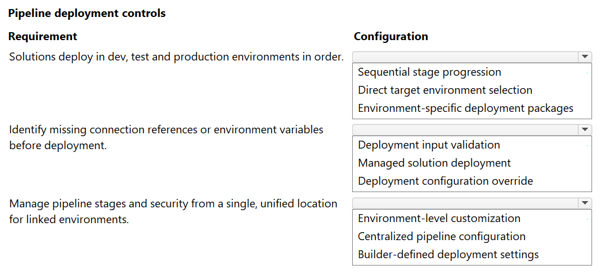

_HOTSPOT — the original ExamTopics question expects you to mark areas on the exhibit above; the correct hotspot coordinates are not published._

**Most voted:**
- •. Solutions deploy in dev, test and production environments in order → Sequential stage progression
- •. Identify missing connection references or environment variables before deployment → Deployment input validation
- •. Manage pipeline stages and security from a single, unified location for linked environments → Centralized pipeline configuration.

### Top explanations
- **Snoopy70** (3 upvotes): Solutions deploy in dev, test, and production environments in order> ✅ Sequential stage progression
  Identify missing connection references or environment variables before deployment✅ Deployment input validation
  Manage all pipeline stages and security from a single, unified location for all linked environments✅ Centralized pipeline configuration
- **faisalronnie** (3 upvotes): •	Solutions deploy in dev, test and production environments in order → Sequential stage progression
  •	Identify missing connection references or environment variables before deployment → Deployment input validation
  •	Manage pipeline stages and security from a single, unified location for linked environments → Centralized pipeline configuration.
- **Arcadiuz** (1 upvotes [Most Recent]): 1. Sequential stage progression
  The solution must move through the pipeline stages in the correct order.
  For example:
  Development → Test → Production.
  Power Platform Pipelines ensure that the same solution artifact moves through the configured stages.
  2. Deployment input validation
  Pipelines validate the target environment before deployment.
  This includes checking dependencies and ensuring that required connection references and environment variables are configured.
  3. Centralized pipeline configuration
  Pipeline administration is centralized in the host environment and associated administration experience.
  Administrators can manage pipeline configuration, stages and deployment governance.

## Q4.21 (ID 419349)

HOTSPOT
You run multiple evaluation tests for an agent in Copilot Studio before expanding user access.
You observe the following about the evaluation results:
Each evaluation case is reported as meeting or missing the expected response.
Some evaluation cases fail repeatedly across several runs.
Each run displays the expected response and the response generated by the agent.
You need to interpret what the evaluation results reveal.
What should you conclude based on each interpretation? To answer, select the appropriate options in the answer area.
NOTE: Each correct selection is worth one point.

**Exhibits**
- Exhibit 1: 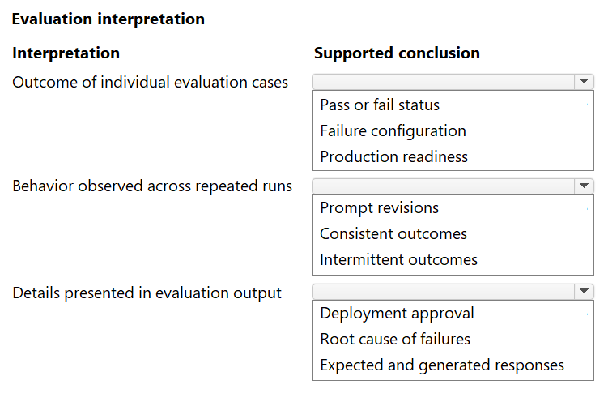

_HOTSPOT — the original ExamTopics question expects you to mark areas on the exhibit above; the correct hotspot coordinates are not published._

**Most voted:**
- 1 → Pass or fail status
- 2 → Intermittent outcomes
- 3 → Expected and generated responses

### Top explanations
- **Snoopy70** (1 upvotes [Most Recent]): 1 → Pass or fail status
  2 → Intermittent outcomes
  3 → Expected and generated responses

## Q4.22 (ID 419337)

DRAG DROP
A company uses an agent in Copilot Studio in production and requires centralized monitoring for operational visibility and troubleshooting.
The team decides to use Application Insights as the monitoring solution.
An agent activity is not included in the monitoring data.
You need to enable monitoring the agent by using Application Insights.
Which four actions should you perform in sequence? To answer, move the appropriate actions from the list of actions to the answer area and arrange them in the correct order.

**Exhibits**
- Exhibit 1: 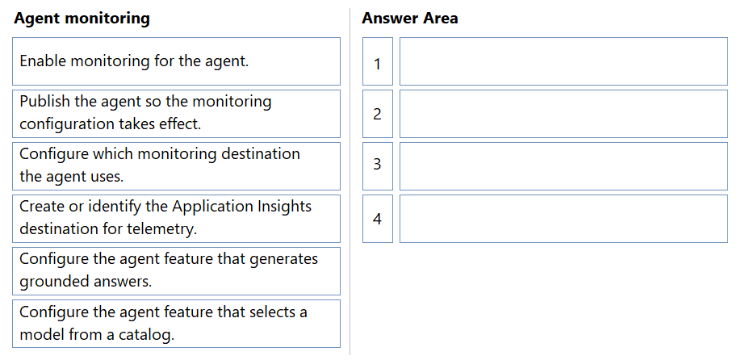

_DRAG DROP — the original ExamTopics question expects you to drag and drop items; the correct targets are not published._

**Most voted:**
- Create or identify the Application Insights destination for telemetry
- Configure which monitoring destination the agent uses
- Enable monitoring for the agent
- Publish the agent so the monitoring configuration takes effect

### Top explanations
- **Snoopy70** (2 upvotes [Most Recent]): Correct sequence
  Create or identify the Application Insights destination for telemetry
  Configure which monitoring destination the agent uses
  Enable monitoring for the agent
  Publish the agent so the monitoring configuration takes effect
- **massnonn** (1 upvotes): 1-Create or identify the Application Insights destination for telemetry.
  2-Enable monitoring for the agent.
  3-Configure which monitoring destination the agent uses.
  4-Publish the agent so the monitoring configuration takes effect.

## Q4.23 (ID 419331)

Note: This question is part of a series of questions that present the same scenario. Each question in the series contains a unique solution that might meet the stated goals. Some question sets might have more than one correct solution, while others might not have a correct solution.
After you answer a question in this section, you will NOT be able to return to it. As a result, these questions will not appear on the review screen.
A team is implementing ALM for agents in Copilot Studio across multiple environments.
The team requires a consistent way to manage and transport agent assets.
You need to recommend a solution that supports creation and use of ALM scenarios for agents in Copilot Studio.
Solution: To export, import, and manage agents between environments, you need to create and use a custom solution.
Does the solution meet the goal?

✅ **A.** Yes
⭕ **B.** No

**Correct answer:** A
**Most voted:** A

### Top explanations
- **BolDeFruits** (3 upvotes [Selected Answer: A]): The statement in the solution:
  "To export, import, and manage agents between environments, you need to create and use a custom solution."
  matches the documented ALM process for Copilot Studio agents
  Source:
  https://learn.microsoft.com/en-us/microsoft-copilot-studio/authoring-solutions-import-export
- **faisalronnie** (2 upvotes [Most Recent, Selected Answer: A]): "To export, import, and manage agents between environments, you need to create and use a custom solution."

## Q4.25 (ID 419316)

Note: This question is part of a series of questions that present the same scenario. Each question in the series contains a unique solution that might meet the stated goals. Some question sets might have more than one correct solution, while others might not have a correct solution.
After you answer a question in this section, you will NOT be able to return to it. As a result, these questions will not appear on the review screen.
A team is implementing ALM for agents in Copilot Studio across multiple environments.
The team requires a consistent way to manage and transport agent assets.
You need to recommend a solution that supports creation and use of ALM scenarios for agents in Copilot Studio.
Solution: Builders can change environment variable values directly in Copilot Studio to complete ALM configuration without administrative tools.
Does the solution meet the goal?

⭕ **A.** Yes
✅ **B.** No

**Correct answer:** B
**Most voted:** B

### Top explanations
- **BolDeFruits** (5 upvotes [Selected Answer: B]): Answer should be B (No)
  In Copilot Studio, environment variables are read-only for builders. Their values are managed through the appropriate Power Platform administrative experience (such as solution management and environment configuration), not directly during Copilot Studio authoring. Environment variables are specifically designed to support ALM by separating configuration from the agent definition.
- **Joselito79** (1 upvotes [Most Recent, Selected Answer: B]): No. ❌
  The solution does not meet the goal.
  Why?
  For ALM in Copilot Studio, environment variable values should be managed outside Copilot Studio's agent authoring experience, using the appropriate administrative/Power Platform management tools.
