# AB-650 Administering Microsoft 365 and AI Services Study Guide

_60 questions generated from ExamTopics discussions._

**Official Exam & Registration:** [Register for AB-650 on Microsoft Learn](https://learn.microsoft.com/en-us/credentials/certifications/ai-services-administrator-associate/?practice-assessment-type=certification)

## Table of contents

- [Q1.1](#q1-1)
- [Q1.2](#q1-2)
- [Q1.3](#q1-3)
- [Q1.5](#q1-5)
- [Q1.6](#q1-6)
- [Q1.8](#q1-8)
- [Q1.9](#q1-9)
- [Q1.10](#q1-10)
- [Q1.11](#q1-11)
- [Q1.12](#q1-12)
- [Q2.13](#q2-13)
- [Q2.14](#q2-14)
- [Q2.15](#q2-15)
- [Q2.16](#q2-16)
- [Q2.17](#q2-17)
- [Q2.18](#q2-18)
- [Q2.19](#q2-19)
- [Q2.20](#q2-20)
- [Q2.21](#q2-21)
- [Q2.22](#q2-22)
- [Q2.23](#q2-23)
- [Q2.24](#q2-24)
- [Q2.25](#q2-25)
- [Q2.26](#q2-26)
- [Q2.27](#q2-27)
- [Q2.28](#q2-28)
- [Q2.29](#q2-29)
- [Q2.30](#q2-30)
- [Q2.31](#q2-31)
- [Q2.32](#q2-32)
- [Q2.33](#q2-33)
- [Q2.34](#q2-34)
- [Q2.36](#q2-36)
- [Q3.37](#q3-37)
- [Q3.38](#q3-38)
- [Q3.39](#q3-39)
- [Q3.40](#q3-40)
- [Q3.41](#q3-41)
- [Q3.42](#q3-42)
- [Q3.44](#q3-44)
- [Q3.45](#q3-45)
- [Q3.46](#q3-46)
- [Q3.47](#q3-47)
- [Q3.48](#q3-48)
- [Q3.49](#q3-49)
- [Q3.50](#q3-50)
- [Q3.51](#q3-51)
- [Q3.52](#q3-52)
- [Q3.53](#q3-53)
- [Q3.54](#q3-54)
- [Q3.55](#q3-55)
- [Q3.56](#q3-56)
- [Q3.57](#q3-57)
- [Q3.58](#q3-58)
- [Q3.59](#q3-59)
- [Q3.61](#q3-61)
- [Q3.62](#q3-62)
- [Q3.63](#q3-63)
- [Q3.64](#q3-64)
- [Q3.65](#q3-65)

## Q1.1 (ID 430863)

HOTSPOT
Contoso, Ltd. is a consulting company that has a main office in San Francisco and a branch office in Dallas.
Existing Environment
Microsoft Entra configuration
Contoso has an Azure subscription.
Contoso has a Microsoft 365 E5 subscription.
Contoso has a Microsoft Entra tenant named contoso.com. The tenant has an administrative unit named AU1 that contains the following membership rule.
(device.deviceTrustType –eq “Workplace”) and (device.deviceOSType –in [“Windows”, “Android”])
The tenant contains the cloud-only users shown in the following table.
The tenant contains the groups shown in the following table.
The tenant contains the devices shown in the following table.
All the devices are managed by using Microsoft Intune.
Microsoft Entra authentication methods
Contoso contains an Authentication methods policy for Microsoft Authenticator that has the following settings:
Include: Group1
Exclude: Group3
Authentication mode: Passwordless
Privileged Identity Management (PIM) configuration
Privileged roles are managed by using Privileged Identity Management (PIM).
The PIM settings for the AI Administrator role are configured as shown in the following table.
Email configuration
Each user has a Microsoft Exchange mailbox.
Contoso contains an anti-spam outbound policy named Antispam1 that has the following configurations:
Included groups: Group4
Excluded users: User2
Set an external message limit: 3
Set an internal message limit: 5
Set a daily message limit: 13
Restriction placed on users who reach the message limit: Restrict the user from sending mail
Microsoft SharePoint configuration
Contoso has a Microsoft SharePoint site named Site1 that stores the following types of content and various other documents:
Project documents: All the documents have a project code that includes the letters PR, followed by a dash and nine digits (for example PR-123456789).
Proposal documents: All the documents have a customer ID that includes seven to 10 alphanumerical characters. All the customer IDs are recorded in a Microsoft Excel workbook.
Feedback forms: All the documents were created by using the same template.
Microsoft AI services
Contoso implements the following Microsoft AI services:
Microsoft 365 Copilot for selected users
Microsoft Foundry agents, including an agent named Agent1
Requirements
Planned changes
Contoso plans to implement the following changes:
Issue new Android devices to the Group1 users.
Assign Microsoft 365 Copilot licenses to the users in Group1.
Add an additional email address alias for the users in Group4.
Create a Conditional Access policy named CAPolicy1 for Group3.
Disable web search for Microsoft 365 Copilot and Microsoft 365 Copilot Chat.
Create classifiers to identify project documents and proposal documents stored on Site1.
Technical requirements
Contoso identifies the following technical requirements:
The users in Group3 that access Microsoft 365 resources from anonymous IP addresses must complete multifactor authentication (MFA).
Microsoft 365 Copilot responses must NOT use content from the project documents stored on Site1.
Microsoft 365 Copilot responses must use content from only Microsoft 365 locations.
The total costs of Agent1 must be monitored and evaluated monthly.
All the Android devices must be registered in Microsoft Entra.
Administrative effort must be minimized.
Administrative costs must be minimized.
You need to evaluate the configuration of AU1.
For each of the following statements, select Yes if the statement is true. Otherwise, select No.
NOTE: Each correct selection is worth one point.

**Exhibits**
- Exhibit 1: 
- Exhibit 2: 
- Exhibit 3: 
- Exhibit 4: 
- Exhibit 5: 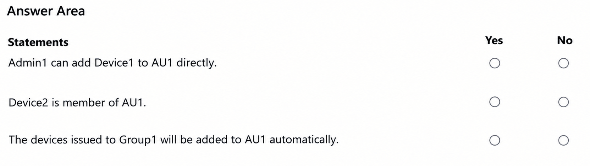

_HOTSPOT — the original ExamTopics question expects you to mark areas on the exhibit above; the correct hotspot coordinates are not published._

**Most voted:**
- Reason: AU1 uses dynamic membership, which does not permit manual assignment regardless of admin roles. Additionally, Device1 is Microsoft Entra joined (deviceTrustType = AzureAd), failing AU1's requirement for Workplace.
- Reason: Microsoft Entra registered devices map to deviceTrustType = Workplace. Device2 runs Windows 11 and is registered, satisfying both the OS and trust-type rules.

### Top explanations
- **daeus** (2 upvotes): Answer; No , Yes  , Yes ?
  Under the planned changes and technical requirements, Contoso will issue new Android devices to Group1 users, and these devices must be registered in Microsoft Entra. Because they are Android (deviceOSType is Android) and registered (deviceTrustType is "Workplace"), they satisfy the dynamic rule criteria for AU1 and will be added automatically.
- **linux_admin** (1 upvotes [Most Recent]): No
  Reason: AU1 uses dynamic membership, which does not permit manual assignment regardless of admin roles. Additionally, Device1 is Microsoft Entra joined (deviceTrustType = AzureAd), failing AU1's requirement for Workplace.
  Yes
  Reason: Microsoft Entra registered devices map to deviceTrustType = Workplace. Device2 runs Windows 11 and is registered, satisfying both the OS and trust-type rules.
  Yes
  Reason: The requirements state new Android devices for Group1 must be registered. Registering sets deviceTrustType = Workplace and deviceOSType = Android, automatically matching AU1's dynamic membership query.
- **Nick_UNO** (1 upvotes): Should be N Y Y

## Q1.2 (ID 430864)

DRAG DROP
You have a Microsoft 365 subscription.
You need to meet the following requirements.
Report a Microsoft 365 service issue.
Request help on how to add a new user to a Microsoft Entra tenant.
What should you use in the Microsoft 365 admin center? To answer, drag the appropriate features to the correct requirements. Each feature may be used once, more than once, or not at all. You may need to drag the split bar between panes or scroll to view content.
NOTE: Each correct selection is worth one point.

**Exhibits**
- Exhibit 1: 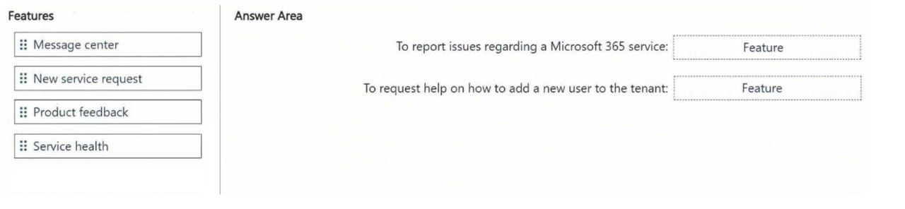

_DRAG DROP — the original ExamTopics question expects you to drag and drop items; the correct targets are not published._

**Most voted:**
- Service health: Located under the Health node in the Microsoft 365 admin center, this tool is used to monitor service status, review ongoing incidents, and report active service disruptions or outages across tenant workloads.
- New service request: Located under the Support section in the Microsoft 365 admin center, this feature allows administrators to open support tickets and get technical assistance or guidance from Microsoft regarding administrative procedures, such as managing user accounts.

### Top explanations
- **linux_admin** (2 upvotes [Most Recent]): Service health: Located under the Health node in the Microsoft 365 admin center, this tool is used to monitor service status, review ongoing incidents, and report active service disruptions or outages across tenant workloads.
  New service request: Located under the Support section in the Microsoft 365 admin center, this feature allows administrators to open support tickets and get technical assistance or guidance from Microsoft regarding administrative procedures, such as managing user accounts.

## Q1.3 (ID 430865)

You have a Microsoft 365 E5 subscription and use Microsoft Intune for managing mobile devices.
You need to access service health alerts from a mobile phone.
What should you use?

⭕ **A.** Intune Company Portal
⭕ **B.** the Intune app
✅ **C.** the Microsoft 365 Admin mobile app
⭕ **D.** the Microsoft Authenticator app

**Correct answer:** C
**Most voted:** C

### Top explanations
- **Ginnious** (2 upvotes [Selected Answer: C]): C. the Microsoft 365 Admin mobile app
- **Shital K** (1 upvotes [Most Recent, Selected Answer: B]): the microsoft app
- **linux_admin** (1 upvotes [Selected Answer: C]): The Microsoft 365 Admin mobile app.
  Explanation:
  The Microsoft 365 Admin mobile app is built for administrators to monitor service health notifications, track active incidents, and manage tenant health from a mobile device. Intune apps and Authenticator do not provide service health monitoring capabilities.

## Q1.5 (ID 430867)

HOTSPOT
You have a Microsoft 365 E5 subscription that contains a user named User1.
You need to perform the following actions:
Create a shared mailbox named Mbox1 in the subscription.
Grant User1 the Send As permission for Mbox1.
Which Microsoft 365 portals can you use to perform each task? To answer, select the appropriate options in the answer area.
NOTE: Each correct selection is worth one point.

**Exhibits**
- Exhibit 1: 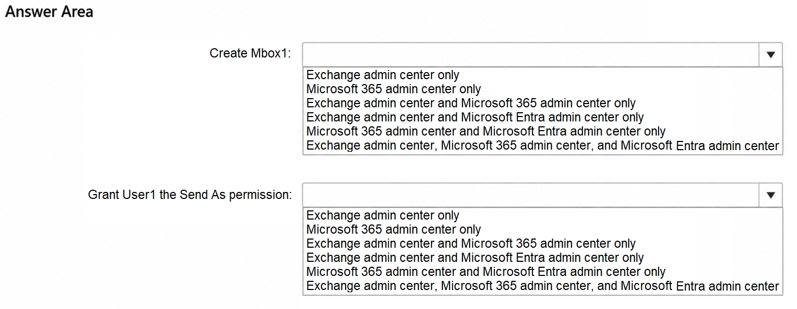

_HOTSPOT — the original ExamTopics question expects you to mark areas on the exhibit above; the correct hotspot coordinates are not published._

**Most voted:** Exchange admin center and Microsoft 365 admin center for creating Mbox1, and Exchange admin center and Microsoft 365 admin center for granting Send As permission.

### Top explanations
- **Shital K** (1 upvotes [Most Recent]): Exchange Admin Center Only
- **linux_admin** (1 upvotes): Exchange admin center and Microsoft 365 admin center for creating Mbox1, and Exchange admin center and Microsoft 365 admin center for granting Send As permission.
  Explanation: Both the Exchange admin center and the Microsoft 365 admin center allow administrators to create shared mailboxes and assign Send As permissions. The Microsoft Entra admin center does not support creating shared mailboxes or managing Exchange mailbox permissions

## Q1.6 (ID 430868)

You have a Microsoft 365 subscription.
Your company has multiple branch offices, including a branch office named Branch1. The users in Branch1 connect to Microsoft 365 by using a corporate web proxy.
On the Network connectivity page in the Microsoft 365 admin center, Branch1 displays the following network insight:
“We’re detecting WebSocket (WSS) connection failures to the domain: *.cloud.microsoft, which causes Copilot to not work correctly for your users.”
HTTPS access to Microsoft 365 apps from Branch1 succeeds.
You need to resolve the insight without changing connectivity for the other branch offices.
What should you configure?

✅ **A.** the Branch1 web proxy policy to allow required protocols for the hosts in *.cloud.microsoft
⭕ **B.** the Branch1 DNS resolver policy to optimize regional name resolution for the hosts in *.cloud.microsoft
⭕ **C.** the Branch1 web proxy policy to exempt hosts in *.cloud.microsoft from TLS inspection
⭕ **D.** the Branch1 firewall policy to allow HTTPS connections for the hosts in *.cloud.microsoft

**Correct answer:** A
**Most voted:** A

### Top explanations
- **linux_admin** (1 upvotes [Most Recent, Selected Answer: A]): Update the Branch1 web proxy policy to allow required protocols for the hosts in *.cloud.microsoft.
  Explanation:
  Microsoft 365 Copilot requires persistent WebSocket (WSS) connections to endpoints under *.cloud.microsoft. Because HTTPS traffic already succeeds, the connectivity issue occurs at the proxy level where non-HTTP/1.1 protocol upgrades are restricted, requiring the Branch1 web proxy policy to explicitly allow the WebSocket protocol for *.cloud.microsoft.

## Q1.8 (ID 430870)

HOTSPOT
You have a Microsoft 365 subscription that contains two groups named Group1 and Group2.
You need to configure tenant notifications to meet the following requirements.
Group1: Receive email notifications when major service updates occur.
Group2: Receive email alerts when Microsoft 365 maintenance event occur.
Which type of notification should you configure for each group?

**Exhibits**
- Exhibit 1: 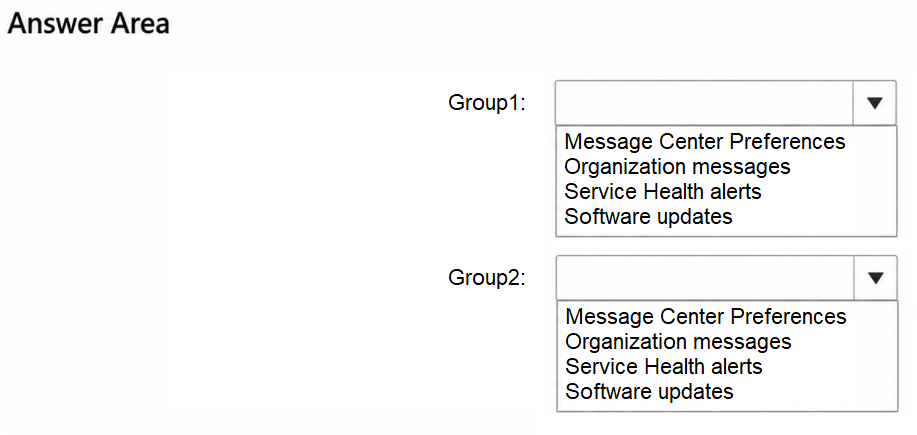

_HOTSPOT — the original ExamTopics question expects you to mark areas on the exhibit above; the correct hotspot coordinates are not published._

**Most voted:**
- Group 1: Message Center Preferences
- Group 2: Service Health alerts

### Top explanations
- **linux_admin** (1 upvotes [Most Recent]): Message center is incorrect for Group 2 because Message center email preferences cannot trigger automated email alerts when maintenance events happen. In the Microsoft 365 admin center, Message center communications are designed to announce planned product roadmaps, new feature rollouts, and general change notices through weekly email summaries or major update digests. It lacks the monitoring and alert mechanism required to send real time operational email alerts for active infrastructure maintenance events, advisories, or service interruptions.
- **Boats** (1 upvotes): Group 2 = Message center
  Planned maintenance events aren't shown in service health. You can track planned maintenance events by staying up to date with the Message center. Filter to messages categorized as Plan for change to find out when the change is going to happen, its effect, and how to prepare for it. See Message center in Microsoft 365 for more details.
- **linux_admin** (1 upvotes): Group 1: Message Center Preferences
  Group 2: Service Health alerts
  Explanation:
  Message Center Preferences are used to manage notification settings for major feature updates, product announcements, and planned tenant changes. Service Health alerts trigger email notifications for active service incidents, status degradations, and scheduled maintenance events.

## Q1.9 (ID 430871)

You have a Microsoft 365 subscription that has an initial domain named contoso.onmicrosoft.com and two verified custom domains named contoso.com and fabrikam.com.
The fabrikam.com domain is the default domain.
The contoso.com domain uses managed authentication, and has 750 references across unused user accounts, application identifier URIs, and mail-enabled security groups.
You need to remove contoso.com from the subscription. The solution must minimize manual changes to Microsoft Entra objects.
What should you do?

⭕ **A.** Rename all the user, group, and application references in the Microsoft Entra admin center, and then delete contoso.com.
⭕ **B.** Use the –ForceDelete option for contoso.com without changing the mail-enabled security group references.
✅ **C.** Update or remove the mail-enabled security group references, and then use the –ForceDelete option for contoso.com.
⭕ **D.** Make contoso.com the default domain, and then delete contoso.com.

**Correct answer:** C
**Most voted:** C

### Top explanations
- **saidkha** (2 upvotes): Renaming 750 objects by hand is the opposite of minimizing manual changes so it cannot be A ! C is the correct answer.
- **s.i.r.24** (1 upvotes [Most Recent, Selected Answer: C]): Normally, before deleting a custom domain, you must remove all references to that domain from Microsoft Entra ID, including:
  - User principal names (UPNs).
  - Application identifier URIs.
  - Mail-enabled security groups.
  However, -ForceDelete can automatically handle certain references, reducing the amount of manual work.
- **Nick_UNO** (1 upvotes [Selected Answer: C]): C is correct
- **P1233** (1 upvotes [Selected Answer: C]): C minimized manual changes
- **Skri113xX** (1 upvotes [Selected Answer: A]): A maybe

## Q1.10 (ID 430872)

HOTSPOT
You have a Microsoft 365 subscription that contains a security group named Group1.The object ID of Group1 is stored in a PowerShell variable named $groupId.
You have a CSV file named C:\Temp\members.csv that contains a column named memberObjectId. The column stores the directory object ID of each user that will be added to Group1.
You need to perform a bulk membership update for Group1 by using Microsoft Graph PowerShell.
How should you complete the script? To answer, select the appropriate options in the answer area.
NOTE: Each correct selection is worth one point.

**Exhibits**
- Exhibit 1: 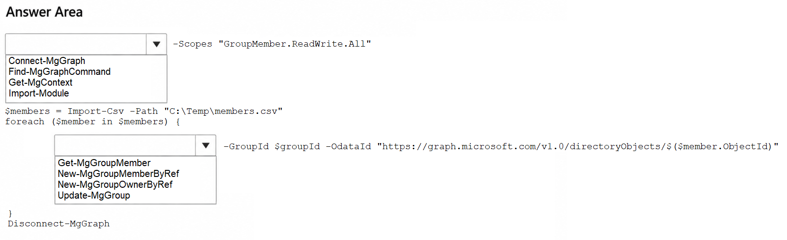

_HOTSPOT — the original ExamTopics question expects you to mark areas on the exhibit above; the correct hotspot coordinates are not published._

**Most voted:**
1. Connect-MgGraph
2. New-MgGroupMemberByRef

### Top explanations
- **linux_admin** (1 upvotes [Most Recent]): Connect-MgGraph
  New-MgGroupMemberByRef
  Explanation:
  Connect-MgGraph is correct because it authenticates and creates a connection to Microsoft Graph with specific permissions defined by the Scopes parameter. Import-Module is incorrect because it only loads a module into memory and does not accept a Scopes parameter. Find-MgGraphCommand is incorrect because it searches for Graph commands and does not connect to the service. Get-MgContext is incorrect because it only views current connection details rather than establishing a new session.
  New-MgGroupMemberByRef is correct because adding members to a group by reference URI using the OdataId parameter corresponds to the Microsoft Graph endpoint for adding group members. New-MgGroupOwnerByRef is incorrect because it assigns group owners instead of members. Update-MgGroup is incorrect because it updates group attributes rather than adding member objects. Get-MgGroupMember is incorrect because it reads group members rather than creating or adding new ones.
- **Nick_UNO** (1 upvotes): Shoud be
  1	Connect-MgGraph
  2	New-MgGroupMemberByRef

## Q1.11 (ID 430873)

You have a Microsoft 365 subscription that contains a distribution list named Group1.
Group1 does NOT have nested groups and is used by project members to send emails.
You need to provide the project members with group-based collaboration resources. The solution must meet the following requirements:
Enable group owners to manage the membership of Group1
Provide a shared calendar and shared files
Support Microsoft Teams integration
Minimize administrative effort
What should you do?

⭕ **A.** Create a Microsoft SharePoint team site
⭕ **B.** Create a dynamic security group
✅ **C.** Upgrade Group1 to a Microsoft 365 group
⭕ **D.** Create a mail-enabled security group

**Correct answer:** C
**Most voted:** C

### Top explanations
- **linux_admin** (1 upvotes [Most Recent, Selected Answer: C]): Upgrade Group1 to a Microsoft 365 group.
  Explanation: Upgrading an existing distribution list to a Microsoft 365 group preserves existing membership while enabling collaboration features such as a shared calendar, document library, and Microsoft Teams integration with minimal administrative effort.
- **lightthetorch** (1 upvotes [Selected Answer: C]): Upgrading Group1 to a Microsoft 365 group would be the only option to satisfy all 4 of these requirements at once.

## Q1.12 (ID 430831)

HOTSPOT
You have a Microsoft 365 E5 subscription.
You need to configure a group naming policy.
Which portal should you use, and to which types of groups will the policy apply? To answer, select the appropriate options in the answer area.
NOTE: Each correct selection is worth one point.

**Exhibits**
- Exhibit 1: 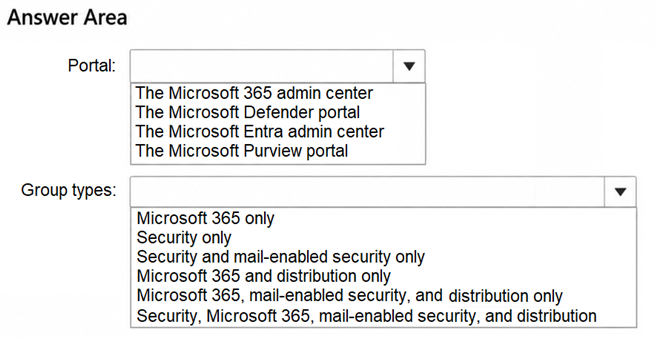

_HOTSPOT — the original ExamTopics question expects you to mark areas on the exhibit above; the correct hotspot coordinates are not published._

**Most voted:**
- The Microsoft Entra admin center
- Microsoft 365 only

### Top explanations
- **linux_admin** (1 upvotes [Most Recent]): The Microsoft Entra admin center
  Microsoft 365 only
  Explanation:
  The Microsoft Entra admin center is correct because group naming policies, including prefix-suffix naming rules and custom blocked words, are configured under Groups in Microsoft Entra. The Microsoft 365 admin center is incorrect because it does not host the native group naming policy configuration engine. The Microsoft Defender portal is incorrect because it manages security operations and threat protection rather than directory group naming rules. The Microsoft Purview portal is incorrect because it governs information protection, risk, and compliance rather than identity governance.
  Microsoft 365 only is correct because the Microsoft Entra group naming policy applies exclusively to Microsoft 365 groups created across workloads such as Teams, SharePoint, Planner, and Outlook. Security only is incorrect because security groups are not governed by the group naming policy. Security and mail-enabled security only is incorrect because neither security nor mail-enabled security groups are affected by this policy. Microsoft 365 and distribution only is incorrect because distribution lists are not evaluated by the Microsoft Entra group naming policy. Microsoft 365, mail-enabled security, and distribution only is incorrect because mail-enabled security and distribution groups are excluded. Security, Microsoft 365, mail-enabled security, and distribution is incorrect because the policy does not apply universally across all directory group types.

## Q2.13 (ID 430832)

HOTSPOT
Contoso, Ltd. is a consulting company that has a main office in San Francisco and a branch office in Dallas.
Existing Environment
Microsoft Entra configuration
Contoso has an Azure subscription.
Contoso has a Microsoft 365 E5 subscription.
Contoso has a Microsoft Entra tenant named contoso.com. The tenant has an administrative unit named AU1 that contains the following membership rule.
(device.deviceTrustType –eq “Workplace”) and (device.deviceOSType –in [“Windows”, “Android”])
The tenant contains the cloud-only users shown in the following table.
The tenant contains the groups shown in the following table.
The tenant contains the devices shown in the following table.
All the devices are managed by using Microsoft Intune.
Microsoft Entra authentication methods
Contoso contains an Authentication methods policy for Microsoft Authenticator that has the following settings:
Include: Group1
Exclude: Group3
Authentication mode: Passwordless
Privileged Identity Management (PIM) configuration
Privileged roles are managed by using Privileged Identity Management (PIM).
The PIM settings for the AI Administrator role are configured as shown in the following table.
Email configuration
Each user has a Microsoft Exchange mailbox.
Contoso contains an anti-spam outbound policy named Antispam1 that has the following configurations:
Included groups: Group4
Excluded users: User2
Set an external message limit: 3
Set an internal message limit: 5
Set a daily message limit: 13
Restriction placed on users who reach the message limit: Restrict the user from sending mail
Microsoft SharePoint configuration
Contoso has a Microsoft SharePoint site named Site1 that stores the following types of content and various other documents:
Project documents: All the documents have a project code that includes the letters PR, followed by a dash and nine digits (for example PR-123456789).
Proposal documents: All the documents have a customer ID that includes seven to 10 alphanumerical characters. All the customer IDs are recorded in a Microsoft Excel workbook.
Feedback forms: All the documents were created by using the same template.
Microsoft AI services
Contoso implements the following Microsoft AI services:
Microsoft 365 Copilot for selected users
Microsoft Foundry agents, including an agent named Agent1
Requirements
Planned changes
Contoso plans to implement the following changes:
Issue new Android devices to the Group1 users.
Assign Microsoft 365 Copilot licenses to the users in Group1.
Add an additional email address alias for the users in Group4.
Create a Conditional Access policy named CAPolicy1 for Group3.
Disable web search for Microsoft 365 Copilot and Microsoft 365 Copilot Chat.
Create classifiers to identify project documents and proposal documents stored on Site1.
Technical requirements
Contoso identifies the following technical requirements:
The users in Group3 that access Microsoft 365 resources from anonymous IP addresses must complete multifactor authentication (MFA).
Microsoft 365 Copilot responses must NOT use content from the project documents stored on Site1.
Microsoft 365 Copilot responses must use content from only Microsoft 365 locations.
The total costs of Agent1 must be monitored and evaluated monthly.
All the Android devices must be registered in Microsoft Entra.
Administrative effort must be minimized.
Administrative costs must be minimized.
You need to implement CAPolicy1. The solution must meet the technical requirements.
Which two Conditional Access settings should you configure? To answer, select the appropriate settings in the answer area.
NOTE: Each correct selection is worth one point.

**Exhibits**
- Exhibit 1: 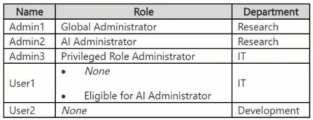
- Exhibit 2: 
- Exhibit 3: 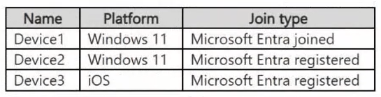
- Exhibit 4: 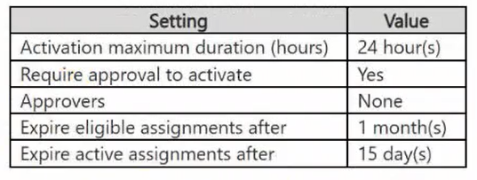
- Exhibit 5: 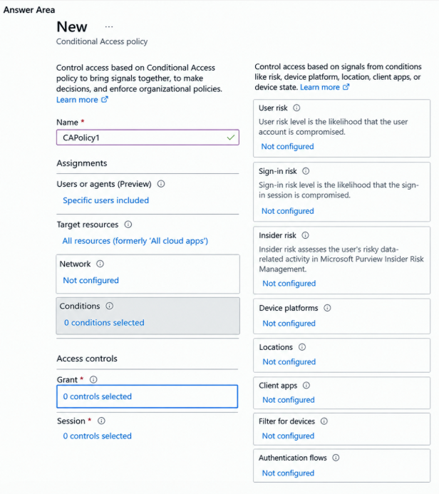

_HOTSPOT — the original ExamTopics question expects you to mark areas on the exhibit above; the correct hotspot coordinates are not published._

**Most voted:**
- Sign-in risk under Conditions
- Grant under Access controls.

### Top explanations
- **linux_admin** (1 upvotes [Most Recent]): Sign-in risk under Conditions
  Grant under Access controls.
  Explanation: To satisfy the technical requirement that users in Group3 accessing Microsoft 365 resources from anonymous IP addresses must complete multifactor authentication, you must configure two settings in CAPolicy1. First, under Conditions, select Sign-in risk. Microsoft Entra ID Protection detects sign-in attempts from anonymous IP addresses as a real-time sign-in risk. Configuring the Sign-in risk condition targets these specific risk events. Second, under Access controls, select Grant. Within the Grant settings, select the option to require multifactor authentication. This enforces multifactor authentication whenever Group3 users attempt to access Microsoft 365 resources from anonymous IP addresses.

## Q2.14 (ID 430833)

You have a Microsoft 365 subscription that contains a Microsoft SharePoint communication site named Site1 and a security group named Group1.
Some users that are outside of Group1 have direct permissions or sharing links to the content in Site1.
You need to ensure that users can access Site1 and its content only when they meet both of the following conditions.
The user is a member of Group1.
The user has SharePoint permissions to the content.
The solution must meet the following requirements:
Apply only to Site1.
Preserve the existing SharePoint permissions.
Minimize administrative effort.
What should you do?

⭕ **A.** Configure sharing restrictions outside of Restricted Access Control groups
⭕ **B.** Configure Restricted Content Discovery for Site1
✅ **C.** Configure Restricted Access Control for Site1
⭕ **D.** Configure site permissions for Site1

**Correct answer:** C
**Most voted:** C

### Top explanations
- **linux_admin** (1 upvotes [Most Recent, Selected Answer: C]): Configure Restricted Access Control for Site1
  Explanation: Restricted Access Control ensures users can access Site1 only if they belong to Group1 and hold existing SharePoint permissions for the content. This preserves underlying site permissions while restricting access strictly to the specified security group

## Q2.15 (ID 430834)

You have a Microsoft 365 subscription.
You create a retention label named Retention1 as shown in the following exhibit.
You apply Retention1 to all the Microsoft OneDrive content.
On January 1, 2025, a user stores a file named File1 in OneDrive.
On January 10, 2025, the user modifies File1.
On February 1, 2025, the user deletes File1.
When will File1 be removed permanently and unrecoverable from OneDrive?

**Exhibits**
- Exhibit 1: 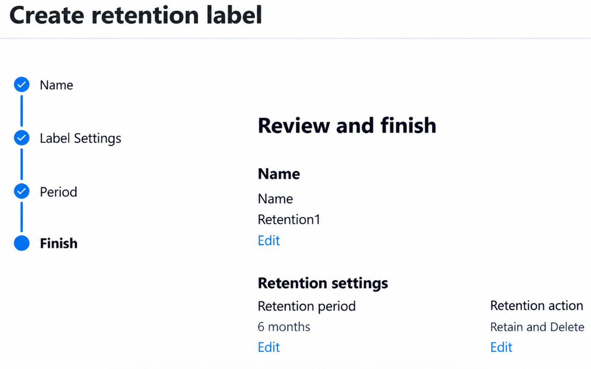

⭕ **A.** February 1, 2025
⭕ **B.** July, 2025
✅ **C.** July 10, 2025
⭕ **D.** August 1, 2025

**Correct answer:** C
**Most voted:** C

### Top explanations
- **linux_admin** (2 upvotes [Selected Answer: B]): B. July 1, 2025 (July 2025)
  Explanation:
  Preservation Hold Library on Deletion: When the user deletes File1 on February 1, 2025, the file is not permanently deleted right away. Because Retention1 is configured with a Retain and Delete action for a duration of 6 months, OneDrive moves the file to the Preservation Hold Library to ensure it remains retained for the full specified retention period.
  Retention Start Date (Creation Date Default): In Microsoft Purview, unless modified to trigger off the last modification or an event, the default setting for a retention label's retention period is calculated from when the item was created.
  Creation Date: January 1, 2025
  Retention Period: 6 months
  Expiration Date: July 1, 2025
  Permanent Deletion: Once the 6-month retention period expires on July 1, 2025, the background retention cleanup process permanently removes File1 from the Preservation Hold Library, making it unrecoverable.
  (Note: If the label settings were specifically configured to calculate retention from when items were last modified [Jan 10, 2025], it would expire on July 10, 2025. However, by default in Purview, retention defaults to the item creation date.)
- **Ploaded** (1 upvotes [Most Recent, Selected Answer: C]): Last modification date
- **saidkha** (1 upvotes [Selected Answer: C]): I think it should be from the date it has been modified + 93 days

## Q2.16 (ID 430835)

You are testing a data loss prevention (DLP) policy to protect the sharing of credit card information with external users.
During testing, you discover that a user can share credit card information with external users by using email. However, the user is prevented from sharing files that contain credit card information by using Microsoft SharePoint.
You need to prevent the user from sharing the credit card information by using email and SharePoint.
What should you configure?

⭕ **A.** the user overrides of the DLP policy rule
✅ **B.** the locations of the DLP policy
⭕ **C.** the status of the DLP policy
⭕ **D.** the conditions of the DLP policy rule

**Correct answer:** B
**Most voted:** B

### Top explanations
- **Nick_UNO** (1 upvotes [Most Recent, Selected Answer: B]): check if Locations are correct
- **s.i.r.24** (1 upvotes [Selected Answer: B]): - A. User overrides: Controls whether users can override certain DLP restrictions.
  - B. Locations: Determines which workloads (Exchange, SharePoint, OneDrive, Teams) the policy protects.
  - C. Status: Determines whether the policy is active, test mode or turned off.
  - D. Conditions: Defines what sensitive information the rule detects, such as credit card numbers.
  Exam tip: If DLP works in one Microsoft 365 service but not another, check the policy locations first.
- **linux_admin** (1 upvotes [Selected Answer: B]): B. the locations of the DLP policy
  Explanation:
  In Microsoft Purview, Data Loss Prevention (DLP) policies are scoped to specific workloads, known as Locations (such as Exchange email, SharePoint sites, OneDrive accounts, and Teams chats).
  Because the policy is already successfully blocking the sharing of credit card information in SharePoint but failing to block it in emails, it indicates that the "Exchange email" location has not been selected in the policy settings. To prevent the user from sharing credit card information via email, you must edit the DLP policy and ensure that both the Exchange email and SharePoint sites locations are toggled on.
  Why other options are incorrect:
  Why D is incorrect: Option D (the conditions of the DLP policy rule) is incorrect because conditions define what the policy looks for (e.g., credit card numbers shared with external users). Because the policy successfully identified and blocked the sensitive information in SharePoint, it proves that the underlying conditions are already configured correctly.
  Why A is incorrect: Option A (the user overrides of the DLP policy rule) is incorrect because user overrides allow end-users to bypass a DLP block. The goal is to prevent the sharing, not to give users a button to ignore the policy. Additionally, configuring an override does not fix the fact that the policy isn't even scanning emails yet.
- **P1233** (1 upvotes [Selected Answer: A]): The location the policy is active in. The conditions are already correct
- **s.i.r.24** (1 upvotes [Selected Answer: D]): conditions of the DLP policy rule :The existing DLP policy already blocks sharing credit card information through SharePoint, so the policy is detecting the sensitive information correctly. The issue is that the policy does not apply to email.

## Q2.17 (ID 430836)

HOTSPOT
You have a Microsoft 365 subscription that contains the users shown in the following table.
The Global Administrator role has the Privileged Identity Management (PIM) settings shown in the following table.
For each of the following statements, select Yes if the statement is true. Otherwise, select No.
NOTE: Each correct selection is worth one point.

**Exhibits**
- Exhibit 1: 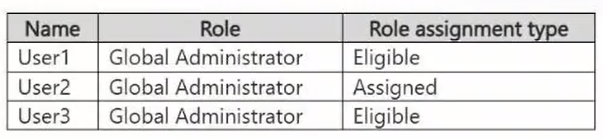
- Exhibit 2: 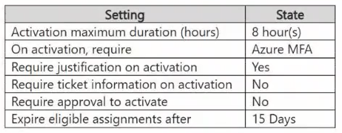
- Exhibit 3: 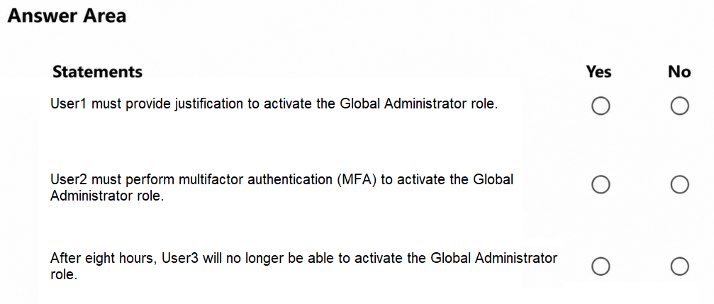

_HOTSPOT — the original ExamTopics question expects you to mark areas on the exhibit above; the correct hotspot coordinates are not published._

**Most voted:**
- Yes
- No
- No

### Top explanations
- **linux_admin** (1 upvotes [Most Recent]): Yes
  No
  No
  Explanation:
  Yes is correct for the first statement because User1 has an eligible assignment for the Global Administrator role and the Privileged Identity Management settings explicitly require justification on activation. No is incorrect because eligible administrators cannot bypass configured activation requirements.
  No is correct for the second statement because User2 has an assigned active role rather than an eligible assignment, meaning the role is permanently or directly active and does not require activation. Yes is incorrect because activation requirements such as multifactor authentication only apply when activating an eligible role.
  No is correct for the third statement because the eight hour setting governs the maximum duration of an active session after activation, whereas eligible assignments expire after fifteen days. User3 remains eligible to activate the role throughout the fifteen day assignment window. Yes is incorrect because the eight hour threshold does not end eligibility.

## Q2.18 (ID 430837)

You have a Microsoft 365 subscription.
You need to create a Conditional Access policy that blocks sign-ins for the following scenarios:
Activity from anonymous IP address.
Impossible travel between two geographical locations.
Which condition should you configure for the policy?

⭕ **A.** Locations
⭕ **B.** Insider risk
⭕ **C.** User risk
✅ **D.** Sign-in risk

**Correct answer:** D
**Most voted:** D

### Top explanations
- **linux_admin** (1 upvotes [Most Recent, Selected Answer: D]): Sign-in risk
  Explanation: To block sign-ins for scenarios involving activity from an anonymous IP address or impossible travel between two geographical locations, you should configure the Sign-in risk condition in the Conditional Access policy. Microsoft Entra ID Protection detects real-time authentication anomalies such as anonymous IP addresses and impossible travel specifically as sign-in risks. Sign-in risk evaluates the probability that a specific sign-in request was not authorized by the account owner. In contrast, User risk measures the overall likelihood that the user identity itself has been compromised. Configuring the Sign-in risk condition ensures the policy evaluates these real-time signals and blocks access whenever suspicious sign-in events occur.

## Q2.19 (ID 430838)

You have a Microsoft 365 E5 subscription that uses Microsoft Defender for Office 365. Strict protection is enabled for all recipients.
The subscription contains a group named Group1 that contains all the mailboxes for your company’s marketing department.
Several marketing department mailboxes recently sent high volumes of external email after a credential was compromised.
You need to enforce a lower external message limit for Group1. The solution must automatically restrict senders that reach the limit.
What should you do?

✅ **A.** Create a custom anti-spam outbound policy.
⭕ **B.** Modify the default anti-spam outbound policy.
⭕ **C.** Modify the Strict protection settings.
⭕ **D.** Configure the Standard preset security policy.
⭕ **E.** Create a custom anti-spam inbound policy.

**Correct answer:** A
**Most voted:** A

### Top explanations
- **linux_admin** (2 upvotes [Most Recent, Selected Answer: A]): Create a custom anti-spam outbound policy.
  Explanation:
  To enforce a lower external message limit for Group1 and automatically restrict senders who reach that limit, you must create a custom anti-spam outbound policy. In Microsoft Defender for Office 365, outbound anti-spam policies allow administrators to configure specific outbound message limits for targeted users or groups and set automatic restrictions when those limits are exceeded.
  Strict and Standard preset security policies apply to inbound threat protection and do not manage outbound message limits. Creating a custom outbound policy scoped to Group1 ensures that the lower limit and automated sending restrictions apply specifically to the marketing department's mailboxes.

## Q2.20 (ID 430839)

HOTSPOT
You have a Microsoft 365 E5 subscription.
You need to enable passwordless authentication for all users.
Which authentication method and portal should you use? To answer, select the appropriate options in the answer area.
NOTE: Each correct selection is worth one point.

**Exhibits**
- Exhibit 1: 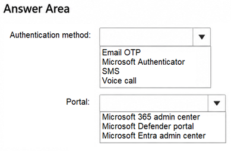

_HOTSPOT — the original ExamTopics question expects you to mark areas on the exhibit above; the correct hotspot coordinates are not published._

**Most voted:**
- Authentication method: Microsoft Authenticator
- Portal: Microsoft Entra admin center

### Top explanations
- **linux_admin** (1 upvotes [Most Recent]): Authentication method: Microsoft Authenticator
  Portal: Microsoft Entra admin center
  Explanation: To enable passwordless authentication for all users in the subscription, you select Microsoft Authenticator as the authentication method and configure the policy in the Microsoft Entra admin center. Microsoft Authenticator provides passwordless phone sign-in functionality, allowing users to authenticate securely without entering a password. The Microsoft Entra admin center is the portal where administrators manage identity protection, authentication methods, and tenant-wide sign-in policies

## Q2.21 (ID 430840)

You have a Microsoft 365 subscription.
Several support engineers at your company require temporary access to Microsoft Entra administrator roles.
You need to configure role access for the engineers. The solution must meet the following requirements:
The engineers must activate role access before role use.
Role access must expire automatically after activation.
What should you do?

⭕ **A.** Create an administrative unit and assign the required roles to the engineers at the scope of the administrative unit.
⭕ **B.** Assign the engineers as active members of a role-assignable group that has the required role assignments.
⭕ **C.** Create an access package that includes the required administrative resources and assign the package to the engineers.
✅ **D.** Assign the engineers as eligible for the required roles by using Privileged Identity Management (PIM).

**Correct answer:** D
**Most voted:** D

### Top explanations
- **linux_admin** (3 upvotes [Most Recent, Selected Answer: D]): Assign the engineers as eligible for the required roles by using Privileged Identity Management (PIM).
  Explanation: Eligible assignments in PIM require users to explicitly activate administrative permissions when needed (Just-In-Time access), and the access automatically expires after the configured activation duration ends.

## Q2.22 (ID 430841)

HOTSPOT
You have a Microsoft 365 subscription that uses Microsoft Defender for Office 365.
Users collaborate on files in Microsoft Teams. Files that are identified as malicious cannot be opened, moved, copied, and shared, but users can still save local copies.
You need to configure file-based protection for the collaboration workloads. The solution must meet the following requirements:
Apply malware protection to the files stored in Teams.
Prevent users from retaining local copies of files identified as malicious.
What should you do? To answer, select the appropriate options in the answer area.
NOTE: Each correct selection is worth one point.

**Exhibits**
- Exhibit 1: 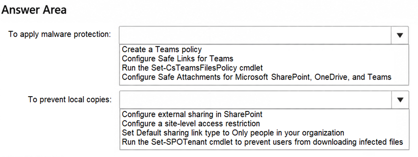

_HOTSPOT — the original ExamTopics question expects you to mark areas on the exhibit above; the correct hotspot coordinates are not published._

**Most voted:** Configure Safe Attachments for Microsoft SharePoint, OneDrive, and Teams | Run the Set-SPOTenant cmdlet to prevent users from downloading infected files.

### Top explanations
- **linux_admin** (2 upvotes [Most Recent]): Configure Safe Attachments for Microsoft SharePoint, OneDrive, and Teams | Run the Set-SPOTenant cmdlet to prevent users from downloading infected files.
  Explanation:
  First Selection: Turning on Safe Attachments for SharePoint, OneDrive, and Teams extends Defender scanning to collaboration files, blocking malicious files from being opened, moved, copied, or shared.
  Second Selection: By default, Safe Attachments still allows users to download local copies of blocked files. Running Set-SPOTenant -DisallowInfectedFileDownload $true via PowerShell explicitly prevents users from downloading local copies of infected files.

## Q2.23 (ID 430842)

HOTSPOT
You have a Microsoft 365 E5 subscription that contains the users shown in the following table.
The subscription has the following two anti-spam policies:
Name: AntiSpam1
Priority: 0
Include these users, groups and domains
Users: User3
Groups: Group1
Exclude these users, groups and domains
Groups: Group2
Message limits
Set a daily message limit: 100
Name: AntiSpam2
Priority: 1
Include these users, groups and domains
Users: User1
Groups: Group2
Exclude these users, groups and domains
Users: User3
Message limits
Set a daily message limit: 50
For each of the following statements, select Yes if the statement is true. Otherwise, select No.
NOTE: Each correct selection is worth one point.

**Exhibits**
- Exhibit 1: 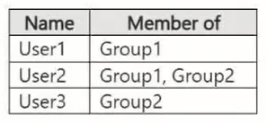
- Exhibit 2: 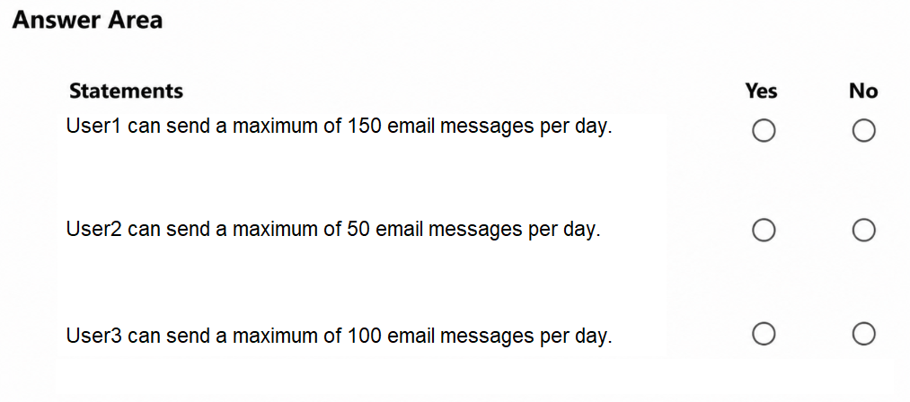

_HOTSPOT — the original ExamTopics question expects you to mark areas on the exhibit above; the correct hotspot coordinates are not published._

**Most voted:**
- AntiSpam1 (Priority 0): User3 is explicitly included. Daily limit = 100.
- AntiSpam2 (Priority 1): User3 is explicitly excluded. Daily limit = 50.

### Top explanations
- **s.i.r.24** (1 upvotes [Most Recent]): Yes, User3 can send up to 100 messages per day, assuming AntiSpam1 applies.
  Let's look at the policies:
  - AntiSpam1 (Priority 0): User3 is explicitly included. Daily limit = 100.
  - AntiSpam2 (Priority 1): User3 is explicitly excluded. Daily limit = 50.
  Because AntiSpam1 has the higher priority (0), User3 is covered by AntiSpam1.

## Q2.24 (ID 430843)

HOTSPOT
You have a Microsoft 365 E5 subscription that contains a user named Admin1.
Your company deploys a new branch office named Branch1.
You need to provide Admin1 with the ability to manage Branch1. The solution must meet the following requirements:
Admin1 must only be able to manage users that have Office location set to Branch1.
Admin1 must be able to reset passwords, manage user licenses, and modify user attributes only for the users in Branch1.
What should you use to organize the Branch1 users, and which role should you assign to Admin1? To answer, select the appropriate options in the answer area.
NOTE: Each correct selection is worth one point.

**Exhibits**
- Exhibit 1: 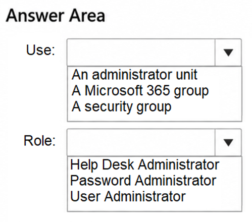

_HOTSPOT — the original ExamTopics question expects you to mark areas on the exhibit above; the correct hotspot coordinates are not published._

**Most voted:**
- Use: An administrative unit
- Role: User Administrator

### Top explanations
- **linux_admin** (1 upvotes [Most Recent]): Use: An administrative unit
  Role: User Administrator
  Explanation:
  To delegate management over a specific set of users, such as those in Branch1, you create an administrative unit. Administrative units allow you to scope Microsoft Entra administrative permissions to a specific subset of users, groups, or devices, ensuring Admin1 can only manage users assigned to that administrative unit.
  Assigning the User Administrator role scoped to the administrative unit grants Admin1 the necessary permissions to reset passwords, manage user licenses, and modify user attributes strictly for the members of Branch1, without providing administrative access to users outside of that administrative unit.

## Q2.25 (ID 430844)

HOTSPOT
You have a Microsoft 365 E5 tenant that contains a Microsoft SharePoint site named Site1. Site1 contains the files shown in the following table.
You create a sensitivity label named Sensitivity1 and an auto-label policy that has the following configurations:
Name: AutoLabel1
Label to auto-apply: Sensitivity1
Choose locations where you want to apply the label: Site1
The Define content that contains sensitive info settings for AutoLabel1 is shown in the following exhibit.
For each of the following statements, select Yes if the statement is true. Otherwise, select No.
NOTE: Each correct selection is worth one point.

**Exhibits**
- Exhibit 1: 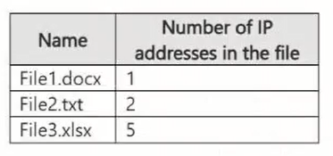
- Exhibit 2: 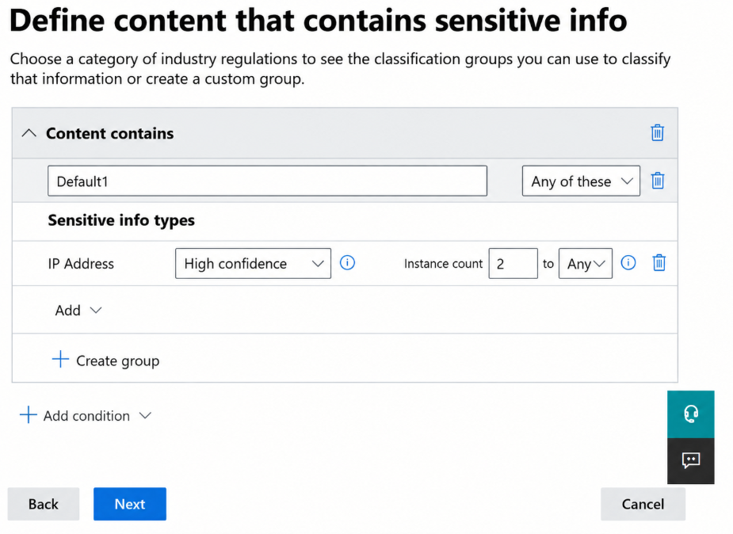
- Exhibit 3: 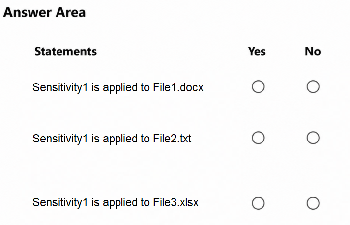

_HOTSPOT — the original ExamTopics question expects you to mark areas on the exhibit above; the correct hotspot coordinates are not published._

**Most voted:**
- Statement 1: No.
- Statement 2: No.
- Statement 3: Yes.

### Top explanations
- **linux_admin** (2 upvotes): Statement 1: No.
  Statement 2: No.
  Statement 3: Yes.
  Explanation: The auto-labeling policy AutoLabel1 requires a minimum instance count of 2 IP addresses (2 to Any) to apply the Sensitivity1 label. Additionally, sensitivity auto-labeling policies in SharePoint Online only apply to supported file formats such as Word (.docx), Excel (.xlsx), PowerPoint (.pptx), and PDF (.pdf).
  For Statement 1, File1.docx contains 1 IP address. Because the count of 1 is below the policy threshold of at least 2 instances, Sensitivity1 is not applied to File1.docx.
  For Statement 2, File2.txt contains 2 IP addresses, which meets the instance count condition. However, plain text (.txt) files do not support sensitivity labels in SharePoint Online. Therefore, Sensitivity1 is not applied to File2.txt. If evaluated strictly against the instance count condition alone, the count matches the criteria.
  For Statement 3, File3.xlsx contains 5 IP addresses, which satisfies the threshold of 2 or more instances, and Excel workbooks are a fully supported file format for sensitivity auto-labeling. Therefore, Sensitivity1 is applied to File3.xlsx.
- **s.i.r.24** (1 upvotes [Most Recent]): Statement 2: No. Plain text (.txt) files do not support sensitivity labels in SharePoint Online in the same way that supported Office documents do.
- **Nick_UNO** (1 upvotes): txt does not auto label, so  N N Y

## Q2.26 (ID 430845)

HOTSPOT
You have a Microsoft Entra tenant that contains a cloud app named Payroll and three groups named Group1, Group2, and Group3.
Group2 is a member of Group1.
The subscription contains the users shown in the following table.
The subscription has the Conditional Access policies shown in the following table.
For each of the following statements, select Yes if the statement is true. Otherwise, select No.
NOTE: Each correct selection is worth one point.

**Exhibits**
- Exhibit 1: 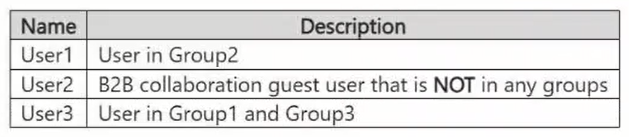
- Exhibit 2: 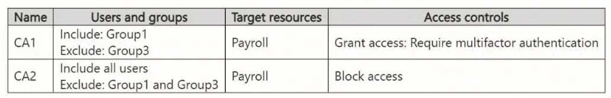
- Exhibit 3: 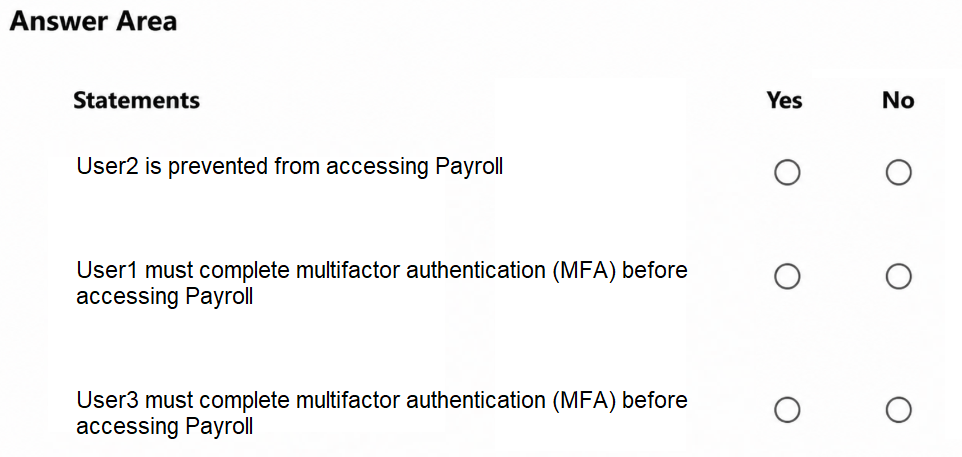

_HOTSPOT — the original ExamTopics question expects you to mark areas on the exhibit above; the correct hotspot coordinates are not published._

**Most voted:**
- Statement 1: Yes.
- Statement 2: Yes.
- Statement 3: No.

### Top explanations
- **linux_admin** (1 upvotes [Most Recent]): Statement 1: Yes.
  Statement 2: Yes.
  Statement 3: No.
  Explanation:
  For Statement 1: User2 is a B2B collaboration guest user who does not belong to any groups. Policy CA1 does not apply to User2 because it only targets Group1. Policy CA2 applies to all users while excluding Group1 and Group3. Because User2 is not in Group1 or Group3, Policy CA2 applies to User2 and blocks access to Payroll. Therefore, User2 is prevented from accessing Payroll.
  For Statement 2: User1 is a member of Group2, which is nested inside Group1. Because Group2 is a member of Group1, User1 is evaluated as a member of Group1. Policy CA1 targets Group1 members and requires multifactor authentication to access Payroll. Policy CA2 explicitly excludes Group1 members, so CA2 does not block User1. Therefore, User1 must complete multifactor authentication before accessing Payroll.
  For Statement 3: User3 belongs to both Group1 and Group3. In Conditional Access policies, exclusions unconditionally take priority over inclusions. Because User3 is a member of Group3, they are excluded from Policy CA1. Policy CA2 also explicitly excludes members of Group1 and Group3. As a result, neither policy enforces multifactor authentication on User3.

## Q2.27 (ID 430846)

HOTSPOT
You have a Microsoft 365 subscription that uses Privileged Identity Management (PIM).
A group of support engineers requires access to the User Administrator role in Microsoft Entra.
You need to configure privileged access for the engineers. The solution must meet the following requirements:
The engineers must activate the role before receiving user administrator privileges.
The engineers must complete multifactor authentication (MFA) during role activation.
A designated approver must authorize each activation request.
What should you configure? To answer, select the appropriate options in the answer area.
NOTE: Each correct selection is worth one point.

**Exhibits**
- Exhibit 1: 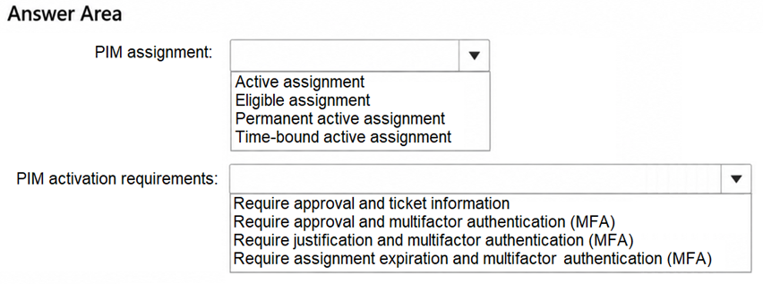

_HOTSPOT — the original ExamTopics question expects you to mark areas on the exhibit above; the correct hotspot coordinates are not published._

**Most voted:** Eligible assignment, Require approval and multifactor authentication (MFA).

### Top explanations
- **linux_admin** (2 upvotes [Most Recent]): Eligible assignment, Require approval and multifactor authentication (MFA).
  Explanation:
  First Selection (Eligible assignment): Requiring users to perform an activation workflow before receiving permissions requires an eligible assignment.
  Second Selection (Require approval and MFA): Enforcing approval by a designated user alongside identity verification requires enabling both approval and MFA in the PIM role activation settings.

## Q2.28 (ID 430874)

You have a Microsoft 365 subscription that uses Microsoft Defender for Office 365 Plan 2.
You need to configure automated investigation and response (AIR) to specify which types of message clusters to remediate automatically without approval from the security team.
Which remediation action should you use?

⭕ **A.** Move to deleted items
⭕ **B.** Move to junk folder
⭕ **C.** Hard delete
✅ **D.** Soft delete

**Correct answer:** D
**Most voted:** D

### Top explanations
- **linux_admin** (1 upvotes [Most Recent, Selected Answer: D]): Action: Soft delete
  Explanation:
  In Microsoft Defender for Office 365 Plan 2, Automated Investigation and Response (AIR) evaluates email threats and message clusters to perform automated remediation actions.
  Configuring Soft delete as the remediation action automatically removes malicious message clusters from user mailboxes and moves them to the Recoverable Items folder without requiring manual approval from the security team. This neutralizes outbound or inbound threat clusters immediately while preserving the ability for administrators to recover the messages if necessary.

## Q2.29 (ID 430875)

HOTSPOT
You have a Microsoft 365 subscription that contains two security groups named Group1 and Group2. Group2 is a member of Group1. The subscription contains the users shown in the following table.
The subscription has self-service password reset (SSPR) enabled as shown in the following table.
User3 failed mobile phone authentication six times during the last 50 minutes.
For each of the following statements, select Yes if the statement is true. Otherwise, select No.
NOTE: Each correct selection is worth one point.

**Exhibits**
- Exhibit 1: 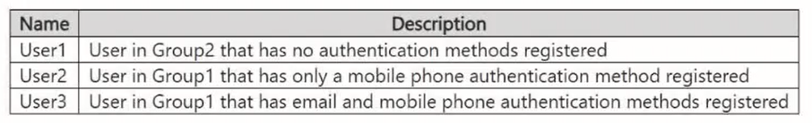
- Exhibit 2: 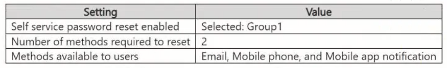
- Exhibit 3: 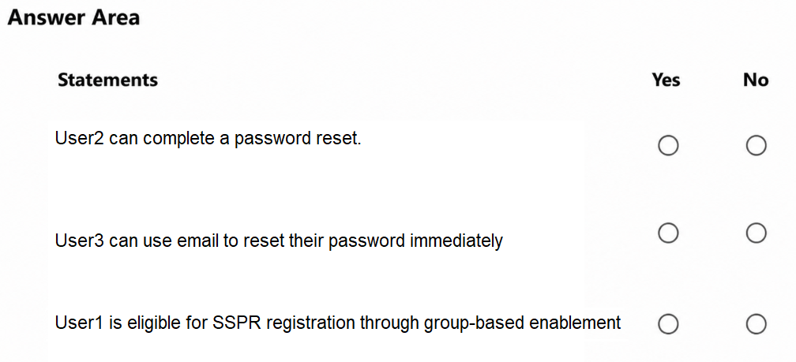

_HOTSPOT — the original ExamTopics question expects you to mark areas on the exhibit above; the correct hotspot coordinates are not published._

**Most voted:**
- Statement 1: No.
- Statement 2: No.
- Statement 3: Yes.

### Top explanations
- **linux_admin** (1 upvotes): Statement 1: No.
  Statement 2: No.
  Statement 3: Yes.
  Explanation:
  For Statement 1: The SSPR policy requires two authentication methods to reset a password. Although User2 is in Group1 and targeted by the SSPR policy, they have only registered a mobile phone (one method). Because User2 lacks the required two registered methods, they cannot complete a password reset.
  For Statement 2: SSPR requires two authentication methods to complete a reset, making email alone insufficient. Additionally, failing mobile phone authentication six times within 50 minutes triggers a temporary lockout on the user account or method. Therefore, User3 cannot immediately use email to reset their password.
  For Statement 3: SSPR is enabled for Group1, and Group2 is a security group nested inside it. Because Microsoft Entra ID group-based SSPR enablement supports nested security groups, members of Group2 fall within the SSPR scope. Even though User1 has not registered any authentication methods yet, being in the targeted group makes them eligible for SSPR registration.
- **linux_admin** (1 upvotes [Most Recent]): For the third statement I am changing my answer to No. According to official Microsoft Entra ID documentation, nested groups are explicitly not supported for group-based SSPR rollouts. SSPR policy evaluation applies only to direct members of the targeted security group. Because User1 is only a member of the nested group (Group2) and not a direct member of Group1, User1 does not receive SSPR enablement through this group assignment.

## Q2.30 (ID 430876)

You have a Microsoft 365 subscription that has an accepted domain named contoso.com.
You need to ensure that the message headers of emails sent from Microsoft Exchange are signed digitally.
What should you configure?

⭕ **A.** Microsoft Purview Message Encryption
⭕ **B.** DMARC
⭕ **C.** ARC
✅ **D.** DKIM

**Correct answer:** D
**Most voted:** D

### Top explanations
- **linux_admin** (2 upvotes [Most Recent, Selected Answer: D]): DKIM (DomainKeys Identified Mail).
  Explanation: DomainKeys Identified Mail adds a digital signature to the headers of outgoing email messages sent from Exchange Online. This signature verifies domain authenticity and prevents message tampering in transit.

## Q2.31 (ID 430877)

You have a Microsoft 365 subscription.
You need to create a data loss prevention (DLP) policy that is configured to use the Set headers action.
To which location can the policy be applied?

⭕ **A.** OneDrive accounts
✅ **B.** Exchange email
⭕ **C.** SharePoint sites
⭕ **D.** Teams chat and channel messages

**Correct answer:** B
**Most voted:** B

### Top explanations
- **linux_admin** (1 upvotes [Most Recent, Selected Answer: B]): Answer: B. Exchange email
  Explanation:
  In Microsoft Purview Data Loss Prevention (DLP), the Set headers action is used to inject custom email headers (such as X-headers) into messages when sensitive content is detected.
  Exchange email: This is the only location that supports email transport actions such as header modification, adding recipients, or routing adjustments.
  OneDrive accounts, SharePoint sites, and Teams chat and channel messages: These workloads handle file storage, collaboration, and messaging streams. Because they do not process MIME email headers, header modification actions cannot be applied to them.

## Q2.32 (ID 430878)

You have a Microsoft 365 subscription that uses Microsoft Defender for Office 365. The subscription contains a group named Group1.
Group1 receives recurring unwanted email from countries where your company does NOT do business.
You need to reduce the unwanted email for Group1 without affecting other groups.
What should you configure?

⭕ **A.** a connection filter policy
⭕ **B.** the Strict preset security policy
✅ **C.** a custom anti-spam inbound policy
⭕ **D.** the Standard preset security policy
⭕ **E.** a custom anti-phishing policy

**Correct answer:** C
**Most voted:** C

### Top explanations
- **linux_admin** (1 upvotes [Most Recent, Selected Answer: C]): C. a custom anti-spam inbound policy
  Explanation:
  To reduce unwanted email originating from countries where your company does not do business for Group1 without affecting other groups, you should configure a custom anti-spam inbound policy. In Microsoft Defender for Office 365, inbound anti-spam policies contain International Spam settings that allow administrators to filter or block emails sent from specific geographic regions.
  By creating a custom inbound anti-spam policy scoped specifically to Group1, you enforce regional email blocking for Group1 while ensuring all other groups in the tenant remain unaffected. Connection filter policies apply IP-based filtering globally across the entire tenant and cannot be targeted to specific groups, while Standard and Strict preset security policies enforce predefined baseline settings rather than group-specific geographic filtering.

## Q2.33 (ID 430879)

You have a Microsoft 365 subscription that uses Microsoft Defender for Office 365. Standard protection is enabled for all recipients.
The subscription contains a mail-enabled security group named Group1. Group1 contains users that require custom inbound anti-spam actions. A custom anti-spam inbound policy named Policy1 is applied to Group1 and has a priority value of 0.
You discover that email sent to the users in Group1 is evaluated by using the Standard preset security policy instead of Policy1.
You need to ensure that Policy1 is applied to Group1. All other recipients must continue to receive the Standard protection settings.
What should you do?

⭕ **A.** Add all other recipients to Policy1 as exceptions
⭕ **B.** Set Policy1 to Priority1
✅ **C.** Add Group1 as an exception in the Standard protection settings
⭕ **D.** Disable Standard protection

**Correct answer:** C
**Most voted:** C

### Top explanations
- **linux_admin** (1 upvotes [Most Recent, Selected Answer: C]): C. Add Group1 as an exception in the Standard protection settings
  Explanation:
  In Microsoft Defender for Office 365, Preset Security Policies (Strict and Standard protection) take precedence over custom policies, regardless of the priority value assigned to those custom policies. Even though Policy1 is assigned Priority 0, the Standard preset policy overrides it because Standard protection is enabled for all recipients.
  To ensure Policy1 is applied to the members of Group1 while keeping Standard protection active for everyone else, you must add Group1 as an exception within the Standard preset security policy settings. Excluding Group1 from the preset policy allows Policy1 to process email sent to Group1 users.

## Q2.34 (ID 430880)

HOTSPOT
You have a Microsoft 365 E5 subscription.
You configure a new data loss prevention (DLP) policy named Policy1 that detects when sensitive content is shared externally.
Policy1 has the DLP rule shown in the following exhibit.
Use the drop-down menus to select the answer choice that completes each statement based on the information presented in the graphic.
NOTE: Each correct selection is worth one point.

**Exhibits**
- Exhibit 1: 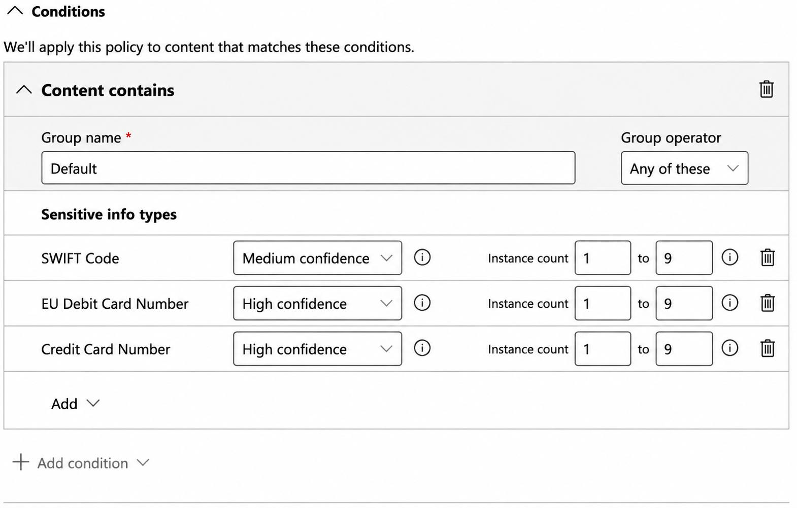
- Exhibit 2: 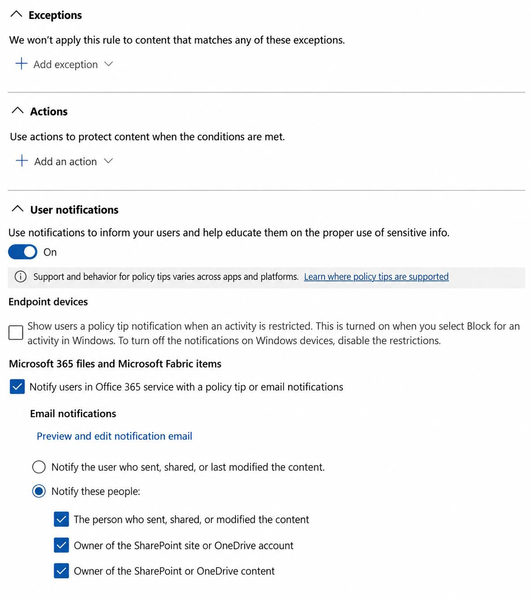
- Exhibit 3: 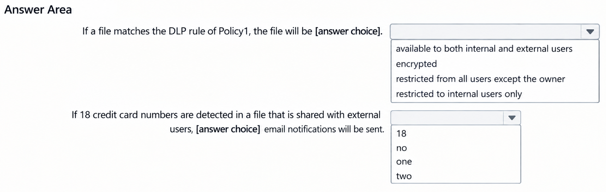

_HOTSPOT — the original ExamTopics question expects you to mark areas on the exhibit above; the correct hotspot coordinates are not published._

**Most voted:**
- restricted to internal users only
- no

### Top explanations
- **linux_admin** (1 upvotes): restricted to internal users only
  no
  Explanation:
  First drop-down (restricted to internal users only): Policy1 is configured to detect when sensitive content is shared externally. When a file matches a Data Loss Prevention (DLP) rule targeting external sharing, Microsoft Purview restricts access for external recipients while allowing internal organization members to retain access. This makes the file restricted to internal users only.
  Second drop-down (no): The conditions specify an instance count of 1 to 9 for Credit Card Numbers. Because 18 credit card numbers exceeds the upper threshold of 9, the file fails to meet the criteria for this specific rule. As a result, the rule is not triggered, and no email notifications will be sent.
- **linux_admin** (1 upvotes [Most Recent]): Available to both internal and external users.
  Reason: In the rule exhibit under Actions, no restriction or protection actions were added (it still displays + Add an action). Instead, the rule only configures User notifications (policy tips and alert emails). Because Microsoft Purview Data Loss Prevention (DLP) does not automatically block or restrict external sharing unless a specific Restrict access or encrypt content action is explicitly configured, matching files remain accessible to both internal and external users.

## Q2.36 (ID 430882)

HOTSPOT
You have a Microsoft 365 E5 tenant.
You have a sensitivity label configured as shown in the Sensitivity label exhibit. (Click the Sensitivity label tab.)
You have an auto-labeling policy as shown in the Auto-labeling policy exhibit. (Click the Auto-labeling policy tab.)
A user sends an email that contains the components shown in the following table.
Sensitivity label:
Auto-labeling policy:
For each of the following statements, select Yes if the statement is true. Otherwise, select No.
NOTE: Each correct selection is worth one point.

**Exhibits**
- Exhibit 1: 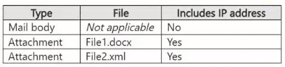
- Exhibit 2: 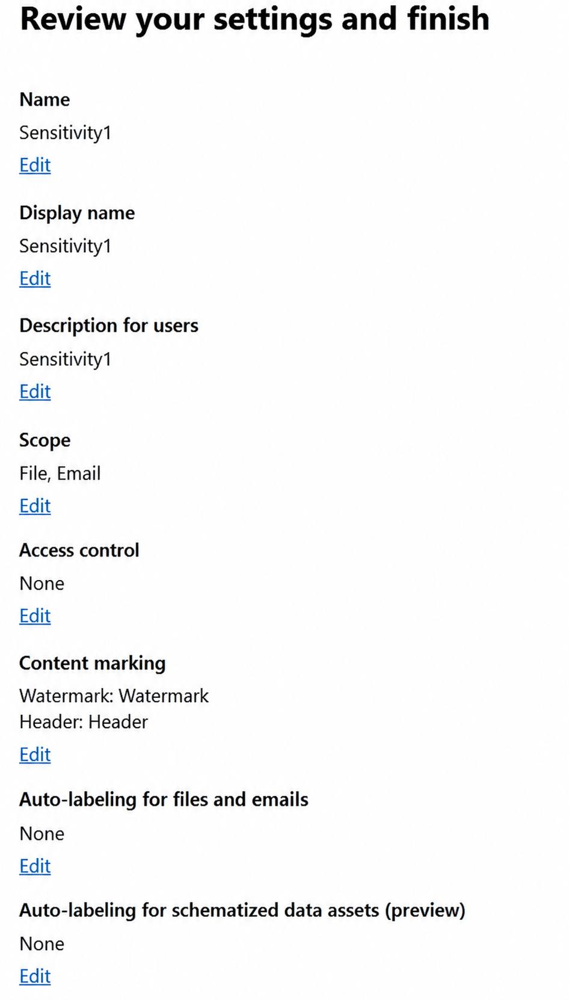
- Exhibit 3: 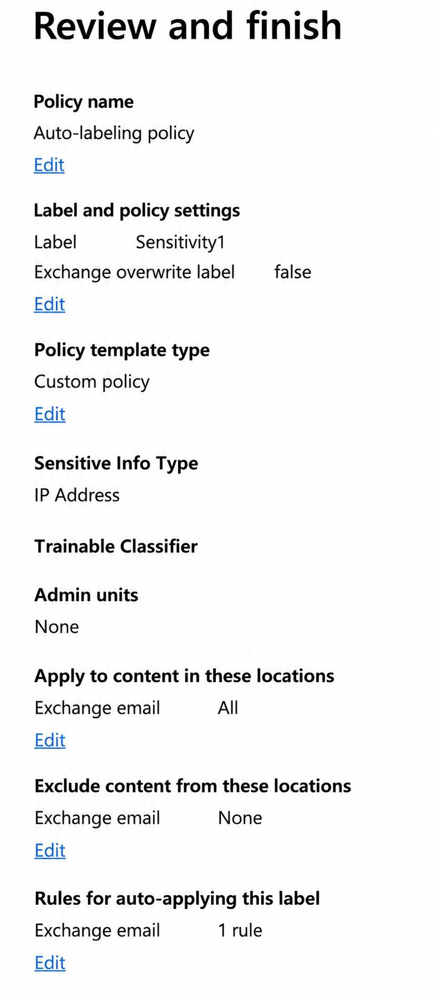
- Exhibit 4: 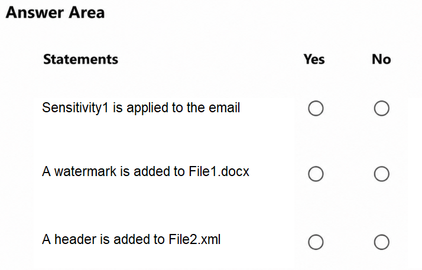

_HOTSPOT — the original ExamTopics question expects you to mark areas on the exhibit above; the correct hotspot coordinates are not published._

**Most voted:**
- Statement 1: Yes.
- Statement 2: No.
- Statement 3: No.

### Top explanations
- **linux_admin** (1 upvotes [Most Recent]): Statement 1: Yes.
  Statement 2: No.
  Statement 3: No.
  Explanation:
  For Statement 1: Auto-labeling policies applied to the Exchange email location inspect the email body as well as attached files for sensitive information types. Because both File1.docx and File2.xml contain IP addresses, the policy matches the Sensitive Info Type rule and automatically applies the Sensitivity1 label to the email message.
  For Statement 2: Exchange service-side auto-labeling policies apply sensitivity labels and content markings to the email message container itself. The policy does not open or apply visual content markings, such as watermarks, directly inside attached files like File1.docx.
  For Statement 3: Exchange auto-labeling policies do not alter or apply headers directly to email attachments. Additionally, XML files are not a supported file format for visual content markings like headers.

## Q3.37 (ID 430883)

HOTSPOT
You have a Microsoft 365 subscription that contains three users named User1, User2, and User3.
The subscription has Conditional Access policies assigned to all users. The policies are configured as shown in the following table.
The users report that they fail to access Microsoft 365 resources as shown in the following table.
For each of the following statements, select Yes if the statement is true. Otherwise, select No.
NOTE: Each correct selection is worth one point.

**Exhibits**
- Exhibit 1: 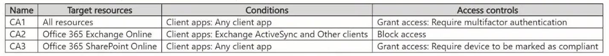
- Exhibit 2: 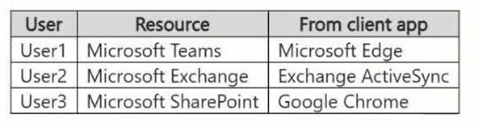
- Exhibit 3: 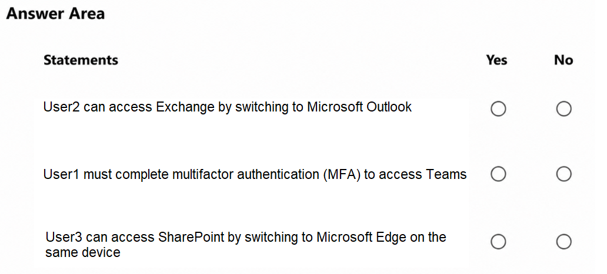

_HOTSPOT — the original ExamTopics question expects you to mark areas on the exhibit above; the correct hotspot coordinates are not published._

**Most voted:**
- Statement 1: Yes.
- Statement 2: Yes.
- Statement 3: No.

### Top explanations
- **linux_admin** (1 upvotes [Most Recent]): Statement 1: Yes.
  Statement 2: Yes.
  Statement 3: No.
  Explanation: For Statement 1, Policy CA2 blocks access to Exchange Online specifically for legacy authentication clients using Exchange ActiveSync and Other clients. Microsoft Outlook uses modern authentication, which is not targeted by CA2\. When User2 switches to Microsoft Outlook and completes multifactor authentication as required by Policy CA1, User2 can successfully access Exchange.
  For Statement 2, Policy CA1 applies to all resources and any client app, requiring multifactor authentication. Microsoft Teams is included under all resources, and Microsoft Edge is an evaluated client app. Therefore, User1 must complete multifactor authentication to access Teams.
  For Statement 3, Policy CA3 targets SharePoint Online for any client app and mandates that the device must be marked as compliant. User3 failed to access SharePoint because the underlying device is not compliant. Simply switching the web browser from Google Chrome to Microsoft Edge on the same non-compliant device does not fulfill the device compliance requirement, so access remains blocked.

## Q3.38 (ID 430884)

Contoso, Ltd. is a consulting company that has a main office in San Francisco and a branch office in Dallas.
Existing Environment
Microsoft Entra configuration
Contoso has an Azure subscription.
Contoso has a Microsoft 365 E5 subscription.
Contoso has a Microsoft Entra tenant named contoso.com. The tenant has an administrative unit named AU1 that contains the following membership rule.
(device.deviceTrustType –eq “Workplace”) and (device.deviceOSType –in [“Windows”, “Android”])
The tenant contains the cloud-only users shown in the following table.
The tenant contains the groups shown in the following table.
The tenant contains the devices shown in the following table.
All the devices are managed by using Microsoft Intune.
Microsoft Entra authentication methods
Contoso contains an Authentication methods policy for Microsoft Authenticator that has the following settings:
Include: Group1
Exclude: Group3
Authentication mode: Passwordless
Privileged Identity Management (PIM) configuration
Privileged roles are managed by using Privileged Identity Management (PIM).
The PIM settings for the AI Administrator role are configured as shown in the following table.
Email configuration
Each user has a Microsoft Exchange mailbox.
Contoso contains an anti-spam outbound policy named Antispam1 that has the following configurations:
Included groups: Group4
Excluded users: User2
Set an external message limit: 3
Set an internal message limit: 5
Set a daily message limit: 13
Restriction placed on users who reach the message limit: Restrict the user from sending mail
Microsoft SharePoint configuration
Contoso has a Microsoft SharePoint site named Site1 that stores the following types of content and various other documents:
Project documents: All the documents have a project code that includes the letters PR, followed by a dash and nine digits (for example PR-123456789).
Proposal documents: All the documents have a customer ID that includes seven to 10 alphanumerical characters. All the customer IDs are recorded in a Microsoft Excel workbook.
Feedback forms: All the documents were created by using the same template.
Microsoft AI services
Contoso implements the following Microsoft AI services:
Microsoft 365 Copilot for selected users
Microsoft Foundry agents, including an agent named Agent1
Requirements
Planned changes
Contoso plans to implement the following changes:
Issue new Android devices to the Group1 users.
Assign Microsoft 365 Copilot licenses to the users in Group1.
Add an additional email address alias for the users in Group4.
Create a Conditional Access policy named CAPolicy1 for Group3.
Disable web search for Microsoft 365 Copilot and Microsoft 365 Copilot Chat.
Create classifiers to identify project documents and proposal documents stored on Site1.
Technical requirements
Contoso identifies the following technical requirements:
The users in Group3 that access Microsoft 365 resources from anonymous IP addresses must complete multifactor authentication (MFA).
Microsoft 365 Copilot responses must NOT use content from the project documents stored on Site1.
Microsoft 365 Copilot responses must use content from only Microsoft 365 locations.
The total costs of Agent1 must be monitored and evaluated monthly.
All the Android devices must be registered in Microsoft Entra.
Administrative effort must be minimized.
Administrative costs must be minimized.
You need to meet the technical requirements for the project documents.
What should you create in Microsoft Purview?

**Exhibits**
- Exhibit 1: 
- Exhibit 2: 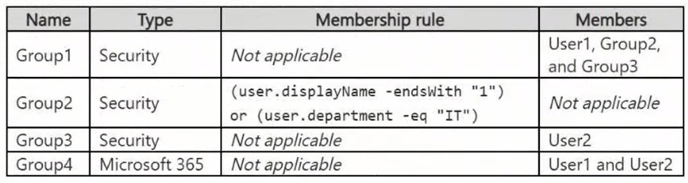
- Exhibit 3: 
- Exhibit 4: 

✅ **A.** a sensitivity label and an auto-labeling policy
⭕ **B.** an Insider Risk Management policy
⭕ **C.** an Information Barriers policy
⭕ **D.** a data loss prevention (DLP) policy

**Correct answer:** A
**Most voted:** A

### Top explanations
- **linux_admin** (1 upvotes [Most Recent, Selected Answer: A]): A. a sensitivity label and an auto-labeling policy
  Explanation:
  To fulfill the technical requirement ensuring that Microsoft 365 Copilot responses do NOT use content from the project documents stored on Site1, you should create a sensitivity label and an auto-labeling policy in Microsoft Purview.
  Microsoft 365 Copilot respects Information Protection sensitivity labels and encryption permissions. By creating a sensitivity label that restricts access or applies encryption, and using an auto-labeling policy to automatically apply this label to project documents (matching their project code pattern), Copilot is prevented from indexing, extracting, or using content from those project documents to ground its answers.
- **sanio** (1 upvotes [Selected Answer: A]): DLP (Data Loss Prevention): Prevents data leakage, but it does not classify content or exclude content from Microsoft 365 Copilot responses.

## Q3.39 (ID 430885)

Contoso, Ltd. is a consulting company that has a main office in San Francisco and a branch office in Dallas.
Existing Environment
Microsoft Entra configuration
Contoso has an Azure subscription.
Contoso has a Microsoft 365 E5 subscription.
Contoso has a Microsoft Entra tenant named contoso.com. The tenant has an administrative unit named AU1 that contains the following membership rule.
(device.deviceTrustType –eq “Workplace”) and (device.deviceOSType –in [“Windows”, “Android”])
The tenant contains the cloud-only users shown in the following table.
The tenant contains the groups shown in the following table.
The tenant contains the devices shown in the following table.
All the devices are managed by using Microsoft Intune.
Microsoft Entra authentication methods
Contoso contains an Authentication methods policy for Microsoft Authenticator that has the following settings:
Include: Group1
Exclude: Group3
Authentication mode: Passwordless
Privileged Identity Management (PIM) configuration
Privileged roles are managed by using Privileged Identity Management (PIM).
The PIM settings for the AI Administrator role are configured as shown in the following table.
Email configuration
Each user has a Microsoft Exchange mailbox.
Contoso contains an anti-spam outbound policy named Antispam1 that has the following configurations:
Included groups: Group4
Excluded users: User2
Set an external message limit: 3
Set an internal message limit: 5
Set a daily message limit: 13
Restriction placed on users who reach the message limit: Restrict the user from sending mail
Microsoft SharePoint configuration
Contoso has a Microsoft SharePoint site named Site1 that stores the following types of content and various other documents:
Project documents: All the documents have a project code that includes the letters PR, followed by a dash and nine digits (for example PR-123456789).
Proposal documents: All the documents have a customer ID that includes seven to 10 alphanumerical characters. All the customer IDs are recorded in a Microsoft Excel workbook.
Feedback forms: All the documents were created by using the same template.
Microsoft AI services
Contoso implements the following Microsoft AI services:
Microsoft 365 Copilot for selected users
Microsoft Foundry agents, including an agent named Agent1
Requirements
Planned changes
Contoso plans to implement the following changes:
Issue new Android devices to the Group1 users.
Assign Microsoft 365 Copilot licenses to the users in Group1.
Add an additional email address alias for the users in Group4.
Create a Conditional Access policy named CAPolicy1 for Group3.
Disable web search for Microsoft 365 Copilot and Microsoft 365 Copilot Chat.
Create classifiers to identify project documents and proposal documents stored on Site1.
Technical requirements
Contoso identifies the following technical requirements:
The users in Group3 that access Microsoft 365 resources from anonymous IP addresses must complete multifactor authentication (MFA).
Microsoft 365 Copilot responses must NOT use content from the project documents stored on Site1.
Microsoft 365 Copilot responses must use content from only Microsoft 365 locations.
The total costs of Agent1 must be monitored and evaluated monthly.
All the Android devices must be registered in Microsoft Entra.
Administrative effort must be minimized.
Administrative costs must be minimized.
You implement the planned change for Group1.
Which users are licensed for Microsoft 365 Copilot?

**Exhibits**
- Exhibit 1: 
- Exhibit 2: 
- Exhibit 3: 
- Exhibit 4: 

✅ **A.** User1 only
⭕ **B.** Admin1 and User1 only
⭕ **C.** User1 and User2 only
⭕ **D.** Admin1, Admin3, User1, and User2

**Correct answer:** A
**Most voted:** A

### Top explanations
- **linux_admin** (1 upvotes [Most Recent, Selected Answer: A]): User1:
  Result: Licensed
  Reason: User1 is explicitly listed as a direct user member of Group1.
  Admin1 & Admin3:
  Result: Not licensed
  Reason: Admin1 (display name ends with "1") and Admin3 (department is "IT") match the dynamic membership rule for Group2. Because Group2 is nested within Group1, Entra group-based licensing ignores its members.
  User2:
  Result: Not licensed
  Reason: User2 is a member of Group3. Since Group3 is nested within Group1, User2 does not inherit the license assigned to Group1.

## Q3.40 (ID 430886)

DRAG DROP
You have a Microsoft 365 subscription that uses Microsoft Agent 365. The subscription contains two security groups named Group1 and Group2.
Users create agents by using Agent Builder in Microsoft 365 Copilot.
You need to configure Agent settings to meet the following requirements:
Only the users in Group1 must be able to interact with the agents.
Only the users in Group2 must be able to distribute the agents to your organization.
What should you configure for each requirement? To answer, drag the appropriate settings to the correct requirements. Each setting may be used once, more than once, or not at all. You may need to drag the split bar between panes or scroll to view content.
NOTE: Each correct selection is worth one point.

**Exhibits**
- Exhibit 1: 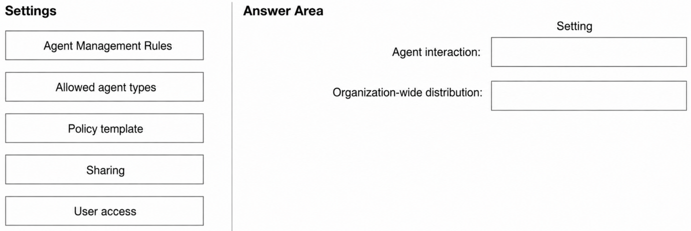

_DRAG DROP — the original ExamTopics question expects you to drag and drop items; the correct targets are not published._

**Most voted:**
- User access
- Sharing

### Top explanations
- **linux_admin** (1 upvotes [Most Recent]): User access
  Sharing
  Explanation:
  User access is correct for Agent interaction because within Agent settings in Microsoft Agent 365, the User access configuration controls which users or security groups are permitted to discover, run, and interact with agents created via Agent Builder.
  Sharing is correct for Organization-wide distribution because the Sharing setting governs publishing and deployment permissions, allowing administrators to restrict who can distribute custom agents to the broader organization catalog (scoped here to Group2).
  Other options:
  Agent Management Rules is used to automate lifecycle governance and compliance triggers for agents rather than scoping interaction or distribution permissions.
  Allowed agent types specifies which categories of agents (e.g., custom declarative vs. external/prebuilt) are enabled in the tenant.
  Policy template establishes baseline security, compliance, and DLP policies across agents rather than assigning user group rights for interaction or sharing.

## Q3.41 (ID 430887)

DRAG DROP
You have a Microsoft 365 subscription.
The following agent compliance gaps are identified in Microsoft Agent 365:
Users can create, install, and share agents without restrictions.
An assessment is required to identify sensitive data oversharing risks.
What should you use to resolve each gap? To answer, drag the appropriate options to the correct gaps. Each option may be used once, more than once, or not at all. You may need to drag the split bar between panes or scroll to view content.
NOTE: Each correct selection is worth one point.

**Exhibits**
- Exhibit 1: 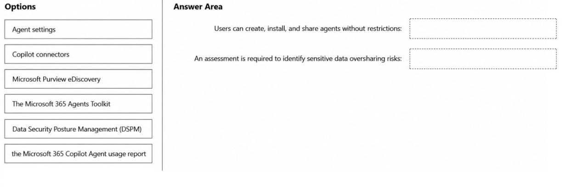

_DRAG DROP — the original ExamTopics question expects you to drag and drop items; the correct targets are not published._

**Most voted:**
- Agent settings
- Data Security Posture Management (DSPM)

### Top explanations
- **linux_admin** (1 upvotes [Most Recent]): Agent settings
  Data Security Posture Management (DSPM)
  Explanation:
  Agent settings is correct for the first gap because in Microsoft Agent 365, administrators use Agent settings (such as Allowed agent types, User access, and Sharing controls) to restrict who can create, install, and share agents across the tenant. Data Security Posture Management (DSPM) is correct for the second gap because Microsoft Purview Data Security Posture Management (DSPM) for AI discovers and assesses sensitive data interactions, oversharing vulnerabilities, and data exposure risks across AI assistants and agents. Other options: - Copilot connectors manages integrations that ground Copilot in external third-party data repositories rather than assessing internal oversharing risks or configuring agent creation permissions. - Microsoft Purview eDiscovery is an investigative tool used to search, hold, and export electronic records for legal or regulatory matters rather than conducting proactive oversharing risk assessments. - The Microsoft 365 Agents Toolkit is a developer tool used in Visual Studio Code for authoring and building custom agents rather than managing tenant-wide governance settings. - The Microsoft 365 Copilot Agent usage report provides operational adoption and interaction metrics for agents rather than assessing security configurations or sensitive data oversharing risks.

## Q3.42 (ID 430888)

DRAG DROP
You have a Microsoft 365 subscription.
The following agent compliance gaps are identified in Microsoft Agent 365:
Agents flagged by aggregated security and compliance signals
Agents that lack accountable lifecycle management
You need to resolve the gaps.
Which action card should you use for each gap? To answer, drag the appropriate action cards to the correct gaps. Each action card may be used once, more than once, or not at all. You may need to drag the split bar between panes or scroll to view content.
NOTE: Each correct selection is worth one point.

**Exhibits**
- Exhibit 1: 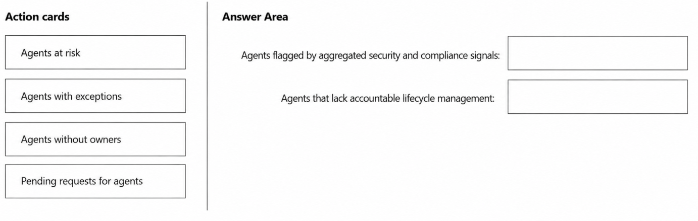

_DRAG DROP — the original ExamTopics question expects you to drag and drop items; the correct targets are not published._

**Most voted:**
- Agents at risk
- Agents without owners

### Top explanations
- **linux_admin** (1 upvotes [Most Recent]): Agents at risk
  Agents without owners
  Explanation:
  Agents at risk is correct for "Agents flagged by aggregated security and compliance signals" because in Microsoft Agent 365, the Agents at risk action card aggregates risk alerts, data loss prevention (DLP) triggers, and security signals from Microsoft Defender and Microsoft Purview, enabling administrators to investigate and remediate high-risk agents. Agents without owners is correct for "Agents that lack accountable lifecycle management" because the Agents without owners action card identifies orphaned or abandoned agents that lack assigned technical owners or business sponsors responsible for reviewing, approving, and managing their operational lifecycle. Other options: - Agents with exceptions is used to track agents that deviate from standard policy templates, baseline configurations, or approved permission sets. - Pending requests for agents displays newly submitted custom agents or connectors awaiting administrator review and approval before they can be published to the organization catalog.

## Q3.44 (ID 430847)

You have a Microsoft 365 subscription.
All users are assigned Microsoft 365 Copilot licenses.
You plan to deploy Microsoft 365 Apps for enterprise to user devices.
You need to ensure that the users can use Microsoft 365 Copilot in Microsoft Word and Excel. The solution must minimize how often Microsoft 365 Apps receives feature updates.
Which update channel should you use?

✅ **A.** Monthly Enterprise Channel
⭕ **B.** Beta Channel
⭕ **C.** Targeted Release
⭕ **D.** Current Channel

**Correct answer:** A
**Most voted:** A

### Top explanations
- **linux_admin** (1 upvotes [Most Recent, Selected Answer: A]): A. Monthly Enterprise Channel
  Explanation
  The Monthly Enterprise Channel is the recommended update channel for balancing access to new Microsoft 365 Copilot features with operational stability. It delivers feature updates once a month on a predictable schedule (the second Tuesday of each month), minimizing disruption compared to more frequent release cadences.
  Why Other Options Are Incorrect
  Current Channel: Receives feature updates as soon as they are ready, often multiple times per month, which increases update frequency.
  Beta Channel: Intended solely for testing pre-release builds; unsupported for general production environments.
  Targeted Release: A tenant-level release opt-in for early web app and admin center features, not a client deployment channel for Microsoft 365 Apps for enterprise.

## Q3.45 (ID 430848)

DRAG DROP
You have a Microsoft 365 subscription that uses Microsoft Agent 365. The subscription contains multiple agents from different sources.
You need to recommend an agent management solution that meets the following requirements:
Provides a view of all the agents and monitors recent agent activity
Manages agent identities, blueprints, permissions
What solution should you include for each requirement? To answer, drag the appropriate solutions to the correct requirements. Each solution may be used once, more than once, or not at all. You may need to drag the split bar between panes or scroll to view content.
NOTE: Each correct selection is worth one point.

**Exhibits**
- Exhibit 1: 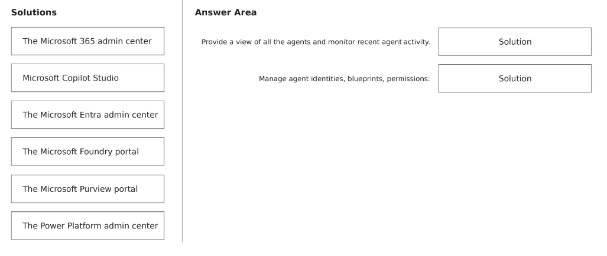

_DRAG DROP — the original ExamTopics question expects you to drag and drop items; the correct targets are not published._

**Most voted:**
- The Microsoft 365 admin center
- The Microsoft Entra admin center

### Top explanations
- **linux_admin** (1 upvotes [Most Recent]): The Microsoft 365 admin center
  The Microsoft Entra admin center
  Explanation:
  The Microsoft 365 admin center is correct for the first requirement because it provides centralized oversight and catalog visibility for the organization's agent estate through Microsoft Agent 365 and Integrated apps, allowing administrators to view all deployed agents, check their operational status, and monitor recent agent activity across workloads. The Microsoft Entra admin center is correct for the second requirement because identity lifecycle, blueprint configurations, and role/access permissions for autonomous and assistive agents are governed through Microsoft Entra Agent ID within the Microsoft Entra admin center.

## Q3.46 (ID 430849)

You have a Microsoft 365 subscription.
You need to report a Microsoft 365 Copilot service issue to Microsoft.
Which two pages can you use? Each correct answer presents a complete solution.
NOTE: Each correct selection is worth one point.

✅ **A.** Service health in the Microsoft 365 admin center
✅ **B.** Product feedback in the Microsoft 365 admin center
⭕ **C.** Health in the Copilot Control System
⭕ **D.** Usage in the Copilot Control System
⭕ **E.** Message center in the Microsoft 365 admin center

**Correct answer:** A, B
**Most voted:** AB

### Top explanations
- **linux_admin** (1 upvotes [Most Recent, Selected Answer: AB]): Service health in the Microsoft 365 admin center
  Product feedback in the Microsoft 365 admin center
  Explanation:
  Service health in the Microsoft 365 admin center is correct because administrators can report an active service issue, outage, or performance degradation directly to Microsoft engineering from the Service health dashboard (via the "Report an issue" feature). Product feedback in the Microsoft 365 admin center is correct because administrators can use the built-in feedback mechanism ("Give feedback" / Product feedback) to submit problem reports, unexpected behaviors, and service issue details directly to Microsoft product teams.

## Q3.47 (ID 430850)

You have a Microsoft 365 subscription that uses Microsoft Agent 365. The subscription contains multiple agents that are discoverable in the agent registry.
Your company is preparing for an internal AI governance audit. The audit team requires a formal assessment of AI regulatory controls for agents and recommended improvement actions.
You need to recommend a solution that provides the required assessment.
What should you include in the recommendation?

✅ **A.** Microsoft Purview Compliance Manager
⭕ **B.** Microsoft Purview eDiscovery
⭕ **C.** Search in Microsoft Purview Audit
⭕ **D.** the Microsoft 365 Copilot Agent usage report

**Correct answer:** A
**Most voted:** A

### Top explanations
- **linux_admin** (1 upvotes [Most Recent, Selected Answer: A]): Microsoft Purview Compliance Manager
  Explanation:
  Microsoft Purview Compliance Manager is correct because it provides built-in regulatory assessment templates and tracks compliance posture against specific regulations, standards, and industry frameworks (including AI regulatory controls). It translates complex regulatory requirements into concrete, actionable improvement actions and measures progress with a compliance score. Microsoft Purview eDiscovery is incorrect because it is used for legal hold, search, identification, and export of electronic records for litigation and investigations, not for evaluating regulatory frameworks or generating proactive improvement actions. Search in Microsoft Purview Audit is incorrect because audit log search is an operational logging tool used to query historical user and admin activities, rather than providing structured assessments of regulatory controls and recommended remediation actions. The Microsoft 365 Copilot Agent usage report is incorrect because it provides operational telemetry regarding active users, prompt counts, and agent utilization rather than compliance assessments against regulatory controls.

## Q3.48 (ID 430851)

HOTSPOT
You have a Microsoft 365 subscription that has at least one paid Microsoft 365 Copilot license.
Microsoft 365 Copilot is configured as shown in the following table.
The subscription contains the users shown in the following table.
For each of the following statements, select Yes if the statement is true. Otherwise, select No.
NOTE: Each correct selection is worth one point.

**Exhibits**
- Exhibit 1: 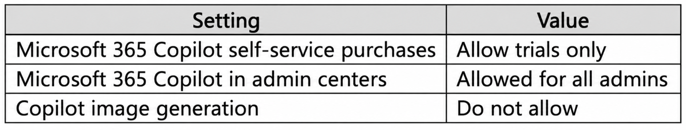
- Exhibit 2: 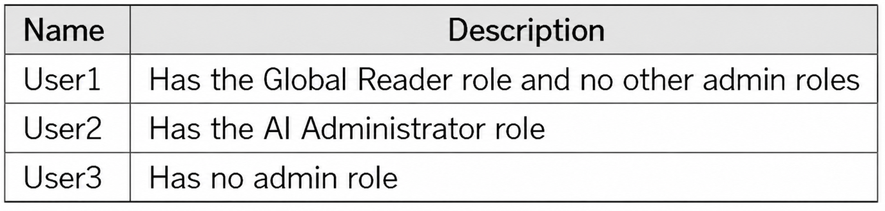
- Exhibit 3: 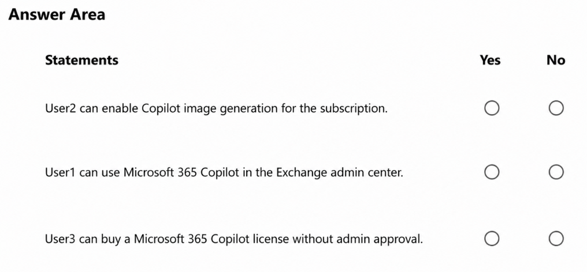

_HOTSPOT — the original ExamTopics question expects you to mark areas on the exhibit above; the correct hotspot coordinates are not published._

**Most voted:**
- Yes
- Yes
- No

### Top explanations
- **linux_admin** (1 upvotes [Most Recent]): In Microsoft 365 administrative environments, accounts with the Global Reader role are recognized as administrator accounts, which allows them to view admin center dashboards and access administrator-targeted experiences such as Copilot in admin centers when enabled by policy, while preventing them from altering tenant-wide configuration settings.
- **linux_admin** (1 upvotes): Yes
  Yes
  No
  Explanation:
  Yes is correct for the first statement because User2 is assigned the AI Administrator role. In Microsoft Entra and Microsoft 365, the AI Administrator role grants permissions to manage tenant-level Copilot settings, including toggling Copilot image generation, web search integration, and AI provider configurations in the Microsoft 365 admin center. No is incorrect because the AI Administrator role possesses administrative authority over Microsoft 365 Copilot settings without requiring the Global Administrator role.
  Yes is correct for the second statement because Microsoft 365 Copilot in admin centers is configured to Allowed for all admins, and User1 holds the Global Reader administrator role. Copilot in administrative portals is available to users with supported administrative roles when tenant policy permits all admins, and it does not require a paid personal Microsoft 365 Copilot user license. No is incorrect because Global Reader is an administrative role covered by the Allowed for all admins policy setting.
  No is correct for the third statement because Microsoft 365 Copilot self-service purchases is explicitly configured to Allow trials only. This setting permits users to sign up for temporary product trials, but prevents them from executing paid self-service license purchases without administrator approval. Yes is incorrect because purchasing a paid subscription requires full self-service purchase enablement rather than the trials only setting.

## Q3.49 (ID 430852)

HOTSPOT
You have a Microsoft 365 subscription that uses pay-as-you-go billing for Microsoft 365 Copilot Chat and Microsoft SharePoint agents.
The finance department at your company reports higher than expected AI service charges.
You need to review metered consumption by user and agent, and notify the department when spending reaches a defined threshold.
What should you do? To answer, select the appropriate options in the answer area.
NOTE: Each correct selection is worth one point.

**Exhibits**
- Exhibit 1: 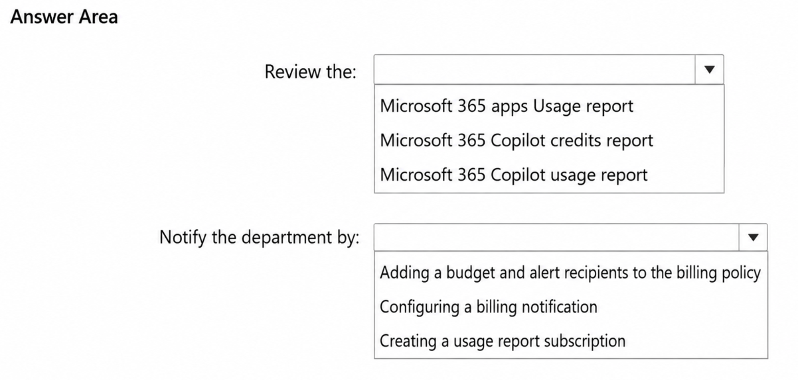

_HOTSPOT — the original ExamTopics question expects you to mark areas on the exhibit above; the correct hotspot coordinates are not published._

**Most voted:**
- Microsoft 365 Copilot credits report
- Adding a budget and alert recipients to the billing policy

### Top explanations
- **linux_admin** (1 upvotes [Most Recent]): Microsoft 365 Copilot credits report
  Adding a budget and alert recipients to the billing policy
  Explanation:
  Microsoft 365 Copilot credits report is correct for "Review the" because metered consumption for pay-as-you-go AI services (such as Microsoft 365 Copilot Chat queries and SharePoint agents) draws against AI credits. In the Microsoft 365 admin center, the Copilot credits report provides detailed breakdown telemetry of credit consumption by individual user and agent. Adding a budget and alert recipients to the billing policy is correct for "Notify the department by" because pay-as-you-go AI services are linked to an Azure subscription through a billing policy in the Microsoft 365 admin center. Configuring a budget threshold and defining alert recipients directly within that billing policy automates notifications to stakeholders (such as finance) when spending reaches the specified threshold. Other options: - Microsoft 365 apps Usage report is incorrect because it tracks non-AI application activity (such as launches and file edits in desktop Office apps), not AI credit or financial consumption. - Microsoft 365 Copilot usage report is incorrect because it tracks licensed user adoption and prompt volumes rather than pay-as-you-go financial credit burn. - Configuring a billing notification is incorrect because standard tenant billing notifications alert administrators to general invoice availability and payment status rather than consumption-based AI spending threshold breaches. - Creating a usage report subscription is incorrect because report subscriptions send scheduled exports of usage telemetry rather than threshold-triggered spending alerts.

## Q3.50 (ID 430853)

HOTSPOT
You have a Microsoft 365 subscription.
Users can enable and disable web search from within Microsoft 365 Copilot.
You need to remove the web search option from Microsoft 365 Copilot Chat only when Work IQ is active.
What should you do? To answer, select the appropriate options in the answer area.
NOTE: Each correct selection is worth one point.

**Exhibits**
- Exhibit 1: 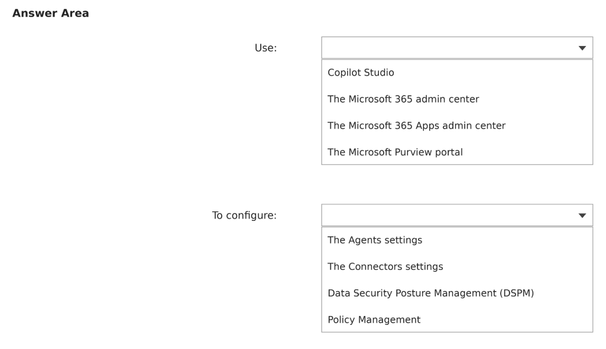

_HOTSPOT — the original ExamTopics question expects you to mark areas on the exhibit above; the correct hotspot coordinates are not published._

**Most voted:** Work IQ in Microsoft 365 Copilot refers to the work-grounded mode of Copilot Chat, where the AI model is anchored directly in your organization's enterprise data rather than the public internet.

### Top explanations
- **linux_admin** (1 upvotes [Most Recent]): Work IQ in Microsoft 365 Copilot refers to the work-grounded mode of Copilot Chat, where the AI model is anchored directly in your organization's enterprise data rather than the public internet.
  In the Microsoft 365 Copilot Chat interface, users can toggle between web mode and work mode. When Work IQ mode is active, Copilot uses Microsoft Graph to access enterprise content that the user has permission to view, including emails, Teams chats, meetings, calendar events, SharePoint documents, and OneDrive files.
  Because Work IQ operates within the organization's Microsoft 365 tenant boundary, it inherits the tenant's security, privacy, and compliance configurations, such as Microsoft Purview sensitivity labels, retention rules, and data loss prevention policies.
  Administrators can use cloud policy management to control how Work IQ behaves, such as removing the option for users to include public web search results while Work IQ is active, ensuring that enterprise prompts and responses stay confined strictly to internal tenant data
- **linux_admin** (1 upvotes): The Microsoft 365 Apps admin center
  Policy Management
  Explanation:
  The Microsoft 365 Apps admin center is correct because cloud-based policy configurations for Microsoft 365 Apps and Copilot are managed through the Microsoft 365 Apps admin center. This portal provides granular client and user-level policy controls, allowing administrators to target specific settings such as disabling or removing the web search toggle in Microsoft 365 Copilot Chat when Work IQ is active.
  Policy Management is correct because the Policy Management feature inside the Microsoft 365 Apps admin center enables administrators to create, scope, and apply cloud policies that enforce specific application controls, including policies governing web search behavior in Copilot chat experiences.
  The Microsoft 365 admin center is incorrect because although it provides tenant-level toggles for general AI settings and web search enablement, it does not host the Policy Management service needed to configure granular policy settings for Work IQ mode.
  Copilot Studio is incorrect because it is used by developers and makers to build, author, and publish custom AI agents and copilots, not to manage enterprise client policies.
  The Microsoft Purview portal is incorrect because it handles data governance, compliance, information protection, and data loss prevention rather than client application feature policies.
  The Agents settings is incorrect because it governs user interaction permissions and organization-wide distribution settings for AI agents.
  The Connectors settings is incorrect because it manages data connections and indexing for external knowledge sources rather than client chat interface options.
  Data Security Posture Management is incorrect because it provides discovery, risk analysis, and oversharing assessments for sensitive data rather than configuring feature availability policies.

## Q3.51 (ID 430854)

DRAG DROP
You have a Microsoft 365 subscription that contains the groups shown in the following table.
You need to provide adoption details for both groups from the last 30 days. The details must include the active users and the prompts of those users from the last 30 days.
What Microsoft 365 admin center report should you use for each group? To answer, drag the appropriate reports to the correct groups. Each report may be used once, more than once, or not at all. You may need to drag the split bar between panes or scroll to view content.
NOTE: Each correct selection is worth one point.

**Exhibits**
- Exhibit 1: 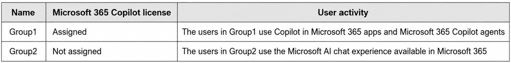
- Exhibit 2: 

_DRAG DROP — the original ExamTopics question expects you to drag and drop items; the correct targets are not published._

**Most voted:**
- Group1: The Microsoft 365 Copilot usage report
- Group2: The Microsoft 365 Copilot Chat usage report

### Top explanations
- **linux_admin** (1 upvotes [Most Recent]): Group1: The Microsoft 365 Copilot usage report
  Group2: The Microsoft 365 Copilot Chat usage report
  Explanation:
  The Microsoft 365 Copilot usage report is correct for Group1 because members of Group1 are assigned paid Microsoft 365 Copilot licenses and actively work with Copilot features embedded across Microsoft 365 apps and agents. In the Microsoft 365 admin center, the Copilot usage report specifically aggregates licensed user adoption, active user counts, and submitted prompt volumes. The Microsoft 365 Copilot Chat usage report is correct for Group2 because members of Group2 do not possess paid Microsoft 365 Copilot licenses and instead utilize the complimentary Microsoft AI chat experience available to tenant users. In the Microsoft 365 admin center, the Copilot Chat usage report tracks active user counts and prompt activity specifically for users on the baseline chat tier without a paid license.

## Q3.52 (ID 430855)

DRAG DROP
You have a Microsoft 365 subscription that contains a security group named Group1.
In the Microsoft 365 admin center, you review two new agent requests as shown in the following table.
You need to complete the agent request process for each request.
What should you do for each agent request? To answer, drag the appropriate actions to the correct requests. Each action may be used once, more than once, or not at all. You may need to drag the split bar between panes or scroll to view content.
NOTE: Each correct selection is worth one point.

**Exhibits**
- Exhibit 1: 
- Exhibit 2: 

_DRAG DROP — the original ExamTopics question expects you to drag and drop items; the correct targets are not published._

**Most voted:**
- Agent1: Publish the agent for Group1
- Agent2: Reject the submission

### Top explanations
- **linux_admin** (1 upvotes [Most Recent]): Agent1: Publish the agent for Group1
  Agent2: Reject the submission
  Explanation: Publish the agent for Group1 is correct for Agent1 because in the Microsoft 365 admin center under Integrated apps and agent management, completing the request lifecycle for an approved custom agent requires publishing it to the intended audience. Publishing makes the agent available in the organization's app catalog and scopes its deployment directly to the members of Group1\. Reject the submission is correct for Agent2 because the review determined that the agent connects to an unapproved external data source, violating tenant governance policies. Rejecting the request closes the workflow and ensures the agent cannot be published, installed, or accessed by any users in the tenant.

## Q3.53 (ID 430856)

HOTSPOT
You have a Microsoft 365 subscription that contains the resources shown in the following table.
Microsoft SharePoint contains the folders shown in the following table.
For each of the following statements, select Yes if the statement is true. Otherwise, select No.
NOTE: Each correct selection is worth one point.

**Exhibits**
- Exhibit 1: 
- Exhibit 2: 
- Exhibit 3: 

_HOTSPOT — the original ExamTopics question expects you to mark areas on the exhibit above; the correct hotspot coordinates are not published._

**Most voted:**
- Slot 1: Yes Explanation: User2 is an internal user with access to the Vendor Contracts folder under the Everyone except external users setting, enabling Copilot Chat to reference these unlabeled files
- Slot 2: No Explanation: The Forecast files are encrypted by a sensitivity label that grants usage rights exclusively to Group1, preventing User1 who is outside Group1 from decrypting or grounding Copilot responses in them
- Slot 3: Yes Explanation: User1 is assigned a Microsoft 365 Copilot license and has access to the Vendor Contracts folder through the Everyone except external users setting

### Top explanations
- **linux_admin** (1 upvotes): Answer: Yes Explanation: User2 is an internal user with access to the Vendor Contracts folder under the Everyone except external users setting, enabling Copilot Chat to reference these unlabeled files.
  Answer: No Explanation: The Forecast files are encrypted by a sensitivity label that grants usage rights exclusively to Group1, preventing User1 who is outside Group1 from decrypting or grounding Copilot responses in them.
  Answer: Yes Explanation: User1 is assigned a Microsoft 365 Copilot license and has access to the Vendor Contracts folder through the Everyone except external users setting.
- **linux_admin** (1 upvotes [Most Recent]): Correction for Statement 1: No
  Reason: User2 only has access to Microsoft 365 Copilot Chat (unlicensed). Copilot Chat is strictly a web-grounded experience and lacks the technical integration to search, access, or reference internal organizational data in SharePoint, regardless of User2's permissions to the folder. Tenant data grounding requires a paid Microsoft 365 Copilot license.

## Q3.54 (ID 430857)

HOTSPOT
You have an Azure subscription named Sub1 that contains two resource groups named RG1 and RG2.
RG2 contains virtual machines.
You have a Microsoft 365 subscription. The subscription uses metered pay-as-you-go billing through a policy named BP1 that is linked to RG1.
The finance department at your company uses calendar-month reporting.
You need to compare the current month’s AI service spending with the previous month, and identify which usage categories contribute to the largest variance.
What should you configure in Microsoft Cost Management? To answer, select the appropriate options in the answer area.
NOTE: Each correct selection is worth one point.

**Exhibits**
- Exhibit 1: 

_HOTSPOT — the original ExamTopics question expects you to mark areas on the exhibit above; the correct hotspot coordinates are not published._

**Most voted:**
- RG1
- Cost analysis

### Top explanations
- **linux_admin** (1 upvotes [Most Recent]): RG1
  Cost analysis
  Explanation:
  Scope is RG1 because the pay-as-you-go billing policy (BP1) for Microsoft 365 AI services is linked directly to resource group RG1. Scoping to RG1 isolates AI consumption charges from unrelated infrastructure in the subscription (such as virtual machines located in RG2) without double-counting. Analysis settings is Cost analysis because Cost analysis in Microsoft Cost Management allows administrators to compare calendar-month spending between the current month and the previous month, group expenditures by usage categories, and identify which specific services or agents contribute to the largest spending variances.
  Explanation:
  Scope is RG1 because the pay-as-you-go billing policy (BP1) for Microsoft 365 AI services is linked directly to resource group RG1. Scoping to RG1 isolates AI consumption charges from unrelated infrastructure in the subscription (such as virtual machines located in RG2) without double-counting. Analysis settings is Cost analysis because Cost analysis in Microsoft Cost Management allows administrators to compare calendar-month spending between the current month and the previous month, group expenditures by usage categories, and identify which specific services or agents contribute to the largest spending variances.

## Q3.55 (ID 430858)

You have a Microsoft 365 subscription. The subscription contains multiple agents that use Microsoft SharePoint and OneDrive content for knowledge.
You need to identify SharePoint sites and OneDrive accounts that have had agent interactions during the last 30 days. The solution must minimize administrative effort.
What should you use?

⭕ **A.** data access governance reports
✅ **B.** the Microsoft 365 Copilot Agent usage report
⭕ **C.** a search Microsoft Purview Audit
⭕ **D.** an agent access insights report

**Correct answer:** B
**Most voted:** B

### Top explanations
- **linux_admin** (1 upvotes [Most Recent, Selected Answer: B]): The Microsoft 365 Copilot Agent usage report
  Explanation:
  the Microsoft 365 Copilot Agent usage report is correct because it provides an out-of-the-box dashboard that aggregates agent interactions and tracks the exact SharePoint sites and OneDrive accounts accessed during those interactions over a standard 30-day reporting period, which directly satisfies the requirement to minimize administrative effort.
  an agent access insights report is incorrect because its reporting intervals in the SharePoint admin center are strictly capped at 1, 7, 14, and 28 days. Because data older than 28 days is automatically rolled off, it cannot fulfill the scenario's explicit 30-day tracking requirement.
  a search in Microsoft Purview Audit is incorrect because although it captures raw Copilot interaction events for 30 days, manually configuring search parameters, exporting logs, and parsing data requires significant operational overhead, which violates the requirement to minimize administrative effort.
  data access governance reports is incorrect because these reports are designed to discover sharing links, content sensitivity, and oversharing risks rather than providing telemetry on AI agent interactions.

## Q3.56 (ID 430859)

You have a Microsoft 365 subscription.
You are preparing for an upcoming compliance audit by reviewing current agent governance gaps.
You need to provide a direct path to remediate the following agent governance gaps:
Agents that lack lifecycle accountability
Agent requests awaiting administrative action
Agents with security or compliance risk signals
What should you use?

⭕ **A.** The Microsoft 365 Copilot Agent usage report
⭕ **B.** Overview in Copilot Control System
✅ **C.** Overview in Microsoft Agent 365
⭕ **D.** Improvement actions in Microsoft Purview Compliance Manager
⭕ **E.** Tools in Microsoft Agent 365

**Correct answer:** C
**Most voted:** C

### Top explanations
- **linux_admin** (1 upvotes [Most Recent, Selected Answer: C]): Overview in Microsoft Agent 365
  Explanation:
  Overview in Microsoft Agent 365 is correct because the Overview page in Microsoft Agent 365 centralizes agent governance and observability. It provides dedicated action cards (such as "Agents without owners", "Pending requests for agents", and "Agents at risk") that give administrators a direct path to remediate missing lifecycle accountability, act on pending agent requests, and investigate security or compliance risk signals. The Microsoft 365 Copilot Agent usage report is incorrect because it provides operational adoption and interaction telemetry (such as active users, total sessions, and prompts submitted) rather than remediation paths for governance and compliance gaps. Overview in Copilot Control System is incorrect because the Copilot Control System focuses on broader architecture pillars, service health, and platform governance rather than agent lifecycle, registry approvals, and action card remediations. Improvement actions in Microsoft Purview Compliance Manager is incorrect because Compliance Manager provides regulatory assessment templates and compliance scoring against external standards rather than managing operational agent lifecycle ownership, admin approval queues, and agent risk alerts. Tools in Microsoft Agent 365 is incorrect because Tools is used to review, activate, approve, or block specific tool integrations and MCP servers invoked by agents, rather than managing general agent lifecycle accountability, pending agent approvals, and risk signals.

## Q3.57 (ID 430860)

You have a Microsoft 365 subscription. All users are assigned Microsoft 365 Copilot licenses.
During the last 30 days, the overall active user rate for Microsoft 365 Copilot remained stable, but you suspect that Copilot activity in Microsoft Word decreased.
You need to provide workload-level adoption evidence of the decrease. The solution must minimize administrative effort.
What should you do?

✅ **A.** From Trend view in the Microsoft 365 Copilot usage report, review Adoption by app
⭕ **B.** From the Microsoft 365 Copilot readiness report, review users that use Microsoft Office documents
⭕ **C.** From Summary view in the Microsoft 365 Copilot usage report, review Prompts submitted
⭕ **D.** From the Microsoft Purview audit log, search for Copilot and AI app activities

**Correct answer:** A
**Most voted:** A

### Top explanations
- **linux_admin** (1 upvotes [Most Recent, Selected Answer: A]): From Trend view in the Microsoft 365 Copilot usage report, review Adoption by app
  Explanation:
  From Trend view in the Microsoft 365 Copilot usage report, review Adoption by app is correct because in the Microsoft 365 admin center, the Copilot usage report includes a Trend view that breaks down active usage and adoption trajectory across individual Microsoft 365 apps (such as Word, Excel, PowerPoint, Teams, and Outlook) over time. This provides immediate, workload-level visual evidence of whether Copilot activity specifically in Microsoft Word declined over the 30-day window with minimal administrative effort. Why the other options are incorrect: - From the Microsoft 365 Copilot readiness report, review users that use Microsoft Office documents is incorrect because the readiness report is a pre-deployment assessment tool used to determine user eligibility, licensing prerequisites, and technical readiness before assigning licenses; it does not track ongoing post-licensing usage trends or workload-specific activity drops. - From Summary view in the Microsoft 365 Copilot usage report, review Prompts submitted is incorrect because the Summary view aggregates tenant-wide prompt volumes and high-level active user counts rather than providing an app-by-app historical trend comparison to isolate activity in Microsoft Word. - From the Microsoft Purview audit log, search for Copilot and AI app activities is incorrect because while Purview Audit records interaction events, querying, exporting, and parsing raw audit logs requires substantial manual effort and does not minimize administrative overhead when an out-of-the-box usage report view is already available.

## Q3.58 (ID 430861)

DRAG DROP
You have a Microsoft 365 subscription that uses Microsoft Entra Agent ID.
You plan to create an agent identity named Agent1.
The subscription contains the resources shown in the following table.
You need to configure administrative relationships for Agent1. The solution must meet the following requirements.
Provide lifecycle accountability for decisions about whether to retain or retire Agent1.
Automate the maintenance of Agent1 credentials and sign-in settings without broad Microsoft Entra Agent ID permissions.
What should you do for each requirement? To answer, drag the appropriate actions to the correct requirements. Each action may be used once, more than once, or not at all. You may need to drag the split bat between panes or scroll to view content.
NOTE: Each correct selection is worth one point.

**Exhibits**
- Exhibit 1: 
- Exhibit 2: 

_DRAG DROP — the original ExamTopics question expects you to drag and drop items; the correct targets are not published._

**Most voted:**
- Lifecycle accountability: Configure User1 as a sponsor of Agent1
- Automated maintenance: Configure SP1 as an owner of Agent1

### Top explanations
- **linux_admin** (1 upvotes [Most Recent]): Owner: Technical administration. Manages credentials (secrets, certificates), sign-in settings, and object-level permissions. Can be a user or a service principal for automated maintenance without tenant-wide admin roles. Sponsor: Business and lifecycle accountability. A designated stakeholder responsible for the agent's purpose, access reviews, and deciding whether to retain, renew, or decommission it. Manager: Organizational hierarchy. Line-of-business reporting relationship from HR/directory user profiles, used for standard employee approval workflows rather than technical or agent lifecycle management.
- **linux_admin** (1 upvotes): Lifecycle accountability: Configure User1 as a sponsor of Agent1
  Automated maintenance: Configure SP1 as an owner of Agent1
  Explanation:
  Configure User1 as a sponsor of Agent1 is correct for lifecycle accountability because Microsoft Entra Agent ID uses sponsors to establish business ownership and accountability. Sponsors are designated individuals or business leads responsible for regular access reviews, governance oversight, and determining whether an agent should be retained, renewed, or retired. Configuring User1 as a manager is incorrect because manager attributes typically reflect organizational reporting hierarchies rather than Entra ID resource sponsorship. Configuring Group1 or SP1 as an owner does not provide the individual accountability required for human-led lifecycle decisions.

## Q3.59 (ID 430862)

You have a Microsoft 365 subscription that has a custom Microsoft Teams meeting policy named Policy1.
Policy is assigned to all the users in a department named Department1 and has the following settings:
Transcription is set to Off.
Copilot is set to Off.
You need to ensure that the Department1 users assigned Microsoft 365 Copilot licenses can use Copilot in Teams meetings. The solution must ensure that Microsoft 365 Copilot is available only for meetings that are configured to save a transcript.
Which two actions should you perform in Policy1? Each correct answer presents part of the solution.
NOTE: Each correct selection is worth one point.

⭕ **A.** Set Meeting recording to On
✅ **B.** Set Copilot to On with saved transcript required
⭕ **C.** Set Copilot to On with transcript saved by default
⭕ **D.** Set Store recordings outside of your country or region to On
⭕ **E.** Set Copilot to On
✅ **F.** Set Transcription to On

**Correct answer:** B, F
**Most voted:** BF

### Top explanations
- **linux_admin** (1 upvotes [Most Recent, Selected Answer: BF]): Set Transcription to On
  Set Copilot to On with saved transcript required
  Explanation: Microsoft 365 Copilot requires saved meeting transcript data to function when transcript enforcement is configured. Enabling meeting transcription and selecting the required saved transcript setting in the Copilot policy meets both requirements.

## Q3.61 (ID 430891)

DRAG DROP
You have a Microsoft 365 subscription.
You need to identify sources for AI service licensing. The solution must meet the following requirements:
Identify users that are eligible for Microsoft 365 Copilot licensing.
Review Microsoft Copilot Studio user license assignments.
What should you use for each requirement? To answer, drag the appropriate sources to the correct requirements. Each source may be used once, more than once, or not at all. You may need to drag the split bar between panes or scroll to view content.
NOTE: Each correct selection is worth one point.

**Exhibits**
- Exhibit 1: 

_DRAG DROP — the original ExamTopics question expects you to drag and drop items; the correct targets are not published._

**Most voted:**
- Microsoft 365 Copilot license eligibility: Microsoft 365 admin center reports
- Copilot Studio user license assignments: Licenses in the Microsoft 365 admin center

### Top explanations
- **linux_admin** (1 upvotes [Most Recent]): Microsoft 365 Copilot license eligibility: Microsoft 365 admin center reports
  Why: The Microsoft 365 Copilot readiness report (located under Reports in the Microsoft 365 admin center) evaluates tenant users against prerequisite base licensing requirements (such as Microsoft 365 E3/E5, Office 365 E3/E5, or Business Premium/Standard) to identify which users are eligible to be assigned Microsoft 365 Copilot licenses.
  Copilot Studio user license assignments: Licenses in the Microsoft 365 admin center
  Why: To review, assign, or audit user-level license allocations for Microsoft Copilot Studio across individual users, administrators navigate to Billing > Licenses (Licenses in the Microsoft 365 admin center), which details active user license assignments, available quantities, and assigned services.

## Q3.62 (ID 430892)

HOTSPOT
You have a Microsoft 365 subscription that has a Microsoft Teams meeting policy named Policy1.
Policy1 is assigned to all the users in a department named Department1 and has the following settings:
Transcription is set to Off.
Cloud recording is set to On.
Copilot is set to Off.
You need to update Policy1 to ensure that assigned users can use Copilot in Teams meetings only when transcripts of meetings are saved.
How should you complete the PowerShell command? To answer, select the appropriate options in the answer area.
NOTE: Each correct selection is worth one point.

**Exhibits**
- Exhibit 1: 

_HOTSPOT — the original ExamTopics question expects you to mark areas on the exhibit above; the correct hotspot coordinates are not published._

**Most voted:**
- Select -AllowTranscription for the first option
- Select -Copilot EnabledWithTranscript for the second option

### Top explanations
- **linux_admin** (1 upvotes [Most Recent]): Select -AllowTranscription for the first option
  Select -Copilot EnabledWithTranscript for the second option
  Explanation: The -AllowTranscription parameter enables the meeting transcription feature in Microsoft Teams meeting policies. The -Copilot EnabledWithTranscript parameter configures Copilot so that it is available only during meetings where transcripts are recorded.

## Q3.63 (ID 430893)

Note: This section contains one or more sets of questions with the same scenario and problem. Each question presents a unique solution to the problem. You must determine whether the solution meets the stated goals. More than one solution in the set might solve the problem. It is also possible that none of the solutions in the set solve the problem.
After you answer a question in this section, you will NOT be able to return. As a result, these questions do not appear on the Review Screen.
You have a Microsoft 365 subscription that contains Microsoft 365 Copilot agents deployed to multiple departments at your company.
The adoption team reports team reports increasing license assignments, and corporate management wants to identify Copilot engagement gaps by Microsoft 365 apps and features.
You need to provide the required adoption insights. The solution must support targeted user education without using audit events or prompt content.
Solution: From the Microsoft 365 Apps admin center, you review Inventory.
Does this meet the goal?

⭕ **A.** Yes
✅ **B.** No

**Correct answer:** B
**Most voted:** B

### Top explanations
- **linux_admin** (1 upvotes [Most Recent, Selected Answer: B]): No
  Explanation:
  From the Microsoft 365 Apps admin center, reviewing Inventory does NOT meet the goal. The Inventory dashboard in the Microsoft 365 Apps admin center provides device-level telemetries regarding installed versions of Microsoft 365 Apps, update channels, deployed COM/add-ins, and hardware status across endpoints. It does not measure user activity, AI interactions, or Copilot engagement gaps across apps and features. To identify Copilot engagement gaps across apps and features to support targeted training without exposing prompt text or audit logs, valid solutions include: - The Microsoft 365 Copilot usage report in the Microsoft 365 admin center (breaks down prompt counts and active usage by app, such as Word, Excel, Teams, and PowerPoint). - The Microsoft Copilot Dashboard in Microsoft Viva Insights (analyzes behavioral adoption trends and feature usage patterns at the organizational/departmental level).

## Q3.64 (ID 430894)

Note: This section contains one or more sets of questions with the same scenario and problem. Each question presents a unique solution to the problem. You must determine whether the solution meets the stated goals. More than one solution in the set might solve the problem. It is also possible that none of the solutions in the set solve the problem.
After you answer a question in this section, you will NOT be able to return. As a result, these questions do not appear on the Review Screen.
You have a Microsoft 365 subscription that contains Microsoft 365 Copilot agents deployed to multiple departments at your company.
The adoption team reports team reports increasing license assignments, and corporate management wants to identify Copilot engagement gaps by Microsoft 365 apps and features.
You need to provide the required adoption insights. The solution must support targeted user education without using audit events or prompt content.
Solution: From the Microsoft Copilot Dashboard in Microsoft Viva Insights, you review app and feature usage trends.
Does this meet the goal?

✅ **A.** Yes
⭕ **B.** No

**Correct answer:** A
**Most voted:** A

### Top explanations
- **linux_admin** (1 upvotes [Most Recent, Selected Answer: A]): Yes
  Explanation:
  Reviewing app and feature usage trends from the Microsoft Copilot Dashboard in Microsoft Viva Insights meets the goal. The Microsoft Copilot Dashboard in Viva Insights combines behavioral collaboration data and Copilot telemetry to measure organizational adoption, active usage depth, and engagement gaps across specific Microsoft 365 apps and features. Furthermore, Viva Insights protects employee privacy by aggregating insights across teams/departments without exposing individual audit events or user prompt text, making it an ideal tool to guide targeted training initiatives.

## Q3.65 (ID 430895)

Note: This section contains one or more sets of questions with the same scenario and problem. Each question presents a unique solution to the problem. You must determine whether the solution meets the stated goals. More than one solution in the set might solve the problem. It is also possible that none of the solutions in the set solve the problem.
After you answer a question in this section, you will NOT be able to return. As a result, these questions do not appear on the Review Screen.
You have a Microsoft 365 subscription that contains Microsoft 365 Copilot agents deployed to multiple departments at your company.
The adoption team reports team reports increasing license assignments, and corporate management wants to identify Copilot engagement gaps by Microsoft 365 apps and features.
You need to provide the required adoption insights. The solution must support targeted user education without using audit events or prompt content.
Solution: From the Microsoft 365 admin center, you review the Microsoft 365 Copilot usage report.
Does this meet the goal?

✅ **A.** Yes
⭕ **B.** No

**Correct answer:** A
**Most voted:** A

### Top explanations
- **linux_admin** (1 upvotes [Most Recent, Selected Answer: A]): Yes
  Explanation:
  Reviewing the Microsoft 365 Copilot usage report from the Microsoft 365 admin center meets the goal. The Microsoft 365 Copilot usage report breaks down adoption metrics, active user counts, and prompt volume across individual apps (such as Microsoft Word, Excel, PowerPoint, Outlook, and Teams). This allows administrators and adoption teams to pinpoint specific engagement gaps across apps and features to guide targeted user training. In addition, the usage report presents aggregated metric telemetry without exposing raw prompt content or requiring queries against Purview audit events, strictly satisfying all scenario constraints.
