# AB-730 AI Business Professional Study Guide

_89 questions generated from ExamTopics discussions._

## Table of contents

- [Q1.1](#q1-1)
- [Q1.2](#q1-2)
- [Q1.3](#q1-3)
- [Q1.4](#q1-4)
- [Q1.5](#q1-5)
- [Q1.6](#q1-6)
- [Q1.7](#q1-7)
- [Q1.8](#q1-8)
- [Q1.9](#q1-9)
- [Q1.10](#q1-10)
- [Q1.11](#q1-11)
- [Q1.12](#q1-12)
- [Q1.13](#q1-13)
- [Q1.14](#q1-14)
- [Q1.15](#q1-15)
- [Q1.16](#q1-16)
- [Q1.17](#q1-17)
- [Q1.18](#q1-18)
- [Q1.19](#q1-19)
- [Q1.20](#q1-20)
- [Q1.21](#q1-21)
- [Q1.22](#q1-22)
- [Q1.23](#q1-23)
- [Q1.24](#q1-24)
- [Q1.25](#q1-25)
- [Q1.26](#q1-26)
- [Q2.1](#q2-1)
- [Q2.2](#q2-2)
- [Q2.3](#q2-3)
- [Q2.4](#q2-4)
- [Q2.5](#q2-5)
- [Q2.6](#q2-6)
- [Q2.7](#q2-7)
- [Q2.8](#q2-8)
- [Q2.9](#q2-9)
- [Q2.10](#q2-10)
- [Q2.11](#q2-11)
- [Q2.12](#q2-12)
- [Q2.13](#q2-13)
- [Q2.14](#q2-14)
- [Q2.15](#q2-15)
- [Q2.16](#q2-16)
- [Q2.17](#q2-17)
- [Q2.18](#q2-18)
- [Q2.19](#q2-19)
- [Q2.20](#q2-20)
- [Q2.21](#q2-21)
- [Q2.22](#q2-22)
- [Q2.23](#q2-23)
- [Q2.24](#q2-24)
- [Q2.25](#q2-25)
- [Q2.26](#q2-26)
- [Q2.27](#q2-27)
- [Q2.28](#q2-28)
- [Q2.29](#q2-29)
- [Q2.30](#q2-30)
- [Q2.31](#q2-31)
- [Q2.32](#q2-32)
- [Q2.33](#q2-33)
- [Q2.34](#q2-34)
- [Q2.35](#q2-35)
- [Q2.36](#q2-36)
- [Q2.37](#q2-37)
- [Q2.38](#q2-38)
- [Q2.39](#q2-39)
- [Q2.40](#q2-40)
- [Q2.44](#q2-44)
- [Q2.45](#q2-45)
- [Q3.1](#q3-1)
- [Q3.2](#q3-2)
- [Q3.3](#q3-3)
- [Q3.4](#q3-4)
- [Q3.5](#q3-5)
- [Q3.6](#q3-6)
- [Q3.7](#q3-7)
- [Q3.8](#q3-8)
- [Q3.9](#q3-9)
- [Q3.10](#q3-10)
- [Q3.11](#q3-11)
- [Q3.12](#q3-12)
- [Q3.13](#q3-13)
- [Q3.14](#q3-14)
- [Q3.15](#q3-15)
- [Q3.16](#q3-16)
- [Q3.17](#q3-17)
- [Q3.18](#q3-18)
- [Q3.19](#q3-19)
- [Q3.20](#q3-20)
- [Q3.21](#q3-21)

## Q1.1 (ID 383712)

You are using Microsoft 365 Copilot to enhance your productivity in Microsoft Excel.
Which two tasks can you achieve by using Copilot in Excel? Each correct answer presents a complete the solution.
NOTE: Each correct selection is worth one point.

⭕ **A.** Customize the conditional formatting rules for your data.
⭕ **B.** Insert a custom chart that has specific formatting.
✅ **C.** Generate a summary of key insights from your data.
✅ **D.** Build a pivot table based on your data.

**Correct answer:** C, D
**Most voted:** CD

### Top explanations
- **Scooter47** (3 upvotes [Selected Answer: CD]): In trying these 4 options out on my company laptop, with just basic Copilot, it appears answers are C & D. "I can't directly install a chart into your open workbook." and "I can't directly change the formatting inside your open workbook."
- **bn1234** (3 upvotes [Selected Answer: CD]): C and D
- **Lindsay6930** (3 upvotes [Selected Answer: CD]): Copilot in Excel can:
  Analyze data + generate insights → summaries, trends, correlations
  Create pivot tables → “Create a pivot table that shows revenue by region”
  Copilot cannot:
  A: Customize conditional formatting rules
  B: Insert a custom-formatted chart (it can suggest charts, not custom formats)
- **Dee254** (2 upvotes [Selected Answer: CD]): D and C is correct
- **kumarzzz** (1 upvotes [Most Recent, Selected Answer: CD]): C & D option are correct:-
  C. Generate a summary of key insights from your data: Copilot in Excel can analyze data and provide summaries, trends, outliers, and insights.
  D. Build a pivot table based on your data: Copilot can create PivotTables to help you analyze and organize data.

## Q1.2 (ID 383673)

You are using Microsoft 365 Copilot to enhance your productivity in Microsoft Word.
Which two tasks can you achieve by using Copilot in Word? Each correct answer presents a complete the solution.
NOTE: Each correct selection is worth one point.

✅ **A.** Insert a table of contents based on the headings in your document.
⭕ **B.** Customize the page margins to match your company's document standards.
✅ **C.** Generate a summary of the key points in your document.
⭕ **D.** Insert a custom watermark that has specific text and formatting.

**Correct answer:** A, C
**Most voted:** AC

### Top explanations
- **876LKZ** (7 upvotes [Highly Voted, Selected Answer: AC]): The correct answers are:
  A. Insert a table of contents based on the headings in your document.
  C. Generate a summary of the key points in your document.
  Explanation:
  Microsoft 365 Copilot in Word can help you analyze and create content, such as summarizing documents or generating sections like a table of contents from existing structure.
  However, tasks like adjusting margins or inserting a custom watermark are formatting actions that must be performed using Word’s built‑in tools—not Copilot.
- **19Gabriel** (5 upvotes [Selected Answer: AC]): The correct answers are:
  A. Insert a table of contents based on the headings in your document.
  C. Generate a summary of the key points in your document.
  Why these are correct
  With Microsoft 365 Copilot in Word, you can use AI to work with your content, such as:
  Creating summaries of long documents
  Suggesting or creating a table of contents based on headings
  Rewriting text in simple English (great for your presentations)
  Drafting documents from prompts
- **maas1976** (3 upvotes [Selected Answer: AC]): If I try to insert a watermark, Copilot only gives me the steps to go and do it myself. It adds the table of contents if I ask it.
- **SilvaR** (1 upvotes [Most Recent, Selected Answer: AC]): Generate a summary of the contents and Insert a table based on the content in the word document are one of the benefits of M365 copilot for Word.
- **Dee254** (1 upvotes [Selected Answer: AC]): you can insert tables from text when using copilot in word, and you can summarize a document

## Q1.3 (ID 383674)

You are using Microsoft 365 Copilot to enhance your productivity in Microsoft Outlook.
Which two tasks can you achieve by using Copilot in Outlook? Each correct answer presents a complete the solution.
NOTE: Each correct selection is worth one point.

⭕ **A.** Insert a custom HTML signature that has specific formatting.
✅ **B.** Generate a draft response to an email based on the context of the conversation.
✅ **C.** Create a summary of unread emails in your inbox.
⭕ **D.** Customize the folder structure to organize your emails.

**Correct answer:** B, C
**Most voted:** BC

### Top explanations
- **maas1976** (4 upvotes [Selected Answer: BC]): Correct
- **TDAC** (2 upvotes [Selected Answer: BC]): B & C are correct
  Why these are correct
  B. Generate a draft response to an email based on the context of the conversation.
  Copilot in Outlook can read the thread, understand tone and intent, and produce a draft reply you can refine.
  C. Create a summary of unread emails in your inbox.
  Copilot can summarise long threads, catch you up on missed messages, and provide quick overviews of unread mail.
  Why the others are not correct
  A. Insert a custom HTML signature — Outlook handles signatures, but Copilot cannot create or insert custom HTML‑formatted signatures.
  D. Customize the folder structure — Copilot does not reorganise your mailbox folders.
- **SilvaR** (1 upvotes [Most Recent, Selected Answer: BC]): B and C are the correct answers. Create summaries of the e-mails and generate a draft to reply the e-mail.

## Q1.4 (ID 383732)

You have a Microsoft 365 Copilot license.
You are preparing a business presentation by using Copilot in PowerPoint.
Which two tasks can you achieve by using Copilot in PowerPoint? Each correct answer presents a complete the solution.
NOTE: Each correct selection is worth one point.

⭕ **A.** Insert a custom animation for a specific object on a slide.
✅ **B.** Create a slide layout based on the content of your presentation.
⭕ **C.** Customize the design theme of your presentation to match your company's branding.
✅ **D.** Produce a summary slide based on the key points in your presentation.

**Correct answer:** B, D
**Most voted:** BD

### Top explanations
- **fa62dd5** (9 upvotes [Highly Voted, Selected Answer: BD]): BD correct
- **Dee254** (1 upvotes [Selected Answer: BD]): i also think C is correct, copilot can create a presentation using a customized design by your organisation
- **MoneyStacking** (1 upvotes [Most Recent]): No, that is not true. Copilot does not know your company brand. Therefore, he cannot make a theme out of it.

## Q1.5 (ID 383711)

You are using Microsoft 365 Copilot to enhance your productivity in Microsoft Teams.
Which two tasks can you achieve by using Copilot in Teams? Each correct answer presents a complete the solution.
NOTE: Each correct selection is worth one point.

⭕ **A.** Mute and unmute participants in a meeting based on their location.
⭕ **B.** Create a custom background and add the background to your video calls.
✅ **C.** Create a meeting summary, including key decisions and action items.
✅ **D.** Draft a response to a channel message based on the context of the conversation.

**Correct answer:** C, D
**Most voted:** CD

### Top explanations
- **fcb3021** (4 upvotes [Most Recent, Selected Answer: CD]): correct
- **fa62dd5** (4 upvotes [Selected Answer: CD]): CD correct
- **Gabrycloud** (1 upvotes [Selected Answer: D]): My choice is D. What are your thoughts?

## Q1.6 (ID 383658)

A colleague from another company shares a link to a prompt.
When you select the link, you receive the following response: "Prompt not found. Sorry, it looks like the prompt is no longer available."
What is a possible cause of the response?

⭕ **A.** The prompt is outdated.
✅ **B.** The prompt is outside of your organization.
⭕ **C.** The prompt contains a reference to a file that you do NOT have access to.
⭕ **D.** The prompt is a scheduled prompt.
⭕ **E.** The prompt contains a file that has a sensitivity label applied.

**Correct answer:** B
**Most voted:** B

### Top explanations
- **fa62dd5** (6 upvotes [Most Recent, Selected Answer: B]): B Prompts created in one organization (tenant) are not accessible to users in another organization
- **876LKZ** (6 upvotes [Selected Answer: B]): B. The prompt is outside of your organization.
  Explanation:
  Shared prompts in Microsoft 365 Copilot must be stored and accessed within the same organization. If someone from another company shares a prompt link with you, you will not have permission to open it. Instead, you’ll see the message:
  "Prompt not found. Sorry, it looks like the prompt is no longer available."
  This happens even though the prompt still exists—your organization simply cannot access items stored in a different tenant.
- **rveney** (2 upvotes [Selected Answer: B]): B. The prompt is outside of your organization. Reason: Microsoft 365 Copilot prompts cannot be shared across organizations. If someone from another company sends you a link, you will see “Prompt not found” because you do not have permission to view prompts stored in their tenant. This aligns with how the Copilot Prompt Gallery handles access—prompts are only visible within the same organization’s tenant.

## Q1.7 (ID 383714)

You run a saved prompt and receive the following response: "You asked for a summary of File.docx. However, the file appears to be either empty, corrupted, or in a format that I cannot process."
What is a possible cause of the response?

⭕ **A.** You did NOT schedule the prompt to run.
⭕ **B.** You ran the prompt from a web app instead of a desktop app.
⭕ **C.** You used the wrong agent to run the prompt.
✅ **D.** You do NOT have access to the file.

**Correct answer:** D
**Most voted:** D

### Top explanations
- **fa62dd5** (10 upvotes [Highly Voted, Selected Answer: D]): ✅ D. You do NOT have access to the file.
  Explanation
  When Copilot tries to summarize a file, it must be able to open and read the file contents. If you do not have permission to access File.docx, Copilot cannot read it and may report that the file appears empty, corrupted, or in an unsupported format.
- **lisa6906** (1 upvotes [Most Recent, Selected Answer: D]): You must be able to read it.
- **Gabrycloud** (1 upvotes [Selected Answer: A]): It can't be [Option X] because of [reason]. It can't be [Option Y] because... So it must be A.

## Q1.8 (ID 383741)

You receive several images from a colleague.
You suspect that the images were generated by using Microsoft 365 Copilot.
What can you use to verify whether the images were AI-generated?

⭕ **A.** file names
⭕ **B.** watermarks
✅ **C.** content credentials
⭕ **D.** file descriptions

**Correct answer:** C
**Most voted:** C

### Top explanations
- **fa62dd5** (5 upvotes [Selected Answer: C]): The correct answer is: ✅ C. content credentials
  Explanation
  Microsoft 365 Copilot uses Content Credentials (based on the C2PA standard) to help identify AI‑generated content, including images.
  Content credentials embed metadata into the image that can indicate:
  The image was AI‑generated
  The tool used (such as Microsoft 365 Copilot)
  When the image was created or modified
- **SheepyBob** (1 upvotes [Most Recent, Selected Answer: C]): Content Credentials are cryptographically signed metadata (C2PA manifests) that record a digital asset’s origin, authorship, and edit history, providing a verifiable chain of provenance.

## Q1.9 (ID 383751)

You are a merchandiser who is planning for the upcoming season.
You prompt Microsoft 365 Copilot to suggest which products to stock based on historical sales data. Without reviewing the suggestions or checking current market trends, you place a large order based solely on the output of Copilot.
What is this an example of?

⭕ **A.** verification
✅ **B.** overreliance
⭕ **C.** fabrication
⭕ **D.** prompt injection

**Correct answer:** B
**Most voted:** B

### Top explanations
- **Scooter47** (4 upvotes [Selected Answer: B]): This scenario is an example of overreliance on AI, often specifically referred to as automation bias.
- **TheMCT** (1 upvotes [Most Recent, Selected Answer: B]): This is an example of overreliance because the merchandiser accepts and acts on Microsoft 365 Copilot's recommendations without applying human judgment, verifying the results, or considering additional information such as current market trends.

## Q1.10 (ID 383713)

You are comparing the difference between Microsoft 365 Copilot and Microsoft 365 Copilot Chat.
What is available in both versions?

⭕ **A.** the Researcher agent
✅ **B.** Copilot Pages
⭕ **C.** Copilot Notebooks

**Correct answer:** B
**Most voted:** B

### Top explanations
- **Gabrycloud** (5 upvotes [Selected Answer: B]): I'll go with B.
- **Scooter47** (4 upvotes [Selected Answer: B]): Pages are available in both versions; Pages can be created and used from Copilot Chat, including side-by-side experiences. Notebooks are an AI-powered workspace in the M365 Copilot app and OneNote; they are not apart of standalone Microsoft Copilot Chat. The Researcher agent is only available to users with a M365 Copilot license.
- **Consultant1995** (3 upvotes [Selected Answer: B]): ✅ Answer: B. Copilot Pages
  Why?
  Copilot Pages is available in both Microsoft 365 Copilot Chat and Microsoft 365 Copilot. Microsoft documentation states that Copilot Chat users can use Copilot Pages to save, edit, and share AI-generated content, and that Copilot Pages is available even to users without a Microsoft 365 Copilot license (subject to storage requirements).
  Why not the others?
  A. Researcher agent: This is a premium capability associated with Microsoft 365 Copilot, not included in the basic Copilot Chat experience.
  C. Copilot Notebooks: Not a feature available in both versions.
  Correct Answer: B. Copilot Pages ✅
- **annapham196sg** (3 upvotes [Selected Answer: B]): Copilot Pages is available in both Microsoft 365 Copilot and Microsoft 365 Copilot Chat. It allows users to turn Copilot responses into editable, shareable pages and collaborate on them.
  Copilot Notebooks requires a Microsoft 365 Copilot license and is not available in the basic Copilot Chat experience.
  Researcher is a premium Microsoft 365 Copilot capability/agent and is not generally available in the basic Copilot Chat offering.
- **KOLADY** (2 upvotes [Selected Answer: A]): Researcher Agent

## Q1.11 (ID 383728)

You are discussing Microsoft 365 Copilot with a colleague. The colleague asks which data Copilot uses to answer questions when using the Work scope.
What should you tell your colleague?

✅ **A.** Copilot provides responses based only on data that the user can access and the general knowledge that Copilot was trained on.
⭕ **B.** Copilot provides responses based on all the data in your organization's Microsoft 365 environment and the general knowledge that Copilot was trained on.
⭕ **C.** Copilot provides responses based only on data that the user can access.
⭕ **D.** Copilot provides responses based only on the general knowledge that Copilot was trained on.

**Correct answer:** A
**Most voted:** A

### Top explanations
- **SuperIMO76** (4 upvotes [Selected Answer: A]): Copilot can access only to the data that the user can access
- **Scooter47** (3 upvotes [Selected Answer: A]): Changing my answer to A.
  only on data that the user can access, not the entire org's M365 environment.
- **HoangND63** (1 upvotes [Most Recent, Selected Answer: C]): I think C is right answer
- **Chiyan** (1 upvotes [Selected Answer: A]): MS states that the copilot only accessess content the signed in user has permission to access and combine org data with web data and model knowledge to generate responses.
- **Scooter47** (1 upvotes [Selected Answer: B]): Work is your organization's M365 environment-only, no web.

## Q1.12 (ID 383740)

HOTSPOT
For each of the following statements, select Yes if the statement is true. Otherwise, select No.
NOTE: Each correct selection is worth one point.

**Exhibits**
- Exhibit 1: 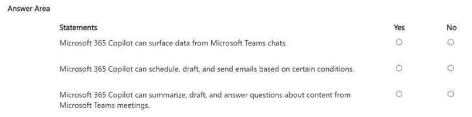

_HOTSPOT — the original ExamTopics question expects you to mark areas on the exhibit above; the correct hotspot coordinates are not published._

**Most voted:**
- Answer is correct: Y N Y
- Regarding using Copilot to SEND emails...
- Copilot can draft emails and help you refine them, *but it cannot autonomously schedule or send emails* based on conditions or triggers. It does not act as an automation engine or rule-based workflow tool.

### Top explanations
- **fcb3021** (5 upvotes): i would say 3 times yes
- **TDAC** (3 upvotes): Answer is correct: Y N Y
  Regarding using Copilot to SEND emails...
  Copilot can draft emails and help you refine them, *but it cannot autonomously schedule or send emails* based on conditions or triggers. It does not act as an automation engine or rule-based workflow tool.
  Sending emails automatically based on conditions would require workflow automation (e.g., Power Automate), not Copilot.
- **Scooter47** (3 upvotes): YNY
  Changing my answer to YNY.
  M365 Copilot CAN surface data from Teams chats.
- **KOLADY** (2 upvotes): YNY.
  It can only draft meeting schedules and not schedule messages
- **jim85** (2 upvotes): Agree! YYY

## Q1.13 (ID 383749)

HOTSPOT
For each of the following statements, select Yes if the statement is true. Otherwise, select No.
NOTE: Each correct selection is worth one point.

**Exhibits**
- Exhibit 1: 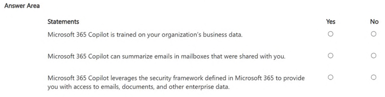

_HOTSPOT — the original ExamTopics question expects you to mark areas on the exhibit above; the correct hotspot coordinates are not published._

**Most voted:**
- Microsoft 365 Copilot is trained on your organization's business data — ❌ No
- Copilot is not trained on your tenant’s data. It uses large language models pretrained by Microsoft/OpenAI and grounds responses using your Microsoft 365 data at runtime, respecting permissions.
- Copilot can summarize emails in mailboxes that were shared with you — ✅ Yes

### Top explanations
- **fa62dd5** (10 upvotes [Most Recent, Highly Voted]): Microsoft 365 Copilot is trained on your organization's business data — ❌ No
  Copilot is not trained on your tenant’s data. It uses large language models pretrained by Microsoft/OpenAI and grounds responses using your Microsoft 365 data at runtime, respecting permissions.
  Copilot can summarize emails in mailboxes that were shared with you — ✅ Yes
  Copilot can access and summarize content you already have permission to view, including shared mailboxes.
  Copilot leverages the Microsoft 365 security framework — ✅ Yes
  Copilot fully respects Microsoft 365 security, identity, compliance, and permission models (Entra ID, sensitivity labels, access controls).

## Q1.14 (ID 383668)

HOTSPOT
You use Microsoft 365 Copilot.
For each of the following statements, select Yes if the statement is true. Otherwise, select No.
NOTE: Each correct selection is worth one point.

**Exhibits**
- Exhibit 1: 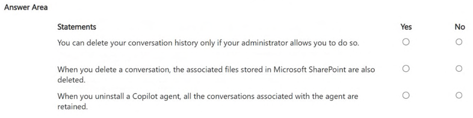

_HOTSPOT — the original ExamTopics question expects you to mark areas on the exhibit above; the correct hotspot coordinates are not published._

**Most voted:**
- “You can delete your conversation history only if your administrator allows you to do so.” → NO
- “When you delete a conversation, the associated files stored in SharePoint are also deleted.” → NO
- Deleting a Copilot conversation does not delete any files in: SharePoint
- “When you uninstall a Copilot agent, all the conversations associated with the agent are retained.” → NO

### Top explanations
- **fa62dd5** (8 upvotes [Highly Voted]): You can delete your conversation history only if your administrator allows you to do so.❌ NoWhen you delete a conversation, the associated files stored in Microsoft SharePoint are also deleted.❌ NoWhen you uninstall a Copilot agent, all the conversations associated with the agent are retained.✅ Yes
- **rveney** (7 upvotes [Highly Voted]): ✔️ Explanation
  1. “You can delete your conversation history only if your administrator allows you to do so.” → NO
  Users can delete their own Copilot conversation history at any time.
  This action does not require admin approval.
  2. “When you delete a conversation, the associated files stored in SharePoint are also deleted.” → NO
  Deleting a Copilot conversation does not delete any files in:
  SharePoint
  OneDrive
  Teams
  Files remain where they are stored.
  3. “When you uninstall a Copilot agent, all the conversations associated with the agent are retained.” → NO
  Uninstalling a Copilot agent removes the agent and its associated conversations.
  They are not retained.
- **876LKZ** (3 upvotes): First one is Yes — You can delete your conversation history in Microsoft 365 Copilot only if your administrator has enabled this capability.
- **Ali_Khan7** (2 upvotes): ✅ Yes	Deletion permissions are controlled by admin policy. Users can delete history only if allowed by their admin.
  ✅ No	Deleting a conversation does not remove SharePoint or OneDrive files; those remain intact.
  ✅ Yes	Uninstalling an agent does not delete its conversations; they’re retained for audit and recovery.
- **microsoft29** (1 upvotes [Most Recent]): Y-Y-N
  N : When an agent is uninstalled, the agent is removed from your list of available agents, but Microsoft specifically notes that saved prompts remain available in the Copilot Prompt Gallery

## Q1.15 (ID 383748)

HOTSPOT
For each of the following statements, select Yes if the statement is true. Otherwise, select No.
NOTE: Each correct selection is worth one point.

**Exhibits**
- Exhibit 1: 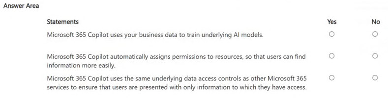

_HOTSPOT — the original ExamTopics question expects you to mark areas on the exhibit above; the correct hotspot coordinates are not published._

**Most voted:**
- Uses your business data to train AI models — ❌ No
- Microsoft 365 Copilot does not train its underlying AI models on your tenant or business data. Your data is used only to ground responses at runtime, not for model training.
- Automatically assigns permissions — ❌ No

### Top explanations
- **fa62dd5** (8 upvotes [Most Recent, Highly Voted]): Uses your business data to train AI models — ❌ No
  Microsoft 365 Copilot does not train its underlying AI models on your tenant or business data. Your data is used only to ground responses at runtime, not for model training.
  Automatically assigns permissions — ❌ No
  Copilot never changes or assigns permissions. It strictly respects existing Microsoft 365 permissions and access controls.
  Uses the same data access controls as Microsoft 365 — ✅ Yes
  Copilot relies on the Microsoft 365 security, identity, and compliance framework, ensuring users only see content they are already authorized to access.

## Q1.16 (ID 383726)

HOTSPOT
For each of the following statements, select Yes if the statement is true. Otherwise, select No.
NOTE: Each correct selection is worth one point.

**Exhibits**
- Exhibit 1: 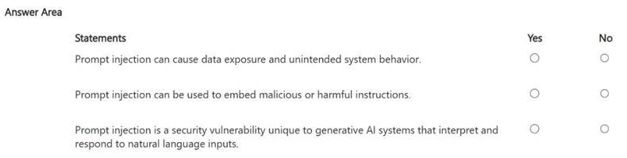

_HOTSPOT — the original ExamTopics question expects you to mark areas on the exhibit above; the correct hotspot coordinates are not published._

**Most voted:**
- Data exposure and unintended behavior — ✅ Yes
- Prompt injection can manipulate an AI system into revealing sensitive information or behaving in ways not intended by its designers.
- Embedding malicious or harmful instructions — ✅ Yes

### Top explanations
- **fa62dd5** (8 upvotes [Highly Voted]): Data exposure and unintended behavior — ✅ Yes
  Prompt injection can manipulate an AI system into revealing sensitive information or behaving in ways not intended by its designers.
  Embedding malicious or harmful instructions — ✅ Yes
  Attackers can craft prompts that override system instructions or introduce harmful logic, making this a recognized AI security risk.
  Unique to generative AI systems — ✅ Yes
  Prompt injection is specific to generative AI systems because they interpret natural language instructions, unlike traditional software vulnerabilities.
- **MoneyStacking** (1 upvotes [Most Recent]): Correct, thanks for the excellent explanation

## Q1.17 (ID 383669)

HOTSPOT
You have a Microsoft 365 subscription.
You do NOT have a Microsoft 365 Copilot license.
For each of the following statements, select Yes if the statement is true. Otherwise, select No.
NOTE: Each correct selection is worth one point.

**Exhibits**
- Exhibit 1: 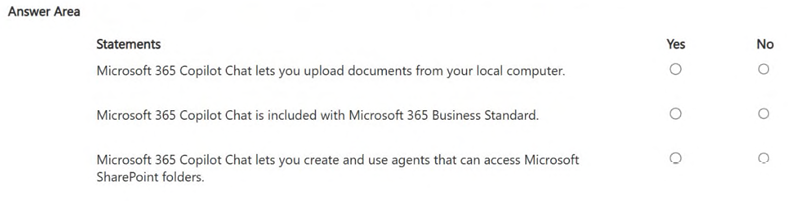

_HOTSPOT — the original ExamTopics question expects you to mark areas on the exhibit above; the correct hotspot coordinates are not published._

**Most voted:**
- Upload documents from your local computer → YES
- Copilot Chat included with Microsoft 365 Business Standard → YES
- Create and use agents that access SharePoint folders → NO
- Creating agents that can read: SharePoint folders

### Top explanations
- **rveney** (19 upvotes [Highly Voted]): ✔️ Explanation
  1. Upload documents from your local computer → YES
  Even without a Copilot license, Copilot Chat allows you to upload files directly from your device for grounding in the conversation.
  2. Copilot Chat included with Microsoft 365 Business Standard → YES
  Copilot Chat is available to all work accounts with Microsoft 365 licenses, including Business Standard.
  A paid Copilot license is not required to use Chat.
  3. Create and use agents that access SharePoint folders → NO
  Creating agents that can read:
  SharePoint folders
  OneDrive files
  Microsoft Graph data
  requires a Microsoft 365 Copilot license and organizational approval.
  Without a license, you can use only free declarative agents, which cannot access enterprise data.
- **fa62dd5** (3 upvotes): Y Y Y that is the answer
- **876LKZ** (3 upvotes): Last one is no
- **SrWalk49** (2 upvotes): I think the last one is yes. Microsoft 365 Copilot Chat can use agents that access SharePoint data, but only within the user’s permissions and with limited granularity (often site-level, not specific folders).
- **fa62dd5** (2 upvotes): aNSWER IS YNN

## Q1.18 (ID 383670)

You open Microsoft 356 Copilot as shown in the following exhibit.
What can you infer about the Standings conversation?

**Exhibits**
- Exhibit 1: 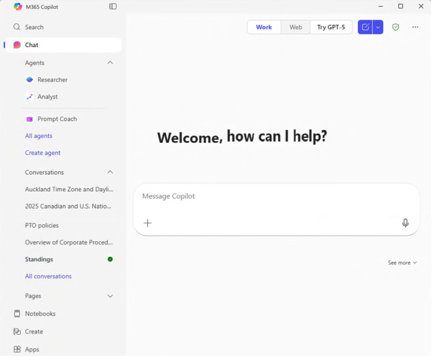

⭕ **A.** The conversation contains only anonymous data.
✅ **B.** The conversation contains a verified response.
⭕ **C.** The conversation was added to a notebook.
⭕ **D.** The conversation contains a scheduled prompt.
⭕ **E.** The conversation was shared.

**Correct answer:** B
**Most voted:** B

### Top explanations
- **edac11c** (7 upvotes [Highly Voted, Selected Answer: B]): The green dot NEVER means “scheduled prompt.”
  A scheduled prompt in Copilot uses a clock icon, not a dot.
  Microsoft’s UI indicators:
  Green dot → Verified response
  Clock icon → Scheduled prompt
  Share icon → Shared conversation
  Notebook icon → Added to notebook
  Shield icon → Anonymous data
- **TDAC** (5 upvotes [Selected Answer: B]): Correct answer: B — The conversation contains a verified response.
  Why
  In Microsoft 365 Copilot, the green dot next to a conversation indicates that Copilot has produced a verified response in that thread. This is part of the “grounded and verified” indicator system Microsoft uses to show when an answer has been validated against authoritative sources (Microsoft Graph, internal data, or citations)
- **Scooter47** (5 upvotes [Selected Answer: D]): After scheduling a prompt to run the other day, today I noticed that green checkmark showing that it ran successfully. I'm going with "scheduled" prompt.
- **bllzr** (4 upvotes [Selected Answer: B]): The green dot means the chat has a verified answer.
  So the correct choice is B. The conversation contains a verified response.
  The other options are wrong:
  A. It does not show anonymous data.
  C. If it were in a notebook, you would see a notebook icon.
  D. A scheduled prompt would show a clock or calendar icon.
  E. Shared chats use a blue share icon, not a green dot.
- **rveney** (4 upvotes [Selected Answer: E]): ✅ Correct Answer: E. The conversation was shared.
  What the image shows
  On the left sidebar under Conversations, the entry labeled “Standings” has a green dot next to it.
  In Microsoft 365 Copilot:
  Green dot = Shared conversation
  This marker appears when a conversation has been shared with others.

## Q1.19 (ID 383725)

HOTSPOT
Select the answer that correctly completes the sentence.

**Exhibits**
- Exhibit 1: 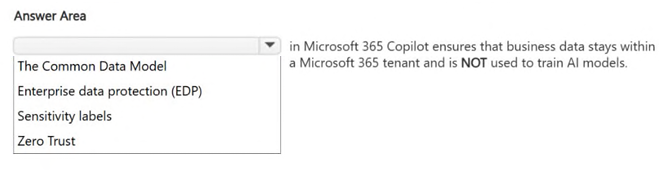

_HOTSPOT — the original ExamTopics question expects you to mark areas on the exhibit above; the correct hotspot coordinates are not published._

**Most voted:**
- Enterprise Data Protection (EDP) is the Microsoft guarantee that: Your organization’s data remains tenant‑isolated
- Data is not used to train foundation AI models
- All access respects Microsoft 365 security, compliance, and privacy controls

### Top explanations
- **fa62dd5** (10 upvotes [Most Recent, Highly Voted]): Enterprise Data Protection (EDP) is the Microsoft guarantee that:
  Your organization’s data remains tenant‑isolated
  Data is not used to train foundation AI models
  All access respects Microsoft 365 security, compliance, and privacy controls

## Q1.20 (ID 383734)

HOTSPOT
Select the answer that correctly completes the sentence.

**Exhibits**
- Exhibit 1: 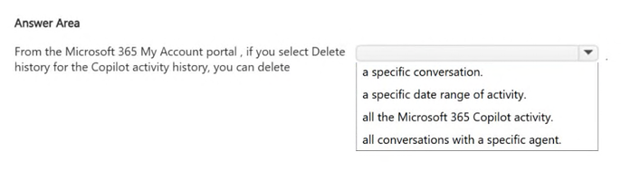

_HOTSPOT — the original ExamTopics question expects you to mark areas on the exhibit above; the correct hotspot coordinates are not published._

**Most voted:** all the Microsoft 365 Copilot activity.

### Top explanations
- **Scooter47** (7 upvotes [Most Recent, Highly Voted]): all the Microsoft 365 Copilot activity.

## Q1.21 (ID 394215)

You use Microsoft 365 Copilot to generate a training plan.
You need to check if there are any existing training plans in your organization that are similar to the new training plan.
What should you use in Copilot?

✅ **A.** Search
⭕ **B.** Designer
⭕ **C.** Apps
⭕ **D.** Pages

**Correct answer:** A
**Most voted:** A

### Top explanations
- **Scooter47** (6 upvotes [Most Recent, Selected Answer: A]): Copilot Search is designed to find and compare existing content across your organization.

## Q1.22 (ID 394216)

You use the Researcher agent in Microsoft 365 Copilot to generate a report.
What can you use to verify whether the report was generated by using valid sources?

✅ **A.** citations
⭕ **B.** instructions
⭕ **C.** memory
⭕ **D.** capabilities

**Correct answer:** A
**Most voted:** A

### Top explanations
- **Scooter47** (4 upvotes [Most Recent, Selected Answer: A]): After having Researcher generate a report, there will be a "sources" button to click to see the references it used. After clicking the sources button a "citations" window appears showing you the sources it used to pull the report data.

## Q1.23 (ID 394217)

HOTSPOT
Select the answer that correctly completes the sentence.

**Exhibits**
- Exhibit 1: 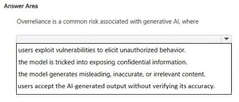

_HOTSPOT — the original ExamTopics question expects you to mark areas on the exhibit above; the correct hotspot coordinates are not published._

**Most voted:** Not provided

### Top explanations
- **Scooter47** (5 upvotes [Most Recent]): Overreliance is a well‑recognized risk associated with generative AI. It occurs when users accept AI‑generated outputs without questioning or verifying their accuracy, completeness, or relevance.

## Q1.24 (ID 394218)

You ask Microsoft 365 Copilot to create a report based on information from the web.
You verify the response and discover that some information is fictional.
What is this an example of?

⭕ **A.** deepfake
✅ **B.** fabrication
⭕ **C.** overreliance
⭕ **D.** prompt injection
⭕ **E.** bias

**Correct answer:** B
**Most voted:** B

### Top explanations
- **TDAC** (3 upvotes [Most Recent, Selected Answer: B]): B is correct.  This is an example of Fabrication, though some may call it Hallucination.
  Same meaning though.
- **Scooter47** (2 upvotes [Selected Answer: B]): Fabrication occurs when an AI system makes up information that does not exist, even though it is presented as factual.

## Q1.25 (ID 394219)

HOTSPOT
For each of the following statements, select Yes if the statement is true. Otherwise, select No.
NOTE: Each correct selection is worth one point.

**Exhibits**
- Exhibit 1: 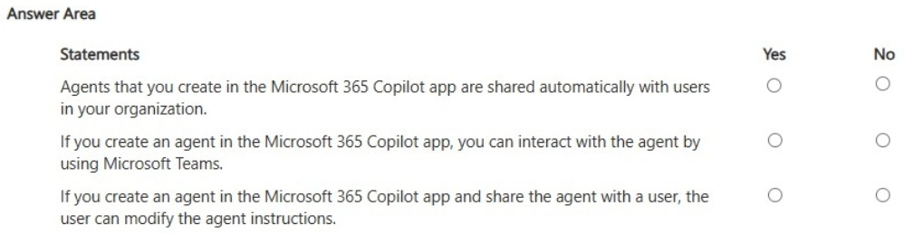

_HOTSPOT — the original ExamTopics question expects you to mark areas on the exhibit above; the correct hotspot coordinates are not published._

**Most voted:** No, Yes, No

### Top explanations
- **Scooter47** (7 upvotes [Most Recent, Highly Voted]): NYN
  Agents are private by default to the creator.
  Yes, as long as the agent is shared/published and Teams access is enabled.
  Shared users cannot change the agent's instructions nor reconfigure or retain the agent.

## Q1.26 (ID 417232)

How does Microsoft 365 Copilot maintain the privacy and security of your organization’s information?

⭕ **A.** Copilot applies separate security, compliance, and privacy policies that override those configured in Microsoft 365.
⭕ **B.** Copilot applies granular security, compliance, and privacy policies that each user can manage independently.
⭕ **C.** Copilot uses dynamic, AI-driven access controls to ensure that users have access to only the information they need.
✅ **D.** Copilot inherits all the security, compliance, and privacy policies configured by your organization in Microsoft 365.

**Correct answer:** D
**Most voted:** D

### Top explanations
- **89d5ded** (2 upvotes [Most Recent, Selected Answer: D]): Correct answer: D. Copilot inherits all the security, compliance, and privacy policies configured by your organization in Microsoft 365.
  Microsoft states that Microsoft 365 Copilot uses the same permissions, security boundaries, compliance controls, and privacy settings that are already configured in Microsoft 365. Users can only access content that they already have permission to access, and Copilot respects existing organizational policies

## Q2.1 (ID 383721)

HOTSPOT
Select the answer that correctly completes the sentence.

**Exhibits**
- Exhibit 1: 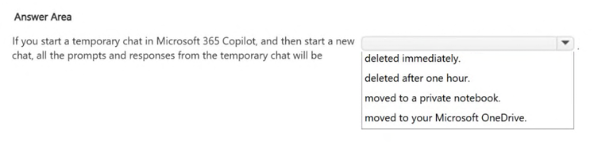

_HOTSPOT — the original ExamTopics question expects you to mark areas on the exhibit above; the correct hotspot coordinates are not published._

**Most voted:** correct answer is deleted immediately

### Top explanations
- **Xabia** (8 upvotes [Most Recent, Highly Voted]): correct answer is deleted immediately
- **Gabrycloud** (1 upvotes [Selected Answer: C]): I'm gonna take a wild guess and say C. This topic is my weak spot.

## Q2.2 (ID 383744)

You are using Microsoft 365 Copilot to plan a trip and have asked Copilot to remember several details about the trip.
You cancel the trip plans.
You need to ensure that Copilot forgets the details.
What should you do?

⭕ **A.** From the My Account portal, delete the Copilot activity history.
✅ **B.** From Copilot, delete memories.
⭕ **C.** From Copilot, delete custom instructions.
⭕ **D.** From Copilot, delete all the conversation about the trip.

**Correct answer:** B
**Most voted:** B

### Top explanations
- **fa62dd5** (8 upvotes [Highly Voted, Selected Answer: B]): You explicitly asked Copilot to remember details about your trip. Those details are stored as Copilot memories.
  When you cancel the trip and want Copilot to forget the information, you must delete the memories directly.
  ❌ Why the other options are incorrect
  A. Delete Copilot activity history
  This removes past interactions but does not erase saved memories Copilot was instructed to remember.
  C. Delete custom instructions
  Custom instructions define how Copilot behaves, not what it remembers.
  D. Delete the conversation
  Deleting a chat removes the conversation history, but memories persist unless explicitly deleted.
- **TonyTeeTee** (2 upvotes [Most Recent, Selected Answer: B]): Memories in Copilot can be found via Settings/Personalization/Saved memories/Manage saved memories.

## Q2.3 (ID 383735)

You are a marketing assistant preparing for a budget meeting with your manager.
You need to evaluate key spending and performance trends from the last year to understand which marketing channels deliver the best return on investment (ROI).
What should you use in Microsoft 365 Copilot to achieve the goal? More than one answer choice may achieve the goal. Select the BEST answer.

✅ **A.** the Analyst agent
⭕ **B.** Chat
⭕ **C.** the Researcher agent
⭕ **D.** a notebook

**Correct answer:** A
**Most voted:** A

### Top explanations
- **Scooter47** (4 upvotes [Most Recent, Selected Answer: A]): To evaluate key spending and performance trends and determine which marketing channels deliver the best return on investment (ROI), you need capabilities such as:
  Data analysis
  Trend identification
  Comparisons across time periods
  Insights derived from structured data (for example, spreadsheets or reports)
  The Analyst agent in Microsoft 365 Copilot is specifically designed for this type of work. It can:
  Analyze historical data from the past year
  Identify patterns and trends
  Compare performance across marketing channels
  Help calculate and interpret ROI

## Q2.4 (ID 383729)

You have several pages in Microsoft 365 Copilot related to the research you are doing for a new product.
You need to simplify your ability to have many different Copilot conversations about the pages.
What should you do first?

⭕ **A.** Create a story.
✅ **B.** Add the pages to a notebook.
⭕ **C.** Add the pages to a conversation.
⭕ **D.** Download the pages locally.

**Correct answer:** B
**Most voted:** B

### Top explanations
- **Scooter47** (6 upvotes [Most Recent, Selected Answer: B]): In Microsoft 365 Copilot, a notebook lets you group related Copilot pages together and use them as shared context for multiple Copilot conversations

## Q2.5 (ID 383659)

You are creating a custom analytics agent in the Microsoft 365 Copilot app. The agent will use Microsoft Excel files that contain sales data as knowledge.
You need to ensure that the agent can create visualizations, perform mathematical operations, create aggregations, and analyze the data in the files.
What should you add to the agent?

⭕ **A.** a suggested prompt
✅ **B.** code interpreter
⭕ **C.** image generator
⭕ **D.** a template

**Correct answer:** B
**Most voted:** B

### Top explanations
- **rveney** (8 upvotes [Highly Voted, Selected Answer: B]): Correct Answer: B. code interpreter
  To enable your custom analytics agent in Microsoft 365 Copilot to: create visualizations
  perform mathematical operations create aggregations analyze data in Excel files—you must add the code interpreter tool to the agent.
- **876LKZ** (7 upvotes [Highly Voted, Selected Answer: B]): B. Code interpreter — BEST choice
  Adding the code interpreter gives your agent the ability to:
  - Run Python
  - Load and manipulate Excel data
  - Perform aggregations and statistical analysis
  - Generate charts and visualizations
  - Handle complex numeric workflows
  This is exactly what the scenario requires.
- **fa62dd5** (5 upvotes [Most Recent, Selected Answer: B]): The code interpreter enables the agent to:
  Execute calculations on numeric data
  Group and aggregate data (for example, monthly totals, averages)
  Generate charts and visualizations from Excel files

## Q2.6 (ID 383733)

You create a prompt in Microsoft 365 Copilot to help you create a draft project report.
You need the prompt to be available in the Copilot Prompt Gallery.
What should you do first?

⭕ **A.** Create a notebook.
⭕ **B.** Add an agent.
⭕ **C.** Create a page.
✅ **D.** Run the prompt.

**Correct answer:** D
**Most voted:** D

### Top explanations
- **fa62dd5** (12 upvotes [Highly Voted, Selected Answer: D]): Correct answer: D. Run the prompt
  Explanation
  In Microsoft 365 Copilot, a prompt must be executed first before it can be saved or surfaced in the Copilot Prompt Gallery. Running the prompt creates an instance that Copilot can then store, reuse, and make available in the gallery.
- **KrissB** (2 upvotes [Selected Answer: D]): you need to run the prompt so its eligable to save in gallery
- **876LKZ** (2 upvotes [Selected Answer: C]): Correct answer: C. Create a page
  Here’s the logic:
  - The Prompt Gallery only surfaces prompts that are saved within a page in the Copilot app.
  - You can’t publish a prompt to the gallery unless it exists inside a page first.
  - Creating a notebook or adding an agent doesn’t place anything in the Prompt Gallery.
  - Running the prompt doesn’t make it available either—you must save it in a page.
  So the first step is always:
  Create a page → Add your prompt → Save to Prompt Gallery
- **Scooter47** (1 upvotes [Most Recent, Selected Answer: D]): In Microsoft 365 Copilot, a prompt must first be run before it can be saved and then made available in the Copilot Prompt Gallery. Running the prompt allows Copilot to validate it and generate an output, after which you can choose to save and share it with others.

## Q2.7 (ID 383716)

You create a Microsoft 365 Copilot notebook and add a file named Process.docx from a local folder.
Yesterday, you updated Process.docx in the local folder.
What will occur when you chat in the notebook?

⭕ **A.** The chat will reference the most recent version of Process.docx.
⭕ **B.** The chat will reference both versions of Process.docx.
✅ **C.** The chat will reference only the original version of Process.docx.

**Correct answer:** C
**Most voted:** C

### Top explanations
- **maas1976** (7 upvotes [Highly Voted, Selected Answer: C]): Because the file is on a LOCAL DRIVE, Copilot does not have constant access to it. If it was in Sharepoint or Onedrive, then C would be correct.
- **Xabia** (1 upvotes [Most Recent, Selected Answer: C]): correct,  Copilot stores a snapshot of the file at the time you add it. The notebook does not maintain a live link to your local file system.
- **jim85** (1 upvotes): lol .. :)
- **fa62dd5** (1 upvotes [Selected Answer: C]): correct
- **Gabrycloud** (1 upvotes [Selected Answer: D]): My choice is D. What are your thoughts?

## Q2.8 (ID 383746)

You have several separate Microsoft 365 Copilot conversations.
You need to gather the conversations so that you can find them more easily, and the conversations can share the same reference material.
What is the best solution to achieve the goal? More than one answer choice may achieve the goal. Select the BEST answer.

✅ **A.** a notebook
⭕ **B.** an agent
⭕ **C.** an app
⭕ **D.** a page

**Correct answer:** A
**Most voted:** A

### Top explanations
- **Scooter47** (6 upvotes [Most Recent, Selected Answer: A]): In Microsoft 365 Copilot, a notebook is specifically designed to:
  Group multiple Copilot conversations together
  Provide shared reference material (pages, files, notes) across those conversations
  Make related work easier to find, reuse, and continue over time

## Q2.9 (ID 383731)

You plan to use a notebook in Microsoft 365 Copilot.
What is the purpose of a notebook?

⭕ **A.** to create a transcript of a conversation that you can easily email to other users
✅ **B.** to provide a private location that can be used to organize reference materials across related conversations
⭕ **C.** to generate a summary of all the interactions you had with Copilot during a specific conversation

**Correct answer:** B
**Most voted:** B

### Top explanations
- **MoneyStacking** (6 upvotes [Most Recent, Selected Answer: B]): Answer is correct > to provide a private location that can be used to organize reference materials across related conversations

## Q2.10 (ID 383724)

You have a Microsoft Excel workbook open that contains a table. The table contains sales data and the following columns:
• OrderDate
• OrderNumber
• Amount
You plan to use Microsoft Copilot in Excel to generate a monthly summary of the sales data in the table.
What should you include in the prompt to generate an effective summary? More than one answer choice may achieve the goal. Select the BEST answer.

⭕ **A.** the desired format of the response
⭕ **B.** a specific cell range from the worksheet
⭕ **C.** the file name of the workbook
✅ **D.** the clear goal of the summary
⭕ **E.** a formula to calculate monthly totals

**Correct answer:** D
**Most voted:** D

### Top explanations
- **rveney** (7 upvotes [Most Recent, Highly Voted, Selected Answer: D]): ✅ Best choices:
  A. the desired format of the response
  Helps Copilot structure the output (for example: a table by month, bullets, or a short narrative).
  D. the clear goal of the summary
  Clearly stating that you want a monthly summary of sales amounts ensures Copilot aggregates and analyzes the data correctly.
- **876LKZ** (1 upvotes [Selected Answer: D]): A&D are both correct - see reasoning below. This was not letting me select 2 options so adding a second comment here.
- **876LKZ** (1 upvotes [Selected Answer: A]): A. the desired format of the response
  Telling Copilot how you want the summary—table, bullet points, chart, etc.—makes the output far more useful.
  ✅ D. the clear goal of the summary
  Copilot performs best when you explicitly state the goal, such as:
  “Summarize monthly sales totals and highlight trends.”
  These two elements are exactly what Copilot needs to generate an effective summary

## Q2.11 (ID 383742)

You are creating a prompt in Microsoft 365 Copilot to get information about a proposal.
You need to ensure that the response is grounded in the proposal's information.
What is the best approach to achieve the goal? More than one answer choice may achieve the goal. Select the BEST answer.

⭕ **A.** Add context about the intended audience.
⭕ **B.** Instruct Copilot to rely on its training data to infer proposal details.
✅ **C.** Reference the proposal content in the prompt.
⭕ **D.** Add a specific goal that you want Copilot to accomplish.

**Correct answer:** C
**Most voted:** C

### Top explanations
- **Scooter47** (6 upvotes [Selected Answer: C]): If your goal is to ensure that Microsoft 365 Copilot’s response is grounded in the proposal’s actual information, you must explicitly point Copilot to that source. Referencing the proposal content (for example, attaching it, linking it, or saying “based on the attached proposal”) ensures Copilot uses that material rather than general knowledge.
- **Sheryle** (1 upvotes [Most Recent, Selected Answer: A]): A. the desired format of the response ✅
  Yes—specifying format (e.g., “summarize by month in a table” or “show totals per month”) helps Copilot structure the output correctly.
  D. the clear goal of the summary ✅
  This is essential. You need to clearly state something like “generate a monthly sales summary.”
  C. the file name of the workbook ❌
  Irrelevant—Copilot already knows which workbook you’re working in.

## Q2.12 (ID 383730)

You need to improve prompt-grounding during a Microsoft 365 Copilot conversation.
What is the best approach to achieve the goal? More than one answer choice may achieve the goal. Select the BEST answer.

⭕ **A.** Use shorter prompts.
⭕ **B.** Provide the desired output format.
⭕ **C.** Avoid technical jargon.
✅ **D.** Reference specific files.

**Correct answer:** D
**Most voted:** D

### Top explanations
- **tvpirate** (6 upvotes [Most Recent, Selected Answer: D]): Grounding means tying Copilot’s response to concrete sources like documents, spreadsheets, or emails. By referencing specific files, you give Copilot the context it needs to generate accurate, relevant answers.

## Q2.13 (ID 383739)

You create a Microsoft 365 Copilot notebook and add a file named Process.docx from a Microsoft SharePoint site as a reference.
Yesterday, a user updated Process.docx in the SharePoint site.
What will occur when you chat in the notebook?

⭕ **A.** The chat will reference only the original version of Process.docx.
✅ **B.** The chat will reference the most recent version of Process.docx.
⭕ **C.** The chat will reference both versions of Process.docx.

**Correct answer:** B
**Most voted:** B

### Top explanations
- **fa62dd5** (7 upvotes [Most Recent, Highly Voted, Selected Answer: B]): Correct Answer: B. The chat will reference the most recent version of Process.docx.
  ✅ Explanation
  When you add a file to a Microsoft 365 Copilot notebook from SharePoint, the file is treated as a live reference, not a static snapshot.
  SharePoint files are dynamically linked
  Any updates made to the file in SharePoint are automatically reflected
  Copilot will reference the latest saved version of the document when you chat in the notebook

## Q2.14 (ID 383660)

You use Microsoft 365 Copilot.
You discover that you had a conversation that used a knowledge source that contains confidential information.
You need to delete the conversation data without requiring administrative approval. You must retain your other conversations, if possible.
What should you use?

⭕ **A.** the Microsoft 365 admin center
⭕ **B.** the My Account portal in Microsoft 365 Copilot
⭕ **C.** the Microsoft Purview compliance portal
✅ **D.** the Microsoft 365 Copilot app

**Correct answer:** D
**Most voted:** D

### Top explanations
- **fa62dd5** (5 upvotes [Selected Answer: D]): Correct answer: D. the Microsoft 365 Copilot app ✅
  Why:
  You need to delete only your own Copilot conversation without admin approval and keep other chats.
  The Microsoft 365 Copilot app lets end users view and delete their individual chat history directly.
  Why the others are wrong
  A. Microsoft 365 admin center → Requires admin rights ❌
  B. My Account portal → Does not manage Copilot chat history ❌
  C. Microsoft Purview → Used for compliance, eDiscovery, and retention — requires admin
  What you do
  Open Microsoft 365 Copilot → Go to Chat history → Find the conversation → Delete it
- **rveney** (4 upvotes [Selected Answer: D]): Correct Answer: D. the Microsoft 365 Copilot app
  ✔️ Explanation
  You need to delete one specific Copilot conversation that used confidential information — without deleting all conversations and without admin approval.
- **Nickybambi** (2 upvotes [Most Recent, Selected Answer: B]): B. the My Account portal in Microsoft 365 Copilot
  Here’s why:
  If you discover a conversation that used a confidential knowledge source, you can delete just that conversation’s data yourself through the My Account portal in Copilot.
  This option does not require administrative approval and allows you to retain your other conversations.
  The other options (admin center, Purview compliance portal, Copilot app) are either for broader administrative/compliance management or for using Copilot itself, not for self-service deletion of conversation data.
  So the best answer is B.
- **Scooter47** (2 upvotes [Selected Answer: D]): My bad. fa62dd5 & rveney are correct. Deleting from Copilot chat allows you to specifically select a conversation. MyAccountPortal deletes ALL conversation history.
- **Scooter47** (2 upvotes [Selected Answer: B]): In the My Account portal, users can manage their Copilot conversation history, including deleting individual conversations they no longer want retained.

## Q2.15 (ID 383717)

You have an open Microsoft 365 Copilot conversation.
You need to chat with an agent named Agent1 during the conversation.
What should you enter to call Agent1?

⭕ **A.** [Agent1]
⭕ **B.** #Agent1
⭕ **C.** /Agent1
✅ **D.** @Agent1

**Correct answer:** D
**Most voted:** D

### Top explanations
- **Gabrycloud** (5 upvotes [Selected Answer: D]): I've seen something similar before — pretty sure it was D.
- **MoneyStacking** (3 upvotes [Most Recent, Selected Answer: D]): Tested this and @-symbol let's chat with an specific agent

## Q2.16 (ID 383661)

You use Microsoft 365 Copilot.
You regularly upload the same five files to Copilot chats.
You need to simplify referencing the files in the chats.
What are two ways to achieve the goal? Each correct answer presents a complete solution.
NOTE: Each correct selection is worth one point.

✅ **A.** Create an agent that has a knowledge source.
⭕ **B.** Send a prompt that includes the files, and then save the prompt.
✅ **C.** Create a notebook that references the files.
⭕ **D.** Ask the data engineers to create a fine-tuned model.
⭕ **E.** Zip the documents and upload the ZIP file to the chats.

**Correct answer:** A, C
**Most voted:** AC

### Top explanations
- **rveney** (7 upvotes [Highly Voted, Selected Answer: AC]): Why these are the correct solutions:
  Option A (Copilot Agents): You can create a custom Copilot agent (formerly known as a "custom GPT" or through Copilot Studio) and upload those five files as a permanent knowledge source. This allows you to chat with that specific agent anytime without re-uploading the documents.
  Option C (Copilot Notebook): The "Notebook" feature in Copilot is designed for iterative prompting and long-form content creation. It allows you to reference specific files and keep them within the context of that workspace, making it easier to manage recurring data than a standard one-off chat.
- **fa62dd5** (4 upvotes [Most Recent, Selected Answer: AC]): A. Create an agent that has a knowledge source. Yes
  C. Create a notebook that references the files.Yes
  B. Send a prompt that includes the files, and then save the prompt.
  ❌ Saved prompts do not reliably retain file attachments as reusable references.
  D. Ask the data engineers to create a fine‑tuned model.
  ❌ Fine‑tuning is not how Microsoft 365 Copilot works and is unnecessary for file reuse.
  E. Zip the documents and upload the ZIP file to the chats.
  ❌ This does not simplify reuse and can reduce Copilot’s ability to interpret the files effectively.

## Q2.17 (ID 383720)

You have a Microsoft 365 subscription.
You do NOT have a Microsoft 365 Copilot license.
When you send a prompt in Microsoft 365 Copilot Chat, which three sources does Copilot Chat use to respond? Each correct answer presents part of the solution.
NOTE: Each correct selection is worth one point.

⭕ **A.** chat data in Microsoft Teams
⭕ **B.** your organization's databases
✅ **C.** the prompt context
⭕ **D.** organizational data in Microsoft 365
✅ **E.** internet search data
✅ **F.** the conversation history

**Correct answer:** C, E, F
**Most voted:** CEF

### Top explanations
- **deca0d4** (7 upvotes [Most Recent, Highly Voted, Selected Answer: CEF]): You have a limited scope without the 365 Copilot license.
- **fa62dd5** (6 upvotes [Selected Answer: CEF]): C. the prompt context✅ YesCopilot always uses the text and instructions you provide in the current prompt.E. internet search data✅ YesCopilot Chat can use public web information to answer general questions.F. the conversation history✅ YesCopilot uses earlier messages in the same chat to maintain context.A. chat data in Microsoft Teams ❌
  Requires a Microsoft 365 Copilot license.
  B. your organization’s databases ❌
  Copilot Chat does not connect to internal databases without licensing and configuration.
  D. organizational data in Microsoft 365 ❌
  Access to Outlook, SharePoint, OneDrive, Teams, etc. requires a Copilot license.
- **Gabrycloud** (1 upvotes [Selected Answer: C]): I'm arriving at C by process of elimination.

## Q2.18 (ID 383752)

You are a project coordinator for a small consulting firm.
You are responsible for tracking client communications, managing project timelines, and preparing weekly status updates for internal stakeholders.
You have a Microsoft 365 Copilot license.
You create an agent to help you monitor project milestones, follow up on client emails, and generate weekly summary reports.
With whom can you share the agent?

✅ **A.** only the people in your organization
⭕ **B.** the people in your organization and people that have personal Microsoft accounts
⭕ **C.** only Microsoft Teams channel members
⭕ **D.** any person who has a valid email address

**Correct answer:** A
**Most voted:** A

### Top explanations
- **Scooter47** (4 upvotes [Most Recent, Selected Answer: A]): When you create an agent in Microsoft 365 Copilot, sharing is limited to users within your Microsoft 365 organization (tenant). Even though the agent may help with project monitoring, email follow‑ups, and reporting, it can only be shared internally.

## Q2.19 (ID 383662)

HOTSPOT
From Microsoft 365 Copilot, you add custom instructions.
For each of the following statements, select Yes if the statement is true. Otherwise, select No.
NOTE: Each correct selection is worth one point.

**Exhibits**
- Exhibit 1: 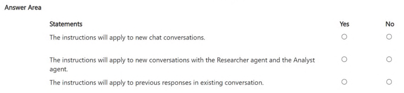

_HOTSPOT — the original ExamTopics question expects you to mark areas on the exhibit above; the correct hotspot coordinates are not published._

**Most voted:**
- The instructions will apply to new chat conversations → YES
- The instructions will apply to new conversations with the Researcher agent and the Analyst agent → YES
- The instructions will apply to previous responses in existing conversations → NO

### Top explanations
- **rveney** (6 upvotes): ✔️ Explanation
  1. The instructions will apply to new chat conversations. → YES
  Custom instructions apply going forward to new chats you start.
  2. The instructions will apply to new conversations with the Researcher agent and the Analyst agent. → YES
  Agents inherit the user’s custom instructions for new conversations, unless explicitly overridden.
  3. The instructions will apply to previous responses in existing conversations. → NO
  Custom instructions do not retroactively modify previous Copilot interactions.
  They only affect future responses.
- **fa62dd5** (4 upvotes): The answer is YYN
- **Scooter47** (3 upvotes): YNN
  Custom instructions you set in Copilot Settings
  Apply to:
  Copilot Chat (your general chats)
  Do not apply to:
  Researcher agent
  Analyst agent
  Any custom agents
  These instructions are user‑level and chat‑level, not agent‑level.
- **MoneyStacking** (2 upvotes [Most Recent]): Answer is YYN > Tested this
- **Sheryle** (1 upvotes): Y: Custom instructions are applied only to new chats started after the instructions are saved.
  Y: Custom instructions apply across Copilot experiences, including agents like Researcher and Analyst, for new conversations.
  N: Custom instructions do not retroactively change existing or past conversations or responses.

## Q2.20 (ID 383718)

HOTSPOT
You create an agent in the Microsoft 365 Copilot app by using a template.
For each of the following statements, select Yes if the statement is true. Otherwise, select No.
NOTE: Each correct selection is worth one point.

**Exhibits**
- Exhibit 1: 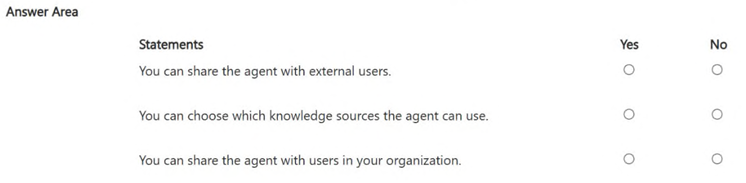

_HOTSPOT — the original ExamTopics question expects you to mark areas on the exhibit above; the correct hotspot coordinates are not published._

**Most voted:** No, Yes, Yes

### Top explanations
- **Scooter47** (6 upvotes): NYY
  Cannot share with external users
  Limited, but yes, sources can be chosen
  Can share with users in your org.
- **Sheryle** (5 upvotes [Most Recent]): N: Copilot agents are limited to your Microsoft 365 tenant and cannot be shared externally.
  Y: Even when using a template, you can configure or adjust the agent’s knowledge sources (e.g., SharePoint, files).
  Y: Agents can be shared with other users in your organization.
- **Gabrycloud** (1 upvotes [Selected Answer: C]): I've seen something similar before — pretty sure it was C.

## Q2.21 (ID 383750)

HOTSPOT
For each of the following statements, select Yes if the statement is true. Otherwise, select No.
NOTE: Each correct selection is worth one point.

**Exhibits**
- Exhibit 1: 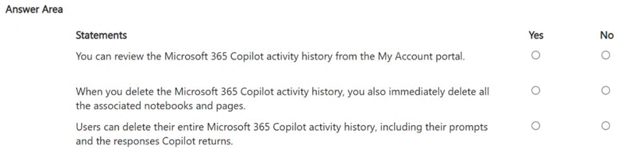

_HOTSPOT — the original ExamTopics question expects you to mark areas on the exhibit above; the correct hotspot coordinates are not published._

**Most voted:** Yes, No, Yes

### Top explanations
- **Scooter47** (4 upvotes [Most Recent]): YNY
  You can review them by downloading history (Microsoft Search History)
  Notebooks and pages and not deleted, just history conversations
  Yes
- **jim85** (3 upvotes): q1: No - see the myaccounts portal, there is no such option to review.

## Q2.22 (ID 383736)

HOTSPOT
For each of the following statements, select Yes if the statement is true. Otherwise, select No.
NOTE: Each correct selection is worth one point.

**Exhibits**
- Exhibit 1: 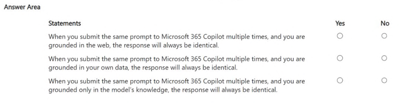

_HOTSPOT — the original ExamTopics question expects you to mark areas on the exhibit above; the correct hotspot coordinates are not published._

**Most voted:**
- No: The web is dynamic. Even if the model's parameters stay the same, new search results or shifting trends can change the data retrieved, leading to different responses.
- No: Even with static files, the model's temperature (randomness) means it may phrase things differently. Additionally, if the internal data is updated (like the Process.docx file mentioned earlier), the grounded content changes.
- No: Large Language Models are probabilistic, not deterministic. Unless the "temperature" is set to zero (which isn't a user-facing toggle in standard Copilot), the model chooses the "next word" based on probabilities, often leading to variations in phrasing or detail.

### Top explanations
- **ksmani99** (6 upvotes): No : The web is dynamic. Even if the model's parameters stay the same, new search results or shifting trends can change the data retrieved, leading to different responses.
  No : Even with static files, the model's temperature (randomness) means it may phrase things differently. Additionally, if the internal data is updated (like the Process.docx file mentioned earlier), the grounded content changes.
  No : Large Language Models are probabilistic, not deterministic. Unless the "temperature" is set to zero (which isn't a user-facing toggle in standard Copilot), the model chooses the "next word" based on probabilities, often leading to variations in phrasing or detail.
- **MoneyStacking** (4 upvotes [Most Recent]): Well I can fairly say it is never identical, therefore 'NO' for everything
- **tvpirate** (2 upvotes): - Grounded in the web →
  Responses can vary because web content is dynamic and Copilot may pull slightly different sources or phrasing each time.
  Answer: No
  - Grounded in your own data →
  Even when grounded in organizational or personal files, Copilot may phrase answers differently. It doesn’t guarantee identical wording each time.
  Answer: No
  - Grounded only in the model’s knowledge →
  Large language models are probabilistic — they don’t always produce identical outputs, even with the same prompt.
  Answer: No

## Q2.23 (ID 383743)

HOTSPOT
For each of the following statements, select Yes if the statement is true. Otherwise, select No.
NOTE: Each correct selection is worth one point.

**Exhibits**
- Exhibit 1: 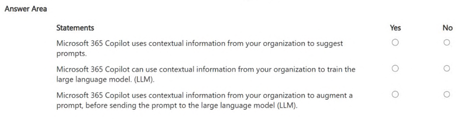

_HOTSPOT — the original ExamTopics question expects you to mark areas on the exhibit above; the correct hotspot coordinates are not published._

**Most voted:** Yes, No, Yes

### Top explanations
- **Scooter47** (4 upvotes): YNY
  Yes
  No
  Yes
- **89d5ded** (1 upvotes [Most Recent]): Contextual information is the background information that helps Copilot understand your situation and provide more relevant answers

## Q2.24 (ID 394220)

You use Microsoft 365 Copilot.
You need to delete all your conversations by using the least amount of effort.
What is the best approach to achieve the goal? More than one answer choice may achieve the goal. Select the BEST answer.

⭕ **A.** the Microsoft 365 Copilot web app
✅ **B.** the My Account portal in Microsoft 365
⭕ **C.** the Microsoft 365 Copilot desktop app
⭕ **D.** the Settings app in Windows 11

**Correct answer:** B
**Most voted:** B

### Top explanations
- **Scooter47** (5 upvotes [Most Recent, Selected Answer: B]): If you want to delete all your Microsoft 365 Copilot conversations at once, the My Account portal is the most efficient option.

## Q2.25 (ID 394221)

HOTSPOT
Select the answer that correctly completes the sentence.

**Exhibits**
- Exhibit 1: 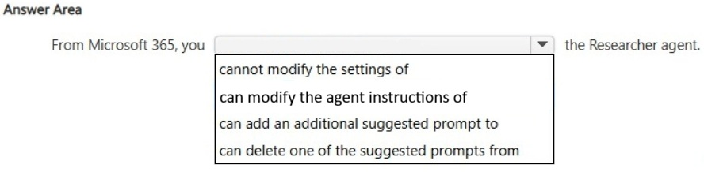

_HOTSPOT — the original ExamTopics question expects you to mark areas on the exhibit above; the correct hotspot coordinates are not published._

**Most voted:** Not provided

### Top explanations
- **Scooter47** (5 upvotes [Most Recent]): cannot modify the settings of

## Q2.26 (ID 394222)

HOTSPOT
Select the answer that correctly completes the sentence.

**Exhibits**
- Exhibit 1: 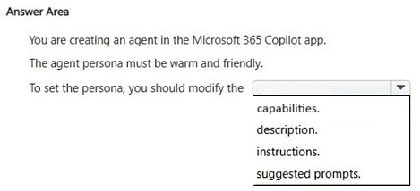

_HOTSPOT — the original ExamTopics question expects you to mark areas on the exhibit above; the correct hotspot coordinates are not published._

**Most voted:**
- instructions
- To set the persona, you should modify the "instructions."

### Top explanations
- **Scooter47** (5 upvotes [Most Recent]): instructions
  To set the persona, you should modify the "instructions."

## Q2.27 (ID 394223)

HOTSPOT
Select the answer that correctly completes the sentence.

**Exhibits**
- Exhibit 1: 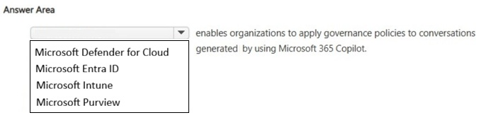

_HOTSPOT — the original ExamTopics question expects you to mark areas on the exhibit above; the correct hotspot coordinates are not published._

**Most voted:** Not provided

### Top explanations
- **Scooter47** (5 upvotes [Most Recent]): Microsoft Purview
  Microsoft Purview is what enables organizations to apply governance, compliance, and security policies to conversations generated by Microsoft 365 Copilot.

## Q2.28 (ID 394224)

You receive the following response to a prompt: “Sorry, it looks like I can’t respond to this. Let’s try a different topic.”
What is a possible cause of the response?

⭕ **A.** The prompt is too vague to illicit a response.
✅ **B.** The prompt contains language that violates safety guidelines.
⭕ **C.** The prompt contains more than five requests.
⭕ **D.** The prompt is larger than the allowed context window.

**Correct answer:** B
**Most voted:** B

### Top explanations
- **Scooter47** (4 upvotes [Selected Answer: B]): The prompt contains language that violates safety guidelines.
- **MoneyStacking** (2 upvotes [Most Recent, Selected Answer: B]): Tested this :P
  Answer is B > Got a meme group chat with people where this response pops-up quite often

## Q2.29 (ID 394225)

You are a medical researcher.
You need to ensure that Microsoft 365 Copilot responds to you in a professional manner that is appropriate to your field.
What is the best approach to achieve the goal? More than one answer choice may achieve the goal. Select the BEST answer.

⭕ **A.** In the conversation, attach an example to your prompts.
✅ **B.** From Settings, configure Custom instructions.
⭕ **C.** In the conversation, create a sample prompt and save it to the Copilot Prompt Gallery.
⭕ **D.** From Settings, configure Copilot Memory.

**Correct answer:** B
**Most voted:** B

### Top explanations
- **Scooter47** (4 upvotes [Selected Answer: B]): To ensure Microsoft 365 Copilot consistently responds in a professional manner appropriate for a medical researcher, the best and most effective approach is to configure Custom instructions.
- **MoneyStacking** (2 upvotes [Most Recent, Selected Answer: B]): Answer B: instructions are custom, markdown-based rules that define how the AI should behave, code, and format its output for your specific project

## Q2.30 (ID 394226)

HOTSPOT
For each of the following statements, select Yes if the statement is true. Otherwise, select No.
NOTE: Each correct selection is worth one point.

**Exhibits**
- Exhibit 1: 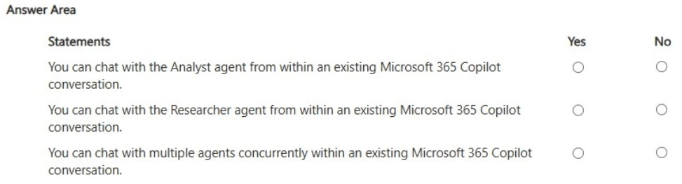

_HOTSPOT — the original ExamTopics question expects you to mark areas on the exhibit above; the correct hotspot coordinates are not published._

**Most voted:** No, No, No

### Top explanations
- **MoneyStacking** (6 upvotes): Tested all three cases
  YYN
  You cannot use multiple agents, only one at the time.
- **Scooter47** (4 upvotes): YYN
  Yes to Analyst agent
  Yes to Researcher agent
  No, not concurrently with multiple agents.
- **flim322** (1 upvotes [Most Recent]): NNN
  Key takeaway (important for exams):
  Custom agents → can be called with @AgentName in a chat
  Built-in agents (Analyst, Researcher) → separate experience, not inline in chat
- **Xabia** (1 upvotes): Q3 is No-> you can switch between agent; agents do not answer in // to the same prompt

## Q2.31 (ID 394227)

You need to access Microsoft 365 Copilot from a web browser.
Which URL should you use?

✅ **A.** https://m365.cloud.microsoft
⭕ **B.** https://copilotstudio.microsoft.com
⭕ **C.** https://myapps.microsoft.com
⭕ **D.** https://myaccount.microsoft.com

**Correct answer:** A
**Most voted:** A

### Top explanations
- **Scooter47** (4 upvotes [Most Recent, Selected Answer: A]): https://m365.cloud.microsoft takes you right to Copilot.

## Q2.32 (ID 394228)

HOTSPOT
You have a Microsoft 365 Copilot license.
You plan to run several prompts.
What should you use to ensure that Copilot generates the best response for each prompt? More than one answer choice may achieve the goal. To answer, select the BEST options in the answer area.
NOTE: Each correct selection is worth one point.

**Exhibits**
- Exhibit 1: 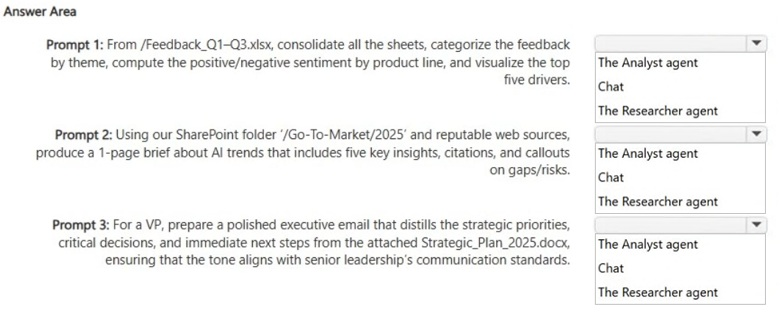

_HOTSPOT — the original ExamTopics question expects you to mark areas on the exhibit above; the correct hotspot coordinates are not published._

**Most voted:** Not provided

### Top explanations
- **Scooter47** (4 upvotes [Most Recent]): The Analyst agent
  The Researcher agent
  Chat

## Q2.33 (ID 394229)

HOTSPOT
You have a Microsoft 365 Copilot conversation as shown in the following exhibit.
Use the drop-down menus to select the answer choice that completes the statement based on the information presented in the graphic.

**Exhibits**
- Exhibit 1: 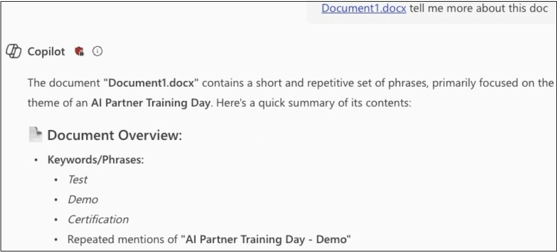
- Exhibit 2: 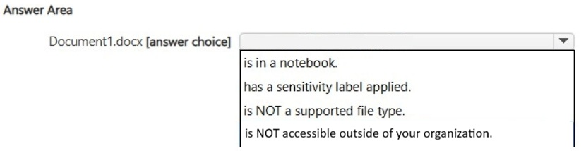

_HOTSPOT — the original ExamTopics question expects you to mark areas on the exhibit above; the correct hotspot coordinates are not published._

**Most voted:** ^this is the correct answer.  It has a sensitivity label applied.  You can see the Restricted/Highly Confidential icon next to the Copilot word at the top.  Copilot cannot access the file so gives a very vague summary.

### Top explanations
- **fpinto** (10 upvotes [Highly Voted]): Has a sensitivity label applied??
- **Sheryle** (4 upvotes): When Copilot responds with something like:
  “Document1.docx — tell me more about the doc”
  this typically means Copilot can see the file name but can’t access or process the contents. The most common and relevant reason for this with a supported file type like .docx is:
  The document has a Microsoft Purview sensitivity label applied that restricts Copilot access (for example, “Highly Confidential”, “Restricted”, or labels that block AI processing).
  Copilot respects sensitivity labels and will not read or summarize content that is protected by such labels
- **108e7c2** (4 upvotes): Should be "Sensitivity Label" I think.
  The red shield next to the Copilot response is indicating a Microsoft Purview sensitivity label associated with the referenced content. Microsoft says Copilot/agent responses can show a shield icon, and hovering over it shows the name/summary of the highest sensitivity label; citations can also indicate labels for specific referenced files.
- **TDAC** (2 upvotes [Most Recent]): ^this is the correct answer.  It has a sensitivity label applied.  You can see the Restricted/Highly Confidential icon next to the Copilot word at the top.  Copilot cannot access the file so gives a very vague summary.
- **Scooter47** (2 upvotes): Going with "is in a notebook."
  Copilot successfully reads and summarizes Document1.docx.
  The document title appears as a clickable reference link at the top of the response.
  There is no warning, refusal, or error message from Copilot.

## Q2.34 (ID 394230)

HOTSPOT
You are creating an agent in the Microsoft 365 Copilot app.
For each of the following statements, select Yes if the statement is true. Otherwise, select No.
NOTE: Each correct selection is worth one point.

**Exhibits**
- Exhibit 1: 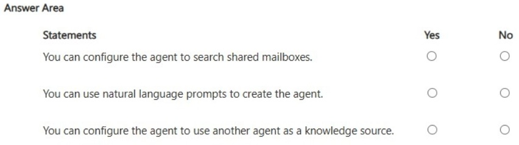

_HOTSPOT — the original ExamTopics question expects you to mark areas on the exhibit above; the correct hotspot coordinates are not published._

**Most voted:** ^this is the correct answer.  The key wording here is "you are using the Copilot app".  You cannot add a shared mailbox or another agent from the COPILOT APP.

### Top explanations
- **Scooter47** (8 upvotes [Highly Voted]): NYN
  not shared mailboxes, only personal mailbox.
  Yes
  No
- **TDAC** (2 upvotes [Most Recent]): ^this is the correct answer.  The key wording here is "you are using the Copilot app".  You cannot add a shared mailbox or another agent from the COPILOT APP.
  You can do it from Copilot Studio, but the question doesn't say Copilot studio.  Only the app where you build an agent using simple natural language. From the app you can only add Files, Sites, Chats, Meetings and 3rd party app connectors (like ServiceNow) as knowledge sources.
- **Sheryle** (1 upvotes): (1) No – Agents can use SharePoint sites, files, Graph Connectors, and other approved data sources. Shared mailboxes aren’t supported as a direct knowledge source.
  (2) Yes – The Agent Builder supports natural language to define the agent’s purpose, instructions, and behavior.
  (3) Yes – Microsoft 365 Copilot supports connected agents, allowing one agent to query or leverage another agent as part of its knowledge or capability set.
- **deca0d4** (1 upvotes): YYN
  Microsoft does not support configuring:
  Agent A → “use Agent B as a knowledge source”
  An agent’s knowledge sources must be data, not other agents.
  Supported knowledge sources include:
  SharePoint files, folders, or sites
  Microsoft Teams data
  Public websites
  Uploaded files
  Copilot connectors
  Agents themselves cannot be added as knowledge sources.
  *you can do this in Copilot Studio with a parent/child relationship but not with the app.

## Q2.35 (ID 394231)

HOTSPOT
You plan to create an agent by using the Microsoft 365 Copilot app.
For each of the following statements, select Yes if the statement is true. Otherwise, select No.
NOTE: Each correct selection is worth one point.

**Exhibits**
- Exhibit 1: 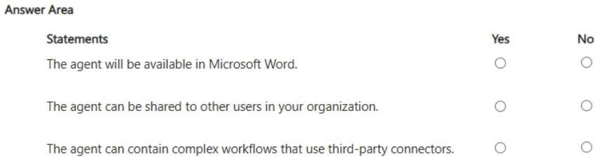

_HOTSPOT — the original ExamTopics question expects you to mark areas on the exhibit above; the correct hotspot coordinates are not published._

**Most voted:**
- 1 → No - Agents created in the Microsoft 365 Copilot app (Agent Builder) are surfaced in Copilot Chat
- 2 → Yes - Agents created in the Copilot app can be shared across your organisation, subject to tenant policies and admin controls. Shared agents appear in Copilot Chat for other users.
- 3 → No- Agents built directly in the Microsoft 365 Copilot app (Agent Builder) are declarative agents.They do not support complex workflows or third‑party connectors—those capabilities require Copilot Studio or workflow‑specific agents.

### Top explanations
- **Scooter47** (9 upvotes [Highly Voted]): NYN
  by default, no
  yes, can be shared internally
  No, would need Power Automate for that scenario
- **Sheryle** (5 upvotes [Most Recent]): 1.  → No - Agents created in the Microsoft 365 Copilot app (Agent Builder) are surfaced in Copilot Chat (and compatible Copilot surfaces such as Teams or the Copilot app).
  They are not embedded as dedicated agents inside Word itself like built‑in Word agents.
  2. → Yes - Agents created in the Copilot app can be shared across your organisation, subject to tenant policies and admin controls. Shared agents appear in Copilot Chat for other users.
  3. → No- Agents built directly in the Microsoft 365 Copilot app (Agent Builder) are declarative agents.They do not support complex workflows or third‑party connectors—those capabilities require Copilot Studio or workflow‑specific agents.
- **Slashimus** (2 upvotes): Y the agent is available in Word. You need to select the navigation panel and choose agents
  Y the agent can be shared to others in your organization
  N You cannot use complex workflows that contain third party connectors if you are creating the agent from the Copilot App

## Q2.36 (ID 394232)

You create a prompt and add several files from your Microsoft OneDrive.
You share the prompt to a user by using email.
What occurs when the user uses the prompt?

⭕ **A.** The user is granted access to the files automatically and can run the prompt.
⭕ **B.** The files are removed from the shared prompt, and the user must add the files manually before they can run the prompt.
⭕ **C.** The user is prompted to request access to the files when they attempt to run the prompt.
✅ **D.** The user can run the prompt successfully only if they have access to the files in your OneDrive.

**Correct answer:** D
**Most voted:** D

### Top explanations
- **Karan630** (6 upvotes [Most Recent, Selected Answer: D]): D. The user can run the prompt successfully only if they have access to the files in your OneDrive.
  When you share a prompt that references files stored in your Microsoft OneDrive, those files are not automatically shared with the recipient. The prompt itself can be accessed, but any embedded file references still respect the original OneDrive permissions.
  So, if the user doesn’t already have permission to access those files, the prompt may fail or not function as intended until access is granted.
- **Scooter47** (3 upvotes [Selected Answer: D]): Changing my answer to D. It even says it in my first thread "If they already have access to the OneDrive files, the prompt runs normally." duh...
- **Scooter47** (1 upvotes [Selected Answer: C]): When you create a prompt (for example, in Microsoft Copilot or Copilot Studio) and attach files from your OneDrive, sharing the prompt via email does not automatically grant access to those files.
  What happens instead:
  The file permissions remain unchanged.
  When the recipient runs the prompt:
  If they already have access to the OneDrive files, the prompt runs normally.
  If they do not have access, they are prompted to request access to the files.

## Q2.37 (ID 394233)

In Microsoft 365 Copilot, you save a prompt.
Which two actions can you perform for the saved prompt? Each correct answer presents a complete the solution.
NOTE: Each correct selection is worth one point.

⭕ **A.** Modify the saved prompt text.
✅ **B.** Remove the saved prompt from the Copilot Prompt Gallery.
⭕ **C.** Update the title of the saved prompt.
⭕ **D.** Schedule the saved prompt to run daily.
✅ **E.** Share the saved prompt to a Microsoft Teams team.

**Correct answer:** B, E
**Most voted:** BE

### Top explanations
- **sub_anav** (4 upvotes [Selected Answer: BE]): Within prompt gallery for a saved prompt, you can only remove the prompt or share it.
- **Nickybambi** (3 upvotes [Most Recent, Selected Answer: AC]): You can edit the text of a saved prompt if you want to refine or adjust it.
  You can also change the title to make it clearer or more descriptive.
  You cannot schedule prompts to run automatically (D), remove them from the gallery (B), or share them directly to Teams (E). Those options aren’t supported.
- **Scooter47** (3 upvotes [Selected Answer: BE]): My only options are to remove and/or share the prompt.
- **Acrious** (2 upvotes [Selected Answer: BE]): 100% B & E its all you can do in the Gallery when you select Your Prompts. Share is there on the screen, click the ... and remove.. thats it
- **AbbasSa** (2 upvotes [Selected Answer: AC]): A. Modify the saved prompt text.
  C. Update the title of the saved prompt.

## Q2.38 (ID 394234)

HOTSPOT
For each of the following statements, select Yes if the statement is true. Otherwise, select No.
NOTE: Each correct selection is worth one point.

**Exhibits**
- Exhibit 1: 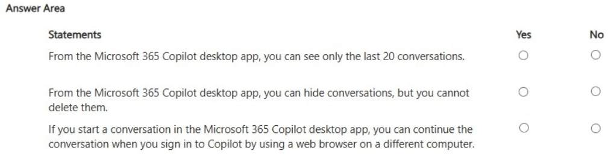

_HOTSPOT — the original ExamTopics question expects you to mark areas on the exhibit above; the correct hotspot coordinates are not published._

**Most voted:** No, No, Yes

### Top explanations
- **Scooter47** (9 upvotes [Highly Voted]): NNY
  I can see all conversations from the app.
  I can delete them from the app.
  I started a convo in the app, did a refresh in the browser, then was able to continue from the browser.
- **MoneyStacking** (4 upvotes): I think you are not understanding the statements. Also, your previous answers seem to be wrong most of the time. Please double-check before answering — that’s how it feels right now.
  N > Maybe your screen is not big enough or something, but I counted and I can see at least 51 chats, so it’s definitely not limited to the last 20
  N > I can literally delete them by hovering over a chat, clicking the three dots, and selecting delete
  Y > this one is correct
- **Sheryle** (1 upvotes): Ignore last update Wrong Question
  YYY
  Y - The desktop app shows a limited recent history (last 20 conversations).
  Y - In the desktop app, conversations can be hidden from view, but deletion is not supported there (deletion is handled via the web experience/account history).
  Y - Copilot conversations are synced to your account, allowing you to continue the same conversation across devices and browsers when signed in with the same account.
- **Sheryle** (1 upvotes): NNN
  A. The user is granted access automatically ❌
  Copilot never auto‑grants file access—doing so would violate Microsoft Entra and Purview security boundaries.
  B. The files are removed from the shared prompt ❌
  The files remain part of the prompt, but Copilot won’t use them if access is missing.
  C. The user is prompted to request access ❌
  Copilot does not manage access requests; users must obtain access through OneDrive/SharePoint sharing.
- **TDAC** (1 upvotes [Most Recent]): ^I agree - this is the answer and the same experience in my environment.

## Q2.39 (ID 394235)

HOTSPOT
For each of the following statements, select Yes if the statement is true. Otherwise, select No.
NOTE: Each correct selection is worth one point.

**Exhibits**
- Exhibit 1: 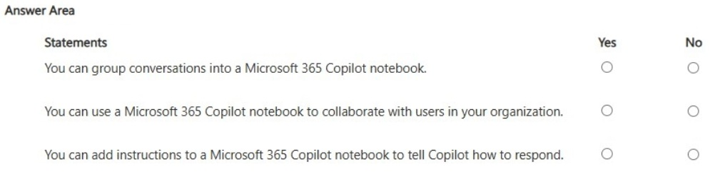

_HOTSPOT — the original ExamTopics question expects you to mark areas on the exhibit above; the correct hotspot coordinates are not published._

**Most voted:**
- yyn.Copilot notebooks are designed to organize conversations and related content ✅
- Notebooks can be shared and used collaboratively within the organization ✅
- Instructions/persona are set at the agent level, not at the notebook level ❌

### Top explanations
- **Redki** (3 upvotes): yyn.Copilot notebooks are designed to organize conversations and related content ✅
  Notebooks can be shared and used collaboratively within the organization ✅
  Instructions/persona are set at the agent level, not at the notebook level ❌
- **Scooter47** (2 upvotes [Most Recent]): NYN
  You cannot group conversations into a notebook. You can only manually add conversations one-by-one to a notebook. Nothing like a 1-click automatic group button exists.
- **Redki** (2 upvotes): yyn.Copilot notebooks are designed to organize conversations and related content ✅
  Notebooks can be shared and used collaboratively within the organization ✅
  Instructions/persona are set at the agent level, not at the notebook level ❌

## Q2.40 (ID 394236)

HOTSPOT
For each of the following statements, select Yes if the statement is true. Otherwise, select No.
NOTE: Each correct selection is worth one point.

**Exhibits**
- Exhibit 1: 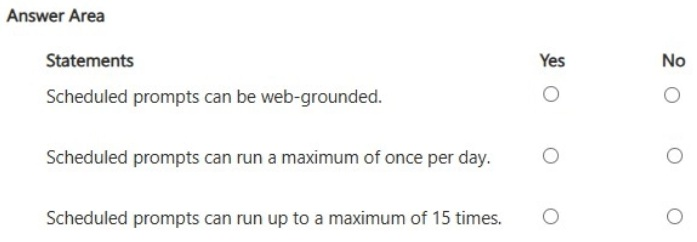

_HOTSPOT — the original ExamTopics question expects you to mark areas on the exhibit above; the correct hotspot coordinates are not published._

**Most voted:** this is the correct answer. Prompts can only be scheduled once per day (maximum)

### Top explanations
- **deca0d4** (5 upvotes): YNY
  According to Microsoft Support and Microsoft Learn:
  ✅ What you can do
  Schedule a prompt:
  Daily
  Weekly
  At specific times
  Multiple times in the same day
  Choose exact run times (for example: 8:00 AM and 4:00 PM)
  Create up to 10 scheduled prompts per user
- **Scooter47** (3 upvotes): YYN
  I scheduled a web-grounded prompt.
  The scheduling options only allow you to run a prompt once per day.
  You can schedule a prompt to run well over just 15 times.
- **Mirana** (1 upvotes): NYY
  Scheduled prompts = internal data only, no real-time web grounding.
  Daily is the maximum execution frequency for scheduled prompts.
  There is a cap of 15 runs per scheduled prompt
- **TDAC** (1 upvotes [Most Recent]): this is the correct answer. Prompts can only be scheduled once per day (maximum)
- **TonyTeeTee** (1 upvotes): Exact run times, yes, but still the limit is max once per day. Other options are weekly and monthly, not multiple times in the same day.

## Q2.44 (ID 417229)

You plan to create an agent in the Microsoft 365 Copilot app to help meeting organizers create and run effective meetings. The agent will be used to prepare invite emails, assign meeting roles, and take meeting notes.
You need to create the agent as soon as possible, and then perform a basic test of the agent. The solution must minimize effort.
What is the best approach to achieve the goal? More than one answer choice may achieve the goal. Select the BEST answer.

✅ **A.** From the Configure tab, provide a detailed configuration of the agent.
⭕ **B.** From the Describe tab, input a basic description of the agent.
⭕ **C.** From the Configure tab, input a basic configuration of the agent.
⭕ **D.** From the Describe tab, select a template.

**Correct answer:** A
**Most voted:** A

### Top explanations
- **Poopynosetomatoface** (1 upvotes [Most Recent, Selected Answer: A]): The Copilot desktop app only includes the following options from the dropdown menu in the center of the screen: Configure, Preview, Monitor.
  I do not see tabs for creating or editing agents. I do not see the 'Describe' option in a tab or dropdown menu.
  The desktop app has the following fields that need to be completed when creating an agent:
  Instructions
  Skills
  Knowledge
  Work content
  Web search
  Attachments
  Suggested Prompts

## Q2.45 (ID 417234)

What is the purpose of adding custom instructions in Microsoft 365 Copilot?

✅ **A.** to set preferences that are applied to all Copilot interactions, such as the tone and style of responses
⭕ **B.** to enable Copilot to take actions on your behalf, such as sending emails
⭕ **C.** to apply security rules that must be followed by Copilot, such as which information is shared
⭕ **D.** to provide additional context to Copilot, such as your name, title, and company, so that Copilot can complete tasks more efficiently

**Correct answer:** A
**Most voted:** A

### Top explanations
- **seevignesh** (1 upvotes [Most Recent, Selected Answer: A]): Custom instructions personalize how Microsoft 365 Copilot responds consistently, including preferences for tone, style, formatting, and response behavior.
- **romero9801** (1 upvotes): Why is this considered the right option? Explanation please.

## Q3.1 (ID 383738)

HOTSPOT
For each of the following statements, select Yes if the statement is true. Otherwise, select No.
NOTE: Each correct selection is worth one point.

**Exhibits**
- Exhibit 1: 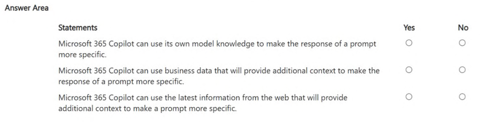

_HOTSPOT — the original ExamTopics question expects you to mark areas on the exhibit above; the correct hotspot coordinates are not published._

**Most voted:** Not provided

### Top explanations
- **fa62dd5** (6 upvotes [Most Recent]): Own model knowledge — Yes
  Copilot uses its underlying large language model (LLM) to interpret prompts and generate responses, even without external data.
  Business data — Yes
  When licensed, Microsoft 365 Copilot can ground responses in organizational data (emails, files, meetings, chats) through Microsoft Graph, respecting user permissions.
  Latest information from the web — Yes
  Copilot can also use web‑grounded information to enrich responses with current, public context when appropriate.
- **rveney** (1 upvotes): Microsoft 365 Copilot can use its own model knowledge to make the response of a prompt more specific.
  ✅ Yes
  Copilot uses the general knowledge embedded in the large language model to refine and clarify responses.
  Microsoft 365 Copilot can use business data that will provide additional context to make the response of a prompt more specific.
  ✅ Yes
  Copilot can ground prompts with your organization’s business data (emails, documents, meetings) that you have permission to access.
  Microsoft 365 Copilot can use the latest information from the web that will provide additional context to make a prompt more specific.
  ❌ No
  Microsoft 365 Copilot does not freely browse the public web for real‑time information unless a specific Copilot experience explicitly supports web grounding.

## Q3.2 (ID 383737)

HOTSPOT
Select the answer that correctly completes the sentence.

**Exhibits**
- Exhibit 1: 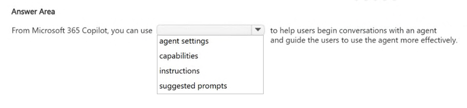

_HOTSPOT — the original ExamTopics question expects you to mark areas on the exhibit above; the correct hotspot coordinates are not published._

**Most voted:** Not provided

### Top explanations
- **Scooter47** (5 upvotes [Most Recent]): suggested prompts, also called conversation starters.

## Q3.3 (ID 383663)

You plan to summarize a proposal for a partnership between your company and another company.
You need to use Microsoft 365 Copilot to summarize the information in the proposal as a bulleted list of three to five key points for a project kickoff meeting. Each bullet point must be concise and simply worded.
Which two details should you include in the prompt? Each correct answer presents part of the solution.
NOTE: Each correct selection is worth one point.

⭕ **A.** a list of contact details for key stakeholders of the partnership
⭕ **B.** profiles of both companies generated by using the Researcher agent
✅ **C.** a specific knowledge source to ground the response
✅ **D.** concise instructions for what to do with the proposal

**Correct answer:** C, D
**Most voted:** CD

### Top explanations
- **fa62dd5** (11 upvotes [Most Recent, Highly Voted, Selected Answer: CD]): Correct answers: C and D
  C. a specific knowledge source to ground the response ✅
  This tells Copilot exactly what content to summarize (for example: “Use the attached proposal file” / “Use this SharePoint document” / “Use the text below”). Grounding prevents hallucinations and keeps the summary accurate.
  D. concise instructions for what to do with the proposal ✅
  This tells Copilot the output format and style requirements, such as:
  “Summarize into 3–5 bullets”
  “Each bullet must be concise and simply worded”
  “Focus on kickoff meeting essentials”
- **rveney** (5 upvotes [Selected Answer: CD]): ✔️ C. a specific knowledge source to ground the response
  To summarize the proposal accurately, Copilot must be grounded in the actual proposal content.
  Providing the file (or referencing it) ensures Copilot uses the real data rather than guessing.
  This is essential for accurate summarization.
  ✔️ D. concise instructions for what to do with the proposal
  Prompts should clearly tell Copilot:
  what the output should look like
  how many bullet points you need
  that the bullets must be concise and simple

## Q3.4 (ID 383664)

In a Microsoft 365 Copilot conversation, you generate a report, and then edit the report in a page.
You need to collaborate with a colleague on the report.
What are two ways to achieve the goal? Each correct answer presents a complete the solution.
NOTE: Each correct selection is worth one point.

✅ **A.** Mention the colleague in the page.
⭕ **B.** Open the page in Microsoft Word.
✅ **C.** Share the page link.
⭕ **D.** Add the page to a notebook.

**Correct answer:** A, C
**Most voted:** AC

### Top explanations
- **rveney** (11 upvotes [Highly Voted, Selected Answer: AC]): ✔️ A. Mention the colleague in the page.
  Tagging (mentioning) a colleague inside a Copilot page:
  Notifies them
  Grants them access (if allowed by your organization’s sharing model)
  Allows them to open and collaborate directly in the page
  This is a built‑in collaboration method.
  ✔️ C. Share the page link.
  Sharing the page link:
  Directly grants access to the page (according to sharing permissions)
  Allows your colleague to open, edit, and collaborate on the report
  Is the primary method for enabling multi‑user editing
- **maas1976** (6 upvotes [Selected Answer: AC]): Word does not represent a direct collaboration method for the page itself
- **Redki** (1 upvotes [Most Recent, Selected Answer: CD]): C. Share the page link. ✅
  Sharing the page link allows your colleague to access and collaborate on the report directly.
  D. Add the page to a notebook. ✅
  Notebooks can be shared with others in your organization, enabling collaboration on all included pages.
  ❌ Why the others are incorrect:
  A. Mention the colleague in the page. ❌
  Mentioning someone only sends a notification; it does not grant access or enable collaboration.
  B. Open the page in Microsoft Word. ❌
  Opening the content in Word is not required and does not ensure collaboration on the Copilot page itself.
- **fa62dd5** (1 upvotes [Selected Answer: BC]): The correct answers are:
  ✅ B. Open the page in Microsoft Word.
  ✅ C. Share the page link.
  Explanation:
  Opening the page in Microsoft Word allows real-time co-authoring, comments, and tracked changes, making it an effective way to collaborate on the report.
  Sharing the page link gives your colleague direct access to the page so they can view or edit it, depending on permissions.
  The other options do not, by themselves, enable collaboration:
  Mentioning a colleague does not grant access or editing rights.
  Adding the page to a notebook organizes content but does not directly support collaborative editing.

## Q3.5 (ID 383722)

You attend many Microsoft Teams meetings.
You want to ensure that you can catch up on key points and next steps after each meeting.
Which Microsoft 365 Copilot feature should you use after the meetings?

✅ **A.** Recap
⭕ **B.** Meeting Whiteboard
⭕ **C.** Meeting info
⭕ **D.** Thread summaries

**Correct answer:** A
**Most voted:** A

### Top explanations
- **fpinto** (6 upvotes [Selected Answer: A]): The Recap feature:
  Summarizes what happened during the meeting
  Highlights important topics discussed
  Lists follow‑up tasks and assigned actions
  Shows outcomes and next steps
  It’s intended for exactly this scenario — helping you quickly get up to speed after the meeting without needing to watch the full recording or review the transcript manually.
- **Sheryle** (3 upvotes [Most Recent, Selected Answer: A]): This is the correct feature. Microsoft 365 Copilot Recap gives you a structured summary of the meeting, including key points, decisions, and action items so you can quickly catch up.
- **Gabrycloud** (1 upvotes [Selected Answer: B]): The answer is B. The keyword in the question is '[KEYWORD]'.

## Q3.6 (ID 383727)

You are creating a custom agent in the Microsoft 365 Copilot app for the marketing team at your company. The agent will be used to produce marketing collateral, including copy, logos and artwork.
What should you add to the agent? More than one answer choice may achieve the goal. Select the BEST answer.

⭕ **A.** code interpreter
✅ **B.** image generator
⭕ **C.** a suggested prompt
⭕ **D.** a template

**Correct answer:** B
**Most voted:** B

### Top explanations
- **deca0d4** (5 upvotes [Most Recent, Selected Answer: B]): Enable the Image Generator (“Create images” / GraphicArt)
  This is what you need for:
  Logo concepts (initial directions, not final trademarked identity)
  Artwork and illustrations (hero images, icons, backgrounds)
  Flyers, posters, social graphics
  Iterating visuals (“make it more minimal”, “change to brand colors”)

## Q3.7 (ID 383665)

You use Microsoft 365 Copilot to create a proposal in Microsoft Word based on a document in a Microsoft SharePoint library.
You need to ensure that the information cited in the proposal is accurate.
What is the best approach to achieve the goal? More than one answer choice may achieve the goal. Select the BEST answer.

✅ **A.** Manually verify the citations in the generated content.
⭕ **B.** Use Copilot in Word to verify the citations.
⭕ **C.** Create an agent that contains your organization's editorial standards and use the agent to verify the citations.
⭕ **D.** Create a notebook that contains all the reference material and use the notebook to verify the citations.

**Correct answer:** A
**Most voted:** A

### Top explanations
- **fa62dd5** (6 upvotes [Most Recent, Selected Answer: A]): A. Manually verify the citations in the generated content
  ❌ B. Use Copilot in Word to verify the citations
  Copilot can summarize or explain, but it cannot act as an authoritative validator of source accuracy.
  ❌ C. Create an agent…
  Agents are used to guide style, tone, or behavior, not to validate factual correctness against source files.
  ❌ D. Create a notebook…
  Notebooks help organize reference material, but they do not validate citations or ensure factual accuracy.
- **rveney** (5 upvotes [Selected Answer: A]): ✔️ A. Manually verify the citations in the generated content.
  ✔️ Why A is the BEST answer
  Microsoft 365 Copilot can assist with drafting content, but:
  Copilot cannot verify factual accuracy of citations.
  Copilot cannot confirm the correctness of sources.
  Copilot cannot access external databases or proprietary citation indexes.
  Citations require human validation, especially in business, legal, academic, or proposal contexts.
  Therefore, manual verification is essential to ensure accuracy and compliance.

## Q3.8 (ID 383667)

HOTSPOT
You are a business user who uses Microsoft 365 apps and services, including Microsoft Teams. You have a work account.
You want to use Microsoft 365 Copilot to help with meetings.
For each of the following statements, select Yes if the statement is true. Otherwise, select No.
NOTE: Each correct selection is worth one point.

**Exhibits**
- Exhibit 1: 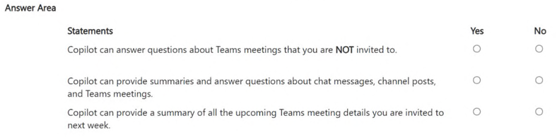

_HOTSPOT — the original ExamTopics question expects you to mark areas on the exhibit above; the correct hotspot coordinates are not published._

**Most voted:**
- Copilot can answer questions about Teams meetings that you are NOT invited to → NO
- If you are not invited to a meeting, Copilot cannot access its content → it cannot answer questions about it.
- Copilot can provide summaries and answer questions about chat messages, channel posts, and Teams meetings → YES
- If you have permission to access the content, Copilot can summarize: Teams chats
- Copilot can provide a summary of all upcoming Teams meeting details you are invited to → YES

### Top explanations
- **rveney** (20 upvotes [Highly Voted]): ✔️ Explanation
  1. Copilot can answer questions about Teams meetings that you are NOT invited to → NO
  Microsoft 365 Copilot uses Microsoft Graph permissions and only accesses data the user has permission to access.
  If you are not invited to a meeting, Copilot cannot access its content → it cannot answer questions about it.
  2. Copilot can provide summaries and answer questions about chat messages, channel posts, and Teams meetings → YES
  If you have permission to access the content, Copilot can summarize:
  Teams chats
  Teams channel posts
  Teams meetings (transcripts, chats, notes, recordings)
  This is standard Copilot meeting‑insight behavior.
  3. Copilot can provide a summary of all upcoming Teams meeting details you are invited to → YES
  Since Copilot can read your calendar, invitation details, and meeting descriptions, it can
- **fa62dd5** (9 upvotes [Most Recent, Highly Voted]): Meetings you are NOT invited to — No
  Microsoft 365 Copilot only accesses content you have permission to see. It cannot summarize or answer questions about meetings you were not invited to.
  Summaries of chats, channel posts, and meetings — Yes
  Copilot can summarize and answer questions about Teams chats, channel conversations, and meetings that you have access to.
  Summary of upcoming meetings you are invited to — Yes
  Copilot can look at your calendar and meeting invitations and provide a consolidated summary of upcoming Teams meetings (for example, next week).

## Q3.9 (ID 383723)

You sign in to the Microsoft 365 Copilot app by using your work account as shown in the following exhibit.
A colleague tells you that when they open the Microsoft 365 Copilot app, they have access to the Researcher agent.
You need to access to the Researcher agent.
What should you do?

**Exhibits**
- Exhibit 1: 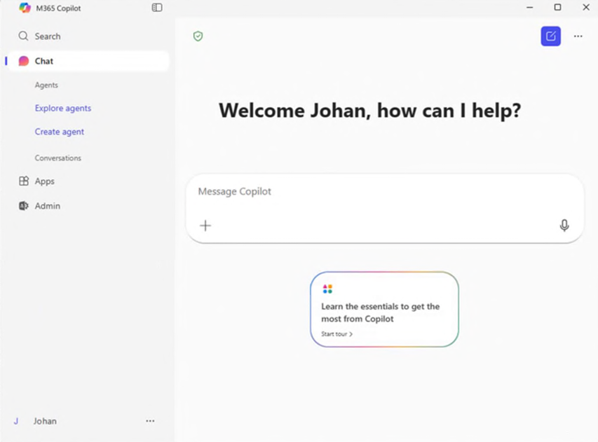

⭕ **A.** Request a Microsoft 365 Copilot license from an administrator.
✅ **B.** Select Explore agents and then search for Researcher.
⭕ **C.** Sign in to the Copilot app by using a personal account.
⭕ **D.** From Microsoft Edge, use your work account to sign in to https://copilot.microsoft.com.

**Correct answer:** B
**Most voted:** B

### Top explanations
- **maas1976** (6 upvotes [Selected Answer: A]): The exhibit clearly shows that the user doesn't have a license. You do not have access to the agents without a license.
- **fa62dd5** (4 upvotes [Selected Answer: B]): B. Select Explore agents and then search for Researcher.
  If your colleague already has access to the Researcher agent in the Microsoft 365 Copilot app, it means the agent is available in your tenant. To access it yourself, you simply need to open the Copilot app, go to Explore agents, and search for Researcher to start using it.
  Why the other options are incorrect:
  A. Request a Microsoft 365 Copilot license – Not necessary if you already have access to the Copilot app and agents are enabled.
  C. Sign in with a personal account – Researcher is a work/school (Entra ID) feature, not personal accounts.
  D. Sign in via copilot.microsoft.com in Edge – This does not specifically enable or surface the Researcher agent.
  ✅ Final Answer: B
- **Redki** (2 upvotes [Selected Answer: B]): If your colleague already has access to the Researcher agent in the Microsoft 365 Copilot app, it means the agent is available in your tenant. It's also mentioned "Using your work account"
- **TDAC** (1 upvotes [Most Recent]): I agree with maas1976.  We are looking at a screen shot of COPILOT CHAT (that comes with a M365 E3/E5 license).  But there is no WORK context (meaning there is no fully paid M365 Copilot license).  The user won't have access to the first party agents until they get a paid license.  Once they get a paid license they will see the WORK context.  And at that point if they still can't see the agent, THEN they can go into Explore Agents.
- **Sheryle** (1 upvotes [Selected Answer: B]): B. Select Explore agents and then search for Researcher.
  Explanation:
  In the Microsoft 365 Copilot app, agents such as Researcher are discovered and enabled through the Explore agents experience. If your colleague can access the Researcher agent, it means the agent is already available in your tenant—you just need to find and add it from the agent catalog rather than requesting a new license or changing accounts

## Q3.10 (ID 383666)

HOTSPOT
Select the answer that correctly completes the sentence.

**Exhibits**
- Exhibit 1: 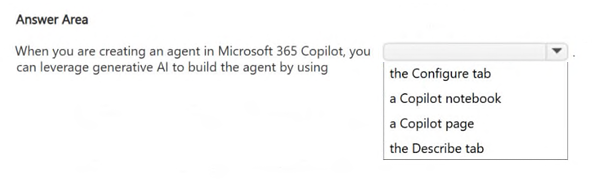

_HOTSPOT — the original ExamTopics question expects you to mark areas on the exhibit above; the correct hotspot coordinates are not published._

**Most voted:**
- the Describe tab: ✅ Explanation
- When you create an agent in Microsoft 365 Copilot, you can leverage generative AI by using the Describe tab.
- The Describe tab allows you to:
- Explain in natural language what you want the agent to do
- Let Copilot generate the agent’s behavior, purpose, and capabilities based on your description

### Top explanations
- **fa62dd5** (13 upvotes [Highly Voted]): the Describe tab
  ✅ Explanation
  When you create an agent in Microsoft 365 Copilot, you can leverage generative AI by using the Describe tab.
  The Describe tab allows you to:
  Explain in natural language what you want the agent to do
  Let Copilot generate the agent’s behavior, purpose, and capabilities based on your description
  This is the primary place where generative AI is used to build the agent.
- **rveney** (6 upvotes): ✔️ Explanation
  In the Microsoft 365 Copilot app:
  The Describe tab is where you type natural‑language instructions describing what the agent should do.
  Copilot then uses generative AI to automatically build the initial configuration, capabilities, and behavior of the agent based on your description.
  This is the only option in the list that directly triggers AI‑assisted agent creation.
- **maas1976** (5 upvotes): Describe tab is correct here.
- **Sheryle** (2 upvotes [Most Recent]): D. the Describe tab
  Explanation:
  When creating an agent in Microsoft 365 Copilot, the Describe tab is where you leverage generative AI to build the agent by describing—using natural language—what you want the agent to do. Copilot then uses that description to generate the agent’s initial setup, instructions, and behavior automatically

## Q3.11 (ID 383747)

HOTSPOT
What are two limitations of prompt scheduling in Microsoft 365 Copilot? To answer, select the appropriate options in the answer area.
NOTE: Each correct selection is worth one point.

**Exhibits**
- Exhibit 1: 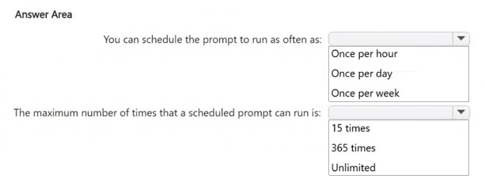

_HOTSPOT — the original ExamTopics question expects you to mark areas on the exhibit above; the correct hotspot coordinates are not published._

**Most voted:**
- Daily: Runs once every day at your specified time.
- Weekly: Runs on specific days of the week.
- Monthly: Runs once per mon

### Top explanations
- **maas1976** (6 upvotes): Once per day with a maximum of 15 times
- **TDAC** (2 upvotes [Most Recent]): ANSWER IS INCORRECT
  Answer should be:
  ONE PER DAY
  365 TIMES
  When scheduling a prompt, you can only schedule to run per DAY, WEEK or MONTH.
  And you can only run that schedule "UNTIL" up to 365 days in advance.
- **deca0d4** (2 upvotes): you can run a prompt once per hour 15 times.
  Microsoft 365 Copilot does not restrict scheduled prompts to “once per day.”
  Microsoft explicitly allows:
  Scheduling prompts at specific times
  Choosing frequencies
  Setting how many times the prompt will run
- **ksmani99** (2 upvotes): Users are currently restricted to a maximum of 15 runs for any single scheduled prompt. Once this limit is reached, the schedule stops, and the user must manually recreate or reset it.
  And schedule window can go down to daily at the shortest.
  The available intervals are:
  Daily: Runs once every day at your specified time.
  Weekly: Runs on specific days of the week.
  Monthly: Runs once per mon
- **Scooter47** (1 upvotes): Once per hour is not an option, therefore it is a limitation.
  365 times is the most number of times a scheduled prompt can be run.

## Q3.12 (ID 383715)

HOTSPOT
You have a Microsoft 365 Copilot license.
You plan to run several prompts.
What should you use to ensure that Copilot generates the best response for each prompt? More than one answer choice may achieve the goal. To answer, select the Best options in the answer area.
NOTE: Each correct selection is worth one point.

**Exhibits**
- Exhibit 1: 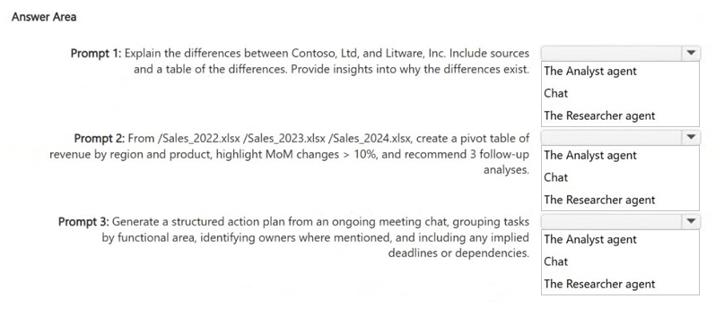

_HOTSPOT — the original ExamTopics question expects you to mark areas on the exhibit above; the correct hotspot coordinates are not published._

**Most voted:**
- The Researcher agent
- The Analyst agent
- Chat

### Top explanations
- **fa62dd5** (6 upvotes): The Researcher agent
  The Analyst agent
  Chat
- **Gabrycloud** (1 upvotes [Selected Answer: B]): Pretty sure it's B. This pattern is very common.
- **Poopynosetomatoface** (1 upvotes [Most Recent]): There are no multiple-choice options for this quest,

## Q3.13 (ID 383745)

HOTSPOT
Select the answer that correctly completes the sentence.

**Exhibits**
- Exhibit 1: 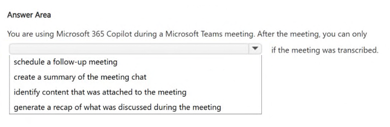

_HOTSPOT — the original ExamTopics question expects you to mark areas on the exhibit above; the correct hotspot coordinates are not published._

**Most voted:** generate a recap of what was discussed during the meeting ✅

### Top explanations
- **Metalwarrior** (1 upvotes [Most Recent]): The correct answer is:
  ✅ generate a recap of what was discussed during the meeting
  Completed sentence:
  You are using Microsoft 365 Copilot during a Microsoft Teams meeting. After the meeting, you can only generate a recap of what was discussed during the meeting if the meeting was transcribed.
  Why?
  Microsoft 365 Copilot relies on the meeting transcript to provide detailed post-meeting recap capabilities, such as summaries, action items, and discussion highlights.
  Without a transcript, Copilot cannot accurately reconstruct everything that was discussed during the meeting.
  Answer: generate a recap of what was discussed during the meeting ✅

## Q3.14 (ID 383719)

HOTSPOT
Select the answer that correctly completes the sentence.

**Exhibits**
- Exhibit 1: 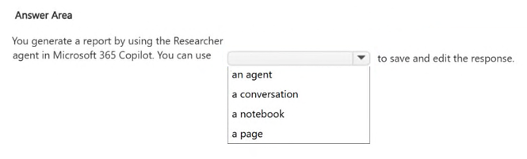

_HOTSPOT — the original ExamTopics question expects you to mark areas on the exhibit above; the correct hotspot coordinates are not published._

**Most voted:**
- a page
- Complete sentence:
- You generate a report by using the Researcher agent in Microsoft 365 Copilot. You can use a page to save and edit the response.

### Top explanations
- **fa62dd5** (6 upvotes): A page
- **Metalwarrior** (1 upvotes [Most Recent]): Answer: a page
  Complete sentence:
  You generate a report by using the Researcher agent in Microsoft 365 Copilot. You can use a page to save and edit the response.
  Explanation: A Copilot Page provides a persistent workspace where you can save, edit, refine, and collaborate on content generated by Microsoft 365 Copilot, including reports created by the Researcher agent.
  ✅ Correct answer: a page
- **Gabrycloud** (1 upvotes [Selected Answer: B]): B. Final answer.

## Q3.15 (ID 394237)

HOTSPOT
For each of the following statements, select Yes if the statement is true. Otherwise, select No.
NOTE: Each correct selection is worth one point.

**Exhibits**
- Exhibit 1: 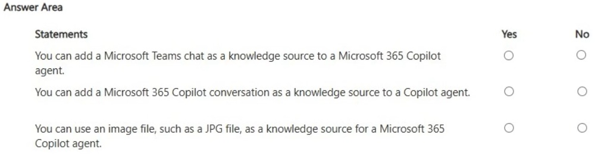

_HOTSPOT — the original ExamTopics question expects you to mark areas on the exhibit above; the correct hotspot coordinates are not published._

**Most voted:** No, No, No

### Top explanations
- **MoneyStacking** (6 upvotes): Tested this
  Y > I can add Microsoft Teams Chats
  N > There is no option for Microsoft 365 Copilot conversation
  N > Tried to upload an JPG & PNG, received an error notification with: file cannot be uploaded.
  To support my arguments and tests, here is the link to it: https://learn.microsoft.com/nl-nl/microsoft-365/copilot/extensibility/agent-builder-add-knowledge
- **MoneyStacking** (4 upvotes [Most Recent]): Last one is false, I tested this and you cannot upload images like JPG and PNG
  Tested this
  Y > I can Microsoft Teams Chats
  N > There is no option for Microsoft 365 Copilot conversation
  N > Tried to upload an JPG & PNG, received an error notification with: file cannot be uploaded.
  https://learn.microsoft.com/nl-nl/microsoft-365/copilot/extensibility/agent-builder-add-knowledge
- **108e7c2** (3 upvotes): No / No / No
  Reason: a Researcher agent conversation stays in the Microsoft 365 Copilot agent/chat experience. You can use Researcher to work with Word files, Teams content, Outlook emails, etc., but you do not continue that same Researcher conversation inside the Word, Teams, or Outlook Copilot side panes.
- **Sheryle** (2 upvotes): YNY
  Y - Agent Builder supports adding up to five Microsoft Teams chat URLs as knowledge sources
  N - Supported knowledge sources include files, SharePoint, Teams chats, emails, meetings, URLs, and uploads—but Copilot conversation history is not a supported knowledge source.
  Y - Agent Builder allows you to upload images (e.g., JPG, PNG) as files. While image understanding has limitations, they are supported as uploaded knowledge sources.
- **108e7c2** (2 upvotes): YNN
  Teams chat can be a knowledge source for an agent.
  Copilot conversations can be added to Notebooks, but not as direct knowledge sources for a Copilot agent.
  JPG/image files are supported in some Copilot contexts, but not as an agent knowledge source in this question.

## Q3.16 (ID 394238)

HOTSPOT
You run a prompt by using the Researcher agent in Microsoft 365 Copilot.
For each of the following statements, select Yes if the statement is true. Otherwise, select No.
NOTE: Each correct selection is worth one point.

**Exhibits**
- Exhibit 1: 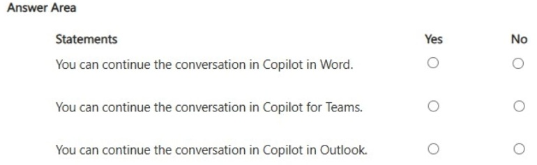

_HOTSPOT — the original ExamTopics question expects you to mark areas on the exhibit above; the correct hotspot coordinates are not published._

**Most voted:**
- I tested this.
- In all cases I can continue the conversation without any problems

### Top explanations
- **MoneyStacking** (5 upvotes [Most Recent]): I tested this.
  In all cases I can continue the conversation without any problems
- **Sheryle** (1 upvotes): YYN
  Y- The Researcher agent is natively available in Copilot in Word (Windows, web, and Mac). Conversations started with Researcher can be continued there.
  Y - Researcher is available in Copilot Chat within Teams, allowing ongoing interaction and follow-up prompts in the same research context
  N - While Copilot exists in Outlook, Researcher conversations don’t carry over into Outlook. Outlook Copilot focuses on mail and calendar workflows, not continuing Researcher agent threads.
- **Scooter47** (1 upvotes): YNN
  The Researcher agent conversation can be continued in Word only — not in Teams or Outlook.

## Q3.17 (ID 394239)

You join an internal Microsoft Teams meeting late and want to catch up on what you missed. The meeting is being recorded.
You need to summarize the portion of the meeting that you missed as soon as possible.
What is the best approach to achieve the goal? More than one answer choice may achieve the goal. Select the BEST answer.

✅ **A.** From the Teams app, ask Copilot in Teams to summarize what you missed so far.
⭕ **B.** From the meeting, read the transcript.
⭕ **C.** From the Microsoft 365 Copilot app, ask Copilot to tell you what you missed.
⭕ **D.** From the Teams app, view the intelligent recap.

**Correct answer:** A
**Most voted:** A

### Top explanations
- **MoneyStacking** (4 upvotes): To be honest, they ask what the best approach is and not approaches. Microsoft just try to trick you to choose multiple options but it clear says approach and not plural. In this case A is the best answer because it needs to be as soon as possible. The recap is only available when the meeting is done and not during the meeting
- **Redki** (4 upvotes [Selected Answer: A]): The fastest and most effective way to catch up during a meeting you joined late is:
  A. From the Teams app, ask Copilot in Teams to summarize what you missed so far.
  Why this is the best choice:
  Copilot in Teams can immediately summarize the portion of the meeting you missed while the meeting is ongoing.
  It is context-aware (it uses the live meeting content, transcript, and recording).
  It requires no manual reading or navigation, making it the quickest option.
  Why the other options are less optimal:
  B. Read the transcript → works, but is manual and slower.
  C. Ask Copilot from the Microsoft 365 Copilot app → can help after the meeting, but is not the fastest during a live Teams meeting.
  D. View intelligent recap → available after the meeting ends, not immediately.
- **Xabia** (3 upvotes [Selected Answer: A]): Use Copilot in Microsoft Teams during the live meeting and ask it to summarize what you’ve missed so far.
- **churchie365** (2 upvotes [Selected Answer: A]): Copilot in Teams can summarize the meeting in real time, including what happened before you joined, as long as transcription is enabled. It’s specifically designed to help you catch up instantly without waiting for the meeting to end - https://support.microsoft.com/en-us/office/use-copilot-in-microsoft-teams-meetings-0bf9dd3c-96f7-44e2-8bb8-790bedf066b1
- **Sheryle** (1 upvotes [Selected Answer: A]): A & D
  A. From the Teams app, ask Copilot in Teams to summarize what you missed so far
  Copilot in Teams can generate an on‑demand summary of the meeting discussion up to the point you joined.
  D. From the Teams app, view the intelligent recap
  Intelligent Recap gives you an AI‑generated summary with:
  Key discussion points
  Timeline markers
  Topics and speakers
  It’s the quickest way to review what happened without reading or watching everything.

## Q3.18 (ID 394240)

You have an open Microsoft Word document that has a sensitivity label named Highly Confidential applied.
From Microsoft PowerPoint, you plan to use Microsoft 365 Copilot to generate a presentation of the Word document.
What will be the result?

⭕ **A.** Copilot will be unable to generate the presentation.
⭕ **B.** Copilot will generate the presentation and will prompt you for a label.
✅ **C.** Copilot will generate the presentation and apply the Highly Confidential label.
⭕ **D.** Copilot will generate the presentation and will NOT apply a label.

**Correct answer:** C
**Most voted:** C

### Top explanations
- **MoneyStacking** (4 upvotes [Most Recent, Selected Answer: C]): Tested this and it is correct.
  The sensitivity label is inherited from the source file

## Q3.19 (ID 394241)

HOTSPOT
For each of the following statements, select Yes if the statement is true. Otherwise, select No.
NOTE: Each correct selection is worth one point.

**Exhibits**
- Exhibit 1: 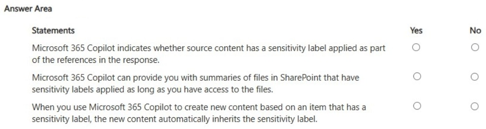

_HOTSPOT — the original ExamTopics question expects you to mark areas on the exhibit above; the correct hotspot coordinates are not published._

**Most voted:** No, Yes, Yes

### Top explanations
- **Sheryle** (5 upvotes [Most Recent]): Y - Copilot displays a sensitivity label shield and shows the label for each referenced file in the response so users can clearly see the classification of the source content
  Y -Copilot can summarize labeled SharePoint files provided the user has sufficient permissions (including Extract/View rights) and no DLP or label restrictions block summarization
  Y -Copilot automatically applies the highest‑priority (most restrictive) sensitivity label from the source content to newly generated content when supported
- **Scooter47** (2 upvotes): NYY
  Microsoft 365 Copilot does not indicate sensitivity labels on source content as part of the references or citations in its responses.

## Q3.20 (ID 394242)

HOTSPOT
Select the answer that correctly completes the sentence.

**Exhibits**
- Exhibit 1: 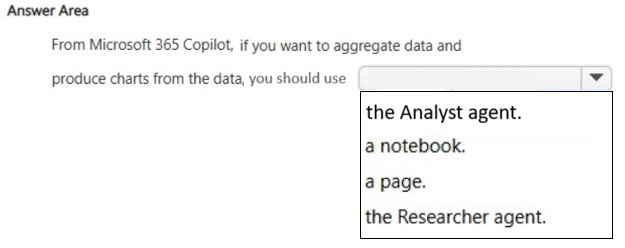

_HOTSPOT — the original ExamTopics question expects you to mark areas on the exhibit above; the correct hotspot coordinates are not published._

**Most voted:**
- a notebook → Organizes files, notes, and sources for grounding conversations.
- a page → Used to create and collaborate on content.
- the Researcher agent → Focuses on gathering, synthesizing, and researching information from multiple sources.

### Top explanations
- **Metalwarrior** (1 upvotes [Most Recent]): The correct answer is:
  ✅ the Analyst agent
  Why? The Analyst agent in Microsoft 365 Copilot is designed to work with data, perform analysis, aggregate information, create calculations, and generate charts and visualizations.
  The other options are not primarily intended for this purpose:
  a notebook → Organizes files, notes, and sources for grounding conversations.
  a page → Used to create and collaborate on content.
  the Researcher agent → Focuses on gathering, synthesizing, and researching information from multiple sources.
  Complete sentence:
  From Microsoft 365 Copilot, if you want to aggregate data and produce charts from the data, you should use the Analyst agent. ✅

## Q3.21 (ID 394243)

HOTSPOT
You are evaluating the features of Microsoft 365 Copilot notebooks.
For each of the following statements, select Yes if the statement is true. Otherwise, select No.
NOTE: Each correct selection is worth one point.

**Exhibits**
- Exhibit 1: 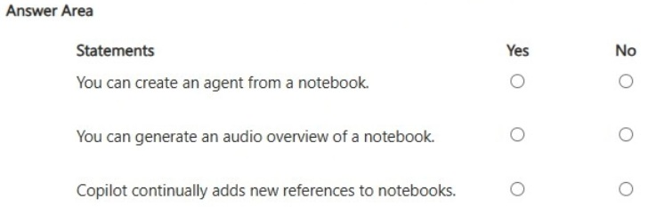

_HOTSPOT — the original ExamTopics question expects you to mark areas on the exhibit above; the correct hotspot coordinates are not published._

**Most voted:**
- NYN.You can create an agent from a notebook.
- ❌ No
- Les agents se créent depuis Explore agents / Create agent, pas à partir d’un notebook.
- You can generate an audio overview of a notebook: ✅ Yes
- Microsoft 365 Copilot permet de générer une présentation audio (audio overview) du contenu d’un notebook.
- Copilot continually adds new references to notebooks.
- ❌ No

### Top explanations
- **Redki** (9 upvotes [Highly Voted]): NYN.You can create an agent from a notebook.
  ❌ No
  Les agents se créent depuis Explore agents / Create agent, pas à partir d’un notebook.
  You can generate an audio overview of a notebook.
  ✅ Yes
  Microsoft 365 Copilot permet de générer une présentation audio (audio overview) du contenu d’un notebook.
  Copilot continually adds new references to notebooks.
  ❌ No
  Les références (pages, fichiers, conversations) sont ajoutées manuellement par l’utilisateur, Copilot ne les ajoute pas automatiquement.
- **MoneyStacking** (2 upvotes [Most Recent]): Tested this
  N > There was no option or a way to create an agent from a notebook
  Y > Possible. Source: https://support.microsoft.com/en-us/topic/get-an-audio-overview-of-your-microsoft-365-copilot-notebook-a22df989-b9cd-47fb-abac-e888d8f10cd9
  N > It is not updating for you. Therefore, you need to do it by yourself
- **Sheryle** (1 upvotes): N - Copilot notebooks are personal, temporary working spaces for gathering content and reasoning. They aren’t used to build or publish agents. Agents are created using Copilot Agent Builder or Copilot Studio, not notebooks.
  Y- Copilot notebooks support Audio Overview, allowing Copilot to generate a spoken summary of the notebook’s content—useful for quick reviews or accessibility.
  N-Notebooks are not auto-updating. Copilot only uses the references that are explicitly added by you at the time. It does not automatically discover or inject new sources over time.
