# AB-731 AI Transformation Leader Study Guide

_100 questions generated from ExamTopics discussions._

## Table of contents

- [Q1.1](#q1-1)
- [Q1.2](#q1-2)
- [Q1.3](#q1-3)
- [Q1.4](#q1-4)
- [Q1.5](#q1-5)
- [Q1.6](#q1-6)
- [Q1.7](#q1-7)
- [Q1.8](#q1-8)
- [Q1.9](#q1-9)
- [Q1.10](#q1-10)
- [Q1.11](#q1-11)
- [Q1.12](#q1-12)
- [Q1.13](#q1-13)
- [Q1.14](#q1-14)
- [Q1.15](#q1-15)
- [Q1.16](#q1-16)
- [Q1.17](#q1-17)
- [Q1.18](#q1-18)
- [Q1.19](#q1-19)
- [Q1.20](#q1-20)
- [Q1.21](#q1-21)
- [Q1.22](#q1-22)
- [Q1.23](#q1-23)
- [Q1.24](#q1-24)
- [Q1.25](#q1-25)
- [Q1.26](#q1-26)
- [Q1.27](#q1-27)
- [Q1.28](#q1-28)
- [Q1.29](#q1-29)
- [Q1.30](#q1-30)
- [Q1.31](#q1-31)
- [Q2.1](#q2-1)
- [Q2.2](#q2-2)
- [Q2.3](#q2-3)
- [Q2.4](#q2-4)
- [Q2.5](#q2-5)
- [Q2.6](#q2-6)
- [Q2.7](#q2-7)
- [Q2.8](#q2-8)
- [Q2.9](#q2-9)
- [Q2.10](#q2-10)
- [Q2.11](#q2-11)
- [Q2.12](#q2-12)
- [Q2.13](#q2-13)
- [Q2.14](#q2-14)
- [Q2.15](#q2-15)
- [Q2.16](#q2-16)
- [Q2.17](#q2-17)
- [Q2.18](#q2-18)
- [Q2.19](#q2-19)
- [Q2.20](#q2-20)
- [Q2.21](#q2-21)
- [Q2.22](#q2-22)
- [Q2.23](#q2-23)
- [Q2.24](#q2-24)
- [Q2.25](#q2-25)
- [Q2.26](#q2-26)
- [Q2.27](#q2-27)
- [Q2.28](#q2-28)
- [Q2.29](#q2-29)
- [Q2.30](#q2-30)
- [Q2.31](#q2-31)
- [Q2.32](#q2-32)
- [Q2.33](#q2-33)
- [Q2.34](#q2-34)
- [Q2.35](#q2-35)
- [Q2.36](#q2-36)
- [Q2.37](#q2-37)
- [Q2.38](#q2-38)
- [Q3.1](#q3-1)
- [Q3.2](#q3-2)
- [Q3.3](#q3-3)
- [Q3.4](#q3-4)
- [Q3.5](#q3-5)
- [Q3.6](#q3-6)
- [Q3.7](#q3-7)
- [Q3.8](#q3-8)
- [Q3.9](#q3-9)
- [Q3.10](#q3-10)
- [Q3.11](#q3-11)
- [Q3.12](#q3-12)
- [Q3.13](#q3-13)
- [Q3.14](#q3-14)
- [Q3.15](#q3-15)
- [Q3.16](#q3-16)
- [Q3.17](#q3-17)
- [Q3.18](#q3-18)
- [Q3.19](#q3-19)
- [Q3.20](#q3-20)
- [Q3.21](#q3-21)
- [Q3.22](#q3-22)
- [Q3.23](#q3-23)
- [Q3.24](#q3-24)
- [Q3.25](#q3-25)
- [Q3.26](#q3-26)
- [Q3.27](#q3-27)
- [Q3.28](#q3-28)
- [Q3.29](#q3-29)
- [Q3.30](#q3-30)
- [Q3.31](#q3-31)

## Q1.1 (ID 384116)

Your company plans to build a generative AI solution based on internal data.
You recommend using Microsoft Foundry as a starting point to develop and manage the solution.
What is a key benefit of using Microsoft Foundry for this project?

✅ **A.** Provides a scalable platform for developing and deploying generative AI solutions.
⭕ **B.** Removes the need to select or configure the underlying AI model.
⭕ **C.** Enables business users to build generative AI solutions.
⭕ **D.** Offers a low-code platform for developing generative AI solutions.

**Correct answer:** A
**Most voted:** A

### Top explanations
- **satoshi_** (7 upvotes [Highly Voted, Selected Answer: A]): One of the major advantages of Microsoft Foundry is that it is an integrated platform that makes it easy to develop, test, deploy, and scale generative AI apps to production. Microsoft's official explanation also emphasizes the scalability that makes it easy to move from PoC to full-scale production apps.
- **omath** (3 upvotes [Selected Answer: A]): Correct Answer:
  A. Provides a scalable platform for developing and deploying generative AI solutions.
  Explanation:
  The key benefit Microsoft Foundry brings—especially in the context of an internal, enterprise-grade generative AI project—is scalability with governance. Foundry gives you:
  - A unified, secure, enterprise-ready environment
  - Model lifecycle management (training, evaluation, deployment, monitoring)
  - Integrated governance, RBAC, networking, and compliance
  - Tooling for agents, grounding, and multimodal workflows
- **AndoidDefect** (2 upvotes [Most Recent, Selected Answer: A]): Provides a scalable platform for developing and deploying generative AI solutions.
- **Tom69420** (2 upvotes [Selected Answer: A]): A is the correct answer
- **Jan123s** (2 upvotes [Selected Answer: A]): Foundry is platform for build AI solutions

## Q1.2 (ID 384118)

HOTSPOT
For each of the following statements, select Yes if the statement is true. Otherwise, select No.
NOTE: Each correct selection is worth one point.

**Exhibits**
- Exhibit 1: 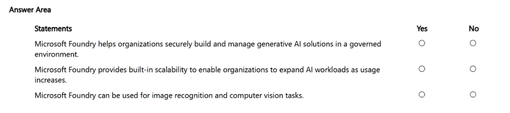

_HOTSPOT — the original ExamTopics question expects you to mark areas on the exhibit above; the correct hotspot coordinates are not published._

**Most voted:** I agree with this.  Azure Vision is part of Foundry Tools.  The question is a bit misleading because it's not actually "Foundry" that does the visual recognition, but it's "Azure Vision".  But since Azure Vision is part of Foundry... I would consider YES to the 3rd option.

### Top explanations
- **Tom69420** (4 upvotes): Yes,
  Yes,
  Yes
  Microsoft making you a salesman with these questions
- **TDAC** (4 upvotes [Most Recent]): I agree with this.  Azure Vision is part of Foundry Tools.  The question is a bit misleading because it's not actually "Foundry" that does the visual recognition, but it's "Azure Vision".  But since Azure Vision is part of Foundry... I would consider YES to the 3rd option.
  Source: https://azure.microsoft.com/en-us/products/ai-foundry/tools/vision
- **omath** (1 upvotes): Yes
  Foundry’s core purpose is exactly this: a secure, governed, enterprise-grade environment for building, evaluating, deploying, and managing generative AI solutions.
  Yes
  Foundry is built on Azure’s scalable infrastructure and is designed for large‑scale, production‑grade AI workloads with monitoring, deployment, and lifecycle management.
  No
  Foundry can be used for computer vision and image recognition tasks as part of its model lifecycle and deployment capabilities.

## Q1.3 (ID 384119)

HOTSPOT
Select the answer that correctly completes the sentence.

**Exhibits**
- Exhibit 1: 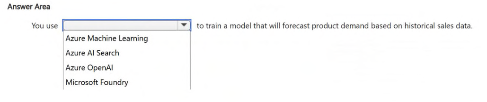

_HOTSPOT — the original ExamTopics question expects you to mark areas on the exhibit above; the correct hotspot coordinates are not published._

**Most voted:** Azure Machine Learning

### Top explanations
- **omath** (4 upvotes [Most Recent]): Correct answer: Azure Machine Learning
  Explanation:
  To train a forecasting model using historical numerical data, you need a machine learning service, not a generative AI service, not a search engine, and not Foundry.

## Q1.4 (ID 384117)

Which business requirement most closely relates to grounding a generative AI model?

⭕ **A.** supporting multiple languages
⭕ **B.** measuring the number of user interactions per day
⭕ **C.** enabling users to interact by using natural language queries
✅ **D.** ensuring that verified company data sources are used for response generation

**Correct answer:** D
**Most voted:** D

### Top explanations
- **omath** (4 upvotes [Most Recent, Selected Answer: D]): Correct answer:
  ✅ D. ensuring that verified company data sources are used for response generation
  Explanation:
  Grounding = forcing the generative AI model to base its answers on trusted, authoritative, internal data, rather than relying solely on the model’s general training data.
- **Tom69420** (3 upvotes [Selected Answer: D]): D all day
- **satoshi_** (2 upvotes [Selected Answer: D]): Grounding refers to basing a model's answers on reliable internal data or designated sources. Microsoft Learn also describes groundedness as "Are answers based on source materials you provide?", and generating answers using internal data is exactly this requirement.

## Q1.5 (ID 384123)

You need to create a custom Azure Machine Learning model. The data used to train the model is consistent and uniform.
What should you do first?

✅ **A.** Prepare the training data.
⭕ **B.** Evaluate the model.
⭕ **C.** Train the model.
⭕ **D.** Tune hyperparameters.
⭕ **E.** Deploy the model.

**Correct answer:** A
**Most voted:** A

### Top explanations
- **Dyno365** (4 upvotes [Selected Answer: A]): Even though the question states:
  “The data used to train the model is consistent and uniform.”
  …you still must prepare the training data first.
  Data preparation includes:
  Splitting data into training, validation, and test sets
  Normalizing/transforming values
  Selecting features
  Handling missing/duplicate records
  Ensuring correct formatting for the model type
  This always occurs before:
  Training the model
  Tuning hyperparameters
  Evaluating performance
  Deploying the model
- **omath** (2 upvotes [Most Recent, Selected Answer: A]): Correct answer: A. Prepare the training data.
  Explanation:
  Even if the data is consistent and uniform, Azure Machine Learning requires you to ingest, structure, split, and validate the data before training.
- **Tom69420** (2 upvotes [Selected Answer: A]): A - always start with preparing the data

## Q1.6 (ID 384122)

Your company uses a non-reasoning generative AI model to create textual content.
You discover that the model’s responses are inconsistent and do NOT meet expectations.
You need to improve the prompts.
What should you do? More than one answer choice may achieve the goal. Select the BEST answer.

⭕ **A.** Provide the prompts with extensive examples of the expected output.
✅ **B.** Add the context, sources, and expectations to the prompts.
⭕ **C.** Use technical terms in the prompts to enhance AI comprehension.
⭕ **D.** Add only a single concise requirement to the prompts.

**Correct answer:** B
**Most voted:** B

### Top explanations
- **omath** (3 upvotes [Most Recent, Selected Answer: B]): Correct answer:
  ✅ Correct: B. Add the context, sources, and expectations to the prompts.
  Explanation:
  This is the most important improvement when a model is inconsistent.
  …dramatically increases consistency, especially for non‑reasoning models, which rely heavily on explicit guidance.
  This aligns directly with Microsoft’s recommended prompt‑engineering techniques.
- **Dyno365** (2 upvotes [Selected Answer: B]): You are using a non‑reasoning generative AI model, which means:
  It does not perform multi‑step reasoning.
  It relies heavily on clear instructions, context, and structure.
  Grounded, explicit prompting has the biggest impact.
  B. Add the context, sources, and expectations to the prompts.
  This directly addresses inconsistency and aligns with Microsoft’s guidance for deterministic prompting with non‑reasoning models.

## Q1.7 (ID 384121)

HOTSPOT
For each of the following statements, select Yes if the statement is true. Otherwise, select No.
NOTE: Each correct selection is worth one point.

**Exhibits**
- Exhibit 1: 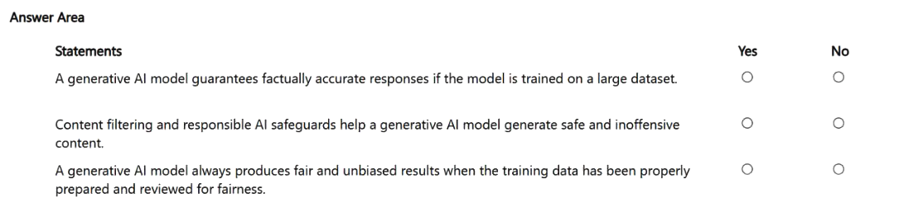

_HOTSPOT — the original ExamTopics question expects you to mark areas on the exhibit above; the correct hotspot coordinates are not published._

**Most voted:** Not provided

### Top explanations
- **omath** (2 upvotes [Most Recent]): No
  Even huge datasets do not guarantee factual accuracy.
  LLMs hallucinate because of how they generate text — not because of dataset size.
  Yes
  This is exactly what content filters, safety systems, and RAI guardrails are designed to do.
  No
  Even with carefully curated data, models can still produce biased outputs.
  There is no such thing as guaranteed fairness.
- **Benny2694** (2 upvotes): No - Large datasets improve performance, but do not guarantee accuracy. Models can still hallucinate or produce incorrect information.
  Yes - These safeguards are specifically designed to reduce harmful, unsafe, or inappropriate outputs.
  No - Even with well-prepared data, bias can still exist due to model behaviour, edge cases, or unseen patterns.
- **Tom69420** (1 upvotes): No, (look for the word guarantees here, nothing is guaranteed with AI)
  Yes
  No

## Q1.8 (ID 384120)

HOTSPOT
Select the answer that correctly completes the sentence.

**Exhibits**
- Exhibit 1: 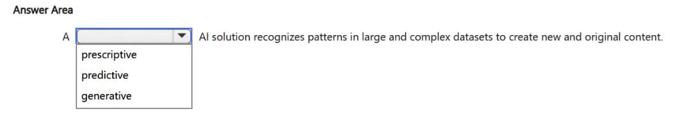

_HOTSPOT — the original ExamTopics question expects you to mark areas on the exhibit above; the correct hotspot coordinates are not published._

**Most voted:** ✅ Generative

### Top explanations
- **Dyno365** (4 upvotes): generative
  Only generative AI fits this definition because it:
  Learns patterns from large datasets
  Produces new and original content such as text, images, code, or audio
  Why the other options are incorrect:
  Prescriptive AI → Recommends actions based on predictions.
  Predictive AI → Forecasts future outcomes (e.g., demand forecasting).
  Generative AI → Creates brand‑new content, which matches the sentence.
- **Tom69420** (3 upvotes): generative
- **omath** (2 upvotes [Most Recent]): Correct answer:
  ✅ Generative
  Explanation:
  Predictive AI → forecasts outcomes (e.g., demand forecasting)
  Prescriptive AI → recommends actions
  Generative AI → creates new content (text, images, audio, code, etc.)

## Q1.9 (ID 384134)

Your company plans to use generative AI to help project managers and engineers work with construction blueprints stored as PDF files.
You need to recommend a generative AI solution that meets the following business requirements:
Processes both images and text
Summarizes the design of a building
Answers user questions about a building’s design
Extracts information from blueprints, such as the location of electrical, heating, and plumbing systems
What should you recommend?

✅ **A.** a multi-modal solution
⭕ **B.** an optical character recognition (OCR) solution
⭕ **C.** a text completion solution
⭕ **D.** a document summarization solution

**Correct answer:** A
**Most voted:** A

### Top explanations
- **d1d6163** (4 upvotes [Selected Answer: A]): "Processes both images and text" = A
- **omath** (3 upvotes [Most Recent, Selected Answer: A]): Correct answer:
  ✅ Correct answer: A. a multi‑modal solution
  Explanation:
  A multi‑modal generative AI solution can process:
  - Images (blueprint diagrams, symbols, layouts)
  - Text (labels, notes, annotations in the PDF)
  And can perform:
  - Summarization
  - Question answering
  - Information extraction
  - Visual understanding (e.g., identifying electrical or plumbing systems)
  This is exactly what multimodal models like GPT‑4o, GPT‑4 Vision, or Azure OpenAI’s vision‑enabled models are designed for.
- **satoshi_** (2 upvotes [Selected Answer: A]): Answer: A. a multi-modal solution
  The requirements explicitly say the solution must process both images and text in PDF blueprints, then:
  summarize the building design,
  answer questions about the design, and
  extract details such as electrical, heating, and plumbing locations.
  That is exactly what a multimodal generative AI solution is for: handling visual + textual inputs together and producing text outputs. Azure’s vision-enabled chat models are described as large multimodal models that can analyze images and answer questions about them, and Azure AI Search also defines multimodal capabilities as working across text and images.

## Q1.10 (ID 384177)

In which scenario is Azure Machine Learning most likely to deliver strategic value for an organization?

✅ **A.** Using historical sales data to forecast demand across product categories.
⭕ **B.** Digitizing a paper-based process to reduce errors.
⭕ **C.** Entering customer feedback into a spreadsheet to understand sentiment.
⭕ **D.** Sending personalized emails to customers based on the customer location.

**Correct answer:** A
**Most voted:** A

### Top explanations
- **omath** (3 upvotes [Selected Answer: A]): Correct answer:
  ✅ Correct answer: A. Using historical sales data to forecast demand across product categories.
  Explanation:
  Azure Machine Learning delivers strategic value when an organization needs to:
  - Build predictive models
  - Use historical data to forecast outcomes
  - Automate data‑driven decisions
  - Optimize operations at scale
  Demand forecasting is a textbook ML use case.
- **King_Lam** (1 upvotes [Most Recent, Selected Answer: A]): No other answer apart from A: Historical sales data
- **satoshi_** (1 upvotes [Selected Answer: A]): Answer: A. Using historical sales data to forecast demand across product categories.
  Azure Machine Learning delivers the most strategic value when it is used for predictive modeling on large datasets, such as forecasting future demand from historical sales data. Azure ML explicitly supports time-series forecasting and AutoML scenarios for demand prediction.

## Q1.11 (ID 384178)

HOTSPOT
Select the answer that correctly completes the sentence.

**Exhibits**
- Exhibit 1: 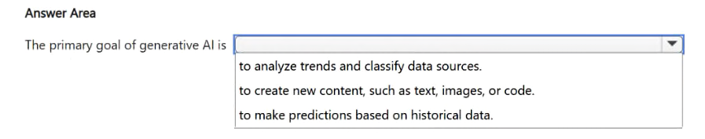

_HOTSPOT — the original ExamTopics question expects you to mark areas on the exhibit above; the correct hotspot coordinates are not published._

**Most voted:** ✅ to create new content, such as text, images, or code

### Top explanations
- **omath** (4 upvotes [Most Recent]): Correct answer:
  ✅ to create new content, such as text, images, or code
  Explanation:
  The sentence is asking for the primary goal of generative AI.
  - analyze trends and classify data sources → predictive / analytical AI
  - create new content, such as text, images, or code → generative AI
  - make predictions based on historical data → predictive AI
- **satoshi_** (3 upvotes): Answer: to create new content, such as text, images, or code.
  That is the primary goal of generative AI: producing new content rather than only analyzing data or making predictions. Microsoft defines generative AI as being good at creating new and original content, including text, images, and code.

## Q1.12 (ID 384179)

HOTSPOT
Select the answer that correctly completes the sentence.

**Exhibits**
- Exhibit 1: 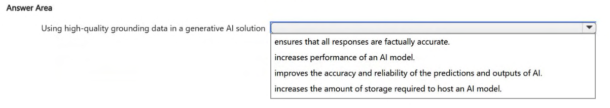

_HOTSPOT — the original ExamTopics question expects you to mark areas on the exhibit above; the correct hotspot coordinates are not published._

**Most voted:** improves the accuracy and reliability of the predictions and outputs of AI.

### Top explanations
- **omath** (8 upvotes [Most Recent, Highly Voted]): Correct answer:
  ✅ improves the accuracy and reliability of the predictions and outputs of AI.
  Explanation:
  Grounding data does not guarantee accuracy, but it significantly improves accuracy, relevance, and reliability by anchoring the model’s responses to trusted information.
- **satoshi_** (5 upvotes): Answer: improves the accuracy and reliability of the predictions and outputs of AI.
  High-quality grounding data helps a generative AI system stay aligned with trusted source material, which improves output quality and reduces inaccurate or fabricated responses. Microsoft notes that the quality and integrity of grounding data strongly affect the relevance of generative AI responses, and groundedness features are used to reduce non-factual outputs.
- **dsharu** (1 upvotes): Why not the first option?

## Q1.13 (ID 384180)

HOTSPOT
Select the answer that correctly completes the sentence.

**Exhibits**
- Exhibit 1: 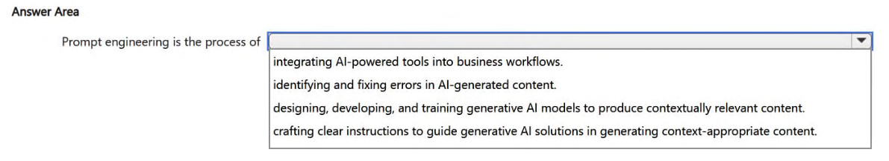

_HOTSPOT — the original ExamTopics question expects you to mark areas on the exhibit above; the correct hotspot coordinates are not published._

**Most voted:** crafting clear instructions to guide generative AI solutions in generating context‑appropriate content.

### Top explanations
- **omath** (9 upvotes [Most Recent, Highly Voted]): ✅ Final Answer: crafting clear instructions to guide generative AI solutions in generating context‑appropriate content.
  Explanation:
  Grounding data does not guarantee accuracy, but it significantly improves accuracy, relevance, and reliability by anchoring the model’s responses to trusted information.
- **satoshi_** (4 upvotes): Answer: crafting clear instructions to guide generative AI solutions in generating context-appropriate content.
  That is the best definition of prompt engineering: writing clear, specific instructions so the model produces the desired output. Microsoft describes prompt engineering as the starting point for getting desired output from generative AI models and emphasizes crafting clear instructions.

## Q1.14 (ID 384181)

HOTSPOT
Select the answer that correctly completes the sentence.

**Exhibits**
- Exhibit 1: 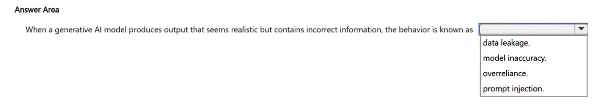

_HOTSPOT — the original ExamTopics question expects you to mark areas on the exhibit above; the correct hotspot coordinates are not published._

**Most voted:** model inaccuracy.

### Top explanations
- **omath** (6 upvotes [Most Recent]): ✅ Final Answer: model inaccuracy.
  Explanation:
  This describes the classic behavior where an AI produces fluent, confident, but incorrect content — often referred to as hallucination, but in this list the closest and correct term is model inaccuracy.
- **d782445_111** (4 upvotes): Model inacurracy is!! Halucination
- **saponazureguy** (2 upvotes): Correct answer should be "hallucination" but its not in the list.
- **satoshi_** (2 upvotes): Answer: model inaccuracy
  The described behavior—output that sounds convincing but contains false information—is commonly known as a hallucination in generative AI. Since that term is not listed, the best available choice is model inaccuracy. Microsoft describes hallucinations as cases where generative AI produces plausible but false information.
- **deca0d4** (1 upvotes): Answer: model inaccuracy is the only reasonable response.

## Q1.15 (ID 384187)

Your company uses a generative AI solution.
You need to improve the quality of responses by using grounding.
Which statement accurately describes how grounding improves accuracy and relevancy?

⭕ **A.** references a diverse set of people, disciplines, and perspectives
⭕ **B.** explains how and why AI models generate content
✅ **C.** anchors the responses in specific data sources
⭕ **D.** specifies the strengths and weaknesses of the AI model

**Correct answer:** C
**Most voted:** C

### Top explanations
- **omath** (4 upvotes [Most Recent, Selected Answer: C]): ✅ C. anchors the responses in specific data sources
  Explanation:
  Grounding is always about anchoring the model to real, verified information so responses become more accurate, relevant, and trustworthy.
- **satoshi_** (3 upvotes [Selected Answer: C]): Answer: C. anchors the responses in specific data sources
  Grounding improves accuracy and relevancy by tying the model’s response to specific source data (for example, trusted documents, databases, or indexed content) instead of relying only on the model’s general training. Microsoft describes grounding as using proprietary or source material to increase the accuracy and relevance of responses.

## Q1.16 (ID 384188)

You plan to meet with a group of stakeholders to discuss how generative AI can benefit your company.
You need to provide the stakeholders with a relevant description of generative AI during the meeting.
Which description should you use?

✅ **A.** Generative AI is designed to generate responses based on a user’s natural language prompts.
⭕ **B.** Generative AI is designed to translate documents into other languages.
⭕ **C.** Generative AI is designed to predict future trends based on historical data.
⭕ **D.** Generative AI is designed to recommend products based on user behavior.

**Correct answer:** A
**Most voted:** A

### Top explanations
- **omath** (5 upvotes [Most Recent, Selected Answer: A]): ✅ Correct answer: A. Generative AI is designed to generate responses based on a user’s natural language prompts.
  Explanation:
  A → This is the true definition: generative AI creates new content (text, images, code, summaries, etc.) in response to prompts.
  B → Translation is one possible use case, not the definition.
  C → Predicting future trends is predictive AI, not generative AI.
  D → Recommending products is recommendation systems, not generative AI.
- **satoshi_** (4 upvotes [Selected Answer: A]): Answer: A. Generative AI is designed to generate responses based on a user’s natural language prompts.
  That best describes generative AI in a stakeholder-friendly way: users provide prompts in natural language, and the model generates new content or responses. Microsoft describes prompts as natural language instructions that tell a generative AI model to perform a task.

## Q1.17 (ID 384189)

HOTSPOT
For each of the following statements, select Yes if the statement is true. Otherwise, select No.
NOTE: Each correct selection is worth one point.

**Exhibits**
- Exhibit 1: 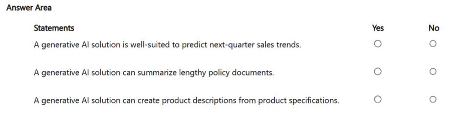

_HOTSPOT — the original ExamTopics question expects you to mark areas on the exhibit above; the correct hotspot coordinates are not published._

**Most voted:** Not provided

### Top explanations
- **omath** (6 upvotes [Most Recent]): ❌ No
  This is predictive AI / machine learning, not generative AI.
  ✅ Yes
  Summarization is a core generative AI capability.
  ✅ Yes
  This is classic generative content creation.
- **satoshi_** (6 upvotes): 1.No — Predicting next-quarter sales trends is typically a predictive AI / machine learning use case, not a core generative AI use case. Predictive AI is used to forecast outcomes, while generative AI is used to create content.
  2.Yes — Generative AI is well-suited to summarizing lengthy documents. Summarization is a common text-generation task for generative AI systems.
  3.Yes — Generative AI can create product descriptions from product specifications, because generating new text from structured or semi-structured input is a standard generative AI use case.

## Q1.18 (ID 384190)

Which statement accurately describes the difference between a pretrained generative AI model and a fine-tuned generative AI model?

⭕ **A.** A pretrained model requires labeled data, while a fine-tuned model does not.
⭕ **B.** A pretrained model is faster to train than a fine-tuned model because the pretrained model uses fewer parameters.
✅ **C.** A pretrained model is trained on broad datasets, while a fine-tuned model is adapted to perform well on a narrower, domain-specific dataset.
⭕ **D.** A pretrained model is optimized for a specific task, while a fine-tuned model is designed for general-purpose use.

**Correct answer:** C
**Most voted:** C

### Top explanations
- **omath** (6 upvotes [Most Recent, Selected Answer: C]): ✅ C. A pretrained model is trained on broad datasets, while a fine‑tuned model is adapted to perform well on a narrower, domain‑specific dataset.
  Explanation:
  - A is false → Fine‑tuning does require labeled data. Pretrained models do not.
  - B is false → Pretrained models aren’t faster because they use fewer parameters; they’re faster because they’re already trained.
  - C is true → This is the textbook definition:
  - D is reversed → Pretrained = general-purpose; fine‑tuned = optimized for a specific task.
- **Benny2694** (4 upvotes [Selected Answer: C]): C-Pretrained models are built using large, diverse datasets, And Fine-tuning takes that model and specializes it for a specific domain (i.e internal company data).
- **satoshi_** (2 upvotes [Selected Answer: C]): Answer: C. A pretrained model is trained on broad datasets, while a fine-tuned model is adapted to perform well on a narrower, domain-specific dataset.
  That is the standard distinction:
  Pretrained model: learns general language patterns from large, broad datasets.
  Fine-tuned model: starts from that pretrained base and is further adapted using smaller, focused, domain-specific data for better task/domain performance.

## Q1.19 (ID 384191)

HOTSPOT
For each of the following statements, select Yes if the statement is true. Otherwise, select No.
NOTE: Each correct selection is worth one point.

**Exhibits**
- Exhibit 1: 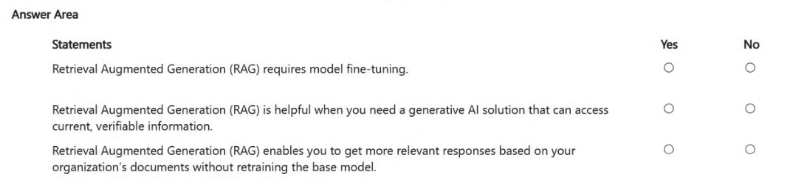

_HOTSPOT — the original ExamTopics question expects you to mark areas on the exhibit above; the correct hotspot coordinates are not published._

**Most voted:** Not provided

### Top explanations
- **omath** (4 upvotes [Most Recent]): ❌ No
  RAG does not require fine‑tuning.
  It works by retrieving external data at runtime and feeding it into the prompt.
  The base model stays unchanged.
  ✅ Yes
  This is exactly what RAG is for — grounding the model in fresh, authoritative, organization‑specific data.
  ✅ Yes
  This is the core benefit:
  RAG = better relevance + no retraining + uses your documents directly.
- **satoshi_** (4 upvotes): 1.No — RAG does not require model fine-tuning. Its main advantage is that it adds retrieved context from external sources at runtime rather than retraining the base model.
  2.Yes — RAG is useful when you need access to current, verifiable information, because it can pull in up-to-date external content instead of relying only on the model’s built-in training data.
  3.Yes — RAG can improve relevance using your organization’s documents without retraining the base model.

## Q1.20 (ID 401270)

HOTSPOT
For each of the following statements, select Yes if the statement is true. Otherwise, select No.
NOTE: Each correct selection is worth one point.

**Exhibits**
- Exhibit 1: 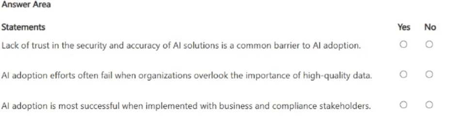

_HOTSPOT — the original ExamTopics question expects you to mark areas on the exhibit above; the correct hotspot coordinates are not published._

**Most voted:**
- ✅ Yes
- Organizations hesitate to adopt AI when they worry about data security, privacy, accuracy, or hallucinations. This is one of the most common barriers: ✅ Yes
- Poor data quality = poor AI outcomes.
- This is a foundational principle: bad data → bad models → failed adoption.
- ✅ Yes
- AI success requires cross‑functional alignment.

### Top explanations
- **omath** (4 upvotes [Most Recent]): ✅ Yes
  Organizations hesitate to adopt AI when they worry about data security, privacy, accuracy, or hallucinations. This is one of the most common barriers.
  ✅ Yes
  Poor data quality = poor AI outcomes.
  This is a foundational principle: bad data → bad models → failed adoption.
  ✅ Yes
  AI success requires cross‑functional alignment.
  This ensures responsible use, governance, and real business value.

## Q1.21 (ID 401271)

Your company creates a custom Azure Machine Learning model that uses a generative AI assistant.
The model initially delivers strong results. However, six months later, the model predictions become noticeably less accurate.
What is a possible cause of the issue?

⭕ **A.** The model requires additional compute resources.
✅ **B.** The input data changed over time.
⭕ **C.** The model was trained incorrectly.

**Correct answer:** B
**Most voted:** B

### Top explanations
- **omath** (4 upvotes [Most Recent, Selected Answer: B]): ✅ Correct answer: B. The input data changed over time.
  Explanation:
  This is known as data drift or concept drift.
  When the real‑world data no longer matches the data the model was trained on, accuracy drops — even if the model was originally excellent.

## Q1.22 (ID 401272)

HOTSPOT
For each of the following statements, select Yes if the statement is true. Otherwise, select No.
NOTE: Each correct selection is worth one point.

**Exhibits**
- Exhibit 1: 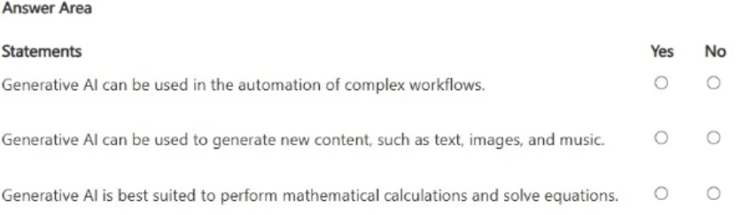

_HOTSPOT — the original ExamTopics question expects you to mark areas on the exhibit above; the correct hotspot coordinates are not published._

**Most voted:** Not provided

### Top explanations
- **omath** (4 upvotes [Most Recent]): ✅ Yes
  Generative AI can orchestrate multi‑step workflows, generate intermediate outputs, and automate reasoning‑heavy tasks.
  (Example: drafting documents, summarizing inputs, generating code, routing tasks.)
  ✅ Yes
  This is the core definition of generative AI — creating new content across modalities.
  ❌ No
  Generative AI is not optimized for precise math.
  It can attempt calculations, but it is not reliable — deterministic tools or traditional ML models are better.

## Q1.23 (ID 401273)

HOTSPOT
For each of the following statements, select Yes if the statement is true. Otherwise, select No.
NOTE: Each correct selection is worth one point.

**Exhibits**
- Exhibit 1: 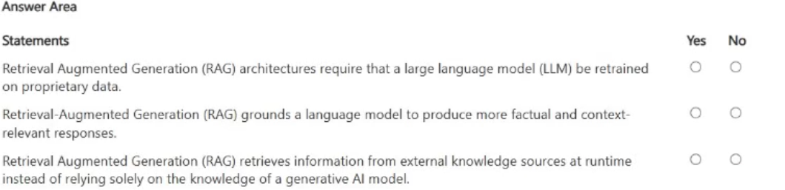

_HOTSPOT — the original ExamTopics question expects you to mark areas on the exhibit above; the correct hotspot coordinates are not published._

**Most voted:**
- Use trusted data → reduce hallucinations → increase factual accuracy.
- Retrieve → augment → generate.

### Top explanations
- **omath** (4 upvotes [Most Recent]): ❌ No
  RAG does not require retraining.
  It keeps the base model unchanged and brings in external data at runtime.
  ✅ Yes
  This is exactly the purpose of RAG:
  Use trusted data → reduce hallucinations → increase factual accuracy.
  ✅ Yes
  This is the core mechanism of RAG:
  Retrieve → augment → generate.

## Q1.24 (ID 401274)

HOTSPOT
For each of the following statements, select Yes if the statement is true. Otherwise, select No.
NOTE: Each correct selection is worth one point.

**Exhibits**
- Exhibit 1: 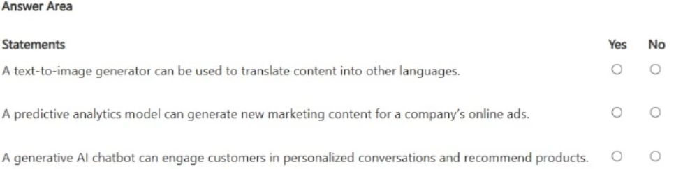

_HOTSPOT — the original ExamTopics question expects you to mark areas on the exhibit above; the correct hotspot coordinates are not published._

**Most voted:**
- ❌ No
- Text‑to‑image models generate images, not translations.
- Translation is a natural language processing task.
- ❌ No
- Predictive models forecast or classify — they do not generate new content.
- Content generation is generative AI, not predictive analytics: ✅ Yes
- This is a classic generative AI use case.

### Top explanations
- **omath** (7 upvotes [Highly Voted]): ❌ No
  Text‑to‑image models generate images, not translations.
  Translation is a natural language processing task.
  ❌ No
  Predictive models forecast or classify — they do not generate new content.
  Content generation is generative AI, not predictive analytics.
  ✅ Yes
  This is a classic generative AI use case.
- **Acrious** (5 upvotes [Most Recent]): NNY images are not going to create different languages
- **89880bd** (4 upvotes): No
  No
  Yes
  Statement 1 (No): Text-to-image generators (like Midjourney or DALL-E) are designed to create visual art from text prompts, not to perform linguistic translation between languages. That is the role of Large Language Models (LLMs).

## Q1.25 (ID 401275)

You have a large language model (LLM) that was pretrained by using public data.
You want the LLM to generate responses that incorporate frequently updated proprietary content, such as internal documents and knowledge bases.
You need to recommend a solution to ensure that the LLM uses the most current information without retraining the model.
What should you include in the recommendation?

✅ **A.** Retrieval Augmented Generation (RAG)
⭕ **B.** prompt engineering
⭕ **C.** content filtering
⭕ **D.** model fine-tuning

**Correct answer:** A
**Most voted:** A

### Top explanations
- **omath** (3 upvotes [Most Recent, Selected Answer: A]): ✅ Correct answer: A. Retrieval Augmented Generation (RAG)
  Explanation:
  RAG allows you to:
  - pull fresh, up‑to‑date, trusted internal data at runtime
  - avoid retraining or fine‑tuning the model
  - ground the LLM’s responses in your proprietary documents
  - ensure accuracy and reduce hallucinations
  It’s the standard pattern for “use my latest internal knowledge without touching the model.”

## Q1.26 (ID 401276)

HOTSPOT
For each of the following statements, select Yes if the statement is true. Otherwise, select No.
NOTE: Each correct selection is worth one point.

**Exhibits**
- Exhibit 1: 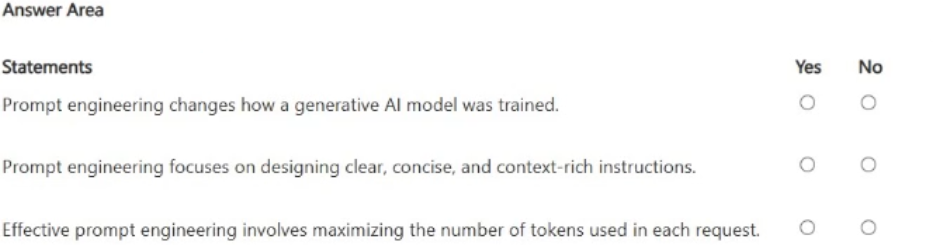

_HOTSPOT — the original ExamTopics question expects you to mark areas on the exhibit above; the correct hotspot coordinates are not published._

**Most voted:** Not provided

### Top explanations
- **omath** (4 upvotes [Most Recent]): ❌ No
  Prompt engineering does not alter training.
  It only affects how you instruct the model at inference time.
  ✅ Yes
  This is the core definition of prompt engineering.
  ❌ No
  More tokens ≠ better prompts.
  Effective prompts are clear, structured, and purposeful, not long.

## Q1.27 (ID 401277)

HOTSPOT
Select the answer that correctly completes the sentence.

**Exhibits**
- Exhibit 1: 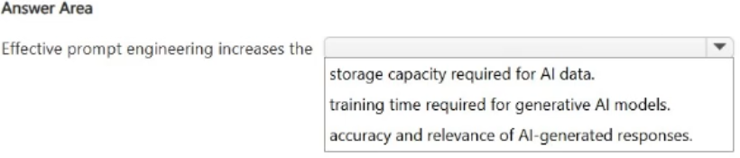

_HOTSPOT — the original ExamTopics question expects you to mark areas on the exhibit above; the correct hotspot coordinates are not published._

**Most voted:** Not provided

### Top explanations
- **omath** (3 upvotes [Most Recent]): ✅ accuracy and relevance of AI‑generated responses.
  Explanation:
  It does not increase storage capacity.
  It does not increase model training time (prompt engineering happens after training).
  It does improve how well the model understands the task and produces useful, context‑appropriate output.

## Q1.28 (ID 401278)

HOTSPOT
For each of the following statements, select Yes if the statement is true. Otherwise, select No.
NOTE: Each correct selection is worth one point.

**Exhibits**
- Exhibit 1: 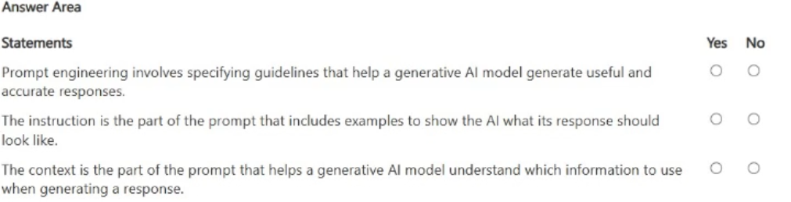

_HOTSPOT — the original ExamTopics question expects you to mark areas on the exhibit above; the correct hotspot coordinates are not published._

**Most voted:** Not provided

### Top explanations
- **omath** (4 upvotes): ✅ Yes
  This is the core purpose of prompt engineering: giving structured, explicit instructions to guide the model.
  ❌ No
  Examples belong to the examples or few‑shot section of a prompt.
  The instruction is the directive — what you want the model to do.
  ✅ Yes
  Context provides background, constraints, or reference information the model should rely on.
- **praraj1978** (1 upvotes [Most Recent]): Yes, No, Yes - Instructions are the directives that explicitly tell the AI what to do or how to behave

## Q1.29 (ID 401279)

Your company plans to use generative AI to help build a website that will showcase various existing products.
Which capability best describes a benefit of using generative AI for this project? More than one answer choice may achieve the goal. Select the BEST answer.

✅ **A.** creating product descriptions based on product specifications
⭕ **B.** designing a new product based on customer requirements
⭕ **C.** translating product descriptions into a different language
⭕ **D.** analyzing product sales to identify patterns and trends

**Correct answer:** A
**Most voted:** A

### Top explanations
- **omath** (5 upvotes [Most Recent, Selected Answer: A]): ✅ A. creating product descriptions based on product specifications
  Explanation:
  B. designing a new product → That’s generative design, not relevant to showcasing existing products.
  C. translating product descriptions → Useful, but translation is not the primary generative AI value for building a product‑showcase website.
  D. analyzing product sales → That’s predictive analytics, not generative AI.
- **deca0d4** (2 upvotes [Selected Answer: A]): The only direct use of generative AI is "Creating product descriptions based on product specifications". The rest are not really in the domain of GenAI.

## Q1.30 (ID 401280)

HOTSPOT
Select the answer that correctly completes the sentence.

**Exhibits**
- Exhibit 1: 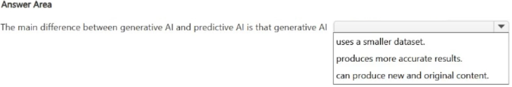

_HOTSPOT — the original ExamTopics question expects you to mark areas on the exhibit above; the correct hotspot coordinates are not published._

**Most voted:** Not provided

### Top explanations
- **omath** (4 upvotes [Most Recent]): ✅ can produce new and original content.
  Explanation:
  - Generative AI creates text, images, audio, code, etc.
  - Predictive AI forecasts or classifies based on historical data.
  - Dataset size and accuracy are not defining differences.

## Q1.31 (ID 401281)

Your company sells hiking and camping gear online.
You need a generative AI solution that can interact with customers, ask questions about their needs, and escalate to a human agent if necessary.
What solution should you use?

✅ **A.** a chatbot
⭕ **B.** predictive AI
⭕ **C.** a recommendation engine
⭕ **D.** computer vision

**Correct answer:** A
**Most voted:** A

### Top explanations
- **omath** (3 upvotes [Most Recent, Selected Answer: A]): ✅ Correct answer: A. a chatbot
  Explanation:
  A generative‑AI‑powered chatbot can:
  - hold natural conversations
  - ask clarifying questions
  - guide customers through product choices
  - hand off to a human agent when needed
  This is exactly the architecture used in modern customer‑service copilots.

## Q2.1 (ID 384192)

Your company receives thousands of scanned invoices each month.
You need to recommend an AI solution that can automatically extract key details, such as invoice numbers, vendor names, and total amounts.
What is the best solution to recommend? More than one answer choice may achieve the goal. Select the BEST answer.

✅ **A.** Azure Document Intelligence in Foundry Tools
⭕ **B.** Azure Vision in Foundry Tools
⭕ **C.** Azure AI Search
⭕ **D.** Azure Machine Learning

**Correct answer:** A
**Most voted:** A

### Top explanations
- **omath** (5 upvotes [Selected Answer: A]): ✅ BEST answer: A. Azure Document Intelligence in Foundry Tools
  Explanation:
  Document Intelligence is explicitly designed for:
  -invoice extraction
  - form recognition
  - receipt parsing
  - structured field extraction
  - handling scanned documents
  Your uploaded materials confirm this capability directly.
- **satoshi_** (3 upvotes [Selected Answer: A]): Answer: A. Azure Document Intelligence in Foundry Tools
  This is the best choice because Azure Document Intelligence is specifically built for intelligent document processing and includes a prebuilt invoice model that can extract structured fields such as invoice numbers, vendor details, totals, and line items from scanned invoices and PDFs.
- **ea4c337** (1 upvotes [Most Recent, Selected Answer: A]): Azure Vision in Foundry Tools visually interprets the world via APIs for image analysis, object detection, and spatial understanding. Azure Document Intelligence provides highly specialized models for extracting structured data, tables, and key-value pairs from business files. Choose Vision for photos; choose Document Intelligence for documents
- **ea4c337** (1 upvotes [Selected Answer: A]): why not Azure Vision in Foundry tool?
  Azure Vision delivers innovative computer vision capabilities. Empower your apps to analyze images, read text, and detect faces using prebuilt image tagging, optical character recognition (OCR), and responsible facial recognition. Easily integrate vision features into your projects with no machine learning expertise required.
  See https://azure.microsoft.com/en-us/products/ai-foundry/tools/vision

## Q2.2 (ID 384193)

HOTSPOT
For each of the following statements, select Yes if the statement is true. Otherwise, select No.
NOTE: Each correct selection is worth one point.

**Exhibits**
- Exhibit 1: 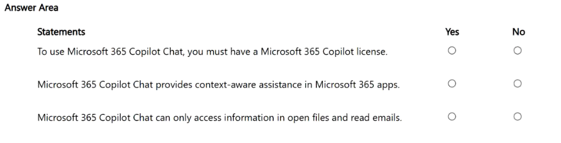

_HOTSPOT — the original ExamTopics question expects you to mark areas on the exhibit above; the correct hotspot coordinates are not published._

**Most voted:**
- ✅ Yes
- Access to Microsoft 365 Copilot Chat requires a Microsoft 365 Copilot license.
- No license → no Copilot Chat in the Microsoft 365 ecosystem.
- ✅ Yes
- Copilot Chat uses Microsoft Graph signals (emails, files, meetings, chats, calendar, etc.) to deliver context‑aware help across Microsoft 365 apps.
- ❌ No
- This is too limited.

### Top explanations
- **satoshi_** (10 upvotes [Highly Voted]): 1.No — Microsoft says using Copilot Chat doesn’t require a Microsoft 365 Copilot license. It does require an eligible Microsoft 365 license, but not the separate Copilot add-on license.
  2.Yes — Microsoft 365 Copilot Chat provides context-aware assistance. Microsoft describes it as being aware of the content of an open file, page, web page, email, or calendar event to provide relevant responses.
  3.No — It can access more than just open files and read emails. Microsoft states it can find information from files, meetings, chats, emails, plus the web and your enterprise.
- **omath** (5 upvotes): ✅ Yes
  Access to Microsoft 365 Copilot Chat requires a Microsoft 365 Copilot license.
  No license → no Copilot Chat in the Microsoft 365 ecosystem.
  ✅ Yes
  Copilot Chat uses Microsoft Graph signals (emails, files, meetings, chats, calendar, etc.) to deliver context‑aware help across Microsoft 365 apps.
  ❌ No
  This is too limited.
  Copilot Chat can access all organizational content you have permission to view through Microsoft Graph — not just open files or emails.
- **pperf** (3 upvotes): Gemini says: Yes, Yes, No
- **rveney** (3 upvotes): To use Microsoft 365 Copilot Chat, you must have a Microsoft 365 Copilot license.
  ❌ No
  Microsoft 365 Copilot Chat provides context‑aware assistance in Microsoft 365 apps.
  ❌ No
  Microsoft 365 Copilot Chat can only access information in open files and read emails.
  ❌ No
- **MoneyStacking** (2 upvotes): I do not agree with the first one. The statement is that you must have a 'Microsoft 365 Copilot' but it is not necessary to have it. Because when you have a Microsoft 365 subscriptions (like Business Basic, Standard, Premium, E3, E5, and A- or G-plans) you can already use Microsoft 365 Copilot Chat.
  You state No license equals to no Copilot chat, but that is not the statement. It does not state that must have a Microsoft 365 subscription. In that case I would agree with you but this statement is about Microsoft 365 Copilot license.

## Q2.3 (ID 384194)

HOTSPOT
Select the answer that correctly completes the sentence.

**Exhibits**
- Exhibit 1: 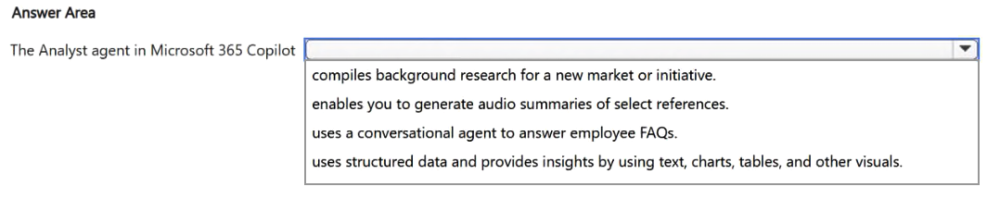

_HOTSPOT — the original ExamTopics question expects you to mark areas on the exhibit above; the correct hotspot coordinates are not published._

**Most voted:**
- uses structured data and provides insights by using text, charts, tables, and other visuals.
- The Microsoft 365 Copilot Analyst agent is built for data analysis. Microsoft describes it as helping analyze structured data and returning reports with insights that can include charts and tables.

### Top explanations
- **omath** (3 upvotes [Most Recent]): ✅ uses structured data and provides insights by using text, charts, tables, and other visuals.
  Explanation:
  The Analyst agent is designed to:
  - analyze structured data
  - generate insights
  - create visualizations (charts, tables, summaries)
  - support data‑driven decision‑making
- **satoshi_** (3 upvotes): Answer: uses structured data and provides insights by using text, charts, tables, and other visuals.
  The Microsoft 365 Copilot Analyst agent is built for data analysis. Microsoft describes it as helping analyze structured data and returning reports with insights that can include charts and tables.

## Q2.4 (ID 384196)

Your company discovers that several employees use personal ChatGPT accounts to assist with work tasks. You are concerned about proprietary data being shared externally.
You need to evaluate the business value of rolling out Microsoft 365 Copilot.
Which capability is a key benefit of using Copilot instead of a personal ChatGPT account?

⭕ **A.** analyzing and producing reports based on complex data
⭕ **B.** generating ideas and solving issues
⭕ **C.** drafting documents, emails, presentations, and marketing materials
✅ **D.** accessing internal data in accordance with existing Microsoft 365 policies

**Correct answer:** D
**Most voted:** D

### Top explanations
- **omath** (3 upvotes [Most Recent, Selected Answer: D]): ✅ Correct answer: D. accessing internal data in accordance with existing Microsoft 365 policies
  Explanation:
  Microsoft 365 Copilot:
  - keeps all data inside your Microsoft 365 tenant
  - respects existing permissions, DLP, Purview, sensitivity labels, and compliance boundaries
  - ensures no proprietary data leaves the organization
  - uses Microsoft Graph to access internal content securely
  This is the core business value when replacing personal ChatGPT usage.
- **satoshi_** (2 upvotes [Selected Answer: D]): Answer: D. accessing internal data in accordance with existing Microsoft 365 policies
  That is the key enterprise benefit over employees using personal ChatGPT accounts. Microsoft 365 Copilot is integrated with Microsoft 365 and inherits existing permissions, sensitivity labels, and retention policies, so access to internal data is governed by the organization’s existing security and compliance controls.

## Q2.5 (ID 384195)

HOTSPOT
Select the answer that correctly completes the sentence.

**Exhibits**
- Exhibit 1: 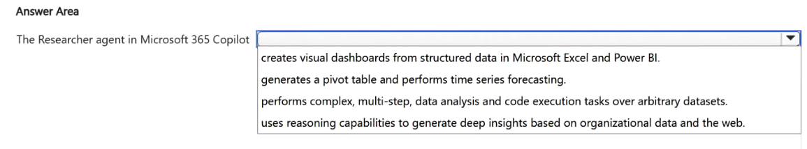

_HOTSPOT — the original ExamTopics question expects you to mark areas on the exhibit above; the correct hotspot coordinates are not published._

**Most voted:**
- uses reasoning capabilities to generate deep insights based on organizational data and the web.
- That best matches the Researcher agent. Microsoft says Researcher helps with complex, multistep research, gathering and analyzing information from the web and your work data to produce structured, source-cited reports.

### Top explanations
- **omath** (4 upvotes [Most Recent]): ✅ uses reasoning capabilities to generate deep insights based on organizational data and the web.
  Explanation:
  This aligns with the Researcher agent’s purpose:
  - synthesize information
  - pull from organizational data + web sources
  - generate insights, summaries, and research‑grade outputs
  The other options describe capabilities of the Analyst agent or Code Interpreter‑style agents, not the Researcher.
- **satoshi_** (3 upvotes): Answer: uses reasoning capabilities to generate deep insights based on organizational data and the web.
  That best matches the Researcher agent. Microsoft says Researcher helps with complex, multistep research, gathering and analyzing information from the web and your work data to produce structured, source-cited reports.

## Q2.6 (ID 384197)

HOTSPOT
What should you use for each task? To answer, select the appropriate options in the answer area.
NOTE: Each correct selection is worth one point.

**Exhibits**
- Exhibit 1: 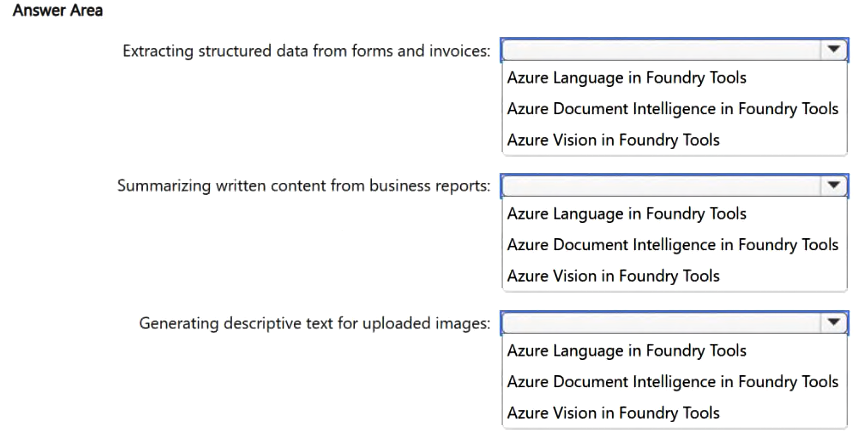

_HOTSPOT — the original ExamTopics question expects you to mark areas on the exhibit above; the correct hotspot coordinates are not published._

**Most voted:**
- Answer: Azure Document Intelligence in Foundry Tools
- Answer: Azure Language in Foundry Tools
- Answer: Azure Vision in Foundry Tools

### Top explanations
- **omath** (3 upvotes [Most Recent]): 1. Answer: Azure Document Intelligence in Foundry Tools
  invoice extraction
  form recognition
  structured field extraction
  handling scanned documents
  2. Answer: Azure Language in Foundry Tools
  summarization
  sentiment
  classification
  entity extraction
  natural‑language understanding
  3. Answer: Azure Vision in Foundry Tools
  image captioning
  object detection
  describing image content
  multimodal understanding
- **satoshi_** (1 upvotes): Use:
  1.Extracting structured data from forms and invoices: Azure Document Intelligence in Foundry Tools
  2.Summarizing written content from business reports: Azure Language in Foundry Tools
  3.Generating descriptive text for uploaded images: Azure Vision in Foundry Tools
  Why:
  1.Document Intelligence is built to extract structured fields from documents like invoices and forms.
  2.Azure Language includes text summarization capabilities for written content.
  3.Azure Vision can generate human-readable descriptions/captions for images.

## Q2.7 (ID 384198)

HOTSPOT
For each of the following statements, select Yes if the statement is true. Otherwise, select No.
NOTE: Each correct selection is worth one point.

**Exhibits**
- Exhibit 1: 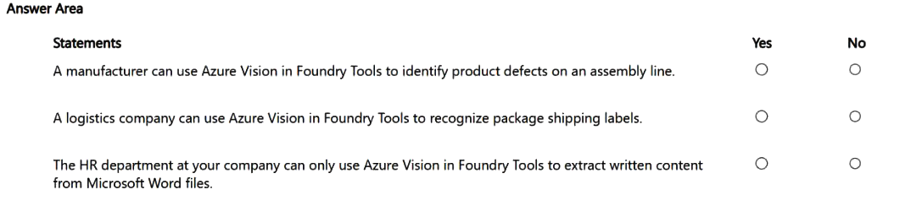

_HOTSPOT — the original ExamTopics question expects you to mark areas on the exhibit above; the correct hotspot coordinates are not published._

**Most voted:**
- Tip: when a statement or answer has the word 'Only' then it almost always a NO, because every tool has mostly multiple purposes.
- In this case it is: YYN

### Top explanations
- **omath** (2 upvotes): Yes
  This is a classic visual inspection use case — exactly what Azure Vision is designed for.
  Yes
  Azure Vision can read text (OCR) and detect objects, making it suitable for label recognition.
  No
  Azure Vision does not extract text from Word files — that’s not an image.
  “Only” is incorrect; Vision supports many image‑based tasks (classification, detection, OCR on images, etc.).
- **satoshi_** (2 upvotes): 1.Yes — Azure Vision can be used for manufacturing quality control, including identifying defects and anomalies on production lines. Microsoft documents this as a vision use case.
  2.Yes — Azure Vision supports OCR/text recognition and can extract text from images such as product labels, which makes it suitable for recognizing package shipping labels.
  3.No — The statement is false because Azure Vision is not limited to extracting written content from Word files; it is primarily used for analyzing images and extracting text from images, while document extraction from Office files is also handled by document-focused services like Document Intelligence.
- **MoneyStacking** (1 upvotes [Most Recent]): Tip: when a statement or answer has the word 'Only' then it almost always a NO, because every tool has mostly multiple purposes.
  In this case it is: YYN

## Q2.8 (ID 384199)

HOTSPOT
Select the answer that correctly completes the sentence.

**Exhibits**
- Exhibit 1: 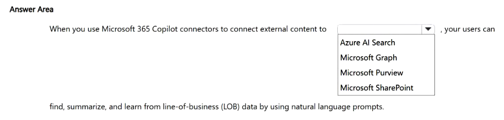

_HOTSPOT — the original ExamTopics question expects you to mark areas on the exhibit above; the correct hotspot coordinates are not published._

**Most voted:**
- Microsoft Graph
- Microsoft 365 Copilot connectors bring external content into Microsoft Graph, where users can then find, summarize, and learn from line-of-business data using natural language prompts.

### Top explanations
- **omath** (3 upvotes [Most Recent]): ✅ Microsoft Graph
  Explanation:
  Microsoft Graph is the unified API layer that Copilot uses to:
  - access organizational data
  - apply existing permissions
  - unify external connector content with internal Microsoft 365 content
  - enable natural‑language querying across LOB systems
  Azure AI Search, SharePoint, and Purview are not the integration point for Copilot connectors — Graph is.
- **satoshi_** (1 upvotes): Answer: Microsoft Graph
  Microsoft 365 Copilot connectors bring external content into Microsoft Graph, where users can then find, summarize, and learn from line-of-business data using natural language prompts.

## Q2.9 (ID 384202)

HOTSPOT
For each of the following statements, select Yes if the statement is true. Otherwise, select No.
NOTE: Each correct selection is worth one point.

**Exhibits**
- Exhibit 1: 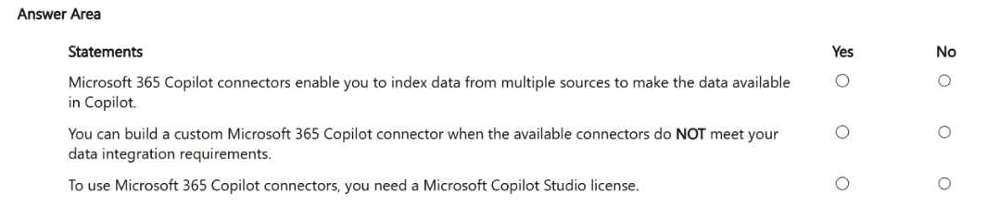

_HOTSPOT — the original ExamTopics question expects you to mark areas on the exhibit above; the correct hotspot coordinates are not published._

**Most voted:** Not provided

### Top explanations
- **omath** (3 upvotes [Most Recent]): ✅ Yes
  This is exactly what connectors do — they bring external LOB systems into Microsoft Graph, making that data available to Copilot while respecting permissions.
  ✅ Yes
  Custom connectors are supported specifically for scenarios where no prebuilt connector fits your needs.
  ❌ No
  Connectors do not require Copilot Studio.
  They are part of the Microsoft 365 Copilot ecosystem and rely on Microsoft Graph + connector licensing, not Copilot Studio.
- **satoshi_** (2 upvotes): 1.Yes — Microsoft 365 Copilot connectors can ingest and index external data from multiple sources and make it available in Copilot. Microsoft says synced connectors “ingest and index external content into Microsoft Graph,” and that content is then made available to Copilot.
  2.Yes — You can build a custom Microsoft 365 Copilot connector when prebuilt connectors do not meet your needs. Microsoft explicitly says the SDK is for data sources “that don't have a prebuilt connector.”
  3.No — A Microsoft Copilot Studio license is not stated as required to use Copilot connectors. The Microsoft Learn setup guidance instead lists a Microsoft 365 Copilot license (or a Microsoft 365 Developer tenant) for the build/test scenario, and specifically says testing in Microsoft 365 Copilot Chat requires a Microsoft 365 Copilot license.

## Q2.10 (ID 384410)

HOTSPOT
For each of the following statements, select Yes if the statement is true. Otherwise, select No.
NOTE: Each correct selection is worth one point.

**Exhibits**
- Exhibit 1: 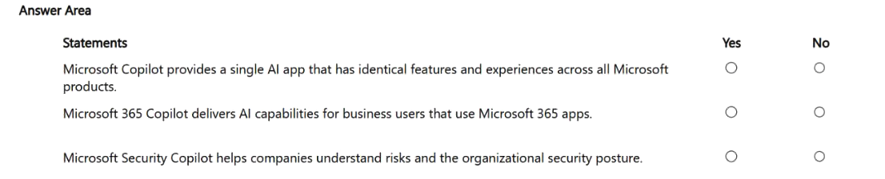

_HOTSPOT — the original ExamTopics question expects you to mark areas on the exhibit above; the correct hotspot coordinates are not published._

**Most voted:**
1. No
2. Yes
3. Yes

### Top explanations
- **omath** (3 upvotes [Most Recent]): 1. No
  Microsoft Copilot is a family of copilots. Each product (Microsoft 365 Copilot, Security Copilot, GitHub Copilot, etc.) has different capabilities tailored to its domain. They do not share identical features.
  2. Yes
  Microsoft 365 Copilot is specifically designed to enhance apps like Word, Excel, Outlook, Teams, and PowerPoint for business productivity.
  3. Yes
  Security Copilot assists security teams by analyzing threats, summarizing incidents, and helping understand risk and posture.
- **satoshi_** (3 upvotes): 1.No — Microsoft does not provide a single Copilot app with identical features across all products. There are distinct offerings such as Microsoft 365 Copilot and Microsoft Security Copilot, each designed for different use cases and experiences.
  2.Yes — Microsoft 365 Copilot provides AI capabilities for business users working in Microsoft 365 apps. Microsoft describes it as helping with work tasks in the context of the Microsoft 365 app the user is using.
  3.Yes — Microsoft Security Copilot helps organizations understand risks and their security posture. Microsoft explicitly says it helps users “understand risks and manage security posture of the organization.”

## Q2.11 (ID 384141)

HOTSPOT
For each of the following statements, select Yes if the statement is true. Otherwise, select No.
NOTE: Each correct selection is worth one point.

**Exhibits**
- Exhibit 1: 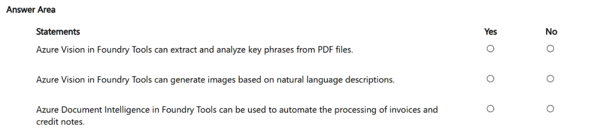

_HOTSPOT — the original ExamTopics question expects you to mark areas on the exhibit above; the correct hotspot coordinates are not published._

**Most voted:**
1. No
2. No
3. Yes

### Top explanations
- **satoshi_** (7 upvotes [Highly Voted]): 1.No — Azure Vision can detect text in images, but for PDF files and document-heavy OCR scenarios, Microsoft directs you to use Azure Document Intelligence Read OCR, and key phrase extraction is a Language capability, not a Vision capability.
  2.No — Image generation from natural language is associated with Azure OpenAI / Foundry Models, not Azure Vision in Foundry Tools.
  3.Yes — Azure Document Intelligence is built for intelligent document processing and can automate extraction from documents such as invoices; it also supports custom models for structured and semi-structured business documents, which covers invoice/credit-note processing workflows.
- **fa62dd5** (6 upvotes): Azure Vision in Foundry Tools can extract and analyze key phrases from PDF files.
  ❌ No
  Key phrase extraction is done by Azure AI Language, not Azure AI Vision.
  Vision can read text (OCR) but does not analyze key phrases.
  Azure Vision in Foundry Tools can generate images based on natural language descriptions.
  ❌ No
  Image generation is done by Azure OpenAI Service (for example with DALL-E models), not Azure Vision.
  Azure Document Intelligence in Foundry Tools can be used to automate the processing of invoices and credit notes.
  ✅ Yes
  Azure AI Document Intelligence (formerly Form Recognizer) is designed to extract structured data from documents like invoices, receipts, and financial forms.
- **omath** (5 upvotes [Most Recent]): 1. No
  Azure Vision handles image and video analysis (object detection, classification, OCR on images).
  Extracting and analyzing key phrases is an Azure Language capability, not Vision.
  PDF extraction belongs to Document Intelligence, not Vision.
  2. No
  Azure Vision does not generate images.
  It analyzes images.
  Image generation is done through Azure OpenAI (DALL·E), not Vision.
  3. Yes
  Document Intelligence is explicitly designed for structured extraction from forms, invoices, receipts, and PDFs.
- **rveney** (5 upvotes): Azure Vision in Foundry Tools can extract and analyze key phrases from PDF files.
  ❌ No
  Azure Vision in Foundry Tools can generate images based on natural language descriptions.
  ❌ No
  Azure Document Intelligence in Foundry Tools can be used to automate the processing of invoices and credit notes.
  ✅ Yes
- **Benny2694** (2 upvotes): No-Key phrase extraction is part of Language (Text Analytics), not Azure Vision. Vision focuses on images, not text analysis.
  Yes-Azure Vision (via generative capabilities like image models) supports text-to-image generation.
  Yes-This is exactly what Document Intelligence is designed for—extracting structured data from documents like invoices.

## Q2.12 (ID 384411)

Your company stores thousands of reports and documents across multiple systems.
You recommend using Azure AI Search as part of a new generative AI solution to improve information discovery.
What is a key benefit of using Azure AI Search in this scenario?

⭕ **A.** generates responses to customer questions without referencing the existing data
✅ **B.** queries and retrieves information from large collections of data by using natural language
⭕ **C.** automates document workflows based on the document content
⭕ **D.** improves model accuracy by fine-tuning organizational data

**Correct answer:** B
**Most voted:** B

### Top explanations
- **omath** (4 upvotes [Selected Answer: B]): Correct Answer: B. queries and retrieves information from large collections of data by using natural language
  Explanation:
  Azure AI Search is designed to:
  - Index large volumes of structured and unstructured content
  - Support semantic search and vector search
  - Allow users (and LLMs) to query data using natural language
  - Provide high‑quality retrieval for RAG (Retrieval‑Augmented Generation)
  This aligns exactly with the scenario: improving information discovery across thousands of documents.
- **satoshi_** (3 upvotes [Selected Answer: B]): Answer: B. queries and retrieves information from large collections of data by using natural language
  Azure AI Search is fundamentally an information retrieval service. Its key value here is that it can index large volumes of documents across sources and support full-text, vector, hybrid, and free-form text queries so users (or a generative AI layer) can find relevant information efficiently.
- **M2000F007fubar** (1 upvotes [Most Recent, Selected Answer: B]): using natural language query is an advantage and only answer that makes sense

## Q2.13 (ID 384412)

You are exploring how Microsoft 365 Copilot uses Microsoft Graph to deliver AI-powered experiences.
Which information in Microsoft Graph can Copilot use by default?

✅ **A.** emails, files, meetings, and chats in Microsoft 365
⭕ **B.** data stored in a file share
⭕ **C.** social media activity
⭕ **D.** content from public websites

**Correct answer:** A
**Most voted:** A

### Top explanations
- **omath** (4 upvotes [Most Recent, Selected Answer: A]): ✅ A. emails, files, meetings, and chats in Microsoft 365
  Explanation:
  Microsoft 365 Copilot uses Microsoft Graph to access the organizational data you already have permission to see—your emails, OneDrive/SharePoint files, Teams chats, calendar, and more.
  This is the foundation of Copilot’s organizational grounding.
- **satoshi_** (1 upvotes [Selected Answer: A]): Answer: A. emails, files, meetings, and chats in Microsoft 365
  By default, Microsoft 365 Copilot uses content in Microsoft Graph such as a user’s emails, files/documents, meetings, and chats (subject to that user’s existing permissions) to personalize responses and provide grounded assistance.

## Q2.14 (ID 384135)

You need to recommend a service that supports indexing information and knowledge mining by extracting insights from documents.
What should you recommend?

⭕ **A.** Microsoft Foundry
⭕ **B.** Azure Vision in Foundry Tools
⭕ **C.** Azure Document Intelligence in Foundry Tools
✅ **D.** Azure AI Search

**Correct answer:** D
**Most voted:** D

### Top explanations
- **d1d6163** (5 upvotes [Selected Answer: D]): C: Extracts structured data from individual documents (invoices, forms), but does not provide indexing or search functionality across large document collections.
- **omath** (3 upvotes [Most Recent, Selected Answer: D]): D. Azure AI Search
  Explanation:
  Azure AI Search is specifically designed for:
  - Indexing large volumes of content (documents, PDFs, files, structured + unstructured data)
  - Knowledge mining
  - Extracting insights using cognitive skills (OCR, key phrase extraction, entity extraction, sentiment, etc.)
  - Powering RAG scenarios by retrieving relevant information for generative AI
  This aligns exactly with the scenario: indexing information and extracting insights from documents.
- **89880bd** (2 upvotes [Selected Answer: D]): The correct Microsoft solution to recommend is Azure Cognitive Search (now often referred to as Azure AI Search).
- **fa62dd5** (2 upvotes [Selected Answer: D]): D. Azure AI Search
  Why?
  Azure AI Search is designed for:
  Indexing large amounts of data
  Knowledge mining
  Extracting insights from documents
  Using AI enrichment pipelines to analyze content (OCR, key phrases, entities, etc.)
- **rveney** (2 upvotes [Selected Answer: D]): Azure AI Search is the right recommendation

## Q2.15 (ID 384137)

DRAG DROP
Match the business scenario to the appropriate AI solution design approach.
To answer, drag the AI solution from the column on the left to its business scenario on the right. Each solution may be used once, more than once, or not at all.
NOTE: Each correct match is worth one point.

**Exhibits**
- Exhibit 1: 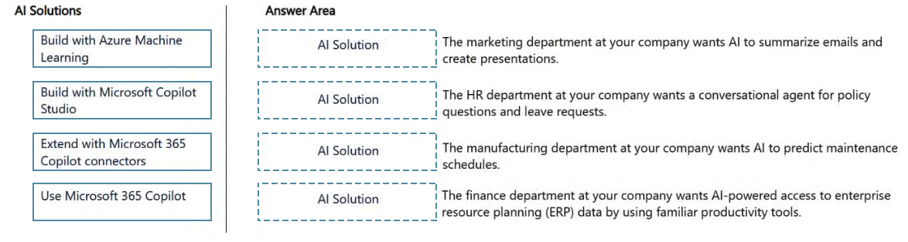

_DRAG DROP — the original ExamTopics question expects you to drag and drop items; the correct targets are not published._

**Most voted:**
- Marketing: AI to summarize emails and create presentations =: Use Microsoft 365 Copilot
- HR: Conversational agent for policy questions and leave requests = Build with Microsoft Copilot Studio

### Top explanations
- **d1d6163** (19 upvotes [Highly Voted]): Marketing: AI to summarize emails and create presentations = 	Use Microsoft 365 Copilot
  HR: Conversational agent for policy questions and leave requests = Build with Microsoft Copilot Studio
- **omath** (10 upvotes [Highly Voted]): 1. ➡️ Use Microsoft 365 Copilot
  Because this is productivity inside Word, Outlook, PowerPoint, and Teams.
  This is the classic “use Copilot where employees already work” scenario.
  2. ➡️ Build with Microsoft Copilot Studio
  This is a custom conversational agent scenario—perfect fit for Copilot Studio.
  3. ➡️ Build with Azure Machine Learning
  Predictive maintenance = machine learning models, not Copilot or connectors.
  4. ➡️ Extend with Microsoft 365 Copilot connectors
  Connectors bring external LOB/ERP data into Microsoft Graph so Copilot can use it.
- **rveney** (4 upvotes): Business ScenarioAI SolutionSummarize emails and create presentations
  Use Microsoft 365 Copilot
  HR conversational agent
  Build with Microsoft Copilot Studio
  Predict maintenance schedules
  Build with Azure Machine Learning
  AI access to ERP data in M365 apps
  Extend with Microsoft 365 Copilot connectors
- **fa62dd5** (3 upvotes): Microsoft 365 Copilot: 1
  Microsoft Copilot Studio:2
  Build with Azure Machine Learning: 3
  Extend with Microsoft 365 Copilot connectors:4
- **fe59431** (2 upvotes [Most Recent]): 1. ➡️ Use Microsoft 365 Copilot
  Because this is productivity inside Word, Outlook, PowerPoint, and Teams.
  This is the classic “use Copilot where employees already work” scenario.

## Q2.16 (ID 384413)

HOTSPOT
Select the answer that correctly completes the sentence.

**Exhibits**
- Exhibit 1: 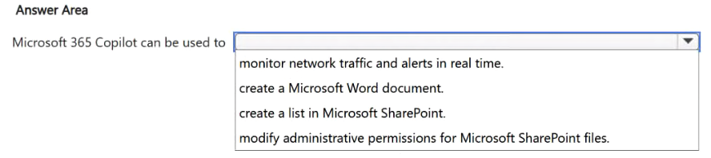

_HOTSPOT — the original ExamTopics question expects you to mark areas on the exhibit above; the correct hotspot coordinates are not published._

**Most voted:**
- monitor network traffic and alerts in real time → more aligned with security/network tools, not Microsoft 365 Copilot.
- create a list in Microsoft SharePoint → not a standard core Copilot capability in this context.
- modify administrative permissions for Microsoft SharePoint files → administrative permission management is not a normal end-user Copilot task.

### Top explanations
- **omath** (3 upvotes): ➡️ create a Microsoft Word document.
  Explanation:
  Microsoft 365 Copilot works inside Microsoft 365 apps—Word, Excel, PowerPoint, Outlook, Teams—so it can:
  - draft documents
  - summarize content
  - rewrite text
  - generate presentations
  - analyze data
  Creating a Word document is a core, built‑in capability.
- **satoshi_** (2 upvotes): Answer: create a Microsoft Word document.
  Microsoft 365 Copilot can help users create and draft Word documents in Copilot in Word. Microsoft explicitly says Copilot in Word helps users go from a blank page to a complete draft and helps users create, understand, and edit documents.
  The other options are not the best fit:
  monitor network traffic and alerts in real time → more aligned with security/network tools, not Microsoft 365 Copilot.
  create a list in Microsoft SharePoint → not a standard core Copilot capability in this context.
  modify administrative permissions for Microsoft SharePoint files → administrative permission management is not a normal end-user Copilot task.
- **ef1ba08** (1 upvotes [Most Recent]): Why not Microsoft SharePoint as it is not a standard Microsoft 365 Copilot core capability tested in this context. So, best answer is "create a Microsoft Word Document. "
- **AMOLMANTHALKAR** (1 upvotes): Why not Sharepoint list as its also a part of M365 ?

## Q2.17 (ID 384138)

HOTSPOT
For each of the following statements, select Yes if the statement is true. Otherwise, select No.
NOTE: Each correct selection is worth one point.

**Exhibits**
- Exhibit 1: 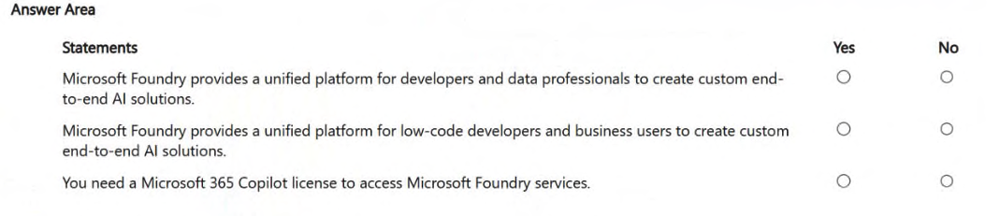

_HOTSPOT — the original ExamTopics question expects you to mark areas on the exhibit above; the correct hotspot coordinates are not published._

**Most voted:**
1. Yes
2. No
3. No

### Top explanations
- **d1d6163** (10 upvotes [Highly Voted]): Yes
  No
  No
- **omath** (6 upvotes [Most Recent]): 1. Yes
  Foundry is designed for pro‑code teams—developers, data engineers, and data scientists—to build governed, end‑to‑end AI solutions using Azure AI, Azure ML, and orchestration tools.
  2. No
  Low‑code and business users build AI experiences using Copilot Studio and Power Platform, not Foundry.
  Foundry is not a low‑code environment.
  3. No
  Foundry is an Azure‑based AI development platform, independent of Microsoft 365 licensing.
  A Microsoft 365 Copilot license is not required to use Foundry.
- **satoshi_** (3 upvotes): 1.Yes  Microsoft Foundry is described as a unified platform for developers and AI/data-focused builders to create end-to-end AI solutions. Microsoft says it is “a unified Azure platform-as-a-service offering for enterprise AI operations, model builders, and application development,” and notes it enables developers to focus on building applications.
  2.No  The description of a unified platform for low-code developers and business users fits products like Copilot Studio more than Microsoft Foundry. Microsoft Foundry documentation emphasizes developers, model builders, SDKs, and application development rather than primarily low-code business-user creation.
  3.No  You do not need a Microsoft 365 Copilot license to access Microsoft Foundry services. Microsoft says you need an Azure account to get access, and that the platform is free to use and explore (with pricing based on services consumed).
- **rveney** (2 upvotes): Microsoft Foundry provides a unified platform for developers and data professionals to create custom end-to-end AI solutions.
  ✅ Yes
  Microsoft Foundry provides a unified platform for low-code developers and business users to create custom end-to-end AI solutions.
  ❌ No
  You need a Microsoft 365 Copilot license to access Microsoft Foundry services.
  ❌ No

## Q2.18 (ID 384414)

Your company is preparing to adopt Microsoft 365 Copilot and wants to follow Microsoft responsible AI principles.
As a business leader, you propose establishing an AI governance council to ensure alignment with the responsible AI principles.
What is the primary purpose of the council? More than one answer choice may achieve the goal. Select the BEST answer.

⭕ **A.** to monitor user behavior and enforce compliance with internal IT policies
⭕ **B.** to train employees on how to use Copilot features effectively
⭕ **C.** to oversee implementation, manage technical performance, and ensure successful AI deployment
✅ **D.** to guide strategy, provide oversight, and ensure cross-functional alignment for responsible AI adoption

**Correct answer:** D
**Most voted:** D

### Top explanations
- **omath** (4 upvotes [Selected Answer: D]): D. to guide strategy, provide oversight, and ensure cross‑functional alignment for responsible AI adoption
  Explanation:
  An AI governance council—as defined in Microsoft’s responsible AI guidance and reinforced throughout AB‑731—exists to:
  - Set AI strategy and vision
  - Ensure responsible AI oversight
  - Align legal, compliance, security, HR, IT, and business leaders
  - Govern risk, ethics, and policy
  - Provide cross‑functional decision‑making
  This is exactly what option D describes.
- **satoshi_** (2 upvotes [Selected Answer: D]): Answer: D. to guide strategy, provide oversight, and ensure cross-functional alignment for responsible AI adoption
  This is the best answer because Microsoft’s AB-731 study guide explicitly says to “establish an AI council to guide strategy, oversight, and cross-functional alignment.”
  Microsoft’s adoption guidance also describes an AI Council as a cross-functional and multidisciplinary body that oversees and guides the development, deployment, and evaluation of AI solutions, aligning AI strategy with organizational goals and helping mitigate risks.
  So the primary purpose is strategic governance and responsible oversight, not end-user training or simple IT policy enforcement.
- **M2000F007fubar** (1 upvotes [Most Recent, Selected Answer: D]): D is correct as defined by Microsoft Learn

## Q2.19 (ID 384139)

HOTSPOT
For each of the following statements, select Yes if the statement is true. Otherwise, select No.
NOTE: Each correct selection is worth one point.

**Exhibits**
- Exhibit 1: 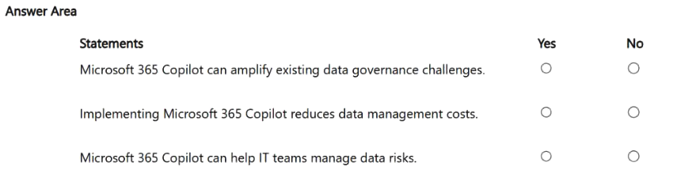

_HOTSPOT — the original ExamTopics question expects you to mark areas on the exhibit above; the correct hotspot coordinates are not published._

**Most voted:**
1. Yes
2. No
3. Yes

### Top explanations
- **d1d6163** (12 upvotes [Highly Voted]): Yes
  No
  Yes
- **fa62dd5** (4 upvotes): Copilot can amplify governance challenges Yes
  Copilot reduces data management costs      No
  Copilot helps IT manage data risks               Yes
- **rveney** (4 upvotes): Microsoft 365 Copilot can amplify existing data governance challenges.
  ✅ Yes
  Implementing Microsoft 365 Copilot reduces data management costs.
  ❌ No
  Microsoft 365 Copilot can help IT teams manage data risks.
  ✅ Yes
- **omath** (3 upvotes [Most Recent]): 1. Yes
  Copilot surfaces information users already have access to.
  If an organization has over‑permissioned access, poor data hygiene, or unclassified sensitive files, Copilot can unintentionally make those issues more visible.
  2. No
  Copilot does not reduce data governance or management costs.
  In fact, organizations often need more investment in data lifecycle management, permissions cleanup, classification, and governance before deployment.
  3. Yes
  Copilot works within the Microsoft 365 security and compliance boundary.
  It leverages: Microsoft Purview, DLP, Sensitivity labels, Conditional access, Audit logs.
  These tools help IT teams identify, classify, and control data risks more effectively.

## Q2.20 (ID 384140)

HOTSPOT
Select the answer that correctly completes the sentence.

**Exhibits**
- Exhibit 1: 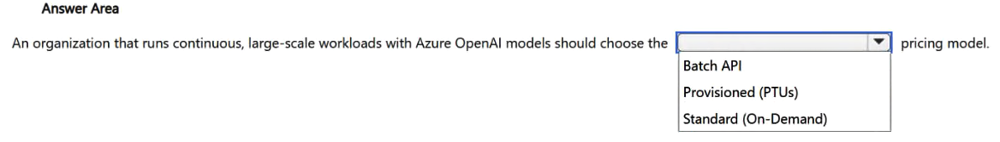

_HOTSPOT — the original ExamTopics question expects you to mark areas on the exhibit above; the correct hotspot coordinates are not published._

**Most voted:** Provisioned (PTUs)

### Top explanations
- **d1d6163** (9 upvotes [Highly Voted]): Provisioned (PTUs)
- **omath** (4 upvotes [Most Recent]): ➡️ Provisioned (PTUs)
  Explanation:
  Provisioned Throughput Units (PTUs) are designed specifically for:
  - High‑volume, predictable, and continuous workloads
  - Guaranteed throughput and low latency
  - Lower cost at scale compared to on‑demand usage
  This is exactly the scenario described.
- **ksmani99** (3 upvotes): Batch processing is mainly intended for asynchronous, offline workloads (like processing large datasets where immediate response isn’t required).
  Continuous, latency‑sensitive or real‑time usage patterns are better served by provisioned capacity.
  Correct answer: Provisioned (PTUs)
- **fa62dd5** (3 upvotes): An organization that runs continuous, large‑scale workloads with Azure OpenAI models should choose the Provisioned (PTUs) pricing model
- **rveney** (3 upvotes): ✅ Correct Answer: Provisioned (PTUs)

## Q2.21 (ID 384472)

Your company sells hiking and camping gear online.
You need a generative AI solution that can interact with customers and ask questions about their needs.
What should you include in the solution?

✅ **A.** a chatbot
⭕ **B.** predictive AI
⭕ **C.** computer vision
⭕ **D.** a recommendation engine

**Correct answer:** A
**Most voted:** A

### Top explanations
- **omath** (3 upvotes [Selected Answer: A]): A. a chatbot
  Explanation:
  A generative‑AI chatbot can:
  - hold natural conversations
  - ask clarifying questions
  - guide customers through product choices
  - personalize responses
  - escalate or hand off when needed
- **M2000F007fubar** (2 upvotes [Most Recent, Selected Answer: A]): a simple chatbot does all of this easily; other answers not correct at all

## Q2.22 (ID 384473)

HOTSPOT
For each of the following statements, select Yes if the statement is true. Otherwise, select No.
NOTE: Each correct selection is worth one point.

**Exhibits**
- Exhibit 1: 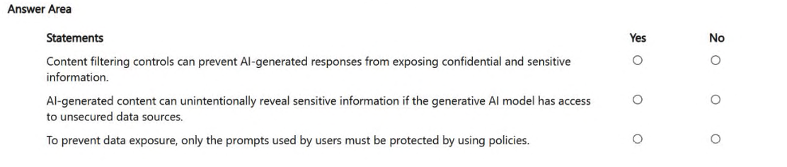

_HOTSPOT — the original ExamTopics question expects you to mark areas on the exhibit above; the correct hotspot coordinates are not published._

**Most voted:**
1. Yes
2. Yes
3. No

### Top explanations
- **omath** (4 upvotes [Most Recent]): 1. Yes
  Content filters (safety filters, DLP, sensitivity labels, Purview policies) can block, mask, or sanitize outputs that might otherwise reveal sensitive data.
  They don’t solve every risk, but they do prevent many forms of unintended disclosure.
  2. Yes
  If the model is grounded on unsecured, over‑permissioned, or poorly governed data, it can surface that information in responses.
  This is one of the exam’s key messages: AI amplifies existing data governance weaknesses.
  3. No
  Protecting prompts alone is not enough.
  You must protect: the data sources, the grounding layer, the outputs, the user access permissions, the governance and lifecycle policies
  Prompts are just one piece of the risk surface.

## Q2.23 (ID 384474)

You have a historical dataset that contains 1,000 records.
You need an AI solution that can analyze the data to identify patterns and predict future outcomes.
What should you include in the solution?

⭕ **A.** Microsoft Foundry
⭕ **B.** Azure Document Intelligence in Foundry Tools
✅ **C.** Azure Machine Learning
⭕ **D.** Azure Content Understanding in Foundry Tools

**Correct answer:** C
**Most voted:** C

### Top explanations
- **omath** (5 upvotes [Most Recent, Selected Answer: C]): ✔️ C. Azure Machine Learning
  Explanation:
  Azure Machine Learning is built for:
  - training predictive models
  - analyzing historical datasets
  - identifying correlations and patterns
  - forecasting future outcomes
  - running experiments and evaluations
- **idrisfl** (2 upvotes [Selected Answer: C]): "predict" is most likely always ML
- **20ca459** (2 upvotes [Selected Answer: C]): The core purpose of Azure Machine Learning is to train models on historical data to identify patterns and predict future outcomes (e.g., forecasting sales or predicting equipment failure).
- **d782445_111** (2 upvotes [Selected Answer: C]): ML always

## Q2.24 (ID 384492)

Your company manages an online catalog of office supplies.
You plan to use a generative AI solution to create product descriptions for your company’s website. The solution must meet the following requirements:
Ensure that the descriptions can be posted immediately after they are created.
Enable the selection and inclusion of product details in each description.
Be fast and simple for non-technical staff to use.
What is the best type of solution to use? More than one answer choice may achieve the goal. Select the BEST answer.

⭕ **A.** custom Azure Machine Learning model
⭕ **B.** the Researcher agent in Microsoft 365 Copilot
✅ **C.** an interactive AI agent
⭕ **D.** a fine-tuned large language model (LLM)

**Correct answer:** C
**Most voted:** C

### Top explanations
- **omath** (4 upvotes [Most Recent, Selected Answer: C]): ✅ BEST Answer: C. an interactive AI agent
  Explanation:
  An interactive AI agent (built with Copilot Studio or similar) can:
  - Ask the user which product details to include
  - Generate descriptions instantly
  - Provide a simple, guided interface for non‑technical staff
  - Produce ready‑to‑publish text
  - Require no ML expertise, no fine‑tuning, no engineering overhead
  This aligns perfectly with the requirements.
- **MarcinW** (3 upvotes [Selected Answer: C]): Research will not post them immediately... so C.
- **20ca459** (2 upvotes [Selected Answer: C]): User Accessibility: Interactive agents (like those built in Microsoft Copilot Studio) provide a conversational or simple interface designed specifically for non-technical staff.
  Controlled Input: They allow users to easily input specific product details (like dimensions, color, or material) and guide the AI to include them in the final output.
  Immediate Results: Unlike custom models or fine-tuning, which require long development cycles and technical oversight, an agent is ready to produce content for immediate use as soon as it's configured.
- **89880bd** (2 upvotes [Selected Answer: C]): The best answer is: C. an interactive AI agent.
  Requirements from the scenario
  Descriptions can be posted immediately → needs real-time generation
  Selection and inclusion of product details → user must be able to input product attributes
  Fast and simple for non-technical staff → easy interface, minimal setup
  An interactive AI agent:
  Allows staff to input product details through prompts or forms
  Generates descriptions instantly
  Requires no technical skills
  Can be implemented via Copilot Studio or similar tools
  This directly satisfies all requirements.
- **fa62dd5** (2 upvotes [Selected Answer: C]): The requirements say the solution must:
  Generate product descriptions
  Allow selection and inclusion of product details
  Be fast and simple for non-technical staff
  Allow immediate posting after creation
  An interactive AI agent can:
  Ask the user for product details (name, features, price, etc.)
  Generate the description automatically
  Allow staff to review and publish immediately
  Provide a simple interface without technical knowledge
  Why the others are not the BEST choice
  A. custom Azure Machine Learning model

## Q2.25 (ID 401282)

Your company has an AI solution that uses a prebuilt Azure OpenAI model to generate content.
You need to reduce the cost of solution while minimizing the impact on the quality of the generated output.
Which two actions should you perform? Each correct answer presents part of the solution.
NOTE: Each correct selection is worth one point.

✅ **A.** Switch to an alternate model.
⭕ **B.** Apply content moderation.
✅ **C.** Optimize the prompts.
⭕ **D.** Decrease the number of hosting hours for the model.
⭕ **E.** Fine-tune the existing model.

**Correct answer:** A, C
**Most voted:** AC

### Top explanations
- **omath** (4 upvotes [Most Recent, Selected Answer: AC]): A. Switch to an alternate model.
  Yes — choosing a smaller or more cost‑efficient model (e.g., GPT‑4o mini instead of GPT‑4o) can significantly reduce cost while still maintaining strong quality.
  This is one of Microsoft’s recommended cost‑optimization strategies
  C. Optimize the prompts.
  Yes — prompt optimization reduces:
  - token usage
  - unnecessary verbosity
  - repeated calls
  - overall cost
  …while keeping output quality high.
  This is explicitly emphasized in the AB‑731 study guide.
- **20ca459** (3 upvotes [Selected Answer: AC]): Switch to an alternate model: Azure OpenAI offers various models with different price points. For example, switching from a high-resource model like GPT-4o to a more efficient model like GPT-4o-mini can significantly lower the cost per token while still providing high-quality results for many tasks.
  Optimize the prompts: Since Azure OpenAI is billed based on the number of tokens processed, shortening prompts or providing clearer instructions that result in more concise outputs directly reduces the token count and, consequently, the cost.

## Q2.26 (ID 401283)

HOTSPOT
You need to recommend an AI solution for each task. The solutions must use prebuilt AI capabilities to reduce development time.
What should you recommend for each task? To answer, select the appropriate options in the answer area.
NOTE: Each correct selection is worth one point.

**Exhibits**
- Exhibit 1: 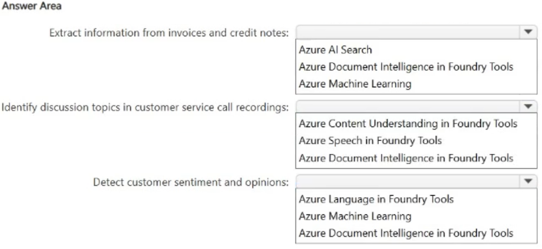

_HOTSPOT — the original ExamTopics question expects you to mark areas on the exhibit above; the correct hotspot coordinates are not published._

**Most voted:**
1) Azure Document Intelligence in Foundry tool
2) Azure Content Understanding in Foundry Tool  because it analyzes audio recordings and extracts higher-level insights such as topics, summaries, sentiment, speaker roles, and structured fields
3) Azure Language in Foundry tool

### Top explanations
- **omath** (3 upvotes): ➡️ Azure Document Intelligence in Foundry Tools
  Because this task involves structured extraction from forms, invoices, receipts, and PDFs — exactly what Document Intelligence is built for.
  ➡️ Azure Speech in Foundry Tools
  Speech → transcribe audio → produce text → identify topics.
  The prebuilt capability that handles call recordings is Speech, not Content Understanding.
  ➡️ Azure Language in Foundry Tools
  Sentiment analysis is a core NLP task, handled by the Language service.
- **ea4c337** (2 upvotes): 1) Azure Document Intelligence in Foundry tool
  2) Azure Content Understanding in Foundry Tool  because it analyzes audio recordings and extracts higher-level insights such as topics, summaries, sentiment, speaker roles, and structured fields
  3) Azure Language in Foundry tool
- **M2000F007fubar** (1 upvotes [Most Recent]): for #2 correct answer is: Azure Content Understanding in Foundry Tools ---
  Use Azure Content Understanding in Foundry Tools to identify and understand topics in recorded calls. Its audio analyzers can extract key topics, summaries, sentiment, and call categories—not just a transcript.

## Q2.27 (ID 401284)

Your company purchases Microsoft 365 Copilot for its sales department.
The sales department needs to find and summarize information across internal documents quickly.
From which two data sources can the sales department obtain results by default? Each correct answer presents part of the solution.
NOTE: Each correct selection is worth one point.

✅ **A.** Microsoft OneDrive
⭕ **B.** an on-premises file share
✅ **C.** Microsoft SharePoint
⭕ **D.** Microsoft Sway
⭕ **E.** a custom customer relationship management (CRM) system

**Correct answer:** A, C
**Most voted:** AC

### Top explanations
- **omath** (4 upvotes [Most Recent, Selected Answer: AC]): A. Microsoft OneDrive
  Yes — OneDrive files are part of Microsoft 365 and are automatically accessible to Copilot based on the user’s permissions.
  C. Microsoft SharePoint
  Yes — SharePoint Online is a primary data source for Copilot.
  Documents, sites, libraries, and lists are all accessible through Microsoft Graph.

## Q2.28 (ID 401285)

HOTSPOT
For each of the following statements, select Yes if the statement is true. Otherwise, select No.
NOTE: Each correct selection is worth one point.

**Exhibits**
- Exhibit 1: 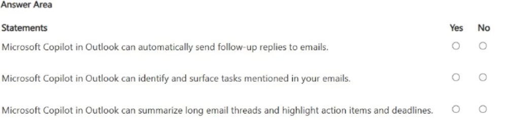

_HOTSPOT — the original ExamTopics question expects you to mark areas on the exhibit above; the correct hotspot coordinates are not published._

**Most voted:**
- Statement 1 (No): Copilot is designed to draft content, but it does not have the autonomy to automatically send emails. A human must review and manually click "Send" to ensure accuracy and accountability.
- Statement 2 (Yes): Copilot can scan the text of an email to detect requested actions and "surface" them as suggested tasks or follow-ups.
- Statement 3 (Yes): This is one of the primary features of the "Summarize by Copilot" button, which provides a concise overview of a thread along with specific dates and responsibilities.

### Top explanations
- **omath** (6 upvotes): No.
  Copilot can draft replies, summarize threads, and suggest follow‑ups — but it does not automatically send emails on your behalf.
  You always remain in control of sending.
  Yes.
  Copilot can detect commitments, deadlines, and tasks embedded in email conversations and surface them as actionable items.
  Yes.
  This is one of Copilot’s core Outlook capabilities: summarizing threads, extracting key points, and highlighting next steps.
- **debs** (5 upvotes [Most Recent]): Microsoft Copilot does not act autonomously so the the correct response to the first statement is No
- **20ca459** (5 upvotes): Statement 1 (No): Copilot is designed to draft content, but it does not have the autonomy to automatically send emails. A human must review and manually click "Send" to ensure accuracy and accountability.
  Statement 2 (Yes): Copilot can scan the text of an email to detect requested actions and "surface" them as suggested tasks or follow-ups.
  Statement 3 (Yes): This is one of the primary features of the "Summarize by Copilot" button, which provides a concise overview of a thread along with specific dates and responsibilities.

## Q2.29 (ID 401286)

Your company’s HR department spends a large amount time answering repetitive questions and updating policy documents.
You need a solution that can automate employee interactions, respond to HR-related questions, and connect to internal business data sources.
What solution should you recommend?

⭕ **A.** Microsoft Security Copilot
✅ **B.** Microsoft Copilot Studio
⭕ **C.** Microsoft 365 Copilot
⭕ **D.** Microsoft Copilot in Azure

**Correct answer:** B
**Most voted:** B

### Top explanations
- **omath** (4 upvotes [Most Recent, Selected Answer: B]): ✅ Best Answer: B. Microsoft Copilot Studio
  Explanation:
  Copilot Studio lets HR teams:
  - Build conversational agents that answer employee questions
  - Connect to internal business data sources (SharePoint, HR systems, policies)
  - Automate repetitive HR workflows
  - Update content easily without engineering support
  - Provide a guided, interactive experience for employees
  This is precisely the scenario Microsoft uses in training materials:
  HR virtual agents → Copilot Studio.

## Q2.30 (ID 401287)

HOTSPOT
For each of the following statements, select Yes if the statement is true. Otherwise, select No.
NOTE: Each correct selection is worth one point.

**Exhibits**
- Exhibit 1: 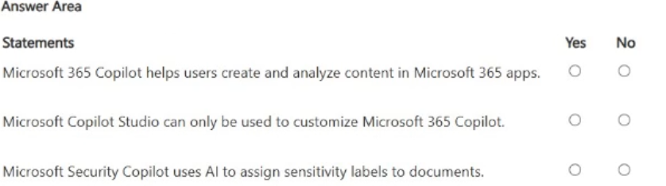

_HOTSPOT — the original ExamTopics question expects you to mark areas on the exhibit above; the correct hotspot coordinates are not published._

**Most voted:**
- Statement 1 (Yes): This is the core functionality of Microsoft 365 Copilot. It assists with drafting text in Word, analyzing data in Excel, and generating slides in PowerPoint.
- Statement 2 (No): Copilot Studio is a versatile low-code tool. While it can extend Microsoft 365 Copilot, it is also used to build standalone custom AI agents for external websites, mobile apps, and other platforms.
- Statement 3 (No): Assigning sensitivity labels is a data governance task handled by Microsoft Purview. Microsoft Copilot for Security (formerly Security Copilot) is a tool specifically for security professionals to assist with incident response, threat hunting, and security posture management.

### Top explanations
- **omath** (5 upvotes [Most Recent]): Yes
  This is exactly what Microsoft 365 Copilot does — generate, summarize, analyze, and transform content inside Word, Excel, PowerPoint, Outlook, Teams, and more.
  No
  Copilot Studio can customize Microsoft 365 Copilot and build standalone conversational agents, automate workflows, connect to business data, and create copilots for websites, HR portals, customer service, etc.
  It is not limited to customizing Microsoft 365 Copilot.
  No
  Security Copilot helps security teams investigate threats, analyze incidents, and accelerate SOC workflows.
  Assigning sensitivity labels is handled by Microsoft Purview, not Security Copilot.
- **20ca459** (2 upvotes): Statement 1 (Yes): This is the core functionality of Microsoft 365 Copilot. It assists with drafting text in Word, analyzing data in Excel, and generating slides in PowerPoint.
  Statement 2 (No): Copilot Studio is a versatile low-code tool. While it can extend Microsoft 365 Copilot, it is also used to build standalone custom AI agents for external websites, mobile apps, and other platforms.
  Statement 3 (No): Assigning sensitivity labels is a data governance task handled by Microsoft Purview. Microsoft Copilot for Security (formerly Security Copilot) is a tool specifically for security professionals to assist with incident response, threat hunting, and security posture management.
- **89880bd** (2 upvotes): Yes, No, No.
  Microsoft Security Copilot focuses on:
  Threat detection
  Incident investigation
  Security analysis
  SOC assistance
  Sensitivity labels are typically handled by Microsoft Purview, not Security Copilot.

## Q2.31 (ID 401288)

HOTSPOT
For each of the following statements, select Yes if the statement is true. Otherwise, select No.
NOTE: Each correct selection is worth one point.

**Exhibits**
- Exhibit 1: 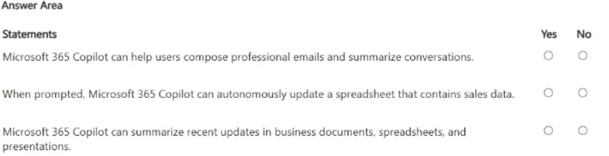

_HOTSPOT — the original ExamTopics question expects you to mark areas on the exhibit above; the correct hotspot coordinates are not published._

**Most voted:**
- Statement 1 (Yes): This describes the core functionality of Copilot in Outlook (drafting and summarizing emails) and Copilot in Teams
- Statement 2 (No): Microsoft 365 Copilot is an AI assistant, not an autonomous agent. While it can suggest changes or create new columns in Excel when prompted, it requires human oversight and does not perform background data updates "autonomously" in the way a programmed script or database trigger would.
- Statement 3 (Yes): Using Microsoft 365 Chat (grounded in the Microsoft Graph), users can ask questions like "What changed in the Q3 budget spreadsheet?" or "Summarize the recent updates to the Project X proposal," and it will pull information across your M365 apps.

### Top explanations
- **20ca459** (8 upvotes [Highly Voted]): Statement 1 (Yes): This describes the core functionality of Copilot in Outlook (drafting and summarizing emails) and Copilot in Teams (summarizing chats and meetings).
  Statement 2 (No): Microsoft 365 Copilot is an AI assistant, not an autonomous agent. While it can suggest changes or create new columns in Excel when prompted, it requires human oversight and does not perform background data updates "autonomously" in the way a programmed script or database trigger would.
  Statement 3 (Yes): Using Microsoft 365 Chat (grounded in the Microsoft Graph), users can ask questions like "What changed in the Q3 budget spreadsheet?" or "Summarize the recent updates to the Project X proposal," and it will pull information across your M365 apps.
- **MoneyStacking** (3 upvotes [Most Recent]): I think you made a mistake at the first one. Your explanation is correct but answered it wrong. I think you meant Yes
- **omath** (2 upvotes): No
  This is one of Copilot’s core capabilities — drafting emails, rewriting them, and summarizing conversations across Outlook and Teams.
  No
  Copilot can suggest formulas, generate summaries, analyze data, and help create visualizations, but it does not autonomously modify or update spreadsheets.
  The user must approve or apply changes manually.
  Yes
  Copilot can summarize changes, highlight updates, and extract key points across Word, Excel, and PowerPoint — this is explicitly part of its Microsoft Graph–powered capabilities.

## Q2.32 (ID 401289)

HOTSPOT
Select the answer that correctly completes the sentence.

**Exhibits**
- Exhibit 1: 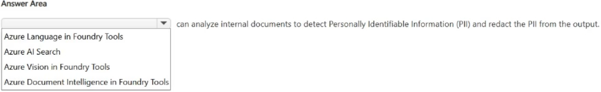

_HOTSPOT — the original ExamTopics question expects you to mark areas on the exhibit above; the correct hotspot coordinates are not published._

**Most voted:**
- For PII detection you need: Azure AI Language (PII detection feature)
- Document Intelligence → extract text
- Azure AI Language → detect PII

### Top explanations
- **omath** (3 upvotes [Most Recent]): ✅ Azure Language in Foundry Tools
  Explanation:
  Azure Language includes prebuilt PII detection capabilities that can:
  - Identify sensitive data (names, emails, phone numbers, IDs, etc.)
  - Classify and extract entities
  - Redact PII automatically from text outputs
  None of the other options provide built‑in PII detection + redaction.
- **deca0d4** (3 upvotes): Azure Language
  For PII detection you need:
  Azure AI Language (PII detection feature)
  👉 Flow in real systems:
  Document Intelligence → extract text
  Azure AI Language → detect PII
- **20ca459** (2 upvotes): PII Detection: Azure AI Language (accessible via Foundry Tools) includes a specific feature called PII detection and redaction. It uses Natural Language Processing (NLP) to identify, categorize, and redact sensitive information like social security numbers, email addresses, and phone numbers from text.

## Q2.33 (ID 401290)

Your company manages a website that publishes daily news articles.
You need to recommend an AI solution that can analyze text and identify the main people, locations, and companies mentioned in the articles.
What should you include in the recommendation?

✅ **A.** Azure Language in Foundry Tools
⭕ **B.** Azure Vision in Foundry Tools
⭕ **C.** Content Safety in Foundry Control Plane
⭕ **D.** Azure Speech in Foundry Tools

**Correct answer:** A
**Most voted:** A

### Top explanations
- **omath** (4 upvotes [Most Recent, Selected Answer: A]): ✅ Best Answer: A. Azure Language in Foundry Tools
  Explanation:
  Azure Language includes prebuilt NLP capabilities such as:
  - Entity recognition (people, organizations, locations, products, dates, etc.)
  - Key phrase extraction
  - Sentiment analysis
  - PII detection
  - Summarization
  This is exactly what you need for news article analysis.
- **20ca459** (2 upvotes [Selected Answer: A]): Named Entity Recognition (NER): Identifying people, locations, and organizations in text is a specific feature of Azure AI Language.
  Text Analysis: This service is purpose-built to process unstructured text and extract key information like entities, phrases, and sentiment.

## Q2.34 (ID 401291)

DRAG DROP
Match the business processes to the appropriate Microsoft Copilot solutions.
To answer, drag the Copilot solution from the column on the left to its business process on the right. Each solution may be used once, more than once, or not at all.
NOTE: Each correct match is worth one point.

**Exhibits**
- Exhibit 1: 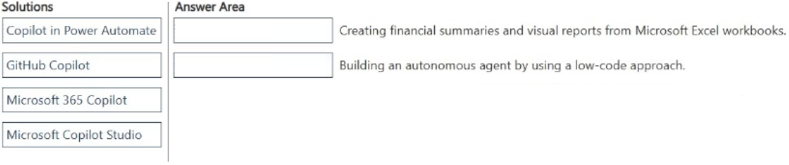

_DRAG DROP — the original ExamTopics question expects you to drag and drop items; the correct targets are not published._

**Most voted:**
- Microsoft 365 Copilot works inside Excel to: - analyze data
- Copilot Studio is the platform for: - building custom copilots

### Top explanations
- **omath** (4 upvotes [Most Recent]): ➡️ Microsoft 365 Copilot
  Microsoft 365 Copilot works inside Excel to:
  - analyze data
  - generate summaries
  - create charts and visuals
  - explain trends
  - build formulas
  This is exactly its domain.
  ➡️ Microsoft Copilot Studio
  Copilot Studio is the platform for:
  - building custom copilots
  - creating autonomous or semi‑autonomous agents
  - connecting to business data
  - using low‑code tools
  - orchestrating workflows
  This is the only option designed for agent creation.

## Q2.35 (ID 401292)

HOTSPOT
For each of the following statements, select Yes if the statement is true. Otherwise, select No.
NOTE: Each correct selection is worth one point.

**Exhibits**
- Exhibit 1: 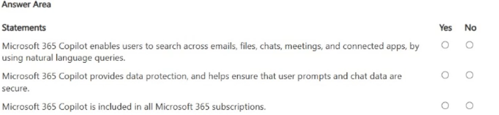

_HOTSPOT — the original ExamTopics question expects you to mark areas on the exhibit above; the correct hotspot coordinates are not published._

**Most voted:**
- It can search across: - Outlook emails
- Copilot enforces: - Microsoft 365 data governance

### Top explanations
- **omath** (5 upvotes): 1. Yes
  This is exactly what Microsoft 365 Copilot does through Microsoft Graph grounding.
  It can search across:
  - Outlook emails
  - OneDrive & SharePoint files
  - Teams chats & meetings
  - Connected apps (e.g., Loop, Planner, etc.)
  All via natural language.
  2. Yes
  Copilot enforces:
  - Microsoft 365 data governance
  - User‑level permissions
  - Tenant boundaries
  - Compliance and security controls
  Prompts and responses stay within the organization’s Microsoft 365 trust boundary.
  3. No
  Copilot is not included by default.
  It requires a separate paid add‑on license.
- **ksmani99** (3 upvotes): Microsoft 365 Copilot is designed with Microsoft’s enterprise security, compliance, and privacy protections built in. It protects prompts, responses, and chat content using the same security boundaries and compliance framework that govern Microsoft 365 data (such as data isolation, Microsoft Entra ID authentication, and Microsoft 365 compliance controls).
  The  Correct answer is - Y, Y, N
- **M2000F007fubar** (1 upvotes [Most Recent]): 1.  yes of course
  2. yes - tricky wording here but M365 gives you protections and M365 Copilot inherits those
  3. no - remember if you get an ME7 license, you get M365 Copilot; otherwise you only get Copilot chat (basic)
- **deca0d4** (1 upvotes): YNN,
  Microsoft 365 Copilot does not provide data protection by itself. It only shows data you’re already allowed to see.

## Q2.36 (ID 401293)

Your company is evaluating the use of Microsoft Copilot Studio to support business process automation and employee self-service.
Which two capabilities are directly supported in Copilot Studio? Each correct answer presents a complete solution.
NOTE: Each correct selection is worth one point.

⭕ **A.** drafting and summarizing files in Microsoft Word and PowerPoint
✅ **B.** customizing agent behavior and responses
⭕ **C.** using agents to identify and respond to security incidents
✅ **D.** building agents that connect to business data and automate user interactions
⭕ **E.** configuring document security

**Correct answer:** B, D
**Most voted:** BD

### Top explanations
- **89880bd** (5 upvotes [Selected Answer: BD]): Detailed Breakdown
  B. customizing agent behavior and responses: Copilot Studio is the primary platform where you define the logic, "topics," and conversational flow of an agent. It allows you to determine exactly how the bot should respond to specific user inputs.
  D. building agents that connect to business data and automate user interactions: This is the core functionality of the "Studio." It allows you to use pre-built connectors (like Power Automate) to link your agent to internal databases, CRM systems, or SharePoint, enabling the bot to perform tasks or retrieve specific business information.
- **omath** (4 upvotes [Most Recent, Selected Answer: BD]): B. customizing agent behavior and responses
  Copilot Studio allows you to:
  - define agent behavior
  - configure instructions and tone
  - control how the agent responds
  - build topics, flows, and logic
  D. building agents that connect to business data and automate user interactions
  It supports:
  - connectors to internal systems (SharePoint, Dataverse, APIs, SQL, HR systems, etc.)
  - multi‑step workflows
  - business process automation
  - conversational self‑service agents
- **20ca459** (4 upvotes [Selected Answer: BD]): Choice B: Copilot Studio is a low-code platform that allows you to create specific topics, define the tone/persona of the agent, and manage the logic of how it responds to user queries.
  Choice D: This is the core value of the tool. It allows you to use connectors (Power Platform) and generative answers to ground an agent in your specific business data (like SharePoint or manual file uploads) to automate employee self-service tasks.
- **ksmani99** (2 upvotes [Selected Answer: BD]): B. Customizing agent behavior and responses
  Microsoft Copilot Studio allows you to design, configure, and customize how agents behave, including conversation flow, tone, triggers, and responses.
  This is a core capability for employee self‑service and business process automation.
  D. Building agents that connect to business data and automate user interactions
  Copilot Studio supports connecting to internal business data sources (via connectors, APIs, Power Platform, Dataverse, etc.).
  It enables automation of user interactions, such as answering HR questions, retrieving policy info, and triggering workflows.

## Q2.37 (ID 401294)

HOTSPOT
Select the answer that correctly completes the sentence.

**Exhibits**
- Exhibit 1: 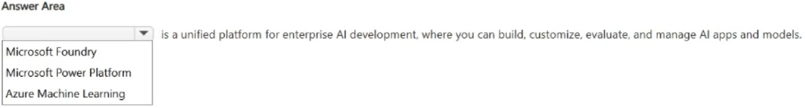

_HOTSPOT — the original ExamTopics question expects you to mark areas on the exhibit above; the correct hotspot coordinates are not published._

**Most voted:**
- customizing models
- evaluating performance
- managing lifecycle and governance
- integrating with enterprise data and controls

### Top explanations
- **omath** (4 upvotes [Most Recent]): ✅ Correct Answer: Microsoft Foundry
  Microsoft Foundry is the enterprise‑grade platform designed specifically for:
  - building AI apps
  - customizing models
  - evaluating performance
  - managing lifecycle and governance
  - integrating with enterprise data and controls
  It is the unified environment Microsoft created for end‑to‑end enterprise AI development.

## Q2.38 (ID 401295)

HOTSPOT
For each of the following statements, select Yes if the statement is true. Otherwise, select No.
NOTE: Each correct selection is worth one point.

**Exhibits**
- Exhibit 1: 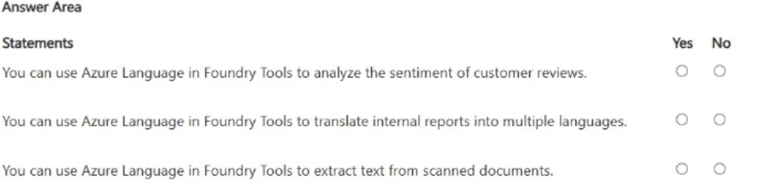

_HOTSPOT — the original ExamTopics question expects you to mark areas on the exhibit above; the correct hotspot coordinates are not published._

**Most voted:**
1. Yes
2. No
3. No

### Top explanations
- **omath** (7 upvotes [Highly Voted]): 1. Yes
  Azure Language includes sentiment analysis as a core prebuilt capability.
  2. No
  Translation is handled by Azure AI Translator, not Azure Language.
  3. No
  Extracting text from scanned documents is OCR, which belongs to Azure Document Intelligence or Azure Vision, not Azure Language.
- **TDAC** (2 upvotes [Most Recent]): This is correct.  Azure Translator is not part of the Azure Language suite—they are two entirely separate, standalone tools that sit side-by-side under the broader Azure AI Foundry Tools umbrella.
- **20ca459** (2 upvotes): Statement 1 (Yes): Sentiment Analysis is a core feature of Azure AI Language. it can automatically categorize text as positive, negative, neutral, or mixed.
  Statement 2 (Yes): While it is often its own service, Translation is integrated into the Azure AI Language suite within Foundry, allowing for the conversion of text between dozens of languages.
  Statement 3 (No): Extracting text from scans or images (OCR) is the responsibility of Azure AI Document Intelligence or Azure AI Vision. Azure AI Language is designed to process text that has already been converted into a digital format.

## Q3.1 (ID 384475)

HOTSPOT
For each of the following statements, select Yes if the statement is true. Otherwise, select No.
NOTE: Each correct selection is worth one point.

**Exhibits**
- Exhibit 1: 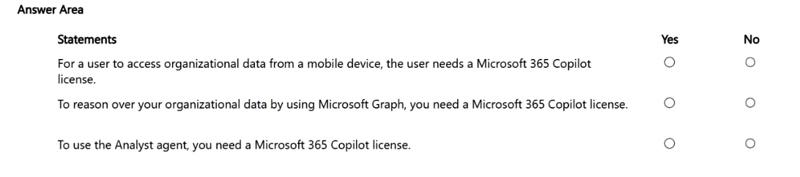

_HOTSPOT — the original ExamTopics question expects you to mark areas on the exhibit above; the correct hotspot coordinates are not published._

**Most voted:**
- No
- No
- Yes

### Top explanations
- **Benny2694** (5 upvotes): No-Accessing organizational data on mobile depends on Microsoft 365 apps,not a Copilot license.
  No-Microsoft Graph can be accessed by applications and services without Microsoft 365 Copilot. Copilot uses Graph, but Graph itself does not require a Copilot license.
  Yes-Analyst is a Copilot agent and requires a Microsoft 365 Copilot license.
- **omath** (2 upvotes): Access from mobile device — No
  Accessing organizational data from a mobile device depends on the user’s Microsoft 365 license, not a Microsoft 365 Copilot license. Copilot is not required just to access data.
  Reason over organizational data — Yes
  Microsoft 365 Copilot uses Microsoft Graph to reason over your organizational data. To use Copilot’s reasoning capabilities, a Microsoft 365 Copilot license is required.
  Analyst agent — No
  The Analyst agent is part of Copilot Studio agent capabilities. It does not require a Microsoft 365 Copilot license.
- **dsharu** (2 upvotes): To reason over your organization data by using Microsoft Graph, you need Microsoft 365 Copilot license.
  The keyword is "reasoning".
  Microsoft Graph provides access to data
  But reasoning over that data using AI (Copilot) requires:
  Microsoft 365 Copilot license
  So, the second option is Yes
- **89880bd** (2 upvotes): ✅ Final Answers:
  No
  No
  Yes
- **fa62dd5** (2 upvotes): NO, NO, YES

## Q3.2 (ID 384476)

Your company plans to adopt AI across multiple business units.
You need to ensure that all AI projects align with the company’s business strategy and are implemented responsibly.
What is the best approach to achieve the goal? More than one answer choice may achieve the goal. Select the BEST answer.

⭕ **A.** Allow each department to deploy its own AI tools and workflows.
⭕ **B.** Delegate AI decision-making to the company’s IT department.
⭕ **C.** Outsource AI development to an external vendor.
✅ **D.** Establish an AI council to provide guidance, oversight, and coordination.

**Correct answer:** D
**Most voted:** D

### Top explanations
- **omath** (3 upvotes [Most Recent, Selected Answer: D]): Best answer: D — Establish an AI council to provide guidance, oversight, and coordination.
  An AI council provides:
  - Strategic alignment across business units
  - Responsible AI oversight
  - Cross‑functional coordination (IT, security, legal, HR, business leaders)
  - Prioritization and risk management
  - Consistent standards, policies, and guardrails

## Q3.3 (ID 384493)

Your company has a Microsoft 365 subscription and uses Microsoft 365 Copilot Chat.
Some users need to build and use declarative agents that can access work data.
Which type of license should you recommend for the users?

✅ **A.** a Microsoft 365 Copilot add-on license
⭕ **B.** Microsoft Copilot Studio user license
⭕ **C.** a Copilot Chat pay-as-you-go plan

**Correct answer:** A
**Most voted:** A

### Top explanations
- **omath** (4 upvotes [Selected Answer: B]): Best answer: B — Microsoft Copilot Studio user license.
  To build and use declarative agents that can access work data, users need Copilot Studio.
  This requires a Copilot Studio user license, not a Microsoft 365 Copilot license.
  Copilot Studio provides:
  - Agent creation (declarative + procedural)
  - Access to organizational data via connectors
  - Governance, environments, and lifecycle management
  - Publishing and usage controls
  This is exactly the licensing requirement Microsoft outlines for agent builders.
- **Benny2694** (3 upvotes [Selected Answer: B]): Copilot Studio is the tool specifically designed for: Building custom and declarative agents and Connect agents to organizational data sources
  Microsoft 365 Copilot add‑on license - This enables Copilot experiences (Chat, Analyst, Researcher), not agent creation
  Copilot Chat pay‑as‑you‑go plan - Intended for usage-based chat scenarios, not building declarative agents with work data
- **idrisfl** (2 upvotes [Selected Answer: A]): A => The key phrase is “declarative agents that can access work data.”
- **RDX** (2 upvotes [Selected Answer: A]): I recommend A. a Microsoft 365 Copilot add-on license
- **Consultant1995** (2 upvotes [Selected Answer: A]): access to Microsoft 365 Copilot extensibility features, including agents that can work with organizational data, requires a Microsoft 365 Copilot license. Users with only Microsoft 365 Copilot Chat do not receive the same work-data grounding and extensibility capabilities.

## Q3.4 (ID 384477)

HOTSPOT
For each of the following statements, select Yes if the statement is true. Otherwise, select No.
NOTE: Each correct selection is worth one point.

**Exhibits**
- Exhibit 1: 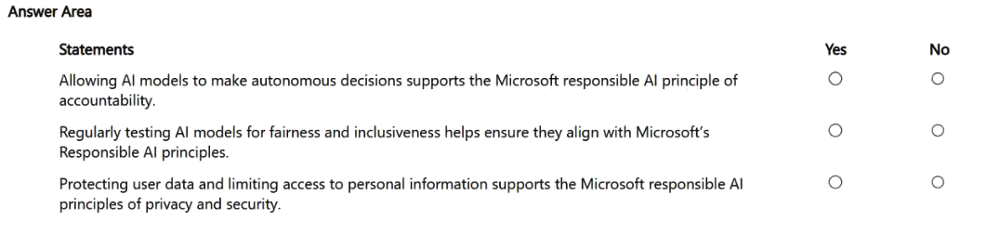

_HOTSPOT — the original ExamTopics question expects you to mark areas on the exhibit above; the correct hotspot coordinates are not published._

**Most voted:** Not provided

### Top explanations
- **omath** (4 upvotes [Most Recent]): No — Accountability requires human oversight, not autonomous decision‑making.
  Yes — Ongoing fairness and inclusiveness testing is a core Responsible AI practice.
  Yes — These actions directly support the Privacy & Security principles.

## Q3.5 (ID 384478)

Your company plans to implement a proof of concept (PoC) agent that uses Azure OpenAI.
The solution must start small and provide flexibility to scale usage as demand grows.
Which pricing model should you use?

⭕ **A.** Microsoft 365 Copilot
⭕ **B.** Batch API
⭕ **C.** Provisioned (PTUs)
✅ **D.** Standard (On-Demand)

**Correct answer:** D
**Most voted:** D

### Top explanations
- **omath** (6 upvotes [Most Recent, Selected Answer: D]): Best answer: D — Standard (On‑Demand).
  For a proof of concept using Azure OpenAI, you need:
  - Low commitment
  - Ability to start small
  - Flexibility to scale up or down
  - No upfront capacity reservations
  That is exactly what the Standard (On‑Demand) pricing model provides.
  You pay only for the tokens you use, making it ideal for experimentation and early‑stage pilots.

## Q3.6 (ID 384491)

HOTSPOT
Select the answer that correctly completes the sentence.

**Exhibits**
- Exhibit 1: 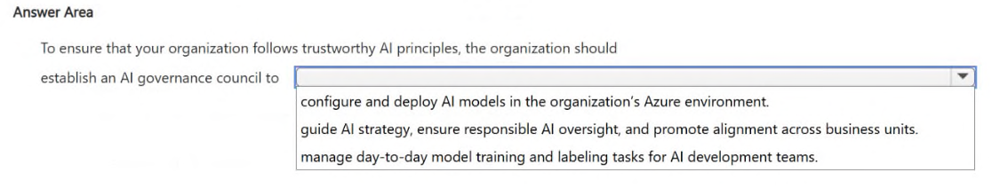

_HOTSPOT — the original ExamTopics question expects you to mark areas on the exhibit above; the correct hotspot coordinates are not published._

**Most voted:**
- guide AI strategy, ensure responsible AI oversight, and promote alignment across business units.
- That is the core purpose of an AI governance council: strategic guidance, oversight, and cross-functional coordination for responsible AI adoption.

### Top explanations
- **omath** (3 upvotes [Most Recent]): guide AI strategy, ensure responsible AI oversight, and promote alignment across business units.
  An AI governance council exists to provide strategic direction, responsible AI oversight, and cross‑organizational alignment.
  It does not deploy models or manage day‑to‑day technical tasks — those belong to engineering and data science teams.
- **satoshi_** (2 upvotes): Answer: guide AI strategy, ensure responsible AI oversight, and promote alignment across business units.
  That is the core purpose of an AI governance council: strategic guidance, oversight, and cross-functional coordination for responsible AI adoption.

## Q3.7 (ID 384518)

Your company deploys an AI-powered loan approval solution that enables applicants to request an explanation as to why their loan application was denied.
Which Microsoft responsible AI principle is this an example of?

⭕ **A.** fairness
⭕ **B.** privacy and security
✅ **C.** transparency
⭕ **D.** inclusiveness

**Correct answer:** C
**Most voted:** C

### Top explanations
- **omath** (4 upvotes [Most Recent, Selected Answer: C]): The correct answer is C. transparency.
  Allowing applicants to request an explanation for why their loan was denied is a direct example of transparency — making AI decisions understandable, traceable, and explainable to the people affected by them.
- **satoshi_** (2 upvotes [Selected Answer: C]): Answer: C. transparency
  Allowing applicants to request an explanation for why a loan was denied is an example of transparency. Microsoft describes transparency as providing clear explanations of how AI systems work and make decisions.

## Q3.8 (ID 384519)

Your company wants to ensure that AI solutions are used responsibly and align with company values and compliance requirements.
You need to establish governance principles for AI use.
Which two actions should you perform? Select the two BEST answers. Each correct answer presents a complete solution.
NOTE: Each correct selection is worth one point.

⭕ **A.** Allow each department to tailor governance processes for its own AI initiatives.
✅ **B.** Define accountability norms for AI decisions across business and technical teams.
✅ **C.** Create a process to review AI initiatives for responsible AI alignment.
⭕ **D.** Assign governance ownership primarily to the AI engineering and data science teams.
⭕ **E.** Focus governance efforts on AI systems that handle regulated or sensitive data.

**Correct answer:** B, C
**Most voted:** BC

### Top explanations
- **omath** (4 upvotes [Most Recent, Selected Answer: BC]): ✔️ Define accountability norms (B)
  Accountability is a core Responsible AI principle.
  You must clearly define:
  - Who is responsible for AI decisions
  - How oversight works
  - Escalation paths
  - Human‑in‑the‑loop requirements
  This is foundational governance.
  ✔️ Create a review process for responsible AI alignment (C)
  A governance framework must include:
  - Pre‑deployment reviews
  - Risk assessments
  - Ethical and compliance checks
  - Ongoing monitoring
  This ensures AI solutions consistently align with company values and regulatory expectations.
- **satoshi_** (3 upvotes [Selected Answer: BC]): Best answers: B and C
  -B. Define accountability norms for AI decisions across business and technical teams.
  This aligns directly with Microsoft’s Responsible AI principle of accountability, which emphasizes that people and organizations must remain responsible for AI systems and their outcomes.
  -C. Create a process to review AI initiatives for responsible AI alignment.
  A formal review process is a core governance practice. Microsoft describes internal impact assessments and review processes to ensure AI initiatives align with the Responsible AI Standard.
- **satoshi_** (2 upvotes): Why not the others:
  -A weakens consistency by fragmenting governance across departments.
  -D is too narrow; governance should be cross-functional, not owned mainly by engineering/data science alone.
  -E is useful as a prioritization tactic, but it is too limited for establishing broad governance principles across all AI use.

## Q3.9 (ID 384520)

Your company is deploying Microsoft 365 Copilot. The deployment must provide users with access to the Researcher agent to search across data in Microsoft SharePoint.
You need to recommend a licensing plan for the solution.
What should you recommend?

✅ **A.** a Microsoft 365 Copilot per-user add-on license
⭕ **B.** pay-as-you-go
⭕ **C.** a Microsoft 365 subscription entitlement
⭕ **D.** a usage-based consumption license in Azure

**Correct answer:** A
**Most voted:** A

### Top explanations
- **omath** (4 upvotes [Most Recent, Selected Answer: A]): Correct answer: A — a Microsoft 365 Copilot per‑user add‑on license
  To use the Researcher agent in Microsoft 365 Copilot — including searching across SharePoint, OneDrive, and other Microsoft 365 data — users must have the full Microsoft 365 Copilot license.
  The Researcher agent is not included in the free Copilot Chat experience.
  It is unlocked only with the Microsoft 365 Copilot per‑user add‑on.
- **satoshi_** (2 upvotes [Selected Answer: A]): Answer: A. a Microsoft 365 Copilot per-user add-on license
  Why:
  Microsoft says Researcher is part of the core default experience for Microsoft 365 Copilot licensed users.
  Microsoft also states that Microsoft 365 Copilot includes comprehensive access to agents, including Analyst & Researcher.
  By contrast, pay-as-you-go is for metered agent access in services like Copilot Chat or SharePoint agents, not the built-in Researcher entitlement.

## Q3.10 (ID 384521)

HOTSPOT
For each of the following statements, select Yes if the statement is true. Otherwise, select No.
NOTE: Each correct selection is worth one point.

**Exhibits**
- Exhibit 1: 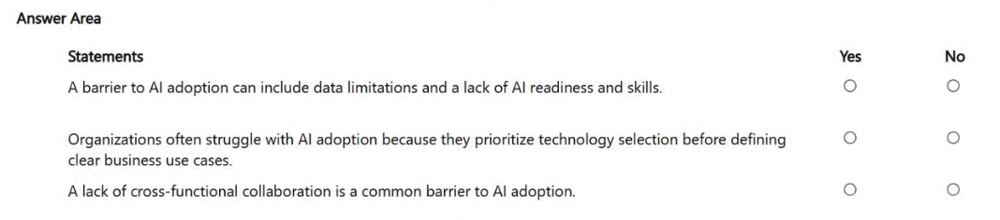

_HOTSPOT — the original ExamTopics question expects you to mark areas on the exhibit above; the correct hotspot coordinates are not published._

**Most voted:** 1.Yes — A common barrier to AI adoption is data limitations and a lack of AI readiness / skills. Microsoft highlights the need for scalable data governance in AI strategy, and Microsoft’s AI change-readiness guidance notes that lack of time, access, and new AI skills can hinder adoption.

### Top explanations
- **omath** (2 upvotes [Most Recent]): Yes — These are among the most common barriers organizations face.
  Yes — This is a well‑known pitfall: choosing tech before defining value.
  Yes — Successful AI requires alignment across business, IT, legal, compliance, and data teams.
- **satoshi_** (2 upvotes): 1.Yes — A common barrier to AI adoption is data limitations and a lack of AI readiness / skills. Microsoft highlights the need for scalable data governance in AI strategy, and Microsoft’s AI change-readiness guidance notes that lack of time, access, and new AI skills can hinder adoption.
  2.Yes — This is true. Microsoft’s AI adoption guidance says organizations should first identify AI use cases that deliver measurable business value, and then select the appropriate AI technologies. That directly supports the idea that prioritizing technology before defining clear business use cases is a common cause of adoption struggles.
  3.Yes — A lack of cross-functional collaboration is a common barrier. Microsoft explicitly recommends forming a cross-functional team (IT, data science, and business experts) for successful AI implementation.

## Q3.11 (ID 384522)

What is considered a best practice when forming an AI adoption team in an enterprise environment?

⭕ **A.** Include primarily IT and project management staff initially to streamline deployment, adding governance and compliance roles later.
⭕ **B.** Include procurement and vendor management specialists early to evaluate AI tools, involving business teams once a platform is selected.
✅ **C.** Include representatives from legal, leadership, and business units to align AI initiatives with organizational priorities.
⭕ **D.** Include only data scientists and engineers at first to validate technical feasibility, then add other stakeholders later.

**Correct answer:** C
**Most voted:** C

### Top explanations
- **omath** (3 upvotes [Most Recent, Selected Answer: C]): Correct answer: C — Include representatives from legal, leadership, and business units to align AI initiatives with organizational priorities.
  An effective AI adoption team must reflect the entire organization, not just technical roles.
  Including legal, leadership, and business units ensures:
  - AI aligns with strategic priorities
  - Responsible AI and compliance requirements are met
  - Change management and adoption succeed
  - Use cases are tied to measurable business value
  This is exactly what Microsoft’s AB‑731 guidance emphasizes.
- **satoshi_** (2 upvotes [Selected Answer: C]): Answer: C. Include representatives from legal, leadership, and business units to align AI initiatives with organizational priorities.
  This is the best practice because enterprise AI adoption works best with a cross-functional team that aligns AI efforts to business goals, governance, and risk management. Microsoft’s AI strategy guidance emphasizes aligning AI initiatives with business value, data governance, and responsible AI practices, which requires more than just technical staff.
  Microsoft’s AI council guidance also describes a cross-functional model that defines AI vision, values, and policies, and reviews AI use cases submitted by different business units, which supports involving leadership, legal, and business stakeholders early.

## Q3.12 (ID 384523)

Your company is developing an AI-powered customer support agent.
You need to ensure that the solution follows Microsoft responsible AI principles.
Which two actions should you perform? Select the two BEST answers. Each correct answer presents part of the solution.
NOTE: Each correct selection is worth one point.

⭕ **A.** Retain all customer conversations.
✅ **B.** Test the agent to ensure that responses are inclusive and culturally sensitive.
⭕ **C.** Enable the agent to operate independently.
⭕ **D.** Ensure that the agent can be used for multiple purposes.
✅ **E.** Provide a clear disclaimer that users are interacting with an AI solution.

**Correct answer:** B, E
**Most voted:** BE

### Top explanations
- **omath** (4 upvotes [Most Recent, Selected Answer: BE]): Inclusive and culturally sensitive testing (B)
  This directly supports Microsoft’s Responsible AI principles of fairness, inclusiveness, and reliability.
  AI systems must be evaluated to ensure they do not produce biased, offensive, or culturally inappropriate responses.
  Clear AI disclosure (E)
  Transparency is a core Responsible AI principle.
  Users must know when they are interacting with an AI system so they can make informed decisions.
- **satoshi_** (2 upvotes [Selected Answer: BE]): Best answers: B and E
  B. Test the agent to ensure that responses are inclusive and culturally sensitive.
  This aligns with Microsoft’s Responsible AI principles of fairness and inclusiveness. Microsoft explicitly lists fairness and inclusiveness among its six core Responsible AI principles.
  E. Provide a clear disclaimer that users are interacting with an AI solution.
  This supports transparency. Microsoft says AI systems should be understandable, and Microsoft also describes in-product disclosure practices that inform users they are interacting with an AI application.
- **satoshi_** (2 upvotes): Why not the others:
  -A is not a best practice because retaining all customer conversations is not inherently required and can conflict with privacy-minimization goals. Microsoft includes privacy and security as a core principle.
  -C is weak because Microsoft’s accountability principle emphasizes human oversight and control, not fully independent operation.
  -D is not tied to a Responsible AI principle; multi-purpose use is not a core requirement.

## Q3.13 (ID 384524)

HOTSPOT
For each of the following statements, select Yes if the statement is true. Otherwise, select No.
NOTE: Each correct selection is worth one point.

**Exhibits**
- Exhibit 1: 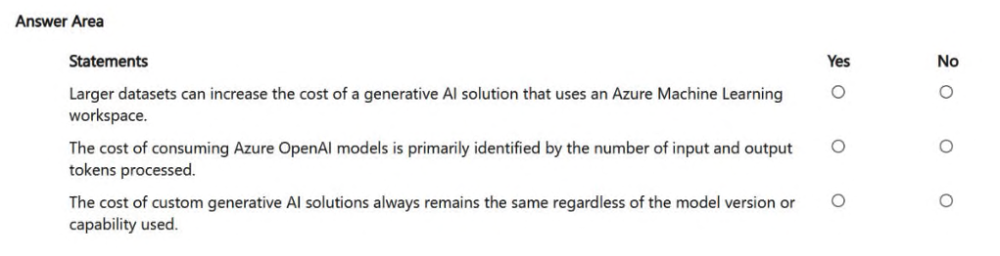

_HOTSPOT — the original ExamTopics question expects you to mark areas on the exhibit above; the correct hotspot coordinates are not published._

**Most voted:** Not provided

### Top explanations
- **omath** (3 upvotes [Most Recent]): Yes — Larger datasets increase storage, compute, training, and experimentation costs.
  Yes — Azure OpenAI billing is based on tokens in + tokens out, depending on the model.
  No — Costs vary significantly by model family, version, throughput, and capability.
- **satoshi_** (2 upvotes): 1.Yes — Larger datasets can increase cost in an Azure Machine Learning-based generative AI solution because Azure Machine Learning charges for the underlying compute resources used for training/inference, and larger datasets typically require more processing and can also increase related storage/network costs.
  2.Yes — Azure OpenAI consumption cost is primarily based on the number of input and output tokens processed. Microsoft’s pricing and cost documentation describes token-based billing for model usage.
  3.No — The cost of custom generative AI solutions does not always remain the same; Microsoft states that pricing varies by model series/version and deployment type, and fine-tuning pricing also varies by model plus hosting and token usage.

## Q3.14 (ID 384525)

HOTSPOT
For each of the following statements, select Yes if the statement is true. Otherwise, select No.
NOTE: Each correct selection is worth one point.

**Exhibits**
- Exhibit 1: 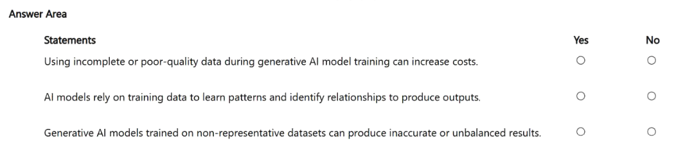

_HOTSPOT — the original ExamTopics question expects you to mark areas on the exhibit above; the correct hotspot coordinates are not published._

**Most voted:** Not provided

### Top explanations
- **omath** (4 upvotes [Most Recent]): Yes — Poor data leads to more retraining, experimentation, and compute usage, all of which increase cost.
  Yes — This is the fundamental mechanism of machine learning and generative AI.
  Yes — Biased or incomplete datasets lead directly to biased or unreliable model outputs.
- **satoshi_** (2 upvotes): 1.Yes — Poor-quality or incomplete training data can increase costs because it often leads to rework, retraining, and lower model performance.
  2.Yes — AI models learn from training data by identifying patterns and relationships, then use those learned patterns to generate outputs.
  3.Yes — If training data is not representative, the model can produce inaccurate, biased, or unbalanced results.

## Q3.15 (ID 384526)

Your company uses a fine-tuned generative AI solution trained on data that is representative of the general population.
You discover that some of the generated responses include inappropriate or exclusionary language based on ableist assumptions.
You need to prevent the inappropriate responses. Your solution must minimize costs.
What should you do?

⭕ **A.** Apply a newer version of the generative AI model.
✅ **B.** Apply a content-moderation filter.
⭕ **C.** Create a new version of the solution that is trained on only inclusive and representative content.
⭕ **D.** Create a new version of the solution that is trained on only exclusionary content.

**Correct answer:** B
**Most voted:** B

### Top explanations
- **omath** (3 upvotes [Most Recent, Selected Answer: B]): The correct answer is B — Apply a content‑moderation filter.
  ✔️ Why content moderation is the BEST solution
  Your goal is to prevent inappropriate or exclusionary language while minimizing cost.
  Content‑moderation filters do exactly that:
  - They block or rewrite harmful, biased, or ableist outputs
  - They require no retraining, no new model, and no additional compute
  - They are the lowest‑cost, highest‑impact mitigation step
  - They align with Microsoft Responsible AI principles (Fairness, Inclusiveness, Safety)
  This is the standard AB‑731 answer pattern:
  When the issue is harmful output and cost matters → apply content moderation.
- **satoshi_** (1 upvotes [Selected Answer: B]): Answer: B. Apply a content-moderation filter.
  Why this is the best choice:
  The goal is to prevent inappropriate responses.
  The solution must minimize costs.
  A content-moderation filter is the most direct and low-cost way to block or flag harmful/exclusionary output without retraining the model.
  Why not the others:
  A. Apply a newer version of the generative AI model
  A newer model might help, but it does not directly guarantee that the specific ableist or exclusionary outputs will be prevented.
  C. Retrain on only inclusive and representative content
  This could help, but it is more expensive and time-consuming than adding moderation controls.
  D. Train on only exclusionary content
  This would obviously make the problem worse.

## Q3.16 (ID 401296)

Your company plans to use an AI-powered solution to analyze customer feedback for insights related to future product designs.
You need to mitigate the privacy risks associated with the solution.
What is the best approach to achieve the goal? More than one answer choice may achieve the goal. Select the BEST answer.

⭕ **A.** Delete all the feedback data immediately after analysis.
⭕ **B.** Ensure that feedback is attributable to the customer so that it can be deleted upon request.
⭕ **C.** Limit privacy reviews to the final stage of the AI project lifecycle.
✅ **D.** Anonymize the source data to remove customer Personally Identifiable Information (PII) from the feedback.

**Correct answer:** D
**Most voted:** D

### Top explanations
- **omath** (3 upvotes [Most Recent, Selected Answer: D]): D. Anonymize the source data to remove customer PII from the feedback.
  ✔️ Why anonymization is the BEST approach
  For an AI solution analyzing customer feedback, the primary privacy risk is exposing or mishandling Personally Identifiable Information (PII).
  Anonymizing the data:
  - Removes direct identifiers (names, emails, phone numbers)
  - Reduces re‑identification risk
  - Minimizes regulatory exposure
  - Allows the AI system to operate on safe, non‑sensitive data
  - Is low‑cost compared to retraining or redesigning the system
  This is the standard Responsible AI mitigation pattern:
  When privacy risk exists → anonymize or de‑identify data.

## Q3.17 (ID 401297)

HOTSPOT
Select the answer that correctly completes the sentence.

**Exhibits**
- Exhibit 1: 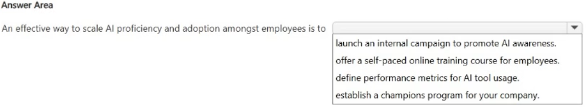

_HOTSPOT — the original ExamTopics question expects you to mark areas on the exhibit above; the correct hotspot coordinates are not published._

**Most voted:** Not provided

### Top explanations
- **omath** (3 upvotes [Most Recent]): establish a champions program for your company.
  An AI champions program is the most effective way to scale AI proficiency and adoption across an enterprise because it:
  - Builds a distributed network of early adopters
  - Accelerates peer‑to‑peer learning
  - Creates internal advocates who drive responsible usage
  - Supports cultural change, not just training completion
  - Scales far more effectively than awareness campaigns or one‑off courses
  This aligns directly with Microsoft’s recommended enterprise AI adoption strategy.

## Q3.18 (ID 401298)

Your company is building a portfolio of AI-powered business solutions.
Company executives want to understand how Microsoft responsible AI principles can support the company’s long-term goals.
Which benefit best demonstrates the importance of responsible AI? More than one answer choice may achieve the goal. Select the BEST answer.

⭕ **A.** reduces the need for executive oversight in AI decision-making
✅ **B.** enhances stakeholder trust and fosters sustainable AI adoption throughout the organization
⭕ **C.** guarantees that AI models provide accurate and relevant responses
⭕ **D.** reduces the need for data protection policies and governance

**Correct answer:** B
**Most voted:** B

### Top explanations
- **omath** (3 upvotes [Most Recent, Selected Answer: B]): The BEST answer is B — enhances stakeholder trust and fosters sustainable AI adoption throughout the organization.
  Responsible AI is fundamentally about trust, safety, governance, and long‑term organizational resilience.
  The strongest enterprise‑level benefit — and the one Microsoft emphasizes in AB‑731 — is that responsible AI:
  - Builds trust with customers, employees, regulators, and partners
  - Enables sustained adoption rather than short‑term experimentation
  - Reduces risk and increases confidence in scaling AI across the business
  This is the benefit that most directly supports long‑term company goals.
- **20ca459** (2 upvotes [Selected Answer: B]): Trust and Sustainability: Responsible AI is designed to build confidence among users, customers, and regulators. This trust is essential for the long-term success and widespread use of AI technologies within a business.
  Long-term Goals: By addressing ethical concerns like fairness, privacy, and transparency early, a company avoids the reputational and legal risks that could derail its AI portfolio in the future.

## Q3.19 (ID 401299)

HOTSPOT
Select the answer that correctly completes the sentence.

**Exhibits**
- Exhibit 1: 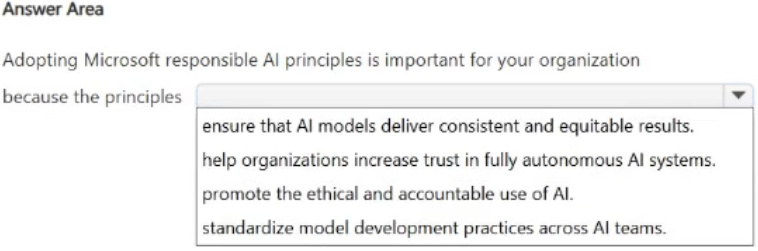

_HOTSPOT — the original ExamTopics question expects you to mark areas on the exhibit above; the correct hotspot coordinates are not published._

**Most voted:** Not provided

### Top explanations
- **omath** (3 upvotes [Most Recent]): promote the ethical and accountable use of AI.
  ✔️ Why this is the correct choice
  Microsoft’s Responsible AI principles exist to guide organizations toward ethical, transparent, and accountable AI practices.
  Their purpose is not just technical consistency — it’s to ensure AI is used in ways that are:
  - aligned with organizational values
  - safe and fair
  - transparent and accountable
  - respectful of privacy and human rights
  That aligns directly with ethical and accountable use.
- **20ca459** (2 upvotes): Microsoft’s Responsible AI framework (comprising Fairness, Reliability & Safety, Privacy & Security, Inclusiveness, Transparency, and Accountability) is designed to ensure that AI technologies are developed and deployed in a way that respects human rights and encourages developer responsibility.

## Q3.20 (ID 401300)

HOTSPOT
For each of the following statements, select Yes if the statement is true. Otherwise, select No.
NOTE: Each correct selection is worth one point.

**Exhibits**
- Exhibit 1: 

_HOTSPOT — the original ExamTopics question expects you to mark areas on the exhibit above; the correct hotspot coordinates are not published._

**Most voted:** Yes, No, Yes

### Top explanations
- **omath** (3 upvotes): Yes — Access to Microsoft 365 Copilot (Word, Excel, Outlook, Teams, SharePoint reasoning, etc.) requires the per‑user Copilot add‑on license.
  No — E3/E5 are prerequisites, but Copilot is not included. It is always an add‑on.
  No — PAYG applies to Copilot Studio and Azure OpenAI, not Microsoft 365 Copilot.
- **TDAC** (2 upvotes): YNY
  The last one (about PAYG) is Yes because M365 Copilot Chat and SharePoint Agents CAN be set up as pay-as-you-go.
  Source: https://learn.microsoft.com/en-us/microsoft-365/copilot/pay-as-you-go/setup
- **M2000F007fubar** (1 upvotes [Most Recent]): agree, it is YNY. The basic is having M365 licensing, Copilot can be added with an add-on or a full ME7 license.

## Q3.21 (ID 401301)

You have a business unit that uses an AI solution to process loan applications.
You discover that the solution rejects the application of all applicants that are older than 60 years of age.
Which Microsoft responsible AI principle is this violating?

⭕ **A.** accountability
⭕ **B.** transparency
⭕ **C.** reliability and safety
✅ **D.** fairness

**Correct answer:** D
**Most voted:** D

### Top explanations
- **omath** (3 upvotes [Most Recent, Selected Answer: D]): The correct answer is D — fairness.
  Rejecting all applicants over age 60 is a clear case of age‑based discrimination.
  This violates the Responsible AI principle of fairness, which requires that AI systems:
  - Do not produce biased or discriminatory outcomes
  - Treat individuals and groups equitably
  - Avoid using sensitive attributes (like age) in harmful or exclusionary ways
  An AI system that automatically denies older applicants is exhibiting systemic bias, which fairness principles are designed to prevent.

## Q3.22 (ID 401302)

HOTSPOT
Select the answer that correctly completes the sentence.

**Exhibits**
- Exhibit 1: 

_HOTSPOT — the original ExamTopics question expects you to mark areas on the exhibit above; the correct hotspot coordinates are not published._

**Most voted:** Not provided

### Top explanations
- **omath** (3 upvotes [Most Recent]): users who advocate for the value of AI by learning, sharing, and identifying use cases.
  An AI champions program is built around champion users — enthusiastic early adopters who:
  - Learn AI tools deeply
  - Share best practices with peers
  - Identify high‑value use cases
  - Drive cultural adoption across the organization
  They are not infrastructure builders, analytics teams, or strategy owners — they are influential employees who help others adopt AI responsibly and effectively.

## Q3.23 (ID 401303)

Your company is reviewing a new AI solution before deploying it. The company wants to ensure that the solution follows Microsoft responsible AI principles.
What is the best approach to achieve the goal? More than one answer choice may achieve the goal. Select the BEST answer.

⭕ **A.** Design the AI solution to automatically approve or reject customer loan applications.
✅ **B.** Test the AI solution to identify and mitigate potential unfair or inconsistent outcomes in its outputs.
⭕ **C.** Prioritize model performance when tuning the AI solution.
⭕ **D.** Enable the AI solution to collect and store personal data.

**Correct answer:** B
**Most voted:** B

### Top explanations
- **omath** (4 upvotes [Most Recent, Selected Answer: B]): B — Test the AI solution to identify and mitigate potential unfair or inconsistent outcomes in its outputs.
  Before deploying an AI system — especially one making high‑impact decisions like loan approvals — Microsoft’s Responsible AI principles require:
  - Testing for bias, unfair treatment, and disparate impact
  - Identifying harmful patterns (e.g., discrimination by age, gender, ethnicity)
  - Mitigating those issues before the system affects real customers
  This is the most direct, effective, and responsible action.

## Q3.24 (ID 401304)

DRAG DROP
Match the Microsoft responsible AI principles to the appropriate descriptions.
To answer, drag the principle from the column on the left to its description on the right. Each principle may be used once, more than once, or not at all.
NOTE: Each correct match is worth one point.

**Exhibits**
- Exhibit 1: 

_DRAG DROP — the original ExamTopics question expects you to drag and drop items; the correct targets are not published._

**Most voted:**
- Privacy and security → Protect personal information and apply strong safeguards to keep data secure.
- Transparency → Make AI solutions understandable by explaining how and why decisions are made.
- Inclusiveness → Design AI solutions that are accessible to people of all abilities and experiences.
- Accountability → Involve human oversight in the control of AI solutions.

### Top explanations
- **omath** (6 upvotes): Privacy and security → Protect personal information and apply strong safeguards to keep data secure.
  Transparency → Make AI solutions understandable by explaining how and why decisions are made.
  Inclusiveness → Design AI solutions that are accessible to people of all abilities and experiences.
  Accountability → Involve human oversight in the control of AI solutions.
- **MoneyStacking** (2 upvotes [Most Recent]): This was in the exam. I scored 979.
  Chosen answer in order:
  - Privacy and security
  - Transparency
  - Inclusiveness
  - Accountability

## Q3.25 (ID 401305)

Your company uses generative AI to assist with content creation and customer interactions.
You need to evaluate whether Azure Machine Learning can add value to the current customer management.
For which use case should you use Machine Learning?

✅ **A.** predicting customer retention
⭕ **B.** creating product descriptions from images
⭕ **C.** generating marketing campaigns
⭕ **D.** summarizing customer service transcripts

**Correct answer:** A
**Most voted:** A

### Top explanations
- **omath** (4 upvotes [Most Recent, Selected Answer: A]): A — predicting customer retention.
  Azure Machine Learning is designed for predictive modeling, where the system learns patterns from historical data to forecast future outcomes.
  Customer retention prediction is a classic ML scenario because it involves:
  - analyzing historical customer behavior
  - identifying churn patterns
  - forecasting which customers are likely to leave
  - enabling proactive retention strategies
  This is exactly the type of structured, data‑driven problem ML excels at.

## Q3.26 (ID 401306)

Your company stores hundreds of internal business reports.
You need to recommend a generative AI solution that uses an agent to answer questions based on the content in the reports.
What should you include in the recommendation?

⭕ **A.** natural language processing
⭕ **B.** Azure Machine Learning
✅ **C.** Retrieval Augmented Generation (RAG)
⭕ **D.** Generative Adversarial Network (GAN)

**Correct answer:** C
**Most voted:** C

### Top explanations
- **omath** (3 upvotes [Most Recent, Selected Answer: C]): C — Retrieval Augmented Generation (RAG).
  Your company wants an agent that can answer questions based on internal business reports.
  That means the solution must:
  - Retrieve relevant internal documents
  - Ground the model’s responses in that content
  - Avoid retraining
  - Keep costs low
  - Provide accurate, source‑based answers
  This is exactly what Retrieval Augmented Generation (RAG) is designed for.
  RAG = LLM + enterprise search over your documents → grounded, trustworthy answers.
- **20ca459** (2 upvotes [Selected Answer: C]): Why RAG is the correct choice:
  Retrieval: When a user asks a question, the system searches (retrieves) the relevant sections from your internal business reports.
  Augmentation: That specific content is then added to the prompt as context.
  Generation: The Generative AI model uses that context to write an accurate answer based solely on your private data, rather than relying on its general training.

## Q3.27 (ID 401307)

HOTSPOT
Select the answer that correctly completes the sentence.

**Exhibits**
- Exhibit 1: 

_HOTSPOT — the original ExamTopics question expects you to mark areas on the exhibit above; the correct hotspot coordinates are not published._

**Most voted:** Not provided

### Top explanations
- **omath** (4 upvotes [Most Recent]): tokens
  Generative AI language models — including Azure OpenAI — are billed based on the number of tokens processed, not words, documents, or requests.
  Tokens represent chunks of text (roughly 3–4 characters on average), and pricing is calculated from:
  - input tokens (your prompt)
  - output tokens (the model’s response)
  This is the industry‑standard billing model for LLMs.

## Q3.28 (ID 401308)

Your company plans to use generative AI to help summarize and analyze internal business documents.
You need to recommend a solution to prevent generative AI from accessing confidential or classified information.
What should you include in the recommendation?

⭕ **A.** an information barrier (IB) policy
⭕ **B.** communication monitoring
⭕ **C.** a data retention policy
✅ **D.** data governance

**Correct answer:** D
**Most voted:** D

### Top explanations
- **omath** (4 upvotes [Most Recent, Selected Answer: D]): The BEST answer is D — data governance.
  Your goal is to prevent generative AI from accessing confidential or classified information while still allowing it to summarize and analyze internal documents safely.
  Data governance provides the controls needed to:
  - classify and label sensitive documents
  - enforce access restrictions
  - ensure only authorized data is available to AI systems
  - apply DLP, sensitivity labels, and conditional access
  - prevent grounding on confidential or restricted content
  This is exactly what Microsoft emphasizes in AB‑731:
  AI amplifies your data governance posture — so governance must be strong before enabling generative AI.

## Q3.29 (ID 401309)

HOTSPOT
Select the answer that correctly completes the sentence.

**Exhibits**
- Exhibit 1: 

_HOTSPOT — the original ExamTopics question expects you to mark areas on the exhibit above; the correct hotspot coordinates are not published._

**Most voted:** Not provided

### Top explanations
- **omath** (5 upvotes [Most Recent]): data security
  The principle of least privilege means Microsoft 365 Copilot only accesses the data a user is already permitted to see.
  This is a data security control, because it:
  - enforces access restrictions
  - prevents unauthorized data exposure
  - ensures AI respects existing permissions and security boundaries
  It is not classification, compliance, or DLP — it is access control, which falls squarely under data security.

## Q3.30 (ID 401310)

Your company uses Microsoft 365 Copilot.
You identify several business processes that require custom workflows and specialized automation.
You need to recommend a solution that extends Copilot capabilities while minimizing development effort and costs.
What should you recommend?

⭕ **A.** Create an agent by using Microsoft Foundry.
⭕ **B.** Deploy a Copilot connector.
⭕ **C.** Build a custom agent by using the full experience of Microsoft Copilot Studio.
✅ **D.** Build a declarative agent by using the lite experience of Microsoft Copilot Studio.

**Correct answer:** D
**Most voted:** D

### Top explanations
- **omath** (4 upvotes [Most Recent, Selected Answer: D]): The correct recommendation is D — build a declarative agent using the lite experience of Microsoft Copilot Studio.
  ✔️ Why declarative agents are the BEST fit
  Your goal is clear:
  - extend Microsoft 365 Copilot
  - support custom workflows and specialized automation
  - minimize development effort and cost
  Declarative agents in the lite experience of Copilot Studio are designed exactly for this scenario:
  - They require minimal coding
  - They allow you to define workflows, actions, and logic declaratively
  - They integrate directly with Microsoft 365 Copilot
  - They are the lowest‑effort, lowest‑cost way to extend Copilot with custom business processes
- **deca0d4** (2 upvotes [Selected Answer: C]): Full Experience
  Custom flows
  Integrations
  Complex logic
  Light Experience
  Simpler interface
  Limited customization
  Prebuilt capabilities

## Q3.31 (ID 401311)

What is a key feature of Microsoft 365 Copilot that aligns with the Microsoft responsible AI principles of transparency, reliability, and safety?

⭕ **A.** Automatically approves AI-generated content for company-wide publishing.
⭕ **B.** Removes the need for a human to review AI-generated outputs.
✅ **C.** Provides grounded, verifiable responses based on organizational data.
⭕ **D.** Enables users to select from an authorized catalog of AI models.

**Correct answer:** C
**Most voted:** C

### Top explanations
- **omath** (4 upvotes [Most Recent, Selected Answer: C]): Correct answer: C — provides grounded, verifiable responses based on organizational data.
  ✔️ Why this is the key feature
  Microsoft 365 Copilot aligns with the Responsible AI principles of transparency, reliability, and safety by:
  - grounding its responses in your organization’s data
  - providing citations so users can verify the source
  - ensuring outputs are traceable, explainable, and auditable
  This is exactly what responsible AI requires: AI that can be checked, validated, and trusted.
