# AB-900 Microsoft 365 Copilot and Agent Administration Fundamentals Study Guide

_87 questions generated from ExamTopics discussions._

## Table of contents

- [Q1.1](#q1-1)
- [Q1.2](#q1-2)
- [Q1.3](#q1-3)
- [Q1.4](#q1-4)
- [Q1.5](#q1-5)
- [Q1.6](#q1-6)
- [Q1.7](#q1-7)
- [Q1.8](#q1-8)
- [Q1.9](#q1-9)
- [Q1.10](#q1-10)
- [Q1.11](#q1-11)
- [Q1.12](#q1-12)
- [Q1.13](#q1-13)
- [Q1.14](#q1-14)
- [Q1.15](#q1-15)
- [Q1.17](#q1-17)
- [Q1.18](#q1-18)
- [Q1.19](#q1-19)
- [Q1.20](#q1-20)
- [Q1.21](#q1-21)
- [Q1.22](#q1-22)
- [Q1.23](#q1-23)
- [Q1.24](#q1-24)
- [Q1.25](#q1-25)
- [Q1.26](#q1-26)
- [Q1.27](#q1-27)
- [Q1.28](#q1-28)
- [Q1.29](#q1-29)
- [Q1.30](#q1-30)
- [Q1.31](#q1-31)
- [Q1.32](#q1-32)
- [Q1.33](#q1-33)
- [Q2.1](#q2-1)
- [Q2.2](#q2-2)
- [Q2.3](#q2-3)
- [Q2.4](#q2-4)
- [Q2.5](#q2-5)
- [Q2.6](#q2-6)
- [Q2.7](#q2-7)
- [Q2.8](#q2-8)
- [Q2.9](#q2-9)
- [Q2.10](#q2-10)
- [Q2.11](#q2-11)
- [Q2.12](#q2-12)
- [Q2.13](#q2-13)
- [Q2.14](#q2-14)
- [Q2.15](#q2-15)
- [Q2.16](#q2-16)
- [Q2.17](#q2-17)
- [Q2.18](#q2-18)
- [Q2.19](#q2-19)
- [Q2.20](#q2-20)
- [Q2.21](#q2-21)
- [Q2.22](#q2-22)
- [Q2.23](#q2-23)
- [Q2.24](#q2-24)
- [Q2.25](#q2-25)
- [Q2.26](#q2-26)
- [Q2.27](#q2-27)
- [Q2.28](#q2-28)
- [Q2.29](#q2-29)
- [Q2.30](#q2-30)
- [Q3.1](#q3-1)
- [Q3.2](#q3-2)
- [Q3.3](#q3-3)
- [Q3.4](#q3-4)
- [Q3.5](#q3-5)
- [Q3.6](#q3-6)
- [Q3.7](#q3-7)
- [Q3.8](#q3-8)
- [Q3.9](#q3-9)
- [Q3.10](#q3-10)
- [Q3.11](#q3-11)
- [Q3.12](#q3-12)
- [Q3.13](#q3-13)
- [Q3.14](#q3-14)
- [Q3.15](#q3-15)
- [Q3.16](#q3-16)
- [Q3.18](#q3-18)
- [Q3.19](#q3-19)
- [Q3.20](#q3-20)
- [Q3.21](#q3-21)
- [Q3.22](#q3-22)
- [Q3.23](#q3-23)
- [Q3.24](#q3-24)
- [Q3.25](#q3-25)
- [Q3.26](#q3-26)

## Q1.1 (ID 385257)

HOTSPOT
You want to view the administrative actions taken by a service administrator in Microsoft 365.
For each of the following statements, select Yes if the statement is true. Otherwise, select No.
NOTE: Each correct selection is worth one point.

**Exhibits**
- Exhibit 1: 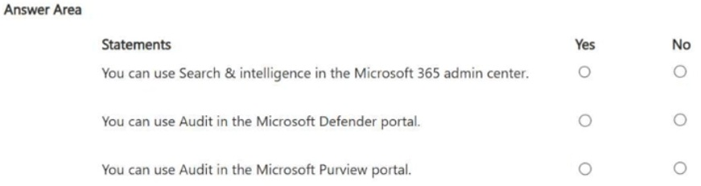

_HOTSPOT — the original ExamTopics question expects you to mark areas on the exhibit above; the correct hotspot coordinates are not published._

**Most voted:**
- Slot 1: No
- Slot 2: No
- Slot 3: Yes

### Top explanations
- **hierro** (7 upvotes [Highly Voted]): Rectifico es:
  1-NO
  2-NO
  3-SI
- **nihil94** (6 upvotes): NO  -  search & intelligence (for insights)
  NO  -  defender portal (for security & alerts)
  YES  -  purview portal  (admin & user action)
- **DeeJayU** (6 upvotes): No
  Yes (available under the Settings section)
  Yes
- **AnonymousJhb** (6 upvotes): no, yes, yes
- **hierro** (5 upvotes): 1-NO
  2-SI
  3-SI

## Q1.2 (ID 385259)

HOTSPOT
Select the answer that correctly completes the sentence.

**Exhibits**
- Exhibit 1: 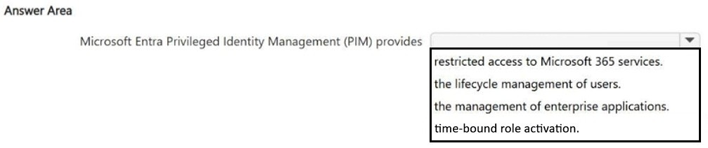

_HOTSPOT — the original ExamTopics question expects you to mark areas on the exhibit above; the correct hotspot coordinates are not published._

**Most voted:** Not provided

### Top explanations
- **omath** (6 upvotes [Most Recent]): Microsoft Entra PIM provides time‑bound role activation.
  Why
  PIM is specifically designed to:
  Allow just‑in‑time (JIT) activation of privileged roles
  Enforce approval workflows
  Require MFA for activation
  Limit exposure to standing admin privileges
- **AnonymousJhb** (4 upvotes): time-bound role activation
- **nihil94** (2 upvotes): Time-Bound Role Activation
  Link to resource:
  https://learn.microsoft.com/en-us/entra/id-governance/privileged-identity-management/pim-configure#:~:text=Privileged%20Identity%20Management%20provides%20time%2Dbased%20and%20approval%2Dbased%20role%20activation
- **gcleff** (1 upvotes): yes it us time bound role activation

## Q1.3 (ID 385260)

Your organization has a Microsoft 365 E5 subscription.
You need to ensure that a third-party cloud service can authenticate to Microsoft Entra.
What should you configure?

⭕ **A.** a Microsoft 365 Copilot connector
⭕ **B.** multifactor authentication (MFA)
⭕ **C.** a Conditional Access policy
✅ **D.** an app registration

**Correct answer:** D
**Most voted:** D

### Top explanations
- **omath** (4 upvotes [Selected Answer: D]): The correct answer is D. an app registration.
  Why
  To allow a third‑party cloud service to authenticate to Microsoft Entra (formerly Azure AD), you must create an app registration.
  This gives the external service:
  A client ID
  A client secret or certificate
  A defined permission model (delegated or application permissions)
  A secure way to obtain tokens from Microsoft Entra ID
  This is the standard method for integrating any external SaaS, automation tool, or custom application with Microsoft 365 services.
- **mlyfr** (3 upvotes [Selected Answer: D]): App Registration
- **AnonymousJhb** (3 upvotes [Selected Answer: D]): app registration
- **nihil94** (2 upvotes [Selected Answer: D]): App Registration
- **PauloJRamos** (1 upvotes [Most Recent, Selected Answer: D]): An app registration

## Q1.4 (ID 385261)

HOTSPOT
Select the answer that correctly completes the sentence.

**Exhibits**
- Exhibit 1: 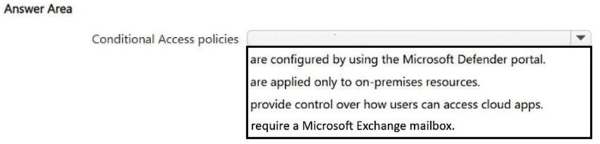

_HOTSPOT — the original ExamTopics question expects you to mark areas on the exhibit above; the correct hotspot coordinates are not published._

**Most voted:**
- The correct completion of the sentence is:
- Conditional Access policies provide control over how users can access cloud apps.
- Why this is the correct choice
- Conditional Access (CA) is part of Microsoft Entra and is designed to: Enforce access conditions (MFA, device compliance, location, risk level)

### Top explanations
- **omath** (5 upvotes [Most Recent]): The correct completion of the sentence is:
  Conditional Access policies provide control over how users can access cloud apps.
  Why this is the correct choice
  Conditional Access (CA) is part of Microsoft Entra and is designed to:
  Enforce access conditions (MFA, device compliance, location, risk level)
  Protect cloud apps such as Exchange Online, SharePoint, Teams, and third‑party SaaS
  Apply policies dynamically based on user, device, session, or risk signals
- **DeeJayU** (5 upvotes): Conditional Access policies provide control over how users can access cloud apps.
- **AnonymousJhb** (3 upvotes): provide control over how users can access cloud apps

## Q1.5 (ID 385262)

HOTSPOT
Select the answer that correctly completes the sentence.

**Exhibits**
- Exhibit 1: 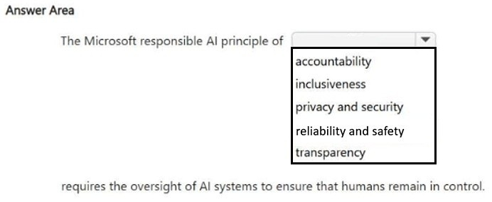

_HOTSPOT — the original ExamTopics question expects you to mark areas on the exhibit above; the correct hotspot coordinates are not published._

**Most voted:** accountability

### Top explanations
- **omath** (4 upvotes [Most Recent]): Answer: accountability
  Explanation:
  Within Microsoft’s Responsible AI principles, accountability is the one that explicitly requires human oversight and control over AI systems.
  It ensures that:
  - Humans remain responsible for decisions made with AI
  - AI systems are monitored and governed
  - Organizations maintain clear oversight structures
  The other principles focus on different dimensions (fairness, transparency, safety, privacy), but human control is rooted in accountability.
- **AnonymousJhb** (3 upvotes): Accountability (This principle requires that AI systems be designed and operated with clear human oversight. It mandates that people are ultimately responsible for AI systems, that there are clear roles and responsibilities)

## Q1.6 (ID 385263)

HOTSPOT
A user named User5 navigates to https://myapps.microsoft.com. After entering their username and password, User5 receives the following message on their mobile device.
Use the drop-down menus to select the answer choice that completes the statement based on the information presented in the graphic.

**Exhibits**
- Exhibit 1: 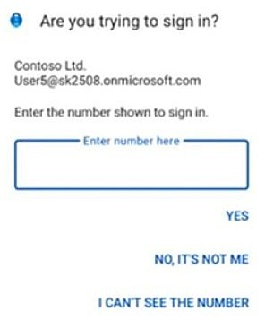
- Exhibit 2: 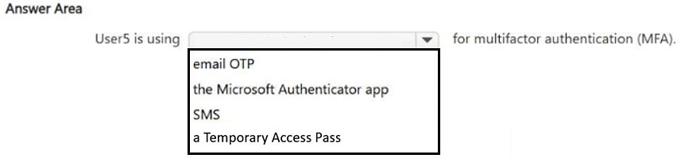

_HOTSPOT — the original ExamTopics question expects you to mark areas on the exhibit above; the correct hotspot coordinates are not published._

**Most voted:** User5 is using the Microsoft Authenticator app for multifactor authentication (MFA).

### Top explanations
- **omath** (4 upvotes [Most Recent]): Answer:
  User5 is using the Microsoft Authenticator app for multifactor authentication (MFA).
  Explanation:
  Number matching is a feature of Microsoft Authenticator push notifications.
  None of the other methods support it:
  - Email OTP → one‑time code sent by email, no number matching
  - SMS → text message code, no number matching
  - Temporary Access Pass → used for bootstrapping authentication, not number matching
- **AnonymousJhb** (2 upvotes): Authenticator App is correct

## Q1.7 (ID 385264)

Your organization has a Microsoft 365 subscription.
You need to evaluate your organization’s Identity Secure Score.
Which two factors affect the score? Each correct answer presents a complete the solution.
NOTE: Each correct selection is worth one point.

⭕ **A.** the SharePoint site permissions
✅ **B.** the number of global administrators
✅ **C.** passwords that are never expired
⭕ **D.** the location of the users

**Correct answer:** B, C
**Most voted:** BC

### Top explanations
- **omath** (6 upvotes [Selected Answer: BC]): For Identity Secure Score, Microsoft evaluates how well your organization is implementing identity‑related security controls in Microsoft Entra.
  The two factors that directly affect the score are:
  ✅ B. the number of global administrators
  Having too many permanent Global Admins reduces your score.
  Reducing standing privilege and using PIM improves it.
  ✅ C. passwords that are never expired
  Password policies (including whether passwords expire or not) impact the score.
  Modern guidance prefers passwordless, but in Secure Score, “passwords never expire” still counts as a negative unless compensating controls exist.
- **AnonymousJhb** (3 upvotes [Selected Answer: BC]): correct
- **Maria Camila Aristizabal** (1 upvotes [Most Recent, Selected Answer: BC]): B. the number of global administrators
  C. passwords that are never expired

## Q1.8 (ID 385265)

Your organization has a Microsoft 365 subscription.
You need to review the impact of a recent phishing incident that targeted email users.
What should you use?

✅ **A.** the Microsoft Defender portal
⭕ **B.** the Microsoft 365 admin center
⭕ **C.** the Microsoft Entra admin center
⭕ **D.** the Microsoft Exchange admin center

**Correct answer:** A
**Most voted:** A

### Top explanations
- **omath** (4 upvotes [Most Recent, Selected Answer: A]): Answer:
  A. the Microsoft Defender portal
  Explanation:
  The Microsoft Defender portal (security.microsoft.com) provides:
  - Threat Explorer / Real‑time detections
  - Campaign views
  - Phishing investigation details
  - User click actions
  - Automated investigation & response (AIR)
  This is exactly where you assess the impact of phishing attacks.
- **AnonymousJhb** (2 upvotes [Selected Answer: A]): correct

## Q1.9 (ID 385275)

HOTSPOT
For each of the following statements, select Yes if the statement is true. Otherwise, select No.
NOTE: Each correct selection is worth one point.

**Exhibits**
- Exhibit 1: 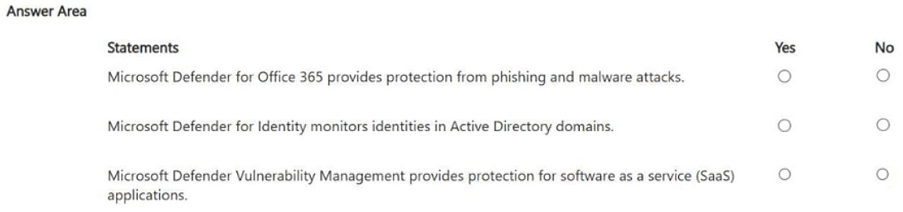

_HOTSPOT — the original ExamTopics question expects you to mark areas on the exhibit above; the correct hotspot coordinates are not published._

**Most voted:**
- Defender for Identity (formerly Azure ATP) monitors: On‑premises Active Directory, Identity-based attacks, Lateral movement, Compromised credentials-
- Defender Vulnerability Management focuses on: Device vulnerabilities,

### Top explanations
- **omath** (7 upvotes [Most Recent, Highly Voted]): 1. Yes
  Defender for Office 365 is specifically designed to protect email and collaboration tolos
  2. Yes
  Defender for Identity (formerly Azure ATP) monitors: On‑premises Active Directory, Identity-based attacks, Lateral movement, Compromised credentials-
  3. No
  Defender Vulnerability Management focuses on: Device vulnerabilities,
  Software vulnerabilities, Configuration weaknesses. It does not provide protection for SaaS apps. That capability belongs to Defender for Cloud Apps.

## Q1.10 (ID 385266)

HOTSPOT
Your organization has a Microsoft 365 subscription that contains a Microsoft SharePoint site named Site1. The permissions for Site1 are configured as shown in the following exhibit.
You create a new user named User1 in the subscription.
Use the drop-down menus to select the answer choice that completes the statement based on the information presented in the graphic.

**Exhibits**
- Exhibit 1: 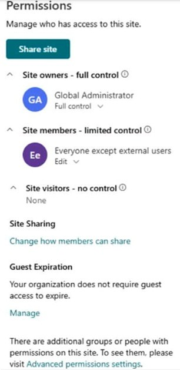
- Exhibit 2: 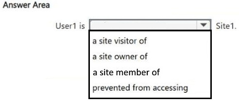

_HOTSPOT — the original ExamTopics question expects you to mark areas on the exhibit above; the correct hotspot coordinates are not published._

**Most voted:** User1 is a site member of Site1.

### Top explanations
- **omath** (5 upvotes [Most Recent]): Answer:
  User1 is a site member of Site1.
  Explanation:
  Because User1 is a newly created user inside the Microsoft 365 subscription, they automatically belong to:
  ✔ Everyone except external users
  This group is assigned Edit permissions on the site, which corresponds to:
  👉 Site member
- **AnonymousJhb** (2 upvotes): Correct

## Q1.11 (ID 385267)

Your organization has a Microsoft 365 subscription.
You create a security group named Group1 and assign a Microsoft 365 E3 license to the group.
You discover that a user named User1 does NOT have access to the Microsoft 365 E3 features.
You need to ensure that User1 can access all the Microsoft 365 E3 features.
Which two actions can you perform? Each correct answer presents a complete solution.
NOTE: Each correct selection is worth one point.

✅ **A.** Add User1 to Group1.
⭕ **B.** Assign a Conditional Access policy to Group1.
⭕ **C.** Assign a Conditional Access policy to User1.
✅ **D.** Assign a license to User1.

**Correct answer:** A, D
**Most voted:** AD

### Top explanations
- **omath** (5 upvotes [Selected Answer: AD]): A. Add User1 to Group1.
  Yes — this is the intended solution.
  Group-based licensing works only if the user is a member of the licensed group.
  D. Assign a license to User1.
  Yes — this is the direct fallback.
  If group-based licensing isn’t working or you need immediate access, you can assign the license directly to the user.
- **AnonymousJhb** (2 upvotes [Selected Answer: AD]): Correct
- **DieFear** (1 upvotes [Most Recent, Selected Answer: AD]): The question is only about accessing to the license, the other two are not valid answers

## Q1.12 (ID 391197)

HOTSPOT
Select the answer that correctly completes the sentence.

**Exhibits**
- Exhibit 1: 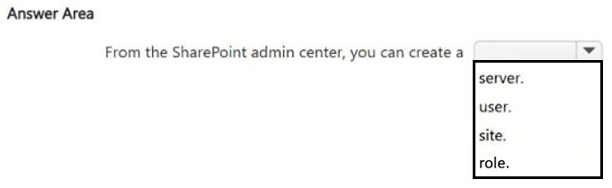

_HOTSPOT — the original ExamTopics question expects you to mark areas on the exhibit above; the correct hotspot coordinates are not published._

**Most voted:** site

### Top explanations
- **omath** (3 upvotes [Most Recent]): Answer:
  site
  Explanation:
  What you can create from the SharePoint admin center:
  - You cannot create a server there.
  - You cannot create a user there.
  - You cannot create a role there.
  - You can create SharePoint sites (team sites, communication sites, site collections).

## Q1.13 (ID 407433)

Your organization has a Microsoft 365 subscription.
You discover that some users cannot sign in to Microsoft 365.
You need to view the failed Microsoft 365 sign-in attempts.
What should you use?

⭕ **A.** the Microsoft Defender portal
✅ **B.** the Microsoft Entra admin center
⭕ **C.** the Microsoft Purview portal
⭕ **D.** the Microsoft 365 admin center

**Correct answer:** B
**Most voted:** B

### Top explanations
- **deca0d4** (3 upvotes [Selected Answer: B]): to view failed Microsoft 365 sign-in attempts, you normally go to the Microsoft Entra Admin Center
  Users → select a user → Sign-in logs
  or  Identity → Monitoring & health → Sign-in logs
  failed sign-ins
  successful sign-ins
  MFA failures
  risky sign-ins
  device/location info
  IP addresses
  conditional access results
- **pbpd91** (1 upvotes [Most Recent, Selected Answer: B]): Copilot said:
  In Microsoft Entra ID, you can view the Sign-in logs, which include:
  Successful and failed sign-in attempts.
  The user who attempted to sign in.
  The application or resource accessed.
  Date, time, and location.
  Reason for the failure.
  Information related to MFA and Conditional Access.

## Q1.14 (ID 407434)

HOTSPOT
Select the answer that correctly completes the sentence.

**Exhibits**
- Exhibit 1: 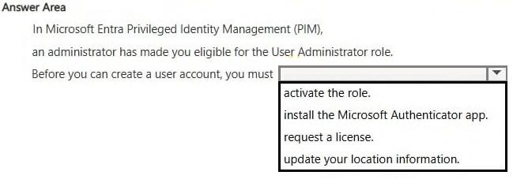

_HOTSPOT — the original ExamTopics question expects you to mark areas on the exhibit above; the correct hotspot coordinates are not published._

**Most voted:**
- Answer is correct.
- If you have been made eligible for an administrative role, then you must activate the role assignment when you need to perform privileged actions.

### Top explanations
- **TDAC** (2 upvotes [Most Recent]): Answer is correct.
  If you have been made eligible for an administrative role, then you must activate the role assignment when you need to perform privileged actions.
  Source: https://learn.microsoft.com/en-us/entra/id-governance/privileged-identity-management/pim-how-to-activate-role

## Q1.15 (ID 407435)

Your organization has a Microsoft 365 subscription that contains a Microsoft SharePoint site named Site1.
You need to prevent users from sharing the content of Site1 to external users.
What should you use?

⭕ **A.** the Site1 content
✅ **B.** the SharePoint admin center
⭕ **C.** the Microsoft 365 admin center
⭕ **D.** the Microsoft Entra admin center

**Correct answer:** B
**Most voted:** B

### Top explanations
- **michou1524** (4 upvotes [Most Recent, Selected Answer: B]): Within the SharePoint Administration Center, you can navigate to the list of Active sites, select a specific site, and adjust the External sharing settings. This is where you can configure the site to prevent sharing with people outside your organization.
- **hierro** (2 upvotes [Selected Answer: B]): centro de administración de SharePoint: Dentro del centro de administración de SharePoint, puedes navegar a la lista de Sitios activos, seleccionar un sitio específico y ajustar la configuración de "Uso compartido externo". Aquí es donde puedes establecer que no se permita el uso compartido con personas ajenas a la organización para ese sitio en particular.

## Q1.17 (ID 407437)

HOTSPOT
You open the Microsoft Entra admin center as shown in the following exhibit.
Use the drop-down menus to select the answer choice that completes the statement based on the information presented in the graphic.

**Exhibits**
- Exhibit 1: 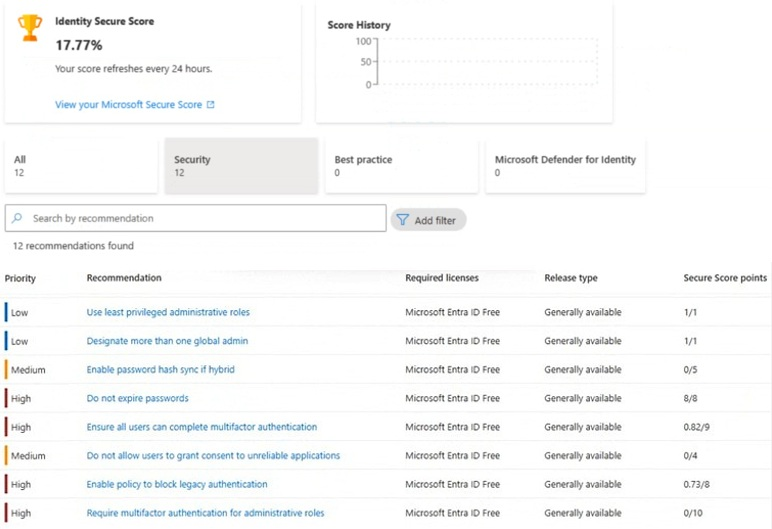
- Exhibit 2: 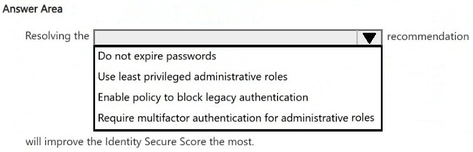

_HOTSPOT — the original ExamTopics question expects you to mark areas on the exhibit above; the correct hotspot coordinates are not published._

**Most voted:** Last option in the dropdown is the right answer. Require MFA for administrative roles has a maximum of 10 points and currently sits at 0/10, meaning the full 10 points are still available — the highest potential gain of any option in the dropdown.

### Top explanations
- **ak1447** (5 upvotes [Most Recent]): Last option in the dropdown is the right answer. Require MFA for administrative roles has a maximum of 10 points and currently sits at 0/10, meaning the full 10 points are still available — the highest potential gain of any option in the dropdown.
  By resolving that recommendation, the Identity Secure Score would increase by up to 10 points, more than any other listed option.

## Q1.18 (ID 407438)

What can you use to block a user account automatically when a risky sigh-in is detected?

⭕ **A.** Microsoft Defender for Identity
✅ **B.** Microsoft Entra ID Protection
⭕ **C.** Microsoft Defender for Office 365
⭕ **D.** Microsoft Entra Privileged Identity Management (PIM)

**Correct answer:** B
**Most voted:** B

### Top explanations
- **michou1524** (5 upvotes [Selected Answer: B]): Microsoft Entra ID Protection is the tool specifically designed to detect, investigate, and remediate identity-based risks.
  It allows you to configure risk policies (such as sign-in risk) that can take automatic actions, such as requiring a password change or directly blocking access when suspicious or risky behavior is detected.
- **hierro** (3 upvotes [Selected Answer: B]): Microsoft Entra ID Protection es la herramienta diseñada específicamente para detectar, investigar y remediar riesgos basados en la identidad.
  Permite configurar políticas de riesgo (como el riesgo de inicio de sesión) que pueden tomar acciones automáticas, como requerir un cambio de contraseña o bloquear el acceso directamente cuando se detecta un comportamiento sospechoso o arriesgado.
- **DieFear** (1 upvotes [Most Recent, Selected Answer: B]): This is the right question because you can use it to create conditional access policies to block the access the moment it is detected

## Q1.19 (ID 407439)

HOTSPOT
Your organization has a Microsoft 365 subscription.
A user named John is assigned an admin role as shown in the following exhibit.
Use the drop-down menus to select the answer choice that completes the statement based on the information presented in the graphic.

**Exhibits**
- Exhibit 1: 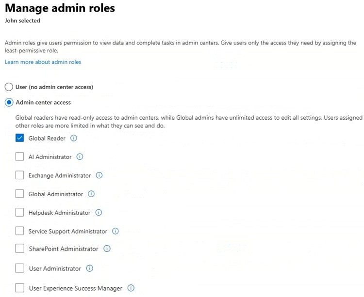
- Exhibit 2: 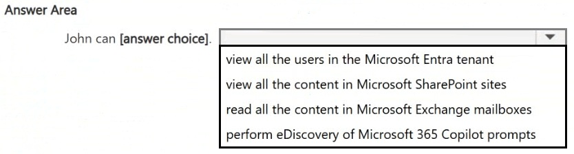

_HOTSPOT — the original ExamTopics question expects you to mark areas on the exhibit above; the correct hotspot coordinates are not published._

**Most voted:**
- ✅ View all the users in the Microsoft Entra tenant → Global Readers have read-only access to Microsoft Entra and can view users and configuration.
- ❌ View all the content in Microsoft SharePoint sites → Requires SharePoint permissions; Global Reader does not automatically get access to site content.
- ❌ Read all the content in Microsoft Exchange mailboxes → Global Reader cannot read users' mailbox contents.
- ❌ Perform eDiscovery of Microsoft 365 Copilot prompts → Requires specific eDiscovery/Compliance permissions, not just Global Reader.

### Top explanations
- **MultiCloudIronMan** (13 upvotes [Highly Voted]): View all users in thr Entra tenant
- **ak1447** (7 upvotes [Highly Voted]): View all the users in the Microsoft Entra tenant.  ✅ Yes
  Global Reader has read-only access across all admin centers, including Entra ID — so viewing users is permitted
  View all the content in Microsoft SharePoint sites. ❌ No
  Global Reader can view SharePoint admin center settings, but cannot read actual site content
  Read all the content in Microsoft Exchange mailboxes ❌ No
  Global Reader cannot access mailbox content — that requires roles like Exchange Admin or specific eDiscovery roles
  Perform eDiscovery of Microsoft 365 Copilot prompts ❌ Noe
  Discovery requires dedicated compliance roles (e.g., eDiscovery Manager) — not granted by Global Reader
- **DieFear** (6 upvotes [Most Recent]): ✅ View all the users in the Microsoft Entra tenant → Global Readers have read-only access to Microsoft Entra and can view users and configuration.
  ❌ View all the content in Microsoft SharePoint sites → Requires SharePoint permissions; Global Reader does not automatically get access to site content.
  ❌ Read all the content in Microsoft Exchange mailboxes → Global Reader cannot read users' mailbox contents.
  ❌ Perform eDiscovery of Microsoft 365 Copilot prompts → Requires specific eDiscovery/Compliance permissions, not just Global Reader.
- **hierro** (3 upvotes): La correcta es view all the users in the Microsoft Entra tenant.
- **mlyfr** (3 upvotes): view all the users in the Microsoft Entra tenant

## Q1.20 (ID 407440)

HOTSPOT
For each of the following statements, select Yes if the statement is true. Otherwise, select No.
NOTE: Each correct selection is worth one point.

**Exhibits**
- Exhibit 1: 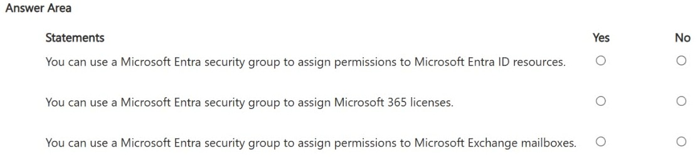

_HOTSPOT — the original ExamTopics question expects you to mark areas on the exhibit above; the correct hotspot coordinates are not published._

**Most voted:**
- Slot 1: Yes
- Slot 2: Yes
- Slot 3: Yes

### Top explanations
- **27705f1** (8 upvotes [Highly Voted]): Yes
  Yes
  No : This is the trap. Exchange mailbox permissions (Full Access, Send As, Send on Behalf) require a mail-enabled security group — a regular cloud-only Entra security group is not recognized by Exchange Online's RBAC/permissions model for mailbox delegation. Exchange permissions assignment requires the group to have an email address and be recognized as a recipient object in Exchange.
- **ak1447** (6 upvotes): Explanation
  Statement 1 — Yes: Security groups are a core mechanism in Entra ID for granting access to resources like apps, Azure resources, and Entra ID-integrated services. This is one of their primary purposes.
  Statement 2 — Yes: Group-based licensing is a supported feature in Microsoft Entra ID. You can assign a Microsoft 365 license to a security group, and all members inherit that license automatically. This requires at least Microsoft Entra ID P1.
  Statement 3 — No: Exchange mailbox permissions (e.g., Full Access, Send As) are managed within Exchange itself, not through Entra security groups directly. You'd use Exchange admin center or PowerShell to assign mailbox permissions — a security group doesn't natively grant Exchange mailbox access the way it does for Entra ID resources.
- **MultiCloudIronMan** (3 upvotes): Yes No Yes checked
- **60ed5c2** (2 upvotes): Yes Yes No.  A standard security group cannot be used for mailbox permissions.  it has to be a mail enabled security group (or a user).
- **DieFear** (1 upvotes [Most Recent]): Assign permissions to Microsoft Entra ID resources
  Security groups can be used to grant access to applications, resources, and roles in Entra ID.
  Answer: Yes
  Assign Microsoft 365 licenses
  Group-based licensing is a Microsoft Entra feature that allows licenses to be assigned to all members of a security group.
  Answer: Yes
  Assign permissions to Exchange mailboxes
  Mailbox permissions (such as Full Access and Send As) can be assigned to mail-enabled security groups, allowing all group members to inherit the permission.
  Answer: Yes

## Q1.21 (ID 407441)

HOTSPOT
Select the answer that correctly completes the sentence.

**Exhibits**
- Exhibit 1: 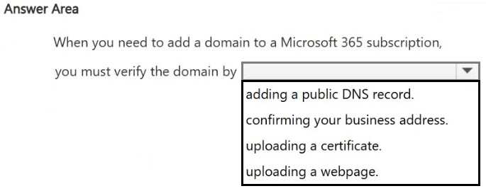

_HOTSPOT — the original ExamTopics question expects you to mark areas on the exhibit above; the correct hotspot coordinates are not published._

**Most voted:**
- Answer is correct: adding a public DNS record.
- To prove you own the domain, you must add a TXT or MX record to your domain (which is done through the domain register).

### Top explanations
- **TDAC** (2 upvotes [Most Recent]): Answer is correct: adding a public DNS record.
  To prove you own the domain, you must add a TXT or MX record to your domain (which is done through the domain register).
  Source: https://learn.microsoft.com/en-us/microsoft-365/admin/get-help-with-domains/information-for-dns-records

## Q1.22 (ID 407442)

HOTSPOT
For each of the following statements, select Yes if the statement is true. Otherwise, select No.
NOTE: Each correct selection is worth one point.

**Exhibits**
- Exhibit 1: 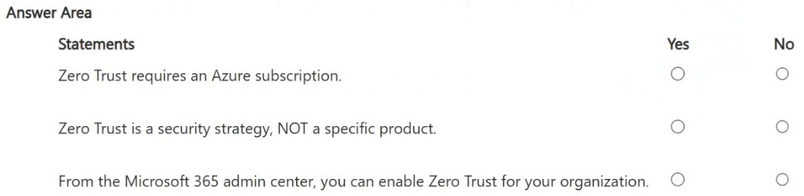

_HOTSPOT — the original ExamTopics question expects you to mark areas on the exhibit above; the correct hotspot coordinates are not published._

**Most voted:**
- NO
- YES
- NO
- Answer is correct.  Zero Trust is a security architecture & framework.  It is not a product that needs an Azure subscription, and it is not something that is simply enabled.

### Top explanations
- **TDAC** (2 upvotes [Most Recent]): NO
  YES
  NO
  Answer is correct.  Zero Trust is a security architecture & framework.  It is not a product that needs an Azure subscription, and it is not something that is simply enabled.

## Q1.23 (ID 407443)

Which statement accurately describes authorization in Microsoft 365?

⭕ **A.** a process to verify whether an identity is who or what they claim to be
⭕ **B.** a process to require additional authentication methods before an identity can access resources
✅ **C.** a process to verify whether an identity is allowed to access a resource
⭕ **D.** a process to validate an identity from an external system

**Correct answer:** C
**Most voted:** C

### Top explanations
- **TDAC** (4 upvotes [Selected Answer: C]): Answer is C
  A is explaining "authentication"
  B is explaining "multi-factor authentication"
  C is "authorization"
  D is explaining "identity federation"
- **Jimextor** (2 upvotes [Most Recent, Selected Answer: C]): La autorización (authorization) es el proceso que determina qué puede hacer una identidad después de haberse autenticado. Es decir, una vez que ya sabemos quién eres, la autorización decide a qué recursos tienes permiso de acceder y qué acciones puedes realizar.

## Q1.24 (ID 407444)

HOTSPOT
For each of the following statements, select Yes if the statement is true. Otherwise, select No.
NOTE: Each correct selection is worth one point.

**Exhibits**
- Exhibit 1: 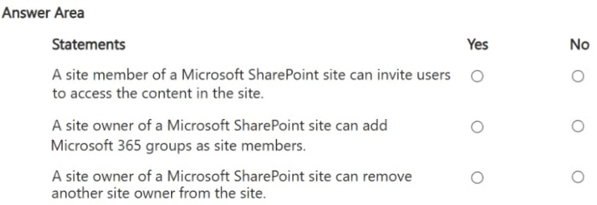

_HOTSPOT — the original ExamTopics question expects you to mark areas on the exhibit above; the correct hotspot coordinates are not published._

**Most voted:** No:

### Top explanations
- **27705f1** (5 upvotes): No:
  By default, Members have Edit permissions but cannot share the site itself with new users — only Owners can. Members can share individual files/folders if "Members can share" is enabled in site permissions settings, but that's not on by default in modern SharePoint sites, and the statement says "invite users to access the content in the site" (i.e., grant site access), which is an Owner-level action.
  The default behavior: Members can edit content, but inviting new users to the site is restricted to Owners unless an Owner explicitly enables member sharing.
  Yes
  Yes
- **PauloJRamos** (1 upvotes [Most Recent]): NO
  Yes
  YEs
- **Maria Camila Aristizabal** (1 upvotes): Afirmación 1: Sí
  Afirmación 2: Sí
  Afirmación 3: Sí
  el miembro si puede compartir sitios, no están preguntando que tipo de permisos porque este si lo hace el administrador, pero el miembro si puede compartir, que ya el usuario pueda ingresar o no es otra cosa.

## Q1.25 (ID 407445)

Your organization has a Microsoft 365 subscription.
Which two tasks can you perform by using the Exchange admin center? Each correct answer presents part of the solution.
NOTE: Each correct selection is worth one point.

⭕ **A.** Assign a Microsoft Exchange license.
✅ **B.** Create a mail flow rule.
✅ **C.** Create a shared mailbox.
⭕ **D.** Add a custom domain.

**Correct answer:** B, C
**Most voted:** BC

### Top explanations
- **TDAC** (2 upvotes [Selected Answer: BC]): Answer is correct. B & C
  Of the list of items those are the only two actions that can be done from the EAC.
- **Maria Camila Aristizabal** (1 upvotes [Most Recent, Selected Answer: BC]): la B y la C son correctas

## Q1.26 (ID 407446)

You are reviewing your company’s security policies as part of a Zero Trust strategy.
Which statement accurately describes the Zero Trust principles?

⭕ **A.** Zero Trust enhances the user experience by minimizing authentication prompts.
✅ **B.** Zero Trust assumes breach and verifies each request.
⭕ **C.** Zero Trust treats all requests from your corporate network as trustworthy.
⭕ **D.** Zero Trust removes the need to regularly review and adjust access permissions.

**Correct answer:** B
**Most voted:** B

### Top explanations
- **TDAC** (2 upvotes [Most Recent, Selected Answer: B]): Answer is correct: B
  There are 3 principles of Zero Trust.
  1. Verify Explicitly
  2. Use least privilege access
  3. Assume breach
  B is correct because it mentions 2 of the 3 principles.  The others have nothing to do with Zero Trust.

## Q1.27 (ID 407447)

Your organization has a Microsoft 365 subscription.
You need to generate a report that shows the permissions and active sharing links of content stored in Microsoft OneDrive accounts.
What should you use?

⭕ **A.** Audit in the Microsoft Defender portal
⭕ **B.** Reports in the Microsoft 365 admin center
✅ **C.** Data access governance in the SharePoint admin center
⭕ **D.** eDiscovery in the Microsoft Purview portal

**Correct answer:** C
**Most voted:** C

### Top explanations
- **MultiCloudIronMan** (6 upvotes [Most Recent, Selected Answer: C]): Why the correct answer is C
  Data Access Governance (DAG) in the SharePoint admin center provides:
  - OneDrive sharing reports
  - Per-user external sharing summaries
  - Active sharing links inventory
  - Files shared with external users
  - Overshared content detection
  - Permissions insights
  This feature is specifically designed to help admins understand who has access to what across SharePoint and OneDrive.
  It is the only tool in Microsoft 365 that gives a combined view of permissions + sharing links for OneDrive accounts.
- **mlyfr** (3 upvotes [Selected Answer: C]): Data access governance in the SharePoint admin center
- **hierro** (2 upvotes [Selected Answer: C]): La opción correcta es la C. Gobernanza del acceso a datos en el centro de administración de SharePoint.
  Ahí puedes ver y generar informes sobre:
  Permisos de acceso a archivos y carpetas en OneDrive (que técnicamente se basa en SharePoint)
  Enlaces de uso compartido activos (internos y externos)
  Actividad relacionada con el acceso y la compartición de datos
- **hierro** (2 upvotes [Selected Answer: C]): Es la C.

## Q1.28 (ID 407448)

HOTSPOT
Select the answer that correctly completes the sentence.

**Exhibits**
- Exhibit 1: 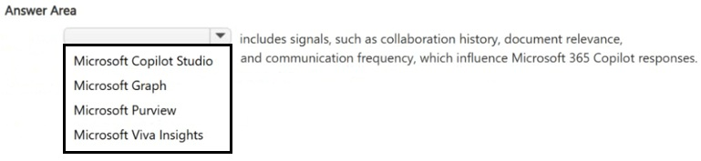

_HOTSPOT — the original ExamTopics question expects you to mark areas on the exhibit above; the correct hotspot coordinates are not published._

**Most voted:**
- Microsoft Graph
- The completed sentence is:
- Microsoft Graph includes signals, such as collaboration history, document relevance, and communication frequency, which influence Microsoft 365 Copilot responses.

### Top explanations
- **27705f1** (5 upvotes): Microsoft Graph
  includes signals, such as collaboration history, document relevance, and communication frequency, which influence Microsoft 365 Copilot responses.
- **ak1447** (4 upvotes): Explanation
  Microsoft Graph is the service that collects and surfaces signals about user activity across Microsoft 365 — including collaboration history, document relevance, communication frequency, people relationships, and more.
- **hierro** (4 upvotes): La respuesta correcta es: Microsoft Graph.
  Explicación breve:
  Microsoft Graph es el que incluye señales como:
  historial de colaboración
  relevancia de documentos
  frecuencia de comunicación
- **fdbfe1d** (3 upvotes [Most Recent]): Microsoft Graph
  The completed sentence is:
  Microsoft Graph includes signals, such as collaboration history, document relevance, and communication frequency, which influence Microsoft 365 Copilot responses.
- **AKSHITSETIA** (3 upvotes): Microsoft Graph
  Microsoft 365 Copilot uses the Microsoft Graph to access organizational context and signals from emails, meetings, chats, files, relationships, and collaboration patterns to generate relevant responses.

## Q1.29 (ID 407449)

HOTSPOT
For each of the following statements, select Yes if the statement is true. Otherwise, select No.
NOTE: Each correct selection is worth one point.

**Exhibits**
- Exhibit 1: 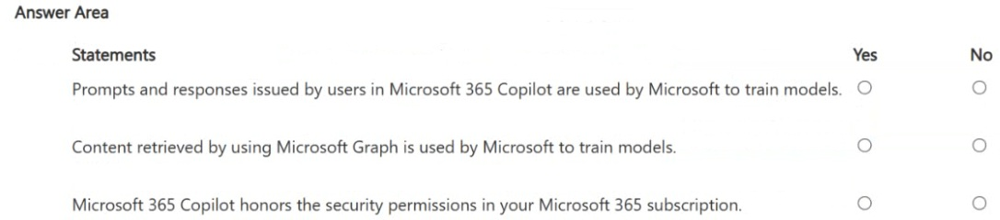

_HOTSPOT — the original ExamTopics question expects you to mark areas on the exhibit above; the correct hotspot coordinates are not published._

**Most voted:**
1. No
2. No
3. Yes

### Top explanations
- **2d2bc95** (3 upvotes [Most Recent]): 1. No
  Microsoft does not use your Microsoft 365 Copilot prompts, responses or organizational data to train its foundation models.
  2. No
  Microsoft Graph content remains within your organization's Microsoft 365 tenant and is not use to train Microsoft's AI models.
  3. Yes
  Copilot only  accesses content that the signed in user already has permission to access through Microsoft 365.

## Q1.30 (ID 407450)

HOTSPOT
For each of the following statements, select Yes if the statement is true. Otherwise, select No.
NOTE: Each correct selection is worth one point.

**Exhibits**
- Exhibit 1: 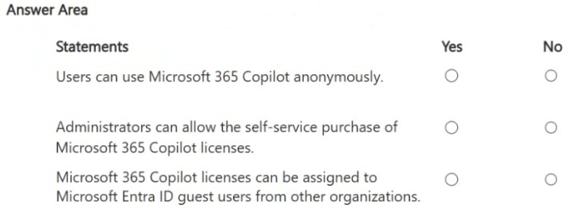

_HOTSPOT — the original ExamTopics question expects you to mark areas on the exhibit above; the correct hotspot coordinates are not published._

**Most voted:**
- Prompts and responses issued by users in Microsoft 365 Copilot are used by Microsoft to train models → No
- Content retrieved by using Microsoft Graph is used by Microsoft to train models → No
- Microsoft 365 Copilot honors the security permissions in your Microsoft 365 subscription → Yes

### Top explanations
- **poesklap** (4 upvotes): No
  Yes
  No
  Microsoft 365 Copilot requires a signed-in, licensed user. Admins can control self-service purchases, but Copilot licenses are assigned to users in the same tenant, not external guest users.
- **PauloJRamos** (1 upvotes [Most Recent]): Prompts and responses issued by users in Microsoft 365 Copilot are used by Microsoft to train models. → No
  Microsoft states that customer prompts, responses, and business data in Microsoft 365 Copilot are not used to train foundation models.
  Content retrieved by using Microsoft Graph is used by Microsoft to train models. → No
  Data accessed through Microsoft Graph remains within the customer's Microsoft 365 boundary and is not used to train Microsoft's AI models.
  Microsoft 365 Copilot honors the security permissions in your Microsoft 365 subscription. → Yes
  Copilot only surfaces content that the user already has permission to access through Microsoft 365.

## Q1.31 (ID 407451)

HOTSPOT
Your company uses Microsoft 365 Copilot pay-as-you-go billing.
The company wants greater visibility into Copilot usage costs and the ability to forecast departmental spending.
You need to ensure that you can see Copilot costs by department.
What should you use? To answer, select the appropriate options in the answer area.
NOTE: Each correct selection is worth one point.

**Exhibits**
- Exhibit 1: 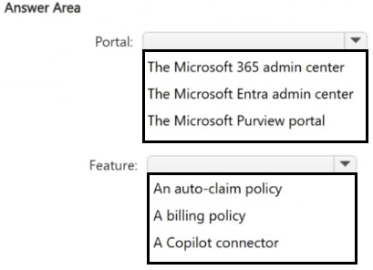

_HOTSPOT — the original ExamTopics question expects you to mark areas on the exhibit above; the correct hotspot coordinates are not published._

**Most voted:**
- Portal: The Microsoft 365 admin center
- Feature: A billing policy

### Top explanations
- **poesklap** (6 upvotes [Most Recent]): Portal: The Microsoft 365 admin center
  Feature: A billing policy
  Billing policies are used with Microsoft 365 Copilot pay-as-you-go to allocate costs across departments and help forecast spending.

## Q1.32 (ID 407452)

HOTSPOT
Select the answer that correctly completes the sentence.

**Exhibits**
- Exhibit 1: 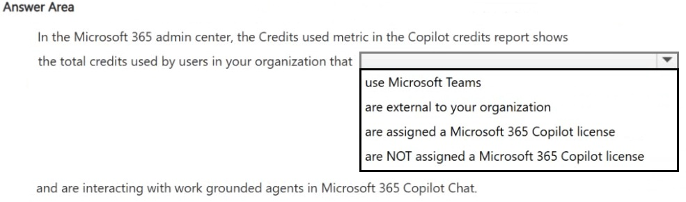

_HOTSPOT — the original ExamTopics question expects you to mark areas on the exhibit above; the correct hotspot coordinates are not published._

**Most voted:** Not provided

### Top explanations
- **poesklap** (5 upvotes [Most Recent]): are NOT assigned a Microsoft 365 Copilot license
  The credits report tracks credits used by unlicensed users interacting with work-grounded agents in Microsoft 365 Copilot Chat.
- **MultiCloudIronMan** (3 upvotes): Users assigned copilot licence

## Q1.33 (ID 407453)

HOTSPOT
For each of the following statements, select Yes if the statement is true. Otherwise, select No.
NOTE: Each correct selection is worth one point.

**Exhibits**
- Exhibit 1: 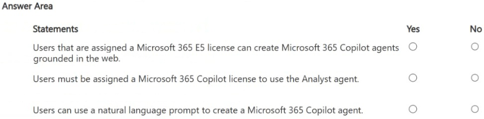

_HOTSPOT — the original ExamTopics question expects you to mark areas on the exhibit above; the correct hotspot coordinates are not published._

**Most voted:** No Yes Yes - although it is very tricky because technically you can create an M365 Copilot agent grounded in the web with only an E5 license if you use agent builder (aka copilot studio lite).  I verified this with an account that only has an E5 license.  I tried asking Copilot if I was missing something in the wording.  Copilot said that something...

### Top explanations
- **60ed5c2** (7 upvotes [Highly Voted]): No Yes Yes - although it is very tricky because technically you can create an M365 Copilot agent grounded in the web with only an E5 license if you use agent builder (aka copilot studio lite).  I verified this with an account that only has an E5 license.  I tried asking Copilot if I was missing something in the wording.  Copilot said that something created with agent builder can't be grounded in the web.  But that is also not true because you can absolutely specify public facing urls as a knowledge source which I would consider to be "grounded in the web".
  Analyst 100% requires a copilot license to use it.
- **killionb12** (2 upvotes [Most Recent]): Yes – Microsoft 365 E5 users can create web-grounded agents using Agent Builder in Microsoft 365 Copilot Chat, subject to organizational settings.
  Yes – The Analyst agent is a Microsoft 365 Copilot capability that requires a Microsoft 365 Copilot license.
  Yes – Agent Builder supports creating agents using natural language prompts without requiring programming.

## Q2.1 (ID 391196)

HOTSPOT
Select the answer that correctly completes the sentence.

**Exhibits**
- Exhibit 1: 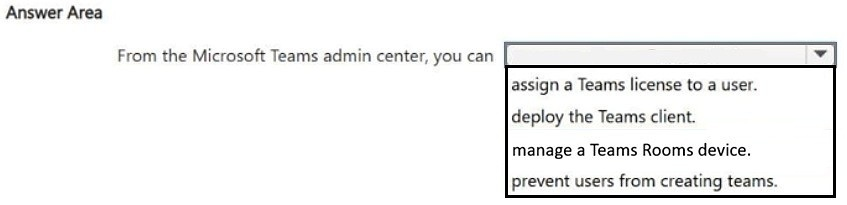

_HOTSPOT — the original ExamTopics question expects you to mark areas on the exhibit above; the correct hotspot coordinates are not published._

**Most voted:** manage a Teams Rooms device

### Top explanations
- **omath** (6 upvotes): Answer:
  manage a Teams Rooms device
  Explanation:
  - Assign a Teams license to a user → This is done in the Microsoft 365 admin center or Entra admin center, not in Teams admin.
  - Deploy the Teams client → Deployment is done via Intune, Endpoint Manager, or manual installation, not the Teams admin center.
  - Manage a Teams Rooms device → ✔ The Teams admin center includes Teams Rooms management, device health, configuration, and monitoring.
  - Prevent users from creating teams → This is controlled through Microsoft 365 Groups settings in Entra or PowerShell, not in the Teams admin center.
- **dcxmscommunity** (1 upvotes [Most Recent]): ✅ Correct answer: manage a Teams Rooms device.
  Explanation
  The Microsoft Teams admin center is used to manage Teams services, devices, policies, and settings, including:
  Teams Rooms devices
  Teams meetings and calling
  Teams apps
  Teams policies

## Q2.2 (ID 391195)

Your organization has a Microsoft 365 subscription.
You need to investigate security incidents and alerts raised from the Windows 11 devices in your organization.
What should you use?

⭕ **A.** Microsoft Entra ID Protection
⭕ **B.** Microsoft Defender for Identity
⭕ **C.** Microsoft Purview Insider Risk Management
✅ **D.** Microsoft Defender for Endpoint

**Correct answer:** D
**Most voted:** D

### Top explanations
- **omath** (5 upvotes [Most Recent, Selected Answer: D]): Answer:
  D. Microsoft Defender for Endpoint
  Defender for Endpoint gives you:
  - Device-based alerts from Windows 11
  - Incident correlation and investigation
  - Threat analytics
  - Device timeline and behavioral monitoring
  - Automated investigation and response (AIR)
  It is the dedicated endpoint protection and EDR/XDR solution in Microsoft 365.

## Q2.3 (ID 391194)

You have a Microsoft SharePoint site as shown in the following exhibit.
You need to view the settings of SLabel1.
What should you use?

**Exhibits**
- Exhibit 1: 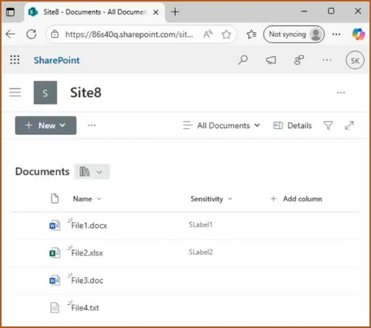

⭕ **A.** the Microsoft Defender portal
⭕ **B.** the SharePoint admin center
⭕ **C.** the Microsoft 365 admin center
✅ **D.** the Microsoft Purview portal

**Correct answer:** D
**Most voted:** D

### Top explanations
- **omath** (6 upvotes [Most Recent, Selected Answer: D]): Answer:
  D. the Microsoft Purview portal
  Explanation:
  You view and manage sensitivity labels — including their settings, scope, and policies — in Microsoft Purview (formerly the Compliance Center).
  Even though the label appears in SharePoint, SharePoint only applies the label.
  The configuration (encryption, content marking, auto‑labeling rules, etc.) lives in Purview under:
  Purview → Information Protection → Labels → SLabel1

## Q2.4 (ID 385273)

Your organization has a Microsoft 365 subscription.
All users have Microsoft 365 Copilot licenses.
You need to identify where sensitive content is being used during Copilot interactions, analyze the content usage patterns, and provide recommendations on applying the appropriate protections.
What should you use?

⭕ **A.** Microsoft Viva Insights
✅ **B.** the Microsoft Purview DSPM for AI solution
⭕ **C.** Microsoft Security Copilot
⭕ **D.** the Microsoft Purview Insider Risk Management solution

**Correct answer:** B
**Most voted:** B

### Top explanations
- **omath** (7 upvotes [Most Recent, Highly Voted, Selected Answer: B]): Answer:
  B. the Microsoft Purview DSPM for AI solution
  Explanation:
  To understand where sensitive content is being used inside Copilot interactions, analyze how users interact with that data, and get recommendations for applying protections, you need a solution that is specifically designed for:
  Tracking data exposure inside AI interactions
  Mapping sensitive data flows across Microsoft 365
  Identifying risky prompts, responses, and data access patterns
  Providing actionable recommendations for labeling, DLP, access control, and governance
  That is exactly what Microsoft Purview DSPM for AI (Data Security Posture Management for AI) does.
- **AnonymousJhb** (7 upvotes [Highly Voted, Selected Answer: B]): correct

## Q2.5 (ID 385274)

HOTSPOT
Select the answer that correctly completes the sentence.

**Exhibits**
- Exhibit 1: 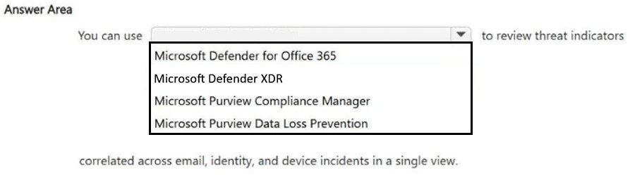

_HOTSPOT — the original ExamTopics question expects you to mark areas on the exhibit above; the correct hotspot coordinates are not published._

**Most voted:** Microsoft Defender XDR

### Top explanations
- **omath** (5 upvotes [Most Recent]): Answer:
  Microsoft Defender XDR
  Explanation:
  Microsoft Defender XDR is the only tool in the list that:
  - Correlates signals across email, identity, endpoints, and cloud apps
  - Provides a unified incident queue
  - Shows cross‑domain threat indicators in a single correlated incident view
  The other options are domain‑specific or compliance‑focused and do not provide cross‑domain correlation.
- **AnonymousJhb** (2 upvotes): correct

## Q2.6 (ID 385276)

Your organization has a Microsoft 365 subscription that contains a user named User1.
User1 plans to leave your company in two weeks.
You need to capture the activity of User1 to identify whether the user is exfiltrating data.
Which Microsoft Purview solution should you use?

⭕ **A.** Communication Compliance
⭕ **B.** Data Security Posture Management
✅ **C.** Insider Risk Management
⭕ **D.** Data Lifecycle Management

**Correct answer:** C
**Most voted:** C

### Top explanations
- **omath** (6 upvotes [Selected Answer: C]): Answer: C. Insider Risk Management.
  Explanation:
  Microsoft Purview Insider Risk Management is specifically designed to detect and investigate behaviors such as:
  - Data exfiltration
  - Unusual file downloads or sharing
  - Use of personal email, USB, cloud storage
  - Sudden spikes in data access
  - Risky actions by users who are leaving the organization
  It even includes a built‑in “Departing Employee” policy template, which is exactly the scenario you described.
- **fa62dd5** (4 upvotes [Selected Answer: C]): ✅ Correct answer: C. Insider Risk Management
  Why (exam‑focused):
  You need to capture and analyze user activity to detect potential data exfiltration, especially for a departing employee.
  Microsoft Purview Insider Risk Management is specifically designed to:
  Monitor risky user behavior
  Detect data exfiltration patterns (downloads, uploads, sharing, emails)
  Handle scenarios like employees leaving the organization
- **Austerer** (1 upvotes [Most Recent, Selected Answer: C]): • Insider Risk Management is built to detect, investigate, and help mitigate risky insider activities, such as data theft and exfiltration by departing employees.

## Q2.7 (ID 391193)

HOTSPOT
For each of the following statements, select Yes if the statement is true. Otherwise, select No.
NOTE: Each correct selection is worth one point.

**Exhibits**
- Exhibit 1: 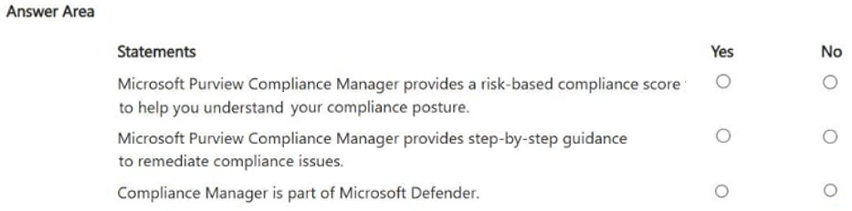

_HOTSPOT — the original ExamTopics question expects you to mark areas on the exhibit above; the correct hotspot coordinates are not published._

**Most voted:**
1. Yes
2. Yes
3. No

### Top explanations
- **omath** (4 upvotes): 1. Yes
  Compliance Manager includes a Compliance Score that quantifies your organization’s compliance posture based on implemented and pending controls.
  2. Yes
  Each improvement action includes detailed implementation guidance, recommended steps, and mapping to regulations and standards.
  3. No
  Compliance Manager is part of Microsoft Purview, not Microsoft Defender.
- **poesklap** (2 upvotes [Most Recent]): Yes
  Yes
  No
  Compliance Manager is part of Microsoft Purview, not Microsoft Defender.

## Q2.8 (ID 392067)

HOTSPOT
Your organization has a Microsoft 365 subscription.
You discover that Microsoft SharePoint files are being shared to users outside your organization.
You need to identify which files are being shared to the external users.
Which report should you use in the SharePoint admin center? To answer, select the appropriate report in the answer area.

**Exhibits**
- Exhibit 1: 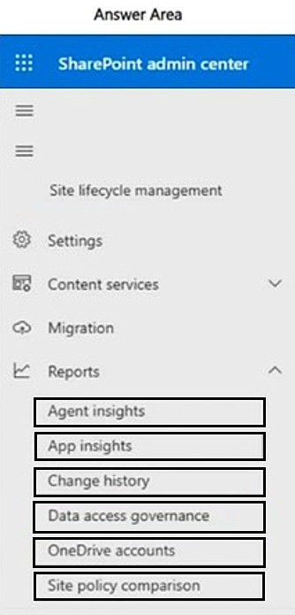

_HOTSPOT — the original ExamTopics question expects you to mark areas on the exhibit above; the correct hotspot coordinates are not published._

**Most voted:** Data access governance

### Top explanations
- **omath** (5 upvotes [Most Recent]): Answer: Data access governance
  Explanation:
  Data access governance (DAG) reports are specifically designed to help you:
  - Identify externally shared files
  - See which sites have the highest exposure
  - Review sharing links, including anonymous and external user access
  - Detect overshared or sensitive content in SharePoint and OneDrive

## Q2.9 (ID 385268)

HOTSPOT
For each of the following statements, select Yes if the statement is true. Otherwise, select No.
NOTE: Each correct selection is worth one point.

**Exhibits**
- Exhibit 1: 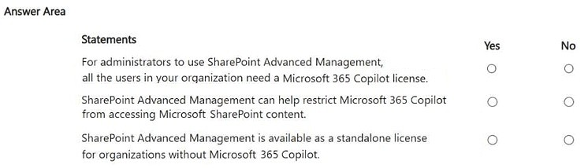

_HOTSPOT — the original ExamTopics question expects you to mark areas on the exhibit above; the correct hotspot coordinates are not published._

**Most voted:**
1. No
2. Yes
3. Yes

### Top explanations
- **poesklap** (4 upvotes [Most Recent]): No
  Yes
  Yes
  Microsoft says SharePoint Advanced Management can restrict high-risk SharePoint sites and files from appearing in Microsoft 365 Copilot. It also says only at least one user needs a Microsoft 365 Copilot license, not all users, and organizations without Copilot can use SAM by purchasing the standalone SharePoint Advanced Management Plan 1 add-on.
- **omath** (3 upvotes): 1. No
  SAM is not tied to Copilot licensing.
  Admins can use SharePoint Advanced Management even if zero users have Copilot.
  2. Yes
  SAM includes Copilot controls, such as:
  - Restricting Copilot access to specific SharePoint sites
  - Blocking Copilot from indexing or retrieving content
  - Managing site-level AI access policies
  This is one of the major reasons SAM is becoming essential in AI‑governed environments.
  3. Yes
  SAM can be purchased standalone.
  It does not require Copilot, E5, or any other AI license.

## Q2.10 (ID 385282)

HOTSPOT
Your organization has a Microsoft 365 subscription.
The HR department at your company asks for a copy of all the recent files that were modified by a user named User1.
What should you use in the Microsoft Purview portal? To answer, select the appropriate solutions in the answer area.

**Exhibits**
- Exhibit 1: 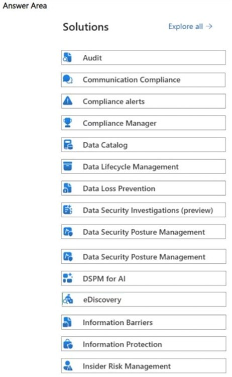

_HOTSPOT — the original ExamTopics question expects you to mark areas on the exhibit above; the correct hotspot coordinates are not published._

**Most voted:** Audit

### Top explanations
- **468fa2a** (6 upvotes): But to meet the 'get a copy' requirement, you also need eDiscovery. Audit logs provide the events, but not the copies of data
- **AnonymousJhb** (4 upvotes): Wrong - its Audit.
  Ediscovery is more for legal hold / investigation, which is done after an audit is completed.
- **TDAC** (3 upvotes): Answer is correct: eDiscovery
  To produce copies of files, especially across SharePoint, OneDrive, Teams, and Exchange, you must use Microsoft Purview eDiscovery (Standard or Premium).
  eDiscovery allows you to:
  Search for content by user activity, including “modified by”
  Collect files across all Microsoft 365 workloads
  Export the files for HR as a packaged download
  Apply date filters (e.g., “recent files”)
  Source: https://learn.microsoft.com/en-us/purview/edisc-search-export
- **Godfirst_E** (3 upvotes): Seeing the HR is asking for a "copy" i believe Ediscovery is the right answer.
- **hierro** (2 upvotes): eDiscovery (Descubrimiento electrónico): Es la herramienta diseñada específicamente para identificar, retener y exportar contenido (como archivos de OneDrive, SharePoint o correos de Exchange) que pueda ser relevante para una investigación o una solicitud de departamentos como RRHH. Puedes crear un caso, buscar archivos filtrando por el "Usuario1" y por la fecha de modificación para luego descargar una copia de los resultados.

## Q2.11 (ID 385269)

HOTSPOT
For each of the following statements, select Yes if the statement is true. Otherwise, select No.
NOTE: Each correct selection is worth one point.

**Exhibits**
- Exhibit 1: 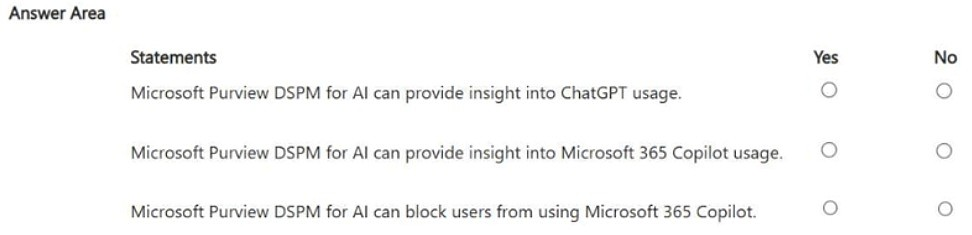

_HOTSPOT — the original ExamTopics question expects you to mark areas on the exhibit above; the correct hotspot coordinates are not published._

**Most voted:**
- DSPM for AI gives visibility into: - What data Copilot accesses
- Blocking or restricting Copilot access is done through: - Licensing

### Top explanations
- **omath** (7 upvotes [Most Recent, Highly Voted]): 1. Yes
  DSPM for AI can detect and analyze usage of external AI services, including ChatGPT, by monitoring data flows and identifying when sensitive data is being used with third‑party AI tools.
  2. Yes
  DSPM for AI gives visibility into:
  - What data Copilot accesses
  - How sensitive content is used in prompts and responses
  - Which users are interacting with sensitive data through Copilot
  3. No
  DSPM for AI provides visibility and recommendations, but it does not enforce access blocks.
  Blocking or restricting Copilot access is done through:
  - Licensing
  - SharePoint Advanced Management (site-level Copilot controls)
  - Conditional Access
  - Data access governance policies
  - DSPM itself does not block usage.
- **AnonymousJhb** (4 upvotes): Y Y N
  Microsoft Purview DSPM for AI itself cannot directly block users from using Microsoft 365 Copilot. It acts as a discovery and recommendation engine
- **fa62dd5** (2 upvotes): Microsoft Purview DSPM for AI can provide insight into ChatGPT usageYes ✅Microsoft Purview DSPM for AI can provide insight into Microsoft 365 Copilot usageYes ✅Microsoft Purview DSPM for AI can block usersNo ❌
  DSPM for AI = visibility & risk insights (Copilot + supported third‑party AI like ChatGPT) ✅
  Blocking Copilot is handled via licensing / access controls, not DSPM for AI ❌

## Q2.12 (ID 385241)

HOTSPOT
Your organization has a Microsoft 365 subscription.
You need to use Microsoft Purview to meet the following requirements:
Prevent users from sharing files that contain Personally Identifiable Information (PII).
Use machine learning to train a model that detects sensitive content.
Which Microsoft Purview solution should you use for each requirement? To answer, select the appropriate options in the answer area.
NOTE: Each correct selection is worth one point.

**Exhibits**
- Exhibit 1: 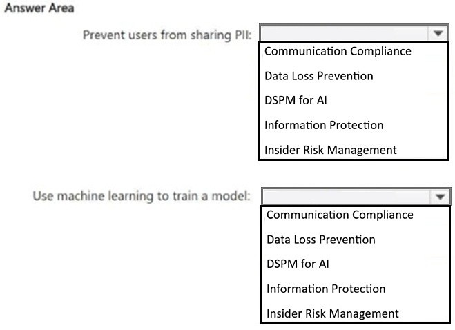

_HOTSPOT — the original ExamTopics question expects you to mark areas on the exhibit above; the correct hotspot coordinates are not published._

**Most voted:**
- Purview Data Loss Prevention (DLP) is the solution that: - Detects PII
- Purview Information Protection includes: - Trainable classifiers (machine learning models)

### Top explanations
- **omath** (8 upvotes [Highly Voted]): 1. Data Loss Prevention
  Purview Data Loss Prevention (DLP) is the solution that:
  - Detects PII (and other sensitive info types)
  - Blocks or restricts sharing, copying, printing, or uploading
  - Applies policies across SharePoint, OneDrive, Teams, Exchange, endpoints, and more
  2. Information Protection
  Purview Information Protection includes:
  - Trainable classifiers (machine learning models)
  - Ability to train the model using positive/negative examples
  - Automatic detection of complex or unstructured sensitive content
  - Integration with sensitivity labels and DLP
- **fa62dd5** (4 upvotes): Prevent users from sharing PII:   Data Loss Prevention
  Use machine learning to train a model:   Information Protection
- **poesklap** (3 upvotes): Prevent users from sharing PII: Data Loss Prevention
  Use machine learning to train a model: Information Protection
- **Acrious** (2 upvotes): Data Loss Prevention and Communication Compliance (for Trainable models etc). Information protection is great for labeling etc but not for ML training.
- **GER_X1** (1 upvotes [Most Recent]): Las opciones correctas son DLP y Communication Compliance

## Q2.13 (ID 385278)

You use Microsoft 365 Copilot.
What does Copilot use to generate responses based on corporate data stored in Microsoft SharePoint?

⭕ **A.** Microsoft Intune
⭕ **B.** Microsoft Defender
✅ **C.** Microsoft Graph
⭕ **D.** Microsoft Purview

**Correct answer:** C
**Most voted:** C

### Top explanations
- **omath** (3 upvotes [Most Recent, Selected Answer: C]): Answer: C. Microsoft Graph
  Explanation:
  When Copilot generates responses using your organization’s SharePoint content, it doesn’t access the data directly. Instead, it retrieves and reasons over that content through the Microsoft Graph, which is the unified API layer that exposes files, sites, chats, emails, calendars, and more.
- **fa62dd5** (2 upvotes [Selected Answer: C]): C: Microsoft 365 Copilot generates responses grounded in your organization’s data (including files stored in SharePoint) by retrieving context through Microsoft Graph.

## Q2.14 (ID 392066)

HOTSPOT
Select the answer that correctly completes the sentence.

**Exhibits**
- Exhibit 1: 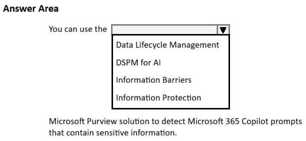

_HOTSPOT — the original ExamTopics question expects you to mark areas on the exhibit above; the correct hotspot coordinates are not published._

**Most voted:** DSPM for AI

### Top explanations
- **omath** (6 upvotes): Answer: DSPM for AI
  Explanation:
  Microsoft Purview DSPM for AI (Data Security Posture Management for AI) is the only Purview solution that:
  - Analyzes Copilot prompts and responses
  - Detects when sensitive information is used in AI interactions
  - Surfaces insights about how Copilot accesses and uses corporate data
  - Helps you understand AI‑related data exposure risks
- **89d5ded** (3 upvotes [Most Recent]): To detect Copilot prompts that contain sensitive information, you should use Microsoft Purview DSPM for AI.
- **GDixit** (1 upvotes): Information Protection is the correct answer

## Q2.15 (ID 385242)

Your organization has a Microsoft 365 subscription.
All users are assigned Microsoft 365 Copilot licenses.
Some users report receiving Copilot responses that contain information from a Microsoft SharePoint site named Finance. The users report that the information is commercially sensitive.
You need to prevent Copilot from providing responses that contain information from the Finance site.
What should you do?

⭕ **A.** From Microsoft Purview, create an Information Barrier (IB) policy.
⭕ **B.** From Microsoft Defender, create a data connector.
⭕ **C.** From Microsoft Entra, create a Conditional Access policy.
✅ **D.** From the Finance site, configure permissions.

**Correct answer:** D
**Most voted:** D

### Top explanations
- **omath** (6 upvotes [Most Recent, Selected Answer: D]): Answer: D. From the Finance site, configure permissions.
  Explanation:
  Copilot respects Microsoft Graph permissions, which are based on:
  - SharePoint site permissions
  - File permissions
  - Group membership
  If a user cannot access the Finance site, Copilot cannot access it on their behalf.
  There is no separate “Copilot permission” layer for content access.
- **AnonymousJhb** (1 upvotes [Selected Answer: D]): WRONG
  From the Finance site, configure permissions.
  Microsoft Purview Information Barriers (IB) is a compliance solution that restricts two-way communication and collaboration between groups and users in Microsoft Teams, SharePoint, and OneDrive.
- **fa62dd5** (1 upvotes [Selected Answer: D]): By restricting access on the Finance SharePoint site:
  Remove or limit user permissions
  Ensure only authorized users can access sensitive data
  👉 Copilot will automatically stop using that data for unauthorized users
- **KrissB** (1 upvotes [Selected Answer: D]): The site should be labeled appropriately or use SPO least priviledge site permissions

## Q2.16 (ID 392065)

Your organization has a Microsoft 365 subscription that contains Microsoft SharePoint sites and Microsoft Teams teams.
You discover that the sites and the teams are shared to users outside your organization.
You need to identify which sites and teams were shared to the external users.
What should you use?

✅ **A.** the SharePoint admin center
⭕ **B.** the Microsoft Teams admin center
⭕ **C.** the Microsoft 365 admin center
⭕ **D.** the Microsoft Defender portal

**Correct answer:** A
**Most voted:** A

### Top explanations
- **omath** (7 upvotes [Highly Voted, Selected Answer: A]): Answer: A. the SharePoint admin center
  Explanation:
  In the SharePoint admin center, you can use:
  - Data access governance (DAG) reports
  - External sharing reports
  - Site sharing settings overview
- **ak1447** (1 upvotes [Most Recent, Selected Answer: A]): correct answer

## Q2.17 (ID 385243)

Your company requires that all Microsoft SharePoint sites have a minimum of two owners.
You need to ensure that sites that have less than two owners are marked as read-only if the sites are NOT remediated.
What should you configure in the SharePoint admin center?

⭕ **A.** Site-level access restriction
⭕ **B.** Data access governance reports
✅ **C.** Site lifecycle management
⭕ **D.** Block download policy for SharePoint and OneDrive

**Correct answer:** C
**Most voted:** C

### Top explanations
- **omath** (6 upvotes [Selected Answer: C]): Answer: C. Site lifecycle management
  Explanation:
  SharePoint Site lifecycle management (part of SharePoint Advanced Management) includes:
  - Ownerless site detection
  - Minimum owner requirements (e.g., at least 2 owners)
  - Automated notifications to site admins
  - Automatic remediation actions
  - Automatic read‑only enforcement if the site is not fixed
- **KrissB** (3 upvotes [Selected Answer: C]): SharePoint Advanced Management’s site lifecycle and governance controls.
- **8b57847** (2 upvotes [Most Recent, Selected Answer: C]): Ownership Policy is included in life cycle management

## Q2.18 (ID 407454)

HOTSPOT
Select the answer that correctly completes the sentence.

**Exhibits**
- Exhibit 1: 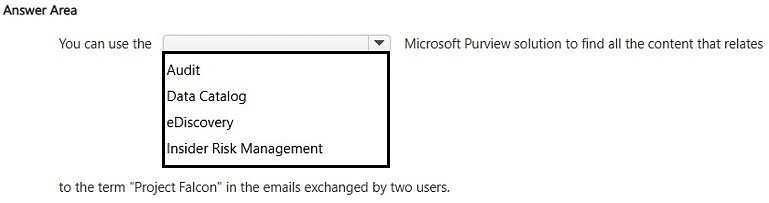

_HOTSPOT — the original ExamTopics question expects you to mark areas on the exhibit above; the correct hotspot coordinates are not published._

**Most voted:**
- Answer is correct: E
- eDiscovery is the exact capability that can search for words and strings of information that are deemed sensitive.

### Top explanations
- **TDAC** (2 upvotes [Most Recent]): Answer is correct: E
  eDiscovery is the exact capability that can search for words and strings of information that are deemed sensitive.
- **ak1447** (2 upvotes): The sentence reads: "find all the content that relates to the term 'Project Falcon' in the emails exchanged by two users."
  This is a classic content search and collection task — searching across mailboxes for specific keywords involving specific people.
  eDiscovery is purpose-built for exactly this:
  Search across Exchange mailboxes scoped to specific users
  Use keyword queries like "Project Falcon"
  Collect and export the results as evidence or for review
- **hierro** (2 upvotes): eDiscovery: Esta es la solución de Microsoft Purview diseñada específicamente para buscar, retener y exportar contenido (como correos electrónicos de Exchange, documentos de SharePoint/OneDrive y mensajes de Teams) con fines de investigación legal o interna. Permite realizar búsquedas precisas por términos clave y usuarios específicos.

## Q2.19 (ID 407455)

Your company uses Microsoft Purview data loss prevention (DLP) policies.
A user named User1 shares sensitive information to an external user by using Microsoft Teams.
You need to identify the sensitive content that was shared.
What should you use in the Microsoft Purview portal?

⭕ **A.** Diagnostics
⭕ **B.** Data explorer
⭕ **C.** Content explorer
✅ **D.** Activity explorer

**Correct answer:** D
**Most voted:** D

### Top explanations
- **ef74e4b** (2 upvotes [Selected Answer: C]): Activity explorer = What happened? (Who shared the information, and what did they do?)
  Content explorer = What was in the data? (What sensitive information was identified?)
- **lightthetorch** (2 upvotes [Most Recent, Selected Answer: D]): D. Activity Explorer
  Content Explorer shows a snapshot of all classified items across SharePoint, OneDrive, and Exchange, while Activity Explorer shows what actions users are taking with labeled content over time such as label changes, downloads, or external shares, forming the observability foundation for all downstream data protection in Purview.
- **Tiz_21** (2 upvotes [Selected Answer: C]): Use Content explorer in the Microsoft Purview portal when you need to view the actual sensitive content that matched a classification or DLP policy.
  In this scenario:
  A user shared sensitive information.
  The sharing happened in Microsoft Teams.
  You need to identify the sensitive content that was shared.
  That means you need to inspect the content itself, not just the activity event.
- **TDAC** (2 upvotes [Selected Answer: D]): Answer is wrong.
  Correct answer is D
  In Microsoft Purview DLP, Activity explorer is the tool that:
  Shows DLP‑detected activities, including sharing events
  Shows who shared what, including sensitive information types
  Shows Teams messages and file-sharing events
  Pulls data from the Microsoft 365 unified audit log
  Allows filtering by user, activity type, location, and sensitive info type
- **c9d180a** (2 upvotes [Selected Answer: D]): Why Activity Explorer?
  Activity Explorer (found in Microsoft Purview > Data Loss Prevention > Activity Explorer) is the correct tool because it:
  Tracks and logs DLP policy matches in real-time
  Shows what sensitive content was shared, by whom, and where
  Filters activities by user, location, sensitivity label, and policy
  Captures Teams DLP violations including external sharing events
  Allows you to drill down into the specific sensitive information type that was detected (e.g., Credit Card, SSN, etc.)

## Q2.20 (ID 407456)

HOTSPOT
Your organization has a Microsoft 365 subscription.
You need to use Microsoft Purview to meet the following requirements:
•	Discover and classify sensitive data across multiple platforms.
•	Block users from sharing intellectual property with external users.
Which Microsoft Purview solution should you use for each requirement? To answer, select the appropriate options in the answer area.
NOTE: Each correct selection is worth one point.

**Exhibits**
- Exhibit 1: 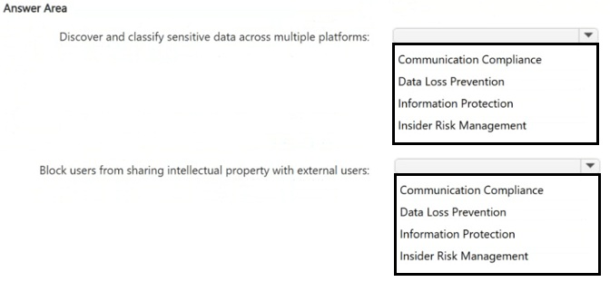

_HOTSPOT — the original ExamTopics question expects you to mark areas on the exhibit above; the correct hotspot coordinates are not published._

**Most voted:**
- Respuesta 1: Information Protection
- Respuesta 2: Data Loss Prevention

### Top explanations
- **hierro** (13 upvotes [Highly Voted]): Respuesta 1: Information Protection
  Microsoft Purview Information Protection es la solución encargada de descubrir, clasificar y proteger datos sensibles en nubes, aplicaciones y dispositivos. Utiliza etiquetas de sensibilidad para identificar la importancia de los datos en múltiples plataformas.
  Respuesta 2: Data Loss Prevention
  Data Loss Prevention (DLP) es la herramienta diseñada específicamente para aplicar políticas que bloqueen el intercambio de información protegida (como propiedad intelectual) con destinatarios no autorizados, especialmente usuarios externos.
- **TDAC** (5 upvotes): Response 1: Information Protection
  “Microsoft Purview Information Protection is the solution responsible for discovering, classifying, and protecting sensitive data across clouds, applications, and devices. It uses sensitivity labels to identify the importance of data across multiple platforms.”
  Response 2: Data Loss Prevention
  “Data Loss Prevention (DLP) is the tool specifically designed to enforce policies that block the sharing of protected information (such as intellectual property) with unauthorized recipients, especially external users.”
- **fe59431** (1 upvotes [Most Recent]): ✅ Answers (Confidence: High)
  Discover and classify sensitive data across multiple platforms → Information Protection
  Block users from sharing intellectual property with external users → Data Loss Prevention
  Why
  Information Protection is how Purview finds and labels your data. It detects sensitive information (credit card numbers, contracts, IP) and applies sensitivity labels, either manually or automatically, across Exchange, SharePoint, OneDrive, Teams, and devices. Its job is to discover, classify, label, and encrypt.
  Data Loss Prevention (DLP) is the enforcement part. A DLP policy spots sensitive content and blocks or warns when someone tries to share it outside the company by email, Teams, SharePoint, or from a device.
  The two work as a pair. Information Protection labels a design file “Highly Confidential,” and a DLP rule says “block external sharing of anything labeled Highly Confidential.”

## Q2.21 (ID 407457)

Your organization has a Microsoft 365 E5 subscription.
You need to prevent users from sharing corporate financial data to external users.
What should you use?

⭕ **A.** role groups
✅ **B.** data loss prevention (DLP) policies
⭕ **C.** insider risk management policies
⭕ **D.** retention labels

**Correct answer:** B
**Most voted:** B

### Top explanations
- **TDAC** (2 upvotes [Most Recent, Selected Answer: B]): Answer is correct: B
  “Data Loss Prevention (DLP) is the tool specifically designed to identify, monitor, and automatically protect sensitive information.”
- **hierro** (2 upvotes [Selected Answer: B]): Prevención de pérdida de datos (DLP) son la herramienta diseñada específicamente para identificar, monitorear y proteger automáticamente la información sensible.

## Q2.22 (ID 407458)

HOTSPOT
You have a Microsoft SharePoint site named Site1 and a security group named Group1.
You need to prevent all users that currently have access to Site1 from accessing the site content, unless the user is also a member of Group1.
Which settings should you configure? To answer, select the appropriate settings in the answer area.

**Exhibits**
- Exhibit 1: 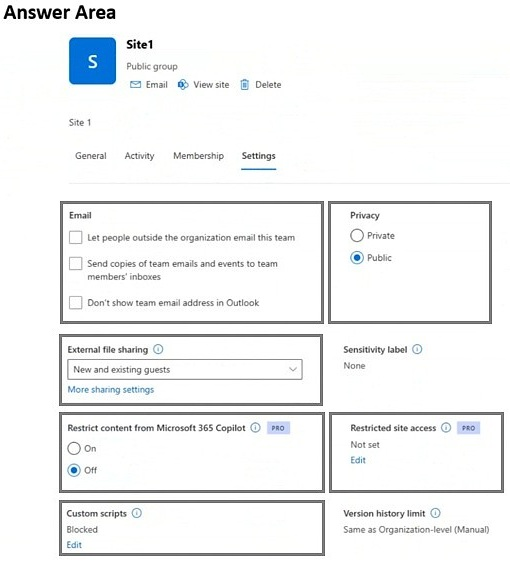

_HOTSPOT — the original ExamTopics question expects you to mark areas on the exhibit above; the correct hotspot coordinates are not published._

**Most voted:** Restricted site access (Acceso restringido al sitio) permite limitar el acceso a un sitio de SharePoint de modo que solo los usuarios que pertenecen a un grupo de seguridad designado (en este caso, Group1) puedan entrar, incluso si el sitio se compartió previamente con otros usuarios.

### Top explanations
- **hierro** (1 upvotes [Most Recent]): Restricted site access (Acceso restringido al sitio) permite limitar el acceso a un sitio de SharePoint de modo que solo los usuarios que pertenecen a un grupo de seguridad designado (en este caso, Group1) puedan entrar, incluso si el sitio se compartió previamente con otros usuarios.

## Q2.23 (ID 407459)

You need to identify files and emails that contain social security numbers (SSNs) and credit card numbers.
What should you use in the Microsoft Purview portal?

✅ **A.** Data explorer
⭕ **B.** Information Protection reports
⭕ **C.** Information Protection policies
⭕ **D.** Activity explorer

**Correct answer:** A
**Most voted:** A

### Top explanations
- **ak1447** (5 upvotes [Most Recent, Selected Answer: A]): The task is to identify files and emails that contain SSNs and credit card numbers — this is a content discovery task, not a policy enforcement task.
  Data explorer allows you to browse and search across your M365 content to see where sensitive information types — like SSNs and credit card numbers — have been detected. It gives you visibility into where that content lives across SharePoint, OneDrive, Exchange, etc.
- **0547a52** (3 upvotes [Selected Answer: A]): Data Explorer lets you view the items (files/emails) that match sensitive info detection (for example, built-in Sensitive Information Types like Credit Card Number and U.S. Social Security Number) and see where they’re located.
- **hierro** (2 upvotes [Selected Answer: R]): Explorador de datos (Data Explorer) es la herramienta diseñada para proporcionar una visibilidad detallada sobre el contenido que ha sido identificado por los tipos de información confidencial (como SSN o números de tarjeta de crédito).

## Q2.24 (ID 407460)

HOTSPOT
For each of the following statements, select Yes if the statement is true. Otherwise, select No.

**Exhibits**
- Exhibit 1: 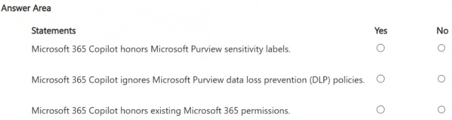

_HOTSPOT — the original ExamTopics question expects you to mark areas on the exhibit above; the correct hotspot coordinates are not published._

**Most voted:**
- Microsoft 365 Copilot honors Microsoft Purview sensitivity labels: SI
- Microsoft 365 Copilot ignores Microsoft Purview data loss prevention (DLP) policies: NO
- Microsoft 365 Copilot honors existing Microsoft 365 permissions: SI

### Top explanations
- **hierro** (4 upvotes): Microsoft 365 Copilot honors Microsoft Purview sensitivity labels: SI
  Microsoft 365 Copilot ignores Microsoft Purview data loss prevention (DLP) policies: NO
  Microsoft 365 Copilot honors existing Microsoft 365 permissions: SI
- **TDAC** (2 upvotes [Most Recent]): YES
  NO
  YES
  Microsoft 365 Copilot honors Microsoft Purview sensitivity labels: YES
  Microsoft 365 Copilot ignores Microsoft Purview data loss prevention (DLP) policies: NO
  Microsoft 365 Copilot honors existing Microsoft 365 permissions: YES

## Q2.25 (ID 407461)

HOTSPOT
Select the answer that correctly completes the sentence.

**Exhibits**
- Exhibit 1: 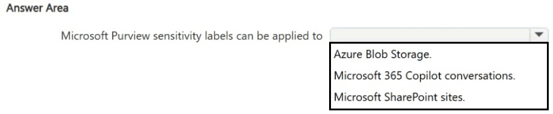

_HOTSPOT — the original ExamTopics question expects you to mark areas on the exhibit above; the correct hotspot coordinates are not published._

**Most voted:** Not provided

### Top explanations
- **hierro** (2 upvotes [Most Recent]): Sitios de Microsoft SharePoint: Microsoft Purview permite aplicar etiquetas de sensibilidad a nivel de contenedor, lo que incluye sitios de SharePoint, grupos de Microsoft 365 y equipos de Microsoft Teams para controlar los ajustes de privacidad y el acceso de usuarios externos.

## Q2.26 (ID 407462)

HOTSPOT
Select the answer that correctly completes the sentence.

**Exhibits**
- Exhibit 1: 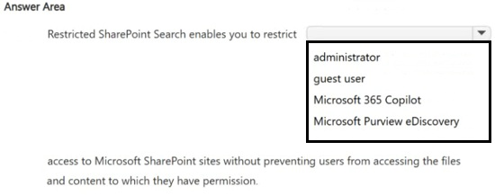

_HOTSPOT — the original ExamTopics question expects you to mark areas on the exhibit above; the correct hotspot coordinates are not published._

**Most voted:** Not provided

### Top explanations
- **ak1447** (4 upvotes [Most Recent]): Microsoft 365 Copilot - This is the exact purpose of Restricted SharePoint Search — it's a SAM feature specifically designed to limit which SharePoint sites Microsoft 365 Copilot can crawl and surface results from, while leaving human user access completely unchanged. Users can still browse and work with their permitted content normally; only Copilot's reach is curtailed.
- **hierro** (3 upvotes): Es Microsoft 365 Copilot.
  Restricted SharePoint Search: Es una funcionalidad diseñada específicamente para ayudar a las organizaciones a controlar qué sitios de SharePoint puede indexar y utilizar Microsoft 365 Copilot.

## Q2.27 (ID 407463)

HOTSPOT
For each of the following statements, select Yes if the statement is true. Otherwise, select No.
NOTE: Each correct selection is worth one point.

**Exhibits**
- Exhibit 1: 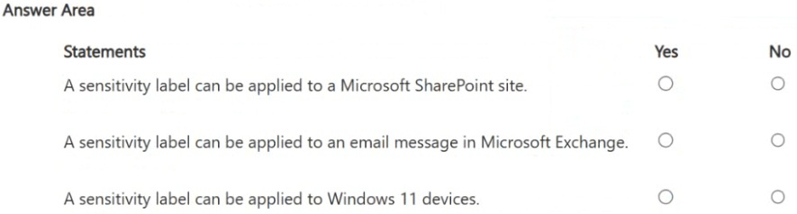

_HOTSPOT — the original ExamTopics question expects you to mark areas on the exhibit above; the correct hotspot coordinates are not published._

**Most voted:**
- SharePoint site – Yes
- Sensitivity labels support container labeling, which includes SharePoint sites and Microsoft Teams. Labels can control privacy, external sharing, and conditional access.
- Email message – Yes
- Sensitivity labels can be applied manually or automatically to Exchange Online emails to enforce encryption, access restrictions, and markings.

### Top explanations
- **0547a52** (12 upvotes [Highly Voted]): SharePoint site – Yes
  Sensitivity labels support container labeling, which includes SharePoint sites and Microsoft Teams. Labels can control privacy, external sharing, and conditional access.
  Email message – Yes
  Sensitivity labels can be applied manually or automatically to Exchange Online emails to enforce encryption, access restrictions, and markings.
  Windows 11 devices – No
  Sensitivity labels do not apply directly to devices. Labels apply to data (files, emails) and containers (sites, teams), not to Windows endpoints themselves.
- **lightthetorch** (2 upvotes [Most Recent]): A sensitivity label can be applied to a SharePoint site — True. Container labels can be applied to SharePoint sites to enforce privacy settings, control external sharing, and manage guest access at the site level.
  A sensitivity label can be applied to an email in Exchange — True. Sensitivity labels can be applied to emails manually by users or automatically based on content inspection rules, applying visual markings and encryption that travel with the email.
  A sensitivity label can be applied to a Windows 11 device — False. Sensitivity labels are applied to content (files, emails, meetings) and containers (sites, teams, groups), not to devices. Device security is managed through tools like Microsoft Intune and Microsoft Entra ID, not sensitivity labels.
- **Cyber198724** (1 upvotes): Yes. In a Microsoft 365 environment, you can assign sensitivity labels to Windows 11 devices. Through Microsoft Purview and Microsoft Intune, you can apply these labels to physical endpoints, user sessions, and individual files/emails.

## Q2.28 (ID 407464)

Your organization has a Microsoft 365 E5 subscription.
You create a Microsoft Purview sensitivity label named Label1.
You need to ensure that users can apply Label1 to files in Microsoft 365.
What should you use?

✅ **A.** a sensitivity label policy
⭕ **B.** a trainable classifier
⭕ **C.** a retention label policy
⭕ **D.** an auto-labeling policy

**Correct answer:** A
**Most voted:** A

### Top explanations
- **0547a52** (6 upvotes [Most Recent, Selected Answer: A]): Creating a sensitivity label is not enough by itself. For users to be able to see and apply Label1 to files in Microsoft 365, the label must be published to users.
  A sensitivity label policy is used to:
  Publish sensitivity labels
  Scope them to users or groups
  Make the labels available in apps like Word, Excel, PowerPoint, Outlook, and SharePoint
- **hierro** (2 upvotes [Selected Answer: R]): R. una política de etiquetas de sensibilidad
  En Microsoft Purview, el proceso de etiquetado de documentos se divide en dos pasos principales:
  Creación: Se define la etiqueta (nombre, cifrado, marcas de agua).
  Publicación: Para que los usuarios finales puedan ver y seleccionar la etiqueta en sus aplicaciones de Office (Word, Excel, etc.), esta debe ser publicada a través de una política de etiquetas de sensibilidad (sensitivity label policy).

## Q2.29 (ID 407465)

Your company has a written compliance policy that requires all emails be retained for seven years, and then permanently deleted.
Which Microsoft Purview solution should you use?

⭕ **A.** Information Protection
✅ **B.** Data Lifecycle Management
⭕ **C.** Data Loss Prevention
⭕ **D.** Insider Risk Management

**Correct answer:** B
**Most voted:** B

### Top explanations
- **TDAC** (1 upvotes [Most Recent, Selected Answer: B]): Answer is correct.
  Data Lifecycle Management is the solution designed to create retention policies and retention labels. Its main purpose is to automate how long data is kept to meet legal or compliance requirements, and what happens to that data once the retention period expires (such as automatically deleting it).
- **hierro** (1 upvotes [Selected Answer: B]): Gestión del ciclo de vida de los datos (Data Lifecycle Management): Esta solución permite crear políticas de retención y etiquetas de retención. Su objetivo principal es automatizar cuánto tiempo se guardan los datos para cumplir con normativas legales o de cumplimiento, y qué sucede con ellos una vez que expira ese plazo (borrarlos automáticamente).

## Q2.30 (ID 407466)

HOTSPOT
Select the answer that correctly completes the sentence.

**Exhibits**
- Exhibit 1: 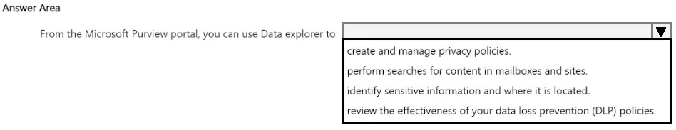

_HOTSPOT — the original ExamTopics question expects you to mark areas on the exhibit above; the correct hotspot coordinates are not published._

**Most voted:**
- Answer is correct.
- Data Explorer is a Microsoft Purview tool designed to provide visibility into content that has been classified by sensitive information types or sensitivity labels.

### Top explanations
- **TDAC** (2 upvotes [Most Recent]): Answer is correct.
  Data Explorer is a Microsoft Purview tool designed to provide visibility into content that has been classified by sensitive information types or sensitivity labels.
- **hierro** (1 upvotes): Es identify sensitive information and where it is located.
  Data Explorer Es una herramienta de Microsoft Purview diseñada para proporcionar visibilidad sobre el contenido que ha sido clasificado por los tipos de información sensible o etiquetas de sensibilidad.

## Q3.1 (ID 385270)

HOTSPOT
You are evaluating Microsoft Purview solutions.
For each of the following statements, select Yes if the statement is true. Otherwise, select No.
NOTE: Each correct selection is worth one point.

**Exhibits**
- Exhibit 1: 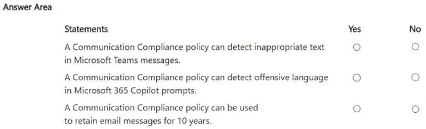

_HOTSPOT — the original ExamTopics question expects you to mark areas on the exhibit above; the correct hotspot coordinates are not published._

**Most voted:**
1. Yes
2. Yes
3. No

### Top explanations
- **omath** (6 upvotes): 1. Yes
  Communication Compliance can detect offensive, profane, harassing, or otherwise inappropriate language in Microsoft Teams chats and channels.
  2. Yes
  Communication Compliance can analyze Copilot prompts and responses for inappropriate or risky content, including harassment, threats, or sensitive information.
  3. No
  Retention of email (e.g., 10‑year retention) is handled by Retention Policies in Data Lifecycle Management—not by Communication Compliance policies.
- **poesklap** (1 upvotes [Most Recent]): Yes
  Yes
  No
  Communication Compliance can detect inappropriate or offensive content in channels like Teams and Microsoft 365 Copilot interactions, but email retention is handled by retention policies, not Communication Compliance.
- **hierro** (1 upvotes): Correcto:
  1: SI
  2: SI
  3: NO

## Q3.2 (ID 392064)

You need to create a Microsoft 365 Copilot agent that can create charts and visualizations based on a Microsoft Excel workbook.
What should you configure for the agent?

⭕ **A.** the image generator capability
⭕ **B.** the Scrum Assistant template
⭕ **C.** the Customer Insights Assistant template
✅ **D.** the code interpreter capability

**Correct answer:** D
**Most voted:** D

### Top explanations
- **omath** (6 upvotes [Most Recent, Selected Answer: D]): Answer: D. the code interpreter capability
  Explanation:
  The Code Interpreter capability allows a Microsoft 365 Copilot agent to analyze data, run Python code, and generate visualizations such as charts and graphs directly from an Excel workbook. This is explicitly the capability designed for data analysis and chart creation.

## Q3.3 (ID 392063)

Your company is piloting the use of Microsoft 365 Copilot and has purchased 100 Microsoft 365 Copilot licenses.
You need to view detailed reports about Copilot usage in Microsoft Teams, such as meeting hours summarized by Copilot and meeting actions taken by using Copilot.
What should you use?

⭕ **A.** the Microsoft 365 Copilot readiness report in the Microsoft 365 admin center
⭕ **B.** the Microsoft 365 Copilot usage report in the Microsoft 365 admin center
✅ **C.** the Microsoft 365 Copilot dashboard in Microsoft Viva Insights
⭕ **D.** the Microsoft 365 Apps usage report in the Microsoft 365 admin center

**Correct answer:** C
**Most voted:** C

### Top explanations
- **omath** (3 upvotes [Selected Answer: C]): Answer:
  ✅ C. the Microsoft 365 Copilot dashboard in Microsoft Viva Insights
  Explanation:
  The Copilot Dashboard (available through Microsoft Viva Insights) provides detailed organizational‑level metrics about Copilot usage, including meeting hours summarized or recapped, as well as insights into how Copilot is being used across Microsoft Teams meetings. These updated metrics are explicitly designed to show Copilot’s impact on meeting summaries, Intelligent Recap usage, and meeting‑related actions.
- **poesklap** (2 upvotes [Most Recent]): C. the Microsoft 365 Copilot dashboard in Microsoft Viva Insights
  The detailed Teams Copilot metrics, including meeting hours summarized or recapped and meeting actions taken using Copilot, are shown in the Microsoft Copilot Dashboard in Viva Insights.

## Q3.4 (ID 392062)

A user named User1 creates a Microsoft 365 Copilot agent named Agent1 and shares the agent to a user named User2.
What occurs if an admin blocks Agent1?

⭕ **A.** Agent1 is accessible to User1 and User2 until the users manually uninstall Agent. No other users can install Agent1.
⭕ **B.** Agent1 is accessible to User1 and User2, and no other users can install Agent1.
⭕ **C.** Agent1 is removed from User2, and User1 can continue to use Agent1.
✅ **D.** Agent1is removed from User1 and User2, and no users can install Agent1.

**Correct answer:** D
**Most voted:** D

### Top explanations
- **omath** (4 upvotes [Selected Answer: D]): Answer:
  ✅ D. Agent1 is removed from User1 and User2, and no users can install Agent1.
  Explanation:
  When an admin blocks a Copilot agent, the agent becomes unavailable to all users, including the creator and anyone it was shared with. Blocking is an admin‑level governance action that prevents the agent from being accessed or installed by anyone in the tenant. This behavior is documented as part of the centralized Copilot agent management capability, where admins can block or remove agents so they can no longer be used.
- **PauloJRamos** (1 upvotes [Most Recent, Selected Answer: C]): Explanation:
  User1 is the owner/creator of Agent1.
  When a user shares an agent with another user (User2), the recipient gains access to that agent.
  If the shared access is removed or revoked, User2 can no longer use Agent1, but User1 retains access because User1 is still the owner of the agent.

## Q3.5 (ID 385318)

HOTSPOT
For each of the following statements, select Yes if the statement is true. Otherwise, select No.
NOTE: Each correct selection is worth one point.

**Exhibits**
- Exhibit 1: 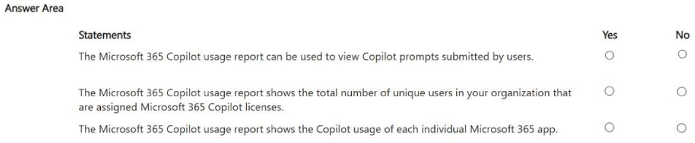

_HOTSPOT — the original ExamTopics question expects you to mark areas on the exhibit above; the correct hotspot coordinates are not published._

**Most voted:**
1. No
2. Yes
3. No

### Top explanations
- **ak1447** (5 upvotes): Statement 1 — No: The Copilot usage report shows usage metrics and adoption data — active users, feature usage, trends. It does not expose the actual content of prompts submitted by users. Prompt content is private to the user and is not surfaced in admin reports (that would be a significant privacy concern).
  Statement 2 — Yes: The report does show licensed user counts — specifically how many unique users have been assigned Copilot licenses and how many are actively using it. This is a core part of adoption tracking for admins.
  Statement 3 — Yes: The report breaks down Copilot usage by individual M365 app — showing activity across Teams, Word, Excel, PowerPoint, Outlook, OneNote, etc. separately. This helps admins see where Copilot is being adopted and which apps are underutilised.
- **omath** (4 upvotes): 1. No
  The usage report shows adoption and usage metrics, such as enabled users, active users, and agent usage. It does not display the actual prompts users submit.
  2. Yes
  The Enabled Users metric in the usage report shows the total number of unique users assigned Copilot licenses.
  3. No
  The usage report provides overall usage metrics, not detailed per‑app usage breakdowns for every Microsoft 365 app.
- **35447c1** (3 upvotes): 1. No
  2. Yes
  3. Yes (New)
  Today, the report includes tenant-wide enabled users, active users, the active user rate, and active agent users. To understand Copilot usage by app, the report displays enabled and active users per app, including the M365 Copilot app, Microsoft Teams, Outlook, Word, PowerPoint, Excel, and more.
- **TDAC** (1 upvotes [Most Recent]): This is incorrect.  It should be NO, YES, YES.
  The usage report DOES show usage per app under the "Adoption by App / Summary" section.  This report is in the Admin Center, Reports, Usage, Microsoft 365 Coplot, Copilot.  It shows enabled users, active users and per app (Excel, Edge, Outlook, Teams, Word etc).

## Q3.6 (ID 385271)

HOTSPOT
For each of the following statements, select Yes if the statement is true. Otherwise, select No.
NOTE: Each correct selection is worth one point.

**Exhibits**
- Exhibit 1: 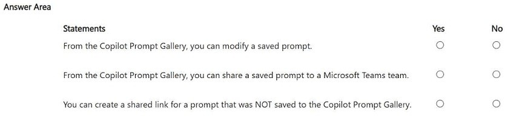

_HOTSPOT — the original ExamTopics question expects you to mark areas on the exhibit above; the correct hotspot coordinates are not published._

**Most voted:** Yes, Yes, No

### Top explanations
- **fa62dd5** (8 upvotes [Highly Voted]): YES / YES / NO
- **60ed5c2** (4 upvotes): No - you cannot modify an already saved prompt IN prompt gallery.  You can select the prompt and then edit it in the copilot chat window, but then you would have to save the NEW prompt to prompt gallery.  It's STUPID and customer hate it, but that is the reality.
  Yes
  Yes - you can absolutely share a prompt from the copilot prompt directly.  It is the icon next to the "save prompt" icon when you hover over the prompt.  It creates a sharing link you can then send to someone without saving it to the prompt gallery first.
- **0547a52** (3 upvotes): Modify a saved prompt – Yes
  Saved prompts in the Copilot Prompt Gallery can be edited and updated.
  Share a saved prompt to a Teams team – Yes
  The Prompt Gallery supports sharing saved prompts directly with others, including Microsoft Teams teams.
  Share a prompt that was not saved – No
  Only prompts that are saved to the Copilot Prompt Gallery can be shared; unsaved prompts cannot generate a shared link.
- **omath** (2 upvotes): 1. No
  Available documentation shows that you can edit a prompt at the moment you save it, but there is no supported action to modify an already‑saved prompt directly from the Prompt Gallery. Saved prompts can be shared or removed, but not edited in place.
  2. Yes
  Microsoft explicitly confirms that you can share a saved prompt with a Microsoft Teams team directly from the Prompt Gallery.
  3. No
  Sharing is only available for saved prompts, accessed under Your Prompts in the Prompt Gallery. Prompts must be saved before they can be shared.
- **poesklap** (1 upvotes [Most Recent]): No
  Yes
  No
  Microsoft says sharing a prompt to a Teams team is done from saved prompts in the Copilot Prompt Gallery, where you select Your prompts, choose the saved prompt, and then select Share to team.

## Q3.7 (ID 385319)

HOTSPOT
For each of the following statements, select Yes if the statement is true. Otherwise, select No.
NOTE: Each correct selection is worth one point.

**Exhibits**
- Exhibit 1: 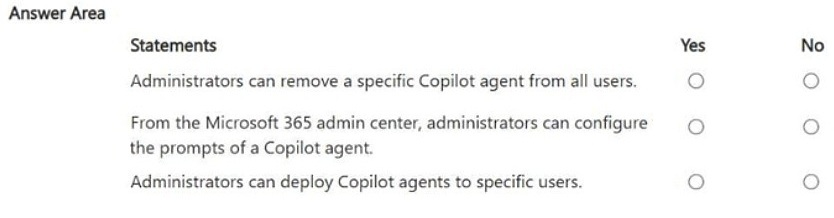

_HOTSPOT — the original ExamTopics question expects you to mark areas on the exhibit above; the correct hotspot coordinates are not published._

**Most voted:**
1. Yes
2. No
3. Yes

### Top explanations
- **omath** (4 upvotes): 1. Yes
  Admins can block or remove Copilot agents using the Microsoft 365 admin center.
  2. No
  Admins can manage access, block, deploy, or remove agents, but cannot edit or configure the internal prompts of a Copilot agent.
  3. Yes
  Admins can target agent deployment to specific users or groups using agent access settings
- **poesklap** (3 upvotes [Most Recent]): Yes
  No
  Yes
  Admins can manage agents in the Microsoft 365 admin center, including enabling, disabling, assigning, blocking, or removing agents. They can also make agents available to specific users or groups. Configuring the actual agent prompts/instructions is done in the agent-building tool, such as Copilot Studio, not directly from the Microsoft 365 admin center.

## Q3.8 (ID 385320)

You plan to create an agent in the Microsoft 365 Copilot app to solve a business issue.
What are two reasons to create the agent? Each correct answer presents a complete solution.
NOTE: Each correct selection is worth one point.

⭕ **A.** You need to use a custom AI model.
✅ **B.** You need to use a custom set of instructions that differ from those of the chat experience.
✅ **C.** You need to reason over a specific website.
⭕ **D.** You need to group related chats into a Copilot notebook.

**Correct answer:** B, C
**Most voted:** BC

### Top explanations
- **omath** (4 upvotes [Most Recent, Selected Answer: BC]): ✅ B. You need to use a custom set of instructions that differ from those of the chat experience.
  Agents allow you to define detailed, custom instructions, roles, and behavior that go beyond what the standard Copilot chat provides.
  ✅ C. You need to reason over a specific website.
  Copilot agents can be configured to allow or block web browsing, enabling them to reason over specific websites when browsing is enabled.

## Q3.9 (ID 392061)

HOTSPOT
Select the answer that correctly completes the sentence.

**Exhibits**
- Exhibit 1: 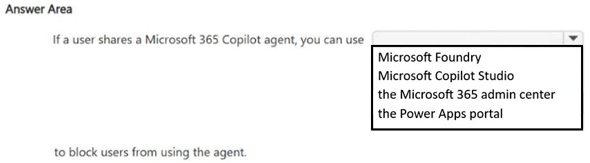

_HOTSPOT — the original ExamTopics question expects you to mark areas on the exhibit above; the correct hotspot coordinates are not published._

**Most voted:** ✅ the Microsoft 365 admin center

### Top explanations
- **omath** (3 upvotes [Most Recent]): Answer:
  ✅ the Microsoft 365 admin center
  Explanation:
  Why: Administrators can block, remove, or manage Copilot agents— including those shared by users—through the Copilot > Agents & connectors area of the Microsoft 365 admin center.

## Q3.10 (ID 385272)

HOTSPOT
For each of the following statements, select Yes if the statement is true. Otherwise, select No.
NOTE: Each correct selection is worth one point.

**Exhibits**
- Exhibit 1: 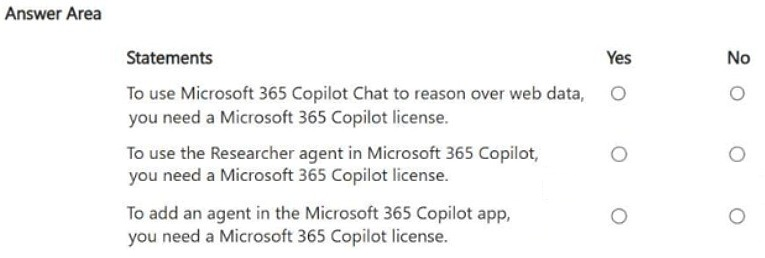

_HOTSPOT — the original ExamTopics question expects you to mark areas on the exhibit above; the correct hotspot coordinates are not published._

**Most voted:**
1. No
2. Yes
3. No

### Top explanations
- **ak1447** (4 upvotes): Statement 1 — No: Microsoft 365 Copilot Chat with web grounding is available to users with eligible Microsoft 365 commercial licenses a dedicated Copilot license is not required for web-based queries. The Copilot license is only required when reasoning over organisational data.
  Statement 2 — Yes: The Researcher agent is one of the premium agents in Microsoft 365 Copilot that performs deep research tasks across organisational data and the web. It is a Copilot-licensed feature and requires a Microsoft 365 Copilot license to access.
  Statement 3 — No: Users can add and use agents in the Microsoft 365 Copilot app with just a standard Microsoft 365 license — a full Copilot license is not required to add agents. However, agents that access organisational data will require appropriate licensing.
- **omath** (4 upvotes): 1. No
  Users without a Microsoft 365 Copilot license can still reason over web data in Copilot Chat.
  2. Yes
  The Researcher agent is available only to users with a Microsoft 365 Copilot license.
  3. No
  Users without a Microsoft 365 Copilot license can still use and add agents in Copilot Chat (with limitations), as agents are supported for free-tier Copilot Chat users.
- **Acrious** (2 upvotes [Most Recent]): Remember that words like always, need, must have etc are a trick, you do not NEED a license to add one, you need at least PAYGO, but it implies there is no other way to do it without a license, which is not true. No, Yes, No is correct
- **20ca459** (2 upvotes): Copilot Chat has agents that can be used at no additional cost as well as agents that are billed based on metered consumption. Declarative agents that are grounded in instructions and public websites are available at no additional cost and are available by default/found in the store based on store settings for Teams and M365 Apps.
- **0547a52** (1 upvotes): Copilot Chat + web data – No
  Users can reason over public web data using Copilot Chat without a Microsoft 365 Copilot license (this uses the web-grounded Copilot experience, not Microsoft Graph).
  Researcher agent – Yes
  Advanced agents such as Researcher are Copilot‑licensed features and require a Microsoft 365 Copilot license.
  Adding an agent in the Copilot app – Yes
  Creating or adding Copilot agents in the Microsoft 365 Copilot app is a licensed capability.

## Q3.11 (ID 385321)

HOTSPOT
For each of the following statements, select Yes if the statement is true. Otherwise, select No.
NOTE: Each correct selection is worth one point.

**Exhibits**
- Exhibit 1: 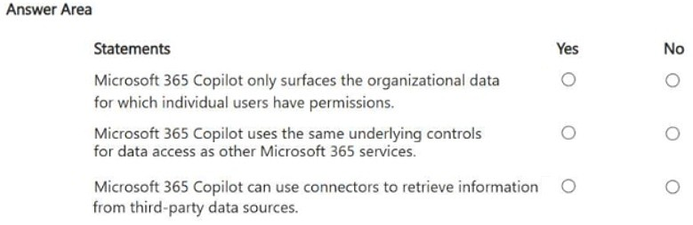

_HOTSPOT — the original ExamTopics question expects you to mark areas on the exhibit above; the correct hotspot coordinates are not published._

**Most voted:**
1. Yes
2. Yes
3. Yes

### Top explanations
- **omath** (4 upvotes [Most Recent]): 1. Yes
  Microsoft 365 Copilot only surfaces data that a user already has at least view‑permissions for.
  2. Yes
  Copilot operates within the Microsoft 365 service boundary and honors the same data protection, access control, and compliance capabilities as all other Microsoft 365 services.
  3. Yes
  Copilot connectors allow retrieval of external third‑party data (e.g., Salesforce, Google Drive, Zendesk, etc.)

## Q3.12 (ID 391684)

HOTSPOT
Select the answer that correctly completes the sentence.

**Exhibits**
- Exhibit 1: 

_HOTSPOT — the original ExamTopics question expects you to mark areas on the exhibit above; the correct hotspot coordinates are not published._

**Most voted:** Use the Researcher agent.

### Top explanations
- **omath** (4 upvotes): Answer: Use the Researcher agent.
  Explanation:
  ✅ The Researcher agent in Microsoft 365 Copilot is specifically designed for deep, multi‑step reasoning across unstructured data, combining insights from both the web and your work content.
- **TDAC** (2 upvotes [Most Recent]): This is correct.  Researcher for unstructured data.  Analyst for structured data/numbers/modelling/number crunching etc.

## Q3.13 (ID 391683)

Your organization has a Microsoft 365 subscription.
You need to assign a license to a user.
What should you use?

⭕ **A.** the Microsoft Purview portal
✅ **B.** the Microsoft 365 admin center
⭕ **C.** the Microsoft Teams admin center

**Correct answer:** B
**Most voted:** B

### Top explanations
- **omath** (2 upvotes [Most Recent, Selected Answer: B]): ✅ B. the Microsoft 365 admin center
  Why:
  Licenses for users in a Microsoft 365 subscription are assigned through the Microsoft 365 admin center under Users → Active users → Licenses and apps.

## Q3.14 (ID 391681)

HOTSPOT
Select the answer that correctly completes the sentence.

**Exhibits**
- Exhibit 1: 

_HOTSPOT — the original ExamTopics question expects you to mark areas on the exhibit above; the correct hotspot coordinates are not published._

**Most voted:** Microsoft SharePoint files

### Top explanations
- **omath** (3 upvotes [Most Recent]): Answer: Microsoft SharePoint files
  Explanation:
  Copilot retrieves organizational content through Microsoft Graph, and that includes:
  - SharePoint files
  - OneDrive files
  - Teams chats
  - Outlook emails
  - Calendar data
  In this question, the only valid data source listed that Copilot retrieves via Graph is Microsoft SharePoint files.

## Q3.15 (ID 407467)

Your organization has a Microsoft 365 subscription.
Your company recently purchased Microsoft 365 Copilot licenses for some users.
You need to identify how many unlicensed users have used Copilot in Microsoft Teams.
Which usage report should you use in the Microsoft 365 admin center?

✅ **A.** Microsoft 365 Copilot Chat
⭕ **B.** Microsoft 365 Copilot Search
⭕ **C.** Microsoft 365 Apps
⭕ **D.** Microsoft 365 Copilot

**Correct answer:** A
**Most voted:** A

### Top explanations
- **Acrious** (2 upvotes [Selected Answer: A]): Unlicensed people using it is A, not D.
- **TDAC** (2 upvotes [Most Recent]): This is the correct answer.  Copilot Chat.   You can see the report in the admin center - Reports - Usage - Microsoft 365 Copilot - Copilot Chat.  It literally says in the heading "This report applies to Microsoft 365 Copilot Chat users who don't have a Microsoft 365 Copilot license assigned to them"
- **MarcMouelle** (2 upvotes [Selected Answer: A]): This is the correct report because it covers only users without a Microsoft 365 Copilot license who interact with Copilot Chat in Teams, Outlook, m365.cloud.microsoft/chat, the Microsoft 365 Copilot app, Microsoft Edge, Word, Excel, PowerPoint, and OneNote.
- **poesklap** (1 upvotes): A. Microsoft 365 Copilot Chat
  Use the Microsoft 365 Copilot Chat usage report. It shows Copilot Chat usage across apps, including Teams, and includes active users of Copilot Chat. Microsoft’s documentation lists Teams as one of the app details tracked in that report.
- **0547a52** (1 upvotes [Selected Answer: D]): Correct answer: D. Microsoft 365 Copilot
  Explanation (exam‑focused)
  To identify how many unlicensed users have used Copilot in Microsoft Teams, you must use the Microsoft 365 Copilot usage report in the Microsoft 365 admin center.
  The Microsoft 365 Copilot usage report:
  Tracks Copilot usage across workloads, including Microsoft Teams
  Differentiates between licensed and unlicensed users
  Shows adoption and usage metrics needed to identify users who accessed Copilot without a license

## Q3.16 (ID 407468)

A user named User1 is responsible for quarterly sales reporting.
User1 needs to identify performance trends, generate visual insights, and create a summary of anomalies across multiple files that contain various datasets.
What should you use?

✅ **A.** the Analyst agent in Microsoft 365 Copilot
⭕ **B.** the Researcher agent in Microsoft 365 Copilot
⭕ **C.** Microsoft 365 Copilot Search
⭕ **D.** Copilot in Excel

**Correct answer:** A
**Most voted:** A

### Top explanations
- **ak1447** (3 upvotes [Most Recent, Selected Answer: A]): The Analyst agent is specifically designed for this — it can:
  Work across multiple data files simultaneously
  Perform advanced data analysis including trend identification
  Generate charts and visual insights automatically
  Surface anomalies and patterns in datasets
  Produce a written summary of findings

## Q3.18 (ID 407470)

Your company is evaluating Microsoft 365 Copilot licensing.
In which scenario should you use pay-as-you-go billing?

⭕ **A.** to provide users with access to the AI assistant in Copilot in Word
⭕ **B.** to summarize the actions in Microsoft Teams meetings
⭕ **C.** to generate images in premium chats
✅ **D.** to make a custom agent available to unlicensed users

**Correct answer:** D
**Most voted:** D

### Top explanations
- **michou1524** (4 upvotes [Selected Answer: D]): Explanation:
  Pay-as-you-go billing for Microsoft 365 Copilot is used when:
  You want to extend Copilot capabilities without assigning full licenses
  You allow unlicensed users to access specific Copilot features, such as custom agents
  Usage is billed based on consumption rather than per-user licensing
  This fits the scenario:
  Making a custom agent available to users who do not have a Copilot license
- **FS202** (1 upvotes [Most Recent, Selected Answer: D]): to make a custom agent available to unlicensed users

## Q3.19 (ID 407471)

You use Microsoft 365 Copilot.
You need to schedule a prompt to run at midnight.
What task should you include in your solution?

⭕ **A.** Create an agent.
⭕ **B.** Create a notebook.
✅ **C.** Run the prompt.
⭕ **D.** Save the prompt.

**Correct answer:** C
**Most voted:** C

### Top explanations
- **Acrious** (5 upvotes [Selected Answer: C]): The answer is C, you have to run it once, THEN you can schedule it, not Save it, sorry that is not correct.
- **MarcMouelle** (4 upvotes [Selected Answer: C]): The official workflow for scheduling a prompt in Microsoft 365 Copilot requires that you first run (or submit) the prompt; only then will the “Schedule this prompt” option become available on the response. You cannot schedule a prompt that has never been run.
  Open Copilot and submit a prompt. Hover over the prompt and select “Schedule this prompt.” Select the options for when the prompt will run, how many times it will run, and whether you want to receive an email notification when the response is ready. Select Save.
- **Sheryle** (3 upvotes [Most Recent, Selected Answer: D]): Answer: D. Save the prompt ✅
  To schedule a prompt in Microsoft 365 Copilot, the prompt must first be saved. Once saved, you can configure it as a scheduled prompt and specify a time such as midnight for it to run automatically. Microsoft documentation describes creating a useful prompt, then saving/scheduling it with a defined time and frequency
- **TDAC** (2 upvotes): ^this is correct.  Once the prompt has run and you have validated the output, you can then click the 3 dots and one of the options is "Schedule this prompt".   So the correct answer is C - the first step is to RUN the prompt.
- **poesklap** (2 upvotes): D. Save the prompt
  To schedule a prompt, it must first be saved. Then you can schedule it to run at a specific time, such as midnight.

## Q3.20 (ID 407472)

HOTSPOT
For each of the following statements, select Yes if the statement is true. Otherwise, select No.
NOTE: Each correct selection is worth one point.

**Exhibits**
- Exhibit 1: 

_HOTSPOT — the original ExamTopics question expects you to mark areas on the exhibit above; the correct hotspot coordinates are not published._

**Most voted:**
1. No - It only detects text-based information, not offensive text within images.
2. Yes
3. No

### Top explanations
- **35447c1** (4 upvotes): 1. No - It only detects text-based information, not offensive text within images.
  2. Yes
  3. No
- **0547a52** (2 upvotes): Detect offensive text in images in SharePoint – No
  Communications Compliance focuses on communications content (such as Exchange email, Microsoft Teams messages, and third‑party connectors). It does not scan images stored in SharePoint libraries for offensive text.
  Anonymizes user identities by default – Yes
  User identities are anonymized by default in investigations to reduce bias. Investigators must explicitly choose to reveal identities if needed.
  Adds a disclaimer to all monitored communications – No
  Communications Compliance is a monitoring and investigation tool, not a content modification or transport feature. It does not inject disclaimers into messages.
- **FS202** (1 upvotes [Most Recent]): No / Yes / No
- **TDAC** (1 upvotes): Detecting offensive text is a trick question.  By default the answer is No.  But the capability is there.  Purview Communication Compliance can detect offensive or harassing text that appears inside images stored in SharePoint, because Purview OCR extracts the text and makes it available to classifiers. However, OCR is not enabled by default, and Communication Compliance only evaluates the extracted text once OCR has processed the file.
  However in this instance we assume default, and I agree with this answer.

## Q3.21 (ID 407473)

Your organization has a Microsoft 365 subscription.
All users are assigned a Microsoft 365 Copilot license.
You need to prevent the users from generating images by using Copilot.
What should you use?

⭕ **A.** the Microsoft Defender portal
⭕ **B.** the Microsoft Entra admin center
⭕ **C.** the Microsoft Purview portal
✅ **D.** the Microsoft 365 admin center

**Correct answer:** D
**Most voted:** D

### Top explanations
- **mlyfr** (3 upvotes [Selected Answer: D]): Admin Center / Copilot / Settings
- **hierro** (3 upvotes [Selected Answer: D]): Centro de administración de Microsoft 365 (M365 Admin Center): Dentro de este centro, existe una sección específica de Configuración de la organización (Org settings) dedicada a Copilot. Desde aquí, los administradores pueden activar o desactivar funciones a nivel de tenant, incluyendo la capacidad de permitir que los usuarios generen imágenes en experiencias de chat premium y aplicaciones de Office.
- **35447c1** (2 upvotes [Selected Answer: D]): D - Picture generating is a product-function of Copilot and not a security nor compliance rule. Therefore it should be Microsoft 365 admin center where I can restrict Copilot functions.
- **2d2bc95** (1 upvotes [Most Recent, Selected Answer: D]): Admins can enable or disable image generation features.
- **8b57847** (1 upvotes [Selected Answer: C]): Can create policy in purview not to create any images

## Q3.22 (ID 407474)

HOTSPOT
For each of the following statements, select Yes if the statement is true. Otherwise, select No.
NOTE: Each correct selection is worth one point.

**Exhibits**
- Exhibit 1: 

_HOTSPOT — the original ExamTopics question expects you to mark areas on the exhibit above; the correct hotspot coordinates are not published._

**Most voted:** No, Yes, No

### Top explanations
- **ak1447** (3 upvotes): Statement 1 — Yes: Admins can configure web search settings in the Microsoft 365 admin center to block specific URLs/domains from being used as sources when Copilot grounds responses in web content. This is managed through search result filtering controls.
  Statement 2 — Yes: Admins have the ability to turn off web search entirely for Microsoft 365 Copilot via the M365 admin center.
  Statement 3 — Yes: The Researcher and Analyst agents can be managed independently by admins. Through the Microsoft 365 admin center, admins can control which Copilot agents are available to users, allowing them to enable/disable specific agents selectively.
- **0547a52** (3 upvotes): Administrators can block specific websites from being used by Microsoft 365 Copilot.
  👉 No
  There is no granular control to block individual external websites used by Copilot’s web grounding.
  Administrators can block Microsoft 365 Copilot from using web search when responding to user prompts.
  👉 Yes
  Admins can disable web search/Bing grounding for Copilot responses via tenant settings.
  Administrators can block access to the Researcher agent in Microsoft 365 Copilot, while allowing access to the Analyst agent.
  👉 Yes
  Agent access can be controlled, allowing selective enablement or restriction of specific Copilot agents.
- **mlyfr** (3 upvotes): NO / YES / NO
- **FS202** (1 upvotes [Most Recent]): No
  Yes
  Yes

## Q3.23 (ID 407475)

HOTSPOT
You need to ensure that users can use an external system as a knowledge source for custom Microsoft 365 Copilot agents.
What should you configure in the Microsoft 365 admin center? To answer, select the appropriate settings in the answer area.

**Exhibits**
- Exhibit 1: 

_HOTSPOT — the original ExamTopics question expects you to mark areas on the exhibit above; the correct hotspot coordinates are not published._

**Most voted:** The requirement is to allow an external system to be used as a knowledge source for custom Copilot agents. This is exactly what Microsoft Graph connectors do — they bring external data  into the Microsoft 365 index so that Copilot agents can reason over it.

### Top explanations
- **Acrious** (6 upvotes [Most Recent]): Connectors is the answer (not agents) and connectors
- **ak1447** (2 upvotes): The requirement is to allow an external system to be used as a knowledge source for custom Copilot agents. This is exactly what Microsoft Graph connectors do — they bring external data  into the Microsoft 365 index so that Copilot agents can reason over it.
  In the M365 admin center under Copilot → Connectors, admins can configure and manage these Graph connectors to ingest external content into Microsoft Search/Graph, making it available as a grounding source for custom agents.

## Q3.24 (ID 407476)

Your company plans to use Microsoft 365 Copilot.
You need to provide a user with the ability to use Microsoft 365 Copilot, including the Researcher and Analyst agent.
What should you use?

✅ **A.** the Microsoft 365 admin center
⭕ **B.** the Microsoft Purview portal
⭕ **C.** the Microsoft Entra admin center
⭕ **D.** the Microsoft Defender portal

**Correct answer:** A
**Most voted:** A

### Top explanations
- **TDAC** (2 upvotes [Most Recent, Selected Answer: A]): A is correct.
  In the Admin Portal - Agents - All Agents.  They can all be managed there.

## Q3.25 (ID 407477)

Your company is evaluating Microsoft 365 Copilot pay-as-you-go billing instead of purchasing a Microsoft 365 Copilot license.
In which scenario can pay-as-you-go billing apply?

⭕ **A.** performing multi-step reasoning by using the Researcher agent
⭕ **B.** generating a recap of a Microsoft Teams meeting
✅ **C.** using a custom agent that is grounded in work data
⭕ **D.** using the AI assistant to edit a document in Copilot in Word

**Correct answer:** C
**Most voted:** C

### Top explanations
- **ak1447** (6 upvotes [Selected Answer: C]): Answer: C
  Microsoft 365 Copilot pay-as-you-go billing applies to messages consumed by custom agents built in Copilot Studio — particularly agents that are grounded in organisational/work data. This model lets organisations pay per message rather than buying per-user Copilot licenses, making it suitable for agents used by a broader or variable audience.
  Why not the others?
  A. Researcher agent -  is a premium feature of the Microsoft 365 Copilot license — it requires a named user Copilot license, not pay-as-you-go
  B. Teams meeting recapThis is a core Microsoft 365 Copilot licensed feature requires a per-user Copilot license, not pay-as-you-go
  D. Copilot in WordThis is a core Microsoft 365 Copilot licensed feature
- **Acrious** (2 upvotes [Most Recent, Selected Answer: C]): Using custom agent is correct, RAG etc is covered by this. The others are not
- **MultiCloudIronMan** (2 upvotes [Selected Answer: A]): Others are part of copilot licensing
- **poesklap** (1 upvotes): C. using a custom agent that is grounded in work data
  Microsoft 365 Copilot pay-as-you-go billing applies to Copilot Chat users without a Microsoft 365 Copilot license when they use agents grounded in work data.
  The others require a full Microsoft 365 Copilot license.

## Q3.26 (ID 407478)

Your company has a Microsoft SharePoint site named Site1. Site1 contains all the policies of the company’s HR department. The policies are saved as Microsoft Word documents.
All users have read access to Site1.
The HR department manager reports that user requests about the policies are NOT being addressed in a timely manner, especially around major holidays.
You need to recommend a solution to enable the users to find the HR department policies. The solution must provide the users with a list of common queries and ensure that responses are grounded only in Site1.
What should you include in the recommendation?

⭕ **A.** the personal assistant in Copilot in Word
✅ **B.** a custom Microsoft 365 Copilot agent
⭕ **C.** the Researcher agent in Microsoft 365 Copilot
⭕ **D.** a Microsoft 365 Copilot notebook

**Correct answer:** B
**Most voted:** B

### Top explanations
- **944e7a1** (3 upvotes [Selected Answer: B]): B. Custom agent since the data has to pull from a specific data source.
- **FS202** (1 upvotes [Most Recent, Selected Answer: B]): A custom Microsoft 365 Copilot agent
- **Acrious** (1 upvotes [Selected Answer: C]): C, based on the requirements none of the others meet the criteria. A personal one is only good for that person who created it, researcher nope, a notebook is not for this, although technically you could create a notebook and do some of the things, but an Agent is the only thing that can scope to all the requirements
- **944e7a1** (1 upvotes): It would be a custom agent (so B) because the data has to be grounded to a specific site. C would work if we were going through multiple data sources.
