# AI-103 Developing AI Apps and Agents on Azure Study Guide

_161 questions generated from ExamTopics discussions._

## Table of contents

- [Q1.1](#q1-1)
- [Q1.2](#q1-2)
- [Q1.3](#q1-3)
- [Q1.4](#q1-4)
- [Q1.5](#q1-5)
- [Q1.6](#q1-6)
- [Q1.7](#q1-7)
- [Q1.8](#q1-8)
- [Q1.9](#q1-9)
- [Q1.10](#q1-10)
- [Q1.11](#q1-11)
- [Q1.12](#q1-12)
- [Q1.13](#q1-13)
- [Q1.14](#q1-14)
- [Q1.15](#q1-15)
- [Q1.16](#q1-16)
- [Q1.17](#q1-17)
- [Q1.18](#q1-18)
- [Q1.19](#q1-19)
- [Q1.20](#q1-20)
- [Q1.21](#q1-21)
- [Q1.22](#q1-22)
- [Q1.23](#q1-23)
- [Q1.24](#q1-24)
- [Q1.25](#q1-25)
- [Q1.26](#q1-26)
- [Q1.27](#q1-27)
- [Q1.28](#q1-28)
- [Q1.29](#q1-29)
- [Q1.30](#q1-30)
- [Q1.31](#q1-31)
- [Q1.32](#q1-32)
- [Q1.33](#q1-33)
- [Q1.34](#q1-34)
- [Q1.35](#q1-35)
- [Q1.36](#q1-36)
- [Q1.37](#q1-37)
- [Q1.38](#q1-38)
- [Q1.39](#q1-39)
- [Q1.40](#q1-40)
- [Q1.41](#q1-41)
- [Q1.42](#q1-42)
- [Q1.43](#q1-43)
- [Q1.44](#q1-44)
- [Q1.45](#q1-45)
- [Q1.46](#q1-46)
- [Q1.47](#q1-47)
- [Q1.48](#q1-48)
- [Q1.49](#q1-49)
- [Q1.50](#q1-50)
- [Q1.51](#q1-51)
- [Q1.52](#q1-52)
- [Q1.53](#q1-53)
- [Q1.54](#q1-54)
- [Q1.55](#q1-55)
- [Q1.56](#q1-56)
- [Q1.57](#q1-57)
- [Q1.58](#q1-58)
- [Q1.59](#q1-59)
- [Q1.60](#q1-60)
- [Q1.61](#q1-61)
- [Q1.62](#q1-62)
- [Q1.63](#q1-63)
- [Q1.64](#q1-64)
- [Q1.65](#q1-65)
- [Q1.66](#q1-66)
- [Q1.67](#q1-67)
- [Q1.68](#q1-68)
- [Q1.69](#q1-69)
- [Q1.70](#q1-70)
- [Q1.71](#q1-71)
- [Q1.72](#q1-72)
- [Q1.73](#q1-73)
- [Q1.74](#q1-74)
- [Q1.75](#q1-75)
- [Q1.76](#q1-76)
- [Q1.77](#q1-77)
- [Q1.78](#q1-78)
- [Q1.79](#q1-79)
- [Q1.80](#q1-80)
- [Q1.81](#q1-81)
- [Q1.82](#q1-82)
- [Q1.83](#q1-83)
- [Q1.84](#q1-84)
- [Q1.85](#q1-85)
- [Q1.86](#q1-86)
- [Q1.87](#q1-87)
- [Q1.88](#q1-88)
- [Q1.89](#q1-89)
- [Q1.90](#q1-90)
- [Q1.91](#q1-91)
- [Q1.92](#q1-92)
- [Q1.93](#q1-93)
- [Q1.94](#q1-94)
- [Q1.95](#q1-95)
- [Q1.96](#q1-96)
- [Q1.97](#q1-97)
- [Q1.98](#q1-98)
- [Q1.99](#q1-99)
- [Q1.100](#q1-100)
- [Q1.101](#q1-101)
- [Q1.102](#q1-102)
- [Q1.103](#q1-103)
- [Q1.104](#q1-104)
- [Q1.105](#q1-105)
- [Q1.106](#q1-106)
- [Q1.108](#q1-108)
- [Q1.109](#q1-109)
- [Q1.110](#q1-110)
- [Q1.111](#q1-111)
- [Q1.112](#q1-112)
- [Q1.113](#q1-113)
- [Q1.114](#q1-114)
- [Q1.115](#q1-115)
- [Q1.116](#q1-116)
- [Q1.117](#q1-117)
- [Q1.118](#q1-118)
- [Q1.119](#q1-119)
- [Q1.120](#q1-120)
- [Q1.121](#q1-121)
- [Q1.122](#q1-122)
- [Q1.123](#q1-123)
- [Q1.124](#q1-124)
- [Q1.125](#q1-125)
- [Q1.126](#q1-126)
- [Q1.127](#q1-127)
- [Q1.128](#q1-128)
- [Q1.129](#q1-129)
- [Q1.130](#q1-130)
- [Q1.131](#q1-131)
- [Q1.132](#q1-132)
- [Q1.133](#q1-133)
- [Q1.134](#q1-134)
- [Q1.135](#q1-135)
- [Q1.136](#q1-136)
- [Q1.137](#q1-137)
- [Q1.138](#q1-138)
- [Q1.139](#q1-139)
- [Q1.140](#q1-140)
- [Q1.141](#q1-141)
- [Q1.142](#q1-142)
- [Q1.143](#q1-143)
- [Q1.144](#q1-144)
- [Q1.145](#q1-145)
- [Q1.147](#q1-147)
- [Q1.148](#q1-148)
- [Q1.149](#q1-149)
- [Q1.150](#q1-150)
- [Q1.151](#q1-151)
- [Q1.152](#q1-152)
- [Q1.153](#q1-153)
- [Q1.154](#q1-154)
- [Q1.156](#q1-156)
- [Q1.157](#q1-157)
- [Q1.158](#q1-158)
- [Q1.159](#q1-159)
- [Q1.160](#q1-160)
- [Q1.161](#q1-161)
- [Q1.172](#q1-172)
- [Q1.174](#q1-174)
- [Q1.178](#q1-178)

## Q1.1 (ID 412433)

HOTSPOT
Overview
Company Information
Contoso, Ltd is a multinational retail company that builds, deploys, and manages generative AI and agent-based solutions by using Microsoft Foundry.
Existing Environment
Identity Environment
Contoso uses Microsoft Entra ID for identity management, authentication, and authorization capabilities that enable agents to access organizational resources and services.
Contoso recently formed a new AI engineering team named Agent1Dev Team to optimize and maintain existing AI solutions.
The team collaborates with solution architects, DevOps engineers, and security engineers to design, implement. monitor, and secure AI applications.
Contoso also has a team named Agent1Test Team that is responsible for validating AI solutions before the solution deployments.
Generative Environment
Contoso has a Microsoft Foundry deployment that contains two projects named Project1 and Project2.
Project1
Project1 contains a customer support agent named Agent1 that assists customers with product inquiries and troubleshooting requests.
Agent1 has the following configurations:
Agent1 uses a base model deployment.
A safety evaluation pipeline is NOT enabled.
Tool invocation approval workflows are NOT enabled.
Conversation memory constraints are NOT configured.
Agent1 interacts with customers by using digital support channels and answers general questions about Contoso products.
Project1 is deployed to an Azure region located in the European Union (EU).
Agent1Dev Team will use Project1 to optimize and maintain Agent1.
Project2
Project2 contains a deployed video generation model. The marketing department at Contoso has access to Project2 and plans to use the model to develop a video creation solution.
Development of the solution is incomplete.
Data Environment
Contoso stores product-related information in Azure resources that support AI applications.
The Azure environment contains an Azure Blob Storage account named storage1 that stores product detail sheets for all the Contoso products.
The product sheets include specifications, feature descriptions, and product support information that Agent1 can use to answer customer questions. The product sheets are stored in the PDF format.
Problem Statements
Contoso identifies the following issues:
Agent1 has only general knowledge of the Contoso products.
A recent chat interaction with Agent1 was analyzed for sentiment. The results of the analysis have NOT been processed yet.
Agent1 does NOT use the detailed product information in the product sheets stored in storage1 when responding to customer questions.
The finance department at Contoso reports that vendor invoices must be reviewed manually to ensure that the invoices match the terms defined in the vendor contracts. The invoices contain tables, logos, and varied layouts that make the documents difficult to process consistently.
Requirements
Planned Changes
Contoso plans to implement the following changes:
Implement a solution for Project1 that analyzes the vendor invoices by evaluating both the visual layout and the textual content of the invoices, so that the invoice details can be verified against the vendor contract terms.
Update the base model deployment used by Agent1 and standardize the model version to ensure continuity and consistent responses.
Enable Agent1 to retrieve and use the detailed product information from the product sheets stored in storage1.
Implement an indexing solution for the product sheets that Agent1 can use to answer customer questions.
Complete the development of the video creation solution.
Technical Requirements
Contoso identifies the following technical requirements:
The model deployment used by Agent1 must support scalable, high-throughput generative AI workloads and dynamically scale to handle variable customer support traffic, without requiring reserved throughput capacity.
The product sheets must be processed by using an indexing pipeline that enables semantic and vector search, so that Agent1 can retrieve the relevant product information.
Responses generated by using the product sheet information must be relevant, complete, and accurate.
Agent1 must be able to use the product sheets to answer natural language questions about product details.
The model version used by Agent1 must remain consistent to ensure stable responses.
The data processed by the model must remain within the EU.
Security and Compliance Requirements
Contoso identifies the following security and compliance requirements:
API keys must NOT be used to access Foundry-deployed models.
Access to the Azure resources must follow the principle of least privilege.
The developers at Contoso must authenticate to Microsoft Foundry resources by using Microsoft Entra authentication.
Access to Project1 must be assigned to the members of Agent1Dev Team by using a security group named SC_Agent1_Dev.
Access to Project1 must be assigned to the members of Agent1Test Team by using a security group named SC_Agent1_Test.
Agent1 must never reveal customer information, even if a document that contains customer data is added erroneously to the product sheet repository in storage1.
The product sheets might contain images that include embedded text. Agent1 must be protected from malicious instructions potentially hidden within the images.
Business Requirements
Contoso identifies the following business requirements:
Users that interact with Agent1 must have a personalized experience in future interactions, including the ability for Agent1 to retain conversation context and recall relevant information from previous interactions.
Agent1 must answer questions only about the products sold by Contoso.
You need to configure the model deployment for Agent1 to meet the technical requirements.
What should you configure? To answer, select the appropriate options in the answer area.
NOTE: Each correct selection is worth one point.

**Exhibits**
- Exhibit 1: 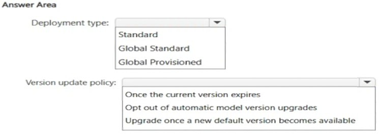

_HOTSPOT — the original ExamTopics question expects you to mark areas on the exhibit above; the correct hotspot coordinates are not published._

**Correct answer:** Not provided by ExamTopics
**Most voted:** "the data prcessed by the model must remain in the EU" | that is Standard for me: | By data residency requirement | No restrictions: Use Global Standard or Global Provisioned | EU data zone: Use DataZone Standard or DataZone Provisioned in an EU region | US data zone: Use DataZone Standard or DataZone Provisioned in a US region | Single region only: Use Standard or Regional Provisioned

### Top explanations
- **profitchannel** (11 upvotes [Highly Voted]): "the data prcessed by the model must remain in the EU"
that is Standard for me:
By data residency requirement
No restrictions: Use Global Standard or Global Provisioned
EU data zone: Use DataZone Standard or DataZone Provisioned in an EU region
US data zone: Use DataZone Standard or DataZone Provisioned in a US region
Single region only: Use Standard or Regional Provisioned
- **RICHARDALEX007** (4 upvotes): The requirement asks for scalable, high-throughput, dynamically scaling capacity WITHOUT reserved throughput. That points to a pay-as-you-go consumption deployment rather than Provisioned (PTU). The highlighted 'Standard' is defensible, but 'Global Standard' is the offering Microsoft positions for the highest, most elastic throughput.
Deployment type: Global Standard
Version upgrade policy: Opt out of automatic model version upgrades
- **mtbagent** (1 upvotes [Most Recent]): Standard
Once the current version expires
- **robert_ico** (1 upvotes): I would go with B) Global Standard (clues: scalable, high-throughput; Standard: specific Azure Region, capaicity associated to that region; Global Provisioned: reserves provisioned capacity) and B) Opt out... why? the model version used by Agent1 MUST remain CONSISTENT to ensure STABLE responses (so no automatic upgrades required)
- **batmanx** (1 upvotes): Standard
Deployment type	Standard
Version update policy	Opt out of automatic model version upgrades

## Q1.2 (ID 412434)

Overview
Company Information
Contoso, Ltd is a multinational retail company that builds, deploys, and manages generative AI and agent-based solutions by using Microsoft Foundry.
Existing Environment
Identity Environment
Contoso uses Microsoft Entra ID for identity management, authentication, and authorization capabilities that enable agents to access organizational resources and services.
Contoso recently formed a new AI engineering team named Agent1Dev Team to optimize and maintain existing AI solutions.
The team collaborates with solution architects, DevOps engineers, and security engineers to design, implement. monitor, and secure AI applications.
Contoso also has a team named Agent1Test Team that is responsible for validating AI solutions before the solution deployments.
Generative Environment
Contoso has a Microsoft Foundry deployment that contains two projects named Project1 and Project2.
Project1
Project1 contains a customer support agent named Agent1 that assists customers with product inquiries and troubleshooting requests.
Agent1 has the following configurations:
Agent1 uses a base model deployment.
A safety evaluation pipeline is NOT enabled.
Tool invocation approval workflows are NOT enabled.
Conversation memory constraints are NOT configured.
Agent1 interacts with customers by using digital support channels and answers general questions about Contoso products.
Project1 is deployed to an Azure region located in the European Union (EU).
Agent1Dev Team will use Project1 to optimize and maintain Agent1.
Project2
Project2 contains a deployed video generation model. The marketing department at Contoso has access to Project2 and plans to use the model to develop a video creation solution.
Development of the solution is incomplete.
Data Environment
Contoso stores product-related information in Azure resources that support AI applications.
The Azure environment contains an Azure Blob Storage account named storage1 that stores product detail sheets for all the Contoso products.
The product sheets include specifications, feature descriptions, and product support information that Agent1 can use to answer customer questions. The product sheets are stored in the PDF format.
Problem Statements
Contoso identifies the following issues:
Agent1 has only general knowledge of the Contoso products.
A recent chat interaction with Agent1 was analyzed for sentiment. The results of the analysis have NOT been processed yet.
Agent1 does NOT use the detailed product information in the product sheets stored in storage1 when responding to customer questions.
The finance department at Contoso reports that vendor invoices must be reviewed manually to ensure that the invoices match the terms defined in the vendor contracts. The invoices contain tables, logos, and varied layouts that make the documents difficult to process consistently.
Requirements
Planned Changes
Contoso plans to implement the following changes:
Implement a solution for Project1 that analyzes the vendor invoices by evaluating both the visual layout and the textual content of the invoices, so that the invoice details can be verified against the vendor contract terms.
Update the base model deployment used by Agent1 and standardize the model version to ensure continuity and consistent responses.
Enable Agent1 to retrieve and use the detailed product information from the product sheets stored in storage1.
Implement an indexing solution for the product sheets that Agent1 can use to answer customer questions.
Complete the development of the video creation solution.
Technical Requirements
Contoso identifies the following technical requirements:
The model deployment used by Agent1 must support scalable, high-throughput generative AI workloads and dynamically scale to handle variable customer support traffic, without requiring reserved throughput capacity.
The product sheets must be processed by using an indexing pipeline that enables semantic and vector search, so that Agent1 can retrieve the relevant product information.
Responses generated by using the product sheet information must be relevant, complete, and accurate.
Agent1 must be able to use the product sheets to answer natural language questions about product details.
The model version used by Agent1 must remain consistent to ensure stable responses.
The data processed by the model must remain within the EU.
Security and Compliance Requirements
Contoso identifies the following security and compliance requirements:
API keys must NOT be used to access Foundry-deployed models.
Access to the Azure resources must follow the principle of least privilege.
The developers at Contoso must authenticate to Microsoft Foundry resources by using Microsoft Entra authentication.
Access to Project1 must be assigned to the members of Agent1Dev Team by using a security group named SC_Agent1_Dev.
Access to Project1 must be assigned to the members of Agent1Test Team by using a security group named SC_Agent1_Test.
Agent1 must never reveal customer information, even if a document that contains customer data is added erroneously to the product sheet repository in storage1.
The product sheets might contain images that include embedded text. Agent1 must be protected from malicious instructions potentially hidden within the images.
Business Requirements
Contoso identifies the following business requirements:
Users that interact with Agent1 must have a personalized experience in future interactions, including the ability for Agent1 to retain conversation context and recall relevant information from previous interactions.
Agent1 must answer questions only about the products sold by Contoso.
You need to configure Agent1 to meet the security and compliance requirements.
What should you use?

⭕ **A.** self-harm content filtering
✅ **B.** prompt shields
⭕ **C.** Personally identifiable information (PII) Detection
⭕ **D.** violence content filtering

**Correct answer:** B
**Most voted:** B

### Top explanations
- **seesee1** (4 upvotes [Selected Answer: B]): The requirement in question is: "The product sheets might contain images that include embedded text. Agent1 must be protected from malicious instructions potentially hidden within the images."
This describes an indirect prompt injection attack - malicious instructions embedded in content (in this case, text hidden inside images) that could hijack the agent's behavior when it processes that document. Microsoft Foundry's Prompt Shields (part of Azure AI Content Safety) is purpose-built to detect and block both direct and indirect prompt injection attempts, including those embedded in documents/images ingested by an agent, before they reach the model.
- **CharlieMike** (4 upvotes [Selected Answer: C]): I think it is C due to the security/compliance requirement
- **Srikantha** (3 upvotes [Most Recent, Selected Answer: B]): Prompt Shields detect both direct prompt injection (jailbreaks) and indirect prompt injection attacks. Indirect prompt injection occurs when external sources (such as product documents or OCR-extracted text from embedded images) contain hidden adversarial instructions intended to hijack or manipulate the model's behavior.
- **RPC112** (3 upvotes [Selected Answer: C]): Personally Identifiable Information (PII) Detection
The requirement"must never reveal customer information" is a hard compliance requirement.
Prompt Shields solve the hidden-instructions problem, but they do not directly prevent disclosure of customer data. [learn.microsoft.com], [learn.microsoft.com]
The latest AI‑103 discussion sites and explanations for this exact case study also mark PII Detection as the correct answer
- **Vasent** (3 upvotes [Selected Answer: C]): Since the case-study question mentions the requirement of NOT including any Customer information, so Agent1 must have the configuration setting of any "Personally identifiable Information" to be identified.

## Q1.3 (ID 412435)

You are planning a Microsoft Foundry project named Project1 that will contain multiple agents. Each agent will access the same Azure AI Search resource.
You need to recommend a solution to centrally manage the Azure AI Search credentials within Project1. The solution must be implemented across all the agents.
What should you recommend?

⭕ **A.** Enable role-based access control (RBAC) for the Azure AI Search resource.
⭕ **B.** Disable key-based access control on the Azure AI Search resource.
✅ **C.** Add a connection to the Azure AI Search resource.
⭕ **D.** Create a managed private endpoint that connects to the Azure AI Search resource.

**Correct answer:** C
**Most voted:** C

### Top explanations
- **RICHARDALEX007** (3 upvotes [Most Recent, Selected Answer: C]): A project connection centralizes the credential/endpoint once and is reused by every agent in the project, which is exactly 'centrally manage ... across all agents.' RBAC (A) and disabling key auth (B) are good security practices but do not centralize the credential reference, and a managed private endpoint (D) addresses network isolation, not credential management.

## Q1.4 (ID 412436)

HOTSPOT
Your company is piloting a customer support agent in a Microsoft Foundry project name Project1. Project1 is connected to an existing Application Insights resource, and the company’s support team reviews runs in the Traces tab.
The Foundry Agent Service is configured to perform the following actions:
Retrieve the Application Insights connection string by calling project_client.telemetry.get_application_insights_connection_string().
Call configure_azure_monitor(connection_string=...) to enable telemetry.
A separate LangChain service is configured to use OpenTelemetry and has the following configurations:
Uses AzureAIOpenTelemetryTracer(connection_string=..., enable_content_recording=False)
Passes the tracer by using config={“callbacks”:[azure_tracer]}
Company policy has the following requirements:
Telemetry from LangChain and OpenTelemetry must be distinguishable within the same Application Insights resource.
Secrets and credentials must NOT be stored in prompts, tool arguments, or span attributes.
For each of the following statements, select Yes if the statement is true. Otherwise, select No.
NOTE: Each correct selection is worth one point.

**Exhibits**
- Exhibit 1: 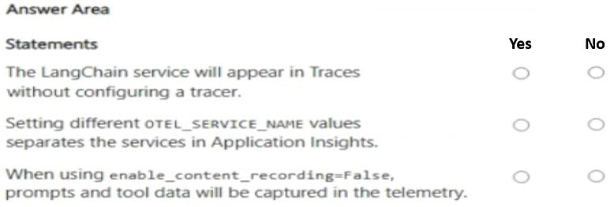

_HOTSPOT — the original ExamTopics question expects you to mark areas on the exhibit above; the correct hotspot coordinates are not published._

**Correct answer:** Not provided by ExamTopics
**Most voted:** 1) The configuration of Azure Monitor Telemetry does not magically instrument an independent LangChain service (or similar) | 2) OTEL_SERVICE_NAME = OpenTelemetry Service Name, and is the service name used in Application Insights (we would then query by cloud_RoleName; e.g., if OTEL_SERVICE_NAME = "LangChain" and "Agent", query with kql : ... | where cloud_RoleName="LangChain") | 3) enable_content_recodring=False redacts message content and tool call ar...

### Top explanations
- **RICHARDALEX007** (2 upvotes): A project connection centralizes the credential/endpoint once and is reused by every agent in the project, which is exactly 'centrally manage ... across all agents.' RBAC (A) and disabling key auth (B) are good security practices but do not centralize the credential reference, and a managed private endpoint (D) addresses network isolation, not credential management.
- **robert_ico** (1 upvotes [Most Recent]): 1) The configuration of Azure Monitor Telemetry does not magically instrument an independent LangChain service (or similar)
2) OTEL_SERVICE_NAME = OpenTelemetry Service Name, and is the service name used in Application Insights (we would then query by cloud_RoleName; e.g., if OTEL_SERVICE_NAME = "LangChain" and "Agent",  query with kql :  ... | where cloud_RoleName="LangChain")
3) enable_content_recodring=False redacts message content and tool call arguments from traces (almost a direct definition)

## Q1.5 (ID 412437)

DRAG DROP
You have a Microsoft Foundry project that processes procurement documents submitted by suppliers.
You need to implement two pipelines by using Azure Content Understanding in Foundry Tools. The solution must meet the following requirements:
Include a pipeline named Pipeline1 that supports cost-effective, high-volume processing of standalone PDF invoices.
Include a pipeline named Pipeline2 that supports cross-document validation by using multi-step reasoning and reference data.
How should you configure each pipeline? To answer, drag the appropriate configurations to the correct pipelines. Each configuration may be used once, more than once, of not at all. You may need to drag the split bar between panes or scroll to view content.
NOTE: Each correct selection is worth one point.

**Exhibits**
- Exhibit 1: 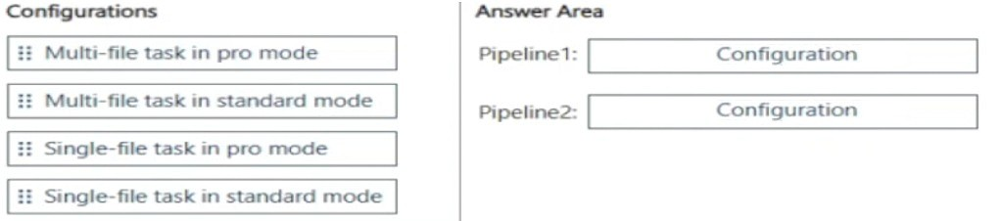

_DRAG DROP — the original ExamTopics question expects you to drag and drop items; the correct targets are not published._

**Correct answer:** Not provided by ExamTopics
**Most voted:** Pipeline 1: D - Single-file, standard | Clues: standalone files (one document at a time), high volume, cost-effective. These are basically the definition for standard mode (individual documents without complex reasoning) | Pipeline 2: A- Multi in pro | Clues: Cross-document ("multi-file"), multi-step reasongin, reference data (pro mode: multi-step, complex reasoning)

### Top explanations
- **robert_ico** (5 upvotes [Most Recent]): Pipeline 1: D - Single-file, standard
Clues: standalone files (one document at a time), high volume, cost-effective. These are basically the definition for standard mode (individual documents without complex reasoning)
Pipeline 2: A- Multi in pro
Clues: Cross-document ("multi-file"), multi-step reasongin, reference data (pro mode: multi-step, complex reasoning)
- **AIBoss** (3 upvotes): Content Understanding offers two modes for different scenarios:
Standard mode
- Ideal for processing single files with straightforward field extraction. Use standard mode when you need to extract structured data from individual documents, images, audio, or video files without cross-file analysis or complex reasoning requirements.
Pro mode
- Designed for advanced scenarios requiring multi-step reasoning and cross-file analysis.
Uses of  pro mode:
Process multiple input files in a single request
Apply reasoning across different documents to validate, enrich, or aggregate data
Use reference data (knowledge base) to guide extraction and validation
Perform complex multi-step analysis that goes beyond simple field extraction
- **examtopics53932** (1 upvotes): pipeline1: Singlefile standard
pipeline2: Multifile pro
Note that pro-mode is only available in the 2025-05-01-preview API version.
current API (2025-11-01) and latest preview (2026-06-01-preview) has replaced pro-mode with agentic mode.

## Q1.6 (ID 412438)

HOTSPOT
You have a Python application named App1 that integrates with a Microsoft Foundry project named Project1.
You need to ensure that App1 meets the following requirements:
Authenticates by using a Microsoft Entra managed identity
Sends prompts to a deployed model by using the Azure OpenAI Responses API
How should you complete the Python code? To answer, select the appropriate options in the answer area.
NOTE: Each correct selection is worth one point.

**Exhibits**
- Exhibit 1: 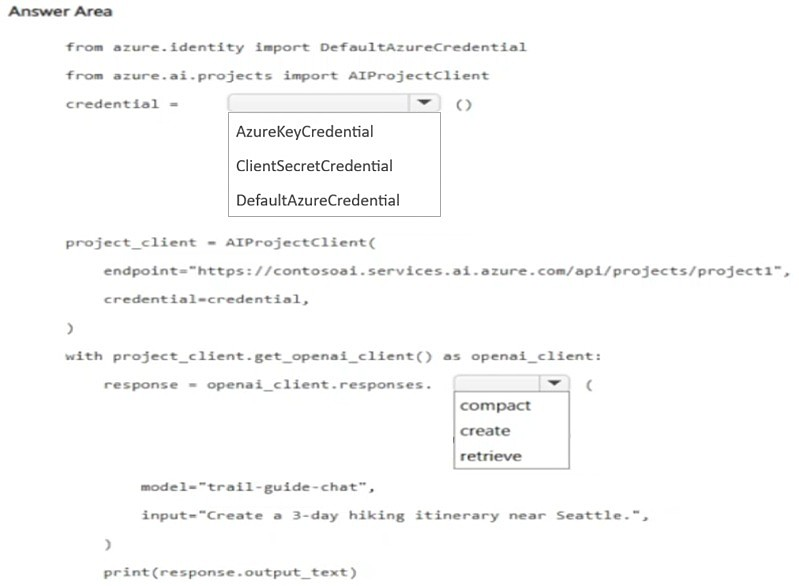

_HOTSPOT — the original ExamTopics question expects you to mark areas on the exhibit above; the correct hotspot coordinates are not published._

**Correct answer:** Not provided by ExamTopics
**Most voted:** A managed identity is consumed through DefaultAzureCredential (not AzureKeyCredential, which is key-based, nor ClientSecretCredential, which needs a secret). The Responses API call to send a prompt is responses.create(); retrieve/compact are not the send operation.

### Top explanations
- **RICHARDALEX007** (9 upvotes [Highly Voted]): A managed identity is consumed through DefaultAzureCredential (not AzureKeyCredential, which is key-based, nor ClientSecretCredential, which needs a secret). The Responses API call to send a prompt is responses.create(); retrieve/compact are not the send operation.
- **robert_ico** (1 upvotes [Most Recent]): AzureKeyCredential needs an PI ley; ClientSecretCredential uses a service principal (not managed; requires client id and client secret), DefaultAzureCredential: can use the application's managed identity (as a matter of fact, this method is used as standard in dev (e.g., in VSCODE, to detect your az login) and in Foundry (after deployed) or the final app like teams or copilot (when published)).

## Q1.7 (ID 412439)

HOTSPOT
You have a Microsoft Foundry project that contains a workflow for a customer support triage process.
You have an Ask a question node that stores user responses in a local variable named Var01.
You need to create the following Power Fx expressions:
An if/else condition expression that ensures that Var01 contains a value
A Send message expression that returns the stored user response in uppercase
How should you configure the expressions? To answer, select the appropriate options in the answer area.
NOTE: Each correct selection is worth one point.

**Exhibits**
- Exhibit 1: 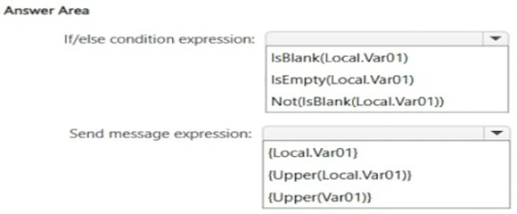

_HOTSPOT — the original ExamTopics question expects you to mark areas on the exhibit above; the correct hotspot coordinates are not published._

**Correct answer:** Not provided by ExamTopics
**Most voted:** IsEmpty(): used to determine if a table/collection has no records; IsBlank is for checking blank, null values in variables; Upper() converts to uppercase; Local.Var01 is the correct way to address Var01. | ANSWER: Not(IsBlank(Local.Var01)) and {Upper(Local.Var01)}

### Top explanations
- **robert_ico** (4 upvotes [Most Recent]): IsEmpty(): used to determine if a table/collection has no records; IsBlank is for checking blank, null values in variables; Upper() converts to uppercase;  Local.Var01 is the correct way to address Var01.
ANSWER: Not(IsBlank(Local.Var01)) and {Upper(Local.Var01)}
- **AIBoss** (2 upvotes): Because it mentioned in the question.
"...... that returns the stored user response in uppercase"
- **Sridhar_AI_Engineer** (1 upvotes): Why Upper ? required
A Send message expression that returns the stored user response
Why not Local.Var01 ?

## Q1.8 (ID 412440)

HOTSPOT
You have a Microsoft Foundry project that contains a customer support agent built by using the Foundry Agent Service.
The agent uploads user-provided screenshots to Azure Storage through a ticketing tool and receives a blob URL for additional reasoning.
You need to use image moderation during agent runs and prevent harmful content from being returned during runs. Azure AI Content Safety must access the images by using the blob URL. The solution must follow the principle of least privilege.
What should you configure for Content Safety? To answer, select the appropriate options in the answer area.
NOTE: Each correct selection is worth one point.

**Exhibits**
- Exhibit 1: 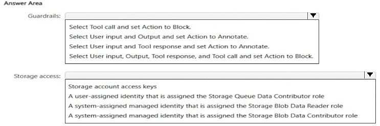

_HOTSPOT — the original ExamTopics question expects you to mark areas on the exhibit above; the correct hotspot coordinates are not published._

**Correct answer:** Not provided by ExamTopics
**Most voted:** The state that you mention is about Content Safety Custom Categories, which is a different situation. For this question, following the principle of least privilege, Storage Blob Data Reader is the correct answer.

### Top explanations
- **3f9a492** (4 upvotes): For the first question, select **Block** for all four intervention points: User input, Tool call, Tool response, and Output. For the second, select **system-assigned managed identity + Storage Blob Data Contributor**—Microsoft states that Content Safety access through `blobUrl` requires Contributor or Owner, so Reader is not supported.
- **OnlineCH** (3 upvotes): Storage access: on https://learn.microsoft.com/en-us/azure/ai-services/content-safety/quickstart-image?pivots=programming-language-rest&tabs=visual-studio%2Cwindows#prepare-a-sample-image it is mentioned "Only Storage Blob Data Contributor or Storage Blob Data Owner are valid roles to proceed." so "Storage Blob Data Contributor" instead of ".. Reader" might be correct.
- **robert_ico** (3 upvotes): 1) For guardrails: two key parts; one says "prevent" so it's block, not just annotate (which would label, identify, but no prevent), and the complete configuration should include user input, oputput, tool response and tool call (option 1 is only the tool call, but doing so would not prevent harmfull content in what the user inputs, or what the tool outputs, or the ultimate output given by the agent).
2) For Storage access: Content Safety needs to access the screenshots using their blob URLs; therefore, it needs READ permission (least priviledge); Contributor assigns unnecessary write/delete permissions.
- **Alvarogc** (2 upvotes [Most Recent]): The state that you mention is about Content Safety Custom Categories, which is a different situation. For this question, following the principle of least privilege, Storage Blob Data Reader is the correct answer.

## Q1.9 (ID 412441)

You have a Microsoft Foundry project that contains three agents as shown in the following table.
You need to orchestrate the agents to ensure that the customer requests meet the following requirements:
Support a deterministic, step-based process that uses conditional branching and shared state across the agents.
Optionally trigger a ticket action based on the triage result.
The solution must minimize development effort.
What should you include in the solution?

**Exhibits**
- Exhibit 1: 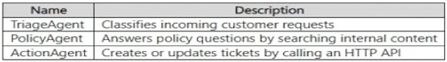

✅ **A.** a workflow
⭕ **B.** threads and runs without a workflow
⭕ **C.** a multi-agent group chat session
⭕ **D.** separate agent runs coordinated in the application code

**Correct answer:** A
**Most voted:** A

### Top explanations
- **robert_ico** (3 upvotes [Most Recent, Selected Answer: A]): Deterministic, step-based process, conditional branching, shared state, optional ticket action, minimize development effort; those features describe what a workflow does. On the other hand, the others: B) lack deterministic orchestration + branching, C) agents collaborate dynamically, but lacks determinism and a step-based process as well, D) you should write the orchestration logic, which does not reduce development effort
ANSWER: A) Worklfow
- **RICHARDALEX007** (1 upvotes [Selected Answer: A]): : The requirements - deterministic, step-based, conditional branching, shared state, optional triggered action, minimal dev effort - describe a Foundry workflow. Threads/runs (B) and app-code coordination (D) require custom orchestration (more effort), and a group-chat session (C) is non-deterministic conversational collaboration, not a deterministic branching process.

## Q1.10 (ID 412442)

You have a Microsoft Foundry project that contains an agent. The agent uses Azure Speech in Foundry Tools.
You fine-tune a baseline speech to text model for the en-us locale and publish the model.
The agent calls the Speech to text REST API and returns an error message indicating that the project ID is invalid.
You need to set the project property to the correct ID.
To what should you set the project property?

⭕ **A.** the project URL
✅ **B.** the custom speech project ID
⭕ **C.** the project ID
⭕ **D.** the custom speech endpoint URL

**Correct answer:** B
**Most voted:** B

### Top explanations
- **cloudera** (2 upvotes [Selected Answer: B]): I am pretty sure the answer should be B. the custom speech project ID.
- **robert_ico** (1 upvotes [Most Recent, Selected Answer: B]): Microsoft documents that when using a custom speech model through the Speech-to-Text REST API, the request can specify the custom speech project ID using the project query parameter. The key thing here is that there are 2 "projects": the foundry project, and the custom project. According to this reference, we need to specify the custom project id: https://learn.microsoft.com/en-us/azure/ai-services/speech-service/rest-speech-to-text
- **maxng52** (1 upvotes): The error is an invalid project ID for a fine-tuned Custom Speech model, so the `project` property must be set to the GUID of the **Custom Speech project** that owns the model — not a URL (A/D, which aren't IDs) and not the generic Foundry project ID (C).
- **RICHARDALEX007** (1 upvotes [Selected Answer: B]): The error is an invalid project ID for a custom speech model, so the project property must be set to the custom speech project ID (a GUID identifying the Custom Speech project). A URL or endpoint URL is not a project ID, and 'the project ID' (C) is the generic Foundry project, not the Custom Speech project that owns the fine-tuned model.

## Q1.11 (ID 412443)

HOTSPOT
You have a Microsoft Foundry project that contains an agent named PaymentAgent.
PaymentAgent includes a function tool that issues customer refunds by using an external API.
You are creating a workflow in YAML.
You need to ensure that the workflow pauses for human approval and continues with the refund step only after approval is granted.
How should you complete the workflow definition? To answer, select the appropriate options in the answer area.
NOTE: Each correct selection is worth one point.

**Exhibits**
- Exhibit 1: 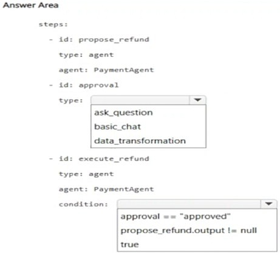

_HOTSPOT — the original ExamTopics question expects you to mark areas on the exhibit above; the correct hotspot coordinates are not published._

**Correct answer:** Not provided by ExamTopics
**Most voted:** Box 1: ask_question To create a human-in-the-loop approval step in a Microsoft Foundry workflow, you should fill in the missing type with ask_question. | In Microsoft Foundry, the ask_question step is specifically designed to pause a workflow, prompt a user for input (such as an approval or rejection), and store the response in a variable that can be evaluated by subsequent logic. | Box 2: approval == "approved" Execute Condition: Use a condition such a...

### Top explanations
- **TuanJin** (1 upvotes [Most Recent]): Box 1: ask_question To create a human-in-the-loop approval step in a Microsoft Foundry workflow, you should fill in the missing type with ask_question.
In Microsoft Foundry, the ask_question step is specifically designed to pause a workflow, prompt a user for input (such as an approval or rejection), and store the response in a variable that can be evaluated by subsequent logic.
Box 2: approval == "approved" Execute Condition: Use a condition such as steps.approval.output == 'approved' (or a similar logical check based on your choice variable) to ensure the refund only executes when authorized.

## Q1.12 (ID 412444)

You have an Azure Speech in Foundry Tools resource that hosts a custom speech to text model deployed to a custom endpoint. An agent uses the endpoint to perform real-time speech recognition.
You are approaching the expiration date of the custom speech to text model.
What is the expected behavior when the model expires?

⭕ **A.** Speech recognition requests will return a 4xx error until a new custom model is deployed.
⭕ **B.** Speech recognition requests will continue to use the expired custom model until the model is removed manually.
✅ **C.** Speech recognition requests will fall back to the most recent base model for the same locale.
⭕ **D.** The custom model will be deleted automatically when the model expires.

**Correct answer:** C
**Most voted:** C

### Top explanations
- **cloudera** (7 upvotes [Highly Voted, Selected Answer: C]): C is correct.
According to the Microsoft lifecycle policy for Custom Speech, when a custom model deployed to a custom endpoint expires, the endpoint does not suddenly shut down or throw errors. Instead, Azure Speech ensures service continuity by automatically falling back to the most recent available base model for that specific locale.
For more visit - https://learn.microsoft.com/en-us/azure/ai-services/speech-service/how-to-custom-speech-model-and-endpoint-lifecycle?utm_source=chatgpt.com&pivots=ai-foundry-portal
- **7b5220c** (3 upvotes [Selected Answer: C]): Answer C is the correct choice.
When a custom Speech-to-Text model in Azure reaches its expiration date, the endpoint does not experience an immediate outage. To prevent a hard disruption of service, Azure utilizes a fallback mechanism:
Speech recognition requests will automatically fall back to the most recent base model for the same locale.
In practice, this means:
The service continues to run: The agent will not receive 4xx errors (which makes Answer A incorrect).
Accuracy may decrease: Since the system now uses the general base model instead of the specially trained custom model, the specific adaptations to your vocabulary or acoustic environment are lost until a new custom model is trained and deployed.
- **Eloy522752** (1 upvotes [Most Recent, Selected Answer: A]): When a Custom Speech model passes its expiration, the deployed endpoint stops serving it and requests fail rather than silently using the expired model (B) or auto-deleting (D)
- **Srini7** (1 upvotes [Selected Answer: C]): Transcription route : Question is about Custom endpoint, So it fall back to the most recent base model for the same locale.
If the question is a batch transcription: then 'A" it will be fail with a 4xx error.
- **RICHARDALEX007** (1 upvotes [Selected Answer: A]): When a Custom Speech model passes its expiration, the deployed endpoint stops serving it and requests fail rather than silently using the expired model (B) or auto-deleting (D)

## Q1.13 (ID 412445)

You have a Microsoft Foundry project that contains a model deployment.
You have an application that calls the deployment by using the Azure OpenAI v1 API and DefaultAzureCredential.
The developers at your company receive HTTP 403 errors when they send inference requests, even after running az login.
You need to ensure that the developers can perform model inference. The solution must follow the principle of least privilege.
Which role-based access control (RBAC) role should you assign to the developers?

⭕ **A.** Cognitive Services User
✅ **B.** Cognitive Services OpenAI User
⭕ **C.** Contributor
⭕ **D.** Cognitive Services Data Reader

**Correct answer:** B
**Most voted:** B

### Top explanations
- **RICHARDALEX007** (3 upvotes [Most Recent, Selected Answer: B]): DefaultAzureCredential authenticates but a 403 means missing data-plane authorization. The least-privilege role that grants inference (data actions) is Cognitive Services OpenAI User. Cognitive Services User (A) covers non-OpenAI services, Contributor (C) is over-privileged control-plane, and Data Reader (D) does not grant inference.

## Q1.14 (ID 412446)

You have a Microsoft Foundry project that contains an agent. The agent has a Model Context Protocol (MCP) tool that queries a knowledge base stored in Azure AI Search.
Some agent runs return answers from the base model without invoking the knowledge base, which results in responses without grounded citations.
You are provided with the following code snippet that runs the agent.
You need to add the correct tool _choice parameter to the code to deterministically force the agent to invoke the MCP tool on each run.
What should you add?

**Exhibits**
- Exhibit 1: 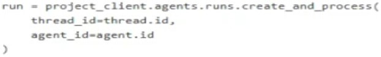

✅ **A.** tool_choice={“required”}
⭕ **B.** tool_choice={“auto”}
⭕ **C.** tool_choice={“type”:“knowledge_base”}
⭕ **D.** tool_choice ={“type”:“mcp”}

**Correct answer:** A
**Most voted:** A

### Top explanations
- **Mattt** (6 upvotes [Selected Answer: D]): D is more precise. required only forces the use of some tool, while {"type":"mcp"} explicitly forces the MCP tool. Also, option A uses incorrect Python syntax.
- **AzureGeek79** (3 upvotes [Selected Answer: D]): The correct answer is D. tool_choice ={"type":"mcp"}.
In the Microsoft Foundry Agent Service, the tool_choice parameter controls whether and how the agent uses its attached tools during a run.
• {"type":"mcp"} (Choice D): When you want to target a specific tool type and force the agent to use it deterministically for the processing turn, you must pass an object specifying that particular type. Since the agent is querying the Azure AI Search knowledge base explicitly via a Model Context Protocol (MCP) tool, specifying {"type":"mcp"} forces the model to invoke the protocol handler right away rather than attempting to answer directly from its internal pre-trained weights.
• {"required"} (Choice A): While "required" forces the model to choose at least one tool from its toolbox, it does not explicitly guarantee which tool it will pick if multiple are defined. Furthermore, passing it as a Python set literal like {"required"} is a syntax misfit for the parameter expectations.
• {"auto"} (Choice B): This is the default runtime behavior. It keeps tool selection non-deterministic, allowing the base model to skip the knowledge base if it feels confident enough to respond on its own—which is the exact behavior causing the ungrounded citations issue.
• {"type":"knowledge_base"} (Choice C): "knowledge_base" is not a valid tool type identifier for an MCP-connected architecture in Foundry's Agent execution framework.
- **Sky_Akash** (3 upvotes [Selected Answer: D]): Why not A ({"required"})?
{"required"} only ensures some tool is used, not specifically the MCP tool.
If multiple tools exist, the agent could pick another one.
The question explicitly says “deterministically force the agent to invoke the MCP tool”, so you must specify its type.
So even though A is “most voted,” D is the technically correct and exam-accurate choice.
- **3f9a492** (3 upvotes [Selected Answer: A]): Must use a tool every run → required
The option displays tool_choice={"required"}, but proper Python SDK syntax is normally tool_choice="required"
- **cloudera** (3 upvotes [Selected Answer: A]): Syntax error but I will still go with A: tool_choice="required"
The issue is that the agent sometimes answers from the base model without calling the knowledge base tool. tool_choice="required" forces the agent to call a tool on each run, which prevents it from skipping retrieval and helps ensure grounded citations.
D is tempting because MCP is the tool type, but the question is about forcing tool use at runtime, not defining the MCP tool itself.
For more - https://learn.microsoft.com/en-us/azure/search/agentic-retrieval-how-to-create-pipeline

## Q1.15 (ID 412447)

DRAG DROP
You have a Microsoft Foundry project that contains a customer support agent grounded in internal documentation.
After a recent update, users report the following issues:
Some answers are unsupported by retrieved documents.
A small number of responses are flagged for policy violations.
You need to evaluate each issue.
Which observability signals should you use for each issue? To answer, drag the appropriate observability signals to the correct issues. Each observability signal may be used once, more than once, or not at all. You may need to drag the spit bar between panes or scroll to view content.
NOTE: Each correct selection is worth one point.

**Exhibits**
- Exhibit 1: 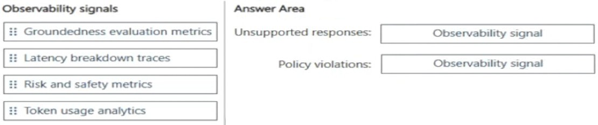

_DRAG DROP — the original ExamTopics question expects you to drag and drop items; the correct targets are not published._

**Correct answer:** Not provided by ExamTopics
**Most voted:** Answers unsupported by retrieved documents are a groundedness problem, measured by groundedness evaluation metrics. Responses flagged for policy violations map to the risk and safety evaluators

### Top explanations
- **RICHARDALEX007** (3 upvotes [Most Recent]): Answers unsupported by retrieved documents are a groundedness problem, measured by groundedness evaluation metrics. Responses flagged for policy violations map to the risk and safety evaluators

## Q1.16 (ID 412448)

You have a Microsoft Foundry project named Project1 that contains an agent. The agent uses an OpenAPI 3.0 specification to call an external weather service.
The weather service requires a key to be passed in an HTTP header. The key value is stored as a connection in Project1.
You need to ensure that the key value from the connection is included automatically whenever the OpenAPI tool is invoked.
What should you configure in the OpenAPI specification?

⭕ **A.** a header parameter defined for each operation
⭕ **B.** an Azure Key Vault connection
✅ **C.** an API key security scheme
⭕ **D.** a Bearer token security scheme

**Correct answer:** C
**Most voted:** C

### Top explanations
- **Srikantha** (1 upvotes [Most Recent, Selected Answer: C]): components:
securitySchemes:
ApiKeyAuth:
type: apiKey
in: header
name: X-Weather-API-Key  # The header name expected by the service
- **RICHARDALEX007** (1 upvotes [Selected Answer: C]): The OpenAPI tool injects a connection-stored key automatically when the spec declares an API key security scheme (apiKey in header). A per-operation header parameter (A) would require passing the value manually, a Key Vault connection (B) is not an OpenAPI construct, and a Bearer scheme (D) is for OAuth/JWT tokens, not a static header key.

## Q1.17 (ID 412449)

You have a Microsoft Foundry project that serves a high-volume chat app.
Most requests are simple FAQs, but some require advanced reasoning.
You need to reduce costs and latency for common queries, without degrading the quality of the responses to complex questions.
What should you do?

⭕ **A.** Route all the requests to a smaller model.
✅ **B.** Use a model cascade that routes the requests to different models.
⭕ **C.** Increase the value of the max_tokens parameter for all the requests.
⭕ **D.** Route all the requests to the most capable model.

**Correct answer:** B
**Most voted:** B

### Top explanations
- **RICHARDALEX007** (2 upvotes [Selected Answer: B]): A model cascade sends simple FAQs to a small/cheap model and escalates complex queries to a capable model, reducing cost/latency without degrading hard-question quality. Routing everything to a small model (A) hurts complex answers; routing all to the largest model (D) keeps costs high; raising max_tokens (C) does not reduce cost or latency.
- **shank23** (1 upvotes [Most Recent, Selected Answer: B]): A Model Cascade (also known as LLM Cascading) is an optimization and reliability pattern where an AI system chains multiple language models together sequentially. Instead of sending every single user query to a highly intelligent, expensive model, the system leverages a fast and cheap model first

## Q1.18 (ID 412450)

HOTSPOT
You have a Microsoft Foundry project that contains an internal Q&A agent.
Users report the following issues when they ask the agent questions:
An increase in the following response: “No relevant information found”
Periodic HTTP 429 rate limit exceeded errors during peak hours
You need to identify whether each issue is caused by model unavailability, resource limits, or inference failures.
What should you do? To answer, select the appropriate options in the answer area.
NOTE: Each correct selection is worth one point.

**Exhibits**
- Exhibit 1: 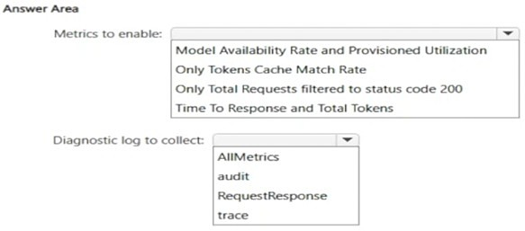

_HOTSPOT — the original ExamTopics question expects you to mark areas on the exhibit above; the correct hotspot coordinates are not published._

**Correct answer:** Not provided by ExamTopics
**Most voted:** I think the correct answer for diagnostic log is 'trace'. The question contains 'identify whether each issue is caused by model unavailability, resource limits or inference failures. That is a diagnostic/root-cause question hence 'trace'

### Top explanations
- **Amelia233** (7 upvotes [Highly Voted]): Select Model Availability Rate and Provisioned Utilization because they help identify model availability issues and resource limits causing HTTP 429 errors. Select RequestResponse logs to investigate inference failures and understand why the agent returns “No relevant information found.”
- **ArindamPal** (3 upvotes [Most Recent]): Should be this asnwer
Metrics - Model Availability Rate and Provisioned Utilization
Diagnostic log to collect - trace
- **Retinol2** (3 upvotes): I think the correct answer for diagnostic log is 'trace'. The question contains 'identify whether each issue is caused by model unavailability, resource limits or inference failures. That is a diagnostic/root-cause question hence 'trace'

## Q1.19 (ID 412451)

You have a Microsoft Foundry project that contains a high-traffic agent.
After a recent update, operational costs increase significantly.
Monitoring confirms that the volume of user traffic to the agent remains unchanged.
You suspect that changes to the request or response characteristics are causing the increase. You need to identify whether the additional costs are driven by the model input size, the model output size, or expanded tool usage.
Which observability capability should you use?

⭕ **A.** latency
⭕ **B.** evaluation metrics
⭕ **C.** run success rate
✅ **D.** token usage

**Correct answer:** D
**Most voted:** D

### Top explanations
- **DEEBOY** (1 upvotes [Most Recent, Selected Answer: D]): Token usage reveals input size and output size
- **RICHARDALEX007** (1 upvotes [Selected Answer: D]): : Cost is driven by tokens, so token-usage observability reveals whether input size, output size, or expanded tool calls increased consumption. Latency (A), evaluation metrics (B), and run success rate (C) do not attribute cost to input/output/tool token volume.

## Q1.20 (ID 412452)

HOTSPOT
You have a Microsoft Foundry project that contains an agent.
The agent uses tools to retrieve internal content and call external APIs. The agent is configured to let the model decide when to call the tools.
You need to publish the agent for a compliance workflow. The solution must meet the following requirements:
Each workflow run must include a retrieval step before generating a response.
Tool calls must authenticate by using the published agent’s own identity.
Tool access must use an identity isolated from other project resources.
Tool access must use support audit tracing.
What should you do? To answer, select the appropriate options in the answer area.
NOTE: Each correct selection is worth one point.

**Exhibits**
- Exhibit 1: 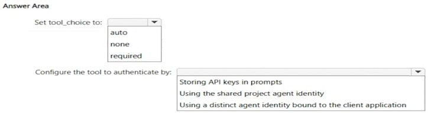

_HOTSPOT — the original ExamTopics question expects you to mark areas on the exhibit above; the correct hotspot coordinates are not published._

**Correct answer:** Not provided by ExamTopics
**Most voted:** The problem statement notes that the agent is currently configured to "let the model decide when to call the tools" (which is what tool_choice: "auto" does). However, the compliance requirement mandates: | ​"Each workflow run must include a retrieval step before generating a response." | If left as auto, the model might choose to answer directly from parametric memory without executing a tool call. Setting tool_choice: "required" forces the model to cal...

### Top explanations
- **8ac3742** (1 upvotes): The problem statement notes that the agent is currently configured to "let the model decide when to call the tools" (which is what tool_choice: "auto" does). However, the compliance requirement mandates:
​"Each workflow run must include a retrieval step before generating a response."
If left as auto, the model might choose to answer directly from parametric memory without executing a tool call. Setting tool_choice: "required" forces the model to call one of its available tools before generating an answer.
- **RICHARDALEX007** (1 upvotes [Most Recent]): Forcing a retrieval step every run requires tool_choice=required (auto lets the model skip tools; none disables them). For an isolated, auditable identity that is the published agent's own, a distinct agent identity bound to the client app is correct; storing keys in prompts violates security and a shared project identity is not isolated.

## Q1.21 (ID 412453)

You have a Microsoft Foundry project named Project1 that contains the following:
An OpenAPI tool that calls an external API
A project connection named Connection1 that stores the API key of the external API
When an agent calls the OpenAPI tool, the API returns a 401 unauthorized error, and traces show that the API key header is NOT being sent.
You need to ensure that the OpenAPI tool automatically includes the API key from Connection1 on all requests.
What should you do?

⭕ **A.** Enable identity passthrough so that the tool uses the Microsoft Entra token of the caller.
⭕ **B.** Add the API key header manually to the OpenAPI specification.
⭕ **C.** Configure the tool to use the default connection of Project1.
✅ **D.** Connect the tool to Connection1.

**Correct answer:** D
**Most voted:** D

### Top explanations
- **RICHARDALEX007** (4 upvotes [Selected Answer: D]): The 401 with a missing key header means the tool is not bound to the connection holding the key. Connecting the tool to Connection1 makes Foundry inject the stored key automatically. Identity passthrough (A) sends the caller's Entra token, not the API key; manually adding the header (B) hardcodes secrets; the default project connection (C) is not necessarily Connection1.
- **8ac3742** (3 upvotes [Selected Answer: D]): ​Bind to the Connection:
​In the tool configuration blade, scroll to the Authentication section.
​Switch the authentication method/source to Project Connection (or Saved Connection).
​From the dropdown list of available connections, select Connection1.
​Verify that the security scheme defined in the OpenAPI specification (e.g., apiKey in header) matches the key/secret stored in Connection1.
- **cloudera** (2 upvotes [Selected Answer: D]): D. Connect the tool to Connection1.
B is incomplete answer and can expose secrets if done wrong.
- **afolabisbox** (1 upvotes [Most Recent, Selected Answer: D]): Tool must be bounded to connection holding the key

## Q1.22 (ID 412454)

You have a Microsoft Foundry project that contains a customer support agent. The agent calls an internal knowledge API tool before generating responses.
Users report the following issues:
Some requests take more than 15 seconds to complete.
Some responses are incorrect, even when the knowledge API returns the expected data.
You need to inspect individual agent runs to view the ordered sequence of large language model (LLM) calls, tool invocations, and timing information.
Which observability capability should you use?

⭕ **A.** token usage
⭕ **B.** monitoring
⭕ **C.** safety metrics
✅ **D.** tracing

**Correct answer:** D
**Most voted:** D

### Top explanations
- **AgentIsOnline** (1 upvotes [Most Recent, Selected Answer: D]): Tracing is capability that would allow for viewing the ordered span sequence of LLM calls, tool invocations, and timing within a single run.
- **RICHARDALEX007** (1 upvotes [Selected Answer: D]): Tracing shows the ordered span sequence of LLM calls, tool invocations, and timing within a single run, which is exactly what is needed to diagnose latency and incorrect-despite-correct-data behavior. Token usage (A), monitoring (B), and safety metrics (C) are aggregate signals, not per-run ordered traces.

## Q1.23 (ID 412455)

Note: This section contains one or more sets of questions with the same scenario and problem. Each question presents a unique solution to the problem. You must determine whether the solution meets the stated goals. More than one solution in the set might solve the problem. It is also possible that none of the solutions in the set solve the problem.
After you answer a question in this section, you will NOT be able to return. As a result, these questions do not appear on the Review Screen.
You have a multimodal AI generative model that accepts image uploads and uses extracted image text to generate responses.
You discover that users can upload unsafe images and embed hidden instructions into images to manipulate the model.
You need to implement controls to mitigate the risk.
Solution: You configure a prompt shield for user prompts.
Does this meet the goal?

⭕ **A.** Yes
✅ **B.** No

**Correct answer:** B
**Most voted:** B

### Top explanations
- **RICHARDALEX007** (4 upvotes [Selected Answer: B]): The threat is hidden instructions embedded in uploaded IMAGES (indirect/document attack) plus unsafe image content. A prompt shield for USER PROMPTS addresses direct jailbreak text from the user, not injected content extracted from images, so it does not meet the goal.
- **Dinesh_87** (2 upvotes [Selected Answer: B]): Requires - Content Safety image/multimodal harm filters + Spotlighting, to mark extracted/image-derived text as untrusted so the model treats it as data, not instructions
- **profitchannel** (2 upvotes [Selected Answer: A]): but since one of the 4 questions should have a right answer, this is more likely the one with the right answer?
- **nnaidu** (1 upvotes [Most Recent, Selected Answer: B]): It does not protect against malicious instructions embedded inside uploaded documents
- **a5f05ea** (1 upvotes [Selected Answer: B]): B. No
A Prompt Shield for user prompts protects against prompt injection attacks coming directly from user-entered text. It does not protect against malicious instructions embedded inside uploaded documents or images.

## Q1.24 (ID 412456)

Note: This section contains one or more sets of questions with the same scenario and problem. Each question presents a unique solution to the problem. You must determine whether the solution meets the stated goals. More than one solution in the set might solve the problem. It is also possible that none of the solutions in the set solve the problem.
After you answer a question in this section, you will NOT be able to return. As a result, these questions do not appear on the Review Screen.
You have a multimodal AI generative model that accepts image uploads and uses extracted image text to generate responses.
You discover that users can upload unsafe images and embed hidden instructions into images to manipulate the model.
You need to implement controls to mitigate the risk.
Solution: You configure image moderation to block unsafe content before processing the images.
Does this meet the goal?

⭕ **A.** Yes
✅ **B.** No

**Correct answer:** B
**Most voted:** B

### Top explanations
- **RICHARDALEX007** (3 upvotes [Selected Answer: B]): : Image moderation blocks unsafe visual content, which handles the 'unsafe images' half, but it does NOT neutralize hidden text instructions embedded in images (the prompt-injection half). Because the stated goal includes mitigating embedded instructions, image moderation alone does not fully meet the goal
- **cloudera** (3 upvotes [Selected Answer: B]): Correct answer is B (No) again.
There is two issues here 1)unsafe image 2) hidden instructions.
Image moderation address unsafe image, but doesn't help with the #2 above. The 2nd part required prompt injection protection which is missing in the configuration.
- **RPC112** (2 upvotes [Most Recent, Selected Answer: B]): Hidden instructions in images/documents → Prompt Shields for documents
Unsafe visual content (violence, nudity, illegal imagery, etc.) → Image content moderation / Analyze Image API
The scenario in questions 23–26 describes both risks together, which is why none of the four individual solutions on their own "meets the goal" as stated — each one only solves half the problem.
Would be A if Unsafe images were isolated and not combined with embedded hidden instructions.

## Q1.25 (ID 412457)

Note: This section contains one or more sets of questions with the same scenario and problem. Each question presents a unique solution to the problem. You must determine whether the solution meets the stated goals. More than one solution in the set might solve the problem. It is also possible that none of the solutions in the set solve the problem.
After you answer a question in this section, you will NOT be able to return. As a result, these questions do not appear on the Review Screen.
You have a multimodal AI generative model that accepts image uploads and uses extracted image text to generate responses.
You discover that users can upload unsafe images and embed hidden instructions into images to manipulate the model.
You need to implement controls to mitigate the risk.
Solution: You configure a prompt shield for documents.
Does this meet the goal?

✅ **A.** Yes
⭕ **B.** No

**Correct answer:** A
**Most voted:** A

### Top explanations
- **ArindamPal** (3 upvotes [Selected Answer: A]): Prompt shields for Documents is the correct answer
- **AzureGeek79** (3 upvotes [Selected Answer: A]): There is not a single answer to this question. It should be:
a) You configure a prompt shield for documents.
b) You configure image moderation to block unsafe content before processing the images.
- **Srikantha** (3 upvotes [Selected Answer: B]): Correct Solution:
To mitigate both risks, you must use:
Azure AI Content Safety Image Moderation to scan uploaded images for unsafe visual content (Adult, Violence, Hate, Self-harm).
Prompt Shields for User Input / Images (or running OCR text through Prompt Shields) to detect embedded prompt injection instructions hidden inside the image text.
- **Mattt** (3 upvotes [Selected Answer: A]): A is correct.
Here, “unsafe images” refers to images containing hidden malicious instructions. Prompt Shields for Documents can analyze the extracted text and detect these indirect prompt-injection attacks.
- **a5f05ea** (2 upvotes [Selected Answer: B]): For unsafe images it should be Image moderation and for embed text prompt shield, since prompt shield aloe cannot solve both the issue.

## Q1.26 (ID 412458)

Note: This section contains one or more sets of questions with the same scenario and problem. Each question presents a unique solution to the problem. You must determine whether the solution meets the stated goals. More than one solution in the set might solve the problem. It is also possible that none of the solutions in the set solve the problem.
After you answer a question in this section, you will NOT be able to return. As a result, these questions do not appear on the Review Screen.
You have a multimodal AI generative model that accepts image uploads and uses extracted image text to generate responses.
You discover that users can upload unsafe images and embed hidden instructions into images to manipulate the model.
You need to implement controls to mitigate the risk.
Solution: You configure protected material detection.
Does this meet the goal?

⭕ **A.** Yes
✅ **B.** No

**Correct answer:** B
**Most voted:** B

### Top explanations
- **RICHARDALEX007** (2 upvotes [Selected Answer: B]): Protected material detection identifies copyrighted/owned content in output. It has nothing to do with unsafe images or embedded malicious instructions, so it does not meet the goal.
- **Munish_20** (1 upvotes [Most Recent, Selected Answer: B]): protected material detection is for copy right related prevention, not for required protection
- **Dinesh_87** (1 upvotes [Selected Answer: B]): Protected material detection serves a completely different purpose — it's designed to identify copyrighted or owned content, specifically pinpointing copyrighted content and providing sources for preexisting text and code. It checks whether the model's output matches known copyrighted text or code (song lyrics, articles, licensed code snippets, etc.)
To actually meet the goal, you'd need:
Content Safety image/multimodal harm filters → for unsafe images
Prompt Shields for Documents → for hidden instructions in extracted image text

## Q1.27 (ID 412459)

Overview
Company Information
Contoso, Ltd is a multinational retail company that builds, deploys, and manages generative AI and agent-based solutions by using Microsoft Foundry.
Existing Environment
Identity Environment
Contoso uses Microsoft Entra ID for identity management, authentication, and authorization capabilities that enable agents to access organizational resources and services.
Contoso recently formed a new AI engineering team named Agent1Dev Team to optimize and maintain existing AI solutions.
The team collaborates with solution architects, DevOps engineers, and security engineers to design, implement. monitor, and secure AI applications.
Contoso also has a team named Agent1Test Team that is responsible for validating AI solutions before the solution deployments.
Generative Environment
Contoso has a Microsoft Foundry deployment that contains two projects named Project1 and Project2.
Project1
Project1 contains a customer support agent named Agent1 that assists customers with product inquiries and troubleshooting requests.
Agent1 has the following configurations:
Agent1 uses a base model deployment.
A safety evaluation pipeline is NOT enabled.
Tool invocation approval workflows are NOT enabled.
Conversation memory constraints are NOT configured.
Agent1 interacts with customers by using digital support channels and answers general questions about Contoso products.
Project1 is deployed to an Azure region located in the European Union (EU).
Agent1Dev Team will use Project1 to optimize and maintain Agent1.
Project2
Project2 contains a deployed video generation model. The marketing department at Contoso has access to Project2 and plans to use the model to develop a video creation solution.
Development of the solution is incomplete.
Data Environment
Contoso stores product-related information in Azure resources that support AI applications.
The Azure environment contains an Azure Blob Storage account named storage1 that stores product detail sheets for all the Contoso products.
The product sheets include specifications, feature descriptions, and product support information that Agent1 can use to answer customer questions. The product sheets are stored in the PDF format.
Problem Statements
Contoso identifies the following issues:
Agent1 has only general knowledge of the Contoso products.
A recent chat interaction with Agent1 was analyzed for sentiment. The results of the analysis have NOT been processed yet.
Agent1 does NOT use the detailed product information in the product sheets stored in storage1 when responding to customer questions.
The finance department at Contoso reports that vendor invoices must be reviewed manually to ensure that the invoices match the terms defined in the vendor contracts. The invoices contain tables, logos, and varied layouts that make the documents difficult to process consistently.
Requirements
Planned Changes
Contoso plans to implement the following changes:
Implement a solution for Project1 that analyzes the vendor invoices by evaluating both the visual layout and the textual content of the invoices, so that the invoice details can be verified against the vendor contract terms.
Update the base model deployment used by Agent1 and standardize the model version to ensure continuity and consistent responses.
Enable Agent1 to retrieve and use the detailed product information from the product sheets stored in storage1.
Implement an indexing solution for the product sheets that Agent1 can use to answer customer questions.
Complete the development of the video creation solution.
Technical Requirements
Contoso identifies the following technical requirements:
The model deployment used by Agent1 must support scalable, high-throughput generative AI workloads and dynamically scale to handle variable customer support traffic, without requiring reserved throughput capacity.
The product sheets must be processed by using an indexing pipeline that enables semantic and vector search, so that Agent1 can retrieve the relevant product information.
Responses generated by using the product sheet information must be relevant, complete, and accurate.
Agent1 must be able to use the product sheets to answer natural language questions about product details.
The model version used by Agent1 must remain consistent to ensure stable responses.
The data processed by the model must remain within the EU.
Security and Compliance Requirements
Contoso identifies the following security and compliance requirements:
API keys must NOT be used to access Foundry-deployed models.
Access to the Azure resources must follow the principle of least privilege.
The developers at Contoso must authenticate to Microsoft Foundry resources by using Microsoft Entra authentication.
Access to Project1 must be assigned to the members of Agent1Dev Team by using a security group named SC_Agent1_Dev.
Access to Project1 must be assigned to the members of Agent1Test Team by using a security group named SC_Agent1_Test.
Agent1 must never reveal customer information, even if a document that contains customer data is added erroneously to the product sheet repository in storage1.
The product sheets might contain images that include embedded text. Agent1 must be protected from malicious instructions potentially hidden within the images.
Business Requirements
Contoso identifies the following business requirements:
Users that interact with Agent1 must have a personalized experience in future interactions, including the ability for Agent1 to retain conversation context and recall relevant information from previous interactions.
Agent1 must answer questions only about the products sold by Contoso.
You need to recommend a solution to assess the responses generated by Agent1 when the agent uses the product information stored in storage1. The solution must meet the technical requirements.
What should you include in the recommendation?

✅ **A.** a Retrieval Augmented Generation (RAG) evaluator
⭕ **B.** a custom guardrail
⭕ **C.** model fine-tuning
⭕ **D.** a groundedness evaluator

**Correct answer:** A
**Most voted:** A

### Top explanations
- **Darkren4eveR** (5 upvotes [Selected Answer: D]): Requirements says relevant, complete and Accurate
So should be D
- **fa62dd5** (3 upvotes [Selected Answer: A]): For this case study question, I would choose:
✅ A. a Retrieval Augmented Generation (RAG) evaluator
Here's why, based on Microsoft Learn:
The technical requirements say responses generated from the product sheets must be:
Relevant
Complete
Accurate
Microsoft's RAG evaluators cover these dimensions as a group. The RAG evaluator family includes Groundedness, Relevance, Retrieval, and Response Completeness evaluators. Microsoft Learn describes:
Groundedness as measuring whether the response is supported by the retrieved context (accuracy/precision).
Relevance as measuring the accuracy, completeness, and direct relevance of the response to the query.
Response Completeness as measuring whether critical information is missing.
The case study requirement is broader than just hallucination detection. It explicitly asks that responses be relevant, complete, and accurate, which maps to the broader RAG evaluation approach rather than only Groundedness.
Why not D?
Groundedness only measures whether the response is supported by the retrieved context and avoids fabrication. It does not directly evaluate completeness or overall relevance.
Exam answer
A. a Retrieval Augmented Generation (RAG) evaluator
This is one of the more controversial practice questions. If an official answer key marks D, it is usually because it focuses narrowly on validating responses against retrieved product-sheet content. However, Microsoft's evaluator definitions favor A when the requirement explicitly includes relevance, completeness, and accuracy.
- **8ac3742** (3 upvotes [Selected Answer: A]): Groundedness Evaluator (Option D) measures only one dimension: whether the response is strictly derived from the context without fabricating informatio
Retrieval Augmented Generation (RAG) Evaluator (Option A) evaluates the end-to-end RAG architecture across all three required metrics:
Relevance (Retrieval & Question-Answer Relevance)
Completeness (Context / Answer Completeness)
Accuracy / Faithfulness (Groundedness)
- **AIBoss** (3 upvotes): The question says "to assess the responses".
Groundedness evaluator is a subset of RAG evaluators. RAG evaluators has other evaluators also which is not relevent here.
https://learn.microsoft.com/en-us/azure/foundry/concepts/evaluation-evaluators/rag-evaluators
- **3d259eb** (2 upvotes [Selected Answer: A]): The technical requirements say responses generated from the product sheets must be:
Relevant
Complete
Accurate
a RAG pipeline is systematically assessed using individual metrics like groundedness, coherence, relevance, and fluency.

## Q1.28 (ID 412460)

Overview
Company Information
Contoso, Ltd is a multinational retail company that builds, deploys, and manages generative AI and agent-based solutions by using Microsoft Foundry.
Existing Environment
Identity Environment
Contoso uses Microsoft Entra ID for identity management, authentication, and authorization capabilities that enable agents to access organizational resources and services.
Contoso recently formed a new AI engineering team named Agent1Dev Team to optimize and maintain existing AI solutions.
The team collaborates with solution architects, DevOps engineers, and security engineers to design, implement. monitor, and secure AI applications.
Contoso also has a team named Agent1Test Team that is responsible for validating AI solutions before the solution deployments.
Generative Environment
Contoso has a Microsoft Foundry deployment that contains two projects named Project1 and Project2.
Project1
Project1 contains a customer support agent named Agent1 that assists customers with product inquiries and troubleshooting requests.
Agent1 has the following configurations:
Agent1 uses a base model deployment.
A safety evaluation pipeline is NOT enabled.
Tool invocation approval workflows are NOT enabled.
Conversation memory constraints are NOT configured.
Agent1 interacts with customers by using digital support channels and answers general questions about Contoso products.
Project1 is deployed to an Azure region located in the European Union (EU).
Agent1Dev Team will use Project1 to optimize and maintain Agent1.
Project2
Project2 contains a deployed video generation model. The marketing department at Contoso has access to Project2 and plans to use the model to develop a video creation solution.
Development of the solution is incomplete.
Data Environment
Contoso stores product-related information in Azure resources that support AI applications.
The Azure environment contains an Azure Blob Storage account named storage1 that stores product detail sheets for all the Contoso products.
The product sheets include specifications, feature descriptions, and product support information that Agent1 can use to answer customer questions. The product sheets are stored in the PDF format.
Problem Statements
Contoso identifies the following issues:
Agent1 has only general knowledge of the Contoso products.
A recent chat interaction with Agent1 was analyzed for sentiment. The results of the analysis have NOT been processed yet.
Agent1 does NOT use the detailed product information in the product sheets stored in storage1 when responding to customer questions.
The finance department at Contoso reports that vendor invoices must be reviewed manually to ensure that the invoices match the terms defined in the vendor contracts. The invoices contain tables, logos, and varied layouts that make the documents difficult to process consistently.
Requirements
Planned Changes
Contoso plans to implement the following changes:
Implement a solution for Project1 that analyzes the vendor invoices by evaluating both the visual layout and the textual content of the invoices, so that the invoice details can be verified against the vendor contract terms.
Update the base model deployment used by Agent1 and standardize the model version to ensure continuity and consistent responses.
Enable Agent1 to retrieve and use the detailed product information from the product sheets stored in storage1.
Implement an indexing solution for the product sheets that Agent1 can use to answer customer questions.
Complete the development of the video creation solution.
Technical Requirements
Contoso identifies the following technical requirements:
The model deployment used by Agent1 must support scalable, high-throughput generative AI workloads and dynamically scale to handle variable customer support traffic, without requiring reserved throughput capacity.
The product sheets must be processed by using an indexing pipeline that enables semantic and vector search, so that Agent1 can retrieve the relevant product information.
Responses generated by using the product sheet information must be relevant, complete, and accurate.
Agent1 must be able to use the product sheets to answer natural language questions about product details.
The model version used by Agent1 must remain consistent to ensure stable responses.
The data processed by the model must remain within the EU.
Security and Compliance Requirements
Contoso identifies the following security and compliance requirements:
API keys must NOT be used to access Foundry-deployed models.
Access to the Azure resources must follow the principle of least privilege.
The developers at Contoso must authenticate to Microsoft Foundry resources by using Microsoft Entra authentication.
Access to Project1 must be assigned to the members of Agent1Dev Team by using a security group named SC_Agent1_Dev.
Access to Project1 must be assigned to the members of Agent1Test Team by using a security group named SC_Agent1_Test.
Agent1 must never reveal customer information, even if a document that contains customer data is added erroneously to the product sheet repository in storage1.
The product sheets might contain images that include embedded text. Agent1 must be protected from malicious instructions potentially hidden within the images.
Business Requirements
Contoso identifies the following business requirements:
Users that interact with Agent1 must have a personalized experience in future interactions, including the ability for Agent1 to retain conversation context and recall relevant information from previous interactions.
Agent1 must answer questions only about the products sold by Contoso.
You need to configure Agent1 to answer customer questions about only the Contoso products. The solution must meet the business requirements.
What should you do?

✅ **A.** Modify the system message instructions.
⭕ **B.** Add few-shot examples.
⭕ **C.** Apply top-p sampling.
⭕ **D.** Increase the value of the temperature parameter.

**Correct answer:** A
**Most voted:** A

### Top explanations
- **RICHARDALEX007** (5 upvotes [Selected Answer: A]): Constraining the agent to answer only about Contoso products is a scope/grounding instruction best enforced through the system message. Few-shot examples (B) shape style but do not reliably bound scope; top-p (C) and temperature (D) tune randomness, not topic restriction.
- **Srikantha** (3 upvotes [Selected Answer: A]): he correct answer is A. Modify the system message instructions.
Reasoning:
The system message (system prompt) defines the agent's persona, operational boundaries, tone, and guardrails. Updating the system instructions with explicit domain-scoping rules (for example, "You are a support assistant for Contoso. You must answer questions ONLY about Contoso products and politely decline out-of-scope inquiries.") is the standard and most effective method to restrict the model's behavior and scope.
- **besquets** (1 upvotes [Most Recent, Selected Answer: A]): Has to be "A" here because system message can define the persona of an agent, hence helps with scope, none of the rest of the options do this.

## Q1.29 (ID 412461)

You have a Microsoft Foundry project.
You plan to build a customer support solution that contains an agent. The solution must meet the following requirements:
Provide accurate, context-aware responses grounded in internal product documentation stored in Azure AI Search.
Require deep, multi-step reasoning across long contexts.
Generate detailed natural language responses.
Which type of model should you use to power the agent?

⭕ **A.** a multimodal model
⭕ **B.** a small language model (SLM)
⭕ **C.** a key phrase extraction model
✅ **D.** a large language model (LLM)

**Correct answer:** D
**Most voted:** D

### Top explanations
- **_Lucifer_** (2 upvotes [Most Recent, Selected Answer: D]): Multimodal is usefull when in question they have asked image + text ,image + audio
LLM fits in this case when u want multireasoning and other requirements
so answer is D-LLM
- **RICHARDALEX007** (2 upvotes [Selected Answer: D]): Deep multi-step reasoning over long contexts with detailed natural-language generation is the strength of an LLM. An SLM (B) trades reasoning depth for cost/latency; a multimodal model (A) adds image/audio not required here; key phrase extraction (C) is a narrow NLP task, not a generative reasoner.
- **Shaharaz** (1 upvotes [Selected Answer: D]): An LLM is best suited because the agent must:
Perform deep, multi-step reasoning
Process long contexts
Generate detailed natural-language responses
Use retrieval-augmented generation, or RAG, to ground answers in internal product documentation retrieved from Azure AI Search
RAG combines search with an LLM by retrieving relevant internal content, adding it to the model’s context, and generating an answer grounded in that content

## Q1.30 (ID 412462)

DRAG DROP
You have a Microsoft Foundry project that contains a deployed ticket-triage agent.
You discover that sometimes the agent responds without calling any tools, even when a tool is required.
You need to ensure that the agent calls a tool during execution.
How should you complete the Python code? To answer, drag the appropriate values to the correct targets. Each value may be used once, more than once, or not at all. You may need to drag the split bar between panes or scroll to view content.
NOTE: Each correct selection is worth one point.

**Exhibits**
- Exhibit 1: 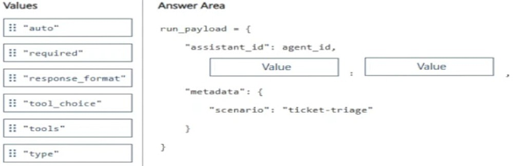

_DRAG DROP — the original ExamTopics question expects you to drag and drop items; the correct targets are not published._

**Correct answer:** Not provided by ExamTopics
**Most voted:** To guarantee a tool is invoked, set the tool_choice key to the value 'required'. The highlighted drag values place "tool_choice" as the key and "required" as the value, which forces tool usage on every run.

### Top explanations
- **RICHARDALEX007** (4 upvotes [Most Recent]): To guarantee a tool is invoked, set the tool_choice key to the value 'required'. The highlighted drag values place "tool_choice" as the key and "required" as the value, which forces tool usage on every run.

## Q1.31 (ID 412463)

You are building a web app named App1 that generates responses by using a model deployed to a Microsoft Foundry project named Project1.
Before sending the prompts to the model, App1 must retrieve documents by using Azure AI Search.
You need to integrate Project1 and App1. The solution must meet the following requirements:
Multiple client applications must use the same search configuration.
A security policy must prevent key-based authentication.
Administrative effort must be minimized.
What should you do?

⭕ **A.** Create a custom HTTP connection in Foundry and manually configure Azure AI Search endpoints per application.
✅ **B.** Configure an Azure AI Search connection in Project1 and reference the connection in each application.
⭕ **C.** Call Azure AI Search directly from each application by using Microsoft Entra authentication.
⭕ **D.** Enable a managed identity for each application and call Azure AI Search directly.

**Correct answer:** B
**Most voted:** B

### Top explanations
- **8ac3742** (1 upvotes [Selected Answer: B]): Microsoft Foundry project connections natively support Microsoft Entra ID / Managed Identity authentication without storing or exposing API keys.
- **e886835** (1 upvotes [Most Recent, Selected Answer: B]): Centralized Configuration: Configuring the Azure AI Search connection at the project level (Project1) satisfies the requirement that multiple client applications use the same search configuration, minimizing redundancy.
Security & Compliance: Azure AI Foundry connections support Microsoft Entra ID (Azure RBAC) for authentication. This allows you to avoid API keys completely, ensuring compliance with the policy against key-based authentication.
Minimized Administrative Effort: Instead of managing endpoints, credentials, or custom code across every single client application individually (as suggested in options A, C, and D), you manage a single, shared connection within the Foundry project that the applications can simply reference.
- **RICHARDALEX007** (1 upvotes [Selected Answer: B]): A single project connection gives all apps the same search configuration and uses Entra-based (keyless) auth with minimal admin effort. Custom per-app HTTP config (A) and calling Search directly from each app (C, D) duplicate configuration and increase administrative effort.

## Q1.32 (ID 412464)

DRAG DROP
You have a Microsoft Foundry project that contains an agent used by the financial analysts at your company.
You need to optimize the agent workflow by providing additional data access and processing capabilities. The solution must meet the following requirements:
Ensure that the agent can perform calculations during conversations.
Ensure that the agent can access up-to-date information from public websites.
Ensure that the agent can retrieve information from documents uploaded directly to the agent.
What should you use for each requirement? To answer, drag the appropriate tools to the correct requirements. Each tool may be used once, more than once, or not at all. You may need to drag the split bar between panes or scroll to view content.
NOTE: Each correct selection is worth one point.

**Exhibits**
- Exhibit 1: 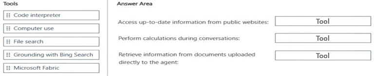

_DRAG DROP — the original ExamTopics question expects you to drag and drop items; the correct targets are not published._

**Correct answer:** Not provided by ExamTopics
**Most voted:** Grounding with Bing Search supplies current public-web information; Code interpreter executes calculations during a conversation; File search retrieves from documents uploaded directly to the agent. Each highlighted pairing matches the canonical Foundry Agent Service tool.

### Top explanations
- **RICHARDALEX007** (2 upvotes [Most Recent]): Grounding with Bing Search supplies current public-web information; Code interpreter executes calculations during a conversation; File search retrieves from documents uploaded directly to the agent. Each highlighted pairing matches the canonical Foundry Agent Service tool.
- **8ac3742** (1 upvotes): (1)Access up-to-date information from public websites: Grounding with Bing Search   (2)Perform calculations during conversations: Code interpreter   Retrieve information from (3)documents uploaded directly to the agent: File search
Code interpreter: Runs code in an isolated sandbox environment to execute precise mathematical operations, process datasets, and generate analytical calculations without hallucination.

## Q1.33 (ID 412465)

You have a Microsoft Foundry project that contains a prompt agent used by a customer support web app.
The agent is invoked from a Python service that does NOT run in the Foundry portal.
You need to implement end-to-end tracing to capture latency breakdowns and exceptions across agent runs.
Which two components can you use? Each correct answer presents a complete solution.
NOTE: Each correct selection is worth one point.

⭕ **A.** a Log Analytics workspace
✅ **B.** Application Insights
✅ **C.** OpenTelemetry
⭕ **D.** the Azure Monitor Agent
⭕ **E.** Microsoft Sentinel

**Correct answer:** B, C
**Most voted:** BC

### Top explanations
- **RICHARDALEX007** (2 upvotes [Most Recent, Selected Answer: BC]): For end-to-end tracing of agent runs from an external Python service, OpenTelemetry instruments the code and Application Insights stores/visualizes the traces - each is a complete tracing solution as worded. A Log Analytics workspace (A) backs App Insights but is not itself the tracing capability; Azure Monitor Agent (D) and Sentinel (E) are not used for agent run tracing
- **8ac3742** (1 upvotes [Selected Answer: BC]): Application Insights (Option B):Microsoft Foundry projects integrate natively with Azure Application Insights to provide end-to-end distributed tracing, latency breakdowns (span timelines for LLM calls, tool executions, and retrieval), and automatic exception tracking across external application calls.   Connecting the Python service to the project’s linked Application Insights resource fulfills the entire requirement out of the box.   OpenTelemetry (Option C):The Azure AI Foundry SDK (azure-ai-projects / prompt flow / agent framework) is instrumented directly on top of the OpenTelemetry (OTel) open standard.   In a standalone Python service outside the portal, you can enable end-to-end tracing using the OpenTelemetry SDK (via azure-monitor-opentelemetry or an OTel tracer) to capture spans, measure component latency, and log exceptions to any compatible backend.

## Q1.34 (ID 412466)

You have a customer support agent that uses the Microsoft Foundry Agent Service.
Sometimes, customers return to a session days later to continue the same support case, and the agent must resume with the full historical context. The agent must provide the following:
Multi-turn continuity within the session
Cross-session continuity for the same case
Access to the full interaction history, including user messages, agent messages, tool calls, and tool outputs
You need to ensure that the agent automatically reloads the complete history on each new turn.
What should you do?

✅ **A.** Create and reuse a conversation by storing the conversation’s ID and supplying the ID on subsequent requests.
⭕ **B.** Persist only the final model response stored in the client application and prepend the response to future prompts.
⭕ **C.** Enable memory summarization on the agent definition to persist the context automatically.

**Correct answer:** A
**Most voted:** A

### Top explanations
- **RICHARDALEX007** (4 upvotes [Most Recent, Selected Answer: A]): Persisting and reusing the conversation/thread ID reloads the full server-side history (user/agent messages, tool calls, tool outputs) on each new turn and supports cross-session resumption. Storing only the final response (B) loses tool history; memory summarization (C) condenses rather than reloads the complete interaction history.
- **8ac3742** (1 upvotes [Selected Answer: A]): In the Microsoft Foundry Agent Service (and the underlying OpenAI Assistants/threads model), a conversation (thread) is a stateful entity managed server-side by Azure.   It automatically appends and preserves:User inputs and assistant responses.   Internal reasoning steps, tool calls, and tool response outputs

## Q1.35 (ID 412467)

HOTSPOT
You have a Microsoft Foundry project that contains a deployed chat model.
You have a Python service that sends API requests to the model. The service is integrated with an automated validation system that compares generated outputs against approved response patterns.
Stakeholders report that small wording differences are causing validation mismatches.
You need to update the request parameters to improve output stability. The solution must maximize reasoning quality.
How should you complete the Python code? To answer, select the appropriate options in the answer area.
NOTE: Each correct selection is worth one point.

**Exhibits**
- Exhibit 1: 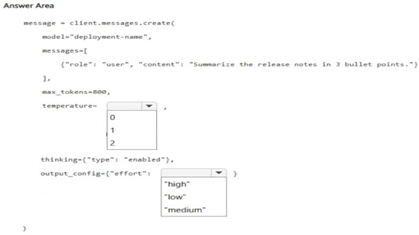

_HOTSPOT — the original ExamTopics question expects you to mark areas on the exhibit above; the correct hotspot coordinates are not published._

**Correct answer:** Not provided by ExamTopics
**Most voted:** Answer: temperature = 1, effort = “high” | This code uses the Anthropic Messages API, so it calls a Claude model in Foundry. Since thinking is enabled, Claude does not allow temperature changes: temperature may only be set to 1 when thinking is enabled. Setting it to 0 returns an error, and 2 is out of range. With thinking on, stability comes from the reasoning itself, not from temperature. | effort = "high" gives the deepest reasoning, which is what “maximize reasoning quality” ask...

### Top explanations
- **RICHARDALEX007** (7 upvotes [Highly Voted]): To maximize output stability/determinism, set temperature to 0 (lowest randomness). To maximize reasoning quality on a reasoning model, set the effort to high. The two highlighted selections satisfy 'improve output stability' and 'maximize reasoning quality' respectively.
- **dinizingrid** (1 upvotes [Most Recent]): Answer: temperature = 1, effort = “high”
This code uses the Anthropic Messages API, so it calls a Claude model in Foundry. Since thinking is enabled, Claude does not allow temperature changes: temperature may only be set to 1 when thinking is enabled. Setting it to 0 returns an error, and 2 is out of range. With thinking on, stability comes from the reasoning itself, not from temperature.
effort = "high" gives the deepest reasoning, which is what “maximize reasoning quality” asks for.

## Q1.36 (ID 412468)

You have a chat app in a Microsoft Foundry project and an Azure AI Search vectorized index.
You need to connect to the index to meet the following requirements:
Complex questions must retrieve information from multiple chunks.
Multi-turn conversations must influence retrieval planning.
Retrievals must run in parallel to reduce latency.
Which retrieval approach should you use?

⭕ **A.** iterative retrieval
✅ **B.** agentic Retrieval Augmented Generation (RAG)
⭕ **C.** chain of thought
⭕ **D.** classic Retrieval Augmented Generation (RAG)

**Correct answer:** B
**Most voted:** B

### Top explanations
- **RICHARDALEX007** (4 upvotes [Most Recent, Selected Answer: B]): Agentic RAG decomposes complex questions into subqueries spanning multiple chunks, uses conversation history to influence query planning, and runs subqueries in parallel to cut latency - matching all three requirements.
Classic RAG (D) is single-shot; iterative retrieval (A) is sequential; chain of thought (C) is a prompting technique, not a retrieval method.

## Q1.37 (ID 412469)

HOTSPOT
You need to recommend a plan to create a customer support agent by using the Microsoft Foundry Agent Service. The agent must meet the following requirements:
Retain user preferences across multiple conversations.
Enable users to provide contextual grounding by directly uploading documents during a chat.
Which Foundry capability should you recommend for each requirement? To answer, select the appropriate options in the answer area.
NOTE: Each correct selection is worth one point.

**Exhibits**
- Exhibit 1: 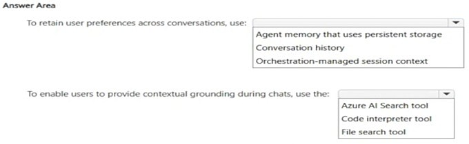

_HOTSPOT — the original ExamTopics question expects you to mark areas on the exhibit above; the correct hotspot coordinates are not published._

**Correct answer:** Not provided by ExamTopics
**Most voted:** Retaining user preferences across conversations requires persistent agent memory (conversation history alone resets per session; orchestration session context is in-session). Letting users ground via documents uploaded during chat is the File search tool (Azure AI Search tool targets a pre-built index; code interpreter is for compute).

### Top explanations
- **RICHARDALEX007** (1 upvotes [Most Recent]): Retaining user preferences across conversations requires persistent agent memory (conversation history alone resets per session; orchestration session context is in-session). Letting users ground via documents uploaded during chat is the File search tool (Azure AI Search tool targets a pre-built index; code interpreter is for compute).

## Q1.38 (ID 412470)

You have a Microsoft Foundry project that contains an agent. The agent generates summaries from retrieved policy documents.
You need to improve response completeness. The solution must be implemented in the logic of the application code before responses are returned.
What should you do?

✅ **A.** Add a retry evaluation before the responses are returned.
⭕ **B.** Decrease the value of the max_tokens parameter.
⭕ **C.** Switch to Retrieval Augmented Generation (RAG).
⭕ **D.** Replace the model with a smaller deployment.

**Correct answer:** A
**Most voted:** A

### Top explanations
- **RICHARDALEX007** (4 upvotes [Most Recent, Selected Answer: A]): Implementing the fix 'in the logic of the application code before responses are returned' points to an evaluation/retry pass that checks completeness and regenerates if needed. Decreasing max_tokens (B) and using a smaller model (D) reduce completeness; switching to RAG (C) changes retrieval, not the in-code post-check requested.
- **8ac3742** (2 upvotes [Selected Answer: A]): Read the prompt's first sentence carefully:"The agent generates summaries from retrieved policy documents."   Because the agent is already retrieving policy documents and generating summaries from them, it is already using Retrieval Augmented Generation (RAG). Switching to RAG is redundant and doesn't solve the issue.

## Q1.39 (ID 412471)

You have a customer support agent built by using the Microsoft Foundry Agent Service. The agent calls an Azure OpenAI model deployment.
During load testing, calls intermittently fail and return an HTTP 429 rate limit exceeded error.
You need to handle throttling to reduce call failures and improve reliability under load. The solution must remain within the service and model limits.
What should you do?

⭕ **A.** Create a new thread and retry the calls immediately.
⭕ **B.** Reduce the number of registered tools.
✅ **C.** Implement a retry policy that uses exponential backoff and jitter.
⭕ **D.** Spit uploaded content into smaller files.

**Correct answer:** C
**Most voted:** C

### Top explanations
- **RICHARDALEX007** (2 upvotes [Most Recent, Selected Answer: C]): The standard, within-limits way to handle HTTP 429 is exponential backoff with jitter to spread retries. Immediate retry on a new thread (A) worsens throttling; reducing tools (B) and splitting files (D) do not address rate limits.

## Q1.40 (ID 412472)

HOTSPOT
You have a Microsoft Foundry project that contains an agent.
You use a GitHub Actions workflow for CI/CD.
You need to configure the workflow to automatically evaluate the agent when a pull request (PR) is created and prevent branches from merging if the evaluation results do NOT meet the defined thresholds.
How should you configure the workflow? To answer, select the appropriate options in the answer area.
NOTE: Each correct selection is worth one point.

**Exhibits**
- Exhibit 1: 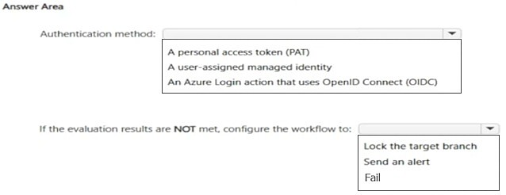

_HOTSPOT — the original ExamTopics question expects you to mark areas on the exhibit above; the correct hotspot coordinates are not published._

**Correct answer:** Not provided by ExamTopics
**Most voted:** GitHub Actions should authenticate to Azure with the Azure Login action using OIDC (federated credentials), avoiding stored secrets/PATs and managed identity isn't used for GitHub-hosted runners this way. To block merges when evaluation thresholds are not met, the workflow step must Fail (which fails the check and prevents merge); 'send an alert' or 'lock the branch' do not gate the PR check.

### Top explanations
- **RICHARDALEX007** (2 upvotes [Most Recent]): GitHub Actions should authenticate to Azure with the Azure Login action using OIDC (federated credentials), avoiding stored secrets/PATs and managed identity isn't used for GitHub-hosted runners this way. To block merges when evaluation thresholds are not met, the workflow step must Fail (which fails the check and prevents merge); 'send an alert' or 'lock the branch' do not gate the PR check.

## Q1.41 (ID 412473)

Note: This section contains one or more sets of questions with the same scenario and problem. Each question presents a unique solution to the problem. You must determine whether the solution meets the stated goals. More than one solution in the set might solve the problem. It is also possible that none of the solutions in the set solve the problem.
After you answer a question in this section, you will NOT be able to return. As a result, these questions do not appear on the Review Screen.
You have a Microsoft Foundry project that contains an agent. The agent generates summaries from retrieved policy documents.
Users report that some responses omit required regulatory clauses, even when the clauses are present in the retrieved content.
You need to improve response completeness.
Solution: You increase the value of the max_tokens parameter.
Does this meet the goal?

⭕ **A.** Yes
✅ **B.** No

**Correct answer:** B
**Most voted:** B

### Top explanations
- **RICHARDALEX007** (5 upvotes [Selected Answer: B]): Clauses are present in the retrieved content but omitted from the summary, so the problem is selection/faithfulness, not output length truncation. Increasing max_tokens does not force inclusion of the missing clauses, so it does not meet the goal.
- **Mattt** (4 upvotes [Selected Answer: B]): B. No.
Increasing max_tokens only allows a longer response; it does not ensure that required clauses are included. The issue is response completeness, not output truncation.
- **mamaMia2** (1 upvotes [Most Recent, Selected Answer: B]): as the rest said it only makes it longer, doesnt gaurantee what we need
- **ArindamPal** (1 upvotes [Selected Answer: A]): Increasing the max_tokens parameter allows the model to generate a longer response, which can improve the likelihood that all required clauses are included in the summary.
Therefore, increasing max_tokens can improve response completeness and meets the stated goal.
- **8ac3742** (1 upvotes [Selected Answer: B]): To ensure completeness for regulatory clauses, you should update the agent's system instructions (prompt engineering), enforce a structured output schema, or add a pre-response evaluation/retry loop in the application logic

## Q1.42 (ID 412474)

Note: This section contains one or more sets of questions with the same scenario and problem. Each question presents a unique solution to the problem. You must determine whether the solution meets the stated goals. More than one solution in the set might solve the problem. It is also possible that none of the solutions in the set solve the problem.
After you answer a question in this section, you will NOT be able to return. As a result, these questions do not appear on the Review Screen.
You have a Microsoft Foundry project that contains an agent. The agent generates summaries from retrieved policy documents.
Users report that some responses omit required regulatory clauses, even when the clauses are present in the retrieved content.
You need to improve response completeness.
Solution: You add a reflection pass that regenerates the response if the required clauses are missing.
Does this meet the goal?

✅ **A.** Yes
⭕ **B.** No

**Correct answer:** A
**Most voted:** A

### Top explanations
- **RICHARDALEX007** (2 upvotes [Selected Answer: A]): A reflection pass that regenerates the response when required clauses are missing directly enforces completeness by re-checking and re-prompting until the clauses appear. This meets the goal.
- **8ac3742** (1 upvotes [Selected Answer: A]): reflection pass:
1.Send the retrieved documents and the draft summary to a cheaper model with below prompt:
You are a compliance reviewer. Inspect the generated summary against the source text.
Check if any regulatory, compliance, or mandatory policy clauses present in the
source documents were omitted from the summary.
Return JSON:
{
"is_complete": true | false,
"missing_clauses": ["list of omitted clauses"],
"critique": "guidance on what needs to be added"
}
2.If is_complete is false, the application issues a second call to the generator model:
"Your previous draft omitted: {missing_clauses}. Please regenerate the summary to ensure these required regulatory clauses are included."
- **Shaharaz** (1 upvotes [Selected Answer: A]): A reflection pass reviews the initial response against defined requirements, such as whether all mandatory regulatory clauses from the retrieved context are included.
- **cloudera** (1 upvotes [Most Recent, Selected Answer: A]): A. Yes Reflection Pass is the correct.

## Q1.43 (ID 412475)

Note: This section contains one or more sets of questions with the same scenario and problem. Each question presents a unique solution to the problem. You must determine whether the solution meets the stated goals. More than one solution in the set might solve the problem. It is also possible that none of the solutions in the set solve the problem.
After you answer a question in this section, you will NOT be able to return. As a result, these questions do not appear on the Review Screen.
You have a Microsoft Foundry project that contains an agent. The agent generates summaries from retrieved policy documents.
Users report that some responses omit required regulatory clauses, even when the clauses are present in the retrieved content.
You need to improve response completeness.
Solution: You increase the value of the temperature parameter.
Does this meet the goal?

⭕ **A.** Yes
✅ **B.** No

**Correct answer:** B
**Most voted:** B

### Top explanations
- **RICHARDALEX007** (2 upvotes [Most Recent, Selected Answer: B]): Raising temperature increases randomness/creativity; it does not make the model reliably include required regulatory clauses and can make omissions worse. It does not meet the goal.

## Q1.44 (ID 412476)

Note: This section contains one or more sets of questions with the same scenario and problem. Each question presents a unique solution to the problem. You must determine whether the solution meets the stated goals. More than one solution in the set might solve the problem. It is also possible that none of the solutions in the set solve the problem.
After you answer a question in this section, you will NOT be able to return. As a result, these questions do not appear on the Review Screen.
You have a Microsoft Foundry project that contains an agent. The agent generates summaries from retrieved policy documents.
Users report that some responses omit required regulatory clauses, even when the clauses are present in the retrieved content.
You need to improve response completeness.
Solution: You run an evaluation flow that scores responses for completeness and blocks responses that fall below a defined threshold.
Does this meet the goal?

⭕ **A.** Yes
✅ **B.** No

**Correct answer:** B
**Most voted:** B

### Top explanations
- **NVIT2026** (4 upvotes [Selected Answer: B]): Simply blocking incomplete responses prevents poor output from reaching the user, but it does not fix, improve, or regenerate the response to make it complete. It results in a failed request or error message rather than delivering a complete summary containing the required regulatory clauses.
- **cloudera** (4 upvotes [Selected Answer: B]): While implementing an evaluation flow to score responses is an excellent practice for monitoring, but it does not actually improve the completeness of the generated summaries.
- **Mattt** (3 upvotes [Selected Answer: B]): B. No. The evaluation flow only detects and blocks incomplete responses; it does not regenerate them or add the missing clauses.
- **RICHARDALEX007** (2 upvotes [Selected Answer: A]): Running an evaluation flow that scores completeness and blocks sub-threshold responses enforces the completeness requirement before delivery, so it meets the goal.
- **AzureGeek79** (1 upvotes [Most Recent, Selected Answer: B]): Correct answer is B.
While running an evaluation flow to score responses for completeness is a great way to measure and monitor the issue, simply blocking responses that fall below a defined threshold does not improve response completeness. Instead of fixing the problem or generating complete answers, it simply results in a broken experience where users receive an error message, a blocked state, or a generic refusal instead of the required summary.

## Q1.45 (ID 412477)

You are creating an image-editing workflow in a Microsoft Foundry project.
The workflow must meet the following requirements:
Ensure that background objects can be removed by applying a mask-based inpainting edit.
Preserve the original lighting and style of the edited images.
Use the built-in image editing controls, NOT a custom model.
You need to ensure that image edits apply exclusively inside the masked area.
How should you configure the workflow?

⭕ **A.** Set generation mode to image_variation and provide the original image as a reference.
⭕ **B.** Enable text_to_image mode and a prompt describing the desired background removal.
⭕ **C.** Enable image_to_image mode and a high-strength value to regenerate the full image based on the prompt.
✅ **D.** Enable mask_inpainting and supply both the input image and a mask indicating which part of the image to modify.

**Correct answer:** D
**Most voted:** D

### Top explanations
- **8ac3742** (1 upvotes [Selected Answer: D]): In Microsoft Foundry / Azure AI, "image-edit" is not an agent. It is a  inference workflow mode provided by diffusion models such as Stable Diffusion / FLUX models deployed through Foundry Model Catalog).
When you invoke image models in Foundry workflows, the model supports different task modes:
text_to_image (Option B): Generates a brand-new image completely from scratch based on a textual prompt. It cannot edit an existing image in place.
image_variation (Option A): Takes an existing image and generates diverse stylistic variants of the whole picture. It does not allow targeted object removal.
image_to_image (Option C): Modifies the whole image globally according to a prompt and a strength parameter. Even with high or low strength, it evaluates and alters pixels across the entire frame, failing the requirement that edits apply exclusively inside the target area.
mask_inpainting (Option D): The dedicated editing mode where the API accepts image + mask + prompt. The model regenerates only the masked pixels and blends them seamlessly into the surrounding context.
Below is one sample image workflow
# Requirement: Input image and mask must be square PNGs with alpha channel
# The mask transparent area indicates where the model should edit.
def run_mask_inpainting(original_png_path: str, mask_png_path: str):
print("Performing mask-based inpainting...")
with open(original_png_path, "rb") as image_file, open(mask_png_path, "rb") as mask_file:
edit_response = client.images.edit(
model="dall-e-2",  # Deployment supporting mask-based edits
image=image_file,
mask=mask_file,
prompt="Seamless natural meadow background, matching the original grass and lighting perfectly",
n=1,
size="1024x1024",
)
edited_url = edit_response.data[0].url
print(f"Edited Image URL: {edited_url}")
return edited_url
- **RICHARDALEX007** (1 upvotes [Most Recent, Selected Answer: D]): Editing only inside a masked region while preserving the rest is exactly mask-based inpainting, which needs the input image plus a mask. image_variation (A) and text_to_image (B) regenerate broadly; high-strength image_to_image (C) regenerates the whole image, not just the masked area.

## Q1.46 (ID 412478)

You have a Microsoft Foundry project that generates product marketing images from text prompts.
After publishing several images, the legal team at your company identifies a competitor’s logo on a sign in the background of an image.
You need to remove only the logo, while preserving the rest of the image.
What should you do?

✅ **A.** Apply a mask-based inpainting edit to the part of the image that contains the logo.
⭕ **B.** Increase the prompt guidance strength.
⭕ **C.** Modify the original prompt to exclude brand names.
⭕ **D.** Rerun the prompt by using a different random seed.

**Correct answer:** A
**Most voted:** A

### Top explanations
- **Shaharaz** (1 upvotes [Selected Answer: A]): With mask-based inpainting, you create a mask covering only the competitor’s logo.
- **RICHARDALEX007** (1 upvotes [Most Recent, Selected Answer: A]): To remove only the logo while keeping the rest intact, mask the logo region and inpaint. Increasing guidance (B), editing the prompt (C), or changing the seed (D) regenerate or re-roll the whole image and do not surgically remove one element.

## Q1.47 (ID 412479)

You have a Microsoft Foundry project that contains an agent.
The agent ingests scanned PDF vendor invoices that contain tables and embedded QR codes.
The agent must preserve the PDF layout in the extracted output to ensure that downstream processing can reference sections and tables.
You plan to call Azure Content Understanding in Foundry Tools.
You need to extract content and layout elements and detect QR codes without requiring a language model deployment.
Which built-in analyzer should you use?

⭕ **A.** prebuilt-documentFieldSchema
⭕ **B.** prebuilt-read
⭕ **C.** prebuilt-documentSearch
✅ **D.** prebuilt-layout

**Correct answer:** D
**Most voted:** D

### Top explanations
- **8ac3742** (1 upvotes [Selected Answer: D]): A. prebuilt-documentFieldSchema: This analyzer is used to discover or propose structured field definitions for unknown document schemas; it does not perform raw layout preservation.
B. prebuilt-read: Provides basic optical character recognition (OCR) and text lines, but it strips away complex document layout hierarchy and does not reconstruct structured tables.
C. prebuilt-documentSearch: A RAG-optimized analyzer intended to generate markdown chunks and semantic embeddings/descriptions for downstream search, typically utilizing language model processing
D. prebuilt-layout:
(1)Preserve PDF Layout & Tables: extract structure, paragraphs, reading order, and complex tables.
(2)QR Codes & Barcodes
(3)No Language Model Required
- **RICHARDALEX007** (1 upvotes [Most Recent, Selected Answer: D]): prebuilt-layout extracts content and layout elements (tables, structure) and detects barcodes/QR codes without needing a model deployment. prebuilt-read (B) does OCR text only (no layout/tables); documentFieldSchema (A) and documentSearch (C) are not the layout/QR extractor.

## Q1.48 (ID 412480)

You have a Microsoft Foundry project that contains an agent and an image generation model deployment.
The agent generates original images from user-supplied product photos.
You need to ensure that the generated images maintain the product identity and visual characteristics of the provided photo.
What should you do?

⭕ **A.** Set the input_fidelity parameter to high.
⭕ **B.** Apply a groundedness detection filter.
✅ **C.** Include a prompt and input image in the request.
⭕ **D.** Decrease the value of the temperature parameter.

**Correct answer:** C
**Most voted:** C

### Top explanations
- **AzureGeek79** (2 upvotes [Most Recent, Selected Answer: C]): Correct answer is C.
To ensure that a generative image model modifies or adapts an existing visual object while preserving its identity, structure, and distinct features, you must perform an Image-to-Image generation request. This requires passing both a textual prompt (describing the changes or new context) along with the original input image (the product photo) inside the API payload. This provides the model with the exact visual baseline necessary to maintain the product's identity.
• A. Set the input_fidelity parameter to high: input_fidelity is not a standard configuration parameter across Azure / Microsoft Foundry image generation deployments (such as DALL-E 3 or Stable Diffusion).
• B. Apply a groundedness detection filter: Groundedness evaluation tools are explicitly designed for text-based Retrieval-Augmented Generation (RAG) tasks to ensure a text response matches its source text. They cannot parse or enforce structural integrity for image-to-image workflows.
• D. Decrease the value of the temperature parameter: While lowering temperature reduces randomness in text models, it is not a parameter used in image generation endpoints to pin structural consistency to an unprovided reference photo.
- **RICHARDALEX007** (1 upvotes [Selected Answer: A]): Maintaining the product's identity and visual characteristics from a supplied photo is what high input_fidelity controls in image editing

## Q1.49 (ID 412481)

HOTSPOT
You have a Microsoft Foundry project that contains an agent.
The agent accepts user-uploaded screenshots and uses a multimodal chat model.
Some screenshots contain potentially malicious embedded text.
You need to prevent a prompt injection attack and ensure that third-party content is treated as lower trust.
How should you configure prompt shields for document attacks? To answer, select the appropriate options in the answer area.
NOTE: Each correct selection is worth one point.

**Exhibits**
- Exhibit 1: 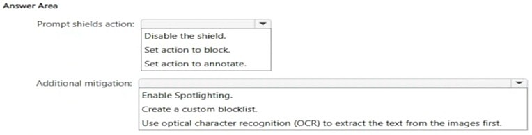

_HOTSPOT — the original ExamTopics question expects you to mark areas on the exhibit above; the correct hotspot coordinates are not published._

**Correct answer:** Not provided by ExamTopics
**Most voted:** To prevent prompt injection from document/image-embedded text, set the document-attack shield action to Block. Spotlighting is the Prompt Shields capability that marks third-party content as lower trust, directly satisfying 'treat third-party content as lower trust.' A custom blocklist or OCR pre-step do not provide the provenance/trust separation.

### Top explanations
- **RICHARDALEX007** (5 upvotes [Most Recent]): To prevent prompt injection from document/image-embedded text, set the document-attack shield action to Block. Spotlighting is the Prompt Shields capability that marks third-party content as lower trust, directly satisfying 'treat third-party content as lower trust.' A custom blocklist or OCR pre-step do not provide the provenance/trust separation.

## Q1.50 (ID 412482)

You are deploying a support agent that enables users to upload photos.
You need to automatically classify uploaded images for harmful content. The solution must block content based on severity levels.
What should you do?

⭕ **A.** Apply keyword scanning to optical character recognition (OCR) output by using Azure Vision in Foundry Tools.
⭕ **B.** Enable prompt shields.
⭕ **C.** Use blocklists.
✅ **D.** Implement image moderation.

**Correct answer:** D
**Most voted:** D

### Top explanations
- **profitchannel** (13 upvotes [Most Recent, Highly Voted]): the comments are really helpful and provide background, you see from the answer match already when the answer ist correct!
- **RICHARDALEX007** (5 upvotes [Selected Answer: D]): Image moderation classifies images into harm categories with severity levels and can block above a threshold. OCR keyword scanning (A) only handles embedded text; prompt shields (B) target injection; blocklists (C) match terms, not visual harm severity.
- **cloudera** (2 upvotes [Selected Answer: D]): I thought we were supposed to leave the discussion section empty when the answer is already correct. Aren't to discuss only when the question requires correction or further clarification.
It’s frustrating to see someone commenting on every single answer just to restate what’s already been said. It adds noise rather than value. Please avoid doing that — it’s unnecessary and distracting.
- **038c182** (2 upvotes): youre mad someone went through and explained / justified the answers? lol

## Q1.51 (ID 412483)

You have an app named App1 that uses a Microsoft Foundry multimodal model deployment.
App1 runs optical character recognition (OCR) on uploaded images and appends the OCR output to the prompt as additional context.
Some uploaded images contain embedded text.
You need to prevent potentially malicious instructions from being processed by the model.
What should you use?

⭕ **A.** image moderation
✅ **B.** prompt shields for documents
⭕ **C.** protected material text
⭕ **D.** prompt shields for user prompts

**Correct answer:** B
**Most voted:** B

### Top explanations
- **RICHARDALEX007** (2 upvotes [Most Recent, Selected Answer: B]): OCR text appended to the prompt is third-party/document content, so Prompt Shields for Documents is the control that detects embedded malicious instructions. Image moderation (A) checks visual harm not instructions; protected material (C) is copyright; prompt shields for user prompts (D) target direct user jailbreaks.

## Q1.52 (ID 412484)

You have a Microsoft Foundry project that contains an agent.
You need to process mixed-format documents that contain scanned text, tables, and multicolumn layouts. The extracted content must preserve the document structure and be converted into the Markdown format for downstream reasoning.
What should you configure first?

⭕ **A.** an Azure Language in Foundry Tools text analysis model deployment
⭕ **B.** a generative chat completion request
⭕ **C.** an Azure OpenAI Responses API call that uses a multimodal model
✅ **D.** an Azure Content Understanding in Foundry Tools analyzer

**Correct answer:** D
**Most voted:** D

### Top explanations
- **RICHARDALEX007** (3 upvotes [Most Recent, Selected Answer: D]): Content Understanding converts mixed-format documents (scanned text, tables, multicolumn) into structured Markdown for downstream reasoning, and Microsoft recommends it as the starting point for file processing. A Language text model (A), a chat completion (B), or a multimodal Responses call (C) do not provide structure-preserving Markdown extraction as a first step.

## Q1.53 (ID 412485)

You have an application that processes scanned PDF invoices. The invoices have varied layouts and include multipage tables.
You have a pipeline that uses optical character recognition (OCR) and extracts totals and invoice numbers. The results are often incorrect because the document structure is ignored.
You need to implement a solution that provides OCR, layout analysis, and template-generalizing field extraction. The solution must NOT require training a custom model. The solution must minimize administrative effort.
What should you include in the solution?

⭕ **A.** Azure Language in Foundry Tools
✅ **B.** Azure Content Understanding in Foundry Tools
⭕ **C.** an Azure Machine Learning model

**Correct answer:** B
**Most voted:** B

### Top explanations
- **2b61a0f** (9 upvotes [Highly Voted]): Some of us want to know also the details, not just the correct answer, I like that RICHARDALEX007 explains the answers.
- **2b61a0f** (9 upvotes [Highly Voted]): Some of us want to know also the details, not just the correct answer, I like that RICHARDALEX007 explains the answers.
- **RICHARDALEX007** (7 upvotes [Highly Voted, Selected Answer: B]): Content Understanding provides OCR, layout analysis, and template-generalizing field extraction without training a custom model and with minimal admin effort. Language (A) is text analytics, and an Azure ML model (C) requires building/training.
- **cloudera** (1 upvotes [Most Recent]): The answer is already correct. Why are you plastering your comments everywhere. Seriously, stop it — full stop.

## Q1.54 (ID 412486)

You have a Microsoft Foundry project that contains an agent.
The agent uses a knowledge source built from documents stored in Azure Blob Storage. The documents include digitally scanned PDFs that contain multipage tables.
You have an ingestion job that extracts only plain text, causing loss of table structure, headings, and page-number metadata.
Users frequently ask questions that require the retrieval of specific table rows across the pages.
You need to configure an ingestion job for a Retrieval Augmented Generation (RAG) pipeline that performs optical character recognition (OCR) on scanned PDFs, preserves tables and headings as structure-aware chunks, and stores page-number metadata with each chunk.
How should you configure the ingestion job?

✅ **A.** Use advanced data parsing to reingest the documents.
⭕ **B.** Use OCR and page-level chunking.
⭕ **C.** Use page-level OCR extraction and store each page as a single chunk.
⭕ **D.** Use basic parsing and fixed-size chunking.

**Correct answer:** A
**Most voted:** A

### Top explanations
- **RICHARDALEX007** (4 upvotes [Selected Answer: A]): Preserving tables/headings as structure-aware chunks with OCR and page-number metadata is what advanced/structure-aware data parsing provides; plain OCR with page-level chunking (B, C) stores whole pages and loses row-level table structure, and basic fixed-size chunking (D) ignores structure
- **8ac3742** (3 upvotes [Selected Answer: A]): In Foundry AI Search, you configure the parsing strategy:
Basic parsing: Extracts only unstructured raw text from files and applies standard fixed-size chunking, discarding tables, formatting, headers, and visual layout.
Advanced data parsing (Option A): Automatically leverages the Azure AI Document Intelligence layout model during ingestion:
Runs OCR on scanned images and PDFs.
Understands layout hierarchy (headings, titles, sections).
Extracts multipage tables into structured representations (Markdown/HTML).
Produces structure-aware chunks while attaching page-number metadata to each chunk.
- **Srikantha** (2 upvotes [Most Recent, Selected Answer: A]): Advanced data parsing: In Microsoft Foundry (Azure AI Studio), the "advanced" data parsing option utilizes Azure AI Document Intelligence (specifically the Layout model). This capability is explicitly designed to perform Optical Character Recognition (OCR) while preserving complex document structures such as tables (even those spanning multiple pages), headings, and reading order. It outputs the data into structure-aware chunks (often formatted as Markdown) and automatically tags those chunks with metadata, including page numbers. This perfectly matches the requirement for accurate RAG retrieval of specific table rows
- **e886835** (1 upvotes [Selected Answer: A]): Not B because this handles the scanning part, blindly cutting chunks at strict page boundaries will slice multipage tables in half incorrectly, destroying row context that spans across page breaks
- **cloudera** (1 upvotes): Well done, you finally got it right.
BTW, if I were you, I’d seriously mask my username. Just saying.

## Q1.55 (ID 412487)

You have a Microsoft Foundry project that contains an agent.
The agent uses Azure AI Search as the retriever.
You plan to ingest PDF into an Azure AI Search index to ensure that the agent can ground responses in texts in both documents and embedded images.
Users require citations that link to the source files.
You need to ensure that during indexing, the images are extracted into a structure that can be used as input for the built-in optical character recognition (OCR) skill.
Which indexing approach should you use?

✅ **A.** an indexer to extract image data into a normalized_images collection
⭕ **B.** a Shaper skill to restructure the OCR input
⭕ **C.** a skillset to run the OCR skill directly against the content field of the index
⭕ **D.** the outputFieldMappings parameter to write image data to a searchable field

**Correct answer:** A
**Most voted:** A

### Top explanations
- **RICHARDALEX007** (2 upvotes [Most Recent, Selected Answer: A]): To feed embedded images to the built-in OCR skill, the indexer must extract images into the normalized_images collection (the documented input for the OCR skill). A Shaper skill (B) restructures data, running OCR on the content field (C) is wrong because OCR needs image input, and outputFieldMappings (D) writes results, not image extraction.

## Q1.56 (ID 412488)

Overview
Company Information
Contoso, Ltd is a multinational retail company that builds, deploys, and manages generative AI and agent-based solutions by using Microsoft Foundry.
Existing Environment
Identity Environment
Contoso uses Microsoft Entra ID for identity management, authentication, and authorization capabilities that enable agents to access organizational resources and services.
Contoso recently formed a new AI engineering team named Agent1Dev Team to optimize and maintain existing AI solutions.
The team collaborates with solution architects, DevOps engineers, and security engineers to design, implement. monitor, and secure AI applications.
Contoso also has a team named Agent1Test Team that is responsible for validating AI solutions before the solution deployments.
Generative Environment
Contoso has a Microsoft Foundry deployment that contains two projects named Project1 and Project2.
Project1
Project1 contains a customer support agent named Agent1 that assists customers with product inquiries and troubleshooting requests.
Agent1 has the following configurations:
Agent1 uses a base model deployment.
A safety evaluation pipeline is NOT enabled.
Tool invocation approval workflows are NOT enabled.
Conversation memory constraints are NOT configured.
Agent1 interacts with customers by using digital support channels and answers general questions about Contoso products.
Project1 is deployed to an Azure region located in the European Union (EU).
Agent1Dev Team will use Project1 to optimize and maintain Agent1.
Project2
Project2 contains a deployed video generation model. The marketing department at Contoso has access to Project2 and plans to use the model to develop a video creation solution.
Development of the solution is incomplete.
Data Environment
Contoso stores product-related information in Azure resources that support AI applications.
The Azure environment contains an Azure Blob Storage account named storage1 that stores product detail sheets for all the Contoso products.
The product sheets include specifications, feature descriptions, and product support information that Agent1 can use to answer customer questions. The product sheets are stored in the PDF format.
Problem Statements
Contoso identifies the following issues:
Agent1 has only general knowledge of the Contoso products.
A recent chat interaction with Agent1 was analyzed for sentiment. The results of the analysis have NOT been processed yet.
Agent1 does NOT use the detailed product information in the product sheets stored in storage1 when responding to customer questions.
The finance department at Contoso reports that vendor invoices must be reviewed manually to ensure that the invoices match the terms defined in the vendor contracts. The invoices contain tables, logos, and varied layouts that make the documents difficult to process consistently.
Requirements
Planned Changes
Contoso plans to implement the following changes:
Implement a solution for Project1 that analyzes the vendor invoices by evaluating both the visual layout and the textual content of the invoices, so that the invoice details can be verified against the vendor contract terms.
Update the base model deployment used by Agent1 and standardize the model version to ensure continuity and consistent responses.
Enable Agent1 to retrieve and use the detailed product information from the product sheets stored in storage1.
Implement an indexing solution for the product sheets that Agent1 can use to answer customer questions.
Complete the development of the video creation solution.
Technical Requirements
Contoso identifies the following technical requirements:
The model deployment used by Agent1 must support scalable, high-throughput generative AI workloads and dynamically scale to handle variable customer support traffic, without requiring reserved throughput capacity.
The product sheets must be processed by using an indexing pipeline that enables semantic and vector search, so that Agent1 can retrieve the relevant product information.
Responses generated by using the product sheet information must be relevant, complete, and accurate.
Agent1 must be able to use the product sheets to answer natural language questions about product details.
The model version used by Agent1 must remain consistent to ensure stable responses.
The data processed by the model must remain within the EU.
Security and Compliance Requirements
Contoso identifies the following security and compliance requirements:
API keys must NOT be used to access Foundry-deployed models.
Access to the Azure resources must follow the principle of least privilege.
The developers at Contoso must authenticate to Microsoft Foundry resources by using Microsoft Entra authentication.
Access to Project1 must be assigned to the members of Agent1Dev Team by using a security group named SC_Agent1_Dev.
Access to Project1 must be assigned to the members of Agent1Test Team by using a security group named SC_Agent1_Test.
Agent1 must never reveal customer information, even if a document that contains customer data is added erroneously to the product sheet repository in storage1.
The product sheets might contain images that include embedded text. Agent1 must be protected from malicious instructions potentially hidden within the images.
Business Requirements
Contoso identifies the following business requirements:
Users that interact with Agent1 must have a personalized experience in future interactions, including the ability for Agent1 to retain conversation context and recall relevant information from previous interactions.
Agent1 must answer questions only about the products sold by Contoso.
You need to recommend an invoice review solution that resolves the issue reported by the finance department.
What should you include in the recommendation?

⭕ **A.** chat completions
⭕ **B.** Azure Document Intelligence in Foundry Tools
✅ **C.** Azure Content Understanding in Foundry Tools
⭕ **D.** Image Analysis

**Correct answer:** C
**Most voted:** C

### Top explanations
- **cloudera** (4 upvotes [Most Recent, Selected Answer: C]): B attempting, but C is the correct answer. Why? The question is not only asking for invoice field extraction. The finance requirement is closer to “Understand invoice content and layout, then compare/validate it against contract terms.” This needs invoice processing plus contract/document reasoning or validation and for that Microsoft’s Content Understanding is the correct answer. For more visit https://learn.microsoft.com/en-us/azure/ai-services/document-intelligence/overview?view=doc-intel-4.0.0
To summarise:
Extract fields from invoices is B - Azure Document Intelligence. To review invoices against contract layout, text and reasoning is C - Azure Content Understanding which is the answer for this question.
- **RICHARDALEX007** (3 upvotes [Selected Answer: C]): The finance requirement is to evaluate both visual layout and textual content of varied-layout invoices with tables and logos and verify against contract terms - Content Understanding handles multimodal layout+text and reasoning. Document Intelligence (B) extracts fields but the multimodal layout-plus-reasoning framing favors Content Understanding; chat completions (A) and Image Analysis (D) do not do document field/layout extraction

## Q1.57 (ID 412489)

You have a Microsoft Foundry project that contains an agent.
The knowledge source for the agent is a set of scanned PDF troubleshooting guides stored in Azure Blob Storage. The guide pages contain two-column layouts and tables.
You use Azure Content Understanding in Foundry Tools to process the PDFs.
You plan to ingest the processed content into an index for Retrieval Augmented Generation (RAG) and store extracted fields for downstream automation.
Stakeholders must be able to verify where each extracted field value came from in the original PDF and route low-reliability extractions for manual review.
You need to ensure that the Content Understanding document analyzer output includes a per-field confidence score and source grounding to locations within the source document.
What should you do?

⭕ **A.** Set enableSegment to true.
⭕ **B.** Provide labeled samples.
✅ **C.** Enable estimateFieldSourceAndConfidence.
⭕ **D.** Configure the analyzer to use generative extraction for all fields.

**Correct answer:** C
**Most voted:** C

### Top explanations
- **RICHARDALEX007** (4 upvotes [Most Recent, Selected Answer: C]): estimateFieldSourceAndConfidence makes the Content Understanding analyzer return a per-field confidence score plus source grounding (page/bounding box) so values can be verified and low-confidence ones routed to review. enableSegment (A), labeled samples (B), and generative extraction (D) do not produce per-field confidence+grounding.

## Q1.58 (ID 412490)

You are building a speech processing solution in Microsoft Foundry for a customer support platform.
The platform will transcribe live phone calls, so that supervisors at your company can view call transcripts and detect issues while the calls are in progress. The call audio will arrive as a continuous stream from the telephony system.
You need to ensure that the call transcripts appear within only a few seconds of the audio stream.
What should you do?

⭕ **A.** Use text to speech by using a custom neural voice.
⭕ **B.** Use speech translation to generate the transcripts into multiple languages.
⭕ **C.** Run a batch transcription job on recorded audio files.
✅ **D.** Use real-time speech to text to process streaming audio input.

**Correct answer:** D
**Most voted:** D

### Top explanations
- **RICHARDALEX007** (1 upvotes [Most Recent, Selected Answer: D]): Transcripts within seconds of a continuous live stream require real-time speech to text. Batch transcription (C) is for recorded files (high latency); custom neural voice TTS (A) generates speech; speech translation (B) translates, neither giving low-latency live transcription.

## Q1.59 (ID 412491)

You are creating an agent workflow in a Microsoft Foundry project to support natural voice interactions.
The agent must receive continuous audio input, convert the input into text for reasoning, and then return spoken responses to a user. The workflow must meet the following requirements:
Support turn-taking dynamics, where the agent begins to generate the speech output before the user finishes speaking.
Operate with low latency to maintain conversational experience.
You need to enable both speech to text and text to speech in a real-time agent interaction.
What should you do?

⭕ **A.** Use batch transcription to convert the audio input and return text responses from the agent.
✅ **B.** Use real-time speech to text for incoming audio and text to speech for agent responses.
⭕ **C.** Use an embeddings model to encode the audio, and then decode the audio into text and speech.
⭕ **D.** Use speech translation to convert the audio into another language and return the translated text.

**Correct answer:** B
**Most voted:** B

### Top explanations
- **RICHARDALEX007** (2 upvotes [Most Recent, Selected Answer: B]): A low-latency voice agent with turn-taking needs real-time STT on input and TTS on output. Batch transcription (A) is high-latency; embeddings (C) do not transcribe/synthesize; speech translation (D) changes language rather than enabling spoken responses.

## Q1.60 (ID 412492)

You have an application named App1 that uses Azure Speech in Foundry Tools to transcribe live calls.
Transcript segments often contain both English and Spanish. App1 sends each segment to Azure Translator in Foundry Tools to translate to another language.
Sometimes, mixed-language segments result in incomplete or incorrect translations.
You need to reduce translation errors. The solution must ensure that the entire transcript is translated successfully.
What should you do before sending the segments to Translator?

⭕ **A.** Use document translation to translate the entire transcript as a single document.
✅ **B.** Split the mixed-language segments into single-language segments and translate each segment separately.
⭕ **C.** Enable automatic language detection for the translation request.
⭕ **D.** Specify English as the source language in the translation request for all the segments.

**Correct answer:** B
**Most voted:** B

### Top explanations
- **RICHARDALEX007** (1 upvotes [Most Recent, Selected Answer: B]): Translator works best per source language; splitting mixed English/Spanish segments into single-language pieces and translating each gives complete, correct results. Document translation (A) and auto-detect (C) still mis-handle a single mixed segment; forcing English as source (D) mistranslates the Spanish parts.

## Q1.61 (ID 412493)

Overview
Company Information
Contoso, Ltd is a multinational retail company that builds, deploys, and manages generative AI and agent-based solutions by using Microsoft Foundry.
Existing Environment
Identity Environment
Contoso uses Microsoft Entra ID for identity management, authentication, and authorization capabilities that enable agents to access organizational resources and services.
Contoso recently formed a new AI engineering team named Agent1Dev Team to optimize and maintain existing AI solutions.
The team collaborates with solution architects, DevOps engineers, and security engineers to design, implement. monitor, and secure AI applications.
Contoso also has a team named Agent1Test Team that is responsible for validating AI solutions before the solution deployments.
Generative Environment
Contoso has a Microsoft Foundry deployment that contains two projects named Project1 and Project2.
Project1
Project1 contains a customer support agent named Agent1 that assists customers with product inquiries and troubleshooting requests.
Agent1 has the following configurations:
Agent1 uses a base model deployment.
A safety evaluation pipeline is NOT enabled.
Tool invocation approval workflows are NOT enabled.
Conversation memory constraints are NOT configured.
Agent1 interacts with customers by using digital support channels and answers general questions about Contoso products.
Project1 is deployed to an Azure region located in the European Union (EU).
Agent1Dev Team will use Project1 to optimize and maintain Agent1.
Project2
Project2 contains a deployed video generation model. The marketing department at Contoso has access to Project2 and plans to use the model to develop a video creation solution.
Development of the solution is incomplete.
Data Environment
Contoso stores product-related information in Azure resources that support AI applications.
The Azure environment contains an Azure Blob Storage account named storage1 that stores product detail sheets for all the Contoso products.
The product sheets include specifications, feature descriptions, and product support information that Agent1 can use to answer customer questions. The product sheets are stored in the PDF format.
Problem Statements
Contoso identifies the following issues:
Agent1 has only general knowledge of the Contoso products.
A recent chat interaction with Agent1 was analyzed for sentiment. The results of the analysis have NOT been processed yet.
Agent1 does NOT use the detailed product information in the product sheets stored in storage1 when responding to customer questions.
The finance department at Contoso reports that vendor invoices must be reviewed manually to ensure that the invoices match the terms defined in the vendor contracts. The invoices contain tables, logos, and varied layouts that make the documents difficult to process consistently.
Requirements
Planned Changes
Contoso plans to implement the following changes:
Implement a solution for Project1 that analyzes the vendor invoices by evaluating both the visual layout and the textual content of the invoices, so that the invoice details can be verified against the vendor contract terms.
Update the base model deployment used by Agent1 and standardize the model version to ensure continuity and consistent responses.
Enable Agent1 to retrieve and use the detailed product information from the product sheets stored in storage1.
Implement an indexing solution for the product sheets that Agent1 can use to answer customer questions.
Complete the development of the video creation solution.
Technical Requirements
Contoso identifies the following technical requirements:
The model deployment used by Agent1 must support scalable, high-throughput generative AI workloads and dynamically scale to handle variable customer support traffic, without requiring reserved throughput capacity.
The product sheets must be processed by using an indexing pipeline that enables semantic and vector search, so that Agent1 can retrieve the relevant product information.
Responses generated by using the product sheet information must be relevant, complete, and accurate.
Agent1 must be able to use the product sheets to answer natural language questions about product details.
The model version used by Agent1 must remain consistent to ensure stable responses.
The data processed by the model must remain within the EU.
Security and Compliance Requirements
Contoso identifies the following security and compliance requirements:
API keys must NOT be used to access Foundry-deployed models.
Access to the Azure resources must follow the principle of least privilege.
The developers at Contoso must authenticate to Microsoft Foundry resources by using Microsoft Entra authentication.
Access to Project1 must be assigned to the members of Agent1Dev Team by using a security group named SC_Agent1_Dev.
Access to Project1 must be assigned to the members of Agent1Test Team by using a security group named SC_Agent1_Test.
Agent1 must never reveal customer information, even if a document that contains customer data is added erroneously to the product sheet repository in storage1.
The product sheets might contain images that include embedded text. Agent1 must be protected from malicious instructions potentially hidden within the images.
Business Requirements
Contoso identifies the following business requirements:
Users that interact with Agent1 must have a personalized experience in future interactions, including the ability for Agent1 to retain conversation context and recall relevant information from previous interactions.
Agent1 must answer questions only about the products sold by Contoso.
You need to configure an indexing pipeline for Agent1 to retrieve the relevant product information in storage1. The solution must meet the technical requirement.
Which two built-in skills should you use? Each correct answer presents part of the solution.
NOTE: Each correct selection is worth one point.

✅ **A.** Azure OpenAI Embedding
⭕ **B.** Entity Recognition
✅ **C.** Text Split
⭕ **D.** Merge
⭕ **E.** Language Detection
⭕ **F.** key phrase extraction

**Correct answer:** A, C
**Most voted:** AC

### Top explanations
- **8ac3742** (5 upvotes [Selected Answer: AC]): Let's look directly at the requirement in the case study:"The product sheets must be processed by using an indexing pipeline that enables semantic and vector search, so that Agent1 can retrieve the relevant product information.
In Azure AI Search / Foundry indexing pipelines, generating vector embeddings from unstructured text documents (like the product sheets in storage1) requires two fundamental, coupled built-in skills:
(1)Text Split (#Microsoft.Skills.Text.SplitSkill):Documents like product detail sheets in PDF format are typically multi-page and exceed model token limits.Before text can be vectorized, it must be chunked into semantically meaningful segments (pages, paragraphs, or fixed token lengths).
(2)Azure OpenAI Embedding (#Microsoft.Skills.Text.AzureOpenAIEmbeddingSkill):Takes the individual text chunks output by the Text Split skill and generates the high-dimensional numerical vectors (embeddings) needed to populate the search index.This is what directly enables vector search.Together, Text Split then Azure OpenAI Embedding is the standard, foundational enrichment pipeline for vector search indexing in Azure.
The word "embedding" comes directly from mathematics (topology and geometry): discrete, symbolic human language is being embedded into a continuous, geometric vector space.
{"dog"} = [1, 0, 0, 0}
{"cat"} = [0, 1, 0, 0}
{"apple"} = [0, 0, 1, 0}
- **RICHARDALEX007** (2 upvotes [Most Recent, Selected Answer: AC]): For an indexing pipeline enabling semantic/vector search over PDFs, Text Split chunks the documents and Azure OpenAI Embedding generates the vectors for vector search. Entity Recognition (B), Merge (D), Language Detection (E), and key phrase extraction (F) are not required to produce a vector index.

## Q1.62 (ID 412494)

Overview
Company Information
Contoso, Ltd is a multinational retail company that builds, deploys, and manages generative AI and agent-based solutions by using Microsoft Foundry.
Existing Environment
Identity Environment
Contoso uses Microsoft Entra ID for identity management, authentication, and authorization capabilities that enable agents to access organizational resources and services.
Contoso recently formed a new AI engineering team named Agent1Dev Team to optimize and maintain existing AI solutions.
The team collaborates with solution architects, DevOps engineers, and security engineers to design, implement. monitor, and secure AI applications.
Contoso also has a team named Agent1Test Team that is responsible for validating AI solutions before the solution deployments.
Generative Environment
Contoso has a Microsoft Foundry deployment that contains two projects named Project1 and Project2.
Project1
Project1 contains a customer support agent named Agent1 that assists customers with product inquiries and troubleshooting requests.
Agent1 has the following configurations:
Agent1 uses a base model deployment.
A safety evaluation pipeline is NOT enabled.
Tool invocation approval workflows are NOT enabled.
Conversation memory constraints are NOT configured.
Agent1 interacts with customers by using digital support channels and answers general questions about Contoso products.
Project1 is deployed to an Azure region located in the European Union (EU).
Agent1Dev Team will use Project1 to optimize and maintain Agent1.
Project2
Project2 contains a deployed video generation model. The marketing department at Contoso has access to Project2 and plans to use the model to develop a video creation solution.
Development of the solution is incomplete.
Data Environment
Contoso stores product-related information in Azure resources that support AI applications.
The Azure environment contains an Azure Blob Storage account named storage1 that stores product detail sheets for all the Contoso products.
The product sheets include specifications, feature descriptions, and product support information that Agent1 can use to answer customer questions. The product sheets are stored in the PDF format.
Problem Statements
Contoso identifies the following issues:
Agent1 has only general knowledge of the Contoso products.
A recent chat interaction with Agent1 was analyzed for sentiment. The results of the analysis have NOT been processed yet.
Agent1 does NOT use the detailed product information in the product sheets stored in storage1 when responding to customer questions.
The finance department at Contoso reports that vendor invoices must be reviewed manually to ensure that the invoices match the terms defined in the vendor contracts. The invoices contain tables, logos, and varied layouts that make the documents difficult to process consistently.
Requirements
Planned Changes
Contoso plans to implement the following changes:
Implement a solution for Project1 that analyzes the vendor invoices by evaluating both the visual layout and the textual content of the invoices, so that the invoice details can be verified against the vendor contract terms.
Update the base model deployment used by Agent1 and standardize the model version to ensure continuity and consistent responses.
Enable Agent1 to retrieve and use the detailed product information from the product sheets stored in storage1.
Implement an indexing solution for the product sheets that Agent1 can use to answer customer questions.
Complete the development of the video creation solution.
Technical Requirements
Contoso identifies the following technical requirements:
The model deployment used by Agent1 must support scalable, high-throughput generative AI workloads and dynamically scale to handle variable customer support traffic, without requiring reserved throughput capacity.
The product sheets must be processed by using an indexing pipeline that enables semantic and vector search, so that Agent1 can retrieve the relevant product information.
Responses generated by using the product sheet information must be relevant, complete, and accurate.
Agent1 must be able to use the product sheets to answer natural language questions about product details.
The model version used by Agent1 must remain consistent to ensure stable responses.
The data processed by the model must remain within the EU.
Security and Compliance Requirements
Contoso identifies the following security and compliance requirements:
API keys must NOT be used to access Foundry-deployed models.
Access to the Azure resources must follow the principle of least privilege.
The developers at Contoso must authenticate to Microsoft Foundry resources by using Microsoft Entra authentication.
Access to Project1 must be assigned to the members of Agent1Dev Team by using a security group named SC_Agent1_Dev.
Access to Project1 must be assigned to the members of Agent1Test Team by using a security group named SC_Agent1_Test.
Agent1 must never reveal customer information, even if a document that contains customer data is added erroneously to the product sheet repository in storage1.
The product sheets might contain images that include embedded text. Agent1 must be protected from malicious instructions potentially hidden within the images.
Business Requirements
Contoso identifies the following business requirements:
Users that interact with Agent1 must have a personalized experience in future interactions, including the ability for Agent1 to retain conversation context and recall relevant information from previous interactions.
Agent1 must answer questions only about the products sold by Contoso.
You need to recommend a solution to support the planned changes and technical requirements for Agent1 to use the product information stored in storage1.
What should you include in the recommendation?

⭕ **A.** Azure Translator in Foundry Tools
⭕ **B.** Grounding with Bing Search
✅ **C.** Azure AI Search
⭕ **D.** Azure Document intelligence in Foundry Tools

**Correct answer:** C
**Most voted:** C

### Top explanations
- **8ac3742** (5 upvotes [Selected Answer: C]): Notice the exact wording of the question:
"You need to recommend a solution to support the planned changes and technical requirements for Agent1 to use the product information stored in storage1."
The Trap: You are thinking about the vendor invoices (which would  use Document Intelligence / Content Understanding for layouts and tables).
The Actual Subject: The question is specifically asking about Agent1 retrieving the product information in storage1, not processing vendor invoices.
The core service that provides the indexing pipeline, vector search, and semantic search over documents stored in Azure Blob Storage to ground an agent via RAG is Azure AI Search.
- **RICHARDALEX007** (2 upvotes [Most Recent, Selected Answer: C]): The technical requirement is an indexing pipeline with semantic and vector search so the agent can retrieve product info - that is Azure AI Search. Translator (A) and Bing grounding (B) do not index private PDFs; Document Intelligence (D) extracts content but is not the retrieval/index layer.

## Q1.63 (ID 412495)

You have a Microsoft Foundry project named Project1.
Project1 contains an application that processes PDF vendor invoices.
You need to configure Azure Document Intelligence in Foundry Tools to generate a Markdown output that preserves the sections and table structure of the PDFs. The solution must minimize development effort.
What should you do?

⭕ **A.** Configure output=figures when you analyze the PDF.
⭕ **B.** Configure content=markdown when you analyze the document.
⭕ **C.** Increase the confidence threshold.
✅ **D.** Set the output_content_format=ContentFormat.MARKDOWN value.

**Correct answer:** D
**Most voted:** D

### Top explanations
- **Alvarogc** (3 upvotes [Most Recent, Selected Answer: D]): According to Microsoft Learn, the layout API can output the extracted text in Markdown format by using the outputContentFormat=markdown to specify the output format in Markdown. The Markdown content is then output as part of the content section.
Refference: https://learn.microsoft.com/en-us/azure/ai-services/document-intelligence/prebuilt/layout

## Q1.64 (ID 412496)

You have a Microsoft Foundry project that ingests scanned PDF invoices stored in Azure Blob Storage. Each invoice contains printed fine items and has a table-based layout.
Extracted results are stored as structured JSON and used as grounding data for an agent in a Retrieval Augmented Generation (RAG) solution.
You need to create a single analyzer that meets the following requirements:
Extracts the invoice number, invoice date, vendor name, and total amount across varying templates
Returns confidence scores so that results with confidence below 0.80 can be routed for supervisor review
What should you use?

⭕ **A.** a Foundry agent that has groundedness guardrails enabled to extract invoice fields and confidence scores
✅ **B.** a custom Azure Content Understanding in Foundry Tools analyzer that defines the required fields as the extracted fields and the returned confidence scores for routing
⭕ **C.** the Azure Content Understanding in Foundry Tools prebuilt-layout analyzer
⭕ **D.** the Azure Content Understanding in Foundry Tools prebuilt-documentSearch analyzer and search.score from the Azure AI Search results for routing

**Correct answer:** B
**Most voted:** B

### Top explanations
- **RICHARDALEX007** (1 upvotes [Most Recent, Selected Answer: B]): Extracting specific fields across varying templates AND returning confidence scores for sub-0.80 routing is a custom Content Understanding analyzer with estimateFieldSourceAndConfidence. prebuilt-layout (C) lacks the custom fields; documentSearch + search.score (D) is search relevance, not extraction confidence; a groundedness-guardrail agent (A) does not produce structured field confidence.

## Q1.65 (ID 412497)

You have a Microsoft Foundry project that uses Azure AI Search to ground an agent in internal documentation.
After a recent content update, users report that the agent’s answers have become less accurate.
You need to identify whether the retrieved content is negatively influencing the model’s generated responses.
Which observability signal should you review?

⭕ **A.** indexer status and failure history
⭕ **B.** latency breakdown traces
⭕ **C.** prediction drift metrics
✅ **D.** groundedness evaluation metrics

**Correct answer:** D
**Most voted:** D

### Top explanations
- **Alvarogc** (1 upvotes [Most Recent, Selected Answer: D]): As defined by Microsoft Learn, Groundedness measures how grounded the response is in the retrieved context. It returns a score from 1–5 using a model-based judgment. This way you can evaluate if retrieved documents are influencing the model's generated responses.
Refference: https://learn.microsoft.com/en-us/azure/foundry/concepts/built-in-evaluators

## Q1.66 (ID 421512)

HOTSPOT
Overview
Company Information
Contoso, Ltd is a multinational retail company that builds, deploys, and manages generative AI and agent-based solutions by using Microsoft Foundry.
Existing Environment
Identity Environment
Contoso uses Microsoft Entra ID for identity management, authentication, and authorization capabilities that enable agents to access organizational resources and services.
Contoso recently formed a new AI engineering team named Agent1Dev Team to optimize and maintain existing AI solutions.
The team collaborates with solution architects, DevOps engineers, and security engineers to design, implement. monitor, and secure AI applications.
Contoso also has a team named Agent1Test Team that is responsible for validating AI solutions before the solution deployments.
Generative Environment
Contoso has a Microsoft Foundry deployment that contains two projects named Project1 and Project2.
Project1
Project1 contains a customer support agent named Agent1 that assists customers with product inquiries and troubleshooting requests.
Agent1 has the following configurations:
•	Agent1 uses a base model deployment.
•	A safety evaluation pipeline is NOT enabled.
•	Tool invocation approval workflows are NOT enabled.
•	Conversation memory constraints are NOT configured.
Agent1 interacts with customers by using digital support channels and answers general questions about Contoso products.
Project1 is deployed to an Azure region located in the European Union (EU).
Agent1Dev Team will use Project1 to optimize and maintain Agent1.
Project2
Project2 contains a deployed video generation model. The marketing department at Contoso has access to Project2 and plans to use the model to develop a video creation solution.
Development of the solution is incomplete.
Data Environment
Contoso stores product-related information in Azure resources that support AI applications.
The Azure environment contains an Azure Blob Storage account named storage1 that stores product detail sheets for all the Contoso products.
The product sheets include specifications, feature descriptions, and product support information that Agent1 can use to answer customer questions. The product sheets are stored in the PDF format.
Problem Statements
Contoso identifies the following issues:
•	Agent1 has only general knowledge of the Contoso products.
•	A recent chat interaction with Agent1 was analyzed for sentiment. The results of the analysis have NOT been processed yet.
•	Agent1 does NOT use the detailed product information in the product sheets stored in storage1 when responding to customer questions.
•	The finance department at Contoso reports that vendor invoices must be reviewed manually to ensure that the invoices match the terms defined in the vendor contracts. The invoices contain tables, logos, and varied layouts that make the documents difficult to process consistently.
Requirements
Planned Changes
Contoso plans to implement the following changes:
•	Implement a solution for Project1 that analyzes the vendor invoices by evaluating both the visual layout and the textual content of the invoices, so that the invoice details can be verified against the vendor contract terms.
•	Update the base model deployment used by Agent1 and standardize the model version to ensure continuity and consistent responses.
•	Enable Agent1 to retrieve and use the detailed product information from the product sheets stored in storage1.
•	Implement an indexing solution for the product sheets that Agent1 can use to answer customer questions.
•	Complete the development of the video creation solution.
Technical Requirements
Contoso identifies the following technical requirements:
•	The model deployment used by Agent1 must support scalable, high-throughput generative AI workloads and dynamically scale to handle variable customer support traffic, without requiring reserved throughput capacity.
•	The product sheets must be processed by using an indexing pipeline that enables semantic and vector search, so that Agent1 can retrieve the relevant product information.
•	Responses generated by using the product sheet information must be relevant, complete, and accurate.
•	Agent1 must be able to use the product sheets to answer natural language questions about product details.
•	The model version used by Agent1 must remain consistent to ensure stable responses.
•	The data processed by the model must remain within the EU.
Security and Compliance Requirements
Contoso identifies the following security and compliance requirements:
•	API keys must NOT be used to access Foundry-deployed models.
•	Access to the Azure resources must follow the principle of least privilege.
•	The developers at Contoso must authenticate to Microsoft Foundry resources by using Microsoft Entra authentication.
•	Access to Project1 must be assigned to the members of Agent1Dev Team by using a security group named SC_Agent1_Dev.
•	Access to Project1 must be assigned to the members of Agent1Test Team by using a security group named SC_Agent1_Test.
•	Agent1 must never reveal customer information, even if a document that contains customer data is added erroneously to the product sheet repository in storage1.
•	The product sheets might contain images that include embedded text. Agent1 must be protected from malicious instructions potentially hidden within the images.
Business Requirements
Contoso identifies the following business requirements:
•	Users that interact with Agent1 must have a personalized experience in future interactions, including the ability for Agent1 to retain conversation context and recall relevant information from previous interactions.
•	Agent1 must answer questions only about the products sold by Contoso.
You need to ensure that the marketing department can generate videos by using the model deployed to Project2.
How should you complete the Python code? To answer, select the appropriate options in the answer area.
NOTE: Each correct selection is worth one point.

**Exhibits**
- Exhibit 1: 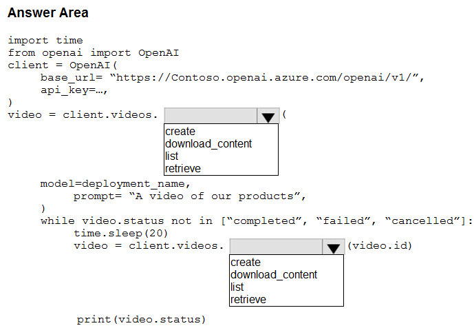

_HOTSPOT — the original ExamTopics question expects you to mark areas on the exhibit above; the correct hotspot coordinates are not published._

**Correct answer:** Not provided by ExamTopics
**Most voted:** create and retrieve | Generating video is a long-running, asynchronous operation. | client.videos.create(...) initiates the video generation job and immediately returns an initial job object containing an id and an initial status (e.g., "queued" or "processing"). | then retrieve | while video.status not in ["completed", "failed", "cancelled"]: | time.sleep(20) | video = client.videos.retrieve(video.id) | Why not list? list() takes no ID and returns a pa...

### Top explanations
- **8ac3742** (2 upvotes [Most Recent]): create and retrieve
Generating video is a long-running, asynchronous operation.
client.videos.create(...) initiates the video generation job and immediately returns an initial job object containing an id and an initial status (e.g., "queued" or "processing").
then retrieve
while video.status not in ["completed", "failed", "cancelled"]:
time.sleep(20)
video = client.videos.retrieve(video.id)
Why not list? list() takes no ID and returns a paginated list of all video generation jobs.

## Q1.67 (ID 421513)

Overview
Company Information
Contoso, Ltd is a multinational retail company that builds, deploys, and manages generative AI and agent-based solutions by using Microsoft Foundry.
Existing Environment
Identity Environment
Contoso uses Microsoft Entra ID for identity management, authentication, and authorization capabilities that enable agents to access organizational resources and services.
Contoso recently formed a new AI engineering team named Agent1Dev Team to optimize and maintain existing AI solutions.
The team collaborates with solution architects, DevOps engineers, and security engineers to design, implement. monitor, and secure AI applications.
Contoso also has a team named Agent1Test Team that is responsible for validating AI solutions before the solution deployments.
Generative Environment
Contoso has a Microsoft Foundry deployment that contains two projects named Project1 and Project2.
Project1
Project1 contains a customer support agent named Agent1 that assists customers with product inquiries and troubleshooting requests.
Agent1 has the following configurations:
•	Agent1 uses a base model deployment.
•	A safety evaluation pipeline is NOT enabled.
•	Tool invocation approval workflows are NOT enabled.
•	Conversation memory constraints are NOT configured.
Agent1 interacts with customers by using digital support channels and answers general questions about Contoso products.
Project1 is deployed to an Azure region located in the European Union (EU).
Agent1Dev Team will use Project1 to optimize and maintain Agent1.
Project2
Project2 contains a deployed video generation model. The marketing department at Contoso has access to Project2 and plans to use the model to develop a video creation solution.
Development of the solution is incomplete.
Data Environment
Contoso stores product-related information in Azure resources that support AI applications.
The Azure environment contains an Azure Blob Storage account named storage1 that stores product detail sheets for all the Contoso products.
The product sheets include specifications, feature descriptions, and product support information that Agent1 can use to answer customer questions. The product sheets are stored in the PDF format.
Problem Statements
Contoso identifies the following issues:
•	Agent1 has only general knowledge of the Contoso products.
•	A recent chat interaction with Agent1 was analyzed for sentiment. The results of the analysis have NOT been processed yet.
•	Agent1 does NOT use the detailed product information in the product sheets stored in storage1 when responding to customer questions.
•	The finance department at Contoso reports that vendor invoices must be reviewed manually to ensure that the invoices match the terms defined in the vendor contracts. The invoices contain tables, logos, and varied layouts that make the documents difficult to process consistently.
Requirements
Planned Changes
Contoso plans to implement the following changes:
•	Implement a solution for Project1 that analyzes the vendor invoices by evaluating both the visual layout and the textual content of the invoices, so that the invoice details can be verified against the vendor contract terms.
•	Update the base model deployment used by Agent1 and standardize the model version to ensure continuity and consistent responses.
•	Enable Agent1 to retrieve and use the detailed product information from the product sheets stored in storage1.
•	Implement an indexing solution for the product sheets that Agent1 can use to answer customer questions.
•	Complete the development of the video creation solution.
Technical Requirements
Contoso identifies the following technical requirements:
•	The model deployment used by Agent1 must support scalable, high-throughput generative AI workloads and dynamically scale to handle variable customer support traffic, without requiring reserved throughput capacity.
•	The product sheets must be processed by using an indexing pipeline that enables semantic and vector search, so that Agent1 can retrieve the relevant product information.
•	Responses generated by using the product sheet information must be relevant, complete, and accurate.
•	Agent1 must be able to use the product sheets to answer natural language questions about product details.
•	The model version used by Agent1 must remain consistent to ensure stable responses.
•	The data processed by the model must remain within the EU.
Security and Compliance Requirements
Contoso identifies the following security and compliance requirements:
•	API keys must NOT be used to access Foundry-deployed models.
•	Access to the Azure resources must follow the principle of least privilege.
•	The developers at Contoso must authenticate to Microsoft Foundry resources by using Microsoft Entra authentication.
•	Access to Project1 must be assigned to the members of Agent1Dev Team by using a security group named SC_Agent1_Dev.
•	Access to Project1 must be assigned to the members of Agent1Test Team by using a security group named SC_Agent1_Test.
•	Agent1 must never reveal customer information, even if a document that contains customer data is added erroneously to the product sheet repository in storage1.
•	The product sheets might contain images that include embedded text. Agent1 must be protected from malicious instructions potentially hidden within the images.
Business Requirements
Contoso identifies the following business requirements:
•	Users that interact with Agent1 must have a personalized experience in future interactions, including the ability for Agent1 to retain conversation context and recall relevant information from previous interactions.
•	Agent1 must answer questions only about the products sold by Contoso.
You need to configure personalized user interactions for Agent1. The solution must meet the business requirements.
What should you include in the solution?

⭕ **A.** knowledge
✅ **B.** memory
⭕ **C.** guardrails
⭕ **D.** tools

**Correct answer:** B
**Most voted:** B

### Top explanations
- **Amelia233** (2 upvotes [Most Recent, Selected Answer: B]): Memory should be included to provide personalized interactions for Agent1.
The business requirement states that Agent1 must retain conversation context and recall relevant information from previous interactions. This is exactly what agent memory is designed to provide.
A. Knowledge ❌ → Provides external information, such as product details from the product sheets.
B. Memory ✅ → Retains relevant information and conversation context across interactions.
C. Guardrails ❌ → Restrict or control the agent's behavior and content.
D. Tools ❌ → Allow the agent to perform actions or interact with external services.
Final Answer: B. Memory

## Q1.68 (ID 421514)

HOTSPOT
Overview
Company Information
Contoso, Ltd is a multinational retail company that builds, deploys, and manages generative AI and agent-based solutions by using Microsoft Foundry.
Existing Environment
Identity Environment
Contoso uses Microsoft Entra ID for identity management, authentication, and authorization capabilities that enable agents to access organizational resources and services.
Contoso recently formed a new AI engineering team named Agent1Dev Team to optimize and maintain existing AI solutions.
The team collaborates with solution architects, DevOps engineers, and security engineers to design, implement. monitor, and secure AI applications.
Contoso also has a team named Agent1Test Team that is responsible for validating AI solutions before the solution deployments.
Generative Environment
Contoso has a Microsoft Foundry deployment that contains two projects named Project1 and Project2.
Project1
Project1 contains a customer support agent named Agent1 that assists customers with product inquiries and troubleshooting requests.
Agent1 has the following configurations:
•	Agent1 uses a base model deployment.
•	A safety evaluation pipeline is NOT enabled.
•	Tool invocation approval workflows are NOT enabled.
•	Conversation memory constraints are NOT configured.
Agent1 interacts with customers by using digital support channels and answers general questions about Contoso products.
Project1 is deployed to an Azure region located in the European Union (EU).
Agent1Dev Team will use Project1 to optimize and maintain Agent1.
Project2
Project2 contains a deployed video generation model. The marketing department at Contoso has access to Project2 and plans to use the model to develop a video creation solution.
Development of the solution is incomplete.
Data Environment
Contoso stores product-related information in Azure resources that support AI applications.
The Azure environment contains an Azure Blob Storage account named storage1 that stores product detail sheets for all the Contoso products.
The product sheets include specifications, feature descriptions, and product support information that Agent1 can use to answer customer questions. The product sheets are stored in the PDF format.
Problem Statements
Contoso identifies the following issues:
•	Agent1 has only general knowledge of the Contoso products.
•	A recent chat interaction with Agent1 was analyzed for sentiment. The results of the analysis have NOT been processed yet.
•	Agent1 does NOT use the detailed product information in the product sheets stored in storage1 when responding to customer questions.
•	The finance department at Contoso reports that vendor invoices must be reviewed manually to ensure that the invoices match the terms defined in the vendor contracts. The invoices contain tables, logos, and varied layouts that make the documents difficult to process consistently.
Requirements
Planned Changes
Contoso plans to implement the following changes:
•	Implement a solution for Project1 that analyzes the vendor invoices by evaluating both the visual layout and the textual content of the invoices, so that the invoice details can be verified against the vendor contract terms.
•	Update the base model deployment used by Agent1 and standardize the model version to ensure continuity and consistent responses.
•	Enable Agent1 to retrieve and use the detailed product information from the product sheets stored in storage1.
•	Implement an indexing solution for the product sheets that Agent1 can use to answer customer questions.
•	Complete the development of the video creation solution.
Technical Requirements
Contoso identifies the following technical requirements:
•	The model deployment used by Agent1 must support scalable, high-throughput generative AI workloads and dynamically scale to handle variable customer support traffic, without requiring reserved throughput capacity.
•	The product sheets must be processed by using an indexing pipeline that enables semantic and vector search, so that Agent1 can retrieve the relevant product information.
•	Responses generated by using the product sheet information must be relevant, complete, and accurate.
•	Agent1 must be able to use the product sheets to answer natural language questions about product details.
•	The model version used by Agent1 must remain consistent to ensure stable responses.
•	The data processed by the model must remain within the EU.
Security and Compliance Requirements
Contoso identifies the following security and compliance requirements:
•	API keys must NOT be used to access Foundry-deployed models.
•	Access to the Azure resources must follow the principle of least privilege.
•	The developers at Contoso must authenticate to Microsoft Foundry resources by using Microsoft Entra authentication.
•	Access to Project1 must be assigned to the members of Agent1Dev Team by using a security group named SC_Agent1_Dev.
•	Access to Project1 must be assigned to the members of Agent1Test Team by using a security group named SC_Agent1_Test.
•	Agent1 must never reveal customer information, even if a document that contains customer data is added erroneously to the product sheet repository in storage1.
•	The product sheets might contain images that include embedded text. Agent1 must be protected from malicious instructions potentially hidden within the images.
Business Requirements
Contoso identifies the following business requirements:
•	Users that interact with Agent1 must have a personalized experience in future interactions, including the ability for Agent1 to retain conversation context and recall relevant information from previous interactions.
•	Agent1 must answer questions only about the products sold by Contoso.
You need to ensure that Agent1Dev Team can access Agent1. The solution must meet the security and compliance requirements.
How should you complete the Python code? To answer, select the appropriate options in the answer area.
NOTE: Each correct selection is worth one point.

**Exhibits**
- Exhibit 1: 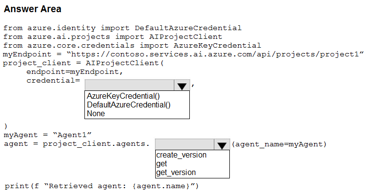

_HOTSPOT — the original ExamTopics question expects you to mark areas on the exhibit above; the correct hotspot coordinates are not published._

**Correct answer:** Not provided by ExamTopics
**Most voted:** (1) DefaultAzureCredential | Security & Compliance Requirement: | "API keys must NOT be used to access Foundry-deployed models." | "The developers at Contoso must authenticate to Microsoft Foundry resources by using Microsoft Entra authentication." | DefaultAzureCredential() integrates with Microsoft Entra ID and honors the RBAC assignments granted to the security group SC_Agent1_Dev. | (2) get | Why not create_version? | create_version requires specifi...

### Top explanations
- **8ac3742** (1 upvotes [Most Recent]): (1) DefaultAzureCredential
Security & Compliance Requirement:
"API keys must NOT be used to access Foundry-deployed models."
"The developers at Contoso must authenticate to Microsoft Foundry resources by using Microsoft Entra authentication."
DefaultAzureCredential() integrates with Microsoft Entra ID and honors the RBAC assignments granted to the security group SC_Agent1_Dev.
(2) get
Why not create_version?
create_version requires specification of model deployments, instructions, and tools to construct a new revision. It is an authoring method, not a retrieval method.

## Q1.69 (ID 421515)

You have a Microsoft Foundry project that contains a Retrieval Augmented Generation (RAG) chat solution used by customer support agents.
You are adding an automated pre-production evaluation step to a CI/CD pipeline named Pipeline1. The evaluation will run against a labeled test dataset that contains support questions and the expected grounding context.
You need to ensure that Pipeline1 fails if unsupported content or a retrieval mismatch exceeds a defined threshold:
•	responses include claims not supported by the retrieved source content
•	retrieved source content does not align with the labeled expected context
Which two built-in evaluators should you use in Pipeline1? Each correct answer presents pat of the solution.
NOTE: Each correct selection is worth one point.

✅ **A.** Retrieval
⭕ **B.** Fluency
⭕ **C.** Coherence
✅ **D.** Groundedness
⭕ **E.** Response Completeness

**Correct answer:** A, D
**Most voted:** AD

### Top explanations
- **8ac3742** (2 upvotes [Selected Answer: AD]): Groundness and retrieval
Requirement 1: "responses include claims not supported by the retrieved source content"
Evaluated by D. Groundedness (GroundednessEvaluator)
Requirement 2: "retrieved source content does not align with the labeled expected context"
Evaluated by A. Retrieval : Compares the chunks/documents retrieved by the system against the ground-truth expected context in the labeled test dataset to ensure the search component fetches the correct grounding data.
Notes tell about retrieval and coherence/fluence
Below is the examples of coherence/fluence
(1)High Fluency, Low Coherence
"It was pouring rain outside. Therefore, she put on her favorite sunglasses and went swimming in the lake to stay dry."
Coherence: Low (1/5) — It makes no logical sense. Rain does not lead to wearing sunglasses, and swimming in a lake will not keep you dry.
(2)High Coherence, low Fluency
"Rain heavy fall sky. Girl take umbrella. Water no wet coat."
- **8ac3742** (1 upvotes): translate "compares the chunks/documents retrieved by the system against the ground-truth expected context in the labeled test dataset"
for example, in the test dataset for evaluation,
for question " what is the counterparty of trade A"?
the expected context: chunk = B, RBC
If retrieval returns : chuck = A, the settlement date = 2026-10-10
Then the retrieval evaluation failed
- **Amelia233** (1 upvotes [Most Recent, Selected Answer: A]): For a RAG chat solution, the two requirements map directly to these evaluators:
A. Retrieval ✅ → Checks whether the retrieved source content matches the expected/labeled context.
D. Groundedness ✅ → Checks whether the response claims are supported by the retrieved source content.
The other options measure different aspects:
B. Fluency → Measures how naturally and clearly the response is written.
C. Coherence → Measures whether the response is logical and consistent.
E. Response Completeness → Measures whether the response adequately addresses the question.
👉 Final Answer: A. Retrieval + D. Groundedness

## Q1.70 (ID 421516)

You have a Microsoft Foundry project that contains a support-ticket triage agent built by using the Foundry Agent Service.
The agent uses tool to classify the ticket type and sot the ticket priority.
Sometimes, the same support case continues across multiple sessions over several days.
You need to persist state by using a durable ID to ensure that the agent can automatically reuse the full interaction history. The solution must preserve previous user messages, tool calls and tool outputs across turns and sessions.
Which runtime component should you use?

⭕ **A.** output item
⭕ **B.** agent
✅ **C.** conversation
⭕ **D.** response

**Correct answer:** C
**Most voted:** C

### Top explanations
- **Amelia233** (2 upvotes [Most Recent, Selected Answer: C]): A Conversation in Microsoft Foundry Agent Service provides a durable ID that allows the agent to persist and reuse interaction history across multiple turns and sessions.
It preserves:
Previous user messages
Tool calls
Tool outputs
Interaction history across sessions
A. Output item ❌ → Represents an individual piece of generated output.
B. Agent ❌ → Defines the agent and its capabilities.
C. Conversation ✅ → Maintains the persistent interaction state.
D. Response ❌ → Represents a single response from the agent.
Final Answer: C. Conversation

## Q1.71 (ID 421517)

HOTSPOT
You have a Microsoft Founcy project that contains a Retrieval Augmented Generation (RAG) solution.
You need to run a pre-production evaluation by using labeled CSV dataset that contains the query, context, response and ground truth. The evaluation must measure the following:
•	Whether responses address the user query
•	Whether responses are supported by the provided context
•	Whether responses contain sensitive or proprietary information
Which AI quality evaluation metrics should you use? To answer, select the appropriate options in the answer area.
NOTE: Each correct selection is worth one point.

**Exhibits**
- Exhibit 1: 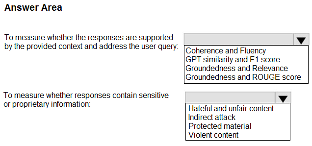

_HOTSPOT — the original ExamTopics question expects you to mark areas on the exhibit above; the correct hotspot coordinates are not published._

**Correct answer:** Not provided by ExamTopics
**Most voted:** Correct Metrics | Whether responses address the user query → Response Completeness | Whether responses are supported by the provided context → Groundedness | Whether responses contain sensitive or proprietary information → Content Safety | 👉 Final Answer: | Response Completeness + Groundedness + Content Safety

### Top explanations
- **8ac3742** (1 upvotes): (1)To measure whether the responses are supported by the provided context and address the user query:
Groundedness and Relevance
(2)To measure whether responses contain sensitive or proprietary information:
Protected material
- **Amelia233** (1 upvotes [Most Recent]): Correct Metrics
Whether responses address the user query → Response Completeness
Whether responses are supported by the provided context → Groundedness
Whether responses contain sensitive or proprietary information → Content Safety
👉 Final Answer:
Response Completeness + Groundedness + Content Safety

## Q1.72 (ID 421518)

You plan to configure an evaluation in Microsoft Foundry for a Retrieval Augmented Generation (RAG) chat app.
You need to provide scores for groundedness, relevance, and harmful content categories.
Which two evaluation categories can you use? Each correct answer presents a complete solution.
NOTE: Each correct selection is worth one point.

✅ **A.** risk and safety metrics
⭕ **B.** fluency evaluator
⭕ **C.** similarity evaluators
⭕ **D.** AI quality (NLP) metrics
✅ **E.** AI quality (AI assisted) metrics

**Correct answer:** A, E
**Most voted:** AE

### Top explanations
- **Srikantha** (4 upvotes [Selected Answer: AE]): The two correct evaluation categories are A. risk and safety metrics and E. AI quality (AI assisted) metrics.
Explanation:
E. AI quality (AI assisted) metrics: This category uses a judge model (such as GPT-4) to measure quality aspects like groundedness and relevance.
A. Risk and safety metrics: This category evaluates harmful content across various severity levels (such as self-harm, hate/unfairness, violence, and sexual content).
- **Amelia233** (3 upvotes [Selected Answer: AD]): Correct Answers: A. Risk and Safety Metrics and D. AI Quality (NLP) Metrics
A. Risk and Safety Metrics ✅ → Used to evaluate harmful content categories and safety risks.
D. AI Quality (NLP) Metrics ✅ → Used to measure groundedness and relevance of responses.
Why not the others?
B. Fluency evaluator → Measures how naturally the response is written.
C. Similarity evaluators → Focus on similarity between responses/reference content.
E. AI Quality (AI-assisted) metrics → Uses AI-based evaluation for certain quality dimensions, but the question specifically maps groundedness/relevance and harmful content to the two categories above.
👉 Final Answer: A and D.
- **8ac3742** (1 upvotes [Selected Answer: AE]): The two correct evaluation categories are:
A. risk and safety metrics
E. AI quality (AI assisted) metrics
Why "AI assisted" and NOT "NLP"?
Microsoft Foundry categorizes evaluation metrics into distinct buckets:
AI quality (AI assisted) metrics:
These use an LLM (such as GPT-4o) as an automated judge to reason over unstructured inputs and context.
(NLP) metrics are traditional, deterministic mathematical string-matching and overlap formulas.They cannot assess complex semantic concepts like groundedness or contextual relevance.
- **CRdumps** (1 upvotes [Most Recent]): D. AI quality (NLP) metrics: These are traditional text-overlap metrics such as F1, BLEU, GLEU, ROUGE, and METEOR. They require ground truth and don’t provide groundedness, relevance, or safety scoring.
I do not think D is a good answer

## Q1.73 (ID 421519)

You have a Microsoft Foundry project that contains an agent. The agent uses two tools to perform the following actions:
•	Use Azure AI Search to retrieve answers from a private product documentation index.
•	Use the web search tool to retrieve public information on the internet.
You need to ensure that for a specific run, the agent deterministically retrieves information only from the internet.
To what should you set tool_choice?

✅ **A.** {“type”: “bing_grouding”}
⭕ **B.** {“type”: “azure_ai-search”}
⭕ **C.** “auto”
⭕ **D.** “required”

**Correct answer:** A
**Most voted:** A

### Top explanations
- **Amelia233** (1 upvotes [Most Recent, Selected Answer: A]): Correct Answer: A. {“type”: “bing_grounding”}
To ensure the agent deterministically uses only the internet for a specific run, set tool_choice to the Bing grounding/web search tool.
A. {"type": "bing_grounding"} ✅ → Forces the agent to use internet search.
B. {"type": "azure_ai-search"} ❌ → Uses the private Azure AI Search index.
C. "auto" ❌ → Allows the model to decide which tool to use.
D. "required" ❌ → Requires a tool to be used but does not specify which tool.
Final Answer: A. {"type": "bing_grounding"}

## Q1.74 (ID 421520)

You have a Microsoft Foundry project that contains a customer support agent built on a deployed chat model.
The agent responses are validated by using an automated testing system that compares generated answers to stored expected outputs. Identical prompts must return consistent response to prevent automated test failures.
You need to reduce response variability, without modifying the prompt or reducing factual accuracy.
What should you do for the model?

⭕ **A.** Increase the max_tokens parameter.
⭕ **B.** Remove stop sequences from the requests.
✅ **C.** Decrease the temperature parameter.
⭕ **D.** Increase the temperature parameter.

**Correct answer:** C
**Most voted:** C

### Top explanations
- **Amelia233** (1 upvotes [Most Recent, Selected Answer: C]): The temperature controls how much variability or randomness the model uses when generating responses. A lower temperature makes the model more deterministic and consistent.
A. Increase max_tokens ❌ — Controls response length, not variability.
B. Remove stop sequences ❌ — Does not directly reduce randomness.
C. Decrease temperature ✅ — Produces more consistent responses.
D. Increase temperature ❌ — Makes responses more varied and unpredictable.
✅ Answer: C. Decrease the temperature parameter.

## Q1.75 (ID 421521)

You are developing prompts for a Micosoft Foundry project that classifies incoming support tickets by category.
You need to improve accuracy by showing the model how correct classifications look, without retaining the model or storing knowledge permanently.
Which prompt engineering approach should you use?

⭕ **A.** Retrieval Augmented Generation (RAG)
⭕ **B.** zero-shot learning
⭕ **C.** chain of thought
✅ **D.** few-shot learning

**Correct answer:** D
**Most voted:** D

### Top explanations
- **8ac3742** (1 upvotes [Selected Answer: D]): "Showing the model how correct classifications look" means providing input-output demonstration examples directly within the prompt.
"Without retraining the model or storing knowledge permanently" describes in-context learning.
The examples live strictly within the prompt context window of that specific API call; the underlying model weights are not altered or fine-tuned, and no permanent state is kept.
Do not choose zero-shot learning: Provides only instructions and the input data without any example demonstrations of the expected output format or classification
- **Amelia233** (1 upvotes [Most Recent, Selected Answer: D]): Option D: few-shot learning is correct.
Few-shot learning provides concrete input-output examples inside the prompt to demonstrate classification patterns without needing model fine-tuning or permanent storage.

## Q1.76 (ID 421522)

You have a Microsoft Foundry project that contains an agent for a customer support chat app. The agent uses a memory store and a memory search tool.
You need to ensure that the conversation history does NOT persist across separate sessions.
To what should you set the scope of the memory tool?

⭕ **A.** session
✅ **B.** {{$conversationId}}
⭕ **C.** {{$userId}}
⭕ **D.** global

**Correct answer:** B
**Most voted:** B

### Top explanations
- **acon** (5 upvotes [Most Recent, Selected Answer: B]): This gives each conversation its own memory scope, preventing history from being shared across separate sessions. A literal session value would be a shared static scope. Microsoft Learn (https://learn.microsoft.com/en-us/azure/ai-foundry/agents/how-to/memory-usage)
- **8ac3742** (1 upvotes [Selected Answer: A]): tell about session and conversation(chat)
You open ChatGPT or your customer support chat portal (Session starts).
You have one chat
You click "New Chat" (Conversation 1 ends, Conversation 2 starts).
Both happened inside the exact same login Session.
- **Amelia233** (1 upvotes [Selected Answer: A]): The memory tool scope should be set to session when you want conversation history to remain available only during the current session and not persist across separate sessions.
A. Session ✅ → Memory is limited to the current session.
B. {{$conversationId}} ❌ → Ties memory to a specific conversation, but the requirement specifically calls for session-level isolation.
C. {{$userId}} ❌ → Allows memory to persist for the same user across sessions.
D. Global ❌ → Makes memory available broadly rather than limiting it to one session.
Final Answer: A. Session

## Q1.77 (ID 421523)

DRAG DROP
You have a Microsoft Foundry project that contains an agent.
You need to enable long-term memory to ensure that the agent can recall user preferences across separate conversations. Stored memories must be isolated per authenticated user without the client application manually generating user IDs.
How should you complete the Python code? To answer, drag the appropriate values to the correct targets. Each value may be used once, more than once, or not at all.
NOTE: Each correct selection is worth one point.

**Exhibits**
- Exhibit 1: 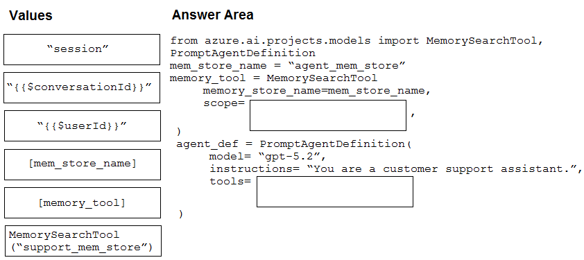

_DRAG DROP — the original ExamTopics question expects you to drag and drop items; the correct targets are not published._

**Correct answer:** Not provided by ExamTopics
**Most voted:** The correct values are: | scope= → "{{$userId}}" | tools= → [memory_tool] | Explanation: | {{$userId}} ensures that each authenticated user has a separate memory scope. This allows the agent to remember user preferences across different conversations without mixing one user's memories with another user's data.

### Top explanations
- **Amelia233** (1 upvotes [Most Recent]): The correct values are:
scope= → "{{$userId}}"
tools= → [memory_tool]
Explanation:
{{$userId}} ensures that each authenticated user has a separate memory scope. This allows the agent to remember user preferences across different conversations without mixing one user's memories with another user's data.

## Q1.78 (ID 421524)

You have a web app named App1 that processes user prompts by integrating with a Microsoft Foundry project named Project1. App1 performs the following actions:
•	Sends prompts directly to a model by using the Azure OpenAI Responses API
•	Invokes the Azure AI Content Safety tool by using a Foundry connection within the same request
You need to configure end-to-end visibility into each step of the request workflow.
What should you do?

⭕ **A.** Enable logging by using the client SDK for Content Safety.
⭕ **B.** Enable logging by using Foundry Local.
✅ **C.** Enable application tracing in Project1.
⭕ **D.** Route requests through the Azure OpenAI endpoint.

**Correct answer:** C
**Most voted:** C

### Top explanations
- **Amelia233** (1 upvotes [Most Recent, Selected Answer: C]): Application tracing provides end-to-end visibility into the request, including model and tool calls.
This is especially useful for troubleshooting, monitoring, and understanding how requests move through the application.
A. Content Safety logging ❌ — Focuses on Content Safety rather than the complete workflow.
B. Foundry Local ❌ — Not used for end-to-end application tracing.
C. Application tracing ✅ — Provides visibility across the request workflow.
D. Azure OpenAI endpoint ❌ — The app already uses the API; routing alone doesn't provide full tracing.
Answer: C. Enable application tracing in Project1.

## Q1.79 (ID 421525)

HOTSPOT
You have a Microsoft Foundry project that contains two agents named PolicyWriter and RskReviewer.
PolicyWriter generates daft updates for customer polices, and RiskReviewer reviews the drafts.
In the visual builder, you need to create a workflow that meets the following requirements:
•	Finalizes low-risk updates without manual intervention
•	Ensures predictable execution across the agents
•	Requires user approval for highs updates
What should you configure? To answer, select the appropriate options in the answer area.
NOTE: Each comet selection is worth one point.

**Exhibits**
- Exhibit 1: 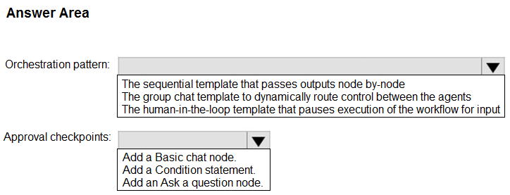

_HOTSPOT — the original ExamTopics question expects you to mark areas on the exhibit above; the correct hotspot coordinates are not published._

**Correct answer:** Not provided by ExamTopics
**Most voted:** Orchestration pattern The sequential template that passes outputs node-by-node | Approval checkpoints Add an Ask a question node

### Top explanations
- **ExamProAzure** (9 upvotes [Highly Voted]): Orchestration pattern	The sequential template that passes outputs node-by-node
Approval checkpoints	Add an Ask a question node
- **8ac3742** (5 upvotes): Orchestration pattern is the sequential template that passes outputs node-by-node
Key requirement: "Ensures predictable execution across the agents" and "PolicyWriter generates draft updates... and RiskReviewer reviews the drafts."
A sequential template defines a strict, deterministic pipeline: PolicyWriter runs first to generate the draft, passing its output directly to RiskReviewer.
Why not "group chat"? The prompt specifically rules out dynamic routing: a group chat dynamically decides which agent speaks next using an LLM coordinator, which makes execution non-deterministic and unpredictable.
Why not "human-in-the-loop template"? The question asks for the overall orchestration pattern across the two agents. Low-risk updates must execute automatically without manual intervention, while human review is handled downstream via a branch checkpoint.
Why not "human-in-the-loop template"? The question asks for the overall orchestration pattern across the two agents. Low-risk updates must execute automatically without manual intervention, while human review is handled downstream via a branch checkpoint
- **Srikantha** (5 upvotes): nswer Key
Orchestration pattern: The sequential template that passes outputs node by-node
Approval checkpoints: Add a Condition statement.
- **jwlnewsome** (4 upvotes): Orchestration pattern: The sequential template that passes outputs node by-node
Approval checkpoints: Add a Condition statement.
Predictable execution across the agents requires a Sequential orchestration pattern, where PolicyWriter → RiskReviewer execute in a fixed order and outputs are passed between nodes.
Finalize low-risk updates without manual intervention and require user approval for high-risk updates requires evaluating the risk score/review outcome and branching accordingly. This is done with a Condition node:
If risk = Low → finalize automatically.
If risk = High → route to a human approval step.
- **mhussey79** (1 upvotes [Most Recent]): Orchestration pattern	Human-in-the-loop template	Sequential template
Approval checkpoints	Add a Condition statement	Add an Ask a question node

## Q1.80 (ID 421526)

You have a Microsoft Foundry project that contains an agent named Agent1.
Agent runs successful, but Foundry Control Plane does NOT display values for error rates, runs, and token usage, and the Traces tab is empty.
You need to ensure that Found Control Plane displays the appropriate values for Agent1.
What should you do?

⭕ **A.** Update Agent1 to a new version.
⭕ **B.** Restart Agent from Foundry Control Plan
⭕ **C.** Assign to a Log Analytics workspace to Agent1.
✅ **D.** Enable Application Insights for Agent1.

**Correct answer:** D
**Most voted:** D

### Top explanations
- **Amelia233** (1 upvotes [Most Recent, Selected Answer: D]): Correct Answer: D. Enable Application Insights for Agent1.
Enable Application Insights to collect Agent1’s runs, errors, token usage, and traces.
It provides the telemetry needed to display monitoring information in the Foundry Control Plane.

## Q1.81 (ID 421527)

You have a Microsoft Foundry project that contains an agent.
The agent uses Azure Content Understanding in Foundry Too to process vendor onboarding packets. The packs include digital PDFs that contain tables and hyperlinks.
The extracted content is indexed for search and provided to a downstream agent in the Markdown format.
You need to generate a Markdown output that has a layout and a semantic structure optimized for Retrieval Augmented Generation (RAG) workflows.
Which built-in analyzer should you use?

⭕ **A.** prebuilt-documentFieldSchema
✅ **B.** prebuilt-documentSearch
⭕ **C.** prebuilt-read
⭕ **D.** prebuilt-layout

**Correct answer:** B
**Most voted:** B

### Top explanations
- **mmpurnel** (2 upvotes [Selected Answer: D]): The prebuilt-layout analyzer is designed to:
Preserve document structure
Extract headings, sections, tables, paragraphs, and hyperlinks
Maintain reading order
Produce Markdown output suitable for downstream RAG and search scenarios
Handle complex PDFs with multi-column layouts and tables
This makes it the preferred analyzer for converting PDF content into semantically structured Markdown for indexing and retrieval workflows.
- **a5f05ea** (2 upvotes [Selected Answer: B]): Answer: B. prebuilt-documentSearch ✅
prebuilt-documentSearch is specifically a RAG analyzer, optimized for retrieval-augmented generation scenarios. It performs semantic analysis and produces structured Markdown suitable for document ingestion, search applications, and knowledge bases.
Why not the others?
A.prebuilt-documentFieldSchema: focused on schema/field extraction rather than RAG-ready document representation.
C.prebuilt-read: primarily basic text/OCR extraction.
D.prebuilt-layout: extracts layout elements such as words, paragraphs, figures, and tables, but isn't the analyzer specifically optimized for RAG.
- **Srikantha** (2 upvotes [Selected Answer: B]): . prebuilt-documentSearch
Explanation:
prebuilt-documentSearch: This is a dedicated RAG analyzer in Azure Content Understanding that extracts content from documents (such as PDFs with tables and links) while maintaining layout preservation, table detection, and structured Markdown output optimized specifically for downstream RAG and agent workflows.
Other options: prebuilt-read provides basic OCR without layout analysis; prebuilt-layout focuses primarily on general document structure rather than being the specific prebuilt RAG search analyzer; prebuilt-documentFieldSchema is a utility analyzer used for proposing field schemas rather than extracting content for search.
- **Amelia233** (2 upvotes [Selected Answer: D]): Correct Answer: D. prebuilt-layout
prebuilt-layout extracts document content while preserving layout and semantic structure, including tables and hyperlinks. This makes the Markdown output better suited for RAG workflows.
- **centri** (1 upvotes [Most Recent, Selected Answer: B]): prebuilt-documentSearch is optimised for RAG by parsing content of the PDF and creating markdown outputs which can be used as input in RAG developments. The other closest answer prebuilt-layout preserves the layout of the PDF document but is not optimised for RAG operations

## Q1.82 (ID 421528)

You have a Microsoft Foundry project that contains an agent.
The agent uses Azure AI Search for Retrieval Augmented Generation (RAG).
You plan to ingest and index PDF product manuals.
You need to build a solution that supports semantic similarity matching. The solution must ensure that the agent retrieves relevant data when user questions use different wording than the product manuals.
Which indexing approach should you use?

✅ **A.** vector search
⭕ **B.** semantic ranking
⭕ **C.** suggesters
⭕ **D.** analyzers

**Correct answer:** A
**Most voted:** A

### Top explanations
- **8ac3742** (1 upvotes [Selected Answer: A]): answer is vector search not semantic rank
"Which indexing approach should you use?"
Semantic ranking (Option B) is a query-time re-ranking feature (L2 ranker) applied to results after an initial search executes. It is not an indexing approach at all,its A query-side capability that evaluates the top 50 search results using cross-encoder models to reorder and produce semantic captions/answers.
Vector search (Option A) is the fundamental indexing approach that generates and indexes high-dimensional mathematical representations (embeddings) of text. It captures meaning and conceptual intent rather than exact keywords, ensuring match retrieval when users express questions in different wording than the manuals.
- **Amelia233** (1 upvotes [Most Recent, Selected Answer: A]): Correct answer: A. Vector search
Explanation: Vector search converts text into numerical embeddings and finds content based on meaning and semantic similarity, not just exact keywords. This allows the agent to retrieve relevant information even when the user's question uses different wording from the PDF manuals.

## Q1.83 (ID 421529)

You have a Microsoft Foundry agent that grounds responses from an Azure Search index that contains the following:
•	Searchable text fields for product names and product codes
•	A vector field that stores embeddings for product descriptions
You need to ensure that users can query the index by using the following:
•	Exact product names or codes
•	Natural language descriptions of the products
What should you configure?

⭕ **A.** vector search only
✅ **B.** hybrid search
⭕ **C.** keyword search only
⭕ **D.** semantic search only

**Correct answer:** B
**Most voted:** B

### Top explanations
- **Amelia233** (2 upvotes [Most Recent, Selected Answer: B]): Hybrid search combines keyword search and vector search, allowing users to search with both exact terms and natural language.
Exact product names/codes → Keyword search
Natural language descriptions → Vector search
👉 Final Answer: B. Hybrid Search
- **8ac3742** (1 upvotes [Selected Answer: B]): hybrid of keyword search and vector search(embedding search)

## Q1.84 (ID 421530)

You have an Azure AI Search indexer that ingests PDF policy manuals.
Client applications must display page-level citations that have bounding polygons for both text and images.
You need to add a single built-in multimodal content extraction skill to the Azure AI Search skillset. The solution must meet the following requirements:
•	Provide text and image location metadata.
•	Extract tables that span multiple pages.
What should you add?

⭕ **A.** Document Extraction
⭕ **B.** Azure Content Understanding in Foundry Tools
⭕ **C.** GenAI Prompt
✅ **D.** Document Layout

**Correct answer:** D
**Most voted:** D

### Top explanations
- **Srikantha** (3 upvotes [Most Recent, Selected Answer: B]): B. Azure Content Understanding in Foundry Tools
Explanation:
Azure Content Understanding: This skill combines layout-aware extraction, image and text location metadata, and advanced structural support for extracting complex elements like cross-page tables as single semantic units.
- **a5f05ea** (2 upvotes [Selected Answer: D]): document layout skill to extract text, images, bounding polygons, and multi-page tables.
Azure content understanding doesn't output individual bounding polygons.
- **8ac3742** (2 upvotes [Selected Answer: D]): Notes Azure AI Search does not have to call Azure Content Understanding to create or store an index. Calling Content Understanding (or Document Intelligence) is entirely optional.
- **Amelia233** (2 upvotes [Selected Answer: D]): The Document Layout skill can extract text, images, tables, and their location metadata, including bounding polygons. It also supports tables that span multiple pages, making it suitable for page-level citations in PDF documents.
In short: Text + images + bounding polygons + multi-page tables → Document Layout
✅ Answer: D. Document Layout
- **a5f05ea** (1 upvotes [Selected Answer: B]): The deciding requirement is:
“Extract tables that span multiple pages.”
Document Layout does satisfy much of the first requirement. It supports text/image extraction and provides location metadata for images.
But the question deliberately adds the cross-page table requirement. Microsoft's comparison specifically identifies recognition of a table spanning multiple pages as an advantage of Azure Content Understanding over Document Layout.

## Q1.85 (ID 421531)

You are building an Azure AI Search indexing pipeline named Pipeline1 that ingests invoices stored in Azure Blob Storage. The invoices are stored as scanned images.
You need to enable users to search invoice data across the invoice fields.
Which built-in skill should you add to the skillset of Pipeline1?

⭕ **A.** Text Split
⭕ **B.** Text Translation
✅ **C.** optical character recognition (OCR)
⭕ **D.** Image Analysis

**Correct answer:** C
**Most voted:** C

### Top explanations
- **8ac3742** (1 upvotes [Selected Answer: C]): The invoices are stored as scanned images (e.g., TIFF, JPEG, or image-only files).   In raw image files, there is no selectable text layer for Azure AI Search to read, so you have to choose OCR
- **Amelia233** (1 upvotes [Most Recent, Selected Answer: C]): Correct Answer: C. Optical Character Recognition (OCR)
OCR extracts text from scanned invoice images, allowing the extracted invoice fields to become searchable in Azure AI Search.
A. Text Split → Splits existing text into smaller sections.
B. Text Translation → Translates text into another language.
C. OCR ✅ → Extracts text from scanned images.
D. Image Analysis → Analyzes visual content but isn't the best choice for extracting searchable invoice text.

## Q1.86 (ID 421532)

DRAG DROP
You have a Microsoft Foundry project that uses Azure Content Understanding in Foundry Tools to analyze marketing videos.
Video segmentation is enabled.
You need to configure an analyzer to output a generated JSON field that describes the color scheme of each video segment.
How should you configure the analyzer? To answer, drag the appropriate values to the correct targets. Each value may be used once, more than once, or not at all. You may need to drag the split bar between panes or scroll to view content.
NOTE: Each correct selection is worth one point.

**Exhibits**
- Exhibit 1: 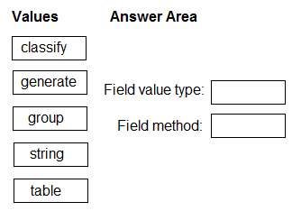

_DRAG DROP — the original ExamTopics question expects you to drag and drop items; the correct targets are not published._

**Correct answer:** Not provided by ExamTopics
**Most voted:** Answer | Field value type: string | Field method: generate | Short discussion: | Use string because the generated JSON field contains a textual description of the color scheme. Use generate because the analyzer needs to create this description automatically for each video segment.

### Top explanations
- **8ac3742** (1 upvotes): generate: Uses a generative AI model to synthesize, describe, summarize, or reason over content (ideal for visual descriptions like describing a scene's color scheme).
classify: Categorizes content into a fixed, predefined set of categories or enum options.
- **Amelia233** (1 upvotes [Most Recent]): Answer
Field value type: string
Field method: generate
Short discussion:
Use string because the generated JSON field contains a textual description of the color scheme. Use generate because the analyzer needs to create this description automatically for each video segment.

## Q1.87 (ID 421533)

You have an invoice-processing application named App1 that uses Azure Constant Understanding in Foundry Tools.
You are building a new Content Understanding pipeline named Pipeline1 that must meet the following requirements:
•	Compare an invoice to its related purchase order
•	Validate the voice against static vendor contact documents
•	Return a single structured output that includes discrepancy findings
You need to configure Pipeline1 and expose the pipeline as a single analyzer endpoint. What should you configure?

⭕ **A.** a single-file task in standard mode that uses the vendor contract provided as an additional document during analysis.
⭕ **B.** a single-file task in standard mode that uses confidence scores enabled for the extracted fields.
✅ **C.** a multiple-file task in pro mode that uses the vendor contract files as reference data
⭕ **D.** a multi-file task in standard mode that uses the invoice and purchase order as input to the analyzer

**Correct answer:** C
**Most voted:** C

### Top explanations
- **Amelia233** (2 upvotes [Most Recent, Selected Answer: C]): Correct answer: C. A multiple-file task in Pro mode that uses the vendor contract files as reference data.
A multiple-file task is required because the pipeline must compare the invoice with its purchase order. Pro mode supports using reference data, allowing the analyzer to validate vendor information against static vendor documents and return the discrepancies in one structured output.
- **8ac3742** (1 upvotes [Selected Answer: C]): In Content Understanding architecture, the invoice and the purchase order are the transaction-specific runtime inputs provided to the multiple-file task payload when calling the analyzer endpoint.
The static vendor contract documents represent the persistent reference data configured in the analyzer schema.
Option C defines the task architecture: "a multiple-file task in pro mode that uses the vendor contract files as reference data."

## Q1.88 (ID 421534)

You have a Microsoft Foundry project that generates  short promotional product videos.
After several clips are approved, reviewers notice a small watermark in the top-right corner of some videos.
You need to remove the watermark without regenerating the videos.
What should you do?

⭕ **A.** Modify the original prompt to exclude watermarks.
⭕ **B.** Crop the video by using the size parameter.
⭕ **C.** Increase the guidance scale.
✅ **D.** Apply a mask-based inpainting edit to the affected part of the video.

**Correct answer:** D
**Most voted:** D

### Top explanations
- **Amelia233** (1 upvotes [Most Recent, Selected Answer: D]): inpainting edit to the affected part of the video.
Short discussion:
Mask-based inpainting allows you to edit a specific area of an existing video. By masking the top-right watermark, you can remove it without regenerating the entire video.
A ❌ modifies the prompt and requires regeneration.
B ❌ cropping changes the video framing.
C ❌ changes generation guidance, not an existing watermark.
D ✅ directly edits the affected area.

## Q1.89 (ID 421535)

You have a web app named App1 that sends requests to a multimodal chat model deployment in a Microsoft Foundry project.
User messages can contain both text and images.
Currently, App1 includes image URL: as plain text inside the message content so the model cannot recognize them as images.
Traces show that the requests contain a single text message instead of a multimodal content array.
You need to send the message as a structured array that includes both the text portion and the image reference to ensure that the model can process the image correctly.
What should you do?

✅ **A.** Set the user message content array to include items that have type: text and type: image_url.
⭕ **B.** Encode the image to base64 and include the encoded data inside the content string of the user message.
⭕ **C.** Add the image URL to the request metadata section, so the model can resolve the processing issue automatically.
⭕ **D.** Place the image URL inside the System Message and set type to image_url so the model loads the image at initialization.

**Correct answer:** A
**Most voted:** A

### Top explanations
- **Amelia233** (2 upvotes [Most Recent, Selected Answer: A]): Correct answer: A. Set the user message content array to include items that have type: text and type: image_url.
Multimodal chat models require the user message to use a structured content array. The array should contain separate items for the text and image, such as type: "text" and type: "image_url".
A ✅ Correct — enables the model to recognize and process both text and images.
B ❌ Not necessary when using the image_url content type.
C ❌ Metadata does not provide image content to the model.
D ❌ Images should be included in the user content, not the system message.

## Q1.90 (ID 421536)

You are building a customer support web app named App1 in Microsoft Foundry that uses a GPT realtime model.
App1 must support:
•	Live, low-latency voice conversations that use Azure OpenAI
•	Streaming audio input from users and playback audio responses
You need to configure a connection method that supports real-time audio streaming in client application and targets approximately 100 ms latency.
Which connection method should you use?

⭕ **A.** RTMP
✅ **B.** WebRTC
⭕ **C.** SIP
⭕ **D.** WebSocket

**Correct answer:** B
**Most voted:** B

### Top explanations
- **MarceloManhaes** (4 upvotes [Selected Answer: B]): The correct response should be letter B. WebRTC has low latency than WebSocket. Source: https://learn.microsoft.com/en-us/azure/foundry/openai/how-to/realtime-audio
- **8ac3742** (1 upvotes [Selected Answer: B]): Targeting sub-second ultra-low latency (~100 ms): The GPT Realtime API supports two transport mechanisms: WebSocket and WebRTC.
WebRTC operates primarily over UDP (via SRTP)
WebSockets run over TCP. Packet loss requires TCP retransmission, introducing jitter and latency spikes well above 100 ms for streaming raw interactive voice over consumer network connections.
- **Wella_** (1 upvotes [Most Recent, Selected Answer: B]): WebRTC - Correct answer
WebSocket supports real-time bidirectional data, but WebRTC is the recommended method for browser-based real-time audio streaming with GPT Realtime.

## Q1.91 (ID 421537)

You have a Microsoft Foundry project that contains an agent and uses a GitHub repository. The repository contains a YAM file named File1 that defines the evaluation settings of the agent.
You need to create a GitHub Actions workflow that runs the evaluation defined in File1 when a pull request (PR) is opened. How should you configure the workflow?

⭕ **A.** Set project-endpoint to the endpoint of the project.
✅ **B.** Set evaluation-config to the path of the YAML file.
⭕ **C.** Set model-deployment-name to the deployed model.
⭕ **D.** Set tenant-id to the Microsoft Entra tenant ID

**Correct answer:** B
**Most voted:** B

### Top explanations
- **VikashDubey** (3 upvotes [Most Recent, Selected Answer: B]): Evaluation is defined in a YAML file” → point the workflow to that YAML configuration.
- **ExamProAzure** (2 upvotes [Selected Answer: B]): The question says File1 is a YAML file that already defines the evaluation settings, and the GitHub Actions workflow needs to run that specific evaluation when the PR opens.

## Q1.92 (ID 421538)

HOTSPOT
You have a Microsoft Foundry project that contains an agent.
The agent uses a stored access key to retrieve secrets from an Azure key vault, which violates a keyless-credentials requirement.
You need to ensure that the agent can retrieve the secrets. The solution must follow the principle of least privilege.
What should you configure? To answer, select the appropriate options in the answer area.
NOTE: Each correct selection is worth one point.

**Exhibits**
- Exhibit 1: 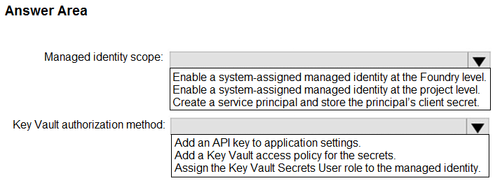

_HOTSPOT — the original ExamTopics question expects you to mark areas on the exhibit above; the correct hotspot coordinates are not published._

**Correct answer:** Not provided by ExamTopics
**Most voted:** Correct selections | Managed identity scope: ✅ Enable a system-assigned managed identity at the project level | Key Vault authorization method: ✅ Assign the Key Vault Secrets User role to the managed identity | Use a project-level managed identity so the agent can access Azure resources without storing credentials. Assign only the Key Vault Secrets User role, following the least-privilege principle.

### Top explanations
- **Amelia233** (2 upvotes [Most Recent]): Correct selections
Managed identity scope: ✅ Enable a system-assigned managed identity at the project level
Key Vault authorization method: ✅ Assign the Key Vault Secrets User role to the managed identity
Use a project-level managed identity so the agent can access Azure resources without storing credentials. Assign only the Key Vault Secrets User role, following the least-privilege principle.

## Q1.93 (ID 421539)

HOTSPOT
You have a Microsoft Foundry project that contains a customer support application.
You create an evaluation named Run1 that has the following configurations:
•	Includes risk and safety metrics
•	Includes the protected material evaluation
•	Includes harmful content metrics that use a medium severity threshold
You create an evaluation named Run2 that has the following configurations:
•	Includes risk and safety metrics
•	Includes the protected material evaluation
•	Includes harmful content metrics that use a high severity threshold
You run both evaluations against a dataset named DB1 and receive the following results:
•	Content harm defect rate of Run1: 12%
•	Content harm defect rate of Run2: 4%
•	Protected material evaluation of Run1: 6%
•	Protected material evaluation of Run1: 6%
You start a fine-tuning job by using DB1. The job fails during automatic RAI checks for multiple content harm types.
You discover that the content filtering configuration is set to high severity.
For each of the following statements, select Yes if the statement is true. Otherwise, select No.
NOTE: Each correct selection is worth one point.

**Exhibits**
- Exhibit 1: 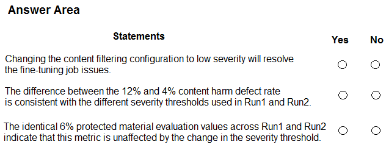

_HOTSPOT — the original ExamTopics question expects you to mark areas on the exhibit above; the correct hotspot coordinates are not published._

**Correct answer:** Not provided by ExamTopics
**Most voted:** correct answer | How Azure Content Safety thresholds work: The threshold sets the cutoff level where content is flagged or blocked. | A High severity threshold is the least restrictive setting (it only flags/blocks High-severity harm). | A Low severity threshold is the most restrictive setting (it flags/blocks Low, Medium, and High-severity harm). | Run2 showed that 4% of DB1 contains High-severity content defects. Because the fine-tuning job already failed under the most permissive setting (...

### Top explanations
- **8ac3742** (1 upvotes): correct answer
How Azure Content Safety thresholds work: The threshold sets the cutoff level where content is flagged or blocked.
A High severity threshold is the least restrictive setting (it only flags/blocks High-severity harm).
A Low severity threshold is the most restrictive setting (it flags/blocks Low, Medium, and High-severity harm).
Run2 showed that 4% of DB1 contains High-severity content defects. Because the fine-tuning job already failed under the most permissive setting (High), tightening the filter to Low would block even more samples (at least 12% or more), causing more failures rather than resolving them. To fix the fine-tuning job, the dataset DB1 itself must be cleaned and remediated to remove the offending content.
- **Amelia233** (1 upvotes [Most Recent]): Correct Answers
Changing the content filtering configuration to low severity will resolve the fine-tuning job issue: No (A low threshold makes filters stricter, triggering more RAI blocks).
The difference between the 12% and 4% content harm defect rate is consistent with the different severity thresholds used in Run1 and Run2: Yes (Medium threshold catches more items than a High threshold).
The identical 6% protected material evaluation values across Run1 and Run2 indicate that this metric is unaffected by the change in the severity threshold: Yes (Protected material detection is independent of content harm severity thresholds).

## Q1.94 (ID 421540)

DRAG DROP
You have a Microsoft Foundry project that contains a multi-agent solution. The agents use tool calling to query internal systems.
You need to implement responsible AI auditing to meet the following requirements:
•	Capture all the nested operations across the entire agent run.
•	Record tool invocation arguments and retuned results as metadata.
What should you use for each requirement? To answer, drag the appropriate options to the correct targets Each option may be used once, more than once, or not at all. You may need o dag the split bar between panes or scroll to view content.
NOTE: Each correct selection is worth one point.

**Exhibits**
- Exhibit 1: 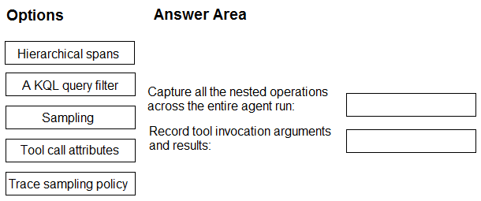

_DRAG DROP — the original ExamTopics question expects you to drag and drop items; the correct targets are not published._

**Correct answer:** Not provided by ExamTopics
**Most voted:** Capture all the nested operations across the entire agent run: Hierarchical spans (Captures parent-child execution flow and nested sub-tasks in open telemetry/tracing). | Record tool invocation arguments and returned results as metadata: Tool call attributes (Attaches tool input arguments and output values as metadata attributes to individual telemetry spans).

### Top explanations
- **Amelia233** (1 upvotes [Most Recent]): Capture all the nested operations across the entire agent run: Hierarchical spans (Captures parent-child execution flow and nested sub-tasks in open telemetry/tracing).
Record tool invocation arguments and returned results as metadata: Tool call attributes (Attaches tool input arguments and output values as metadata attributes to individual telemetry spans).

## Q1.95 (ID 421541)

DRAG DROP
You have a Microsoft Foundry project that contains an agent. The agent uses threads and file uploads and calls an Azure OpenAI model deployment.
During load testing, calls intermittently fall and return an HTTP 429 rate limit exceeded error. Some user uploads fail and generate an HTTP 400 file size exceeded error.
You need to mitigate the errors and reduce call failures. The solution must remain within the service and model limits.
What should you do to resolve each error? To answer, drag the appropriate actions to the correct errors. Each action may be used once, more than once or not at all. You may need to drag the split bar between panes or scroll to view content.
NOTE: Each comet selection is worth one point.

**Exhibits**
- Exhibit 1: 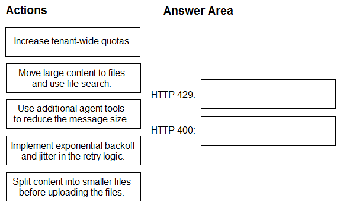

_DRAG DROP — the original ExamTopics question expects you to drag and drop items; the correct targets are not published._

**Correct answer:** Not provided by ExamTopics
**Most voted:** correct answer | Why "Implement exponential backoff and jitter" instead of "Increase tenant-wide quotas"?Look closely at the constraint in the problem statement:"The solution must remain within the service and model limits." HTTP 429 (Rate Limit Exceeded): In high-throughput or load-testing scenarios, temporary request bursts frequently cross TPM (tokens per minute) or RPM (requests per minute) thresholds. The standard architecture pattern to mitigate rate limiti...

### Top explanations
- **8ac3742** (1 upvotes): correct answer
Why "Implement exponential backoff and jitter" instead of "Increase tenant-wide quotas"?Look closely at the constraint in the problem statement:"The solution must remain within the service and model limits."   HTTP 429 (Rate Limit Exceeded): In high-throughput or load-testing scenarios, temporary request bursts frequently cross TPM (tokens per minute) or RPM (requests per minute) thresholds. The standard architecture pattern to mitigate rate limiting while staying strictly within existing service and model limits is client-side retry handling using exponential backoff and jitter.   Simply increasing tenant quotas does not build resiliency against bursting and violates the constraint to stay within the existing limits.
- **Amelia233** (1 upvotes [Most Recent]): Correct Answers
HTTP 429: Implement exponential backoff and jitter in the retry logic. (Standard technique for handling rate limits/throttling without exceeding service quotas).
HTTP 400: Split content into smaller files before uploading the files. (Directly resolves individual file size limits that trigger the HTTP 400 file size exceeded error).

## Q1.96 (ID 421542)

You have a Microsoft Foundry project.
You need to deploy a model from the model catalog to support a search solution for internal policy documents. The model must generate vector representations of the text in the documents and of user queries.
Which type of model should you use?

✅ **A.** an embedding model
⭕ **B.** an image generation model
⭕ **C.** a large language model (LLM)
⭕ **D.** a small language model (SLM)

**Correct answer:** A
**Most voted:** A

### Top explanations
- **Amelia233** (1 upvotes [Most Recent, Selected Answer: A]): Correct answer: A. An embedding model
An embedding model converts documents and user queries into vector representations. These vectors can then be compared to find semantically similar content, making embedding models ideal for search and retrieval solutions.
A ✅ Embedding model — creates text vectors for semantic search.
B ❌ Image generation — creates images.
C ❌ LLM — mainly generates and understands text.
D ❌ SLM — smaller language model, but not specifically designed for embeddings.

## Q1.97 (ID 421543)

You have a Microsoft Foundry project.
You need to deploy a model from the model catalog to support real-time inference. The solution must meet the following requirements:
•	Use key-based authentication.
•	Support real-time REST API access.
•	NOT consume the vCPU quota of the virtual machines in the Azure subscription.
Which type of deployment should you use?

✅ **A.** serverless API
⭕ **B.** batch
⭕ **C.** self-hosted container
⭕ **D.** standard

**Correct answer:** A
**Most voted:** A

### Top explanations
- **Alvarogc** (5 upvotes [Most Recent, Selected Answer: A]): The requirements here are the ones used on the definition of serverless API.
Refference: https://learn.microsoft.com/en-us/azure/foundry-classic/how-to/deploy-models-serverless

## Q1.98 (ID 421544)

HOTSPOT
You plan to create a Microsoft Foundry project named Project1 that will contain an agent and use an Azure key vault named KV1.
You need to configure a connection from Project1 to KV1.
How should you complete the Bicep code? To answer, select the appropriate options in the answer area?
NOTE: Each correct selection is worth one point.

**Exhibits**
- Exhibit 1: 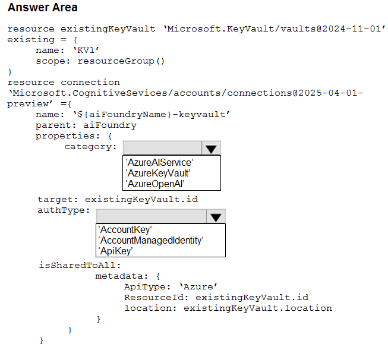

_HOTSPOT — the original ExamTopics question expects you to mark areas on the exhibit above; the correct hotspot coordinates are not published._

**Correct answer:** Not provided by ExamTopics
**Most voted:** Correct Answers | category: 'AzureKeyVault' | Explanation: To connect an existing Key Vault instance to a Microsoft Foundry project, the connection category must be explicitly defined as 'AzureKeyVault'. | authType: 'AccountManagedIdentity' | Explanation: Microsoft Foundry authenticates to Key Vault resources via Azure Managed Identity ('AccountManagedIdentity') using Azure RBAC roles such as Key Vault Secrets Officer.

### Top explanations
- **Amelia233** (2 upvotes [Most Recent]): Correct Answers
category: 'AzureKeyVault'
Explanation: To connect an existing Key Vault instance to a Microsoft Foundry project, the connection category must be explicitly defined as 'AzureKeyVault'.
authType: 'AccountManagedIdentity'
Explanation: Microsoft Foundry authenticates to Key Vault resources via Azure Managed Identity ('AccountManagedIdentity') using Azure RBAC roles such as Key Vault Secrets Officer.

## Q1.99 (ID 421545)

HOTSPOT
You have a Microsoft Foundry project.
You need to create a customer support agent that meets the following requirements:
•	Grounds responses only in company policy documents stored in curated repositories
•	Retains customer preferences across separate chat sessions
How should you configure the agent? To answer, select the appropriate options in the answer area.
NOTE: Each correct selection is worth one point.

**Exhibits**
- Exhibit 1: 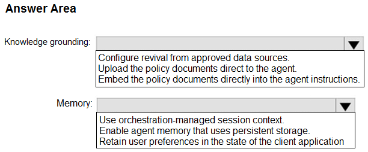

_HOTSPOT — the original ExamTopics question expects you to mark areas on the exhibit above; the correct hotspot coordinates are not published._

**Correct answer:** Not provided by ExamTopics
**Most voted:** correct answer | Requirement: "Grounds responses only in company policy documents stored in curated repositories". The documents are maintained externally in curated repositories. Connecting to the curated repositories via retrieval from approved data sources ensures the agent searches live, managed enterprise stores (such as Azure AI Search or curated Blob containers) rather than copying static files directly into the agent. Why not "Upload the policy documents direct to the a...

### Top explanations
- **8ac3742** (1 upvotes): correct answer
Requirement: "Grounds responses only in company policy documents stored in curated repositories".   The documents are maintained externally in curated repositories. Connecting to the curated repositories via retrieval from approved data sources ensures the agent searches live, managed enterprise stores (such as Azure AI Search or curated Blob containers) rather than copying static files directly into the agent.   Why not "Upload the policy documents direct to the agent": Uploading files directly attaches static copies to the specific agent definition/Assistant tool, which decouples them from the central, curated policy repositories whenever policies get updated.
- **Amelia233** (1 upvotes [Most Recent]): Correct Answers
Knowledge grounding: Configure retrieval from approved data sources. (Typoed as Configure revival... in the option; grounds responses dynamically using enterprise search/RAG over curated repositories rather than hardcoding static instructions or uploading raw files directly into the prompt).
Memory: Enable agent memory that uses persistent storage. (Allows state and user preferences to persist across completely separate chat sessions).

## Q1.100 (ID 421546)

You have a Microsoft Foundry project that contains an agent. The agent generates summaries from retrieved policy documents.
You need to improve response completeness. The solution must be implemented in the logic of the application code before responses are returned.
What should you do?

✅ **A.** Add a retry evaluation before the responses are returned.
⭕ **B.** Decrease the value of the temperature parameter.
⭕ **C.** Increase the value of the presence_penalty parameter
⭕ **D.** Replace the model with a smaller deployment.

**Correct answer:** A
**Most voted:** A

### Top explanations
- **Amelia233** (1 upvotes [Most Recent, Selected Answer: A]): Correct answer: A. Add a retry evaluation before the responses are returned.
A retry evaluation can check whether the generated summary is complete and trigger another generation attempt when necessary. This directly improves response completeness through the application logic.
A ✅ Retry evaluation — checks and improves incomplete responses.
B ❌ Lower temperature mainly makes output more deterministic.
C ❌ Presence penalty affects repetition/new-topic behavior, not completeness.
D ❌ A smaller model generally won't improve completeness.

## Q1.101 (ID 421547)

HOTSPOT
You develop a test method to verify the results retrieved from a call to the Azure Vision in Foundry Tools API. The call is used to analyze the existence of company logos in images. The call returns a collection of brands named brands.
You have the following code segment:
For each of the following statements, select Yes if the statement is true. Otherwise, select No.
NOTE: Each correct selection is worth one point.

**Exhibits**
- Exhibit 1: 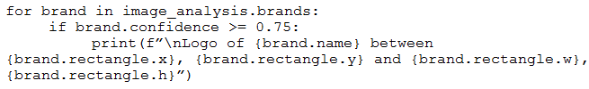
- Exhibit 2: 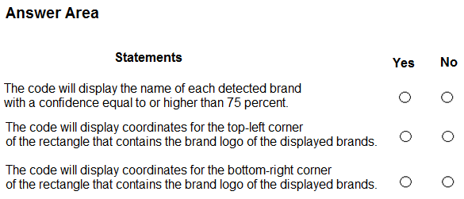

_HOTSPOT — the original ExamTopics question expects you to mark areas on the exhibit above; the correct hotspot coordinates are not published._

**Correct answer:** Not provided by ExamTopics
**Most voted:** Correct Answers | The code will display the name of each detected brand with a confidence equal to or higher than 75 percent: Yes (The if brand.confidence >= 0.75: condition filters and displays only brands with a 75%+ confidence score). | The code will display coordinates for the top-left corner of the rectangle that contains the brand logo of the displayed brands: Yes (In Azure Vision, brand.rectangle.x and brand.rectangle.y represent the top-left corner coordinates of the bounding box).

### Top explanations
- **Amelia233** (1 upvotes [Most Recent]): Correct Answers
The code will display the name of each detected brand with a confidence equal to or higher than 75 percent: Yes (The if brand.confidence >= 0.75: condition filters and displays only brands with a 75%+ confidence score).
The code will display coordinates for the top-left corner of the rectangle that contains the brand logo of the displayed brands: Yes (In Azure Vision, brand.rectangle.x and brand.rectangle.y represent the top-left corner coordinates of the bounding box).

## Q1.102 (ID 421548)

You have an Azure subscription.
You plan to build an app that will use the Azure AI DALL-E model.
You need to deploy the model.
What should you use?

⭕ **A.** the Azure SDK for Python and PowerShell cmdlets.
⭕ **B.** the Azure SDK for JavaScript and Azure Machine Learning Studio.
✅ **C.** Microsoft Foundry and the Azure Command Line Interface (CLI)
⭕ **D.** the Azure portal and Microsoft Graph API

**Correct answer:** C
**Most voted:** C

### Top explanations
- **Srikantha** (1 upvotes [Most Recent, Selected Answer: C]): To deploy an Azure AI model like DALL-E, you must use administrative tools designed for resource provisioning and management. Microsoft Foundry (the unified platform for Azure AI resources) and the Azure CLI handle the infrastructure layer required to create, configure, and manage model deployments within your subscription.
While SDKs (like Python or JavaScript) are used to interact with the model after it is deployed within your application code, they are not the primary tools used for the initial deployment of the model resource itself. Additionally, the Microsoft Graph API is used for interacting with Microsoft 365 data, not Azure AI model deployment.

## Q1.103 (ID 421549)

HOTSPOT
You have an Azure subscription.
You need to create a new resource that will generate fictional stores in response to user prompts. The solution must ensure that the resource uses a customer-managed key to protect data.
How should you complete the script? To answer, select the appropriate options in the answer area.
NOTE: Each correct selection is worth one point.

**Exhibits**
- Exhibit 1: 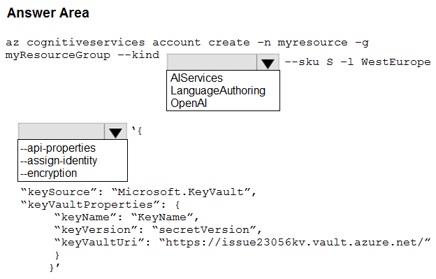

_HOTSPOT — the original ExamTopics question expects you to mark areas on the exhibit above; the correct hotspot coordinates are not published._

**Correct answer:** Not provided by ExamTopics
**Most voted:** Open AI and assign-identity are the correct answers.

### Top explanations
- **mmpurnel** (5 upvotes [Most Recent]): Second one is encryption, not assign-identity.   The provided JSON is a customer-managed key (CMK) configuration using Azure Key Vault.
- **8ac3742** (3 upvotes): OpenAI and encryption
Why --encryption?The requirement states: "ensure that the resource uses a customer-managed key to protect data."   In the az cognitiveservices account create command, the parameter used to specify customer-managed key (CMK) settings backed by Azure Key Vault is --encryption.
- **Alvarogc** (3 upvotes): First one is OpenAI, is the only one that generates free text.
Second one is --encryption, is the property that can receive the JSON on this code; --assign-identity doesn't receive any JSON.
Refference: https://learn.microsoft.com/en-us/cli/azure/cognitiveservices/account?view=azure-cli-latest
- **AIBoss** (2 upvotes): Yes, Second one is --encryption.
https://learn.microsoft.com/en-us/cli/azure/cognitiveservices/account?view=azure-cli-latest#az-cognitiveservices-account-create:~:text=Create%20a%20Text%20Analytics%20Cognitive%20Services%20account%20in%20West%20Europe%20without%20confirmation%20required%20and%20user%20Customer%2Dmanaged%20encryption.
- **AzureGeek79** (1 upvotes): Open AI and assign-identity are the correct answers.

## Q1.104 (ID 421550)

HOTSPOT
You have a Python application collects customer comments before posting them to a public forum.
You need to send a text comment to Azure AI Content Safety and return the self-harm severity from the response.
How should you complete the code? To answer, select the appropriate options in the answer area.
NOTE: Each correct selection is worth one point.

**Exhibits**
- Exhibit 1: 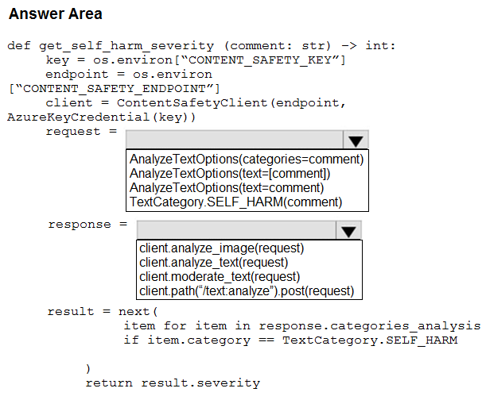

_HOTSPOT — the original ExamTopics question expects you to mark areas on the exhibit above; the correct hotspot coordinates are not published._

**Correct answer:** Not provided by ExamTopics
**Most voted:** Correct Answers | request: AnalyzeTextOptions(text=comment) | response: client.analyze_text(request) | Explanations | request: The AnalyzeTextOptions class takes the input string using the text parameter (e.g., AnalyzeTextOptions(text=comment)). It does not take a list or a category object as the primary argument. | response: To perform text moderation using the ContentSafetyClient in the Azure AI Content Safety Python SDK, call the method client.analyze_text(request).

### Top explanations
- **jwlnewsome** (1 upvotes): request: AnalyzeTextOptions(text=comment)
response: client.analyze_text(request)
https://learn.microsoft.com/en-us/azure/ai-services/content-safety/quickstart-text?tabs=visual-studio%2Cwindows&pivots=programming-language-python
- **8ac3742** (1 upvotes [Most Recent]): why text=comment and not categories=comment? The variable comment is typed as a single string (comment: str).  passing text into categories causes a type mismatch.
- **Amelia233** (1 upvotes): Correct Answers
request: AnalyzeTextOptions(text=comment)
response: client.analyze_text(request)
Explanations
request: The AnalyzeTextOptions class takes the input string using the text parameter (e.g., AnalyzeTextOptions(text=comment)). It does not take a list or a category object as the primary argument.
response: To perform text moderation using the ContentSafetyClient in the Azure AI Content Safety Python SDK, call the method client.analyze_text(request).

## Q1.105 (ID 421551)

You have a custom named entity recognition (NER) project in Azure Language in Foundry Tools for support tickets. The schema for the project contains an entity type named ContactInfo.
In tagged training files, ContactInfo is used for phone numbers, email addresses, and social media handles.
Model evaluation shows low precision for ContactInfo, including false positives in which nearby text is extracted as ContactInfo.
You need to improve the precision of the project.
What should you do before retraining the model?

⭕ **A.** Lower the confidence threshold for ContactInfo.
⭕ **B.** Trigger an auto-labeling job.
⭕ **C.** Add more support tickets as training data and label more ContactInfo entities.
✅ **D.** Replace ContactInfo by using Phone, Email, and SocialMedia entities. Relabel every matching span.

**Correct answer:** D
**Most voted:** D

### Top explanations
- **Srikantha** (1 upvotes [Most Recent, Selected Answer: D]): The Solution: Azure Custom NER best practices dictate that entities should maintain structural similarity. By breaking the broad entity down into three distinct, highly specific types (Phone, Email, and SocialMedia), you give the model clear, distinct patterns to recognize.

## Q1.106 (ID 421552)

You are building a text-to-speech solution that uses Azure Speech in Foundry Tools to read instructions from the script in a text file.
You discover that the solution often pronounces technical terms incorrectly.
You need to prevent the incorrect pronunciations. The solution must minimize development effort.
What should you do?

⭕ **A.** From Speech Studio, train a custom neural voice
✅ **B.** Use Speech Synthesis Markup Language (SSML) to specify phonemes.
⭕ **C.** Use Speech Synthesis Markup Language (SSML) to apply say as rules.
⭕ **D.** Use Speech Synthesis Markup Language (SSML) to adjust the prosody of the voice.
⭕ **E.** From Azure OpenAI use the Whisper model.

**Correct answer:** B
**Most voted:** B

### Top explanations
- **Amelia233** (1 upvotes [Most Recent, Selected Answer: B]): Correct answer: B. Use Speech Synthesis Markup Language (SSML) to specify phonemes.
SSML phonemes let you explicitly control how specific technical terms are pronounced. This is the simplest and most targeted solution and avoids training a custom voice.
A ❌ Custom voice is unnecessary and requires more development effort.
B ✅ SSML phonemes directly correct pronunciation.
C ❌ Say-as controls how text is interpreted, not exact phonetic pronunciation.
D ❌ Prosody changes pitch, rate, and volume—not pronunciation.
E ❌ Whisper is for speech-to-text, not text-to-speech.

## Q1.108 (ID 421554)

DRAG DROP
You are developing an application that will detect faulty components produced on a factory production line. The components are specific to your business.
You need to use the Azure Custom Vision API to help detect common faults.
Which three actions should you perform in sequence? To answer, move the appropriate actions from the list of actions to the answer area and arrange them in the correct order.

**Exhibits**
- Exhibit 1: 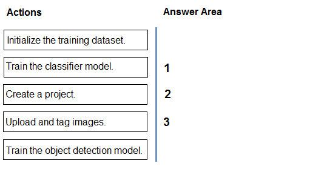

_DRAG DROP — the original ExamTopics question expects you to drag and drop items; the correct targets are not published._

**Correct answer:** Not provided by ExamTopics
**Most voted:** Put Train the classifier model as number 3. | The correct full sequence is: | 1. Create a project | 2. Upload and tag images | 3. Train the classifier model | Here you’re classifying components (faulty vs non‑faulty), not locating multiple objects in an image, so classifier—not object detection—is the right choice.

### Top explanations
- **Az301301X** (9 upvotes [Highly Voted]): Put Train the classifier model as number 3.
The correct full sequence is:
1. Create a project
2. Upload and tag images
3. Train the classifier model
Here you’re classifying components (faulty vs non‑faulty), not locating multiple objects in an image, so classifier—not object detection—is the right choice.
- **ArindamPal** (2 upvotes [Most Recent]): The correct full sequence is:
1. Create a project
2. Upload and tag images
3. Train the classifier model

## Q1.109 (ID 421555)

You are developing a new sales system that will process user-generated video and text from a public-facing website.
You plan to notify users that their data has been processed by the sales system.
Which responsible AI principle does this help meet?

⭕ **A.** fairness
✅ **B.** transparency
⭕ **C.** inclusiveness
⭕ **D.** reliability and safety

**Correct answer:** B
**Most voted:** B

### Top explanations
- **8ac3742** (1 upvotes [Most Recent, Selected Answer: B]): Examples of AI principals:
(1)TransparencyCore concept: Displaying a clear notification: "Your uploaded video has been analyzed by an automated review system to tag product mentions"
(2)InclusivenessCore concept: Integrating Azure AI Immersive Reader, screen reader compatibility, and closed captioning into an educational app so users with visual impairments or dyslexia can learn  equally.
(3)FairnessCore concept:  Ensuring a resume screening model evaluates candidates based solely on relevant skills rather than favoring one gender due to historical hiring bias.
(4)Reliability and SafetyCore concept: Rigorously testing an autonomous vehicle's object detection system to ensure it reliably detects pedestrians in fog, rain, or night conditions without unexpected failure.
- **Amelia233** (1 upvotes [Selected Answer: B]): Notifying users that their data has been processed helps them understand how and when AI systems use their data, which is part of the transparency principle.
A ❌ Fairness — focuses on avoiding unfair bias.
B ✅ Transparency — provides users with information about AI/data processing.
C ❌ Inclusiveness — ensures AI works for diverse users.
D ❌ Reliability and safety — focuses on consistent and safe system behavior.
Correct answer: B. Transparency ✅

## Q1.110 (ID 421556)

You are designing a content management system.
You need to ensure that the reading experience is optimized for users who have reduced comprehension and learning differences, such as dyslexia. The solution must minimize development effort.
Which Azure service should you include in the solution?

⭕ **A.** Azure Document Intelligence in Foundry Tools
⭕ **B.** Azure Language in Foundry Tools
✅ **C.** Azure AI Immersive Reader
⭕ **D.** Azure Translator in Foundry Tools

**Correct answer:** C
**Most voted:** C

### Top explanations
- **8ac3742** (1 upvotes [Most Recent, Selected Answer: C]): What the Question Is Asking
The scenario describes users who have learning differences like dyslexia or lower reading comprehension. In accessibility and inclusive design, these users struggle with:
Crowded fonts and tight line spacing
Complex words and sentence structures
Distracting UI clutter
- **Amelia233** (1 upvotes [Selected Answer: C]): Correct answer: C. Azure AI Immersive Reader
Azure AI Immersive Reader is designed to improve reading comprehension and accessibility for users with learning differences such as dyslexia. It provides features like text spacing, line focus, and read-aloud, with minimal development effort.
A ❌ Document Intelligence — extracts information from documents.
B ❌ Azure Language — analyzes and processes text.
C ✅ Immersive Reader — optimizes reading and accessibility.
D ❌ Translator — translates text between languages.

## Q1.111 (ID 421557)

You have an Azure subscription that contains an Azure App Service app named App1.
You provision a Microsoft Foundry Service resource named CSAccount1.
You need to configure App1 to access CSAccount1. The solution must minimize administrative effort.
What should you use to configure App1?

✅ **A.** the endpoint URI and subscription key
⭕ **B.** the endpoint URI and an OAuth token
⭕ **C.** the endpoint URI and a shared access signature (SAS) token
⭕ **D.** a system assigned managed identity and an X.509 certificate

**Correct answer:** A
**Most voted:** A

### Top explanations
- **8ac3742** (1 upvotes [Most Recent, Selected Answer: A]): In Azure certification questions, "API key" and "subscription key" are used interchangeably when referring to the 32-character key found under Keys and Endpoint in the Azure portal.
- **Amelia233** (1 upvotes [Selected Answer: A]): Using the endpoint URI and subscription key is the simplest configuration and requires the least administrative effort.
A ✅ Simple and straightforward authentication.
B ❌ OAuth requires additional token management.
C ❌ SAS tokens aren't the standard choice here.
D ❌ Managed identity and X.509 certificates require more configuration.
Answer: A

## Q1.112 (ID 421558)

DRAG DROP
You have a web app that uses Azure AI Search.
When reviewing activity you see greater than expected search query volumes. You suspect that the query key is compromised.
You need to prevent unauthorized access to the search endpoint and ensure that users only have read only access to the documents collection. The solution must minimize app downtime.
Which three actions should you perform in sequence? To answer, move the appropriate actions from the list of actions to the answer area and arrange them in the correct order.

**Exhibits**
- Exhibit 1: 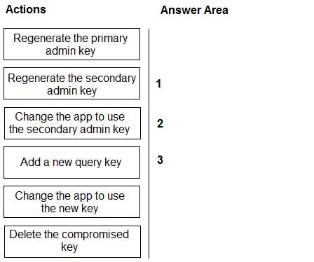

_DRAG DROP — the original ExamTopics question expects you to drag and drop items; the correct targets are not published._

**Correct answer:** Not provided by ExamTopics
**Most voted:** The order shown could cause service disruption. To minimize downtime, the correct sequence should be: | 1. Add a new query key | 2. Change the app to use the new query key | 3. Delete the compromised key

### Top explanations
- **Alvarogc** (16 upvotes [Highly Voted]): The order shown could cause service disruption. To minimize downtime, the correct sequence should be:
1. Add a new query key
2. Change the app to use the new query key
3. Delete the compromised key
- **NielsLOL** (1 upvotes [Most Recent]): The comments below suggest to have less downtime, but would you rather have someone doing bad things with the compromised access and risk more damage, or have some downtime?
I would go with the downtime, and replace the key as soon as possible.
Therefore the answer that was given remains unchanged for me:
1. Delete the compromised key
2. Add a new query key
3. Change the app to use the new key
- **8ac3742** (1 upvotes): Add a new query key   Change the app to use the new key   Delete the compromised key   Why Not "Delete First"?If you delete the compromised key first, your production app immediately loses access and begins throwing 401 Unauthorized errors until you generate and deploy the replacement key. That creates avoidable downtime.

## Q1.113 (ID 421559)

HOTSPOT
You need to create a new resource that will be used to perform sentiment analysis and optical character recognition (OCR). The solution must meet the following requirements:
•	Use a single key and endpoint to access multiple services.
•	Consolidate billing for future services that you might use.
•	Support the use of Azure Vision in Foundry Tools in the future.
How should you complete the HTTP request to create the new resource? To answer, select the appropriate options in the answer area.
NOTE: Each correct selection is worth one point.

**Exhibits**
- Exhibit 1: 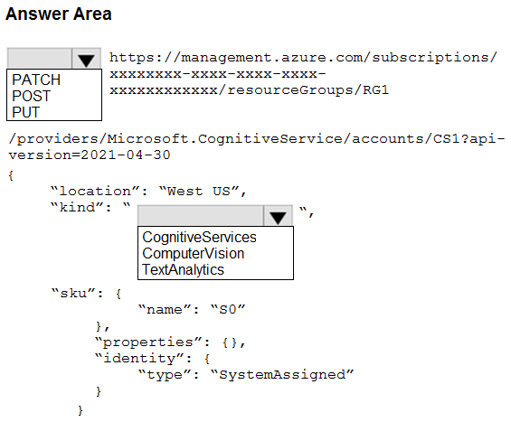

_HOTSPOT — the original ExamTopics question expects you to mark areas on the exhibit above; the correct hotspot coordinates are not published._

**Correct answer:** Not provided by ExamTopics
**Most voted:** Correct Answers | HTTP Method: PUT | kind: "CognitiveServices" | Explanations | HTTP Method (PUT): In Azure Resource Manager (ARM) REST APIs, resource creation or full replacement at a specific URI uses the PUT verb. | kind ("CognitiveServices"): The multi-service Azure AI services resource type is denoted by the "CognitiveServices" kind. Single-service kinds (like "ComputerVision" or "TextAnalytics") only provide access to individual APIs and...

### Top explanations
- **8ac3742** (1 upvotes [Most Recent]): put and cognitive resource
In ARM specifications, creating or replacing a named resource (Create or Update) strictly requires the PUT HTTP verb.
POST is reserved for non-idempotent actions (such as regenerating keys, listing keys, or invoking operations).
- **Amelia233** (1 upvotes): Correct Answers
HTTP Method: PUT
kind: "CognitiveServices"
Explanations
HTTP Method (PUT): In Azure Resource Manager (ARM) REST APIs, resource creation or full replacement at a specific URI uses the PUT verb.
kind ("CognitiveServices"): The multi-service Azure AI services resource type is denoted by the "CognitiveServices" kind. Single-service kinds (like "ComputerVision" or "TextAnalytics") only provide access to individual APIs and cannot satisfy the requirement for consolidated billing, multi-service key/endpoint access, or future Vision integration.

## Q1.114 (ID 421560)

HOTSPOT
You are building a model to detect objects in images.
The performance of the model based on training data is shown in the following exhibit.
Use the drop-down menus to select the answer choice that completes each statement based on the information presented in the graphic.
NOTE: Each correct selection is worth one point.

**Exhibits**
- Exhibit 1: 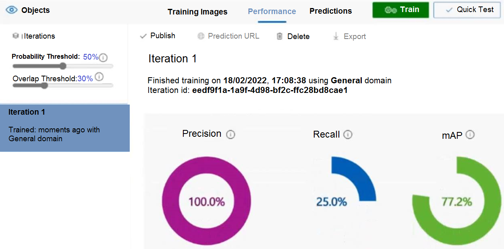
- Exhibit 2: 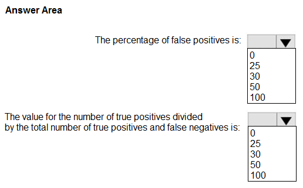

_HOTSPOT — the original ExamTopics question expects you to mark areas on the exhibit above; the correct hotspot coordinates are not published._

**Correct answer:** Not provided by ExamTopics
**Most voted:** Step-by-Step Analysis | The percentage of false positives: | Precision Formula: | Precision= | True Positives (TP)+False Positives (FP) | True Positives (TP) | ​ | With a Precision of 100.0% (1.0), there are no false positive predictions made by the model (FP=0). | Therefore, the percentage of false positives is 0. | The value for the number of true positives divided by the total number of true positives and false negatives: | Recall Formula: | Recall=...

### Top explanations
- **Srikantha** (1 upvotes [Most Recent]): Step-by-Step Analysis
The percentage of false positives:
Precision Formula:
Precision=
True Positives (TP)+False Positives (FP)
True Positives (TP)
​
With a Precision of 100.0% (1.0), there are no false positive predictions made by the model (FP=0).
Therefore, the percentage of false positives is 0.
The value for the number of true positives divided by the total number of true positives and false negatives:
Recall Formula:
Recall=
True Positives (TP)+False Negatives (FN)
True Positives (TP)
​
The definition in the prompt describes the formula for Recall.
Looking at the performance metrics exhibit, Recall is 25.0%, which corresponds to 25.

## Q1.115 (ID 421561)

You are developing an application that will use Azure AI Search for internal documents.
You need to implement document-level filtering for Azure AI Search.
Which three actions should you include in the solution? Each correct answer presents part of the solution.
NOTE: Each correct selection is worth one point.

✅ **A.** Add allowed groups to each index entry
⭕ **B.** Create one index per group.
⭕ **C.** Send access tokens from Microsoft Entra ID, with the search request.
⭕ **D.** Retrieve all the groups.
✅ **E.** Retrieve the group memberships of the user
✅ **F.** Supply the groups as a filter for the search requests

**Correct answer:** A, E, F
**Most voted:** AEF

### Top explanations
- **8ac3742** (1 upvotes [Most Recent, Selected Answer: AEF]): Why the Answer is About "Groups" When the Question Says "Document-Level Filtering"
In Azure AI Search, "document-level filtering" (officially called Security Filters or Document-level Security) means:
When a user runs a search query, they should only see the specific documents they have permission to view, and documents they are not authorized to view must never appear in the search results.
Azure AI Search does not integrate with Microsoft Entra ID permissions at the individual document level automatically. Instead, security trimming is implemented using security groups as document metadata:
A. Add allowed groups to each index entry
E. Retrieve the group memberships of the user
F. Supply the groups as a filter for the search requests
- **Srikantha** (1 upvotes [Selected Answer: AEF]): Add allowed groups to each index entry: Tag documents or index chunks with a security field specifying which groups have access rights.
Retrieve the group memberships of the user: Identify the active security groups or permissions belonging to the user executing the search query.
Supply the groups as a filter for the search requests: Apply an OData filter (such as using search.in or collection operators) containing the user's groups to restrict the search results to only authorized content.

## Q1.116 (ID 421562)

You have an Azure AI Search indexer that ingest PDF policy manuals.
Client applications must display page-level citations that have bounding polygons for both text and images.
You need to add a single built-in multimodal content extraction skill to the Azure AI Search skillset. The solution must meet the following requirements:
•	Provide text and image location metadata.
•	Extract tables that span multiple pages.
What should you add?

⭕ **A.** Document Layout
⭕ **B.** Document Extraction
✅ **C.** Azure Content Understanding
⭕ **D.** GenAI Prompt

**Correct answer:** C
**Most voted:** C

### Top explanations
- **Srikantha** (4 upvotes [Selected Answer: A]): A. Document Layout
Microsoft Documentation Explanation
According to Microsoft Learn documentation on Azure AI Search multimodal skillsets:
Location Metadata & Bounding Polygons: The built-in Document Layout skill uses Azure AI Document Intelligence under the hood to extract text, figures, and embedded images along with spatial location metadata—specifically page numbers (pageNumber) and bounding coordinates (boundingPolygons / locationMetadata) for both text and image elements.
Multi-Page Table Extraction: The layout extraction capability natively parses complex document structures, retaining tables and tabular data that span across multi-page boundaries as cohesive structured objects rather than disconnected text fragments.
- **554b579** (3 upvotes [Selected Answer: C]): C. Azure Content Understanding — TRUE per the key. The multimodal skill covering text and images in one pass, returning location metadata for both and handling tables spanning pages. The word “multimodal” in the stem is the hook
A. Document Layout — FALSE per the key, and the community’s unanimous choice. It genuinely returns bounding polygons, structural elements, and multipage tables, which makes it a strong answer. The argument against it is that it is text-oriented, while the stem requires location metadata for images as well.
- **jwlnewsome** (2 upvotes [Selected Answer: C]): Document Extraction/Layout does not preserve cross-page tables.
- **a5f05ea** (2 upvotes [Most Recent, Selected Answer: C]): Document Layout → preserve/understand document structure
Azure Content Understanding → richer multimodal understanding + semantic chunking + improved complex table extraction
- **Amelia233** (1 upvotes [Selected Answer: A]): Correct answer: A. Document Layout ✅
Short discussion:
The Document Layout skill can extract both text and images with their location/bounding polygon metadata and supports tables that span multiple pages. This makes it suitable for generating page-level citations.
A ✅ Document Layout — provides text/image positions and multi-page table extraction.
B ❌ Document Extraction — focuses on extracting document content, not the required layout metadata.
C ❌ Content Understanding — not the required built-in Search skill for this scenario.
D ❌ GenAI Prompt — used for generative processing, not direct layout extraction.

## Q1.117 (ID 421563)

HOTSPOT
You are creating an enrichment pipeline that will use Azure AI Search. The knowledge store contains unstructured JSON data and the text from scanned PDF documents.
Which projection type should you use for each data type? To answer, select the appropriate options in the answer area.
NOTE: Each correct selection is worth one point.

**Exhibits**
- Exhibit 1: 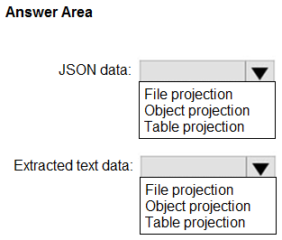

_HOTSPOT — the original ExamTopics question expects you to mark areas on the exhibit above; the correct hotspot coordinates are not published._

**Correct answer:** Not provided by ExamTopics
**Most voted:** Answer: | JSON data: Object projection | Extracted text data: Table projection

### Top explanations
- **Alvarogc** (6 upvotes): 1. Object projection
2. Object projection
It should be Object projection for both answers. There's no specified relational structure on the question, so second one may not be Table projection; but File projection is only for normalized, binary image files.
Reference: https://learn.microsoft.com/en-us/azure/search/knowledge-store-projection-overview
- **fa62dd5** (2 upvotes): Answer:
JSON data: Object projection
Extracted text data: Table projection
- **8ac3742** (1 upvotes [Most Recent]): json: blob, text: file
In Azure AI Search, an AI enrichment pipeline (indexer + skillset) extracts images, text, key phrases, sentiments, and entities from raw files.
Normally, all that enriched data is stored solely inside the search index to answer search queries.
However, if you also want to save that enriched data outside of the search index—into Azure Storage so you can analyze it with Power BI, feed it into machine learning models, or view it in another app—you use a Knowledge Store.
The mechanism that takes the enriched data from the pipeline and shapes it into storage is called a Projection (think of "projecting" or casting the enriched data onto storage).
JSON data $\rightarrow$ Object projection:Unstructured or deeply nested JSON documents cannot easily fit into flat database columns without breaking their hierarchy. Object projections save each enriched item as an individual, native JSON document in Azure Blob Storage.
Text extracted from documents (along with metadata like document title, page number, sentiment score, extracted entities) is shaped into rows and columns using Table projections in Azure Table Storage, making the textual records queryable and structured for downstream analysis.

## Q1.118 (ID 424420)

HOTSPOT
You are building a custom vision model that will be deployed as part of an iOS app.
You have images of cats and dogs. Each image contains either a cat or a dog.
You need to use the Azure Custom Vision service to detect whether the image is of a cat or a dog.
How should you configure the project in the Azure Custom Vision portal? To answer, select the appropriate options in the answer area.
NOTE: Each correct selection is worth one point.

**Exhibits**
- Exhibit 1: 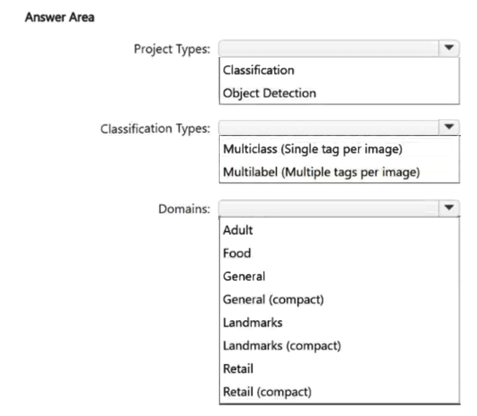

_HOTSPOT — the original ExamTopics question expects you to mark areas on the exhibit above; the correct hotspot coordinates are not published._

**Correct answer:** Not provided by ExamTopics
**Most voted:** Correct Answers | Project Types: Classification | Classification Types: Multiclass (Single tag per image) | Domains: General (compact) | Explanations | Project Types: Classification is selected because the goal is to categorize the overall image rather than locate bounding boxes around objects. | Classification Types: Multiclass (Single tag per image) is selected because each image contains either a cat or a dog, so only one label applies per image. | Domains: General (compact) is required be...

### Top explanations
- **Amelia233** (1 upvotes [Most Recent]): Correct Answers
Project Types: Classification
Classification Types: Multiclass (Single tag per image)
Domains: General (compact)
Explanations
Project Types: Classification is selected because the goal is to categorize the overall image rather than locate bounding boxes around objects.
Classification Types: Multiclass (Single tag per image) is selected because each image contains either a cat or a dog, so only one label applies per image.
Domains: General (compact) is required because the model will be deployed as part of an iOS app (on-device edge export like CoreML requires a compact domain).

## Q1.119 (ID 424416)

You have a Microsoft Foundry project that contains an agent. The agent has a Model Context Protocol (MCP) tool named kbsearch that queries a knowledge base stored in Azure AI Search.
Some agent runs return answers from the base model without invoking the knowledge base, which results in responses without grounded citations.
You are provided with the following code snippet that runs the agent.
You need to deterministically force the agent to invoke kbsearch on each run.
What should you do?

**Exhibits**
- Exhibit 1: 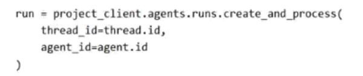

⭕ **A.** Add the response_format parameter to the create_and_process() method call.
⭕ **B.** Replace create_and_process() method with the create_thread_and_process_run() method.
⭕ **C.** Add the toolset parameter to the create_and_process() method call.
✅ **D.** Add the tool_choice parameter to the create_and_process() method call.

**Correct answer:** D
**Most voted:** D

### Top explanations
- **Amelia233** (1 upvotes [Most Recent, Selected Answer: D]): Correct answer: D. Add the tool_choice parameter to the create_and_process() method call. ✅
The tool_choice parameter lets you explicitly force the agent to use a specific tool. Set it to kbsearch so the knowledge base is invoked on every run, ensuring responses are grounded and include citations.
A ❌ response_format controls the output format.
B ❌ Changing the processing method doesn't force tool usage.
C ❌ toolset makes tools available but doesn't force their invocation.
D ✅ tool_choice deterministically selects the required tool.

## Q1.120 (ID 424419)

You are developing a text processing solution.
You have the following function.
You call the function and use the following string as the second argument.
Our tour of London included a visit to Buckingham Palace
What will be the output of the function?

**Exhibits**
- Exhibit 1: 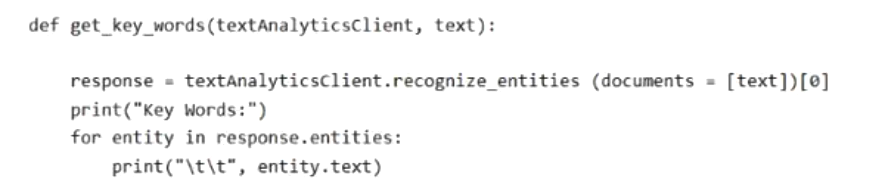

✅ **A.** London and Buckingham Palace only
⭕ **B.** Tour and visit only
⭕ **C.** Our tour of London included a visit to Buckingham Palace
⭕ **D.** London and Tour only

**Correct answer:** A
**Most voted:** A

### Top explanations
- **Amelia233** (2 upvotes [Most Recent, Selected Answer: A]): The function is extracting named entities (proper nouns) from the text. In the sentence:
“Our tour of London included a visit to Buckingham Palace.”
The recognized entities are London and Buckingham Palace.
Answer: A

## Q1.121 (ID 424413)

HOTSPOT
You are building a solution that students will use to find references for essays.
You use the following code to start building the solution.
For each of the following statements, select Yes is the statement is true. Otherwise, select No.
NOTE: Each correct selection is worth one point.

**Exhibits**
- Exhibit 1: 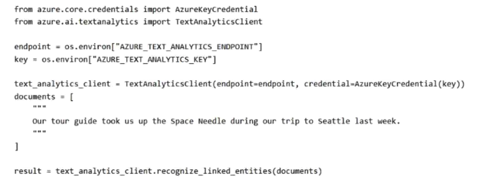
- Exhibit 2: 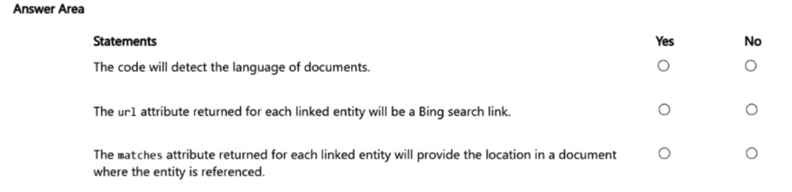

_HOTSPOT — the original ExamTopics question expects you to mark areas on the exhibit above; the correct hotspot coordinates are not published._

**Correct answer:** Not provided by ExamTopics
**Most voted:** Second one should be "no", as the URL is not always from Bing. In fact, there's another parameter for Bing searchs called "bing_entity_search_api_id". | Final correct answer: | 1. No | 2. No | 3. Yes | Reference: https://learn.microsoft.com/en-us/python/api/azure-ai-textanalytics/azure.ai.textanalytics.linkedentity?view=azure-python

### Top explanations
- **Alvarogc** (5 upvotes): Second one should be "no", as the URL is not always from Bing. In fact, there's another parameter for Bing searchs called "bing_entity_search_api_id".
Final correct answer:
1. No
2. No
3. Yes
Reference: https://learn.microsoft.com/en-us/python/api/azure-ai-textanalytics/azure.ai.textanalytics.linkedentity?view=azure-python
- **Codia** (2 upvotes): The correct answer for Statement 2 is No. While Bing's Knowledge Graph is used internally behind the scenes to perform entity resolution, and the SDK exposes a separate bing_entity_search_api_id attribute for API integration, the url field itself links to the underlying data source page (primarily Wikipedia), not a Bing search result URL.
- **[email protected]** (1 upvotes [Most Recent]): 1.	Statement: The code will detect the language of documents. Answer: No. Explanation: It calls recognize_linked_entities(), not detect_language().
2.	Statement: The url attribute for each linked entity will be a Bing search link. Answer: No. Explanation: The URL points to the entity’s knowledge-base entry, typically Wikipedia.
3.	Statement: The matches attribute provides the location in a document where the entity is referenced. Answer: Yes. Explanation: Each match includes offset and length, identifying the entity’s position in the text.
- **8ac3742** (1 upvotes): no( not detect_language), no(wikipedia), yes(location)
Statement 1: The code will detect the language of documents. (No)The code specifically calls recognize_linked_entities(documents).   To detect the language of documents, you must call detect_language(documents). recognize_linked_entities assumes a default language (English, if unspecified) or accepts an explicit language code parameter, but it does not return language detection analysis.Statement 2: The url attribute ... will be a Bing search link. (No)In Azure AI Language / Text Analytics Entity Linking, the default knowledge base used to ground and disambiguate recognized entities is Wikipedia (e.g., [https://en.wikipedia.org/wiki/Space_Needle](https://en.wikipedia.org/wiki/Space_Needle)), not a Bing search link.Statement 3: The matches attribute ... will provide the location in a document where the entity is referenced. (Yes)Each recognized entity in the response has a matches collection containing LinkedEntityMatch objects.Each match object exposes offset (starting character index position in the source text) and length, which explicitly define the exact location where that reference occurs in the document

## Q1.122 (ID 424414)

HOTSPOT
You have a Microsoft Foundry project for a support ticket triage app that reads ticket text from a database.
You need to ensure that the app meets the following requirements:
•	Compares candidate models by quality, cost, and throughput
•	Prevents hosting model weights in the Azure subscription
What should you configure? To answer, select the appropriate options in the answer area.
NOTE: Each correct selection is worth one point.

**Exhibits**
- Exhibit 1: 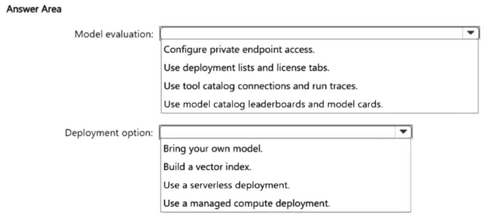

_HOTSPOT — the original ExamTopics question expects you to mark areas on the exhibit above; the correct hotspot coordinates are not published._

**Correct answer:** Not provided by ExamTopics
**Most voted:** Correct Answers | Model evaluation: Use model catalog leaderboards and model cards. | Deployment option: Use a serverless deployment. | Explanations | Model evaluation: Model catalog leaderboards and model cards allow you to evaluate and compare models across benchmarks for quality, cost, latency, and throughput metrics prior to deployment. | Deployment option: Serverless API deployments (Models-as-a-Service) host model weights in Microsoft-managed infrastructure, charging on a pay-as-you-go...

### Top explanations
- **8ac3742** (1 upvotes [Most Recent]): model leaderboard and model cards, serverless
Model weights are the actual multi-gigabyte files that make up a machine learning model.
Model Catalog Leaderboards: Directly rank and compare foundation models across industry benchmarks (quality/accuracy), latency/throughput metrics, and pricing tiers.
Model Cards: Detail specific model architectures, intended use cases, context windows, limitations, and pricing breakdown.
- **Amelia233** (1 upvotes): Correct Answers
Model evaluation: Use model catalog leaderboards and model cards.
Deployment option: Use a serverless deployment.
Explanations
Model evaluation: Model catalog leaderboards and model cards allow you to evaluate and compare models across benchmarks for quality, cost, latency, and throughput metrics prior to deployment.
Deployment option: Serverless API deployments (Models-as-a-Service) host model weights in Microsoft-managed infrastructure, charging on a pay-as-you-go per-token basis and avoiding hosting/managing model weights or dedicated compute inside your own Azure subscription.

## Q1.123 (ID 424404)

You have an Azure subscription.
You need to build an app that will compare documents for semantic similarity. The solution must meet the following requirements:
•	Return numeric vectors that represent the tokens of each document.
•	Minimize development effort.
Which Azure OpenAI model should you use?

⭕ **A.** GPT-3.5
✅ **B.** embeddings
⭕ **C.** GPT-4
⭕ **D.** DALL-E

**Correct answer:** B
**Most voted:** B

### Top explanations
- **Amelia233** (1 upvotes [Most Recent, Selected Answer: B]): An embeddings model converts text into numeric vectors that capture semantic meaning. These vectors can then be compared to determine how semantically similar two documents are.
A ❌ GPT-3.5 — primarily for text generation.
B ✅ Embeddings — specifically designed to generate vector representations.
C ❌ GPT-4 — primarily for understanding and generating content.
D ❌ DALL-E — generates images.
Answer: B

## Q1.124 (ID 424417)

HOTSPOT
You are building an app that will provide users with definitions of common AI terms.
You create the following Python code.
For each of the following statements, select Yes if the statement is true. Otherwise, select No.
NOTE: Each correct selection is worth point.

**Exhibits**
- Exhibit 1: 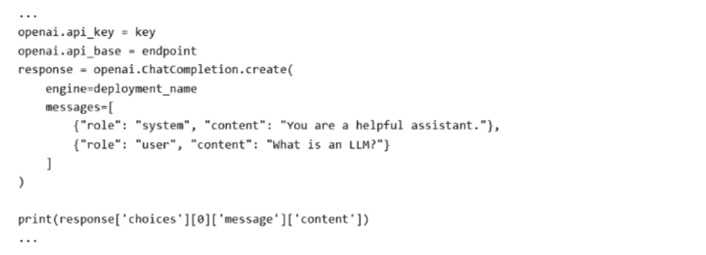
- Exhibit 2: 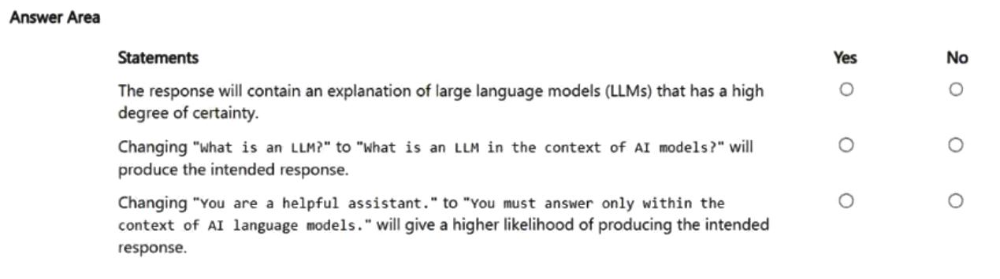

_HOTSPOT — the original ExamTopics question expects you to mark areas on the exhibit above; the correct hotspot coordinates are not published._

**Correct answer:** Not provided by ExamTopics
**Most voted:** Correct Answers | The response will contain an explanation of large language models (LLMs) that has a high degree of certainty: No (The abbreviation "LLM" is ambiguous and can mean Master of Laws in a legal context; without context steering, the model may return legal definition results instead of AI definitions). | Changing "What is an LLM?" to "What is an LLM in the context of AI models?" will produce the intended response: Yes (Disambiguating the user prompt d...

### Top explanations
- **Amelia233** (1 upvotes [Most Recent]): Correct Answers
The response will contain an explanation of large language models (LLMs) that has a high degree of certainty: No (The abbreviation "LLM" is ambiguous and can mean Master of Laws in a legal context; without context steering, the model may return legal definition results instead of AI definitions).
Changing "What is an LLM?" to "What is an LLM in the context of AI models?" will produce the intended response: Yes (Disambiguating the user prompt directly ensures the model targets the correct domain).

## Q1.125 (ID 424411)

You have an Azure OpenAI model named AI1.
You are building a web app named App1 by using the Azure OpenAI SDK.
You need to configure App1 to connect to AI1.
What information must you provide?

⭕ **A.** the deployment name, key, and model name
⭕ **B.** the endpoint, key, and model type
✅ **C.** the deployment name, endpoint, and key
⭕ **D.** the endpoint, key, and model name

**Correct answer:** C
**Most voted:** C

### Top explanations
- **Amelia233** (1 upvotes [Most Recent, Selected Answer: C]): When using the Azure OpenAI SDK, you need the endpoint, API key, and the deployment name to connect to the deployed model.
A ❌ Model name isn't required; the deployment name identifies the deployed model.
B ❌ Model type isn't required.
C ✅ Deployment name + endpoint + key.
D ❌ Model name is not required.
Answer: C

## Q1.126 (ID 424421)

You are building a solution in Azure that will use Azure Language in Foundry Tools service to process sensitive customer data.
You need to ensure that only specific Azure processes can access the Language service. The solution must minimize administrative effort.
What should you include in the solution?

⭕ **A.** Azure Application Gateway
⭕ **B.** a virtual network gateway
⭕ **C.** IPsec rules
✅ **D.** virtual network rules

**Correct answer:** D
**Most voted:** D

### Top explanations
- **Srikantha** (3 upvotes [Selected Answer: D]): Why this is correct:
Virtual network rules (VNet firewalls) on the Azure AI Language resource allow you to restrict incoming traffic so that only applications or workloads running within designated Azure Virtual Network subnets can access the endpoint.
This natively secures sensitive customer data by isolating PaaS access to authorized Azure processes with minimal administrative effort, eliminating the need to deploy or manage additional networking infrastructure.
- **8ac3742** (2 upvotes [Selected Answer: D]): vNet
Azure AI Language supports virtual network rules (Service Endpoints) directly in its built-in firewall.
With a couple of clicks in the portal (or a simple template), you select the subnet where your Azure compute/processes live and allow it. Azure’s internal software-defined network automatically secures the path over the Azure backbone with zero VPNs, zero encryption tunnel management, and minimal administrative effort
- **a5f05ea** (2 upvotes [Selected Answer: D]): Restrict an Azure service to selected VNets/subnets → Virtual network rules
Connect/encrypt traffic between networks → VPN/IPsec
✅ Therefore, D is correct, not C.
- **adilkhan** (1 upvotes [Most Recent, Selected Answer: D]): To secure an Azure AI service resource (such as the Language service) so that only specific Azure workloads or processes can access it, you can configure virtual network rules (network firewalls) directly on the resource. By allowing traffic only from selected subnets within an Azure Virtual Network (VNet), you can isolate the service from the public internet. This approach protects sensitive data and requires minimal administrative effort because it is handled entirely within Azure's built-in platform network configurations.
- **Amelia233** (1 upvotes [Selected Answer: C]): Virtual network rules allow you to restrict access to the Azure Language service to specific virtual networks and subnets, helping protect sensitive customer data with minimal administration.
A ❌ Application Gateway — manages web traffic, not direct service access control.
B ❌ Virtual network gateway — connects networks but doesn't provide this access restriction.
C ❌ IPsec rules — not the appropriate Azure Language access-control mechanism.
D ✅ Virtual network rules — restrict access to trusted Azure network resources.
Answer: D

## Q1.127 (ID 424407)

You have an Azure subscription that contains a Microsoft Foundry Service resource named CSAccount1 and a virtual network named VNet1. CSAaccount1 is connected to VNet1.
You need to ensure that only specific resources can access CSAccount1. The solution must meet the following requirements:
•	Prevent external access to CSAccount1.
•	Minimize administrative effort.
Which two actions should you perform? Each correct answer presents part of the solution.
NOTE: Each correct answer is worth one point.

✅ **A.** In CSAccount1, modify the virtual network settings.
⭕ **B.** In VNet1, create a virtual subnet.
✅ **C.** In VNet1, enable a service endpoint for CSAccount1.
⭕ **D.** In CSAccount1, configure the Access control (IAM) settings.
⭕ **E.** In VNet1, modify the virtual network settings.

**Correct answer:** A, C
**Most voted:** AC

### Top explanations
- **AzureGeek79** (2 upvotes [Selected Answer: AC]): Correct answers: A & C
- **a5f05ea** (2 upvotes [Selected Answer: AC]): Correct answers: A and C
A. In CSAccount1, modify the virtual network settings
C. In VNet1, enable a service endpoint for CSAccount1
- **Srikantha** (2 upvotes [Selected Answer: AE]): ignore the previous
Enable a service endpoint for CSAccount1 in VNet1 (Action A): This securely connects your virtual network to the Azure AI service resource over the Azure backbone network, routing traffic away from the public internet and helping satisfy the requirement to prevent external access.
Modify the virtual network settings in CSAccount1 (Action E): This allows you to restrict network access directly on the resource by setting access rules that block public traffic and permit only designated virtual networks and subnets, keeping administrative overhead minimal compared to configuring complex firewalls or routing mechanisms.
- **Srikantha** (2 upvotes [Selected Answer: AC]): Enable a service endpoint for CSAccount1 in VNet1 (Action A): This securely connects your virtual network to the Azure AI service resource over the Azure backbone network, routing traffic away from the public internet and helping satisfy the requirement to prevent external access.
Modify the virtual network settings in CSAccount1 (Action E): This allows you to restrict network access directly on the resource by setting access rules that block public traffic and permit only designated virtual networks and subnets, keeping administrative overhead minimal compared to configuring complex firewalls or routing mechanisms.
- **8ac3742** (1 upvotes [Most Recent, Selected Answer: AC]): To allow resources inside VNet1 to reach an Azure PaaS service (CSAccount1) privately over the Azure backbone, you must enable a Virtual Network Service Endpoint (specifically for Microsoft.CognitiveServices) on VNet1's subnet. This provides the network route from the VNet to the service without traversing the public internet.
In CSAccount1 under Firewalls and Virtual Networks, you switch the firewall from All Networks to Selected Networks and Private Endpoints, and add VNet1 to the allowed list. This turns on the firewall to reject all external/public internet connections.

## Q1.128 (ID 424415)

HOTSPOT
You have a collection of press releases stored as PDF files.
You need to extract text from the files and perform sentiment analysis.
Which service should you use for each task? To answer, select the appropriate options in the answer area.
NOTE: Each correct selection is worth one point.

**Exhibits**
- Exhibit 1: 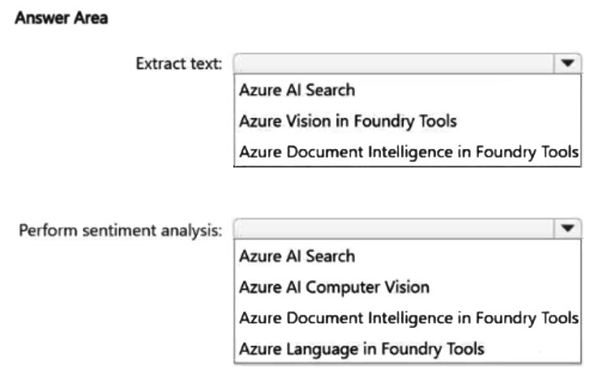

_HOTSPOT — the original ExamTopics question expects you to mark areas on the exhibit above; the correct hotspot coordinates are not published._

**Correct answer:** Not provided by ExamTopics
**Most voted:** extract: vision, sentiment and opinion: language | Press releases are unstructured prose text (articles/announcements). | In Microsoft's official curriculum and exam design, raw text/prose extraction from PDFs and images is handled by the Read API in Azure Vision. | Why not Document Intelligence? Document Intelligence is specifically intended for structured/semi-structured form understanding (such as tables, key-value pairs, invoices, receipts, and tax...

### Top explanations
- **8ac3742** (1 upvotes [Most Recent]): extract: vision, sentiment and opinion: language
Press releases are unstructured prose text (articles/announcements).
In Microsoft's official curriculum and exam design, raw text/prose extraction from PDFs and images is handled by the Read API in Azure Vision.
Why not Document Intelligence? Document Intelligence is specifically intended for structured/semi-structured form understanding (such as tables, key-value pairs, invoices, receipts, and tax forms). When the task is simply extracting plain prose for downstream NLP processing, Vision's Read API is the standard targeted service.
Azure AI Language provides built-in text analytics capabilities, including Sentiment Analysis and Opinion Mining.
Neither Vision nor Document Intelligence has sentiment analysis capabilities
- **rokoskycloud** (1 upvotes): Extract text: Azure Vision in Foundry Tools
The Read API is the OCR operation built for extracting text from images and PDFs. Press releases are unstructured prose, so plain text extraction is exactly what's needed.
Perform sentiment analysis: Azure Language in Foundry Tools
Sentiment analysis is a Language service feature, returning document-level and sentence-level sentiment with positive, neutral, and negative confidence scores

## Q1.129 (ID 424412)

You are designing an Azure AI solution to identify defective products on a production line.
You have a real-time video feed and an image library of sample products that are approved or rejected manually.
You need to recommend a service that meets the following requirements:
•	Monitors the video feed and identifies the defective products.
•	Can train a new model by using the image library.
•	Minimizes development effort.
What should you recommend?

⭕ **A.** Azure Vision in Foundry Tools
⭕ **B.** Azure AI Video Indexer
✅ **C.** Azure AI Custom Vision
⭕ **D.** Azure Machine Learning

**Correct answer:** C
**Most voted:** C

### Top explanations
- **Amelia233** (1 upvotes [Most Recent, Selected Answer: C]): Custom Vision is designed to train custom image classification/object detection models using your own labeled image library. It can identify defective products from the video feed while requiring relatively little development effort.
A ❌ Azure Vision — provides prebuilt vision capabilities but isn't the best fit for training this custom defect model.
B ❌ Video Indexer — focuses on analyzing and indexing video content.
C ✅ Custom Vision — supports custom training with approved/rejected product images.
D ❌ Azure Machine Learning — more flexible but requires significantly more development and management.
Correct answer: C. Azure AI Custom Vision ✅

## Q1.130 (ID 424418)

HOTSPOT
You run the following command.
For each of the following statements, select Yes if the statement is true. Otherwise, select No.
NOTE: Each correct selection is worth one point.

**Exhibits**
- Exhibit 1: 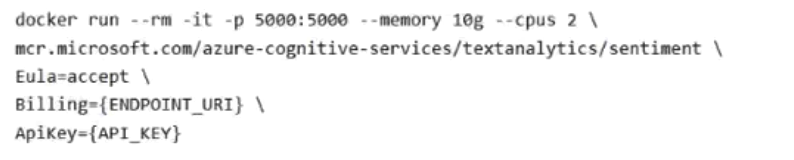
- Exhibit 2: 

_HOTSPOT — the original ExamTopics question expects you to mark areas on the exhibit above; the correct hotspot coordinates are not published._

**Correct answer:** Not provided by ExamTopics
**Most voted:** First one is a No, as you can see in the Microsoft Learn documentation: " this URL verifies if the api-key used to start the container is valid WITHOUT causing an endpoint query". | Second one is a No too, as it's not configured, and third one is a trivial Yes per definition. | 1. No | 2. No | 3. Yes | Reference: https://learn.microsoft.com/en-us/azure/ai-services/language-service/sentiment-opinion-mining/how-to/use-containers

### Top explanations
- **Alvarogc** (4 upvotes): First one is a No, as you can see in the Microsoft Learn documentation: " this URL verifies if the api-key used to start the container is valid WITHOUT causing an endpoint query".
Second one is a No too, as it's not configured, and third one is a trivial Yes per definition.
1. No
2. No
3. Yes
Reference: https://learn.microsoft.com/en-us/azure/ai-services/language-service/sentiment-opinion-mining/how-to/use-containers
- **ExamProAzure** (4 upvotes): Yes, No, Yes
The docker run command in the question includes only Eula, Billing, and ApiKey — no Logging: settings and no --mount for an output directory. Since none of the logging providers are explicitly configured or given a destination (like a mounted output folder), no log data will be written by the logging provider in this scenario.
- **Srikantha** (2 upvotes [Most Recent]): Going to http://localhost:5000/status will query the Azure endpoint to verify whether the API key used to start the container is valid: No (The /status endpoint verifies if the API key is valid locally without causing an endpoint query).
The container logging provider will write log data: Yes (Docker containers automatically log output to the configured container logging provider).
Going to http://localhost:5000/swagger will provide the details to access the documentation for the available endpoints: Yes (The Swagger UI provides the detailed description and documentation for the container's APIs).

## Q1.131 (ID 424406)

You are developing an app that will use the Speech and Language APIs.
You need to provision resources for the app. The solution must ensure that each service is accessed by using a single endpoint and credential.
Which type of resource should you create?

⭕ **A.** Azure Language in Foundry Tools
✅ **B.** Microsoft Foundry service
⭕ **C.** Azure Speech in Foundry Tools
⭕ **D.** Content Safety in Foundry Control Plane

**Correct answer:** B
**Most voted:** B

### Top explanations
- **Amelia233** (2 upvotes [Most Recent, Selected Answer: B]): A Microsoft Foundry service resource can provide access to multiple AI capabilities, such as Speech and Language, through a single endpoint and credential. This minimizes resource and credential management.
Answer: B — Microsoft Foundry service

## Q1.132 (ID 424409)

You are building an app that will include one million scanned magazine articles. Each article will be stored as an image file.
You need to configure the app to extract text from the images. The solution must minimize development effort.
What should you include in the solution?

⭕ **A.** Azure Document Intelligence in Foundry Tools
✅ **B.** the Read API in Azure Vision in Foundry Tools
⭕ **C.** Azure Vision in Foundry Tools Image Analysis
⭕ **D.** Azure Language in Foundry Tools

**Correct answer:** B
**Most voted:** B

### Top explanations
- **ABHISHEK** (6 upvotes [Selected Answer: B]): The Read API is Azure's OCR engine for extracting printed and handwritten text from image files. It's a prebuilt, ready-to-call service, so you don't need to train a model or build a custom pipeline, which meets the "minimize development effort" requirement. It's also built to handle large volumes asynchronously, which suits one million images.
- **8ac3742** (2 upvotes [Most Recent, Selected Answer: B]): Optimized for Pure Text Extraction at Scale:The requirement specifically asks to "extract text from the images" for one million scanned magazine articles with minimal development effort.   The Read API in Azure Vision is Azure’s dedicated, pre-built asynchronous Optical Character Recognition (OCR) engine optimized for reading high volumes of text-heavy scanned image files (printed and handwritten) without needing complex setup or model definitions.Why not C (Azure Vision in Foundry Tools Image Analysis)?Standard Image Analysis is designed for general computer vision tasks (generating image captions, object tags, detecting faces, color palettes, or detecting short scene text in photographs). It is not designed for bulk, multi-page, dense text reading like scanned articles.
- **Alvarogc** (2 upvotes [Selected Answer: A]): Microsoft Learn recommends to use Azure Vision for labels, street signs or posters; while using Document Intelligence for books, articles and reports. In this case, we are talking about a million magazine ARTICLES, so A is the correct answer.
Reference: https://learn.microsoft.com/en-us/azure/ai-services/computer-vision/how-to/call-read-api
- **ArindamPal** (1 upvotes [Selected Answer: B]): The Read API in Azure Vision is specifically designed to extract printed and handwritten text from images and scanned documents with minimal development effort.
- **Srikantha** (1 upvotes [Selected Answer: A]): Based on the official Microsoft Learn documentation, the recommended answer is A. Azure Document Intelligence in Foundry Tools.

## Q1.133 (ID 424410)

DRAG DROP
You are building an app that will scan confidential documents and use the Azure Language in Foundry Tools service to analyze the contents.
You provision a Microsoft Foundry Service resource.
You need to ensure that the app can make requests to the Azure Language in Foundry Tools service endpoint. The solution must ensure that confidential documents remain on-premises.
Which three actions should you perform in sequence? To answer, move the appropriate actions from the list of actions to the answer area and arrange them in the correct order.

**Exhibits**
- Exhibit 1: 

_DRAG DROP — the original ExamTopics question expects you to drag and drop items; the correct targets are not published._

**Correct answer:** Not provided by ExamTopics
**Most voted:** Correct sequence: | - Provision an on-premises Kubernetes cluster that has internet connectivity. | The container needs to have internet connectivity for billing/usage purposes | - Pull an image from the Microsoft Container Registry (MCR). | Azure AI Language containers are distributed through MCR, not Docker Hub. | - Run the container and specify an API key and the Endpoint URL of the Azure AI resource. | Language containers require: | ApiKey | Billing (endpoint URI) | Eula=accept | when sta...

### Top explanations
- **MarceloManhaes** (7 upvotes [Highly Voted]): Correct sequence:
- Provision an on-premises Kubernetes cluster that has internet connectivity.
The container needs to have internet connectivity for billing/usage purposes
- Pull an image from the Microsoft Container Registry (MCR).
Azure AI Language containers are distributed through MCR, not Docker Hub.
- Run the container and specify an API key and the Endpoint URL of the Azure AI resource.
Language containers require:
ApiKey
Billing (endpoint URI)
Eula=accept
when started.
- **adilkhan** (4 upvotes [Most Recent]): Provision an on-premises Kubernetes cluster that has internet connectivity.
Pull an image from the Microsoft Container Registry (MCR).
Run the container and specify an API key and the Endpoint URL of the Azure AI resource.
- **8ac3742** (1 upvotes): kubenetes with internet connection -> pull image from MCR -> run container with API key and endpoint URL
Host environment selectionThe requirement explicitly states that "confidential documents remain on-premises."Azure Kubernetes Service (AKS) is a cloud-hosted managed service in Azure, so running workloads on AKS would upload/process the data in the cloud, violating the on-premises requirement.Connected Cognitive Services / Azure AI containers require outbound access to Azure for billing and metering verification. A cluster that is entirely isolated from the internet would prevent the container from communicating with the metering endpoint (Billing=...), causing it to fail startup.   Therefore, you must provision an on-premises Kubernetes cluster that has internet connectivity (so billing pings succeed while document data remains local).

## Q1.134 (ID 424405)

HOTSPOT
You are developing an app that will use the Azure Vision in Foundry Tools API to analyze an image.
You need configure the request that will be used by the app to identify whether an image is clipart or a line drawing.
How should you complete the request? To answer, select the appropriate options in the answer area.
NOTE: Each correct selection is worth one point.

**Exhibits**
- Exhibit 1: 

_HOTSPOT — the original ExamTopics question expects you to mark areas on the exhibit above; the correct hotspot coordinates are not published._

**Correct answer:** Not provided by ExamTopics
**Most voted:** Correct Answers | HTTP Method: POST | visualFeatures: imageType | HTTP Method (POST): The analyze endpoint in Azure Computer Vision requires sending image data (binary or URL) in the payload via a POST request. | visualFeatures (imageType): The ImageType feature specifically analyzes an image to determine whether it is clip art or a line drawing, returning scores for both types in the response.

### Top explanations
- **Amelia233** (4 upvotes [Most Recent]): Correct Answers
HTTP Method: POST
visualFeatures: imageType
HTTP Method (POST): The analyze endpoint in Azure Computer Vision requires sending image data (binary or URL) in the payload via a POST request.
visualFeatures (imageType): The ImageType feature specifically analyzes an image to determine whether it is clip art or a line drawing, returning scores for both types in the response.

## Q1.135 (ID 424408)

You use the Azure Custom Vision service to build a classifier.
After training is complete, you need to evaluate the classifier.
Which two metrics are available for review? Each correct answer presents a complete solution.
NOTE: Each correct selection is worth one point.

⭕ **A.** F-score
⭕ **B.** area under the curve (AUC)
✅ **C.** precision
⭕ **D.** weighted accuracy
✅ **E.** recall

**Correct answer:** C, E
**Most voted:** CE

### Top explanations
- **8ac3742** (2 upvotes [Most Recent, Selected Answer: CE]): precision and recall
Imagine a basket containing 10 apples and 10 oranges.
You build a classifier to find all the apples. The model inspects the basket and picks out 5 fruits, claiming they are all apples.
Upon inspection of the 5 fruits it picked:
4 are actually apples (True Positives)
1 is an orange (False Positive)
6 apples were left behind in the basket (False Negatives)
precision = 4/5
recall = 4/10
- **AIBoss** (2 upvotes [Selected Answer: CE]): Precision and recall are two different measurements of the effectiveness of a classifier:
Precision indicates the fraction of identified classifications that were correct. For example, if the model identified 100 images as dogs, and 99 of them were actually of dogs, then the precision would be 99%.
Recall indicates the fraction of actual classifications that were correctly identified. For example, if there were actually 100 images of apples, and the model identified 80 as apples, the recall would be 80%.

## Q1.136 (ID 430814)

You have an Azure subscription that contains an Azure Language in Foundry Tools service resource named ta1 and a virtual network named vnet1.
You need to ensure that only resources in vnet1 can access ta1.
What should you configure?

⭕ **A.** a network security group (NSG) for vnet1
⭕ **B.** an Azure Language in Foundry Tools service container for ta1
⭕ **C.** Azure Firewall for vnet1
✅ **D.** the virtual network settings for ta1

**Correct answer:** D
**Most voted:** D

### Top explanations
- **Srikantha** (2 upvotes [Most Recent, Selected Answer: D]): D. the virtual network settings for ta1
Why this is correct:
To restrict access to an Azure AI / Language service resource (ta1) so that it only accepts traffic from a specific virtual network (vnet1), you must configure the Networking / Virtual network settings on ta1 itself. This is done by enabling access from "Selected Networks and Private Endpoints" and linking vnet1 (via Service Endpoints or Private Endpoints).

## Q1.137 (ID 430824)

Note: This question is part of a series of questions that present the same scenario. Each question in the series contains a unique solution that might meet the stated goals. Some question sets might have more than one correct solution, while others might not have a correct solution.
After you answer a question in this section, you will NOT be able to return to it. As a result, these questions will not appear in the review screen.
You have an Azure subscription that contains a Microsoft Foundry resource named AI1 and a Content Safety in Foundry Control Plane resource named CS1.
You build an agent that uses AI1 to provide generative answers to specific questions and CS1 to check input and output for objectionable content.
You need to optimize the content filter configurations by running tests on sample questions.
Solution: From Content Safety Studio, you use the Moderate text content feature to run the tests.
Does this meet the requirement?

✅ **A.** Yes
⭕ **B.** No

**Correct answer:** A
**Most voted:** A

### Top explanations
- **AzureGeek79** (2 upvotes [Most Recent, Selected Answer: A]): To test and optimize content filter configurations (such as modifying threshold sensitivity levels for categories like hate speech, sexual content, violence, and self-harm), you should use the Moderate text content feature within Azure AI Content Safety Studio.

## Q1.138 (ID 430766)

Note: This question is part of a series of questions that present the same scenario. Each question in the series contains a unique solution that might meet the stated goals. Some question sets might have more than one correct solution, while others might not have a correct solution.
After you answer a question in this section, you will NOT be able to return to it. As a result, these questions will not appear in the review screen.
You have an Azure subscription that contains a Microsoft Foundry resource named AI1 and a Content Safety in Foundry Control Plane resource named CS1.
You build an agent that uses AI1 to provide generative answers to specific questions and CS1 to check input and output for objectionable content.
You need to optimize the content filter configurations by running tests on sample questions.
Solution: From Content Safety Studio, you use the Safety metaprompt feature to run the tests.
Does this meet the requirement?

⭕ **A.** Yes
✅ **B.** No

**Correct answer:** B
**Most voted:** B

### Top explanations
- **Srikantha** (1 upvotes [Most Recent, Selected Answer: B]): B. No
Why this does not meet the requirement:
The Safety metaprompt feature provides guidelines and template instructions to embed into an LLM's system prompt to encourage safer generation behaviors. It is not an interactive test harness used to run batch sample questions or adjust content filter thresholds.
Correct Solution:
To test sample questions and optimize sensitivity thresholds or blocklists for content filtering, you should use the Moderate text content feature within Azure AI Content Safety Studio.

## Q1.139 (ID 430808)

Note: This question is part of a series of questions that present the same scenario. Each question in the series contains a unique solution that might meet the stated goals. Some question sets might have more than one correct solution, while others might not have a correct solution.
After you answer a question in this section, you will NOT be able to return to it. As a result, these questions will not appear in the review screen.
You have an Azure subscription that contains a Microsoft Foundry resource named AI1 and a Content Safety in Foundry Control Plane resource named CS1.
You build an agent that uses AI1 to provide generative answers to specific questions and CS1 to check input and output for objectionable content.
You need to optimize the content filter configurations by running tests on sample questions.
Solution: From Content Safety Studio, you use the Protected material detection feature to run the tests.
Does this meet the requirement?

⭕ **A.** Yes
✅ **B.** No

**Correct answer:** B
**Most voted:** B

### Top explanations
- **Srikantha** (1 upvotes [Most Recent, Selected Answer: B]): B. No
Why this does not meet the requirement:
Monitor online activity is used to track and analyze real-time usage, trends, latency, and request metrics for already deployed moderation APIs. It is not designed for testing sample questions or tuning filter sensitivity levels prior to deployment.
Correct Solution:
To test sample questions and adjust/optimize sensitivity thresholds and blocklists for content filtering, you should use the Moderate text content feature in Azure AI Content Safety Studio.

## Q1.140 (ID 430777)

Note: This question is part of a series of questions that present the same scenario. Each question in the series contains a unique solution that might meet the stated goals. Some question sets might have more than one correct solution, while others might not have a correct solution.
After you answer a question in this section, you will NOT be able to return to it. As a result, these questions will not appear in the review screen.
You have an Azure subscription that contains a Microsoft Foundry resource named AI1 and a Content Safety in Foundry Control Plane resource named CS1.
You build an agent that uses AI1 to provide generative answers to specific questions and CS1 to check input and output for objectionable content.
You need to optimize the content filter configurations by running tests on sample questions.
Solution: From Content Safety Studio, you use the Monitor online activity feature to run the tests.
Does this meet the requirement?

⭕ **A.** Yes
✅ **B.** No

**Correct answer:** B
**Most voted:** B

### Top explanations
- **8ac3742** (1 upvotes [Most Recent, Selected Answer: B]): When deploying a model in Microsoft Foundry or Azure OpenAI, Content Safety is integrated by default into the inference pipeline.
Every prompt sent by the user and every completion generated by the model passes through Content Safety filters before reaching the destination.It evaluates the text against the four core harm categories: Hate, Sexual, Violence, and Self-Harm.
In Moderate text content in the Content Safety, you can test individual prompt strings or batch-upload sample question datasets.
- **Srikantha** (1 upvotes [Selected Answer: B]): B. No
Why this does not meet the requirement:
Monitor online activity is used to track and analyze real-time usage, trends, latency, and request metrics for already deployed moderation APIs. It is not designed for testing sample questions or tuning filter sensitivity levels prior to deployment.
Correct Solution:
To test sample questions and adjust/optimize sensitivity thresholds and blocklists for content filtering, you should use the Moderate text content feature in Azure AI Content Safety Studio.

## Q1.141 (ID 430813)

You are building an AI solution that will use Sentiment Analysis results from surveys to calculate bonuses for customer service staff.
You need to ensure that the solution meets the Microsoft responsible AI principles.
What should you do?

✅ **A.** Add a human review and approval step before making decisions that affect the staff’s financial situation.
⭕ **B.** Include the Sentiment Analysis results when surveys return a low confidence score.
⭕ **C.** Use all the surveys, including surveys by customers who requested that their account be deleted and their data be removed.
⭕ **D.** Publish the raw survey data to a central location and provide the staff with access to the location.

**Correct answer:** A
**Most voted:** A

### Top explanations
- **niau** (1 upvotes [Most Recent, Selected Answer: A]): A is the correct answer

## Q1.142 (ID 430733)

You have an Azure DevOps pipeline named Pipeline1 that is used to deploy an app. Pipeline1 includes a step that will create an Azure AI services account.
You need to add a step to Pipeline1 that will identify the created Azure AI services account. The solution must minimize development effort.
Which Azure Command-Line Interface (CLI) command should you run?

⭕ **A.** az cognitiveservices account network-rule
✅ **B.** az cognitiveservices account show
⭕ **C.** az account list
⭕ **D.** az resource link

**Correct answer:** B
**Most voted:** B

### Top explanations
- **Srikantha** (1 upvotes [Most Recent, Selected Answer: B]): B. az cognitiveservices account show
This command retrieves the properties and details of a specific Azure Cognitive Services / Azure AI services account (by name and resource group). After the pipeline creates the account, you can call it to identify and confirm the resource with minimal extra code.
A manages network access rules for the account and does not retrieve its identity/details.
C (az account list) lists Azure subscriptions, not the AI services resource itself.
D works with resource links and is unrelated to identifying a Cognitive Services account.

## Q1.143 (ID 430719)

You are building an internet-based training solution. The solution requires that a user’s camera and microphone remain enabled.
You need to monitor a video stream of the user and verify that the user is alone and is not collaborating with another user. The solution must minimize development effort.
What should you include in the solution?

⭕ **A.** content moderation in Azure AI Azure Video Indexer
⭕ **B.** speech-to-text in the Azure Speech in Foundry Tools
⭕ **C.** object detection in Azure AI Custom Vision
✅ **D.** Spatial Analysis in Azure Vision in Foundry Tools

**Correct answer:** D
**Most voted:** D

### Top explanations
- **Srikantha** (1 upvotes [Most Recent, Selected Answer: D]): D. Spatial Analysis in Azure Vision in Foundry Tools
Why this is correct:
Spatial Analysis is a pre-built capability in Azure AI Vision specifically designed to analyze real-time streaming video. It can detect the presence and movements of people in a video frame, making it the ideal solution to continuously count the number of people in the camera's view and verify that only one person (the user) is present. Because it is pre-built for this exact scenario, it minimizes development effort.

## Q1.144 (ID 430718)

You are developing a method that uses the Azure Vision in Foundry Tools client library. The method will perform optical character recognition (OCR) in images. The method has the following code.
During testing, you discover that the call to the get_read_result method occurs before the read operation is complete.
You need to prevent the get_read_result method from proceeding until the read operation is complete.
Which two actions should you perform? Each correct answer presents part of the solution.
NOTE: Each correct selection is worth one point.

**Exhibits**
- Exhibit 1: 

✅ **A.** Add code to verify the read_result.status value.
⭕ **B.** Add code to verify the status of the read_operation_location value.
⭕ **C.** Remove the operation_id parameter.
✅ **D.** Wrap the call to get_read_result within a loop that contains a delay.

**Correct answer:** A, D
**Most voted:** AD

### Top explanations
- **8ac3742** (1 upvotes [Most Recent, Selected Answer: AD]): import time
# Loop with delay (D) while checking the status (A)
while True:
read_result = computervision_client.get_read_result(operation_id)
if read_result.status not in ['notStarted', 'running']:
break
time.sleep(1)
# Now read_result.status == 'succeeded' and safe to parse lines
if read_result.status == 'succeeded':
for page in read_result.analyze_result.read_results:
for line in page.lines:
print(line.text)

## Q1.145 (ID 430792)

Overview
Company Information
Contoso, Ltd is a multinational retail company that builds, deploys, and manages generative AI and agent-based solutions by using Microsoft Foundry.
Existing Environment
Identity Environment
Contoso uses Microsoft Entra ID for identity management, authentication, and authorization capabilities that enable agents to access organizational resources and services.
Contoso recently formed a new AI engineering team named Agent1Dev Team to optimize and maintain existing AI solutions.
The team collaborates with solution architects, DevOps engineers, and security engineers to design, implement. monitor, and secure AI applications.
Contoso also has a team named Agent1Test Team that is responsible for validating AI solutions before the solution deployments.
Generative Environment
Contoso has a Microsoft Foundry deployment that contains two projects named Project1 and Project2.
Project1
Project1 contains a customer support agent named Agent1 that assists customers with product inquiries and troubleshooting requests.
Agent1 has the following configurations:
•	Agent1 uses a base model deployment.
•	A safety evaluation pipeline is NOT enabled.
•	Tool invocation approval workflows are NOT enabled.
•	Conversation memory constraints are NOT configured.
Agent1 interacts with customers by using digital support channels and answers general questions about Contoso products.
Project1 is deployed to an Azure region located in the European Union (EU).
Agent1Dev Team will use Project1 to optimize and maintain Agent1.
Project2
Project2 contains a deployed video generation model. The marketing department at Contoso has access to Project2 and plans to use the model to develop a video creation solution.
Development of the solution is incomplete.
Data Environment
Contoso stores product-related information in Azure resources that support AI applications.
The Azure environment contains an Azure Blob Storage account named storage1 that stores product detail sheets for all the Contoso products.
The product sheets include specifications, feature descriptions, and product support information that Agent1 can use to answer customer questions. The product sheets are stored in the PDF format.
Problem Statements
Contoso identifies the following issues:
•	Agent1 has only general knowledge of the Contoso products.
•	A recent chat interaction with Agent1 was analyzed for sentiment. The results of the analysis have NOT been processed yet.
•	Agent1 does NOT use the detailed product information in the product sheets stored in storage1 when responding to customer questions.
•	The finance department at Contoso reports that vendor invoices must be reviewed manually to ensure that the invoices match the terms defined in the vendor contracts. The invoices contain tables, logos, and varied layouts that make the documents difficult to process consistently.
Requirements
Planned Changes
Contoso plans to implement the following changes:
•	Implement a solution for Project1 that analyzes the vendor invoices by evaluating both the visual layout and the textual content of the invoices, so that the invoice details can be verified against the vendor contract terms.
•	Update the base model deployment used by Agent1 and standardize the model version to ensure continuity and consistent responses.
•	Enable Agent1 to retrieve and use the detailed product information from the product sheets stored in storage1.
•	Implement an indexing solution for the product sheets that Agent1 can use to answer customer questions.
•	Complete the development of the video creation solution.
Technical Requirements
Contoso identifies the following technical requirements:
•	The model deployment used by Agent1 must support scalable, high-throughput generative AI workloads and dynamically scale to handle variable customer support traffic, without requiring reserved throughput capacity.
•	The product sheets must be processed by using an indexing pipeline that enables semantic and vector search, so that Agent1 can retrieve the relevant product information.
•	Responses generated by using the product sheet information must be relevant, complete, and accurate.
•	Agent1 must be able to use the product sheets to answer natural language questions about product details.
•	The model version used by Agent1 must remain consistent to ensure stable responses.
•	The data processed by the model must remain within the EU.
Security and Compliance Requirements
Contoso identifies the following security and compliance requirements:
•	API keys must NOT be used to access Foundry-deployed models.
•	Access to the Azure resources must follow the principle of least privilege.
•	The developers at Contoso must authenticate to Microsoft Foundry resources by using Microsoft Entra authentication.
•	Access to Project1 must be assigned to the members of Agent1Dev Team by using a security group named SC_Agent1_Dev.
•	Access to Project1 must be assigned to the members of Agent1Test Team by using a security group named SC_Agent1_Test.
•	Agent1 must never reveal customer information, even if a document that contains customer data is added erroneously to the product sheet repository in storage1.
•	The product sheets might contain images that include embedded text. Agent1 must be protected from malicious instructions potentially hidden within the images.
Business Requirements
Contoso identifies the following business requirements:
•	Users that interact with Agent1 must have a personalized experience in future interactions, including the ability for Agent1 to retain conversation context and recall relevant information from previous interactions.
•	Agent1 must answer questions only about the products sold by Contoso.
You need to configure Agent1 to meet the security and compliance requirements.
What should you include in the solution?

✅ **A.** prompt shields
⭕ **B.** protected material detection
⭕ **C.** violence content filtering
⭕ **D.** self-harm content filtering

**Correct answer:** A
**Most voted:** A

### Top explanations
- **a5f05ea** (3 upvotes [Selected Answer: A]): A. Prompt shields
Prompt Shields in Microsoft Foundry/Azure AI Content Safety are designed to detect and block adversarial prompt attacks, including attacks embedded in external documents or content. This directly addresses the requirement that Agent1 be protected from malicious instructions hidden within product-sheet content.
- **Srikantha** (2 upvotes [Selected Answer: A]): A. prompt shields
Why this is correct:
Prompt shields are a key security feature within Azure AI Content Safety designed to defend applications from direct (jailbreak) and indirect prompt injection attacks. Based on the Contoso case study's security and compliance requirements, Agent1 must be protected from malicious instructions that might be hidden within uploaded documents or embedded as text inside images (indirect prompt injections). Prompt shields specifically detect and block these types of hidden instructions before they can hijack the model.
- **8ac3742** (1 upvotes [Most Recent, Selected Answer: A]): Protected Material Detection: Protects against copyrighted/proprietary intellectual property leaks (e.g., songs, books, public code).
For that specific requirement:
"Agent1 must never reveal customer information, even if a document that contains customer data is added erroneously to the product sheet repository in storage1."
This is handled by Personally Identifiable Information (PII) detection / redaction (or Data masking).
In Azure AI services and Microsoft Foundry, this is implemented via:
Azure AI Language — PII Detection & Redaction:
Scans unstructured text for sensitive customer information (names, email addresses, phone numbers, SSNs, credit card numbers, addresses, account IDs).
Masks or redacts the identified PII (e.g., replacing it with [REDACTED] or *) before the text is indexed or before the response is returned to the user.
Azure AI Content Safety / Foundry Guardrails — Sensitive Data Protection:
Modern Foundry agent workflows and content safety filters include PII / Sensitive Data evaluation.
Incoming retrieved text chunks and outgoing agent responses are evaluated against sensitive personal data policies so customer data is blocked or sanitized before reaching the user.
In the Azure AI Search Indexing Pipeline (Skillsets):
Contoso can add a PII Detection Cognitive Skill (Microsoft.Skills.Text.PIIDetectionSkill) to the ingestion/enrichment pipeline for storage1.

## Q1.147 (ID 430781)

You have an agent named Agent1 that uses Model Context Protocol (MCP) calls to retrieve external data.
You need to implement guardrails to ensure that Agent1 cannot send any content tagged as Violence to the MCP server.
Which intervention point should you use?

✅ **A.** tool call
⭕ **B.** user input
⭕ **C.** tool response
⭕ **D.** output

**Correct answer:** A
**Most voted:** A

### Top explanations
- **zingaz** (1 upvotes [Most Recent, Selected Answer: A]): In agentic architectures (such as Microsoft Foundry Agent Service and frameworks using Model Context Protocol/MCP):
Tool Call: This intervention point intercepts requests generated by the agent/LLM before they are sent to external systems or MCP tools. Applying guardrails (such as Azure AI Content Safety) at the tool call intervention point validates and filters tool parameters/payloads, ensuring that prohibited content (e.g., content tagged as Violence) is blocked from being transmitted to the MCP server.

## Q1.148 (ID 430787)

HOTSPOT
You have a configurable guardrail in a Microsoft Foundry project.
You have a Python application. A text blocklist named ConfidentialTerms already contains terms that must be detected in user messages. The application stores each incoming user message in a variable named input_text.
You plan to moderate input_text before the text is sent to a language model.
You need to analyze input_text by using the existing blocklist.
How should you complete the code? To answer, select the appropriate options in the answer area.
NOTE: Each correct selection is worth one point.

**Exhibits**
- Exhibit 1: 

_HOTSPOT — the original ExamTopics question expects you to mark areas on the exhibit above; the correct hotspot coordinates are not published._

**Correct answer:** Not provided by ExamTopics
**Most voted:** AnalyzeTextOption and analyze_text | AnalyzeTextOptions takes the parameters visible directly below it:text=input_text blocklist_names=[blocklist_name] halt_on_blocklist_hit=False client.analyze_text accepts an AnalyzeTextOptions request object and executes the text moderation against the specified blocklist.

### Top explanations
- **8ac3742** (1 upvotes [Most Recent]): AnalyzeTextOption and analyze_text
AnalyzeTextOptions takes the parameters visible directly below it:text=input_text   blocklist_names=[blocklist_name]   halt_on_blocklist_hit=False   client.analyze_text accepts an AnalyzeTextOptions request object and executes the text moderation against the specified blocklist.

## Q1.149 (ID 430798)

You have an Azure subscription that contains Microsoft Foundry resource.
You need to build an app that will suggest product names from a given product description.
Which Foundry model should you use?

⭕ **A.** Whisper
⭕ **B.** DALL-E
⭕ **C.** embeddings
✅ **D.** GPT-4

**Correct answer:** D
**Most voted:** D

### Top explanations
- **8ac3742** (1 upvotes [Most Recent, Selected Answer: D]): An embedding model (such as text-embedding-3-small or text-embedding-ada-002) converts text into a mathematical vector—a list of floating-point numbers:$$\text{"A lightweight running shoe with breathable mesh"} \longrightarrow [0.0142, -0.0284, 0.0891, \dots]$$

## Q1.150 (ID 430778)

DRAG DROP
You have a factory that produces cardboard packaging for food products. The factory has intermittent internet connectivity.
The packages are required to include four samples of each product.
You need to build an Azure Custom Vision model that will identify defects in packaging and provide the location of the defects to an operator. The model must ensure that each package contains the four products.
Which project type and domain should you use? To answer, move the appropriate options to the correct targets. You may use each option once, more than once, or not at all. You may need to move the split bar between panes or scroll to view content.
NOTE: Each correct selection is worth one point.

**Exhibits**
- Exhibit 1: 

_DRAG DROP — the original ExamTopics question expects you to drag and drop items; the correct targets are not published._

**Correct answer:** Not provided by ExamTopics
**Most voted:** Project type: Object detection | Domain: General (compact) | Key Reasons | Object detection: The model must identify specific items (verifying that exactly four products are inside each package) and provide the location (bounding box coordinates) of defects to an operator. Image classification can only categorize an entire image as a whole and cannot return spatial locations or count individual items. | General (compact): The factory has intermittent internet connectivity, meaning the model m...

### Top explanations
- **Srikantha** (2 upvotes [Most Recent]): Project type: Object detection
Domain: General (compact)
Key Reasons
Object detection: The model must identify specific items (verifying that exactly four products are inside each package) and provide the location (bounding box coordinates) of defects to an operator. Image classification can only categorize an entire image as a whole and cannot return spatial locations or count individual items.
General (compact): The factory has intermittent internet connectivity, meaning the model must be exported to run locally on an edge device or container offline. In Azure Custom Vision, only domains designated as (compact) support model export (ONNX, TensorFlow, Docker, etc.).

## Q1.151 (ID 430745)

In Microsoft Foundry, you use the Chat playground with the GPT-35 Turbo model.
You have a prompt that contains the following code.
function F(n)
{
var f = [0, 1];
for (var i = 2; i < n; i++) f[i] = f[i-1] + f[i-2];
return f;
}
You need the model to create an explanation of the code. The solution must minimize costs.
What should you do?

✅ **A.** Add // what does function F do? to the prompt.
⭕ **B.** Set the temperature parameter to 1.
⭕ **C.** Change the model to GPT-4-32k.
⭕ **D.** Add function F(explanation) to the prompt.

**Correct answer:** A
**Most voted:** A

### Top explanations
- **Srikantha** (2 upvotes [Most Recent, Selected Answer: A]): The correct choice is A. Add // what does function F do? to the prompt.
Key Reasons
Direct Prompting via Code Comments: Appending // what does function F do? clearly instructs the model to explain the functionality of the JavaScript code (which generates a Fibonacci sequence) directly within the code context.
Minimizes Token Costs: Adding a short comment requires very few input tokens and keeps the workload on GPT-35-Turbo, which is significantly less expensive per token than larger models like GPT-4.

## Q1.152 (ID 430729)

DRAG DROP
You have an app that uses Azure AI Custom Vision and a custom trained classifier to identify products in images.
You need to add new products to the classifier. The solution must meet the following requirements:
•	Minimize how long it takes to add the products.
•	Minimize development effort.
Which five actions should you perform in sequence? To answer, move the appropriate actions from the list of actions to the answer area and arrange them in the correct order.

**Exhibits**
- Exhibit 1: 

_DRAG DROP — the original ExamTopics question expects you to drag and drop items; the correct targets are not published._

**Correct answer:** Not provided by ExamTopics
**Most voted:** 1: From the Custom Vision portal, open the project. | 2: Upload sample images of the new products. | 3: Label the sample images. | 4: Retrain the model. | 5: Publish the model.

### Top explanations
- **Srikantha** (13 upvotes [Most Recent, Highly Voted]): 1: From the Custom Vision portal, open the project.
2: Upload sample images of the new products.
3: Label the sample images.
4: Retrain the model.
5: Publish the model.

## Q1.153 (ID 430713)

You have a Microsoft Foundry project that contains an agent. The agent generates summaries from retrieved policy documents.
You need to improve response completeness. The solution must be implemented in the logic of the application code before responses are returned.
What should you do?

✅ **A.** Add a reflection pass before the responses are returned.
⭕ **B.** Enable response streaming.
⭕ **C.** Increase the value of the presence_penalty parameter.
⭕ **D.** Decrease the value of the max_tokens parameter.

**Correct answer:** A
**Most voted:** A

### Top explanations
- **8ac3742** (1 upvotes [Most Recent, Selected Answer: A]): How Reflection Pass Works in Application Code
In application logic, a reflection pass is implemented as a two-stage LLM workflow:
Step 1 (Generate Draft): The agent generates a summary based on the retrieved documents.
Step 2 (Self-Reflect & Critique): The application sends a second prompt containing both the retrieved documents and the initial draft:
"Review the summary above against the provided policy documents. Did it omit any key clauses, edge cases, exceptions, or coverage details? List missing items."
Step 3 (Revision): If omissions are identified, the agent integrates them into a completed, final response before returning it.

## Q1.154 (ID 430726)

HOTSPOT
You have a Microsoft Foundry resource named AI1 that hosts three deployments of the GPT 3.5 model. Each deployment is optimized for a unique workload.
You plan to deploy three apps. Each app will access AI1 by using the REST API and will use the deployment that was optimized for the app’s intended workload.
You need to provide each app with access to AI1 and the appropriate deployment. The solution must ensure that only the apps can access AI1.
What should you use to provide access to AI1, and what should each app use to connect to its appropriate deployment? To answer, select the appropriate options in the answer area.
NOTE: Each correct selection is worth one point.

**Exhibits**
- Exhibit 1: 

_HOTSPOT — the original ExamTopics question expects you to mark areas on the exhibit above; the correct hotspot coordinates are not published._

**Correct answer:** Not provided by ExamTopics
**Most voted:** Correct Answer: A — Add a reflection pass before the responses are returned. | Why (from Microsoft Learn): | • A reflection pass means having the application ask the model to re-check its own draft answer against the retrieved source material for gaps or missing points before the final response is sent back to the user — this is exactly an application-code-level check that can catch and fix incomplete summaries, matching "implemented in the logic of the application code." | • Respon...

### Top explanations
- **Az301301X** (8 upvotes [Highly Voted]): Provide access to AI1 by using: An API key
Connect to the deployment by using: A deployment name
- **rokoskycloud** (3 upvotes): Provide access to AI1 by using: An API key | It says three apps call a REST API.
Connect to the deployment by using: A deployment name | The deployment name is a path segment in the request URL. That's what routes each app to its own tuned deployment of the same underlying model.
- **centri** (1 upvotes [Most Recent]): Bearer token and deployment name, the endpoint would be shared by the 3 apps
- **AngusSzarpidrut** (1 upvotes): Correct Answer: A — Add a reflection pass before the responses are returned.
Why (from Microsoft Learn):
•	A reflection pass means having the application ask the model to re-check its own draft answer against the retrieved source material for gaps or missing points before the final response is sent back to the user — this is exactly an application-code-level check that can catch and fix incomplete summaries, matching "implemented in the logic of the application code."
•	Response streaming (B) only changes how the text is delivered to the client (in chunks vs. all at once); it doesn't make the content itself more complete.
•	Increasing presence_penalty (C) discourages the model from repeating the same tokens/topics, which can actually reduce coverage of a topic rather than improve completeness.
•	Decreasing max_tokens (D) directly caps how much the model is allowed to write, which would make responses shorter and less complete, the opposite of what's needed here.

## Q1.156 (ID 430709)

HOTSPOT
You have an Azure AI Search resource named Search1 that is used by multiple apps hosted in Azure.
You need to secure Search1. The solution must meet the following requirements:
•	Prevent access to Search1 from the internet.
•	Limit the access of each app to query specific indexes.
What should you do? To answer, select the appropriate options in the answer area.
NOTE: Each correct answer is worth one point.

**Exhibits**
- Exhibit 1: 

_HOTSPOT — the original ExamTopics question expects you to mark areas on the exhibit above; the correct hotspot coordinates are not published._

**Correct answer:** Not provided by ExamTopics
**Most voted:** To prevent access from the internet: Create a private endpoint. | To limit access to query specific indexes: Use Azure roles. | Key Reasons | Prevent Public Internet Access: Creating a private endpoint routes traffic over a private IP within your Azure Virtual Network (VNet) using Azure Private Link, blocking direct public internet access to Search1. | Index-Level Granular Control: Azure RBAC data-plane roles (such as Search Index Data Reader) can be assigned to individual app managed identit...

### Top explanations
- **AngusSzarpidrut** (4 upvotes): •	To prevent access from the internet: create a private endpoint.
•	To limit access to query specific indexes: use Azure roles.
Why (from Microsoft Learn):
•	An IP firewall only allows or blocks specific public IP ranges — the service is still technically reachable over the internet, just filtered — while a private endpoint gives Search1 a private IP inside your virtual network and removes public internet exposure entirely, which is what "prevent access from the internet" actually requires.
•	For scoping each app to only specific indexes, Azure roles (Azure RBAC data-plane roles for AI Search) let you assign fine-grained, per-resource permissions to each app's identity, whereas the older key-based authentication uses admin/query keys that grant blanket access across the whole search service with no per-index scoping — so only the RBAC/roles approach can satisfy the "specific indexes" requirement.
- **Srikantha** (3 upvotes): To prevent access from the internet: Create a private endpoint.
To limit access to query specific indexes: Use Azure roles.
Key Reasons
Prevent Public Internet Access: Creating a private endpoint routes traffic over a private IP within your Azure Virtual Network (VNet) using Azure Private Link, blocking direct public internet access to Search1.
Index-Level Granular Control: Azure RBAC data-plane roles (such as Search Index Data Reader) can be assigned to individual app managed identities at the scope of a specific index (/indexes/index-name). In contrast, Azure AI Search query keys operate strictly at the service level, granting query access across all indexes in the service.
- **8ac3742** (1 upvotes [Most Recent]): Built-in data plane roles like Search Index Data Reader can be assigned at the index scope:
/subscriptions/{sub-id}/resourceGroups/{rg}/providers/Microsoft.Search/searchServices/{service-name}/indexes/{index-name}

## Q1.157 (ID 430730)

You plan to build an app that will generate a list of tags for uploaded images. The app must meet the following requirements:
•	Generate tags in a user’s preferred language.
•	Support English, French, and Spanish.
•	Minimize development effort.
You need to build a function that will generate the tags for the app.
Which Azure service endpoint should you use?

✅ **A.** Azure Vision in Foundry Tools Image Analysis
⭕ **B.** Azure Custom Vision image classification
⭕ **C.** Content Safety in Foundry Control Plane
⭕ **D.** Custom Translator

**Correct answer:** A
**Most voted:** A

### Top explanations
- **Srikantha** (2 upvotes [Selected Answer: A]): The correct choice is A. Azure Vision in Foundry Tools Image Analysis.
Key Reasons
Native Multi-Language Tagging: Azure Vision Image Analysis includes pre-built tagging capabilities that natively support localized tag output (including English, French, Spanish, and other languages) by simply passing the target language query parameter in the API request.
Minimal Development Effort: It provides a ready-to-use pre-trained AI model out of the box, completely eliminating the need to collect training images, label datasets, or train custom models.
- **8ac3742** (1 upvotes [Most Recent, Selected Answer: A]): Azure Image Analysis has a pre-trained feature (visualFeatures=tags) that automatically identifies thousands of recognizable objects, living beings, scenery, and actions right out of the box without requiring any training data.

## Q1.158 (ID 430795)

DRAG DROP
You have a Docker host named Host1 that contains a container base image.
You have an Azure subscription that contains a custom speech-to-text model named model1.
You need to run model1 on Host1.
Which three actions should you perform in sequence? To answer, move the appropriate actions from the list of actions to the answer area and arrange them in the correct order.

**Exhibits**
- Exhibit 1: 

_DRAG DROP — the original ExamTopics question expects you to drag and drop items; the correct targets are not published._

**Correct answer:** Not provided by ExamTopics
**Most voted:** Answer: Request approval → Export model1 to Host1 → Run the container | Export model1: the custom speech-to-text container takes the model ID (ModelId) in docker run. The model is downloaded on the first run and persisted on the host with a volume mount. | Run the container: docker run requires Eula, Billing and ApiKey; without all three, the container won’t start. | Not needed: disk logging is optional, and model1 is already trained, so no retraining. | Note: per current docs, approval is on...

### Top explanations
- **Srikantha** (6 upvotes): To run the custom speech-to-text model on Host1, perform the following actions in sequence:
Request approval to run the container.
Export model1 to Host1.
Run the container.
Explanation of Steps:
Step 1: Azure AI Speech containers are gated services that require submitting an access request form to receive approval from Microsoft before deploying the container image.
Step 2: The custom speech model (model1) must be exported/downloaded from Speech Studio and copied locally to the host directory so it can be mounted into the container.
Step 3: Execute the docker run command on Host1 with the necessary billing parameters, API key, and local volume mount path to start the container instance.
- **adilkhan** (1 upvotes [Most Recent]): • Request approval to run the container: Azure Speech containers (including those utilizing Custom Speech-to-Text models) are gated services. You must submit a request form and get authorization from Microsoft before the container can validate its billing and initialization.
• Export model1 to Host1: Because you are deploying a custom speech-to-text model, you must use the Azure AI Speech Studio portal or CLI to explicitly package and download/export your trained custom model artifacts (model1) to the destination Docker host.
• Run the container: Once approval is granted and the model files are locally available on Host1, you execute the docker run command with volume mounts linking to the exported model files to spin up the local endpoint.
- **dinizingrid** (1 upvotes): Answer: Request approval → Export model1 to Host1 → Run the container
Export model1: the custom speech-to-text container takes the model ID (ModelId) in docker run. The model is downloaded on the first run and persisted on the host with a volume mount.
Run the container: docker run requires Eula, Billing and ApiKey; without all three, the container won’t start.
Not needed: disk logging is optional, and model1 is already trained, so no retraining.
Note: per current docs, approval is only required for disconnected containers. The question reflects older guidance, when Speech containers were gated even in connected mode, but it’s still the only valid three-step sequence among the options.
- **8ac3742** (1 upvotes): approval -> export -> run
Step 1: Submit Approval Request & Gather Azure Credentials
You can get the Microsoft intake form for gated Speech services to enable container access for your Azure subscription
https://aka.ms/csgate
Before filling the form, Go to the Azure Portal and retrieve your Speech resource credentials
Step 2: Download Your Custom Model (If using Custom Speech)
In Speech Studio, go to Custom Speech > your project > Train Custom Models.
Select your trained model and choose Export for Container.
Download the resulting .zip / model package and extract it to a directory on your Docker host
Step 3: Pull and Run the Docker Container
- **Kalut** (1 upvotes): Export model
Run Container
Configure disk logging

## Q1.159 (ID 430739)

You are designing a solution that will answer questions about human resources (HR) policies stored in the PDF format.
You need to ensure that the identical answer to a specific question is returned every time. The solution must minimize development effort.
Which service should you include in the solution?

⭕ **A.** Azure OpenAI
✅ **B.** Azure Language in Foundry Tools
⭕ **C.** Azure Machine Learning
⭕ **D.** Azure Document Intelligence in Foundry Tools

**Correct answer:** B
**Most voted:** B

### Top explanations
- **Srikantha** (2 upvotes [Selected Answer: B]): The correct choice is B. Azure Language in Foundry Tools.
Key Reasons
Deterministic Responses: Azure Language includes the Question Answering feature (formerly QnA Maker). This service allows you to ingest documents like HR policy PDFs to create a knowledge base. Because it relies on matching user queries to static, predefined answers (or specific extracted passages) in the knowledge base, it guarantees that the exact identical answer is returned every time for a specific matched question.
Minimal Development Effort: The Question Answering feature has built-in capabilities to automatically parse and extract question-answer pairs and hierarchical structures directly from PDFs, requiring almost no custom code compared to building a custom RAG (Retrieval-Augmented Generation) pipeline.
- **mmpurnel** (1 upvotes [Most Recent, Selected Answer: D]): A generative AI solution using Azure OpenAI could produce slightly different responses to the same question because LLMs are probabilistic by nature. Even with low temperature settings, deterministic behavior is not guaranteed.
- **8ac3742** (1 upvotes [Selected Answer: B]): Azure AI Language features Question Answering (formerly QnA Maker), which directly extracts question-and-answer pairs or exact text passages from uploaded source documents (PDFs, FAQs, manuals). When a matching question is recognized, it maps directly to the defined answer, guaranteeing the exact, identical answer every single time.
Azure AI Search includes an AI Enrichment Pipeline (skillsets) where you can embed Azure AI Language as an enrichment step. During indexing, Azure AI Search extracts raw text, calls Azure AI Language to extract entities, key phrases, or translated text, and stores those extracted metadata fields directly in the search index for richer querying.
- **marikifua** (1 upvotes [Selected Answer: B]): The correct answer is B because Azure Language in Foundry Tools allows you to download PDF documents, create a knowledge base and link specific answers to questions. For the same question, the system returns the same answer because it takes it from the knowledge base, rather than generating it anew each time.
- **Az301301X** (1 upvotes [Selected Answer: B]): Correct answer: B. Azure Language in Foundry Tools
The key phrase is “the identical answer to a specific question is returned every time.” That points to Exact Question Answering, not generative AI.

## Q1.160 (ID 430776)

HOTSPOT
You have 100,000 images.
You need to build an app that will perform the following actions:
•	Identify road signs in the images and extract the text on the signs.
•	Analyze the text to identify well-known locations.
The solution must minimize development effort.
What should you use for each action? To answer, select the appropriate options in the answer area.
NOTE: Each correct selection is worth one point.

**Exhibits**
- Exhibit 1: 

_HOTSPOT — the original ExamTopics question expects you to mark areas on the exhibit above; the correct hotspot coordinates are not published._

**Correct answer:** Not provided by ExamTopics
**Most voted:** Answer: Azure Vision → Azure Language | Extract the text: Azure Vision’s OCR (Read) is prebuilt and designed for text in natural scene images, such as road signs. Document Intelligence targets structured documents and forms, and Custom Vision would require training a model. | Identify well-known locations: Azure Language analyzes the extracted text with prebuilt features. Entity linking matches entities to a knowledge base (Wikipedia), which fits “well-known” locations; NER also returns a Loc...

### Top explanations
- **dinizingrid** (2 upvotes [Most Recent]): Answer: Azure Vision → Azure Language
Extract the text: Azure Vision’s OCR (Read) is prebuilt and designed for text in natural scene images, such as road signs. Document Intelligence targets structured documents and forms, and Custom Vision would require training a model.
Identify well-known locations: Azure Language analyzes the extracted text with prebuilt features. Entity linking matches entities to a knowledge base (Wikipedia), which fits “well-known” locations; NER also returns a Location category. No training needed.
- **8ac3742** (1 upvotes): Azure Vision and Azure Language
(1)Azure Vision
Primary Role: Analyzes natural visual imagery (photos, videos) and extracts in-the-wild scene text.
Core Strength: Object detection, image tagging, visual feature analysis, and reading non-document text.
Typical Scenario: Reading street text on an outdoor road sign or detecting missing hard hats in site camera photos.
(2)Azure AI Language
Primary Role: Natural Language Processing (NLP) and text analytics.
Core Strength: Named Entity Recognition (NER), entity linking, PII masking, sentiment analysis, and deterministic question answering.
Typical Scenario: Identifying well-known location entities in extracted text or returning the exact same HR policy answer to employee queries every time.
- **Srikantha** (1 upvotes): Extract the text: Azure Vision in Foundry Tools
Identify well-known locations: Azure Language in Foundry Tools
Key Reasons
Extract the text: Azure Vision includes powerful Optical Character Recognition (OCR) capabilities designed to detect and extract text from natural scene images (often called "text in the wild"), which is exactly what is needed for identifying text on road signs in photographs. Azure Document Intelligence is geared more toward structured documents and forms, not scene images.
Identify well-known locations: Azure Language provides pre-built Named Entity Recognition (NER) capabilities. By feeding the extracted text into Azure Language, it can automatically identify and categorize entities such as cities, landmarks, and other well-known locations with minimal development effort, eliminating the need to train a custom model.

## Q1.161 (ID 430811)

HOTSPOT
You plan to deploy a containerized version of an Azure AI Language service that will be used for sentiment analysis.
You configure https://contoso.cognitiveservices.azure.com as the endpoint URI for the service.
You need to run the container on an Azure virtual machine by using Docker.
How should you complete the command? To answer, select the appropriate options in the answer area.
NOTE: Each correct selection is worth one point.

**Exhibits**
- Exhibit 1: 

_HOTSPOT — the original ExamTopics question expects you to mark areas on the exhibit above; the correct hotspot coordinates are not published._

**Correct answer:** Not provided by ExamTopics
**Most voted:** base image and billing org | docker run --rm -it -p 5000:5000 --memory 8g --cpus 1 \ | mcr.microsoft.com/azure-cognitive-services/textanalytics/sentiment \ | Eula=accept \ | Billing=http://contoso.cognitiveservices.azure.com \ | ApiKey=xxxxxxxxxxxxxxxxxxxxxxxxxxxxxxxx

### Top explanations
- **8ac3742** (1 upvotes [Most Recent]): base image and billing org
docker run --rm -it -p 5000:5000 --memory 8g --cpus 1 \
mcr.microsoft.com/azure-cognitive-services/textanalytics/sentiment \
Eula=accept \
Billing=http://contoso.cognitiveservices.azure.com \
ApiKey=xxxxxxxxxxxxxxxxxxxxxxxxxxxxxxxx

## Q1.172 (ID 435372)

HOTSPOT
You have an application that processes support case notes by using Azure OpenAI in Microsoft Foundry Models. The application has the following request definitions.
For each of the following statements, select Yes if the statement is true. Otherwise, select No.
NOTE: Each correct selection is worth one point.

**Exhibits**
- Exhibit 1: 
- Exhibit 2: 

_HOTSPOT — the original ExamTopics question expects you to mark areas on the exhibit above; the correct hotspot coordinates are not published._

**Correct answer:** Not provided by ExamTopics
**Most voted:** YES NO NO | **I believe this question contains technical errors that affect the expected answers.** | After reviewing the provided Python code and Microsoft's official documentation on Azure OpenAI Structured Outputs, my answers would be: | **1. YES — `request_a` returns a vectorized response.** | The request uses the `text-embedding-ada-002` model through the `/embeddings` endpoint, which generates a numerical vector representation of the input text. | **2. NO — `request_b` returns a JSON-fo...

### Top explanations
- **cayenne06** (1 upvotes [Most Recent]): YES NO NO
**I believe this question contains technical errors that affect the expected answers.**
After reviewing the provided Python code and Microsoft's official documentation on Azure OpenAI Structured Outputs, my answers would be:
**1. YES — `request_a` returns a vectorized response.**
The request uses the `text-embedding-ada-002` model through the `/embeddings` endpoint, which generates a numerical vector representation of the input text.
**2. NO — `request_b` returns a JSON-formatted response.**
Although the request specifies `response_format` with `type: "json_schema"` and `strict: true`, there are two problems:
- The JSON schema is missing `"additionalProperties": false`, which is mandatory for all objects when using strict Structured Outputs.
- The request body does not include the required `"model"` parameter for the `/chat/completions` endpoint.
Consequently, the request as written should fail validation instead of returning the expected structured JSON.
**3. NO — `request_b` always returns a case summary that includes risks.**
Even after fixing the request, Structured Outputs only enforce the JSON structure, not semantic completeness.
The `keyRisks` property is required, but its definition allows an empty array:
`"keyRisks": []`
Therefore, the schema does not guarantee that any risks will actually be included.
**Conclusion: The technically correct answers should be YES / NO / NO.**
If the intended answer to statement 2 is YES, the question should include the required model parameter and `"additionalProperties": false` in the schema.
Microsoft documentation:
https://learn.microsoft.com/en-us/azure/foundry/openai/how-to/structured-outputs

## Q1.174 (ID 436013)

HOTSPOT
You are building an agent that will retrieve the current time at a given location by using a custom API.
You need to test the functionality of the custom API.
How should you complete the command? To answer, select the appropriate options in the answer area.
NOTE: Each correct selection is worth one point.

**Exhibits**
- Exhibit 1: 

_HOTSPOT — the original ExamTopics question expects you to mark areas on the exhibit above; the correct hotspot coordinates are not published._

**Correct answer:** Not provided by ExamTopics
**Most voted:** Not provided

### Top explanations
- **niau** (1 upvotes): found in exam today
- **vvvvvqw** (1 upvotes [Most Recent]): How many questions you got from this set?

## Q1.178 (ID 433809)

You are building an app that will use the Azure Speech in Foundry Tools.
You need to ensure that the app can authenticate to the service by using a Microsoft Entra ID token.
Which two actions should you perform? Each correct answer presents part of the solution.
NOTE: Each correct selection is worth one point.

⭕ **A.** Enable a virtual network service endpoint.
⭕ **B.** Create a private endpoint
✅ **C.** Configure a custom subdomain.
✅ **D.** Create a Conditional Access policy.
⭕ **E.** Request an X.509 certificate.

**Correct answer:** C, D
**Most voted:** CD

### Top explanations
- **niau** (1 upvotes [Most Recent, Selected Answer: CD]): Why C?
To use Microsoft Entra ID authentication with Azure Speech in Foundry Tools, the Speech resource must be configured with a custom subdomain. Entra ID tokens are not supported with the standard regional endpoint.
Why D?
Conditional Access is part of the Microsoft Entra ID security framework and can be used to control and secure access to the Speech service when authentication is performed through Entra ID.
Why not the others?
A. Enable a virtual network service endpoint
This controls network access, not authentication.
B. Create a private endpoint
This provides private network connectivity but is not required for Entra ID authentication.
E. Request an X.509 certificate
Certificates are not required to authenticate to Azure Speech using Microsoft Entra ID.
