# AI-200 Developing AI Cloud Solutions on Azure Study Guide

_28 questions generated from ExamTopics discussions._

**Official Exam & Registration:** [Register for AI-200 on Microsoft Learn](https://learn.microsoft.com/en-us/credentials/certifications/azure-ai-cloud-developer-associate/?practice-assessment-type=certification)

## Table of contents

- [Q1.5](#q1-5)
- [Q1.6](#q1-6)
- [Q1.13](#q1-13)
- [Q1.15](#q1-15)
- [Q1.19](#q1-19)
- [Q1.23](#q1-23)
- [Q2.1](#q2-1)
- [Q2.20](#q2-20)
- [Q2.21](#q2-21)
- [Q2.26](#q2-26)
- [Q2.27](#q2-27)
- [Q2.38](#q2-38)
- [Q2.39](#q2-39)
- [Q2.40](#q2-40)
- [Q3.2](#q3-2)
- [Q3.11](#q3-11)
- [Q3.12](#q3-12)
- [Q3.18](#q3-18)
- [Q3.34](#q3-34)
- [Q3.44](#q3-44)
- [Q4.3](#q4-3)
- [Q4.4](#q4-4)
- [Q4.5](#q4-5)
- [Q4.14](#q4-14)
- [Q4.28](#q4-28)
- [Q4.45](#q4-45)
- [Q4.52](#q4-52)
- [Q4.59](#q4-59)

## Q1.5 (ID 421075)

DRAG DROP
You are developing several microservices to run on Azure Container Apps.
The microservices must allow HTTPS access by using a custom domain.
You need to configure the custom domain in Azure Container Apps.
In which order should you perform the actions? To answer, move all actions from the list of actions to the answer area and arrange them in the correct order.

**Exhibits**
- Exhibit 1: 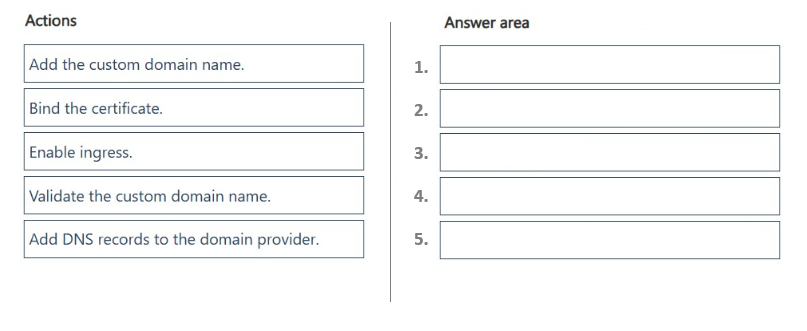

_DRAG DROP — the original ExamTopics question expects you to drag and drop items; the correct targets are not published._

**Most voted:**
1. Enable ingress.
2. Add the custom domain name.
3. Add DNS records to the domain provider.
4. Validate the custom domain name.
5. Bind the certificate.

### Top explanations
- **insanewriters** (5 upvotes): Enable ingress
  You must expose the app publicly before any domain or certificate can be bound.
  Add the custom domain name
  Once ingress is enabled, you register the domain with the Container App.
  Add DNS records to the domain provider
  Azure gives you the required CNAME or TXT records; you must add them at your DNS host.
  Validate the custom domain name
  Azure verifies the DNS records you added.
  Bind the certificate
  After validation succeeds, you can attach the TLS/SSL certificate.
- **MuhammadSaqib** (3 upvotes [Most Recent]): 1. Enable ingress.
  Why: The container app must be publicly accessible via HTTP/HTTPS ingress before you can map any custom domain or certificate to it.
  2. Add the custom domain name.
  Why: When you initiate adding a custom domain in the Azure portal or CLI, Azure generates the unique verification codes and targets needed for your DNS host.
  3. Add DNS records to the domain provider.
  Why: You must create the required CNAME and TXT domain-verification records within your external registrar's DNS management zone using the details provided by Azure.
  4. Validate the custom domain name.
  Why: Azure probes the public DNS network to confirm that the domain records match your container app environment and verify ownership.
  5. Bind the certificate.
  Why: Once ownership validation succeeds, the custom domain can securely bind to an SSL/TLS certificate to enable HTTPS traffic.
- **bashrin** (2 upvotes): Correct Order
  Add the custom domain name.
  Validate the custom domain name.
  Add DNS records to the domain provider.
  Bind the certificate.
  Enable ingress.
  Why This Order Matters
  You can't validate a domain you haven't added yet
  You can't add DNS records before knowing what validation is required
  You can't bind a certificate to an unvalidated domain
  Enabling ingress should be the last step after all security and routing configurations are complete
- **130nk3r5** (2 upvotes): 1 Enable ingress
  2 Add the custom domain name
  3 Add DNS records to the domain provider
  4 Validate the custom domain name
  5 Bind the certificate
  https://learn.microsoft.com/en-us/azure/container-apps/custom-domains-certificates?utm_source=chatgpt.com&tabs=general&pivots=azure-portal#add-a-custom-domain-and-certificate
- **nmatnoh** (1 upvotes): 1. Enable ingress
  2. Add the custom domain name
  3. Validate the custom domain name
  4. Bind the certificate
  5. Add DNS records to the domain provider

## Q1.6 (ID 426630)

You plan to deploy an Azure Container app.
You need to configure the container app to support session affinity.
Which ingress type and revision mode should you assign to the container app?

⭕ **A.** TCP ingress type and single revision mode
⭕ **B.** TCP ingress type and multiple revision mode
⭕ **C.** HTTP ingress type and multiple revision mode
✅ **D.** HTTP ingress type and single revision mode

**Correct answer:** D
**Most voted:** D

### Top explanations
- **MuhammadSaqib** (1 upvotes [Most Recent, Selected Answer: D]): 1. HTTP Ingress Type Session affinity (sticky sessions) is based on client-to-replica consistency using HTTP cookies. HTTP ingress is not supported because TCP routing is done at a lower layer in the network stack (Layer 4) and does not interact with HTTP application layer components like cookies.
  2. Single Revision Mode: Container app supports only the session affinity mechanism built into the platform when the container app is in single revision mode.

## Q1.13 (ID 426618)

You have container source code stored in a Git repository.
The container registry must automatically build and store a new container image whenever a developer commits code to the Git repository.
You must minimize the use of an external build infrastructure.
You need to configure Azure Container Registry (ACR) to manage the build process natively and automatically.
Which two ACR components should you use? Each correct answer presents part of the solution.
NOTE: Each correct selection is worth one point.

✅ **A.** Webhook
⭕ **B.** Quick task
⭕ **C.** Artifact Cache rule
✅ **D.** Source-triggered task

**Correct answer:** A, D
**Most voted:** AD

### Top explanations
- **divya1986** (4 upvotes [Selected Answer: BD]): Manage the build process natively in ACR → Quick task
  A Quick Task lets ACR perform a container image build without requiring external build infrastructure.
  Automatically build when code is committed to Git → Source-triggered task
  A source-triggered task automatically starts an ACR build when source code changes in the configured Git repository.
- **beeboobeep** (1 upvotes [Most Recent, Selected Answer: AD]): while B would keep it form using external sources. A is automated and B relies on manual interaction from the AZ console.
- **Vincenzo_03** (1 upvotes [Selected Answer: AD]): Source-triggered task (D): This is the core component within Azure Container Registry (ACR) Tasks that monitors your Git repository for commits.
  Webhook (A): When you configure a source-triggered task, ACR natively establishes a deployment webhook inside your public or private Git repository (such as GitHub or Azure DevOps).
- **TestAzure26** (1 upvotes [Selected Answer: AD]): Source-triggered task (D): This is the core component within Azure Container Registry (ACR) Tasks that monitors your Git repository for commits.
  Webhook (A): When you configure a source-triggered task, ACR natively establishes a deployment webhook inside your public or private Git repository (such as GitHub or Azure DevOps).
- **joc_lefranc** (1 upvotes): Sorry, but a Quick task is only a one-shot deal, it would not be repeated, you will need to execute one after each push.

## Q1.15 (ID 426605)

DRAG DROP
You are deploying an AI service to ACA.
The service must retrieve secrets securely from Key Vault by using managed identity.
You need to configure secure access.
Which three actions should you perform in sequence? To answer, move the appropriate actions from the list of actions to the answer area and arrange them in the correct order.

**Exhibits**
- Exhibit 1: 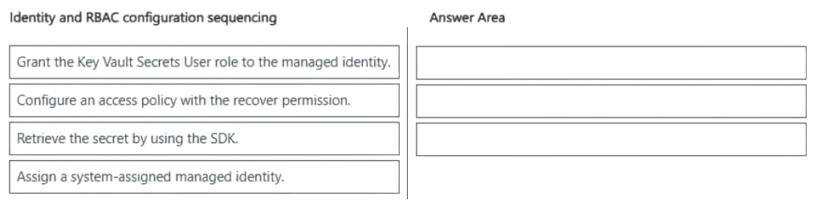

_DRAG DROP — the original ExamTopics question expects you to drag and drop items; the correct targets are not published._

**Most voted:**
- Assign managed identity → ACA gets an Azure identity.
- Grant Key Vault Secrets User role → that identity is authorized to read secrets.
- Retrieve the secret using the SDK → the application can now authenticate through the managed identity and access Key Vault.

### Top explanations
- **bashrin** (25 upvotes [Highly Voted]): Assign managed identity → ACA gets an Azure identity.
  Grant Key Vault Secrets User role → that identity is authorized to read secrets.
  Retrieve the secret using the SDK → the application can now authenticate through the managed identity and access Key Vault.
- **joc_lefranc** (6 upvotes): How can you retrieve the secrets if the identity has not beed assigned yet? Duh
- **Yhohanes** (5 upvotes): 1. Assign system-assigned managed identity
  2. Grant Key /vault Secrets User role to the managed Identity
  3. Retrieve the secret using the SDK
- **kabeer_** (4 upvotes [Most Recent]): Correct options must be
  1) Assign system-assigned managed identity
  2) Grant Key /vault Secrets User role to the managed Identity
  3) Retrieve the secret using the SDK
- **LSCPY** (3 upvotes): Assign a system-assigned managed identity.
  Grant the Key Vault Secrets User role to the managed identity.
  Retrieve the secret by using the SDK.

## Q1.19 (ID 427727)

DRAG DROP
You are designing a solution that will use two Azure Functions apps: App1 and App2. App1 is Windows-based and will be deployed as code. App2 is Linux-based and will be deployed as a container image. Estimates show that the duration of the request processing for both apps will range from 1 to 10 minutes.
You plan to implement App1 and App2 by using the hosting plan to satisfy the following requirements:
•	Request processing can complete within the estimated time range.
•	The autoscaling behavior is event-driven.
•	The upper scaling limit is maximized.
You need to create the hosting plan for the implementation.
Which hosting plan should you create? To answer, move the appropriate hosting plans to the correct apps. You may use each hosting plan once, more than once, or not at all. You may need to move the split bar between panes or scroll to view content.
NOTE: Each correct selection is worth one point.

**Exhibits**
- Exhibit 1: 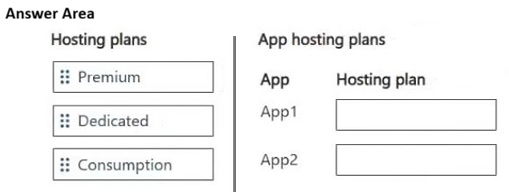

_DRAG DROP — the original ExamTopics question expects you to drag and drop items; the correct targets are not published._

**Most voted:** App1 Consumption plan – since App1 is deployed as code (not a container), the Consumption plan is supported. The Consumption plan has native event-driven autoscaling, and the maximum function execution duration can be configured up to 10 minutes, which exactly covers the given range (1–10 min). Additionally, the Consumption plan has a higher upper limit...

### Top explanations
- **Iva10** (4 upvotes): App1 Consumption plan – since App1 is deployed as code (not a container), the Consumption plan is supported. The Consumption plan has native event-driven autoscaling, and the maximum function execution duration can be configured up to 10 minutes, which exactly covers the given range (1–10 min). Additionally, the Consumption plan has a higher upper limit on the number of instances (up to 200 on Windows) compared to the Premium plan, which satisfies the requirement that "the upper scaling limit is maximized."
- **Ja13** (2 upvotes [Most Recent]): CORRECT ANSWERS
  App1 - Consumption Plan
  App2 - Premium Plan

## Q1.23 (ID 432830)

DRAG DROP
You create an Azure subscription. You then create an Azure resource group.
You plan to create a containerized task that will run as an Azure Container App in regular intervals.
You need to automate the process of creating the task in the resource group by using Azure CLI commands.
Which three commands should you arrange in sequence to develop the solution? To answer, move the appropriate commands from the list of commands to the answer area and arrange them in the correct order.

**Exhibits**
- Exhibit 1: 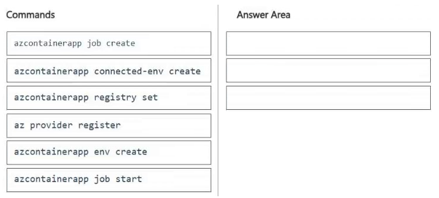

_DRAG DROP — the original ExamTopics question expects you to drag and drop items; the correct targets are not published._

**Most voted:**
- Correct order: A- az provider register
- B- az containerapp env create
- C- az container job create

### Top explanations
- **TrxppBoii** (1 upvotes [Most Recent]): az provider register --namespace Microsoft.App
  az containerapp env create
  az containerapp job create
- **danyal456** (1 upvotes): az provider register
  az containerapp env create
  az containerapp job create
- **Ja13** (1 upvotes): Correct order:
  A- az provider register
  B- az containerapp env create
  C- az container job create

## Q2.1 (ID 421076)

DRAG DROP
Background
Fabrikam Inc. is a global retail analytics company that provides AI-driven demand forecasting and product recommendation services to online retailers. The company is modernizing its solution to run entirely on Microsoft Azure.
The platform ingests transaction data, generates embeddings for semantic retrieval, performs vector similarity search, and returns product recommendations through containerized microservices. Developers use Python and Azure SDKs. Operations teams manage container orchestration, scaling, monitoring, and security.
The solution must meet strict performance, scalability, and security requirements.
Current environment
Application architecture
The Recommendation engine is a customer-facing HTTP API running as a containerized Python application. The engine is deployed to Azure Container Apps (ACA).
Embeddings are stored in Azure Database for PostgreSQL by using pgvector.
Semantic retrieval uses metadata filtering combined with vector similarity search.
Azure Managed Redis is used as a caching layer.
Front-end and API workloads are deployed to Azure Container Apps (ACA).
Batch model retraining workloads run in Azure Kubernetes Service (AKS).
Container and CI/CD
Container images are stored in Azure Container Registry (ACR).
CI/CD uses ACR Tasks to build images on commit.
ACA environments support revision management.
AKS workloads are deployed by using Kubernetes manifest files stored in Git.
Monitoring
Logs are collected in Azure Monitor.
Teams inspect container logs and Kubernetes events when troubleshooting.
Developers write KQL queries to analyze latency spikes.
Business requirements
Customer experience: Maintain a seamless, low-latency recommendation experience for end-users, even during unpredictable seasonal traffic spikes.
Operational cost efficiency: Minimize compute expenditures by deallocating resources during periods of inactivity and by preventing runaway scaling costs.
Data integrity and freshness: Ensure that product recommendations always reflect the most current catalog metadata and pricing to prevent customer dissatisfaction.
Security and compliance: Adhere to a Zero Trust security model by eliminating long-lived credentials and centralizing the management of all sensitive secrets.
Global scalability: Support the rapid ingestion of millions of new product embeddings daily without degrading query performance for existing retailers.
Technical requirements
Performance: Semantic search latency must remain under 200 milliseconds at peak load.
Database optimization: Use pgvector for embeddings and implement metadata filtering to reduce compute overhead. Configure compute and memory appropriately for vector workloads to ensure high-dimensional index residency in RAM and efficient mathematical throughput. Vector similarity calculations must be performed only against products that satisfy mandatory metadata constraints.
Database performance: Database connections must support high concurrency with minimal latency through the implementation of connection optimization.
Data load strategy: To ensure maximum ingestion throughput, secondary indexes must be applied only after bulk loading of embeddings is complete.
Caching: Redis cache entries must expire automatically after 10 minutes. Implement a reactive mechanism to invalidate cache entries upon metadata updates.
Identity: Use managed identities for all service-to-service and service-to-database authentication. Plain-text credentials in configuration files are strictly prohibited.
Secret management: All secrets must be stored centrally. Secrets must be rotated automatically by using a centralized lifecycle policy.
Scaling: Use Kubernetes event-driven autoscaling (KEDA) for event-driven scaling. The Recommendation API must scale based on HTTP traffic, while batch jobs must scale based on queue length and support scale-to-zero.
CI/CD: All images must be stored in Azure Container Registry. Use ACR Tasks to automate image builds triggered by source code commits.
Monitoring: Use KQL to analyze performance telemetry and troubleshoot microservice connectivity failures. Inspect logs and events when troubleshooting AKS and ACA.
You need to implement the semantic retrieval workflow for the recommendation engine to meet the technical and performance requirements of Fabrikam Inc.
Which four actions should you perform in sequence? To answer, move the appropriate actions from the list of actions to the answer area and arrange them in the correct order.

**Exhibits**
- Exhibit 1: 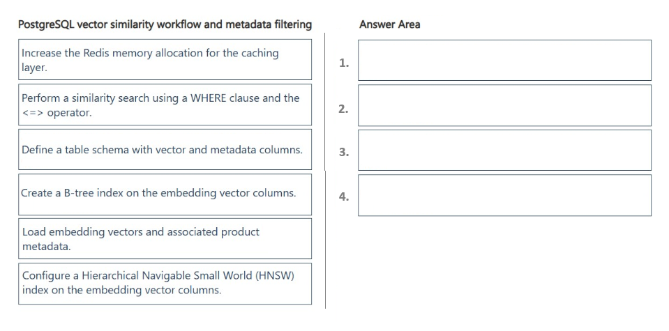

_DRAG DROP — the original ExamTopics question expects you to drag and drop items; the correct targets are not published._

**Most voted:**
- The requirements explicitly state that secondary indexes must be created only after the bulk load is complete.
- Correct order: Define the table schema.
- Load embeddings and metadata.
- Create the HNSW index.
- Run the filtered similarity search.

### Top explanations
- **Mattt** (7 upvotes [Highly Voted]): The requirements explicitly state that secondary indexes must be created only after the bulk load is complete.
  Correct order:
  Define the table schema.
  Load embeddings and metadata.
  Create the HNSW index.
  Run the filtered similarity search.
- **Vandalism** (1 upvotes [Most Recent]): I believe secondary indexes are reserved for metadata filtering. While primary index would be vector operations indexes just like HNSW is.

## Q2.20 (ID 426647)

HOTSPOT
You have a web service that is used to pay for food deliveries. The web service uses Azure Cosmos DB as the data store.
You plan to add a new feature that allows users to set a tip amount. The new feature requires that a property named tip on the document in Azure Cosmos DB must be present and contain a numeric value.
There are many existing websites and mobile apps that use the web service that will not be updated to set the tip property for some time.
How should you complete the trigger?
NOTE: Each correct selection is worth one point.

**Exhibits**
- Exhibit 1: 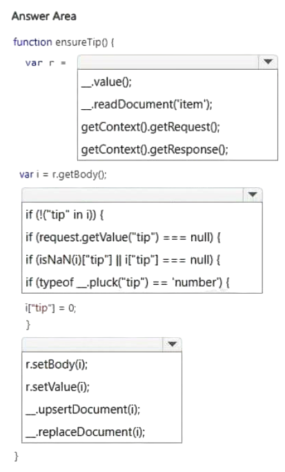

_HOTSPOT — the original ExamTopics question expects you to mark areas on the exhibit above; the correct hotspot coordinates are not published._

**Most voted:** getContext().getRequest();: Retrieves the current operation request object in Azure Cosmos DB, which allows you to inspect and modify the document being created or updated.if (!("tip" in i)) {: Uses native JavaScript to check if the "tip" property does not exist inside the document object (i). If missing, it executes the code to initialize it to...

### Top explanations
- **Ja13** (1 upvotes [Most Recent]): CORRECT ANSWERS:
  A)   get.Context().getRequest();
  B)   if (!("tip" in i)) {
  C)   r.setBody(i);
- **MrTeacher** (1 upvotes): getContext().getRequest();: Retrieves the current operation request object in Azure Cosmos DB, which allows you to inspect and modify the document being created or updated.if (!("tip" in i)) {: Uses native JavaScript to check if the "tip" property does not exist inside the document object (i). If missing, it executes the code to initialize it to 0.r.setBody(i);: Overwrites the original request body with the modified document. Without this line, the changes made to the variable i are discarded and never saved to the database.

## Q2.21 (ID 426606)

DRAG DROP
You are developing a Python application that reads data from Azure Cosmos DB for NoSQL by using the azure-cosmos SDK.
You need to connect to an existing account and run a SQL query against an existing container.
Which four actions should you perform in sequence? To answer, move the appropriate actions from the list of actions to the answer area and arrange them in the correct order.

**Exhibits**
- Exhibit 1: 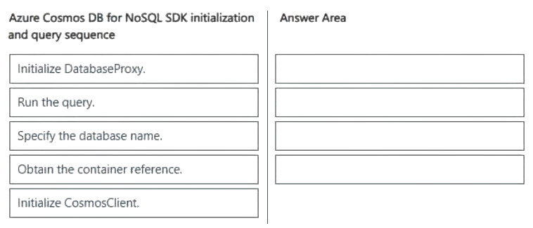

_DRAG DROP — the original ExamTopics question expects you to drag and drop items; the correct targets are not published._

**Most voted:**
- Initialize CosmosClient.
- Initialize DatabaseProxy.
- Obtain the container reference.
- Run the query.

### Top explanations
- **LSCPY** (2 upvotes [Most Recent]): Initialize CosmosClient.
  Initialize DatabaseProxy.
  Obtain the container reference.
  Run the query.

## Q2.26 (ID 426607)

You develop an AI application that stores telemetry documents in Azure Cosmos DB for NoSQL.
Each document contains 30 properties. Queries filter only on deviceId and timestamp.
Write operations consume more RUs than expected.
You need to reduce RU consumption for write operations while maintaining query performance.
What should you do?

⭕ **A.** Exclude unused properties from indexing.
✅ **B.** Configure selective indexing on queried properties.
⭕ **C.** Migrate to a different partition key.
⭕ **D.** Enable strong consistency for all requests.

**Correct answer:** B
**Most voted:** B

### Top explanations
- **sanitest** (2 upvotes [Most Recent, Selected Answer: B]): Because your queries only filter on deviceId and timestamp, there is no benefit in indexing all 30 properties. Azure Cosmos DB's default policy indexes every property, which increases the RU cost of every write because the indexes must be updated for each indexed field.

## Q2.27 (ID 426636)

DRAG DROP
A recommendation system stores 3 million embeddings in Azure Database for PostgreSQL.
During peak hours, P95 similarity-query latency increases, and the cache hit ratio drops significantly.
You suspect that the vector index working set no longer fits in memory, resulting in more disk reads.
You need to scale server resources and validate the outcome.
Which four actions should you perform in sequence? To answer, move the appropriate actions from the list of actions to the answer area and arrange them in the correct order.

**Exhibits**
- Exhibit 1: 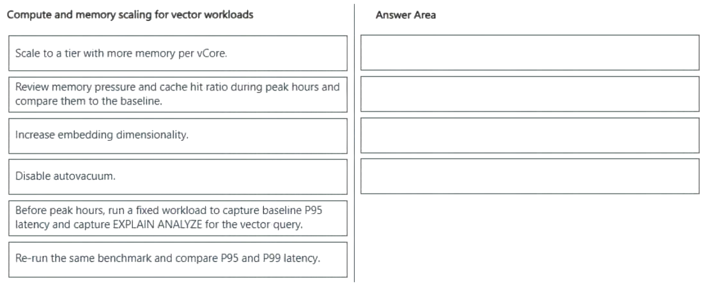

_DRAG DROP — the original ExamTopics question expects you to drag and drop items; the correct targets are not published._

**Most voted:**
- CORRECT ORDER
- A) Before peak hours,run a fixed workload to capture baseline P95 latency and capture EXPLAIN ANALYZE for the vector query.
- B) Review memory pressure and cache hit ratio during peak hours and compare them to the baseline.
- C) Scale to a tier with more memory per vCore.
- D) Re-run the same benchmark and compare P95 and P99 latency.

### Top explanations
- **Ja13** (2 upvotes [Most Recent]): CORRECT ORDER
  A) Before peak hours,run a fixed workload to capture baseline P95 latency and capture EXPLAIN ANALYZE for the vector query.
  B) Review memory pressure and cache hit ratio during peak hours and compare them to the baseline.
  C) Scale to a tier with more memory per vCore.
  D) Re-run the same benchmark and compare P95 and P99 latency.
- **MrTeacher** (1 upvotes): Before peak hours,run a fixed workload to capture baseline P95 latency and capture EXPLAIN ANALYZE for the vector query.
  Review memory pressure and cache hit ratio during peak hours and compare them to the baseline.
  Scale to a tier with more memory per vCore.Re-run the same benchmark and compare P95 and P99 latency.

## Q2.38 (ID 432368)

You are developing a solution that will use a multi-partitioned Azure Cosmos DB database. You plan to use the latest Azure Cosmos DB SDK for development.
The solution must meet the following requirements:
•	Send insert and update operations to an Azure Blob storage account.
•	Process changes to all partitions immediately.
•	Allow parallelization of change processing.
You need to process the Azure Cosmos DB operations.
What are two possible ways to achieve this goal? Each correct answer presents a complete solution.
NOTE: Each correct selection is worth one point.

✅ **A.** Create an Azure Function to use a trigger for Azure Cosmos DB. Configure the trigger to connect to the container.
⭕ **B.** Create an Azure App Service API and implement the change feed estimator of the SDK. Scale the API by using multiple Azure App Service instances.
⭕ **C.** Create a background job in an Azure Kubernetes Service and implement the change feed feature of the SDK.
✅ **D.** Create an Azure Function that uses a FeedIterator object that processes the change feed by using the pull model on the container. Use a FeedRange object to parallelize the processing of the change feed across multiple functions.

**Correct answer:** A, D
**Most voted:** AD

### Top explanations
- **Ja13** (1 upvotes [Most Recent, Selected Answer: AD]): CORRECT ANSWERS
  A and D
  Option	Model	How it meets "all partitions + parallel + immediately"
  A. Functions trigger	Push	It uses the change feed processor behind the scenes and "automatically parallelizes change processing across your container's partitions." It runs on every change
  D. FeedIterator + FeedRange	Pull	You get "one FeedRange per physical partition" and give each one to a different function to run in parallel

## Q2.39 (ID 431947)

HOTSPOT
A company has an Azure Cosmos DB for NoSQL account. The account is configured for session consistency. Data is written to a single Azure region and data can be read from three Azure regions.
An application that will access the Azure Cosmos DB for NoSQL container data using an SDK has the following requirements:
•	Reads from the application must return the most recent committed version of an item from any Azure region.
•	The container items should not automatically be deleted.
You need to implement the changes to the Azure Cosmos DB for NoSQL account.
What should you do? To answer, select the appropriate options in the answer area.
NOTE: Each correct selection is worth one point.

**Exhibits**
- Exhibit 1: 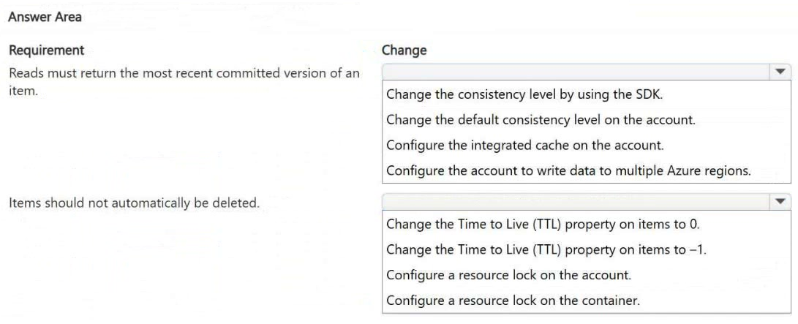

_HOTSPOT — the original ExamTopics question expects you to mark areas on the exhibit above; the correct hotspot coordinates are not published._

**Most voted:**
- CORRET ANSWERS: A -Reads must return the most recent committed version of an item. ------
- -------- Change the default consistency level on the account.
- B - Items should not automatically be deleted -------------------
- ----------Change the Time to Live (TTL) property on items to -1.

### Top explanations
- **Ja13** (1 upvotes [Most Recent]): CORRET ANSWERS:
  A -Reads must return the most recent committed version of an item. ------
  -------- Change the default consistency level on the account.
  B - Items should not automatically be deleted -------------------
  ----------Change the Time to Live (TTL) property on items to -1.

## Q2.40 (ID 432682)

You manage an Azure Cosmos DB for a NoSQL API account named account1. The account contains a database named db1, which contains a container named container1. You configure account1 with a session consistency level.
You plan to develop an application named App1 that will access container1. Individual instances of App1 must perform reads and writes. App1 must allow multiple nodes to participate in the same session.
You need to configure an object to share the session token between the nodes.
Which object should you use?

⭕ **A.** Document response
⭕ **B.** Connection policy
⭕ **C.** Feed options
✅ **D.** Request options

**Correct answer:** D
**Most voted:** D

### Top explanations
- **Ja13** (1 upvotes [Most Recent, Selected Answer: D]): CORRECT ANSWER
  D)
  With session consistency, each client instance keeps its own session token. If App1 runs on several nodes behind a load balancer, your next request can land on a different node that doesn't have your token. To share the session:
  1. Node 1 writes and gets the token from the response (response.SessionToken, header x-ms-session-token).
  2. The token goes to the user, for example in a cookie.
  3. Node 2passes it in the request options: options.SessionToken = token. Now it reads your own writes

## Q3.2 (ID 421095)

HOTSPOT
Background
Proseware Inc. develops AI-powered knowledge management solutions for enterprise customers. The company is modernizing its platform to support semantic search, intelligent document retrieval, and real-time partner integrations.
The engineering team uses Python and Azure SDKs. The architecture is being redesigned to support containerized microservices, vector search workloads, and serverless backend processing.
Planned Application Architecture
Microservices are containerized by using Docker.
Code for containerized microservices and Azure Function apps is developed locally but stored in a GitHub repository.
Custom images for containerized microservices are stored in Azure Container Registry (ACR).
Base images are stored in Docker Hub. Custom images must be rebuilt automatically whenever their base images are updated.
Azure Cosmos DB for NoSQL stores documents, metadata, and vector embeddings.
Azure Functions generate vector embeddings of Azure Cosmos DB for NoSQL-hosted documents and send messages to Service Bus to trigger search index updates.
Azure Container Apps (ACA) apps host backend API services that provide semantic search across Azure Cosmos DB for NoSQL documents. API services process Service Bus messages and update search indexes.
Azure Kubernetes Service (AKS) processes batch vector embedding regeneration for existing Azure Cosmos DB for NoSQL documents (whenever the embedding model is changed).
An extranet-facing containerized webhook allows business partners to submit documents to be processed by internal AI workflows for semantic search and retrieval.
Monitoring
Telemetry generated by Azure resources is sent to Azure Monitor.
A Log Analytics workspace is used to collect ACA apps logs, AKS container logs, and Azure Functions apps logs.
Monitoring of Azure Functions is currently implemented by using Azure Application Insights SDK instrumentation.
Business Requirements
Embeddings for new or updated Azure Cosmos DB for NoSQL-hosted documents must be automatically generated.
Backend API services must scale automatically during business hours.
Cold start delay of backend APIs must be minimized.
Secrets must be stored outside of container images.
Developers must be able to correlate telemetry across Azure Functions hosts and apps.
All tracing must be implemented by using OpenTelemetry SDK instrumentation.
Development efforts must be minimized.
Technical Requirements
Container images must be built automatically and validated before code updates are merged into the main branch.
Image build automation must run inside the Azure Container Registry, eliminating dependency on local developer machines and external build services.
Dependency of image builds on local developer machines must be eliminated.
Event-driven scaling in ACA must occur based on the number of pending messages in the Azure Service Bus queue.
Azure Cosmos DB for NoSQL RU consumption must be minimized.
Vector similarity search must use embeddings stored in Azure Cosmos DB for NoSQL.
The partner-facing containerized webhook service must run on Azure App Service.
Secrets must NOT be stored in container images, source control, or application configuration directly. They must be accessed securely at runtime.
All secrets must be stored centrally in Azure Key Vault and accessed at runtime through a managed identity.
Azure App Service must supply secrets at runtime without relying on external services.
Resources and workloads must be deployed by using Bicep templates through an automated, version-controlled pipeline. Local and command-line deployments must be eliminated to ensure repeatable, auditable deployments.
Known Issues
RU consumption spikes during vector similarity queries.
You need to configure image build automation based on the technical requirements.
Which settings should you configure? To answer, select the appropriate options in the answer area.
NOTE: Each correct selection is worth one point.

**Exhibits**
- Exhibit 1: 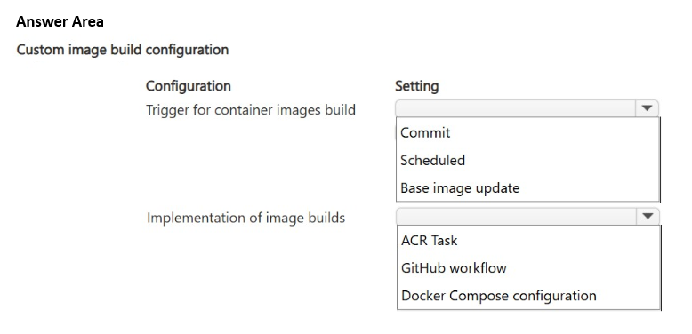

_HOTSPOT — the original ExamTopics question expects you to mark areas on the exhibit above; the correct hotspot coordinates are not published._

**Most voted:**
- Requirement: Container images must be built automatically and validated before code updates are merged into the main branch.
- Requirement: Image build automation must run inside Azure Container Registry, eliminating dependency on local developer machines and *external build services*.

### Top explanations
- **Mattt** (4 upvotes): Commit:
  Requirement: Container images must be built automatically and validated before code updates are merged into the main branch.
  ACR Task:
  Requirement: Image build automation must run inside Azure Container Registry, eliminating dependency on local developer machines and *external build services*.
- **LSCPY** (1 upvotes [Most Recent]): Trigger for container images build: Base image update
  Implementation of image builds: ACR Task

## Q3.11 (ID 421104)

HOTSPOT
You configure an Event Grid event subscription that routes AI file-upload events to an Azure Function endpoint.
Events must be delivered only in the following conditions:
The event path starts with /uploads/ai/.
The payload property data.fileType is "pdf."
You must store undelivered events for later investigation and reprocessing if the subscriber endpoint cannot accept an event after multiple retries.
You need to configure the filtering and reliability settings.
Which configurations should you use? To answer, select the appropriate options in the answer area.
NOTE: Each correct selection is worth one point.

**Exhibits**
- Exhibit 1: 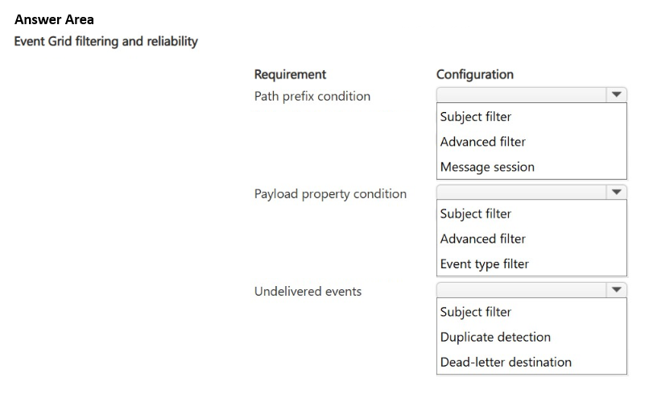

_HOTSPOT — the original ExamTopics question expects you to mark areas on the exhibit above; the correct hotspot coordinates are not published._

**Most voted:**
- Path prefix condition: Subject filter
- Payload property condition: Advanced filter
- Undelivered events: Dead-letter destination

### Top explanations
- **LSCPY** (7 upvotes [Most Recent, Highly Voted]): Path prefix condition: Subject filter
  Payload property condition: Advanced filter
  Undelivered events: Dead-letter destination
- **Mattt** (3 upvotes): Path prefix condition: Subject filter
  The requirement checks whether the event subject starts with /uploads/ai/. The Subject begins with option is designed specifically for prefix matching.

## Q3.12 (ID 421105)

HOTSPOT
You are creating an app that uses Event Grid to connect with other services. Your app's event data will be sent to a serverless function that checks compliance. This function is maintained by your company.
You write a new event subscription at the scope of your resource. The event must be invalidated after a specific period of time.
You need to configure Event Grid.
What should you do? To answer, select the appropriate options in the answer area.
NOTE: Each correct selection is worth one point.

**Exhibits**
- Exhibit 1: 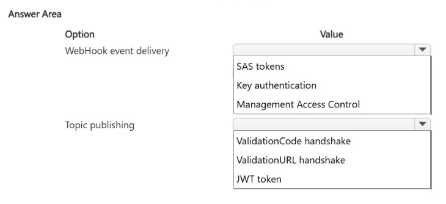

_HOTSPOT — the original ExamTopics question expects you to mark areas on the exhibit above; the correct hotspot coordinates are not published._

**Most voted:**
- SAS tokens
- ValidationCode handshake
- 1-Use SAS tokens because they support an expiration time, allowing publishing access to become invalid automatically after the specified period.

### Top explanations
- **Mattt** (2 upvotes [Most Recent]): SAS tokens
  ValidationCode handshake
  1-Use SAS tokens because they support an expiration time, allowing publishing access to become invalid automatically after the specified period.

## Q3.18 (ID 426608)

You are designing an Azure Function app that processes large image uploads submitted by users through an HTTP endpoint.
The solution must:
•	Prevent client timeouts by decoupling image processing from the initial upload request.
•	Support automatic retry behavior for failed processing attempts.
•	Scale the background processing independently of the rate of incoming HTTP uploads.
You need to design a scalable and reliable asynchronous processing solution.
Which two actions should you implement? Each correct answer presents part of the solution.
NOTE: Each correct selection is worth one point.

✅ **A.** Implement a queue-triggered function for image processing.
⭕ **B.** Configure retry policies on a storage queue.
⭕ **C.** Process the image inside the HTTP-triggered function.
✅ **D.** Persist upload metadata to Azure Storage.

**Correct answer:** A, D
**Most voted:** AD

### Top explanations
- **LSCPY** (4 upvotes [Selected Answer: AD]): A. Implement a queue-triggered function for image processing.
  D. Persist upload metadata to Azure Storage.
- **owais62** (2 upvotes [Most Recent, Selected Answer: AD]): A. Implement a queue-triggered function for image processing.
  D. Persist upload metadata to Azure Storage.

## Q3.34 (ID 427730)

Note: This question is part of a series of questions that present the same scenario. Each question in the series contains a unique solution that might meet the stated goals. Some question sets might have more than one correct solution, while others might not have a correct solution.
After you answer a question in this section, you will NOT be able to return to it. As a result, these questions will not appear on the review screen.
You are implementing an application by using Azure Event Grid to push near-real-time information to customers.
You have the following requirements:
•	You must send events to thousands of customers that include hundreds of various event types.
•	The events must be filtered by event type before processing.
•	Authentication and authorization must be handled by using Microsoft Entra ID.
•	The events must be published to a single endpoint.
You need to implement Azure Event Grid.
Solution: Publish events to a partner topic. Create an event subscription for each customer.
Does the solution meet the goal?

⭕ **A.** Yes
✅ **B.** No

**Correct answer:** B
**Most voted:** B

### Top explanations
- **insanewriters** (4 upvotes [Most Recent, Selected Answer: B]): No
  This solution doesn't meet the goal because a partner topic is the wrong kind of resource for this scenario:
  Partner topics are for consuming events, not publishing them. A partner topic is how a customer receives events from a third-party SaaS provider (a "partner") that has registered with Event Grid. Your application can't publish its own events to a partner topic the way it would to a custom topic or domain.
  It doesn't scale to thousands of customers with isolated access. One topic with a subscription per customer gives you no per-customer authorization boundary. Every customer's subscription would sit on the same resource.

## Q3.44 (ID 432547)

DRAG DROP
You develop software solutions for a mobile delivery service. You are developing a mobile app that users can use to order from a restaurant in their area. The app uses the following workflow:
1. A driver selects the restaurants for which they will deliver orders.
2. Orders are sent to all available drivers in an area.
3. Only orders for the selected restaurants will appear for the driver.
4. The first driver to accept an order removes it from the list of available orders.
You need to implement an Azure Service Bus solution.
Which three actions should you perform in sequence? To answer, move the appropriate actions from the list of actions to the answer area and arrange them in the correct order.

**Exhibits**
- Exhibit 1: 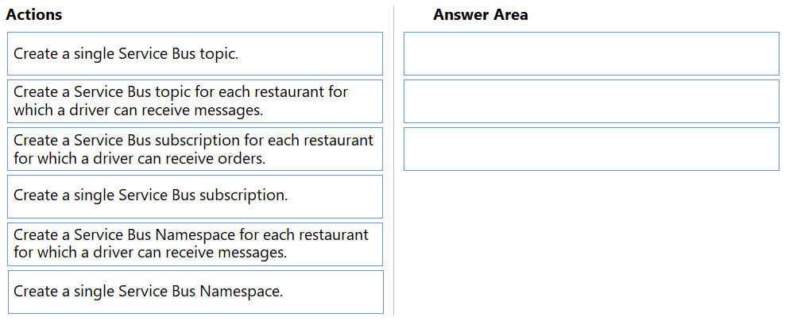

_DRAG DROP — the original ExamTopics question expects you to drag and drop items; the correct targets are not published._

**Most voted:**
1. Create a single Service Bus Namespace.
2. Create a single Service Bus topic.
3. Create a Service Bus subscription for each restaurant for which a driver can receive orders.

### Top explanations
- **Ja13** (1 upvotes [Most Recent]): CORRECT ANSWERS:
  1. Create a single Service Bus Namespace.
  2. Create a single Service Bus topic.
  3. Create a Service Bus subscription for each restaurant for which a driver can receive orders.

## Q4.3 (ID 421111)

DRAG DROP
Background
Fabrikam Inc. is a global retail analytics company that provides AI-driven demand forecasting and product recommendation services to online retailers. The company is modernizing its solution to run entirely on Microsoft Azure.
The platform ingests transaction data, generates embeddings for semantic retrieval, performs vector similarity search, and returns product recommendations through containerized microservices. Developers use Python and Azure SDKs. Operations teams manage container orchestration, scaling, monitoring, and security.
The solution must meet strict performance, scalability, and security requirements.
Current environment
Application architecture
The Recommendation engine is a customer-facing HTTP API running as a containerized Python application. The engine is deployed to Azure Container Apps (ACA).
Embeddings are stored in Azure Database for PostgreSQL by using pgvector.
Semantic retrieval uses metadata filtering combined with vector similarity search.
Azure Managed Redis is used as a caching layer.
Front-end and API workloads are deployed to Azure Container Apps (ACA).
Batch model retraining workloads run in Azure Kubernetes Service (AKS).
Container and CI/CD
Container images are stored in Azure Container Registry (ACR).
CI/CD uses ACR Tasks to build images on commit.
ACA environments support revision management.
AKS workloads are deployed by using Kubernetes manifest files stored in Git.
Monitoring
Logs are collected in Azure Monitor.
Teams inspect container logs and Kubernetes events when troubleshooting.
Developers write KQL queries to analyze latency spikes.
Business requirements
Customer experience: Maintain a seamless, low-latency recommendation experience for end-users, even during unpredictable seasonal traffic spikes.
Operational cost efficiency: Minimize compute expenditures by deallocating resources during periods of inactivity and by preventing runaway scaling costs.
Data integrity and freshness: Ensure that product recommendations always reflect the most current catalog metadata and pricing to prevent customer dissatisfaction.
Security and compliance: Adhere to a Zero Trust security model by eliminating long-lived credentials and centralizing the management of all sensitive secrets.
Global scalability: Support the rapid ingestion of millions of new product embeddings daily without degrading query performance for existing retailers.
Technical requirements
Performance: Semantic search latency must remain under 200 milliseconds at peak load.
Database optimization: Use pgvector for embeddings and implement metadata filtering to reduce compute overhead. Configure compute and memory appropriately for vector workloads to ensure high-dimensional index residency in RAM and efficient mathematical throughput. Vector similarity calculations must be performed only against products that satisfy mandatory metadata constraints.
Database performance: Database connections must support high concurrency with minimal latency through the implementation of connection optimization.
Data load strategy: To ensure maximum ingestion throughput, secondary indexes must be applied only after bulk loading of embeddings is complete.
Caching: Redis cache entries must expire automatically after 10 minutes. Implement a reactive mechanism to invalidate cache entries upon metadata updates.
Identity: Use managed identities for all service-to-service and service-to-database authentication. Plain-text credentials in configuration files are strictly prohibited.
Secret management: All secrets must be stored centrally. Secrets must be rotated automatically by using a centralized lifecycle policy.
Scaling: Use Kubernetes event-driven autoscaling (KEDA) for event-driven scaling. The Recommendation API must scale based on HTTP traffic, while batch jobs must scale based on queue length and support scale-to-zero.
CI/CD: All images must be stored in Azure Container Registry. Use ACR Tasks to automate image builds triggered by source code commits.
Monitoring: Use KQL to analyze performance telemetry and troubleshoot microservice connectivity failures. Inspect logs and events when troubleshooting AKS and ACA.
You need to troubleshoot connectivity failures between microservices running in AKS.
Which troubleshooting actions should you perform? To answer, move the appropriate action to the correct troubleshooting scenario. You may use each action once, more than once, or not at all. You may need to move the split bar between panes or scroll to view content.
NOTE: Each correct selection is worth one point.

**Exhibits**
- Exhibit 1: 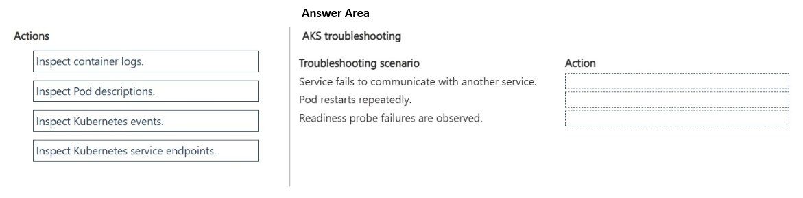

_DRAG DROP — the original ExamTopics question expects you to drag and drop items; the correct targets are not published._

**Most voted:**
- Service fails to communicate with another service: =Inspect Kubernetes service endpoints.
- Pod restarts repeatedly: = Inspect container logs.
- Readiness probe failures are observed =: Inspect Kubernetes events.

### Top explanations
- **Mattt** (4 upvotes): Service fails to communicate with another service
  → Inspect Kubernetes service endpoints
  Pod restarts repeatedly
  → Inspect container logs
  Readiness probe failures are observed
  → Inspect Kubernetes events
- **jamony** (3 upvotes): Service fails to communicate with another service	=Inspect Kubernetes service endpoints.
  Pod restarts repeatedly	= Inspect container logs.
  Readiness probe failures are observed =	Inspect Kubernetes events.
  Service endpoints confirm whether the target service has valid backend pods. Microsoft identifies checking endpoints as the first step when a Kubernetes service is inaccessible.
  For repeated restarts or CrashLoopBackOff, container logs are usually the most direct way to identify the application or startup error.
- **Roman_Rabodzey** (2 upvotes): Service fails to communicate with another service
  → Inspect Kubernetes service endpoints
  Pod restarts repeatedly
  → Inspect container logs
  Readiness probe failures are observed
  → Inspect Pod descriptions
  'kubectl describe pods' shows pod events as well as the liveness/readiness configuration, which helps more in troubleshooting, while 'kubectl get events' shows only events
- **LSCPY** (1 upvotes [Most Recent]): Service fails to communicate with another service.: Inspect Kubernetes service endpoints.
  Pod restarts repeatedly. : Inspect container logs.
  Readiness probe failures are observed.: Inspect Pod descriptions

## Q4.4 (ID 421112)

DRAG DROP
Background
Proseware Inc. develops AI-powered knowledge management solutions for enterprise customers. The company is modernizing its platform to support semantic search, intelligent document retrieval, and real-time partner integrations.
The engineering team uses Python and Azure SDKs. The architecture is being redesigned to support containerized microservices, vector search workloads, and serverless backend processing.
Planned Application Architecture
Microservices are containerized by using Docker.
Code for containerized microservices and Azure Function apps is developed locally but stored in a GitHub repository.
Custom images for containerized microservices are stored in Azure Container Registry (ACR).
Base images are stored in Docker Hub. Custom images must be rebuilt automatically whenever their base images are updated.
Azure Cosmos DB for NoSQL stores documents, metadata, and vector embeddings.
Azure Functions generate vector embeddings of Azure Cosmos DB for NoSQL-hosted documents and send messages to Service Bus to trigger search index updates.
Azure Container Apps (ACA) apps host backend API services that provide semantic search across Azure Cosmos DB for NoSQL documents. API services process Service Bus messages and update search indexes.
Azure Kubernetes Service (AKS) processes batch vector embedding regeneration for existing Azure Cosmos DB for NoSQL documents (whenever the embedding model is changed).
An extranet-facing containerized webhook allows business partners to submit documents to be processed by internal AI workflows for semantic search and retrieval.
Monitoring
Telemetry generated by Azure resources is sent to Azure Monitor.
A Log Analytics workspace is used to collect ACA apps logs, AKS container logs, and Azure Functions apps logs.
Monitoring of Azure Functions is currently implemented by using Azure Application Insights SDK instrumentation.
Business Requirements
Embeddings for new or updated Azure Cosmos DB for NoSQL-hosted documents must be automatically generated.
Backend API services must scale automatically during business hours.
Cold start delay of backend APIs must be minimized.
Secrets must be stored outside of container images.
Developers must be able to correlate telemetry across Azure Functions hosts and apps.
All tracing must be implemented by using OpenTelemetry SDK instrumentation.
Development efforts must be minimized.
Technical Requirements
Container images must be built automatically and validated before code updates are merged into the main branch.
Image build automation must run inside the Azure Container Registry, eliminating dependency on local developer machines and external build services.
Dependency of image builds on local developer machines must be eliminated.
Event-driven scaling in ACA must occur based on the number of pending messages in the Azure Service Bus queue.
Azure Cosmos DB for NoSQL RU consumption must be minimized.
Vector similarity search must use embeddings stored in Azure Cosmos DB for NoSQL.
The partner-facing containerized webhook service must run on Azure App Service.
Secrets must NOT be stored in container images, source control, or application configuration directly. They must be accessed securely at runtime.
All secrets must be stored centrally in Azure Key Vault and accessed at runtime through a managed identity.
Azure App Service must supply secrets at runtime without relying on external services.
Resources and workloads must be deployed by using Bicep templates through an automated, version-controlled pipeline. Local and command-line deployments must be eliminated to ensure repeatable, auditable deployments.
Known Issues
RU consumption spikes during vector similarity queries.
You need to implement trace correlation according to the business requirements.
Which three actions should you perform in sequence? To answer, move the appropriate actions from the list of actions to the answer area and arrange them in the correct order.
NOTE: More than one order of answer choices is correct. You will receive credit for any of the correct orders you select.

**Exhibits**
- Exhibit 1: 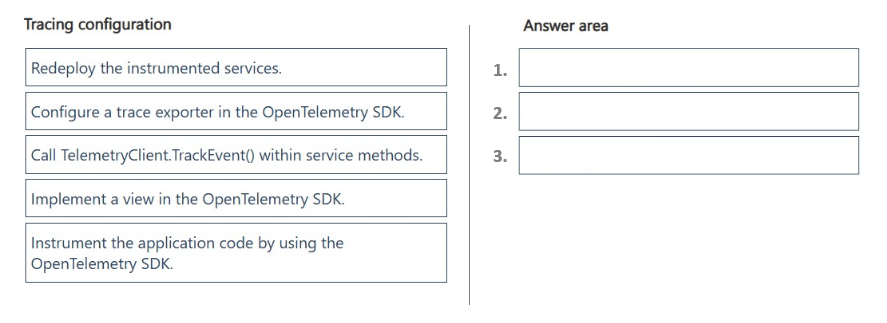

_DRAG DROP — the original ExamTopics question expects you to drag and drop items; the correct targets are not published._

**Most voted:**
- All tracing must be implemented by using OpenTelemetry SDK instrumentation.
- Development efforts must be minimized.

### Top explanations
- **Mattt** (1 upvotes [Most Recent]): Requirements:
  - Developers must be able to correlate telemetry across Azure Functions hosts and apps.
  - All tracing must be implemented by using OpenTelemetry SDK instrumentation.
  - Development efforts must be minimized.

## Q4.5 (ID 421113)

DRAG DROP
Background
Proseware Inc. develops AI-powered knowledge management solutions for enterprise customers. The company is modernizing its platform to support semantic search, intelligent document retrieval, and real-time partner integrations.
The engineering team uses Python and Azure SDKs. The architecture is being redesigned to support containerized microservices, vector search workloads, and serverless backend processing.
Planned Application Architecture
Microservices are containerized by using Docker.
Code for containerized microservices and Azure Function apps is developed locally but stored in a GitHub repository.
Custom images for containerized microservices are stored in Azure Container Registry (ACR).
Base images are stored in Docker Hub. Custom images must be rebuilt automatically whenever their base images are updated.
Azure Cosmos DB for NoSQL stores documents, metadata, and vector embeddings.
Azure Functions generate vector embeddings of Azure Cosmos DB for NoSQL-hosted documents and send messages to Service Bus to trigger search index updates.
Azure Container Apps (ACA) apps host backend API services that provide semantic search across Azure Cosmos DB for NoSQL documents. API services process Service Bus messages and update search indexes.
Azure Kubernetes Service (AKS) processes batch vector embedding regeneration for existing Azure Cosmos DB for NoSQL documents (whenever the embedding model is changed).
An extranet-facing containerized webhook allows business partners to submit documents to be processed by internal AI workflows for semantic search and retrieval.
Monitoring
Telemetry generated by Azure resources is sent to Azure Monitor.
A Log Analytics workspace is used to collect ACA apps logs, AKS container logs, and Azure Functions apps logs.
Monitoring of Azure Functions is currently implemented by using Azure Application Insights SDK instrumentation.
Business Requirements
Embeddings for new or updated Azure Cosmos DB for NoSQL-hosted documents must be automatically generated.
Backend API services must scale automatically during business hours.
Cold start delay of backend APIs must be minimized.
Secrets must be stored outside of container images.
Developers must be able to correlate telemetry across Azure Functions hosts and apps.
All tracing must be implemented by using OpenTelemetry SDK instrumentation.
Development efforts must be minimized.
Technical Requirements
Container images must be built automatically and validated before code updates are merged into the main branch.
Image build automation must run inside the Azure Container Registry, eliminating dependency on local developer machines and external build services.
Dependency of image builds on local developer machines must be eliminated.
Event-driven scaling in ACA must occur based on the number of pending messages in the Azure Service Bus queue.
Azure Cosmos DB for NoSQL RU consumption must be minimized.
Vector similarity search must use embeddings stored in Azure Cosmos DB for NoSQL.
The partner-facing containerized webhook service must run on Azure App Service.
Secrets must NOT be stored in container images, source control, or application configuration directly. They must be accessed securely at runtime.
All secrets must be stored centrally in Azure Key Vault and accessed at runtime through a managed identity.
Azure App Service must supply secrets at runtime without relying on external services.
Resources and workloads must be deployed by using Bicep templates through an automated, version-controlled pipeline. Local and command-line deployments must be eliminated to ensure repeatable, auditable deployments.
Known Issues
RU consumption spikes during vector similarity queries.
You need to configure event-driven scaling for the backend API services to meet the technical requirements.
Which settings should you use for each element? To answer, move the appropriate settings to the correct elements. You may use each setting once, more than once, or not at all. You may need to move the split bar between panes or scroll to view content.
NOTE: Each correct selection is worth one point.

**Exhibits**
- Exhibit 1: 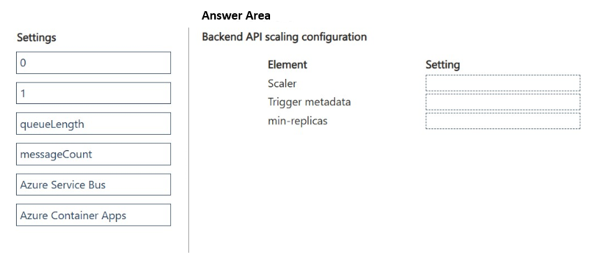

_DRAG DROP — the original ExamTopics question expects you to drag and drop items; the correct targets are not published._

**Most voted:** the 2nd one should be queueLength, While messageCount is commonly used across other KEDA scalers (like RabbitMQ or Azure Storage Queues), the Azure Service Bus scaler specifically maps the target message count threshold to queueLength.

### Top explanations
- **Codia** (2 upvotes): the 2nd one should be queueLength, While messageCount is commonly used across other KEDA scalers (like RabbitMQ or Azure Storage Queues), the Azure Service Bus scaler specifically maps the target message count threshold to queueLength.
- **Mattt** (2 upvotes): min-replicas: 1
  {Cold start delay of backend APIs must be minimized}
  min-replicas should be set to 1 to keep at least one API replica running and minimize cold-start latency. Setting it to 0 allows the app to scale to zero, which can introduce a delay when the next message arrives.
- **Ja13** (1 upvotes [Most Recent]): CORRECT ANSWERS:
  A) Scaler                      -    Azure Service Bus
  B) Trigger metadata    -    messageCount
  C) min-replicas             -    1
- **Mattt** (1 upvotes): Requirements:
  - Event-driven scaling in ACA must occur based on the number of pending messages in the Azure Service Bus queue.
  - Cold start delay of backend APIs must be minimized.

## Q4.14 (ID 421122)

Note: This question is part of a series of questions that present the same scenario. Each question in the series contains a unique solution that might meet the stated goals. Some question sets might have more than one correct solution, while others might not have a correct solution.
After you answer a question in this section, you will NOT be able to return to it. As a result, these questions will not appear on the review screen.
You are preparing a production deployment for an Azure Function app. The app will run across multiple environments.
The solution must support environment-specific configuration and prevent secrets from being stored in source control.
You need to develop the solution.
Solution: Store connection strings in the Function app application settings configured in the Azure Portal.
Does the solution meet the goal?

✅ **A.** Yes
⭕ **B.** No

**Correct answer:** A
**Most voted:** A

### Top explanations
- **tanvralam** (3 upvotes [Most Recent, Selected Answer: A]): Azure Function App Application Settings support:
  - Environment-specific configuration: Each environment (Dev, Test, Prod) can have different connection strings.
  - Secret protection: Connection strings are stored in Azure rather than source control.
  - Runtime access: Azure Functions can retrieve settings through environment variables.

## Q4.28 (ID 421136)

DRAG DROP
A Python API running in ACA must send distributed traces to Azure Monitor.
The API creates spans. However, no traces appear in Azure Monitor.
You need to configure the OpenTelemetry SDK pipeline to export traces to Azure Monitor.
What should you do? To answer, move the appropriate actions to the correct requirements. You may use each action once, more than once, or not at all. You may need to move the split bar between panes or scroll to view content.
NOTE: Each correct selection is worth one point.

**Exhibits**
- Exhibit 1: 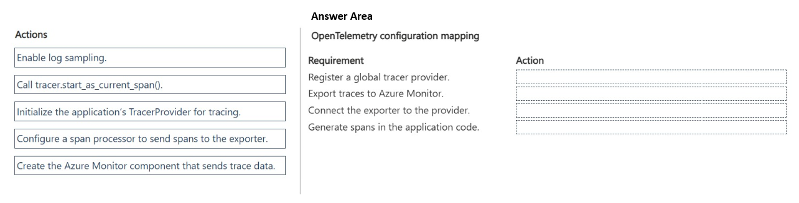

_DRAG DROP — the original ExamTopics question expects you to drag and drop items; the correct targets are not published._

**Most voted:**
- Register a global tracer provider → Initialize the application’s TracerProvider.
- Export traces to Azure Monitor → Create the Azure Monitor trace exporter.
- Connect the exporter to the provider → Configure a span processor with the exporter.
- Generate spans → Call tracer.start_as_current_span().

### Top explanations
- **LSCPY** (3 upvotes [Most Recent]): Register a global tracer provider.: Initialize the application's TracerProvider for tracing.
  Export traces to Azure Monitor. : Create the Azure Monitor component that sends trace data.
  Connect the exporter to the provider. : Configure a span processor to send spans to the exporter.
  Generate spans in the application code.: Call tracer.start_as_current_span().
- **Mattt** (3 upvotes): The provided answer is incorrect because it mismatches the OpenTelemetry components with their responsibilities.
  The correct mapping is:
  Register a global tracer provider → Initialize the application’s TracerProvider.
  Export traces to Azure Monitor → Create the Azure Monitor trace exporter.
  Connect the exporter to the provider → Configure a span processor with the exporter.
  Generate spans → Call tracer.start_as_current_span().

## Q4.45 (ID 426659)

Note: This question is part of a series of questions that present the same scenario. Each question in the series contains a unique solution that might meet the stated goals. Some question sets might have more than one correct solution, while others might not have a correct solution.
After you answer a question in this section, you will NOT be able to return to it. As a result, these questions will not appear on the review screen.
You plan to deploy a container to an Azure App Service API app named api1. You host the source code for api1 in a GitHub repository. The container uses the API key at runtime to connect to a backend service.
The container must be able to retrieve the API key at runtime without exposing it in the source repository or Git commit history.
You need to ensure that the API key remains outside of Git commit history and is available to the container at runtime.
Solution: Store the API key as an App Service application setting configured through the Azure Portal.
Does the solution meet the goal?

✅ **A.** Yes
⭕ **B.** No

**Correct answer:** A
**Most voted:** A

### Top explanations
- **insanewriters** (1 upvotes [Most Recent, Selected Answer: A]): It's preferrable to use KV, but this is a valid approach.

## Q4.52 (ID 431985)

HOTSPOT
You are a developer building a web site using a web app. The web site stores configuration data in Azure App Configuration.
Access to Azure App Configuration has been configured to use the identity of the web app for authentication. Security requirements specify that no other authentication systems must be used.
You import all required libraries.
You need to load configuration data from Azure App Configuration.
How should you complete the code? To answer, select the appropriate options in the answer area.
NOTE: Each correct selection is worth one point.

**Exhibits**
- Exhibit 1: 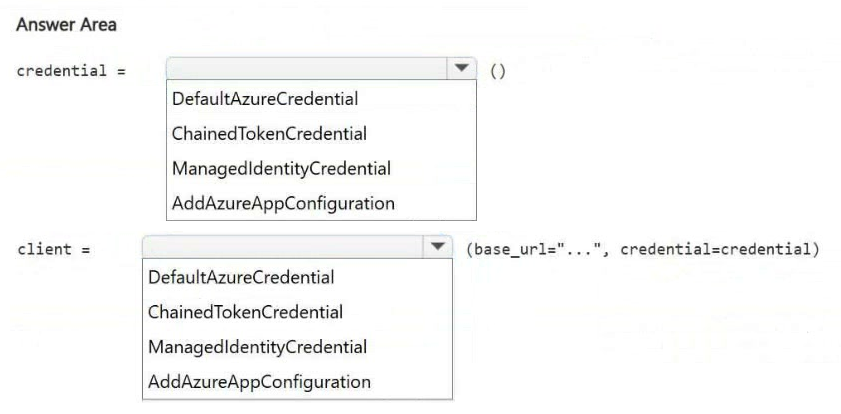

_HOTSPOT — the original ExamTopics question expects you to mark areas on the exhibit above; the correct hotspot coordinates are not published._

**Most voted:**
- Box: Choice
- A) credential =: ManagedIdentityCredential
- B) client =: AddAzureAppConfiguration

### Top explanations
- **Ja13** (1 upvotes [Most Recent]): CORRECT ANSWERS:
  Box	Choice
  A) credential =	ManagedIdentityCredential
  B) client =	AddAzureAppConfiguration
  Why
  * Box 1: the question gives two clues: "the identity of the web app" and "no other authentication systems must be used." That means onlyManagedIdentityCredential. Any chain could authenticate some other way.
  * Box 2: it's the only option that loads configuration. The other three are credentials, not clients.

## Q4.59 (ID 431889)

DRAG DROP
A company has an Azure subscription named Sub1. Sub1 contains an App Configuration store named AppConfig1.
You plan to implement an App Service web app named App1, which will be accessed by users in your organization. App1 will have a dev, test, and prod instance. Each web app instance will connect to a different back-end API endpoint. For each web app instance, you plan to assign a different layout of webpages to different groups of users based on their department.
The implementation must ensure that:
•	API endpoint details are stored in the JSON format and encrypted with a custom key.
•	User assignments of layout pages can be changed without any web app code modifications.
You need to configure AppConfig1 to support your implementation.
What should you create in AppConfig1? To answer, move the appropriate object types to the correct configurations. You may use each object type once, more than once, or not at all. You may need to move the split bar between panes or scroll to view content.
NOTE: Each correct selection is worth one point.

**Exhibits**
- Exhibit 1: 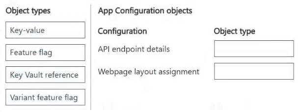

_DRAG DROP — the original ExamTopics question expects you to drag and drop items; the correct targets are not published._

**Most voted:**
- A) API endpoint details: Key-value
- B) Webpage layout assignment: Variant feature flag

### Top explanations
- **Ja13** (1 upvotes [Most Recent]): CORRECT ANSWERS
  A) API endpoint details	Key-value
  B) Webpage layout assignment	Variant feature flag
  Why
  * Box 1, Key-value:
  • "JSON format": a key-value can have content type application/json.
  • "Encrypted with a custom key": you turn on a customer-managed key for the whole store. Microsoft says it encrypts "the values found in key-value pairs."
  • So a normal key-value covers both requirements.
  * Box 2, Variant feature flag: the clue is "different layouts for different groups." A variant flag has "multiple variants... assigned to specific users, groups, or percentile buckets."
  • Each layout is a variant, and each department is a group.
  • You change who gets which layout in the portal, with no code changes.
