# AI-300 Operationalizing Machine Learning and Generative AI Solutions Study Guide

_107 questions generated from ExamTopics discussions._

## Table of contents

- [Q2.1](#q2-1)
- [Q2.2](#q2-2)
- [Q2.3](#q2-3)
- [Q2.4](#q2-4)
- [Q2.5](#q2-5)
- [Q2.6](#q2-6)
- [Q2.7](#q2-7)
- [Q2.8](#q2-8)
- [Q2.9](#q2-9)
- [Q2.10](#q2-10)
- [Q2.11](#q2-11)
- [Q2.12](#q2-12)
- [Q2.13](#q2-13)
- [Q2.14](#q2-14)
- [Q2.15](#q2-15)
- [Q2.16](#q2-16)
- [Q2.17](#q2-17)
- [Q2.19](#q2-19)
- [Q2.20](#q2-20)
- [Q2.21](#q2-21)
- [Q2.22](#q2-22)
- [Q2.23](#q2-23)
- [Q2.24](#q2-24)
- [Q2.25](#q2-25)
- [Q2.26](#q2-26)
- [Q2.27](#q2-27)
- [Q2.28](#q2-28)
- [Q2.29](#q2-29)
- [Q2.30](#q2-30)
- [Q2.31](#q2-31)
- [Q2.32](#q2-32)
- [Q2.33](#q2-33)
- [Q2.34](#q2-34)
- [Q3.1](#q3-1)
- [Q3.2](#q3-2)
- [Q3.3](#q3-3)
- [Q3.4](#q3-4)
- [Q3.5](#q3-5)
- [Q3.6](#q3-6)
- [Q3.7](#q3-7)
- [Q3.8](#q3-8)
- [Q3.9](#q3-9)
- [Q3.10](#q3-10)
- [Q3.11](#q3-11)
- [Q3.12](#q3-12)
- [Q3.13](#q3-13)
- [Q3.14](#q3-14)
- [Q3.15](#q3-15)
- [Q3.17](#q3-17)
- [Q3.18](#q3-18)
- [Q3.19](#q3-19)
- [Q3.20](#q3-20)
- [Q3.21](#q3-21)
- [Q3.22](#q3-22)
- [Q3.23](#q3-23)
- [Q3.24](#q3-24)
- [Q3.25](#q3-25)
- [Q3.26](#q3-26)
- [Q3.27](#q3-27)
- [Q3.28](#q3-28)
- [Q3.29](#q3-29)
- [Q3.31](#q3-31)
- [Q3.33](#q3-33)
- [Q3.34](#q3-34)
- [Q3.36](#q3-36)
- [Q3.38](#q3-38)
- [Q3.41](#q3-41)
- [Q3.46](#q3-46)
- [Q3.67](#q3-67)
- [Q4.1](#q4-1)
- [Q4.3](#q4-3)
- [Q4.5](#q4-5)
- [Q4.7](#q4-7)
- [Q4.9](#q4-9)
- [Q4.10](#q4-10)
- [Q4.11](#q4-11)
- [Q4.12](#q4-12)
- [Q4.13](#q4-13)
- [Q4.14](#q4-14)
- [Q4.15](#q4-15)
- [Q4.16](#q4-16)
- [Q4.18](#q4-18)
- [Q4.19](#q4-19)
- [Q4.20](#q4-20)
- [Q4.22](#q4-22)
- [Q4.25](#q4-25)
- [Q5.2](#q5-2)
- [Q5.3](#q5-3)
- [Q5.4](#q5-4)
- [Q5.5](#q5-5)
- [Q5.6](#q5-6)
- [Q5.7](#q5-7)
- [Q5.10](#q5-10)
- [Q5.16](#q5-16)
- [Q6.1](#q6-1)
- [Q6.2](#q6-2)
- [Q6.3](#q6-3)
- [Q6.4](#q6-4)
- [Q6.5](#q6-5)
- [Q6.7](#q6-7)
- [Q6.8](#q6-8)
- [Q6.9](#q6-9)
- [Q6.10](#q6-10)
- [Q6.11](#q6-11)
- [Q6.12](#q6-12)
- [Q6.17](#q6-17)
- [Q6.20](#q6-20)

## Q2.1 (ID 404549)

Background
Fabrikam Inc. is a mid-sized healthcare analytics company that provides population health dashboards and predictive insights to regional hospital systems across the United States. Fabrikam Inc. customers rely on near real time analytics to monitor patient flow, staffing needs, and readmission risks. They use multiple traditional forecasting machine learning models for predictions.
Fabrikam Inc. has an established Microsoft Azure footprint. The company uses Jupyter Notebooks that run on a local server as the primary development environment. The data science team is experiencing scalability, asset management and code management issues with the current development platform. Fabrikam Inc. plans to migrate to a cloud-based development environment to mitigate the issues.
Additionally, the company plans to implement a Retrieval-Augmented Generation (RAG)-based chat application for client support. Leadership requires the application to be developed and deployed with a low operational risk.
Current Environment
Fabrikam Inc. operates a single Azure subscription that has the following components:
Azure Data Lake Storage Gen2 that contains de-identified clinical and operational datasets
Azure AI Search indexing curated analytical documents and reference materials
A small set of Python-based training scripts maintained by data scientists
Azure OpenAI Service with deployed foundational models
A Microsoft Foundry resource for building a RAG-based solution
Evaluation data has manually defined expected responses.
The current challenges faced by the data science team include the following:
Model training jobs are run manually from notebooks.
Experiment tracking is inconsistent
Model versions are registered without standardized metadata.
Deployment is performed manually by data scientists, with limited rollback capability.
The team has no standardized evaluation process for generative AI outputs.
The environment currently allows public network access. Authentication relies on user accounts rather than managed identities. Compute targets are manually created and shared across experiments. This has led to resource contention during peak usage.
Business Requirements
Fabrikam Inc. has the following business requirements for the modernization initiative:
Provide a conversational interface that answers analytics questions by using internal documents and datasets.
Ensure that sensitive healthcare-related data is not exposed outside the Fabrikam Inc. Azure tenant.
Enable repeatable and auditable model training and deployment processes.
Support experimentation to compare prompt strategies and fine-tuned models.
Align the model with the ranked preferences and optimize behavior for the long term.
Minimize disruption to existing analytics workloads during rollout.
Technical Requirements
To support the business goals, Fabrikam Inc. identifies these technical requirements:
Use Azure Machine Learning workspaces to centrally manage data assets, models, and environments.
Implement experiment tracking and model versioning for all training jobs.
Orchestrate training and evaluation by using pipelines rather than manually running notebooks.
Deploy traditional machine learning models with support for staged rollout and rollback.
Improve RAG-based solution output quality.
Use the existing evaluation datasets that are based on real data with input-output pairs.
Apply advanced fine-tuning techniques only when prompt engineering is insufficient
Issues and Constraints
Fabrikam Inc. must comply with internal security policies that require the company to restrict network access and avoid long-lived secrets. The data science team has limited Azure DevOps experience, so solutions must favor managed services and automation over custom infrastructure.
Cost predictability is important. Leadership prefers serverless or managed compute options where possible but is willing to approve dedicated compute for stable production workloads.
Problem Statement
Fabrikam Inc. must design and implement an Azure-based AI operations solution that enables reliable training, evaluation, deployment, and iteration of generative AI models. The solution must support experimentation and gradual rollout while ensuring governance, security, and operational stability. The data science and platform teams must collaborate to deliver this solution by using Azure Machine Learning and Microsoft Foundry capabilities.
You need to standardize how Fabrikam Inc. manages machine learning assets.
Which action should you perform first?

⭕ **A.** Register assets in the Azure Machine Learning registry.
✅ **B.** Create a shared Azure Machine Learning workspace.
⭕ **C.** Deploy a managed online endpoint.
⭕ **D.** Create a new Microsoft Foundry project.

**Correct answer:** B
**Most voted:** B

### Top explanations
- **uncledana** (3 upvotes [Selected Answer: B]): https://learn.microsoft.com/en-us/azure/machine-learning/concept-workspace?view=azureml-api-2&utm_source=chatgpt.com
- **TanNguyen1998** (1 upvotes [Selected Answer: B]): Request is: ML asset management standardization
- **8d6w46bz** (1 upvotes [Most Recent, Selected Answer: B]): using Azure Machine Learning and Microsoft Foundry capabilities.
You need to standardize how I pass the AI-300 exam by using exam4lead manages machine learning assets.
Which action should you perform first?
A. Register assets in the Azure Machine Learning registry.
B. Create a shared Azure Machine Learning workspace.
C. Deploy a managed online endpoint.
D. Create a new Microsoft Foundry project.
- **03f65a8** (1 upvotes [Selected Answer: B]): Request is: ML asset management standardization

## Q2.2 (ID 404550)

Background
Fabrikam Inc. is a mid-sized healthcare analytics company that provides population health dashboards and predictive insights to regional hospital systems across the United States. Fabrikam Inc. customers rely on near real time analytics to monitor patient flow, staffing needs, and readmission risks. They use multiple traditional forecasting machine learning models for predictions.
Fabrikam Inc. has an established Microsoft Azure footprint. The company uses Jupyter Notebooks that run on a local server as the primary development environment. The data science team is experiencing scalability, asset management and code management issues with the current development platform. Fabrikam Inc. plans to migrate to a cloud-based development environment to mitigate the issues.
Additionally, the company plans to implement a Retrieval-Augmented Generation (RAG)-based chat application for client support. Leadership requires the application to be developed and deployed with a low operational risk.
Current Environment
Fabrikam Inc. operates a single Azure subscription that has the following components:
Azure Data Lake Storage Gen2 that contains de-identified clinical and operational datasets
Azure AI Search indexing curated analytical documents and reference materials
A small set of Python-based training scripts maintained by data scientists
Azure OpenAI Service with deployed foundational models
A Microsoft Foundry resource for building a RAG-based solution
Evaluation data has manually defined expected responses.
The current challenges faced by the data science team include the following:
Model training jobs are run manually from notebooks.
Experiment tracking is inconsistent
Model versions are registered without standardized metadata.
Deployment is performed manually by data scientists, with limited rollback capability.
The team has no standardized evaluation process for generative AI outputs.
The environment currently allows public network access. Authentication relies on user accounts rather than managed identities. Compute targets are manually created and shared across experiments. This has led to resource contention during peak usage.
Business Requirements
Fabrikam Inc. has the following business requirements for the modernization initiative:
Provide a conversational interface that answers analytics questions by using internal documents and datasets.
Ensure that sensitive healthcare-related data is not exposed outside the Fabrikam Inc. Azure tenant.
Enable repeatable and auditable model training and deployment processes.
Support experimentation to compare prompt strategies and fine-tuned models.
Align the model with the ranked preferences and optimize behavior for the long term.
Minimize disruption to existing analytics workloads during rollout.
Technical Requirements
To support the business goals, Fabrikam Inc. identifies these technical requirements:
Use Azure Machine Learning workspaces to centrally manage data assets, models, and environments.
Implement experiment tracking and model versioning for all training jobs.
Orchestrate training and evaluation by using pipelines rather than manually running notebooks.
Deploy traditional machine learning models with support for staged rollout and rollback.
Improve RAG-based solution output quality.
Use the existing evaluation datasets that are based on real data with input-output pairs.
Apply advanced fine-tuning techniques only when prompt engineering is insufficient
Issues and Constraints
Fabrikam Inc. must comply with internal security policies that require the company to restrict network access and avoid long-lived secrets. The data science team has limited Azure DevOps experience, so solutions must favor managed services and automation over custom infrastructure.
Cost predictability is important. Leadership prefers serverless or managed compute options where possible but is willing to approve dedicated compute for stable production workloads.
Problem Statement
Fabrikam Inc. must design and implement an Azure-based AI operations solution that enables reliable training, evaluation, deployment, and iteration of generative AI models. The solution must support experimentation and gradual rollout while ensuring governance, security, and operational stability. The data science and platform teams must collaborate to deliver this solution by using Azure Machine Learning and Microsoft Foundry capabilities.
You need to isolate training workloads while remaining cost-aware to address Fabrikam Inc.’s issues, constraints, and technical requirements.
What should you implement?

⭕ **A.** Training jobs that run on a single shared compute cluster
⭕ **B.** Fixed-size compute cluster
⭕ **C.** Dedicated compute clusters per experiment
✅ **D.** Managed compute targets with autoscaling

**Correct answer:** D
**Most voted:** D

### Top explanations
- **03f65a8** (2 upvotes [Most Recent, Selected Answer: D]): - workload isolation
- autoscaling
- managed service

## Q2.3 (ID 404551)

HOTSPOT
A team trains an MLflow model that scores customer churn risk. The model will be consumed by different downstream systems.
One system requests predictions synchronously during customer interactions.
Another system submits files containing millions of records for scheduled scoring.
You need to deploy the model by using managed inference options that match each usage pattern.
Which option should you use for each usage pattern? To answer, select the appropriate options in the answer area.
NOTE: Each correct selection is worth one point.

**Exhibits**
- Exhibit 1: 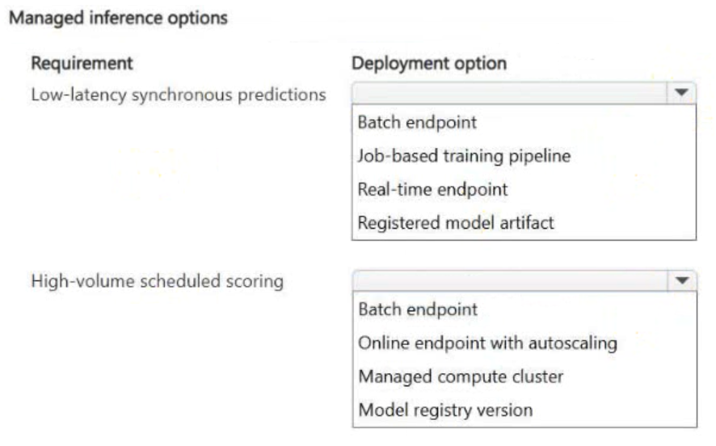

_HOTSPOT — the original ExamTopics question expects you to mark areas on the exhibit above; the correct hotspot coordinates are not published._

**Correct answer:** Not provided by ExamTopics
**Most voted:** Answer is correct - low latency requires a real time endpoint, for schedules always use a batch endpoint

### Top explanations
- **uncledana** (3 upvotes [Most Recent]): Answer is correct - low latency requires a real time endpoint, for schedules always use a batch endpoint

## Q2.4 (ID 404552)

You manage an Azure Machine learning workspace. You develop a machine learning model.
You must deploy the model to use a low-priority VM with a pricing discount.
You need to deploy the model.
Which compute target should you use?

⭕ **A.** Azure Container Instances (ACI)
✅ **B.** Azure Machine Learning compute clusters
⭕ **C.** Local deployment
⭕ **D.** Azure Kubernetes Service (AKS)

**Correct answer:** B
**Most voted:** B

### Top explanations
- **Peeking** (2 upvotes [Most Recent, Selected Answer: B]): Azure batch deployments support low priority virtual machines (VMs) to reduce the cost of batch inference workloads. Low priority VMs enable a large amount of compute power to be used for a low cost. Low priority virtual machines take advantage of surplus capacity in Azure. When you specify low priority VMs in your pools, Azure can use this surplus, when available.
from azure.ai.ml.entities import AmlCompute
compute_name = "low-pri-cluster"
compute_cluster = AmlCompute(
name=compute_name,
description="Low priority compute cluster",
min_instances=0,
max_instances=2,
tier='LowPriority'
)
ml_client.begin_create_or_update(compute_cluster)

## Q2.5 (ID 404553)

A team manages an Azure Machine Learning workspace where they deploy models to online endpoints.
The team needs to introduce a new version of a model to production without disrupting existing users.
The team must validate the new version before full rollout.
You need to reduce risk during deployment.
What should you do?

⭕ **A.** Deploy the model to a batch endpoint.
✅ **B.** Split traffic between deployments.
⭕ **C.** Replace the existing endpoint.
⭕ **D.** Route all traffic to the new deployment.

**Correct answer:** B
**Most voted:** B

### Top explanations
- **ugwuozorcollinsemezie** (3 upvotes [Most Recent, Selected Answer: B]): Blue/Green deployment.
- **Peeking** (1 upvotes [Selected Answer: B]): Some percent and gradually increase traffic to the new model.
- **uncledana** (1 upvotes [Selected Answer: B]): Feature flag - classic

## Q2.6 (ID 404554)

You have a deployment of an Azure OpenAI Service base model.
You plan to fine-tune the model.
You need to prepare a file that contains training data.
Which file format should you use?

⭕ **A.** CSV
⭕ **B.** TSV
✅ **C.** JSONL
⭕ **D.** JSON

**Correct answer:** C
**Most voted:** C

### Top explanations
- **snashe** (3 upvotes [Most Recent, Selected Answer: C]): JSONL is best option.

## Q2.7 (ID 404555)

You have a deployment of an Azure OpenAI Service base model.
You plan to fine-tune the model.
You need to prepare a file that contains training data for multi-turn chat.
Which file encoding method should you use?

⭕ **A.** ISO-8859-1
⭕ **B.** UTF-16
✅ **C.** UTF-8
⭕ **D.** ASCII

**Correct answer:** C
**Most voted:** C

### Top explanations
- **uncledana** (3 upvotes [Most Recent, Selected Answer: C]): standard for JSONL

## Q2.8 (ID 404556)

You are fine-tuning a base language model to analyze customer feedback.
You label examples of support tickets. You must improve classification accuracy by configuring and fine-tuning the base model in Microsoft Foundry.
You need to configure and run fine-tuning.
What should you do first?

⭕ **A.** Use prompt flow to generate multiple prompt templates for evaluation.
⭕ **B.** Deploy the base model to an online endpoint before starting fine-tuning.
⭕ **C.** Enable tracing for all inference calls in the evaluation pipeline.
✅ **D.** Format the dataset as a JSONL file with prompt-completion pairs and upload the file.

**Correct answer:** D
**Most voted:** D

### Top explanations
- **Peeking** (3 upvotes [Selected Answer: D]): Data preparation is first in every model fine tuning
- **cayenne06** (2 upvotes [Selected Answer: D]): This is the first step for fine-tuning
- **uncledana** (2 upvotes [Selected Answer: D]): D - https://learn.microsoft.com/en-us/azure/foundry/openai/how-to/fine-tuning?tabs=oai-sdk&pivots=programming-language-python
- **Peeking** (1 upvotes [Most Recent, Selected Answer: D]): You should prepare the labelled training and validation dataset first.
For Microsoft Foundry fine-tuning, the first step is to format your labelled support-ticket examples as JSONL in the chat/completions conversational format, where each example maps the customer feedback or ticket text to the expected classification label.
- **03f65a8** (1 upvotes [Selected Answer: D]): 1st step is dataset formating

## Q2.9 (ID 404557)

A team is working in Microsoft Foundry to test and compare large language model (LLM) prompt variants in a development environment.
The team requires consistent inputs to evaluate prompt variants without relying on live user traffic.
You need to create a controlled evaluation of input data.
Which action should you perform first?

✅ **A.** Generate synthetic interaction data.
⭕ **B.** Configure content filters.
⭕ **C.** Apply a blocklist.
⭕ **D.** Enable observability metrics.

**Correct answer:** A
**Most voted:** A

### Top explanations
- **naim149** (2 upvotes [Most Recent, Selected Answer: A]): The team needs consistent, controlled input data to compare prompt variants without live traffic. Microsoft Foundry evaluation supports synthetic/simulated data to test applications in controlled scenarios before deployment.

## Q2.10 (ID 404558)

DRAG DROP
A team maintains Infrastructure as Code (IaC) templates to provision Azure Machine Learning resources.
Provisioning must be triggered by changes in the templates and executed without manual intervention.
You need to automate resource provisioning.
Which action should you take for each requirement? To answer, move the appropriate actions to the correct requirements. You may use each action once, more than once, or not at all. You may need to move the split bar between panes or scroll to view content.
NOTE: Each correct selection is worth one point.

**Exhibits**
- Exhibit 1: 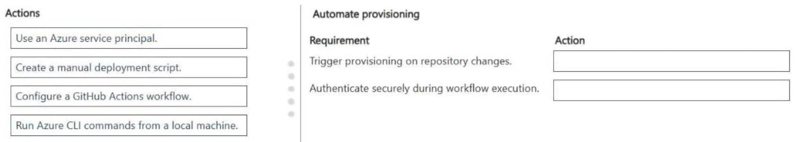

_DRAG DROP — the original ExamTopics question expects you to drag and drop items; the correct targets are not published._

**Correct answer:** Not provided by ExamTopics
**Most voted:** Trigger provisioning on repository changes. Configure a GitHub Actions workflow. | Authenticate securely during workflow execution. Use an Azure service principal.

### Top explanations
- **naim149** (1 upvotes [Most Recent]): Trigger provisioning on repository changes.	Configure a GitHub Actions workflow.
Authenticate securely during workflow execution.	Use an Azure service principal.

## Q2.11 (ID 404559)

An organization maintains separate Azure Machine Learning workspaces for development and production.
Both environments must use the same validated assets without duplicating them.
Assets must be shared across workspaces while maintaining centralized governance and version control.
You need to enable reuse of assets across workspaces without copying them.
What should you do?

⭕ **A.** Enable workspace-level Git integration and sync assets between repositories.
⭕ **B.** Publish the asset as a pipeline component.
⭕ **C.** Create a shared Azure Machine Learning environment that includes the asset.
✅ **D.** Publish the asset to an Azure Machine Learning registry.

**Correct answer:** D
**Most voted:** D

### Top explanations
- **naim149** (2 upvotes [Most Recent, Selected Answer: D]): Azure Machine Learning registries are designed to share validated assets across multiple workspaces, including dev/test/prod, while keeping centralized governance and version control. Microsoft describes registries as decoupling ML assets from individual workspaces and making assets such as models, environments, components, and datasets available across the organization.

## Q2.12 (ID 404560)

An Azure Machine Learning workspace processes sensitive training data.
The workspace must NOT be accessible from the public internet.
You need to restrict network access.
Which configuration should you implement?

⭕ **A.** Azure Firewall rules
✅ **B.** Private endpoints
⭕ **C.** Network security groups
⭕ **D.** Service endpoints

**Correct answer:** B
**Most voted:** B

### Top explanations
- **uncledana** (3 upvotes [Most Recent, Selected Answer: B]): Private is the way

## Q2.13 (ID 404561)

A team is experimenting with traditional models for a classification workflow in Azure Machine Learning.
The team requires a consistent way to manage assets that are created during experimentation.
You need to ensure that artifacts can be reused and governed across projects.
Which asset should you register?

✅ **A.** Model
⭕ **B.** Component
⭕ **C.** Environment
⭕ **D.** Pipeline

**Correct answer:** A
**Most voted:** A

### Top explanations
- **rveney** (5 upvotes [Selected Answer: B]): Correct answer: B. Component
If the team wants a consistent, reusable, and governed way to manage assets created during experimentation, the right asset to register is a component.
- **boywonder** (4 upvotes [Selected Answer: A]): In Azure Machine Learning, when a team is experimenting with traditional (e.g., scikit-learn, XGBoost, etc.) models for a classification workflow, the key artifacts produced by experimentation are the trained models themselves. Since the question refers to traditional models for a classification workflow and wants to manage artifacts created during experimentation, the primary artifact to register is the trained model.
Why not B: Component — Components are reusable pieces of pipeline logic (scripts/steps), not the experimental output (the trained model) itself. Useful for standardizing pipeline steps.
- **03f65a8** (3 upvotes [Selected Answer: A]): Model - the most important reuseable artifact in AML. (and the only artifact in the list :))
- **stfn_DE** (2 upvotes [Selected Answer: A]): A. Model
The scenario centers on artifacts produced during experimentation — in a classification workflow with traditional (non-deep-learning) models, that output is the trained model itself. Registering it as a model asset in Azure ML gives you versioning, lineage back to the job that produced it, and the ability to promote it to a registry so other workspaces/projects can consume the same governed artifact.
- **roijalbaker** (1 upvotes [Most Recent, Selected Answer: B]): From MS Learn: Components allow you to create reusable scripts that can easily be shared across users within the same Azure Machine Learning workspace. You can also use components to build an Azure Machine Learning pipeline. A component has three element:
Metadata: Includes the component's name, version, etc.
Interface: Includes the expected input parameters (like a dataset or hyperparameter) and expected output (like metrics and artifacts).
Command, code and environment: Specifies how to run the code.
A model is a component, but a data preprocessing step too. You need both assets to replicate ones work in another enviroment.

## Q2.14 (ID 404562)

HOTSPOT
You manage an Azure Machine Learning workspace named workspace1 by using the Python SDK v2.
The default datastore of workspace1 contains a folder named sample_data. The folder structure contains the following content:
You write Python SDK v2 code to materialize the data from the files in the sample_data folder into a Pandas data frame.
You need to complete the Python SDK v2 code to use the MLTable folder as the materialization blueprint.
How should you complete the code? To answer, select the appropriate options in the answer area.
NOTE: Each correct selection is worth one point

**Exhibits**
- Exhibit 1: 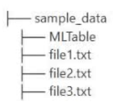
- Exhibit 2: 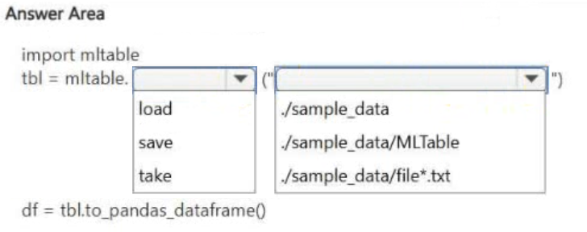

_HOTSPOT — the original ExamTopics question expects you to mark areas on the exhibit above; the correct hotspot coordinates are not published._

**Correct answer:** Not provided by ExamTopics
**Most voted:** Co-pilot say's | First dropdown: load | Second dropdown: ./sample_data | Gemini says | Dropdown 1: load | Dropdown 2: ./sample_data

### Top explanations
- **Alvarogc** (2 upvotes [Most Recent]): When using the Azure Machine Learning Table type, you create an MLTable file, which is a YAML-based file that defines the data loading blueprint. The folder containing the MLTable file may or may not contain the data files themselves, depending on the configuration used. In either case, the table is loaded by referencing the folder containing the MLTable file. In this example, this is done using mltable.load("./sample_data").
Microsoft Documentation: https://learn.microsoft.com/en-us/azure/machine-learning/how-to-mltable
- **0fdb748** (2 upvotes): mltable.load():
In the Azure Machine Learning Python SDK v2, the load() function is used to read an MLTable artifact from a folder containing an MLTable blueprint file.
/sample_data/MLTable: The question specifies that you must use the MLTable folder as the materialization blueprint. Therefore, you must pass the exact path to that folder, which contains the configuration file defining how the data files should be loaded.
- **rveney** (2 upvotes): Co-pilot say's
First dropdown: load
Second dropdown: ./sample_data
Gemini says
Dropdown 1: load
Dropdown 2: ./sample_data
- **uncledana** (2 upvotes): correct
- **03f65a8** (1 upvotes): I disagree.
mltable.load() expects the folder that contains the relevant files, not the MLTable file itself.

## Q2.15 (ID 404563)

HOTSPOT
You manage an Azure Machine Learning workspace named workspace1 by using the Python SDK v2. You create a General Purpose v2 Azure storage account named mlstorage1. The storage account includes a publicly accessible container named mlcontainer1. The container stores 10 blobs with files in the CSV format.
You must develop Python SDK v2 code to create a data asset referencing all blobs in the container named mlcontainer1.
You need to complete the Python SDK v2 code.
How should you complete the code? To answer, select the appropriate options in the answer area.
NOTE: Each correct selection is worth one point.

**Exhibits**
- Exhibit 1: 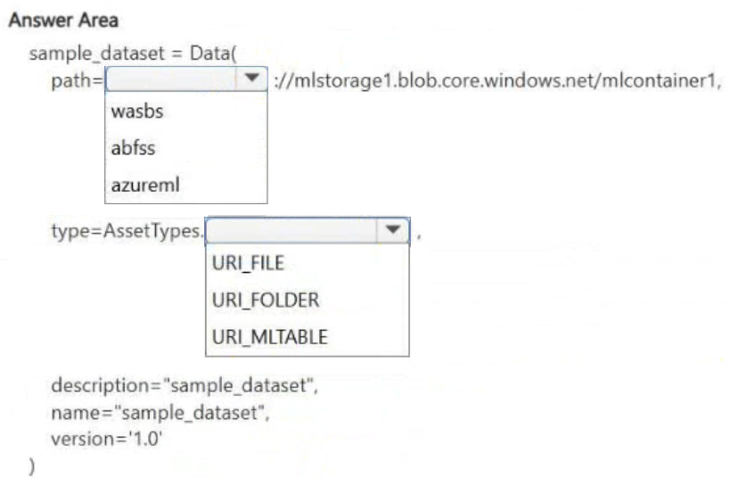

_HOTSPOT — the original ExamTopics question expects you to mark areas on the exhibit above; the correct hotspot coordinates are not published._

**Correct answer:** Not provided by ExamTopics
**Most voted:** Path: wasbs | Type: URI_FOLDER

### Top explanations
- **rveney** (8 upvotes [Highly Voted]): Path: wasbs
Type: URI_FOLDER
- **cayenne06** (4 upvotes): I think it's wasbs for blob storage access. Abfss is for Data Lake Gen 2 and azureml for internal storage of azure ml.
- **Solaimuthu** (1 upvotes [Most Recent]): wasbs  - Windows  Azure Storage blob secure
URI_FOLDER
- **exam_upskill** (1 upvotes): Path protocol: wasbs
Asset type: URI_FOLDER
wasbs is the appropriate choice because the path directly references an Azure Blob Storage container.

## Q2.16 (ID 404564)

Note: This question is part of a series of questions that present the same scenario. Each question in the series contains a unique solution that might meet the stated goals. Some question sets might have more than one correct solution, while others might not have a correct solution.
After you answer a question in this section, you will NOT be able to return to it. As a result, these questions will not appear on the review screen.
You manage an Azure Machine Learning workspace. The Python script named script.py reads an argument named training_data. The training_data argument specifies the path to the training data in a file named dataset1.csv.
You plan to run the script.py Python script as a command job that trains a machine learning model.
You need to provide the command to pass the path for the dataset as a parameter value when you submit the script as a training job.
Solution: python train.py --training_data training_data
Does the solution meet the goal?

⭕ **A.** Yes
✅ **B.** No

**Correct answer:** B
**Most voted:** B

### Top explanations
- **RICHARDALEX007** (3 upvotes [Most Recent, Selected Answer: B]): The solution runs 'python train.py --training_data training_data' but the script is script.py (not train.py) and it passes the literal string 'training_data' rather than the dataset path/input binding. It does not pass the dataset path as a parameter value, so it fails the goal.

## Q2.17 (ID 404565)

Note: This question is part of a series of questions that present the same scenario. Each question in the series contains a unique solution that might meet the stated goals. Some question sets might have more than one correct solution, while others might not have a correct solution.
After you answer a question in this section, you will NOT be able to return to it. As a result, these questions will not appear on the review screen.
You manage an Azure Machine Learning workspace. The Python script named script.py reads an argument named training_data. The training_data argument specifies the path to the training data in a file named dataset1.csv.
You plan to run the script.py Python script as a command job that trains a machine learning model.
You need to provide the command to pass the path for the dataset as a parameter value when you submit the script as a training job.
Solution: python script.py --trainingdata ${{inputs.training_data}}
Does the solution meet the goal?

⭕ **A.** Yes
✅ **B.** No

**Correct answer:** B
**Most voted:** B

### Top explanations
- **uncledana** (4 upvotes [Selected Answer: B]): See the typo - should match exactly as the parameter: python script.py --training_data ${{inputs.training_data}}
- **Z_MU** (2 upvotes [Most Recent, Selected Answer: B]): python script.py --training_data ${{inputs.training_data}} >> Correct
python script.py --trainingdata ${{inputs.training_data}} >> incorrect
underscore is missing in --trainingdata

## Q2.19 (ID 415889)

HOTSPOT
You review the following Azure CLI command and the relevant Bicep excerpt.
(Non-relevant sections are omitted.)
You need to validate what the snippet will do before it is merged. For each of the following statements, select Yes if the statement is true. Otherwise, select No.
NOTE: Each correct selection is worth one point.

**Exhibits**
- Exhibit 1: 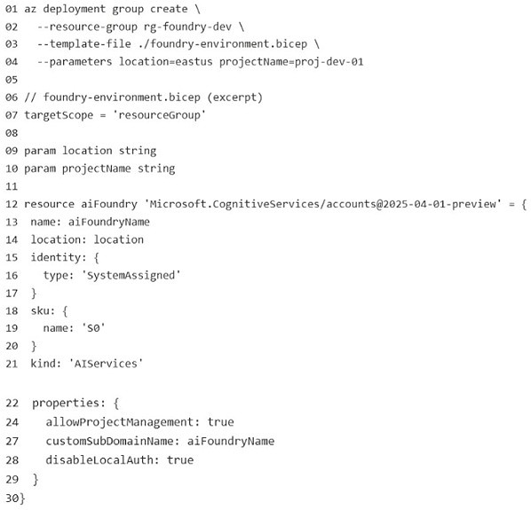
- Exhibit 2: 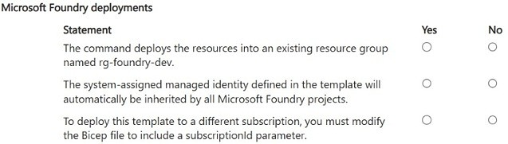

_HOTSPOT — the original ExamTopics question expects you to mark areas on the exhibit above; the correct hotspot coordinates are not published._

**Correct answer:** Not provided by ExamTopics
**Most voted:** Statement 1: Yes | Statement 2: No | Statement 3: No

### Top explanations
- **exam_upskill** (1 upvotes [Most Recent]): YNN
1. Y
2. N
3. N
- **rveney** (1 upvotes): Statement 1: Yes
Statement 2: No
Statement 3: No

## Q2.20 (ID 415890)

DRAG DROP
A team performs interactive experimentation during development. The team also runs scalable jobs for model training.
The team must minimize costs while ensuring compute resources scale when needed. Different workloads require different compute behaviors within the same workspace.
You need to configure compute targets that support each workload.
Which compute targets should you use? To answer, move the appropriate compute targets to the correct workload types. You may use each compute target once, more than once, or not at all. You may need to move the split bar between panes or scroll to view content.
NOTE: Each correct selection is worth one point.

**Exhibits**
- Exhibit 1: 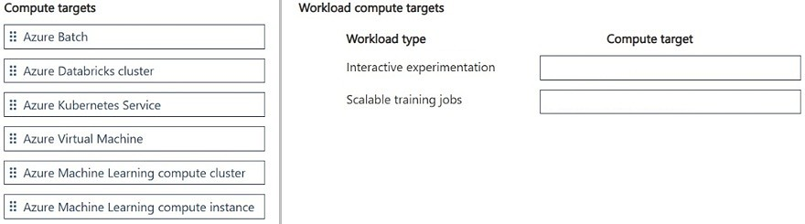

_DRAG DROP — the original ExamTopics question expects you to drag and drop items; the correct targets are not published._

**Correct answer:** Not provided by ExamTopics
**Most voted:** Azure databricks cluster is the correct answer: | All-purpose clusters (for interactive notebooks) and Job clusters (ephemeral clusters for automated pipelines).

### Top explanations
- **rveney** (9 upvotes [Highly Voted]): Interactive experimentation → Azure Machine Learning compute instance
Scalable training jobs → Azure Machine Learning compute cluster
- **pvenkat1967** (1 upvotes [Most Recent]): Azure databricks cluster is the correct answer:
All-purpose clusters (for interactive notebooks) and Job clusters (ephemeral clusters for automated pipelines).
- **exam_upskill** (1 upvotes): 1. Interactive experimentation: Azure Machine Learning compute instance
2. Scalable training jobs: Azure Machine Learning compute cluster
Develop/Experiment → Compute Instance
Train/Scale → Compute Cluster
- **exam_upskill** (1 upvotes): Interactive experimentation: Azure Machine Learning compute instance
Scalable training jobs: Azure Machine Learning compute cluster
- **adelina99** (1 upvotes): I also think that correct answers are:
Interactive experimentation → Azure Machine Learning compute instance
Scalable training jobs → Azure Machine Learning compute cluster

## Q2.21 (ID 415891)

DRAG DROP
You have an existing GitHub repository containing Azure Machine Learning project files.
You need to clone the repository to your Azure Machine Learning shared workspace file system.
Which four actions should you perform in sequence? To answer, move the appropriate actions from the list of actions to the answer area and arrange them in the correct order.
NOTE: More than one order of answer choices is correct. You will receive credit for any of the correct orders you select.

**Exhibits**
- Exhibit 1: 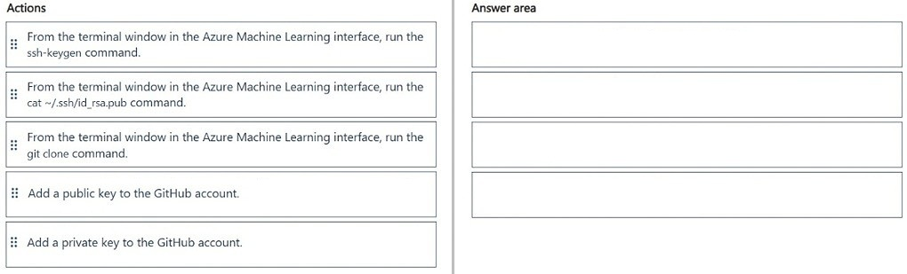

_DRAG DROP — the original ExamTopics question expects you to drag and drop items; the correct targets are not published._

**Correct answer:** Not provided by ExamTopics
**Most voted:** 1. Run ssh-keygen in the Azure Machine Learning terminal. | 2. Run cat ~/.ssh/id_rsa.pub to display/copy the public SSH key. | 3. Add the public key to the GitHub account. | 4. Run git clone from the Azure Machine Learning terminal. | ssh-keygen → cat ~/.ssh/id_rsa.pub → Add public key to GitHub → git clone

### Top explanations
- **exam_upskill** (1 upvotes [Most Recent]): 1. Run ssh-keygen in the Azure Machine Learning terminal.
2. Run cat ~/.ssh/id_rsa.pub to display/copy the public SSH key.
3. Add the public key to the GitHub account.
4. Run git clone from the Azure Machine Learning terminal.
ssh-keygen → cat ~/.ssh/id_rsa.pub → Add public key to GitHub → git clone
- **exam_upskill** (1 upvotes): 1. Run ssh-keygen in the Azure Machine Learning terminal.
2. Run cat ~/.ssh/id_rsa.pub to display/copy the public SSH key.
3. Add the public key to the GitHub account.
4. Run git clone from the Azure Machine Learning terminal.
ssh-keygen → cat ~/.ssh/id_rsa.pub → Add public key to GitHub → git clone
- **rveney** (1 upvotes): From the terminal window in the Azure Machine Learning interface, run the ssh-keygen command.
From the terminal window in the Azure Machine Learning interface, run the cat ~/.ssh/id_rsa.pub command.
Add a public key to the GitHub account.
From the terminal window in the Azure Machine Learning interface, run the git clone command.

## Q2.22 (ID 415892)

You manage an Azure Machine Learning workspace. You have an environment for training jobs which uses an existing Docker image.
A new version of the Docker image is available.
You need to use the latest version of the Docker image for the environment configuration by using the Azure Machine Learning SDK v2.
What should you do?

⭕ **A.** Change the description parameter of the environment configuration.
⭕ **B.** Modify the conda_file to specify the new version of the Docker image.
⭕ **C.** Use the create_or_update method to change the tag of the image.
✅ **D.** Use the Environment class to create a new version of the environment.

**Correct answer:** D
**Most voted:** D

### Top explanations
- **Kachien** (3 upvotes [Selected Answer: D]): Correct answer is D.
For environments, only description and tags can be updated. All other properties are immutable; if you need to change any of those properties you should create a new version of the environment.
To use the latest version of a Docker image, you must define a new Environment object using the Python Environment class, passing the updated image path to the image parameter.
- **RICHARDALEX007** (3 upvotes [Selected Answer: D]): Environments are immutable and versioned; to adopt a new Docker image you create a new environment version via the
Environment class (create_or_update registers it as a new version). Changing description (A) or conda_file (B) does not switch
the base image; 'change the tag' (C) is not how you pin a new image version in SDK v2.
- **exam_upskill** (1 upvotes [Most Recent, Selected Answer: D]): D. Use the Environment class to create a new version of the environment.

## Q2.23 (ID 415893)

You manage an Azure Machine Learning workspace.
You need to define an environment from a Docker image by using the Azure Machine Learning Python SDK v2.
Which parameter should you use?

⭕ **A.** conda_file
⭕ **B.** properties
⭕ **C.** build
✅ **D.** image

**Correct answer:** D
**Most voted:** D

### Top explanations
- **RICHARDALEX007** (1 upvotes [Most Recent, Selected Answer: D]): define an environment from a Docker image in SDK v2 you set the Environment 'image' parameter. conda_file (A) adds
Python deps, build (C) is for a Dockerfile build context, properties (B) is metadata.

## Q2.24 (ID 415894)

A company has multiple data science teams working on separate machine learning projects.
The company requires models to be auditable, reusable, and governed centrally across teams. The models must allow team-level isolation for billing.
You need to establish the foundation for governed machine learning operations.
Which action should you perform first?

⭕ **A.** Register shared datasets in a central storage account.
✅ **B.** Create a shared hub workspace and project workspaces for each team.
⭕ **C.** Create a resource group for shared machine learning assets.
⭕ **D.** Create a shared Azure Machine Learning workspace.

**Correct answer:** B
**Most voted:** B

### Top explanations
- **exam_upskill** (1 upvotes [Most Recent, Selected Answer: B]): B. Create a shared hub workspace and project workspaces for each team.
Multi-team + central governance + isolation → Hub + Projects ✅
- **exam_upskill** (1 upvotes [Selected Answer: B]): B. Create a shared hub workspace and project workspaces for each team.
Multi-team + central governance + isolation → Hub + Projects ✅

## Q2.25 (ID 415895)

A team provisions an Azure Machine Learning environment by triggering pull requests.
Deployments must be automated, auditable, and require approval before running.
You need to select a deployment automation tool.
Which tool should you use?

⭕ **A.** Azure Monitor
✅ **B.** GitHub Actions
⭕ **C.** MLflow
⭕ **D.** Azure Machine Learning pipelines

**Correct answer:** B
**Most voted:** B

### Top explanations
- **RICHARDALEX007** (1 upvotes [Most Recent, Selected Answer: B]): Automated, auditable deployments triggered by pull requests with an approval gate are delivered by GitHub Actions (with
environment protection rules for approvals). Azure Monitor (A) is observability, MLflow (C) is tracking, AML pipelines (D)
orchestrate ML steps, not PR-gated CI/CD.

## Q2.26 (ID 415896)

A team develops and manages a conversational assistant by using Microsoft Foundry.
The team requires generative AI to automatically evaluate every pull request of an agentic application and fail the build if safety thresholds are exceeded.
You need to automate evaluations as part of CI.
What should you configure?

⭕ **A.** Blocklist applied to the model endpoint
⭕ **B.** Content filter configured in warning mode
⭕ **C.** Retrieval chunking strategy
✅ **D.** GitHub Actions workflow that executes the runs

**Correct answer:** D
**Most voted:** D

### Top explanations
- **RICHARDALEX007** (2 upvotes [Selected Answer: D]): Automatically evaluating every pull request and failing the build when safety thresholds are exceeded is a CI task implemented as a GitHub Actions workflow that runs Foundry evaluations. Blocklist (A), content filter (B) and chunking (C) are runtime controls, not CI gates.
- **exam_upskill** (1 upvotes [Most Recent, Selected Answer: D]): D. GitHub Actions workflow that executes the runs

## Q2.27 (ID 420692)

A team runs training and inference jobs in Azure Machine Learning.
The team experiences inconsistent runtime dependencies that cause variation in results.
You need to ensure that all jobs use the same execution dependencies.
Which asset should you define?

⭕ **A.** Azure Machine Learning job configuration
⭕ **B.** Azure Machine Learning job input/output bindings
⭕ **C.** Azure Monitor alert
✅ **D.** Azure Machine Learning environment

**Correct answer:** D
**Most voted:** D

### Top explanations
- **exam_upskill** (1 upvotes [Most Recent, Selected Answer: D]): D. Azure Machine Learning environment
Same/reproducible Python packages + runtime dependencies → Azure Machine Learning Environment ✅
- **exam_upskill** (1 upvotes [Selected Answer: D]): D. Azure Machine Learning environment
Same/reproducible Python packages + runtime dependencies → Azure ML Environment ✅

## Q2.28 (ID 424431)

DRAG DROP
You manage an Azure Machine Learning workspace named workspace1 with a compute instance named compute1. You connect to compute1 by using a terminal window from workspace1.
You create a file named "requirements.txt" containing Python dependencies to include Jupyter.
You need to add a new Jupyter kernel to compute1.
Which four commands should you use? To answer, move the appropriate actions from the list of actions to the answer area and arrange them in the correct order.

**Exhibits**
- Exhibit 1: 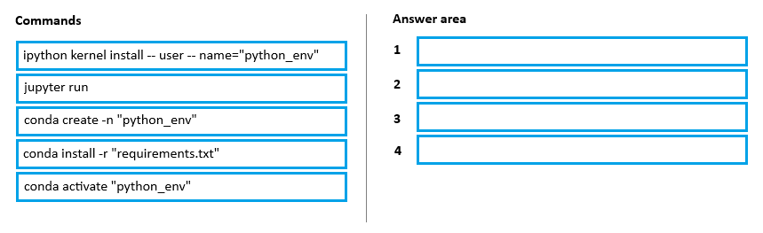

_DRAG DROP — the original ExamTopics question expects you to drag and drop items; the correct targets are not published._

**Correct answer:** Not provided by ExamTopics
**Most voted:** conda create -n "python_env" | conda activate "python_env" | conda install -r "requirements.txt" | ipython kernel install --user --name="python_env" | conda create → conda activate → conda install -r → ipython kernel install

### Top explanations
- **exam_upskill** (1 upvotes [Most Recent]): conda create -n "python_env"
conda activate "python_env"
conda install -r "requirements.txt"
ipython kernel install --user --name="python_env"
conda create → conda activate → conda install -r → ipython kernel install
- **exam_upskill** (1 upvotes): 1. conda create -n "python_env"
2. conda activate "python_env"
3. conda install -r "requirements.txt"
4. ipython kernel install --user --name="python_env"
conda create → conda activate → conda install -r → ipython kernel install

## Q2.29 (ID 424432)

You manage an Azure Machine Learning workspace. You have a folder that contains a CSV file. The folder is registered as a folder data asset.
You plan to use the folder data asset for data wrangling during interactive development.
You need to access and load the folder data asset into a Pandas data frame.
Which method should you use to achieve this goal?

⭕ **A.** mltable.load()
✅ **B.** mltable.from_delimited_files()
⭕ **C.** mltable.from_parquet_files()
⭕ **D.** mltable.from_delta_lake()

**Correct answer:** B
**Most voted:** B

### Top explanations
- **exam_upskill** (2 upvotes [Selected Answer: B]): B. mltable.from_delimited_files() ✅
Existing MLTable definition → mltable.load()
Folder/file containing CSV → mltable.from_delimited_files()
- **guy3hil** (2 upvotes [Selected Answer: A]): Correct answer A = mltable.load()
--------------------------------------------------------------------------
import mltable
tbl = mltable.load("path/to/folder_asset")
df = tbl.to_pandas_dataframe()
--------------------------------------------------------------------------------------
Why not the other options ??
B. mltable.from_delimited_files() → Used to create an MLTable definition from raw delimited files, not to load an already registered folder asset.
C. mltable.from_parquet_files() → Same idea, but for Parquet files. Not applicable here since the asset is CSV.
D. mltable.from_delta_lake() → Used for Delta Lake sources, not CSV.
- **exam_upskill** (1 upvotes [Most Recent, Selected Answer: B]): B. mltable.from_delimited_files()
The key clues are:
The data asset is a folder
It contains a CSV file
You want to load the CSV data for interactive data wrangling into a Pandas DataFrame
- **pandaji** (1 upvotes [Selected Answer: A]): Why the other options are incorrect
B. mltable.from_delimited_files()
Used to create a new MLTable from CSV or other delimited files.
Not used when you're accessing an already registered data asset.
C. mltable.from_parquet_files()
Used for Parquet files only.
D. mltable.from_delta_lake()
Used for Delta Lake datasets.
- **PurpleBlue** (1 upvotes [Selected Answer: B]): mltable.from_delimited_files() is specifically designed to create an MLTable object from delimited text files (like CSVs) by pointing it at a path — in this case, your registered folder data asset. Once created, you can call .to_pandas_dataframe() on the resulting MLTable object to materialize it as a Pandas DataFrame for wrangling

## Q2.30 (ID 424433)

A team uses a hosted Git repository to store training code and pipeline definitions of a machine learning experiment.
The team must ensure that access to the repository is granted without requiring each developer to store personal access tokens on their machines.
Repository access must be secure and centrally managed to reduce credential spread.
You need to enable secure access between an Azure Machine Learning workspace and the repository.
What should you do?

⭕ **A.** Share a repository deploy key across all developers on the team.
⭕ **B.** Generate a personal access token and store it in a pipeline variable.
⭕ **C.** Require each developer to authenticate locally before every pipeline run.
✅ **D.** Configure the workspace to use a managed identity for repository access.

**Correct answer:** D
**Most voted:** D

### Top explanations
- **exam_upskill** (1 upvotes [Most Recent, Selected Answer: D]): D. Configure the workspace to use a managed identity for repository access.
- **exam_upskill** (1 upvotes [Selected Answer: D]): D. Configure the workspace to use a managed identity for repository access.
- **PurpleBlue** (1 upvotes [Selected Answer: D]): A managed identity assigned to the Azure Machine Learning workspace allows the workspace itself to authenticate to the Git repository (or other Azure resources) without any developer needing to generate, store, or manage a PAT locally

## Q2.31 (ID 424434)

HOTSPOT
You manage an Azure Machine Learning workspace named Workspace1 and an Azure Blob Storage accessed by using the URL https://storage1.blob.core.windows.net/data1.
You plan to create an Azure Blob datastore in Workspace1. The datastore must target the Blob Storage by using Azure Machine Learning Python SDK v2. Access authorization to the datastore must be limited to a specific amount of time.
You need to select the parameters of the AzureBlobDatastore class that will point to the target datastore and authorize access to it.
Which parameters should you use? To answer, select the appropriate options in the answer area.
NOTE: Each correct selection is worth one point.

**Exhibits**
- Exhibit 1: 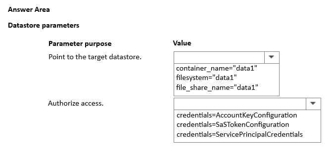

_HOTSPOT — the original ExamTopics question expects you to mark areas on the exhibit above; the correct hotspot coordinates are not published._

**Correct answer:** Not provided by ExamTopics
**Most voted:** 1. Container_name="data1" | 2. Credentials=SaSTokenConfiguration

### Top explanations
- **exam_upskill** (1 upvotes [Most Recent]): 1. Container_name="data1"
2. Credentials=SaSTokenConfiguration

## Q2.32 (ID 424435)

HOTSPOT
You have an Azure Machine Learning workspace.
You plan to use Azure Machine Learning Python SDK v2 to register a component in the workspace. The component definition is stored in the local file ./components/train/train.yml.
You write code to connect to the workspace by using the ml_client object and import all required libraries.
You need to complete the remaining code.
How should you complete the code? To answer, select the appropriate options in the answer area.
NOTE: Each correct selection is worth one point.

**Exhibits**
- Exhibit 1: 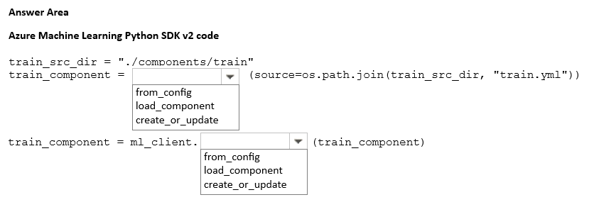

_HOTSPOT — the original ExamTopics question expects you to mark areas on the exhibit above; the correct hotspot coordinates are not published._

**Correct answer:** Not provided by ExamTopics
**Most voted:** 1. load_component | 2. components.create_or_update

### Top explanations
- **exam_upskill** (1 upvotes [Most Recent]): 1. load_component
2. components.create_or_update

## Q2.33 (ID 424436)

DRAG DROP
You have an Azure Machine Learning workspace named WS1 and a GitHub account named account1 that hosts a private repository named repo1.
You need to clone repo1 to make it available directly from WS1. The configuration must maximize the performance of the repo1 clone.
Which four actions should you perform in sequence?

**Exhibits**
- Exhibit 1: 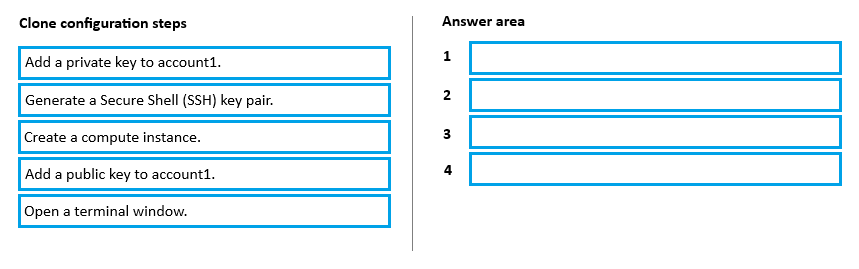

_DRAG DROP — the original ExamTopics question expects you to drag and drop items; the correct targets are not published._

**Correct answer:** Not provided by ExamTopics
**Most voted:** 1 → Create a compute instance | 2 → Open a terminal window | 3 → Generate a Secure Shell (SSH) key pair | 4 → Add a public key to account1 | Public key → GitHub. Private key → stays securely on the machine.

### Top explanations
- **exam_upskill** (1 upvotes [Most Recent]): 1 → Create a compute instance
2 → Open a terminal window
3 → Generate a Secure Shell (SSH) key pair
4 → Add a public key to account1
Public key → GitHub. Private key → stays securely on the machine.

## Q2.34 (ID 424437)

HOTSPOT
You download a .csv file from a notebook in an Azure Machine Learning workspace to a data/sample.csv folder on a compute instance. The file contains 10,000 records.
You must generate the summary statistics for the data in the file. The statistics must include the following for each numerical column:
•	number of non-empty values
•	average value
•	standard deviation
•	minimum and maximum values
•	25th, 50th, and 75th percentiles
You need to complete the Python code that will generate the summary statistics.
Which code segments should you use? To answer, select the appropriate options in the answer area.
NOTE: Each correct selection is worth one point.

**Exhibits**
- Exhibit 1: 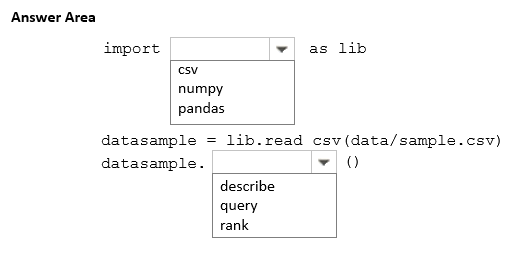

_HOTSPOT — the original ExamTopics question expects you to mark areas on the exhibit above; the correct hotspot coordinates are not published._

**Correct answer:** Not provided by ExamTopics
**Most voted:** 1. pandas | 2. describe

### Top explanations
- **exam_upskill** (1 upvotes [Most Recent]): 1. pandas
2. describe

## Q3.1 (ID 404567)

Background
Fabrikam Inc. is a mid-sized healthcare analytics company that provides population health dashboards and predictive insights to regional hospital systems across the United States. Fabrikam Inc. customers rely on near real time analytics to monitor patient flow, staffing needs, and readmission risks. They use multiple traditional forecasting machine learning models for predictions.
Fabrikam Inc. has an established Microsoft Azure footprint. The company uses Jupyter Notebooks that run on a local server as the primary development environment. The data science team is experiencing scalability, asset management and code management issues with the current development platform. Fabrikam Inc. plans to migrate to a cloud-based development environment to mitigate the issues.
Additionally, the company plans to implement a Retrieval-Augmented Generation (RAG)-based chat application for client support. Leadership requires the application to be developed and deployed with a low operational risk.
Current Environment
Fabrikam Inc. operates a single Azure subscription that has the following components:
Azure Data Lake Storage Gen2 that contains de-identified clinical and operational datasets
Azure AI Search indexing curated analytical documents and reference materials
A small set of Python-based training scripts maintained by data scientists
Azure OpenAI Service with deployed foundational models
A Microsoft Foundry resource for building a RAG-based solution
Evaluation data has manually defined expected responses.
The current challenges faced by the data science team include the following:
Model training jobs are run manually from notebooks.
Experiment tracking is inconsistent
Model versions are registered without standardized metadata.
Deployment is performed manually by data scientists, with limited rollback capability.
The team has no standardized evaluation process for generative AI outputs.
The environment currently allows public network access. Authentication relies on user accounts rather than managed identities. Compute targets are manually created and shared across experiments. This has led to resource contention during peak usage.
Business Requirements
Fabrikam Inc. has the following business requirements for the modernization initiative:
Provide a conversational interface that answers analytics questions by using internal documents and datasets.
Ensure that sensitive healthcare-related data is not exposed outside the Fabrikam Inc. Azure tenant.
Enable repeatable and auditable model training and deployment processes.
Support experimentation to compare prompt strategies and fine-tuned models.
Align the model with the ranked preferences and optimize behavior for the long term.
Minimize disruption to existing analytics workloads during rollout.
Technical Requirements
To support the business goals, Fabrikam Inc. identifies these technical requirements:
Use Azure Machine Learning workspaces to centrally manage data assets, models, and environments.
Implement experiment tracking and model versioning for all training jobs.
Orchestrate training and evaluation by using pipelines rather than manually running notebooks.
Deploy traditional machine learning models with support for staged rollout and rollback.
Improve RAG-based solution output quality.
Use the existing evaluation datasets that are based on real data with input-output pairs.
Apply advanced fine-tuning techniques only when prompt engineering is insufficient
Issues and Constraints
Fabrikam Inc. must comply with internal security policies that require the company to restrict network access and avoid long-lived secrets. The data science team has limited Azure DevOps experience, so solutions must favor managed services and automation over custom infrastructure.
Cost predictability is important. Leadership prefers serverless or managed compute options where possible but is willing to approve dedicated compute for stable production workloads.
Problem Statement
Fabrikam Inc. must design and implement an Azure-based AI operations solution that enables reliable training, evaluation, deployment, and iteration of generative AI models. The solution must support experimentation and gradual rollout while ensuring governance, security, and operational stability. The data science and platform teams must collaborate to deliver this solution by using Azure Machine Learning and Microsoft Foundry capabilities.
You need to recommend an experiment-tracking strategy that ensures consistent experiment results.
What should you recommend?

⭕ **A.** Azure Machine Learning job output logs
✅ **B.** MLflow experiment tracking
⭕ **C.** Application Insights logs
⭕ **D.** Azure Monitor alerts

**Correct answer:** B
**Most voted:** B

### Top explanations
- **RICHARDALEX007** (1 upvotes [Most Recent, Selected Answer: B]): Consistent, centralized experiment tracking in AML is provided by MLflow (the native tracking interface). Job output logs (A) and App Insights (C) capture runtime logs, and Azure Monitor alerts (D) are for operational alerting, not experiment comparison.

## Q3.2 (ID 404600)

HOTSPOT
A machine learning model is deployed to production in Azure Machine Learning and is actively serving predictions for a business application. The model was trained by using a historical dataset that represented expected input patterns at the time of deployment.
The team working on the model must ensure the following:
Changes in input data distribution are detected.
Appropriate actions are triggered when predefined thresholds are exceeded.
You need to configure monitoring to meet the requirements.
Which configuration should you use for each requirement? To answer, select the appropriate options in the answer area.
NOTE: Each correct selection is worth one point.

**Exhibits**
- Exhibit 1: 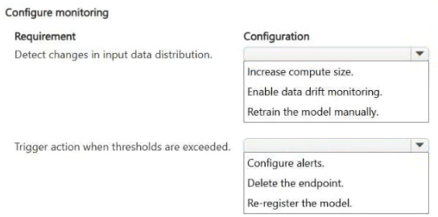

_HOTSPOT — the original ExamTopics question expects you to mark areas on the exhibit above; the correct hotspot coordinates are not published._

**Correct answer:** Not provided by ExamTopics
**Most voted:** 1 → Enable data drift monitoring | 2 → Configure alerts

### Top explanations
- **exam_upskill** (1 upvotes [Most Recent]): 1 → Enable data drift monitoring
2 → Configure alerts
- **RICHARDALEX007** (1 upvotes): Input-distribution change detection is data drift monitoring on the deployed model; the threshold-based response is an alert/automated action. This matches the AML production monitoring model.

## Q3.3 (ID 404601)

You create a binary classification model. You use the Fairlearn package to assess model fairness.
You must eliminate the need to retrain the model.
You need to implement the Fairlearn package.
Which algorithm should you use?

⭕ **A.** fairiearn.reductions.ExponentiatedGradient
⭕ **B.** fairlearn.preprocessing.CorrelationRemover
⭕ **C.** fairlearn.reductions.GridSearch
✅ **D.** fairlearn.postprocessing.ThresholdOptimizer

**Correct answer:** D
**Most voted:** D

### Top explanations
- **cb18c4d** (2 upvotes [Selected Answer: D]): Post-processing: Tweaking the prediction thresholds of an already-trained model (e.g., ThresholdOptimizer) to balance outcomes across sensitive groups without retraining the model from scratch.
- **exam_upskill** (1 upvotes [Most Recent, Selected Answer: D]): D. fairlearn.postprocessing.ThresholdOptimizer ✅
No retraining → Post-processing → ThresholdOptimizer.

## Q3.4 (ID 404602)

DRAG DROP
A real-time endpoint is deployed in Azure Machine Learning to serve predictions to a web application.
Users report intermittent failures and unexpected responses when calling the endpoint.
You need to identify the appropriate troubleshooting action for each reported issue.
Which troubleshooting action should you perform for each issue? To answer, move the appropriate troubleshooting actions to the correct issues. You may use each troubleshooting action once, more than once, or not at all. You may need to move the split bar between panes or scroll to view content.
NOTE: Each correct selection is worth one point.

**Exhibits**
- Exhibit 1: 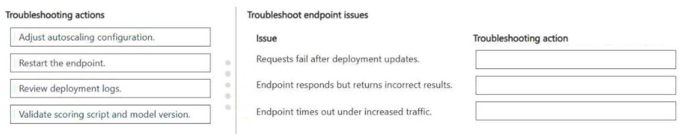

_DRAG DROP — the original ExamTopics question expects you to drag and drop items; the correct targets are not published._

**Correct answer:** Not provided by ExamTopics
**Most voted:** 1 → Review deployment logs | 2 → Validate scoring script and model version | 3 → Adjust autoscaling configuration

### Top explanations
- **exam_upskill** (1 upvotes [Most Recent]): 1 → Review deployment logs
2 → Validate scoring script and model version
3 → Adjust autoscaling configuration

## Q3.5 (ID 404603)

A team manages an Azure Machine Learning workspace and deploys a model to an endpoint.
A deployed online endpoint shows inconsistent response times during periods of high traffic.
You need to identify potential performance degradation.
Which three metrics should you monitor? Each correct answer presents part of the solution. Choose three.
NOTE: Each correct selection is worth one point.

⭕ **A.** Feature count
✅ **B.** Requests per minute
✅ **C.** Connections active
⭕ **D.** Dataset size
✅ **E.** Request latency

**Correct answer:** B, C, E
**Most voted:** BCE

### Top explanations
- **RICHARDALEX007** (2 upvotes [Selected Answer: BCE]): Performance degradation on an online endpoint under load is surfaced by traffic (requests per minute), concurrency (active connections) and request latency. Feature count (A) and dataset size (D) are not endpoint runtime performance metrics.
- **exam_upskill** (1 upvotes [Most Recent, Selected Answer: BCE]): B. Requests per minute ✅
C. Connections active ✅
E. Request latency ✅
B + C + E

## Q3.6 (ID 404604)

DRAG DROP
A team deploys a machine learning model to a managed online endpoint. The team monitors model performance and data quality metrics in production.
When monitoring thresholds are exceeded, the team requires an automated operational response that notifies downstream systems.
You need to configure the monitoring solution to meet the requirements.
Which configuration should you associate with each requirement as a first step? To answer, move the appropriate configurations to the correct requirements. You may use each configuration once, more than once, or not at all. You may need to move the split bar between panes or scroll to view content.
NOTE: Each correct selection is worth one point.

**Exhibits**
- Exhibit 1: 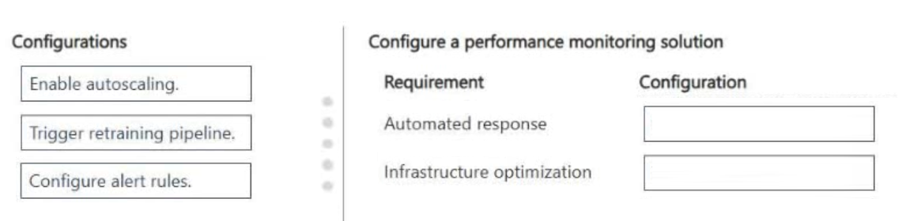

_DRAG DROP — the original ExamTopics question expects you to drag and drop items; the correct targets are not published._

**Correct answer:** Not provided by ExamTopics
**Most voted:** Automated response → Configure alert rules ✅ | Infrastructure optimization → Enable autoscaling ✅

### Top explanations
- **uncledana** (6 upvotes): Configure alert rules
Enable autoscaling
- **exam_upskill** (1 upvotes [Most Recent]): Automated response → Configure alert rules ✅
Infrastructure optimization → Enable autoscaling ✅
- **03f65a8** (1 upvotes): Configure alert rules
Enable autoscaling
- **cayenne06** (1 upvotes): the right choice is Enable autoscaling, because it automatically adjusts capacity based on traffic/load. Trigger retraining pipeline is for improving model quality after drift or performance degradation, not for optimizing endpoint infrastructure.

## Q3.7 (ID 404605)

HOTSPOT
You use Azure Machine Learning to train models across multiple experiments by using the same workspace.
You must record training runs in a centralized location to compare results from different jobs.
During training, performance values must be captured so they appear in the experiment run history.
You need to configure experiment tracking.
What should you configure for each requirement? To answer, select the appropriate options in the answer area.
NOTE: Each correct selection is worth one point.

**Exhibits**
- Exhibit 1: 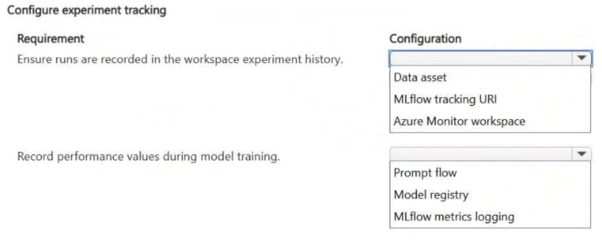

_HOTSPOT — the original ExamTopics question expects you to mark areas on the exhibit above; the correct hotspot coordinates are not published._

**Correct answer:** Not provided by ExamTopics
**Most voted:** 1 → MLflow tracking URI ✅ | 2 → MLflow metrics logging ✅ | Where should runs go? → Tracking URI | What records performance values? → Metrics logging

### Top explanations
- **exam_upskill** (1 upvotes [Most Recent]): 1 → MLflow tracking URI ✅
2 → MLflow metrics logging ✅
Where should runs go? → Tracking URI
What records performance values? → Metrics logging
- **RICHARDALEX007** (1 upvotes): Centralized run recording uses MLflow experiment tracking; logging metrics that appear in run history uses mlflow.log_metric (autolog also valid). This is the native AML experiment-tracking pattern.

## Q3.8 (ID 404606)

A data science team trains a classification model that predicts loan approval outcomes.
Before registering the model, the team must ensure the following:
Predictions must not disproportionately impact protected groups.
Prediction errors can be evaluated across different data segments.
You need to assess whether the model meets Responsible AI expectations.
Which two approaches should you use? Each correct answer presents part of the solution. Choose two.
NOTE: Each correct selection is worth one point.

⭕ **A.** Analyze error rates across the global cohort.
⭕ **B.** Measure endpoint latency under load.
⭕ **C.** Validate inference schema compatibility.
✅ **D.** Evaluate feature importance for prediction transparency.
✅ **E.** Analyze error rates across defined demographic cohorts.

**Correct answer:** D, E
**Most voted:** DE

### Top explanations
- **exam_upskill** (1 upvotes [Most Recent, Selected Answer: DE]): D. Evaluate feature importance for prediction transparency ✅
E. Analyze error rates across defined demographic cohorts ✅
- **Nilf** (1 upvotes [Selected Answer: AE]): Per Microsoft Learn's official Responsible AI dashboard docs: "Error analysis... identify cohorts (subsets) of data with a higher error rate than the overall benchmark. These discrepancies can occur when the model underperforms for specific demographic groups..."
This shows Error Analysis inherently compares demographic cohorts (E) against the overall/global benchmark (A) — they're two parts of the same mechanism, not competing options.
Feature importance (D) belongs to a separate component — "Model Interpretability" — which explains how predictions are made, not where errors concentrate or whether protected groups are disproportionately affected. Microsoft's own docs list "Fairness assessment" and "Error analysis" as distinct from "Model interpretability" for exactly this reason.
- **RICHARDALEX007** (1 upvotes [Selected Answer: DE]): Responsible AI assessment for protected-group impact uses cohort/error analysis across demographic groups (E) plus model transparency via feature importance (D). Global cohort error (A) hides disparities; latency (B) and schema checks (C) are not Responsible AI metrics.

## Q3.9 (ID 404568)

A team deploys a model to a real-time endpoint in Azure Machine Learning. You deploy some updates to the endpoint.
The endpoint returns errors after the new deployment is released.
You need to restore the service as quickly as possible.
What should you do first?

✅ **A.** Roll back traffic to the previous deployment.
⭕ **B.** Delete the endpoint and immediately redeploy it.
⭕ **C.** Change the authentication type to Azure Machine Learning token-based authentication.
⭕ **D.** Increase the compute size.

**Correct answer:** A
**Most voted:** A

### Top explanations
- **RICHARDALEX007** (2 upvotes [Selected Answer: A]): Fastest restoration after a bad release on a real-time endpoint is to shift traffic back to the previous (known-good) deployment, which is why blue/green deployments are kept. Deleting/redeploying (B) is slow, auth changes (C) and bigger compute (D) don't fix a broken release.
- **exam_upskill** (1 upvotes [Most Recent, Selected Answer: A]): A. Roll back traffic to the previous deployment.

## Q3.10 (ID 404569)

HOTSPOT
You train a model in Azure Machine Learning.
You plan to capture experiment details for later comparison. The training code must log parameters and metrics for each run.
You review the following training script.
You need to verify whether the training script meets the experiment tracking requirement. For each of the following statements, select Yes if the statement is true. Otherwise, select No.
NOTE: Each correct selection is worth one point.

**Exhibits**
- Exhibit 1: 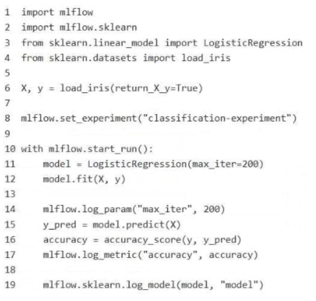
- Exhibit 2: 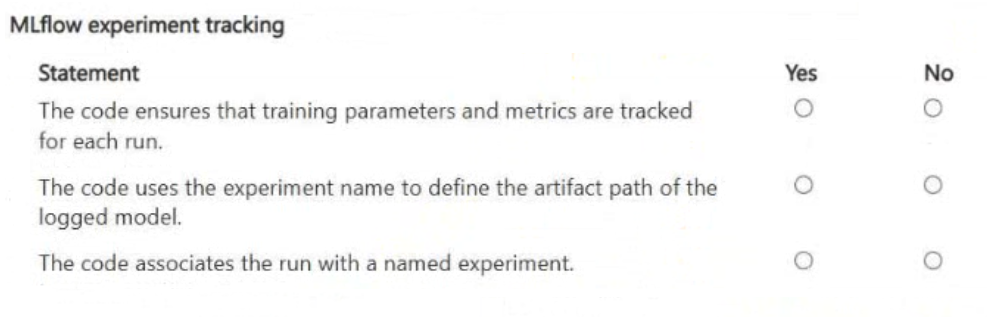

_HOTSPOT — the original ExamTopics question expects you to mark areas on the exhibit above; the correct hotspot coordinates are not published._

**Correct answer:** Not provided by ExamTopics
**Most voted:** Yes No Yes: | mlflow.set_experiment("classification-experiment") | --> experiment association, not artefact path definition | mlflow.sklearn.log_model(model, "model") | --> "model" is the artefact path.

### Top explanations
- **uncledana** (5 upvotes): YNY - makes sense, no experiment name is classification-experiment but artefact name is 'model'
- **03f65a8** (3 upvotes): Yes No Yes:
mlflow.set_experiment("classification-experiment")
--> experiment association, not artefact path definition
mlflow.sklearn.log_model(model, "model")
--> "model" is the artefact path.
- **exam_upskill** (1 upvotes [Most Recent]): 1. YES ✅
2. NO ✅
3. YES ✅
YES → NO → YES.
- **f5f9d28** (1 upvotes): NNY
as you have not imported the accuracy metric at all
log_model is hard coded to model so, it has no reference to classification- experiment

## Q3.11 (ID 404570)

A data science team completes multiple training runs within an experiment by using MLflow.
The team wants to store a selected model in Azure Machine Learning so that it can be versioned and deployed later.
The model must be versioned centrally for reuse across environments.
You need to version the trained model.
Which two actions should you perform? Each correct answer presents part of the solution. Choose two.
NOTE: Each correct selection is worth one point.

✅ **A.** Locate and capture the model artifacts from the outputs of the training run.
✅ **B.** Register the model in the Azure Machine Learning workspace.
⭕ **C.** Tag the training experiment with a name.
⭕ **D.** Export the model files to local storage.

**Correct answer:** A, B
**Most voted:** AB

### Top explanations
- **exam_upskill** (1 upvotes [Most Recent, Selected Answer: AB]): A. Locate and capture the model artifacts from the outputs of the training run.
B. Register the model in the Azure Machine Learning workspace.
- **RICHARDALEX007** (1 upvotes [Selected Answer: AB]): Versioning an MLflow-trained model for reuse requires capturing the run's model artifacts (A) and registering the model in the workspace (B), which creates the versioned entry. Tagging the experiment (C) and exporting to local storage (D) don't version it centrally.

## Q3.12 (ID 404571)

DRAG DROP
A team deploys a classification model to production and monitors performance and data changes.
The team wants to ensure that significant drops in prediction accuracy automatically trigger the following:
Stakeholders must be notified of the drops.
Retraining must be initiated when thresholds are exceeded
You need to configure monitoring to meet the requirements.
Which four actions should you perform in sequence? To answer, move the appropriate actions from the list of actions to the answer area and arrange them in the correct order.

**Exhibits**
- Exhibit 1: 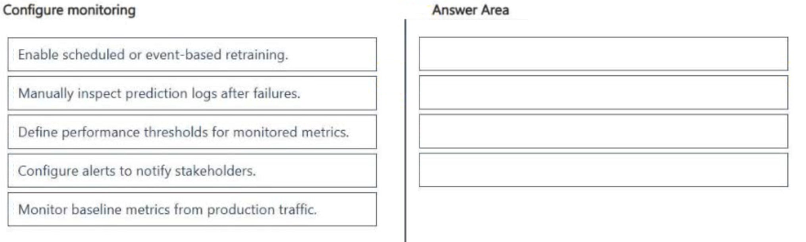

_DRAG DROP — the original ExamTopics question expects you to drag and drop items; the correct targets are not published._

**Correct answer:** Not provided by ExamTopics
**Most voted:** 1. Monitor baseline metrics from production traffic | 2. Define performance thresholds for monitored metrics | 3. Configure alerts to notify stakeholders | 4. Enable scheduled or event-based retraining

### Top explanations
- **uncledana** (13 upvotes [Highly Voted]): 1.	Monitor baseline metrics from production traffic
2.	Define performance thresholds for monitored metrics
3.	Configure alerts to notify stakeholders
4.	Enable scheduled or event-based retraining
- **03f65a8** (3 upvotes): Define thresholds
↓
Monitor production metrics
↓
Trigger alerts
↓
Automated retraining
- **exam_upskill** (1 upvotes [Most Recent]): 1. Monitor baseline metrics from production traffic
2. Define performance thresholds for monitored metrics
3. Configure alerts to notify stakeholders
4. Enable scheduled or event-based retraining
- **DAgoGi** (1 upvotes): Settings:
1. Define thresholds
2. Trigger alerts
3. Automated retraining
Execution:
4. Monitor production metrics

## Q3.13 (ID 404572)

An Azure Machine Learning workspace contains multiple registered versions of a model that is used in production.
An older model version must no longer be deployable, but it must remain available for compliance review and potential rollback.
You need to change the state of the model version to meet the requirements.
What should you do?

⭕ **A.** Archive the training dataset for the model version.
⭕ **B.** Delete the model version.
✅ **C.** Archive the model version.
⭕ **D.** Unregister the model version.

**Correct answer:** C
**Most voted:** C

### Top explanations
- **exam_upskill** (1 upvotes [Most Recent, Selected Answer: C]): C. Archive the model version
- **RICHARDALEX007** (1 upvotes [Selected Answer: C]): Making a version non-deployable but retained for compliance/rollback is exactly archiving the model version (reversible, keeps it registered). Deleting (B) or unregistering (D) removes it; archiving the dataset (A) is unrelated.

## Q3.14 (ID 404573)

A team is deploying machine learning models to a production inference endpoint in Azure Machine Learning.
The team requires a safe way to validate a new model version without disrupting existing users.
You need to recommend a deployment strategy for controlled testing of a new model version.
What should you configure?

✅ **A.** traffic splitting between deployments
⭕ **B.** the model asset version in the registry
⭕ **C.** deployment to a separate staging endpoint
⭕ **D.** an evaluation script in Azure Machine Learning

**Correct answer:** A
**Most voted:** A

### Top explanations
- **exam_upskill** (1 upvotes [Most Recent, Selected Answer: A]): A. traffic splitting between deployments
- **RICHARDALEX007** (1 upvotes [Selected Answer: A]): Safely validating a new model version without disrupting users on an inference endpoint is traffic splitting across deployments (canary). A staging endpoint (C) doesn't test against real production traffic share; registry version (B) and an eval script (D) don't control rollout.

## Q3.15 (ID 404574)

HOTSPOT
You are monitoring a fine-tuned large language model deployed in Microsoft Foundry.
You evaluate the model before and after fine-tuning by using the same evaluation dataset.
You review the following evaluation results:
You need to determine whether the fine-tuned model shows improved performance without introducing regression. For each of the following statements, select Yes if the statement is true. Otherwise, select No.
NOTE: Each correct selection is worth one point.

**Exhibits**
- Exhibit 1: 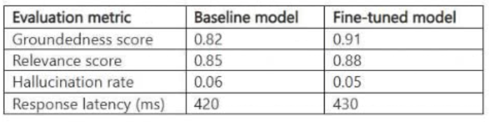
- Exhibit 2: 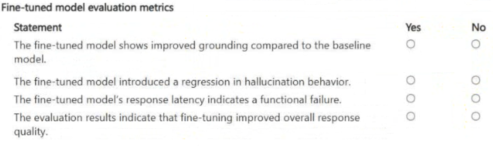

_HOTSPOT — the original ExamTopics question expects you to mark areas on the exhibit above; the correct hotspot coordinates are not published._

**Correct answer:** Not provided by ExamTopics
**Most voted:** 1. YES ✅ | 2. NO ✅ | 3. NO ✅ | 4. YES ✅ | YES → NO → NO → YES.

### Top explanations
- **exam_upskill** (1 upvotes [Most Recent]): 1. YES ✅
2. NO ✅
3. NO ✅
4. YES ✅
YES → NO → NO → YES.

## Q3.17 (ID 415898)

Background
Fabrikam Inc. is a mid-sized healthcare analytics company that provides population health dashboards and predictive insights to regional hospital systems across the United States. Fabrikam Inc. customers rely on near real time analytics to monitor patient flow, staffing needs, and readmission risks. They use multiple traditional forecasting machine learning models for predictions.
Fabrikam Inc. has an established Microsoft Azure footprint. The company uses Jupyter Notebooks that run on a local server as the primary development environment. The data science team is experiencing scalability, asset management and code management issues with the current development platform. Fabrikam Inc. plans to migrate to a cloud-based development environment to mitigate the issues.
Additionally, the company plans to implement a Retrieval-Augmented Generation (RAG)-based chat application for client support. Leadership requires the application to be developed and deployed with a low operational risk.
Current Environment
Fabrikam Inc. operates a single Azure subscription that has the following components:
•	Azure Data Lake Storage Gen2 that contains de-identified clinical and operational datasets
•	Azure AI Search indexing curated analytical documents and reference materials
•	A small set of Python-based training scripts maintained by data scientists
•	Azure OpenAI Service with deployed foundational models
•	A Microsoft Foundry resource for building a RAG-based solution
Evaluation data has manually defined expected responses.
The current challenges faced by the data science team include the following:
•	Model training jobs are run manually from notebooks.
•	Experiment tracking is inconsistent
•	Model versions are registered without standardized metadata.
•	Deployment is performed manually by data scientists, with limited rollback capability.
•	The team has no standardized evaluation process for generative AI outputs.
The environment currently allows public network access. Authentication relies on user accounts rather than managed identities. Compute targets are manually created and shared across experiments. This has led to resource contention during peak usage.
Business Requirements
Fabrikam Inc. has the following business requirements for the modernization initiative:
•	Provide a conversational interface that answers analytics questions by using internal documents and datasets.
•	Ensure that sensitive healthcare-related data is not exposed outside the Fabrikam Inc. Azure tenant.
•	Enable repeatable and auditable model training and deployment processes.
•	Support experimentation to compare prompt strategies and fine-tuned models.
•	Align the model with the ranked preferences and optimize behavior for the long term.
•	Minimize disruption to existing analytics workloads during rollout.
Technical Requirements
To support the business goals, Fabrikam Inc. identifies these technical requirements:
•	Use Azure Machine Learning workspaces to centrally manage data assets, models, and environments.
•	Implement experiment tracking and model versioning for all training jobs.
•	Orchestrate training and evaluation by using pipelines rather than manually running notebooks.
•	Deploy traditional machine learning models with support for staged rollout and rollback.
•	Improve RAG-based solution output quality.
•	Use the existing evaluation datasets that are based on real data with input-output pairs.
•	Apply advanced fine-tuning techniques only when prompt engineering is insufficient
Issues and Constraints
Fabrikam Inc. must comply with internal security policies that require the company to restrict network access and avoid long-lived secrets. The data science team has limited Azure DevOps experience, so solutions must favor managed services and automation over custom infrastructure.
Cost predictability is important. Leadership prefers serverless or managed compute options where possible but is willing to approve dedicated compute for stable production workloads.
Problem Statement
Fabrikam Inc. must design and implement an Azure-based AI operations solution that enables reliable training, evaluation, deployment, and iteration of generative AI models. The solution must support experimentation and gradual rollout while ensuring governance, security, and operational stability. The data science and platform teams must collaborate to deliver this solution by using Azure Machine Learning and Microsoft Foundry capabilities.
You need to recommend a solution to address Fabrikam Inc.’s limited rollback capability.
Which deployment approach should you recommend?

⭕ **A.** VM-hosted REST APIs
⭕ **B.** Azure Kubernetes Service with blue-green switching
✅ **C.** Managed online endpoints with traffic splitting
⭕ **D.** Batch endpoints

**Correct answer:** C
**Most voted:** C

### Top explanations
- **exam_upskill** (1 upvotes [Most Recent, Selected Answer: C]): C. Managed online endpoints with traffic splitting
- **RICHARDALEX007** (1 upvotes [Selected Answer: C]): Fabrikam's limited rollback capability is solved by managed online endpoints with traffic splitting (blue/green), giving staged rollout and instant rollback with minimal ops. VM REST APIs (A) and self-managed AKS blue-green (B) add custom infra the team wants to avoid; batch endpoints (D) aren't for real-time rollback.

## Q3.18 (ID 415899)

Note: This question is part of a series of questions that present the same scenario. Each question in the series contains a unique solution that might meet the stated goals. Some question sets might have more than one correct solution, while others might not have a correct solution.
After you answer a question in this section, you will NOT be able to return to it. As a result, these questions will not appear in the review screen.
You have an Azure Machine Learning workspace. You connect to a terminal session from the Notebooks page in Azure Machine Learning studio.
You plan to add a new Jupyter kernel that will be accessible from the same terminal session.
You need to perform the task that must be completed before you can add the new kernel.
Solution: Delete the Python 3.6 - AzureML kernel.
Does the solution meet the goal?

⭕ **A.** Yes
✅ **B.** No

**Correct answer:** B
**Most voted:** B

### Top explanations
- **RICHARDALEX007** (1 upvotes [Most Recent, Selected Answer: B]): Deleting the Python 3.6 AzureML kernel is not the prerequisite for adding a new Jupyter kernel; you create/activate a new conda environment and register it as a kernel. Deleting an existing kernel is unnecessary and doesn't enable adding one.

## Q3.19 (ID 415900)

Note: This question is part of a series of questions that present the same scenario. Each question in the series contains a unique solution that might meet the stated goals. Some question sets might have more than one correct solution, while others might not have a correct solution.
After you answer a question in this section, you will NOT be able to return to it. As a result, these questions will not appear in the review screen.
You have an Azure Machine Learning workspace. You connect to a terminal session from the Notebooks page in Azure Machine Learning studio.
You plan to add a new Jupyter kernel that will be accessible from the same terminal session.
You need to perform the task that must be completed before you can add the new kernel.
Solution: Delete the Python 3.8 - AzureML kernel.
Does the solution meet the goal?

⭕ **A.** Yes
✅ **B.** No

**Correct answer:** B
**Most voted:** B

### Top explanations
- **RICHARDALEX007** (1 upvotes [Most Recent, Selected Answer: B]): Same scenario: deleting the Python 3.8 AzureML kernel is not the required prerequisite for adding a new kernel. The needed step is creating a new (conda) environment.

## Q3.20 (ID 415901)

Note: This question is part of a series of questions that present the same scenario. Each question in the series contains a unique solution that might meet the stated goals. Some question sets might have more than one correct solution, while others might not have a correct solution.
After you answer a question in this section, you will NOT be able to return to it. As a result, these questions will not appear in the review screen.
You have an Azure Machine Learning workspace. You connect to a terminal session from the Notebooks page in Azure Machine Learning studio.
You plan to add a new Jupyter kernel that will be accessible from the same terminal session.
You need to perform the task that must be completed before you can add the new kernel.
Solution: Create an environment.
Does the solution meet the goal?

✅ **A.** Yes
⭕ **B.** No

**Correct answer:** A
**Most voted:** A

### Top explanations
- **RICHARDALEX007** (1 upvotes [Most Recent, Selected Answer: A]): Creating a (conda) environment is the task that must be completed before a new Jupyter kernel can be added and made available in the terminal session

## Q3.21 (ID 415902)

HOTSPOT
A biomedical research company plans to enroll people in an experimental medical treatment trial.
You create and train a binary classification model to support selection and admission of patients to the trial. The model includes the following features: Age, Gender, and Ethnicity.
The model returns different performance metrics for people from different ethnic groups.
You need to use Fairlearn to mitigate and minimize disparities for each category in the Ethnicity feature.
Which technique and constraint should you use? To answer, select the appropriate options in the answer area.
NOTE: Each correct selection is worth one point.

**Exhibits**
- Exhibit 1: 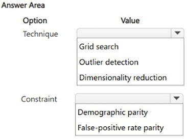

_HOTSPOT — the original ExamTopics question expects you to mark areas on the exhibit above; the correct hotspot coordinates are not published._

**Correct answer:** Not provided by ExamTopics
**Most voted:** To mitigate disparities across each Ethnicity category, a Fairlearn reductions technique (Grid search) with a fairness constraint (demographic parity) is used.

### Top explanations
- **RICHARDALEX007** (1 upvotes [Most Recent]): To mitigate disparities across each Ethnicity category, a Fairlearn reductions technique (Grid search) with a fairness constraint (demographic parity) is used.

## Q3.22 (ID 415903)

You are authoring a notebook in Azure Machine Learning studio.
You must install packages from the notebook into the currently running kernel. The installation must be limited to the currently running kernel only.
You need to install the packages.
Which magic function should you use?

⭕ **A.** !pip
⭕ **B.** !conda
⭕ **C.** %load
✅ **D.** %pip

**Correct answer:** D
**Most voted:** D

### Top explanations
- **RICHARDALEX007** (1 upvotes [Most Recent, Selected Answer: D]): install into only the currently running kernel from a notebook, use the %pip magic (kernel-scoped). !pip (A) runs in the shell and may target a different environment; !conda (B) likewise; %load (C) loads code, not packages.

## Q3.23 (ID 415904)

You create a workspace by using Azure Machine Learning Studio.
You must run a Python SDK v2 notebook in the workspace by using Azure Machine Learning Studio.
You need to reset the state of the notebook.
Which three actions should you use? Each correct answer presents a complete solution.
NOTE: Each correct selection is worth one point.

⭕ **A.** Navigate to another section of the workspace.
⭕ **B.** stop the current kernel.
✅ **C.** Reset the compute.
✅ **D.** Change the current kernel.
✅ **E.** Change the compute.

**Correct answer:** C, D, E
**Most voted:** CDE

### Top explanations
- **boywonder** (2 upvotes [Selected Answer: BCD]): B. Stop the current kernel – Stops the notebook kernel, clearing the current session state. When restarted, the notebook begins with a fresh kernel.
C. Reset the compute – Restarts the compute instance, terminating all running processes and clearing the notebook environment.
D. Change the current kernel – Switching to a different kernel starts a new kernel session, effectively resetting the notebook state.
- **Alvarogc** (1 upvotes [Most Recent, Selected Answer: CDE]): Stopping the kernel and Navigate to another workspace section don't change the notebook state or the values of any variables in the notebook, so answer should be:
C. Reset the compute.
D. Change the current kernel.
E. Change the compute.
Reference: https://learn.microsoft.com/en-us/azure/machine-learning/how-to-run-jupyter-notebooks
- **Kachien** (1 upvotes [Selected Answer: CDE]): These actions reset the notebook state and resets all variables in the notebook.
Action	Result
Change the kernel	Notebook uses new kernel
Switch compute	Notebook automatically uses the new compute.
Reset compute	Starts again when you try to run a cell
Stop compute	No cells will run
Open notebook in Jupyter or JupyterLab	Notebook opened in a new tab.
https://learn.microsoft.com/en-us/azure/machine-learning/how-to-run-jupyter-notebooks?view=azureml-api-2
- **RICHARDALEX007** (1 upvotes [Selected Answer: ABD]): navigating away and back, stopping the kernel, or changing the kernel each reset the in-memory state

## Q3.24 (ID 415905)

A data science team plans to evaluate multiple hyperparameter values automatically while training a model in Azure Machine Learning.
The tuning process must run multiple training trials without manually modifying the training script for each run.
You need to automate hyperparameter tuning for the training job.
What should you do?

⭕ **A.** Run a single training job with fixed hyperparameters.
⭕ **B.** Adjust hyperparameters after model deployment.
⭕ **C.** Select hyperparameters based only on default model settings.
✅ **D.** Create a tuning job that runs multiple trials with different parameter values.

**Correct answer:** D
**Most voted:** D

### Top explanations
- **RICHARDALEX007** (1 upvotes [Most Recent, Selected Answer: D]): Automating hyperparameter evaluation without editing the script per run is a sweep/tuning job that runs multiple trials over a search space. Fixed hyperparameters (A), post-deployment tuning (B) and defaults only (C) don't automate tuning.

## Q3.25 (ID 415906)

DRAG DROP
An organization is deploying generative AI solutions by using Microsoft Foundry to support multiple production workloads.
The organization has the following workload requirements:
•	One workload must be real-time, latency-sensitive, and have predictable global usage patterns that demand consistent performance.
•	One workload must have variable performance and be optimized for cost-efficient operation.
You need to select a global deployment type for each workload.
Which type of deployment should you use for each workload requirement? To answer, move the appropriate deployment types to the correct requirements. You may use each deployment type once, more than once, or not at all. You may need to move the split bar between panes or scroll to view content.
NOTE: Each correct selection is worth one point.

**Exhibits**
- Exhibit 1: 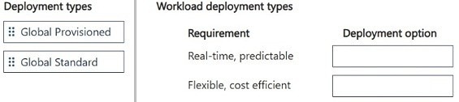

_DRAG DROP — the original ExamTopics question expects you to drag and drop items; the correct targets are not published._

**Correct answer:** Not provided by ExamTopics
**Most voted:** Predictable, consistent global performance uses Global Provisioned (provisioned throughput); variable, cost-efficient workloads use Global Standard (pay-as-you-go).

### Top explanations
- **RICHARDALEX007** (1 upvotes [Most Recent]): Predictable, consistent global performance uses Global Provisioned (provisioned throughput); variable, cost-efficient workloads use Global Standard (pay-as-you-go).

## Q3.26 (ID 415907)

You create an Azure Machine Learning workspace. You train an MLflow-formatted regression model by using tabular structured data.
You must use a Responsible AI dashboard to assess the model.
You need to use the Azure Machine Learning studio UI to generate the Responsible AI dashboard.
What should you do first?

✅ **A.** Register the model with the workspace.
⭕ **B.** Create the model explanations.
⭕ **C.** Convert the model from the MLflow format to a custom format.
⭕ **D.** Deploy the model to a managed online endpoint.

**Correct answer:** A
**Most voted:** A

### Top explanations
- **RICHARDALEX007** (1 upvotes [Most Recent, Selected Answer: A]): Generating a Responsible AI dashboard in AML studio first requires the model to be registered in the workspace. Creating explanations (B) is part of the dashboard build after registration; format conversion (C) is unnecessary for MLflow models; deploying (D) isn't required to build the dashboard.

## Q3.27 (ID 415908)

DRAG DROP
A customer-facing web application uses a foundational model deployed through Microsoft Foundry.
A new model version must be introduced and validated without disrupting production traffic.
You need to deploy the new version by using a safe promotion strategy.
Which three actions should you perform in sequence? To answer, move the appropriate actions from the list of actions to the answer area and arrange them in the correct order.

**Exhibits**
- Exhibit 1: 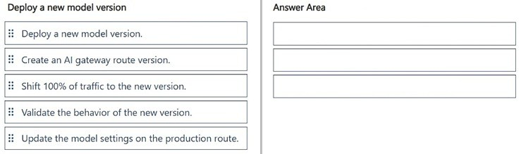

_DRAG DROP — the original ExamTopics question expects you to drag and drop items; the correct targets are not published._

**Correct answer:** Not provided by ExamTopics
**Most voted:** Correct sequence: | 1. Deploy a new model version. | 2, Create an AI gateway route version. | 3. Validate the behavior of the new version. | The model is first deployed without changing existing production routing. A separate route version then provides a controlled configuration for testing. Validate it before promoting it to production. | Do not immediately shift 100% of traffic or change the existing production route before validation.

### Top explanations
- **0fdb748** (2 upvotes [Most Recent]): Correct sequence:
1. Deploy a new model version.
2, Create an AI gateway route version.
3. Validate the behavior of the new version.
The model is first deployed without changing existing production routing. A separate route version then provides a controlled configuration for testing. Validate it before promoting it to production.
Do not immediately shift 100% of traffic or change the existing production route before validation.
- **RICHARDALEX007** (1 upvotes): Safe promotion without disrupting production deploys the new version, sends partial traffic (canary), validates, then promotes fully. Matches the controlled rollout pattern.

## Q3.28 (ID 415909)

DRAG DROP
A team operates a generative AI-powered customer support assistant built on Microsoft Foundry. The application serves users globally and supports both real-time chat interactions and batch summarization jobs.
The team must ensure that the application continues to meet defined service-level objectives (SLO) as usage increases.
The team requires visibility into runtime behavior to identify performance regressions that affect the user experience and system capacity.
You need to select the performance metrics that meet the requirements.
Which performance metric should you monitor for each requirement? To answer, move the appropriate performance metrics to the correct requirements. You may use each performance metric once, more than once, or not at all. You may need to move the split bar between panes or scroll to view content.
NOTE: Each correct selection is worth one point.

**Exhibits**
- Exhibit 1: 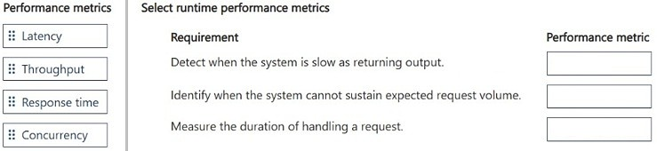

_DRAG DROP — the original ExamTopics question expects you to drag and drop items; the correct targets are not published._

**Correct answer:** Not provided by ExamTopics
**Most voted:** Detect when the system is slow at returning output → Latency | Identify when the system cannot sustain expected request volume → Throughput | Measure the duration of handling a request → Response time

### Top explanations
- **rveney** (4 upvotes [Most Recent]): Detect when the system is slow at returning output → Latency
Identify when the system cannot sustain expected request volume → Throughput
Measure the duration of handling a request → Response time

## Q3.29 (ID 415910)

DRAG DROP
A team deploys a classification model to production and scores incoming customer data daily.
After several weeks, business stakeholders report unexpected changes in prediction behavior, even though the endpoint remains healthy.
You need to determine whether data drift is occurring and if it is, identify the appropriate actions.
Which action should you perform for each observed signal? To answer, move the appropriate actions to the correct observed signals. You may use each action once, more than once, or not at all. You may need to move the split bar between panes or scroll to view content.
NOTE: Each correct selection is worth one point.

**Exhibits**
- Exhibit 1: 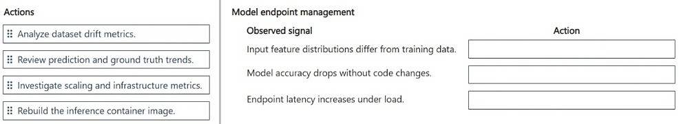

_DRAG DROP — the original ExamTopics question expects you to drag and drop items; the correct targets are not published._

**Correct answer:** Not provided by ExamTopics
**Most voted:** Input feature distributions differ from training data → Analyze dataset drift metrics. | Model accuracy drops without code changes → Review prediction and ground truth trends. | Endpoint latency increases under load → Investigate scaling and infrastructure metrics

### Top explanations
- **rveney** (5 upvotes [Most Recent]): Input feature distributions differ from training data → Analyze dataset drift metrics.
Model accuracy drops without code changes → Review prediction and ground truth trends.
Endpoint latency increases under load → Investigate scaling and infrastructure metrics

## Q3.31 (ID 415912)

HOTSPOT
You use Azure Machine Learning to implement hyperparameter tuning for an Azure ML Python SDK v2-based model training.
Training runs must terminate when the primary metric is lowered by 25 percent or more compared to the best performing run.
You need to configure an early termination policy to terminate training jobs.
Which values should you use? To answer, select the appropriate options in the answer area.
NOTE: Each correct selection is worth one point.

**Exhibits**
- Exhibit 1: 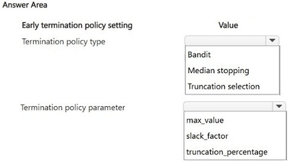

_HOTSPOT — the original ExamTopics question expects you to mark areas on the exhibit above; the correct hotspot coordinates are not published._

**Correct answer:** Not provided by ExamTopics
**Most voted:** Terminating runs when the primary metric is >=25% worse than the best run is exactly the Bandit policy governed by slack_factor (a run within (1/(1+slack)) of the best survives).

### Top explanations
- **RICHARDALEX007** (1 upvotes [Most Recent]): Terminating runs when the primary metric is >=25% worse than the best run is exactly the Bandit policy governed by slack_factor (a run within (1/(1+slack)) of the best survives).

## Q3.33 (ID 415914)

A team is validating a generative AI assistant for a company. The assistant generates responses by using internal knowledge sources.
The company requires assurance that responses are accurate, supported by sources, and related to the user prompts before enabling production access.
You need to implement quality metrics that confirm the assistant produces reliable and meaningful responses.
Which two evaluation metrics should you use? Each correct answer presents part of the solution.
NOTE: Each correct selection is worth one point.

✅ **A.** Groundedness
✅ **B.** Relevance
⭕ **C.** Harmfulness
⭕ **D.** Tone
⭕ **E.** Fairness

**Correct answer:** A, B
**Most voted:** AB

### Top explanations
- **RICHARDALEX007** (1 upvotes [Most Recent, Selected Answer: AB]): Assurance that responses are supported by sources and related to the prompt maps to Groundedness (source support) and Relevance (related to the query). Harmfulness (C) and Fairness (E) are safety/RAI, Tone (D) is style.

## Q3.34 (ID 415915)

DRAG DROP
You use Azure Machine Learning to deploy a model as a real-time web service.
You need to create an entry script for the service that ensures that the model is loaded when the service starts and is used to score new data as it is received.
Which functions should you include in the script? To answer, drag the appropriate functions to the correct actions. Each function may be used once, more than once, or not at all. You may need to drag the split bar between panes or scroll to view content.
NOTE: Each correct selection is worth one point.

**Exhibits**
- Exhibit 1: 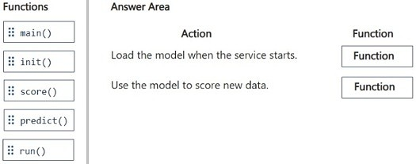

_DRAG DROP — the original ExamTopics question expects you to drag and drop items; the correct targets are not published._

**Correct answer:** Not provided by ExamTopics
**Most voted:** An AML real-time entry/scoring script uses init() to load the model on startup and run(data) to score each request

### Top explanations
- **RICHARDALEX007** (2 upvotes [Most Recent]): An AML real-time entry/scoring script uses init() to load the model on startup and run(data) to score each request

## Q3.36 (ID 415917)

You are training machine learning models in Azure Machine Learning. You use Hyperdrive to tune the hyperparameters.
In previous model training and tuning runs, many models showed similar performance.
You need to select an early termination policy that meets the following requirements:
•	accounts for the performance of all previous runs when evaluating the current run
•	avoids comparing the current run with only the best performing run to date
Which two early termination policies should you use? Each correct answer presents part of the solution.
NOTE: Each correct selection is worth one point.

⭕ **A.** Bandit
⭕ **B.** Default
✅ **C.** Median stopping
✅ **D.** Truncation selection

**Correct answer:** C, D
**Most voted:** CD

### Top explanations
- **RICHARDALEX007** (1 upvotes [Most Recent, Selected Answer: CD]): The requirement to account for all previous runs (not just the best) is met by Median stopping (compares to the median of running averages across all runs) and Truncation selection (cancels the lowest X% across runs). Bandit (A) compares only to the best run; Default (B) applies no policy.

## Q3.38 (ID 415919)

DRAG DROP
A data science team trains a model that depends on features that are stored in a managed feature store.
The model is registered in Azure Machine Learning and will be deployed to a real-time endpoint.
After deployment, the model must:
•	Retrieve feature values dynamically at inference time.
•	Use the same feature definitions that were used during training.
•	Run without manual configuration changes across environments.
You need to define feature store entities so that feature retrieval behaves as expected when the model is deployed.
Which feature store entity should you select for each requirement? To answer, move the appropriate feature store entities to the correct requirements. You may use each feature store entity once, more than once, or not at all. You may need to move the split bar between panes or scroll to view content.
NOTE: Each correct selection is worth one point.

**Exhibits**
- Exhibit 1: 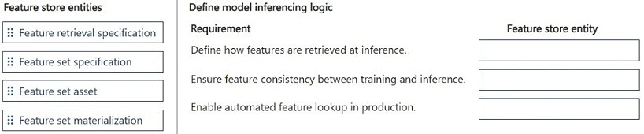

_DRAG DROP — the original ExamTopics question expects you to drag and drop items; the correct targets are not published._

**Correct answer:** Not provided by ExamTopics
**Most voted:** Define how features are retrieved at inference → Feature retrieval specification | Ensure feature consistency between training and inference → Feature retrieval specification | Enable automated feature lookup in production → Feature set materialization

### Top explanations
- **rveney** (3 upvotes): Define how features are retrieved at inference → Feature retrieval specification
Ensure feature consistency between training and inference → Feature retrieval specification
Enable automated feature lookup in production → Feature set materialization
- **boywonder** (1 upvotes [Most Recent]): Define how features are retrieved at inference. → Feature retrieval specification
Ensure feature consistency between training and inference. → Feature set specification
Enable automated feature lookup in production. → Feature retrieval specification
Why not the others?
Feature set asset: Represents the registered feature set itself, but it doesn't define retrieval logic or ensure inference behavior.
Feature set materialization: Controls how offline features are materialized to storage for training; it is not used for online feature retrieval during inference.

## Q3.41 (ID 420695)

HOTSPOT
You have an Azure Machine Learning workspace named Workspace1.
You plan to train an image classification model by using Automated ML in Workspace1.
You need to complete the provided Azure Machine Learning Python SDK v2 code to bring labeled image data as input for model training.
How should you complete the code? To answer, select the appropriate options in the answer area.
NOTE: Each correct selection is worth one point.

**Exhibits**
- Exhibit 1: 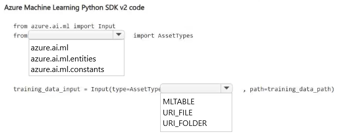

_HOTSPOT — the original ExamTopics question expects you to mark areas on the exhibit above; the correct hotspot coordinates are not published._

**Correct answer:** Not provided by ExamTopics
**Most voted:** The correct answers are: | Import module: azure.ai.ml.entities | Asset type: AssetTypes.URI_FOLDER | Why? | azure.ai.ml.entities provides the AssetTypes class used to specify the type of input data. | AssetTypes.URI_FOLDER is appropriate because image-classification training data typically consists of a folder containing multiple labeled images, organized by class. | P.S. | The guys at ExamTopics are real infamous, though—they make you pay for exam quizzes but don't even include the correct a...

### Top explanations
- **DAgoGi** (1 upvotes [Most Recent]): The correct answers are:
Import module: azure.ai.ml.entities
Asset type: AssetTypes.URI_FOLDER
Why?
azure.ai.ml.entities provides the AssetTypes class used to specify the type of input data.
AssetTypes.URI_FOLDER is appropriate because image-classification training data typically consists of a folder containing multiple labeled images, organized by class.
P.S.
The guys at ExamTopics are real infamous, though—they make you pay for exam quizzes but don't even include the correct answers! Not to mention the explanations!
Li mortacci vostra!

## Q3.46 (ID 420700)

You manage an Azure Machine Learning workspace. You build a model for which you must configure a Responsible Al dashboard.
Based on what you learn from the dashboard, you must perform the following activities:
•	Determine what must be done to get a desirable outcome from the model.
•	Identify the features that have the most direct effect on your outcome of interest.
You need to select the components to use for the Responsible Al dashboard configuration.
Which two components should you add? Each correct answer presents part of the solution.
NOTE: Each correct selection is worth one point.

✅ **A.** counterfactuals
⭕ **B.** error analysis
⭕ **C.** causal
✅ **D.** explanation

**Correct answer:** A, D
**Most voted:** AD

### Top explanations
- **DAgoGi** (1 upvotes [Most Recent, Selected Answer: AD]): The correct answers are A. Counterfactuals and D. Explanation.
Why?
A. Counterfactuals — Helps determine what changes to input features would lead to a desirable model outcome. For example, what changes would make a loan application approved.
D. Explanation — Identifies the features that have the greatest influence on the model's predictions, including their relative importance.
Why not the others?
B. Error analysis: Helps identify patterns in prediction errors and understand where the model performs poorly.
C. Causal: Helps investigate causal relationships and the effects of interventions, rather than directly providing the two requested capabilities.
P.S.
The guys at ExamTopic are absolute infamous, though—they make you pay for exam quizzes but don't even include the correct answers! Not to mention the explanations!
Li mortacci vostra!

## Q3.67 (ID 424452)

HOTSPOT
You manage an Azure Machine Learning workspace. You create an experiment named experiment1 by using the Azure Machine Learning Python SDK v2 and MLflow.
You are reviewing the results of experiment1 by using the following code segment:
For each of the following statements, select Yes if the statement is true. Otherwise, select No.
NOTE: Each correct selection is worth one point.

**Exhibits**
- Exhibit 1: 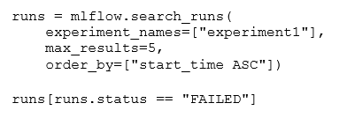
- Exhibit 2: 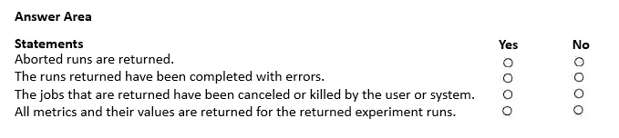

_HOTSPOT — the original ExamTopics question expects you to mark areas on the exhibit above; the correct hotspot coordinates are not published._

**Correct answer:** Not provided by ExamTopics
**Most voted:** According to GPT 5.6: | 1. Aborted runs are returned: No. Aborted runs have the status KILLED, not FAILED. | 2. The runs returned have been completed with errors: Yes. The FAILED status indicates that a run failed during execution. | 3. The jobs returned have been canceled or killed by the user or system: No. Canceled or terminated runs have the status KILLED, not FAILED. | 4. All metrics and their values are returned for the returned experiment runs: N...

### Top explanations
- **DAgoGi** (1 upvotes [Most Recent]): According to GPT 5.6:
1. Aborted runs are returned: No. Aborted runs have the status KILLED, not FAILED.
2. The runs returned have been completed with errors: Yes. The FAILED status indicates that a run failed during execution.
3. The jobs returned have been canceled or killed by the user or system: No. Canceled or terminated runs have the status KILLED, not FAILED.
4. All metrics and their values are returned for the returned experiment runs: No. The query returns run information, including logged metrics, but does not necessarily return every metric value recorded throughout training.

## Q4.1 (ID 404575)

DRAG DROP
A team runs training jobs by using multiple Azure Machine Learning pipelines.
The team must ensure that all runs use the same Python packages and system libraries. The solution must allow dependency updates to be versioned without modifying training code.
You need to configure the workspace so that runtime dependencies are consistent and reusable.
Which four actions should you perform in sequence? To answer, move the appropriate actions from the list of actions to the answer area and arrange them in the correct order.

**Exhibits**
- Exhibit 1: 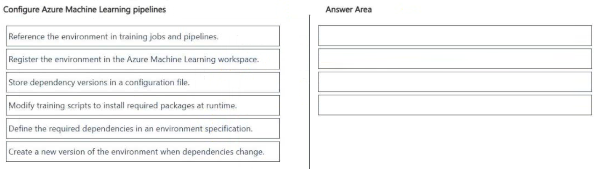

_DRAG DROP — the original ExamTopics question expects you to drag and drop items; the correct targets are not published._

**Correct answer:** Not provided by ExamTopics
**Most voted:** Define, Register, Reference, Create

### Top explanations
- **uncledana** (10 upvotes [Highly Voted]): Define, Register, Reference, Create
- **03f65a8** (5 upvotes [Most Recent]): Define, Register, Reference, Create - that's the correct order
- **rveney** (3 upvotes): ✅ Final Drag-and-Drop Answer (Top → Bottom)
Store dependency versions in a configuration file
Define the required dependencies in an environment specification
Register the environment in the Azure Machine Learning workspace
Reference the environment in training jobs and pipelines

## Q4.3 (ID 404577)

A financial services company is deploying Microsoft Foundry to host generative AI workloads that process regulated customer data. The Microsoft Foundry environment must prevent any public network exposure while still allowing services managed by Microsoft Foundry to communicate with dependent Azure resources.
Security auditors require that all traffic to and from the Microsoft Foundry resource remain on private networks, with no public endpoints available.
You need to configure the Microsoft Foundry environment so that network access is restricted while maintaining full platform functionality.
Which two actions should you perform? Each correct answer presents part of the solution. Choose two.
NOTE: Each correct selection is worth one point.

✅ **A.** Configure a managed virtual network for the Microsoft Foundry resource.
⭕ **B.** Use API key authentication for all model endpoints.
⭕ **C.** Deploy the Microsoft Foundry resource in a separate Azure subscription.
✅ **D.** Disable public network access to the Microsoft Foundry resource.
⭕ **E.** Disable all inbound network access.

**Correct answer:** A, D
**Most voted:** AD

### Top explanations
- **uncledana** (4 upvotes [Selected Answer: AD]): A - put the resource in a VNET is needed for security, D - allow access only via private endpoints for other services whilst disabling public access
- **03f65a8** (1 upvotes [Most Recent, Selected Answer: AD]): D, as the requirement is that:
"no PUBLIC access" NOT "no access at all" :)

## Q4.5 (ID 404579)

DRAG DROP
A company plans to deploy a foundation model in Microsoft Foundry.
The mode must support the following workloads:
A customer support workload used across multiple regions
A marketing workload that must remain within a specific region due to data residency requirements
You need to select the deployment type.
Which deployment type should you use for each workload? To answer, move the appropriate deployment types to the correct requirements. You may use each deployment type once, more than once, or not at all. You may need to move the split bar between panes or scroll to view content.
NOTE: Each correct selection is worth one point.

**Exhibits**
- Exhibit 1: 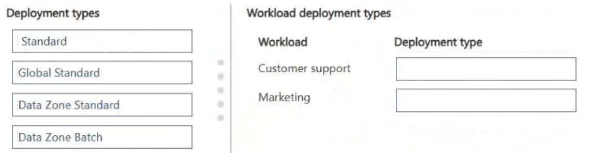

_DRAG DROP — the original ExamTopics question expects you to drag and drop items; the correct targets are not published._

**Correct answer:** Not provided by ExamTopics
**Most voted:** 1 - global standard, 2 - standard | https://learn.microsoft.com/en-us/azure/foundry/foundry-models/concepts/deployment-types

### Top explanations
- **uncledana** (6 upvotes [Most Recent]): 1 - global standard, 2 - standard
https://learn.microsoft.com/en-us/azure/foundry/foundry-models/concepts/deployment-types

## Q4.7 (ID 404607)

A team develops multiple AI applications in Microsoft Foundry that rely on shared prompt templates.
The team requires a centralized way to track, version, and reuse prompt content across projects.
You need to recommend a solution to track and reuse prompt content.
Which approach should you recommend?

✅ **A.** Store prompts as versioned files in a Git repository.
⭕ **B.** Register prompts as datasets in the Azure Machine Learning workspace.
⭕ **C.** Embed prompts directly in application configuration files.
⭕ **D.** Persist prompts in Azure Blob Storage with folder-level organization.

**Correct answer:** A
**Most voted:** A

### Top explanations
- **RICHARDALEX007** (1 upvotes [Most Recent, Selected Answer: A]): Centralized tracking, versioning and reuse of prompt content across projects is best done with versioned files in Git. Registering as datasets (B), embedding in config (C) or Blob folders (D) don't give code-grade version control and review.

## Q4.9 (ID 404609)

A company's platform engineers manage the resource settings and governance of Microsoft Foundry.
Developers must be able to create and update project assets but must not be able to change resource-level configurations.
You need to enforce least privilege access for the engineers and developers.
Which two actions should you perform? Each correct answer presents part of the solution. Choose two.
NOTE: Each correct selection is worth one point.

✅ **A.** Assign a resource-level Azure AI Administrator role to the platform engineers.
⭕ **B.** Disable Microsoft Entra ID authentication for the Microsoft Foundry resource.
✅ **C.** Assign the Azure AI Developer role to the developers.
⭕ **D.** Share a single API key across all teams.

**Correct answer:** A, C
**Most voted:** AC

### Top explanations
- **RICHARDALEX007** (1 upvotes [Most Recent, Selected Answer: AC]): Least privilege gives platform engineers the resource-level admin role (manage configuration) and developers the Azure AI Developer role (create/update project assets, not resource config). Disabling Entra ID (B) and sharing an API key (D) violate least privilege.

## Q4.10 (ID 404610)

You have a Microsoft Foundry project.
You plan to use the Microsoft Foundry portal to fine-tune a base Azure OpenAI Service model that can accept both text and images as input.
You need to choose the suitable model.
Which model should you choose?

⭕ **A.** davinci-002
✅ **B.** gpt-4o
⭕ **C.** gpt-35-turbo
⭕ **D.** gpt-4

**Correct answer:** B
**Most voted:** B

### Top explanations
- **RICHARDALEX007** (1 upvotes [Most Recent, Selected Answer: B]): Fine-tuning a base Azure OpenAI model that accepts both text and images requires a multimodal model; gpt-4o supports text+image input. davinci-002 (A), gpt-35-turbo (C) and gpt-4 (D) are text-only for this fine-tuning purpose.

## Q4.11 (ID 404611)

Note: This question is part of a series of questions that present the same scenario. Each question in the series contains a unique solution that might meet the stated goals. Some question sets might have more than one correct solution, while others might not have a correct solution.
After you answer a question in this section, you will NOT be able to return to it. As a result, these questions will not appear on the review screen.
You work in Microsoft Foundry with a prompt flow.
You must manually evaluate prompts and compare results across prompt variants.
You need to capture the inputs, outputs, token usage, and latencies for each flow run for the evaluation.
Solution: Create prompt variants and compare their outputs in the Evaluation experience.
Does the solution meet the goal?

✅ **A.** Yes
⭕ **B.** No

**Correct answer:** A
**Most voted:** A

### Top explanations
- **rveney** (2 upvotes [Selected Answer: A]): Correct Answer: A. Yes
Explanation
Creating prompt variants and comparing their outputs in the Evaluation experience of Microsoft Foundry does meet the stated goal:
The Evaluation experience allows you to run prompt flows and capture inputs, outputs, token usage, and latency for each run.
You can compare multiple prompt variants side by side, which supports manual evaluation.
Results are tracked per run, enabling consistent comparison across variants over time.
This approach is specifically designed for manual prompt evaluation and benchmarking, making it the correct solution for the scenario described.
- **RICHARDALEX007** (1 upvotes [Most Recent, Selected Answer: A]): Creating prompt variants and comparing them in the Evaluation experience captures inputs/outputs and quality metrics for manual comparison, so it largely meets the goal. The stem also wants token usage and latencies, which are most fully captured via tracing (Q12).

## Q4.12 (ID 404612)

Note: This question is part of a series of questions that present the same scenario. Each question in the series contains a unique solution that might meet the stated goals. Some question sets might have more than one correct solution, while others might not have a correct solution.
After you answer a question in this section, you will NOT be able to return to it. As a result, these questions will not appear on the review screen.
You work in Microsoft Foundry with a prompt flow.
You must manually evaluate prompts and compare results across prompt variants.
You need to capture the inputs, outputs, token usage, and latencies for each flow run for the evaluation.
Solution: Use the prompt flow SDK to enable tracing for the flow before executing runs. Then run the flow to generate traceable results.
Does the solution meet the goal?

✅ **A.** Yes
⭕ **B.** No

**Correct answer:** A
**Most voted:** A

### Top explanations
- **RICHARDALEX007** (1 upvotes [Most Recent, Selected Answer: A]): Enabling tracing via the prompt flow SDK before running captures inputs, outputs, token usage and latencies per run, which is exactly the goa

## Q4.13 (ID 404613)

Note: This question is part of a series of questions that present the same scenario. Each question in the series contains a unique solution that might meet the stated goals. Some question sets might have more than one correct solution, while others might not have a correct solution.
After you answer a question in this section, you will NOT be able to return to it. As a result, these questions will not appear on the review screen.
You work in Microsoft Foundry with a prompt flow.
You must manually evaluate prompts and compare results across prompt variants.
You need to capture the inputs, outputs, token usage, and latencies for each flow run for the evaluation.
Solution: In Microsoft Foundry, turn on Tracing for the prompt flow of the project and execute test runs to produce trace data.
Does the solution meet the goal?

✅ **A.** Yes
⭕ **B.** No

**Correct answer:** A
**Most voted:** A

### Top explanations
- **rveney** (3 upvotes [Selected Answer: B]): Correct answer: B. No
Explanation
Turning on Tracing for a prompt flow and executing test runs only partially meets the requirements:
✅ Tracing does capture:
Inputs
Outputs
Token usage
Latency
- **Alvarogc** (1 upvotes [Most Recent, Selected Answer: A]): The question is about capturing the inputs, outputs, token usage, and latencies for each flow run for the evaluation, and it's exactly what Tracing does.
- **overdoze** (1 upvotes [Selected Answer: A]): Enabling Tracing in Microsoft Foundry automatically captures the required inputs, outputs, token usage, and latencies for each prompt flow run to support comprehensive evaluation.
- **cf04eaa** (1 upvotes [Selected Answer: B]): Traicing just capture Inputs , Outputs, Token usage, Latency and not compare
- **03f65a8** (1 upvotes [Selected Answer: A]): I think this could reasonably be interpreted as **Yes**.
The requirement focuses on capturing:
* inputs
* outputs
* token usage
* latency
Tracing in Microsoft Foundry prompt flow provides exactly this runtime telemetry for each flow run.
While the Evaluation experience is better suited for side-by-side prompt comparison and manual review workflows, the proposed solution still satisfies the stated requirement of capturing evaluation data for prompt runs.
The question does not explicitly require the Evaluation experience itself, only the ability to capture run data for evaluation.

## Q4.14 (ID 416072)

Note: This question is part of a series of questions that present the same scenario. Each question in the series contains a unique solution that might meet the stated goals. Some question sets might have more than one correct solution, while others might not have a correct solution.
After you answer a question in this section, you will NOT be able to return to it. As a result, these questions will not appear in the review screen.
You work in Microsoft Foundry with a prompt flow.
You must manually evaluate prompts and compare results across prompt variants.
You need to capture the inputs, outputs, token usage, and latencies for each flow run for the evaluation.
Solution: Configure Azure Monitor to collect logs from the workspace. Use the logs to perform prompt evaluation.
Does the solution meet the goal?

⭕ **A.** Yes
✅ **B.** No

**Correct answer:** B
**Most voted:** B

### Top explanations
- **RICHARDALEX007** (1 upvotes [Most Recent, Selected Answer: B]): Configuring Azure Monitor to collect workspace logs does not, by itself, capture per-run prompt inputs/outputs, token usage and latencies for prompt evaluation; prompt flow tracing/evaluation is required

## Q4.15 (ID 416073)

A product team is building a customer support assistant that must respond consistently across multiple channels.
Early testing shows that small wording changes in prompts cause large differences in tone and factual accuracy.
The team needs prompts that are reliable, reusable, and adaptable across multiple use cases without retraining the underlying model.
You need to design prompts that improve response quality while remaining flexible for future changes.
Which two actions should you perform? Each correct answer presents part of the solution. (Choose two.)
NOTE: Each correct selection is worth one point.

⭕ **A.** Fine-tune the model for each conversational variation.
✅ **B.** Apply prompt transformations to separate system instructions from user input.
✅ **C.** Use the system prompt to establish the role, tone, and style.
⭕ **D.** Increase the temperature setting to encourage creativity.
⭕ **E.** Repeat the instructions at the end of the system prompt.

**Correct answer:** B, C
**Most voted:** BC

### Top explanations
- **RICHARDALEX007** (1 upvotes [Most Recent, Selected Answer: BC]): Reliable, reusable prompts without retraining come from structuring prompts (separating system instructions from user input) and using the system prompt to set role/tone/style. Fine-tuning per variation (A) contradicts 'without retraining'; high temperature (D) reduces consistency; repeating instructions (E) is a weak, brittle tactic.

## Q4.16 (ID 416074)

DRAG DROP
You develop a Prompt flow in Microsoft Foundry project.
You plan to use variants and invoke a custom API in the flow.
You need to add tools to the flow that will implement the planned functionality. Your solution must minimize development efforts.
Which tools should you use? To answer, move the appropriate tools to the correct functionalities. You may use each tool once, more than once, or not at all. You may need to move the split bar between panes or scroll to view content.
NOTE: Each correct selection is worth one point.

**Exhibits**
- Exhibit 1: 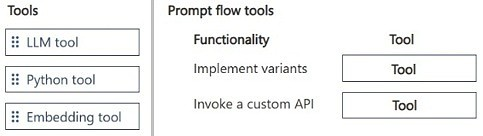

_DRAG DROP — the original ExamTopics question expects you to drag and drop items; the correct targets are not published._

**Correct answer:** Not provided by ExamTopics
**Most voted:** In prompt flow, prompt/LLM variants are configured on the LLM tool, and calling a custom external API with minimal effort uses the Python tool.

### Top explanations
- **RICHARDALEX007** (2 upvotes [Most Recent]): In prompt flow, prompt/LLM variants are configured on the LLM tool, and calling a custom external API with minimal effort uses the Python tool.

## Q4.18 (ID 416076)

DRAG DROP
You have a Microsoft Foundry project with a connected Azure OpenAI Service model.
You have a set of text files stored locally on your computer.
You must set up a flow that will generate responses based on the content of your local files.
You need to implement a solution.
Which four actions should you perform in sequence? To answer, move the appropriate actions from the list of actions to the answer area and arrange them in the correct order.

**Exhibits**
- Exhibit 1: 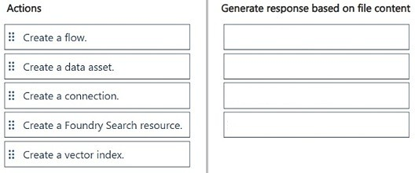

_DRAG DROP — the original ExamTopics question expects you to drag and drop items; the correct targets are not published._

**Correct answer:** Not provided by ExamTopics
**Most voted:** According to GPT5.6: | The correct sequence is: | 1-Create a data asset. | 2-Create a vector index. | 3-Create a Foundry Search resource. | 4-Create a flow. | Why? | Create a data asset: Register the local text files as a data source in Microsoft Foundry. | Create a vector index: Index the file content so it can be retrieved based on semantic similarity. | Create a Foundry Search resource: Provide the search capability needed to retrieve relevant inform...

### Top explanations
- **rveney** (2 upvotes): Create an Azure AI Search resource
Create a data asset
Create a vector index
Create a flow
- **DAgoGi** (1 upvotes [Most Recent]): According to GPT5.6:
The correct sequence is:
1-Create a data asset.
2-Create a vector index.
3-Create a Foundry Search resource.
4-Create a flow.
Why?
Create a data asset: Register the local text files as a data source in Microsoft Foundry.
Create a vector index: Index the file content so it can be retrieved based on semantic similarity.
Create a Foundry Search resource: Provide the search capability needed to retrieve relevant information from the indexed documents.
Create a flow: Orchestrate retrieval and the connected Azure OpenAI model to generate responses based on the file content.
Do not select Create a connection; the Azure OpenAI model is already connected.
- **wwowow** (1 upvotes): Per Fable 5:
Create a data asset (upload the local files)
Create a Foundry Search resource (hosts the index)
Create a vector index (chunk and embed into Search)
Create a flow (query the index, generate responses)
Unused: Create a connection, already done per the scenario.

## Q4.19 (ID 416077)

DRAG DROP
You complete the fine-tuning of a generative model in Microsoft Foundry. The fine-tuned model now appears as a new model variant in your development environment.
The deployment process must ensure that proper validation and control is maintained.
You need to promote the fine-tuned model from development to production.
Which three actions should you perform in sequence? To answer, move the appropriate actions from the list of actions to the answer area and arrange them in the correct order.

**Exhibits**
- Exhibit 1: 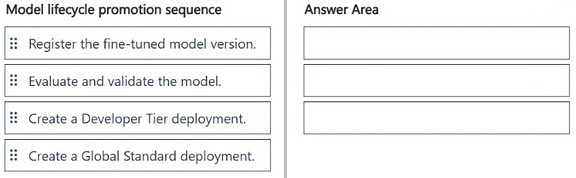

_DRAG DROP — the original ExamTopics question expects you to drag and drop items; the correct targets are not published._

**Correct answer:** Not provided by ExamTopics
**Most voted:** As it's said, the fine-tuned model already appears as a new model variant in the development environment, so there's no sense on registering. Thus, as you can read in Microsoft Documentation, "Developer deployments are designed for model candidate evaluation and not for production use". Correct answer then should be: | 1. Create a Developer Tier deployment | 2. Evaluate and validate the model | 3. Create a Global Standard deployment | Reference: https://learn.microsoft.com/en-us/azu...

### Top explanations
- **Alvarogc** (2 upvotes [Most Recent]): As it's said, the fine-tuned model already appears as a new model variant in the development environment, so there's no sense on registering. Thus, as you can read in Microsoft Documentation, "Developer deployments are designed for model candidate evaluation and not for production use". Correct answer then should be:
1. Create a Developer Tier deployment
2. Evaluate and validate the model
3. Create a Global Standard deployment
Reference: https://learn.microsoft.com/en-us/azure/foundry/openai/how-to/fine-tuning-deploy
- **RICHARDALEX007** (1 upvotes): Register the fine-tuned model version
Evaluate and validate the model
Create a Global Standard deployment
- **rveney** (1 upvotes): Evaluate and validate the model
Register the fine-tuned model version
Create a Global Standard deployment

## Q4.20 (ID 420707)

HOTSPOT
A team is standardizing MLOps practices by using automated deployments.
The team requires infrastructure to be defined declaratively and deployed through automation pipelines.
You need to configure infrastructure deployment.
What should you configure for each requirement? To answer, select the appropriate options in the answer area.
NOTE: Each correct selection is worth one point.

**Exhibits**
- Exhibit 1: 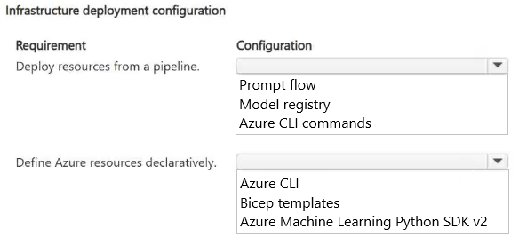

_HOTSPOT — the original ExamTopics question expects you to mark areas on the exhibit above; the correct hotspot coordinates are not published._

**Correct answer:** Not provided by ExamTopics
**Most voted:** Correct answer: | 1. Azure CLI commands | 2. Bicep templates | Reference: https://learn.microsoft.com/es-es/azure/machine-learning/how-to-setup-mlops-azureml

### Top explanations
- **Alvarogc** (2 upvotes [Most Recent]): Correct answer:
1. Azure CLI commands
2. Bicep templates
Reference: https://learn.microsoft.com/es-es/azure/machine-learning/how-to-setup-mlops-azureml

## Q4.22 (ID 420709)

HOTSPOT
You have an Azure Machine Learning workspace and a collection of image files stored in two Azure Blob Storage accounts.
You need to configure data asset properties.
Which values should you use in your configuration? To answer, select the appropriate options in the answer area.
NOTE: Each correct selection is worth one point.

**Exhibits**
- Exhibit 1: 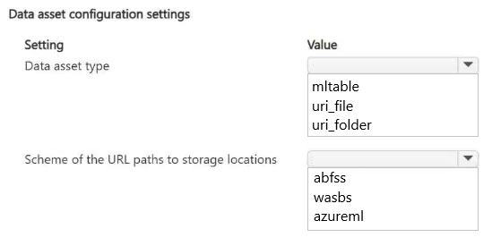

_HOTSPOT — the original ExamTopics question expects you to mark areas on the exhibit above; the correct hotspot coordinates are not published._

**Correct answer:** Not provided by ExamTopics
**Most voted:** Data asset type: mltable | URL scheme: wasbs | Why: An MLTable can define multiple file paths, including images stored across different storage locations. The wasbs:// scheme addresses Azure Blob Storage securely. | uri_file represents a single file. | uri_folder normally references one folder location. | abfss:// is used for Azure Data Lake Storage Gen2. | azureml:// references a location through an Azure Machine Learning datastore rather than directly...

### Top explanations
- **0fdb748** (1 upvotes [Most Recent]): Data asset type: mltable
URL scheme: wasbs
Why: An MLTable can define multiple file paths, including images stored across different storage locations. The wasbs:// scheme addresses Azure Blob Storage securely.
uri_file represents a single file.
uri_folder normally references one folder location.
abfss:// is used for Azure Data Lake Storage Gen2.
azureml:// references a location through an Azure Machine Learning datastore rather than directly addressing Blob Storage.

## Q4.25 (ID 420712)

HOTSPOT
You manage a Microsoft Foundry project.
You are developing a solution to generate content based on text and images. The solution requires the ability to manage high-volume processing and avoid disruptions to the online workloads.
You need to deploy the solution.
Which deployment type and large language model (LLM) should you use? To answer, select the appropriate options in the answer area.
NOTE: Each correct selection is worth one point.

**Exhibits**
- Exhibit 1: 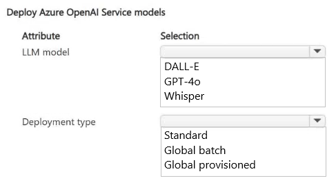

_HOTSPOT — the original ExamTopics question expects you to mark areas on the exhibit above; the correct hotspot coordinates are not published._

**Correct answer:** Not provided by ExamTopics
**Most voted:** GPT-4o | Global Batch | Global Batch handles large-scale and high-volume processing tasks. You can process asynchronous groups of requests with separate quota and a 24-hour target turnaround, at 50% less cost than Global Standard. With batch processing, rather than sending one request at a time, you send a large number of requests in a single file. Global Batch requests have a separate enqueued token quota, which avoids any disruption of your online wor...

### Top explanations
- **Nilf** (1 upvotes [Most Recent]): GPT-4o
Global Batch
Global Batch handles large-scale and high-volume processing tasks. You can process asynchronous groups of requests with separate quota and a 24-hour target turnaround, at 50% less cost than Global Standard. With batch processing, rather than sending one request at a time, you send a large number of requests in a single file. Global Batch requests have a separate enqueued token quota, which avoids any disruption of your online workloads.
https://learn.microsoft.com/en-us/azure/foundry/foundry-models/concepts/deployment-types

## Q5.2 (ID 404615)

DRAG DROP
A team deploys a generative AI application that uses a model deployed in Microsoft Foundry. The application must support latency monitoring under production load.
You need to enable performance observability.
Which three actions should you perform in sequence? To answer, move the appropriate actions from the list of actions to the answer area and arrange them in the correct order.

**Exhibits**
- Exhibit 1: 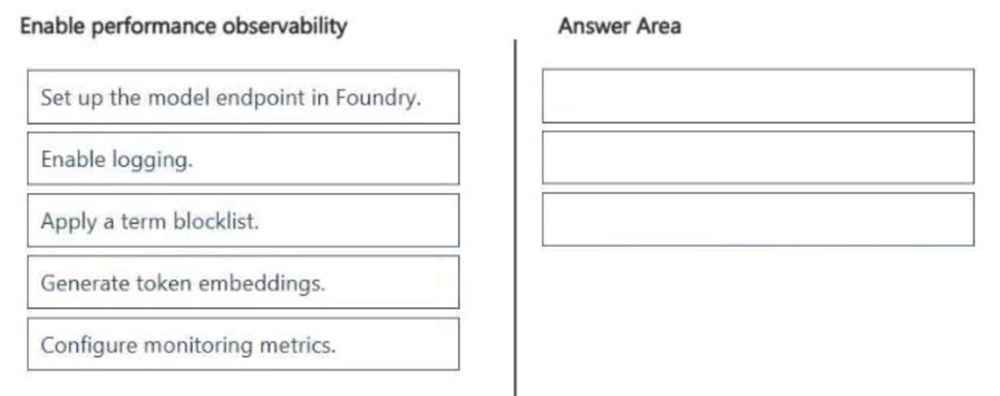

_DRAG DROP — the original ExamTopics question expects you to drag and drop items; the correct targets are not published._

**Correct answer:** Not provided by ExamTopics
**Most voted:** Observability lifecycle: | Deploy endpoint | ↓ | Enable telemetry/logging | ↓ | Configure monitoring metrics

### Top explanations
- **rveney** (5 upvotes): Final Answer (in order)
Set up the model endpoint in Foundry
Enable logging
Configure monitoring metrics
- **cayenne06** (4 upvotes): I think the correct order is Set up the model endpoint, Enable logging, Configure monitoring metrics. Metrics depend on logs, so logging must be enabled first
- **03f65a8** (2 upvotes [Most Recent]): Observability lifecycle:
Deploy endpoint
↓
Enable telemetry/logging
↓
Configure monitoring metrics

## Q5.3 (ID 404616)

A team is developing a generative AI assistant. The team is experimenting with multiple prompt variants to improve the user experience.
When comparing prompt variants, the team plans to assess whether the generated responses are grammatically correct.
You need to evaluate the quality of the language from the generated responses.
Which evaluator should you use?

⭕ **A.** Coherence
⭕ **B.** Textual similarity
⭕ **C.** Grounded ness
✅ **D.** Fluency

**Correct answer:** D
**Most voted:** D

### Top explanations
- **RICHARDALEX007** (2 upvotes [Most Recent, Selected Answer: D]): Assessing grammatical correctness/quality of language is the Fluency evaluator. Coherence (A) is logical flow, textual similarity (B) compares to references, groundedness (C) checks source support.

## Q5.4 (ID 404617)

You manage a Microsoft Foundry project. You build a multi-turn chatbot application.
You plan to filter your traces to identify issues while observing how the application is responding. The solution must not use an external knowledge base.
You need to select an evaluation metric.
Which built-in evaluator should you use?

⭕ **A.** RelevanceEvaluator
⭕ **B.** SimilarityEvaluator
⭕ **C.** QAEvaluator
✅ **D.** CoherenceEvaluator

**Correct answer:** D
**Most voted:** D

### Top explanations
- **overdoze** (2 upvotes [Most Recent, Selected Answer: D]): CoherenceEvaluator: Evaluates the linguistic quality, logic, coherence, and flow of text.

## Q5.5 (ID 404618)

DRAG DROP
An organization operates a generative AI application in production by using Microsoft Foundry. The application serves live user traffic and is updated by a data scientist team regularly as prompts and models evolve.
The application intermittently times out during production use, which requires ongoing visibility into runtime behavior.
The team must also validate model quality and safety before releasing new updates to avoid introducing regressions.
You need to apply the correct mechanisms for continuous runtime monitoring and for release time validation.
Which mechanisms should you use for each requirement? To answer, move the appropriate mechanisms to the correct requirements. You may use each mechanism once, more than once, or not at all. You may need to move the split bar between panes or scroll to view content.
NOTE: Each correct selection is worth one point.

**Exhibits**
- Exhibit 1: 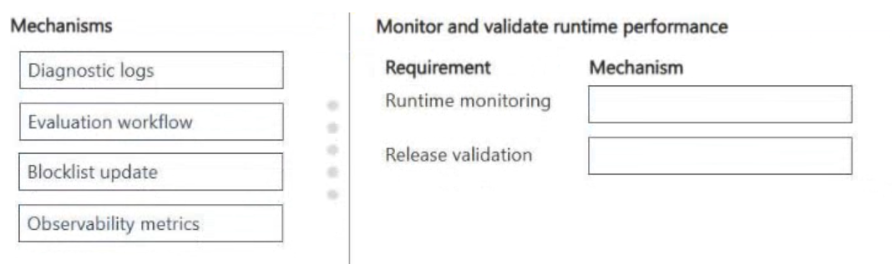

_DRAG DROP — the original ExamTopics question expects you to drag and drop items; the correct targets are not published._

**Correct answer:** Not provided by ExamTopics
**Most voted:** Diagnistic logs, Evaluation workflow | Diagnostic logs are used because they provide detailed, real-time information about runtime behavior and errors (such as timeouts), whereas observability metrics only offer aggregated data and are less suitable for troubleshooting specific issue

### Top explanations
- **cayenne06** (2 upvotes): Diagnistic logs, Evaluation workflow
Diagnostic logs are used because they provide detailed, real-time information about runtime behavior and errors (such as timeouts), whereas observability metrics only offer aggregated data and are less suitable for troubleshooting specific issue
- **rveney** (1 upvotes [Most Recent]): Runtime monitoring: Observability metrics
Release validation: Evaluation workflow

## Q5.6 (ID 404619)

An organization validates generative AI applications during CI/CD Microsoft Foundry.
Evaluation must run automatically and block releases when quality thresholds are NOT met. Manual evaluation is no longer acceptable.
Evaluation must use both predefined quality metrics and custom safety checks.
You need to implement an automated evaluation workflow that supports both built-in and custom metrics.
What should you do?

⭕ **A.** Enable application tracing to collect runtime telemetry.
⭕ **B.** Review evaluation results manually after deployment.
⭕ **C.** Monitor latency metrics during model inference.
✅ **D.** Implement an evaluation step by using GitHub Actions.

**Correct answer:** D
**Most voted:** D

### Top explanations
- **RICHARDALEX007** (2 upvotes [Most Recent, Selected Answer: D]): Automatic evaluation that blocks releases below threshold, using built-in and custom metrics, is a GitHub Actions evaluation step in CI/CD. Tracing (A) and latency monitoring (C) don't gate releases; manual review (B) is explicitly rejected

## Q5.7 (ID 404620)

A team develops and manages a conversational assistant by using Microsoft Foundry.
The team must be able to validate that the assistant does not produce hateful responses before the application is exposed to any users.
You need to evaluate the model output for hateful responses as part of a repeatable validation process.
Which evaluator should you configure first?

⭕ **A.** Protected material
⭕ **B.** Groundedness
⭕ **C.** Indirect attacks
✅ **D.** Content safety

**Correct answer:** D
**Most voted:** D

### Top explanations
- **RICHARDALEX007** (1 upvotes [Most Recent, Selected Answer: D]): Validating that outputs are not hateful before user exposure uses the Content safety (hate/violence/sexual/self-harm) evaluator. Protected material (A) is copyright, Groundedness (B) is source support, Indirect attacks (C) is prompt-injection detection.

## Q5.10 (ID 416080)

DRAG DROP
A team validates a generative AI application that produces free-form text responses by using Microsoft Foundry SDK.
The evaluation dataset is registered in the Microsoft Foundry environment.
You need to configure a safety evaluation pipeline that reliably evaluates model outputs for harmful content.
Which three actions should you perform in sequence? To answer, move the appropriate actions from the list of actions to the answer area and arrange them in the correct order.

**Exhibits**
- Exhibit 1: 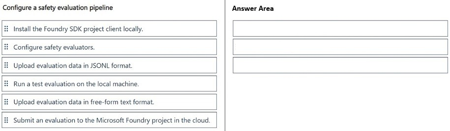

_DRAG DROP — the original ExamTopics question expects you to drag and drop items; the correct targets are not published._

**Correct answer:** Not provided by ExamTopics
**Most voted:** Install the Foundry SDK project client locally. | Configure safety evaluators. | Submit an evaluation to the Microsoft Foundry project in the cloud

### Top explanations
- **rveney** (5 upvotes [Most Recent]): Install the Foundry SDK project client locally.
Configure safety evaluators.
Submit an evaluation to the Microsoft Foundry project in the cloud

## Q5.16 (ID 420719)

You create an Azure Machine Learning workspace.
You must use the Python SDK v2 to implement an experiment from a Jupyter notebook in the workspace. The experiment must log a list of numerical metrics.
You need to implement a method to log a list of numerical metrics.
Which method should you use?

✅ **A.** mlflow.log_batch()
⭕ **B.** mlflow.log_metric()
⭕ **C.** mlflow.log_artifact()
⭕ **D.** mlflow.log_image()

**Correct answer:** A
**Most voted:** A

### Top explanations
- **Alvarogc** (2 upvotes [Most Recent, Selected Answer: A]): Question is a little bit tricky. The answer should be MlflowClient.log_batch() as log_batch() is part of MlflowClient; anyway, the way to log multiple metrics is by using log_batch(), which is more efficient than using log_metric() several times.
- **Kachien** (2 upvotes [Selected Answer: A]): A list of numerical values should be logged as a batch of metrics. Azure Machine Learning documentation shows creating a list of Metric objects and submitting them with MlflowClient.log_batch().
mlflow.log_metric() logs a single numerical metric value per call.

## Q6.1 (ID 404621)

An organization is deploying several generative AI workloads by using Microsoft Foundry. Each workload must meet different requirements related to data governance, task specialization, and operational cost control.
The organization requires models that meet the following requirements:
Model behavior aligns with the task being performed.
Data handling aligns with internal governance policies.
Operational complexity and cost are justified by workload needs.
You need to select the foundation model options that meet the requirements.
Which three models can you select? Each correct answer presents a complete solution. Choose three.
NOTE: Each correct selection is worth one point.

✅ **A.** A model that is optimized for conversational reasoning when deploying an interactive assistant
⭕ **B.** The largest available model to simplify operational management
⭕ **C.** The smallest available model to minimize the usage cost
✅ **D.** A model that supports multiple input types when workloads require combined text and image analysis
✅ **E.** A model that offers enterprise governance controls when workloads process regulated business data

**Correct answer:** A, D, E
**Most voted:** ADE

### Top explanations
- **cayenne06** (3 upvotes [Selected Answer: ADE]): A, D, and E are correct because they directly align with the stated requirements of task suitability, data governance, and cost-effectiveness
- **03f65a8** (1 upvotes [Most Recent, Selected Answer: ADE]): I think that A, D, E are the right answer.

## Q6.2 (ID 404622)

HOTSPOT
A team is building a generative AI agent by using Retrieval-Augmented Generation (RAG) in Microsoft Foundry.
The team frequently updates prompt content. The team must be able to track changes across contributors while avoiding full application redeployments.
You need to enable rapid prompt iteration with traceability. Applications consuming the agent must be able to use updated prompts without requiring redeployment.
What should you configure for each requirement? To answer, select the appropriate options in the answer area.
NOTE: Each correct selection is worth one point.

**Exhibits**
- Exhibit 1: 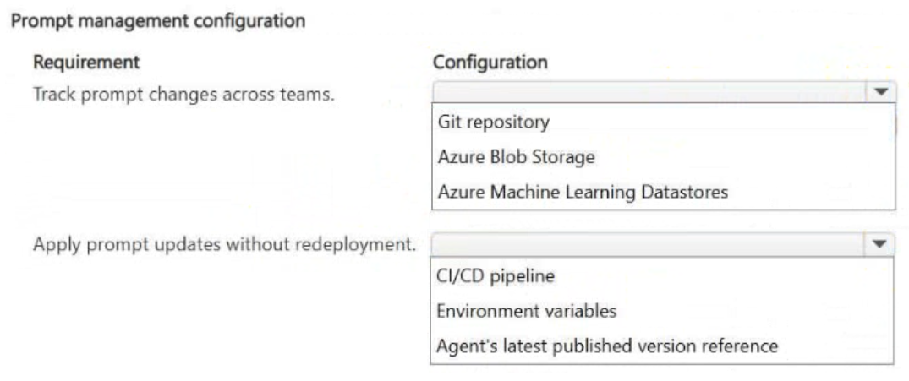

_HOTSPOT — the original ExamTopics question expects you to mark areas on the exhibit above; the correct hotspot coordinates are not published._

**Correct answer:** Not provided by ExamTopics
**Most voted:** 1. Track prompt changes across teams | ✅ Git repository | Git provides version control, change history, and contributor traceability—ideal for collaborative prompt iteration. | 2. Apply prompt updates without redeployment | ✅ Agent’s latest published version reference | Applications can reference the agent’s latest published version, allowing prompt updates to take effect immediately without redeploying consuming apps.

### Top explanations
- **cayenne06** (3 upvotes): I think its's Git and Agent’s latest published version reference
- **03f65a8** (2 upvotes [Most Recent]): | Requirement                                | Configuration                                |
| ------------------------------------------ | -------------------------------------------- |
| Track prompt changes across teams.         | ✅ Git repository                             |
| Apply prompt updates without redeployment. | ✅ Agent's latest published version reference |
- **rveney** (2 upvotes): 1. Track prompt changes across teams
✅ Git repository
Git provides version control, change history, and contributor traceability—ideal for collaborative prompt iteration.
2. Apply prompt updates without redeployment
✅ Agent’s latest published version reference
Applications can reference the agent’s latest published version, allowing prompt updates to take effect immediately without redeploying consuming apps.

## Q6.3 (ID 404623)

HOTSPOT
A company is creating an internal tool that summarizes long meeting transcripts and extracts action items.
The model must:
Process text inputs up to 200k tokens long.
Generate concise summaries in seconds.
Support interactive testing before integration into the app.
You need to select, deploy, and test a model that supports summarization with low latency.
How should you complete the configuration plan? To answer, select the appropriate options in the answer area.
NOTE: Each correct selection is worth one point.

**Exhibits**
- Exhibit 1: 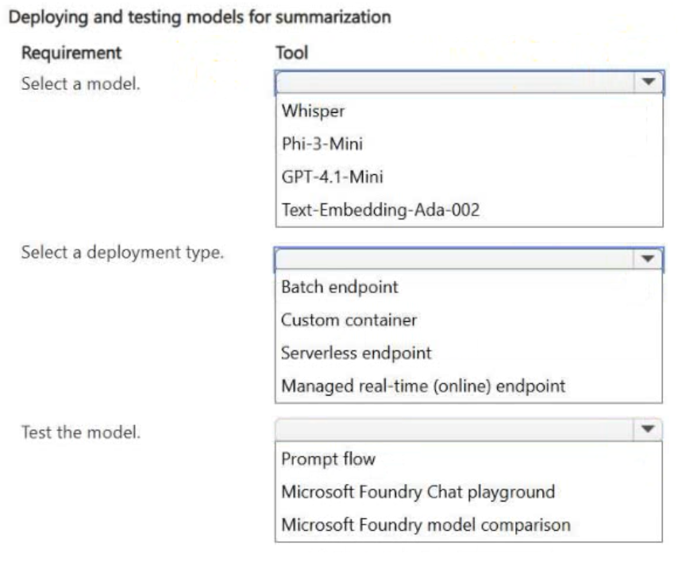

_HOTSPOT — the original ExamTopics question expects you to mark areas on the exhibit above; the correct hotspot coordinates are not published._

**Correct answer:** Not provided by ExamTopics
**Most voted:** The requirement is low latency => should be Managed real-time (online) endpoint instead of serverless endpoint

### Top explanations
- **cayenne06** (3 upvotes): I think it's GTP4.1 mini, servless endpoint and Foundry Chat playground
- **upliftinghut** (1 upvotes [Most Recent]): The requirement is low latency => should be Managed real-time (online) endpoint instead of serverless endpoint
- **03f65a8** (1 upvotes): | Requirement                   | Válasz                                  |
| ----------------------------- | --------------------------------------- |
| **Select a model.**           | ✅ **GPT-4.1-Mini**                      |
| **Select a deployment type.** | ✅ **Serverless endpoint**               |
| **Test the model.**           | ✅ **Microsoft Foundry Chat playground** |
- **rveney** (1 upvotes): GPT-4.1-Mini
Serverless endpoint
Microsoft Foundry Chat playground

## Q6.4 (ID 404624)

HOTSPOT
You manage a Retrieval-Augmented Generation (RAG) system that retrieves internal policy documents from a vector index.
Recent analysis shows that:
Retrieved results frequently include duplicated content from the same document.
Retrieved chunks sometimes span unrelated policy sections.
You review the following retrieval and ingestion configurations:
You need to reduce duplicated retrieval results and improve chunk relevance across policy sections. For each of the following statements, select Yes if the statement is true. Otherwise, select No.
NOTE: Each correct selection is worth one point.

**Exhibits**
- Exhibit 1: 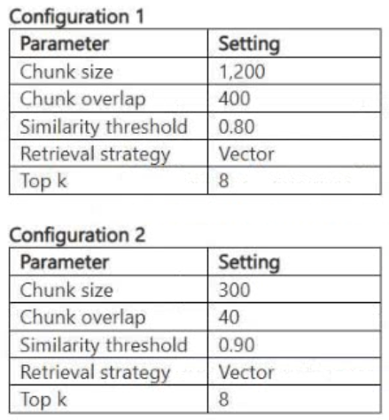
- Exhibit 2: 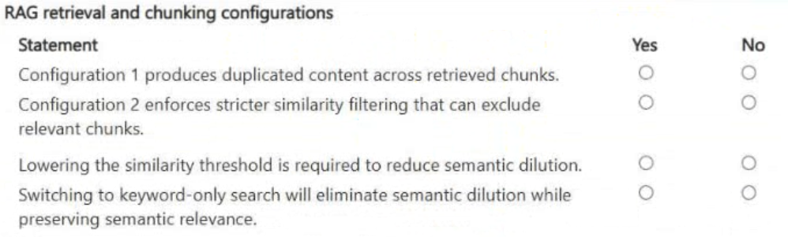

_HOTSPOT — the original ExamTopics question expects you to mark areas on the exhibit above; the correct hotspot coordinates are not published._

**Correct answer:** Not provided by ExamTopics
**Most voted:** 1. Yes — Config 1 has 400 overlap on 1,200 chunk size (a third overlap), so with top k = 8 you retrieve multiple overlapping chunks from the same document. That's the duplication. | 2. Yes — Config 2's 0.90 threshold filters aggressively, and relevant chunks scoring just below get excluded. Stricter filtering trading recall for precision. | 3. No — Backwards. Lowering the threshold lets in more loosely related chunks, which increases dilution. You'd rai...

### Top explanations
- **wwowow** (1 upvotes [Most Recent]): 1. Yes — Config 1 has 400 overlap on 1,200 chunk size (a third overlap), so with top k = 8 you retrieve multiple overlapping chunks from the same document. That's the duplication.
2. Yes — Config 2's 0.90 threshold filters aggressively, and relevant chunks scoring just below get excluded. Stricter filtering trading recall for precision.
3. No — Backwards. Lowering the threshold lets in more loosely related chunks, which increases dilution. You'd raise it or fix chunking, not lower it.
4. No — Keyword-only search discards semantic matching by definition, so it can't "preserve semantic relevance." Classic too-good-to-be-true phrasing.

## Q6.5 (ID 404625)

HOTSPOT
You are reviewing a dataset that will be used for an advanced fine-tuning job in Microsoft Foundry.
The fine-tuning job uses preference comparison data.
You review the following dataset excerpt.
For each of the following statements, select Yes if the statement is true. Otherwise, select No.
NOTE: Each correct selection is worth one point.

**Exhibits**
- Exhibit 1: 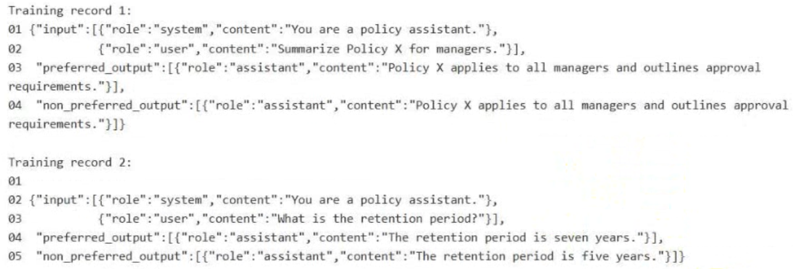
- Exhibit 2: 

_HOTSPOT — the original ExamTopics question expects you to mark areas on the exhibit above; the correct hotspot coordinates are not published._

**Correct answer:** Not provided by ExamTopics
**Most voted:** 1. No | 2. Yes | 3. Yes | 4. Yes

### Top explanations
- **rveney** (2 upvotes [Most Recent]): 1. No
2. Yes
3. Yes
4. Yes

## Q6.7 (ID 404627)

A Retrieval-Augmented Generation (RAG) solution returns incomplete answers because relevant content is inconsistently retrieved from the knowledge source.
You need to improve RAG accuracy without changing the embedding model currently in use. You need to achieve this goal while minimizing operational costs.
Which two actions should you perform? Each correct answer presents part of the solution. Choose two.
NOTE: Each correct selection is worth one point.

✅ **A.** Tune chunk size and overlap to match content structure.
✅ **B.** Implement an optimized re-ranker.
⭕ **C.** Increase token limits for all requests.
⭕ **D.** Optimize the length of embedding vectors.

**Correct answer:** A, B
**Most voted:** AB

### Top explanations
- **RICHARDALEX007** (2 upvotes [Most Recent, Selected Answer: AB]): Improving RAG accuracy without changing the embedding model and at low cost is done by tuning chunk size/overlap (A) and adding a re-ranker (B). Increasing token limits (C) raises cost without fixing retrieval; changing embedding vector length (D) effectively changes the embedding model.

## Q6.8 (ID 416081)

HOTSPOT
Background
Fabrikam Inc. is a mid-sized healthcare analytics company that provides population health dashboards and predictive insights to regional hospital systems across the United States. Fabrikam Inc. customers rely on near real time analytics to monitor patient flow, staffing needs, and readmission risks. They use multiple traditional forecasting machine learning models for predictions.
Fabrikam Inc. has an established Microsoft Azure footprint. The company uses Jupyter Notebooks that run on a local server as the primary development environment. The data science team is experiencing scalability, asset management and code management issues with the current development platform. Fabrikam Inc. plans to migrate to a cloud-based development environment to mitigate the issues.
Additionally, the company plans to implement a Retrieval-Augmented Generation (RAG)-based chat application for client support. Leadership requires the application to be developed and deployed with a low operational risk.
Current Environment
Fabrikam Inc. operates a single Azure subscription that has the following components:
•	Azure Data Lake Storage Gen2 that contains de-identified clinical and operational datasets
•	Azure AI Search indexing curated analytical documents and reference materials
•	A small set of Python-based training scripts maintained by data scientists
•	Azure OpenAI Service with deployed foundational models
•	A Microsoft Foundry resource for building a RAG-based solution
Evaluation data has manually defined expected responses.
The current challenges faced by the data science team include the following:
•	Model training jobs are run manually from notebooks.
•	Experiment tracking is inconsistent
•	Model versions are registered without standardized metadata.
•	Deployment is performed manually by data scientists, with limited rollback capability.
•	The team has no standardized evaluation process for generative AI outputs.
The environment currently allows public network access. Authentication relies on user accounts rather than managed identities. Compute targets are manually created and shared across experiments. This has led to resource contention during peak usage.
Business Requirements
Fabrikam Inc. has the following business requirements for the modernization initiative:
•	Provide a conversational interface that answers analytics questions by using internal documents and datasets.
•	Ensure that sensitive healthcare-related data is not exposed outside the Fabrikam Inc. Azure tenant.
•	Enable repeatable and auditable model training and deployment processes.
•	Support experimentation to compare prompt strategies and fine-tuned models.
•	Align the model with the ranked preferences and optimize behavior for the long term.
•	Minimize disruption to existing analytics workloads during rollout.
Technical Requirements
To support the business goals, Fabrikam Inc. identifies these technical requirements:
•	Use Azure Machine Learning workspaces to centrally manage data assets, models, and environments.
•	Implement experiment tracking and model versioning for all training jobs.
•	Orchestrate training and evaluation by using pipelines rather than manually running notebooks.
•	Deploy traditional machine learning models with support for staged rollout and rollback.
•	Improve RAG-based solution output quality.
•	Use the existing evaluation datasets that are based on real data with input-output pairs.
•	Apply advanced fine-tuning techniques only when prompt engineering is insufficient
Issues and Constraints
Fabrikam Inc. must comply with internal security policies that require the company to restrict network access and avoid long-lived secrets. The data science team has limited Azure DevOps experience, so solutions must favor managed services and automation over custom infrastructure.
Cost predictability is important. Leadership prefers serverless or managed compute options where possible but is willing to approve dedicated compute for stable production workloads.
Problem Statement
Fabrikam Inc. must design and implement an Azure-based AI operations solution that enables reliable training, evaluation, deployment, and iteration of generative AI models. The solution must support experimentation and gradual rollout while ensuring governance, security, and operational stability. The data science and platform teams must collaborate to deliver this solution by using Azure Machine Learning and Microsoft Foundry capabilities.
You need to configure an optimization method to meet Fabrikam Inc.’s technical requirements.
Which strategy should you apply first? To answer, select the appropriate options in the answer area.
NOTE: Each correct selection is worth one point.

**Exhibits**
- Exhibit 1: 

_HOTSPOT — the original ExamTopics question expects you to mark areas on the exhibit above; the correct hotspot coordinates are not published._

**Correct answer:** Not provided by ExamTopics
**Most voted:** Domain specialization → Supervised fine-tuning | The case study hands you the clue: "use the existing evaluation datasets that are based on real data with input-output pairs." Input-output pairs are exactly what SFT trains on, and SFT is the standard method for teaching a model domain-specific knowledge and style. DPO would be the answer for the "align with ranked preferences" requirement, but that's not what this row asks. Reinforcement fine-tuning nee...

### Top explanations
- **wwowow** (2 upvotes [Most Recent]): Domain specialization → Supervised fine-tuning
The case study hands you the clue: "use the existing evaluation datasets that are based on real data with input-output pairs." Input-output pairs are exactly what SFT trains on, and SFT is the standard method for teaching a model domain-specific knowledge and style. DPO would be the answer for the "align with ranked preferences" requirement, but that's not what this row asks. Reinforcement fine-tuning needs a reward signal, not plain input-output pairs.
Poor response accuracy of a RAG-based solution → Apply prompt engineering
Two signals point here. The question asks which strategy to apply first, and the technical requirements explicitly say "apply advanced fine-tuning techniques only when prompt engineering is insufficient." Temperature and max_tokens tweaks don't address accuracy: temperature changes randomness and max_tokens just changes response length.

## Q6.9 (ID 416082)

Background
Fabrikam Inc. is a mid-sized healthcare analytics company that provides population health dashboards and predictive insights to regional hospital systems across the United States. Fabrikam Inc. customers rely on near real time analytics to monitor patient flow, staffing needs, and readmission risks. They use multiple traditional forecasting machine learning models for predictions.
Fabrikam Inc. has an established Microsoft Azure footprint. The company uses Jupyter Notebooks that run on a local server as the primary development environment. The data science team is experiencing scalability, asset management and code management issues with the current development platform. Fabrikam Inc. plans to migrate to a cloud-based development environment to mitigate the issues.
Additionally, the company plans to implement a Retrieval-Augmented Generation (RAG)-based chat application for client support. Leadership requires the application to be developed and deployed with a low operational risk.
Current Environment
Fabrikam Inc. operates a single Azure subscription that has the following components:
•	Azure Data Lake Storage Gen2 that contains de-identified clinical and operational datasets
•	Azure AI Search indexing curated analytical documents and reference materials
•	A small set of Python-based training scripts maintained by data scientists
•	Azure OpenAI Service with deployed foundational models
•	A Microsoft Foundry resource for building a RAG-based solution
Evaluation data has manually defined expected responses.
The current challenges faced by the data science team include the following:
•	Model training jobs are run manually from notebooks.
•	Experiment tracking is inconsistent
•	Model versions are registered without standardized metadata.
•	Deployment is performed manually by data scientists, with limited rollback capability.
•	The team has no standardized evaluation process for generative AI outputs.
The environment currently allows public network access. Authentication relies on user accounts rather than managed identities. Compute targets are manually created and shared across experiments. This has led to resource contention during peak usage.
Business Requirements
Fabrikam Inc. has the following business requirements for the modernization initiative:
•	Provide a conversational interface that answers analytics questions by using internal documents and datasets.
•	Ensure that sensitive healthcare-related data is not exposed outside the Fabrikam Inc. Azure tenant.
•	Enable repeatable and auditable model training and deployment processes.
•	Support experimentation to compare prompt strategies and fine-tuned models.
•	Align the model with the ranked preferences and optimize behavior for the long term.
•	Minimize disruption to existing analytics workloads during rollout.
Technical Requirements
To support the business goals, Fabrikam Inc. identifies these technical requirements:
•	Use Azure Machine Learning workspaces to centrally manage data assets, models, and environments.
•	Implement experiment tracking and model versioning for all training jobs.
•	Orchestrate training and evaluation by using pipelines rather than manually running notebooks.
•	Deploy traditional machine learning models with support for staged rollout and rollback.
•	Improve RAG-based solution output quality.
•	Use the existing evaluation datasets that are based on real data with input-output pairs.
•	Apply advanced fine-tuning techniques only when prompt engineering is insufficient
Issues and Constraints
Fabrikam Inc. must comply with internal security policies that require the company to restrict network access and avoid long-lived secrets. The data science team has limited Azure DevOps experience, so solutions must favor managed services and automation over custom infrastructure.
Cost predictability is important. Leadership prefers serverless or managed compute options where possible but is willing to approve dedicated compute for stable production workloads.
Problem Statement
Fabrikam Inc. must design and implement an Azure-based AI operations solution that enables reliable training, evaluation, deployment, and iteration of generative AI models. The solution must support experimentation and gradual rollout while ensuring governance, security, and operational stability. The data science and platform teams must collaborate to deliver this solution by using Azure Machine Learning and Microsoft Foundry capabilities.
You need to improve a GPT-5 model performance based on Fabrikam Inc.’s technical requirements.
Which action should you perform first?

⭕ **A.** Deploy the model to production to gather real-world feedback.
✅ **B.** Evaluate the model output.
⭕ **C.** Fine-tune the model to improve accuracy.
⭕ **D.** Generate synthetic interaction data.

**Correct answer:** B
**Most voted:** B

### Top explanations
- **RICHARDALEX007** (1 upvotes [Most Recent, Selected Answer: B]): Improving a GPT-5 model under Fabrikam's requirements starts with evaluating model output to establish a baseline before deciding whether prompt changes or fine-tuning are needed. Deploying to prod for feedback (A) is risky, fine-tuning (C) is premature, and synthetic data (D) supports fine-tuning that hasn't been justified yet.

## Q6.10 (ID 416083)

HOTSPOT
You manage a Microsoft Foundry project.
You are evaluating two RAG solutions.
When generating answers, the solutions display the following results:
•	The first solution displays low completeness and low utilization.
•	The second solution displays low completeness and high utilization.
You need to address the issues found during evaluation.
Which action should you perform first for each issue? To answer, select the appropriate options in the answer area.
NOTE: Each correct selection is worth one point.

**Exhibits**
- Exhibit 1: 

_HOTSPOT — the original ExamTopics question expects you to mark areas on the exhibit above; the correct hotspot coordinates are not published._

**Correct answer:** Not provided by ExamTopics
**Most voted:** Low utilization means the model isn't getting enough context, so increase chunk size; high utilization with low completeness means retrieved chunks are present but not the right ones, so verify/improve retrieval relevance.

### Top explanations
- **RICHARDALEX007** (1 upvotes [Most Recent]): Low utilization means the model isn't getting enough context, so increase chunk size; high utilization with low completeness means retrieved chunks are present but not the right ones, so verify/improve retrieval relevance.

## Q6.11 (ID 416084)

A team is building a Retrieval-Augmented Generation (RAG) system.
The team observes that the retrieved documents are often irrelevant or incomplete.
You need to improve retrieval accuracy.
What should you adjust?

✅ **A.** Chunk size and overlap
⭕ **B.** Temperature parameter
⭕ **C.** Token limits
⭕ **D.** Embedding strategy

**Correct answer:** A
**Most voted:** A

### Top explanations
- **Alvarogc** (3 upvotes [Most Recent, Selected Answer: A]): Corrrect answer is:
A. Chunk size and overlap.
The question says that the retrieved document are often irrelevant or incomplete; if the embedding strategy was a poor one (D), then answers shouldn't be relevant but incomplete, and temperature (B) nor token limits (C) has nothing to do on this question.
- **49bce06** (2 upvotes [Selected Answer: D]): Determines how text is converted into vectors
Directly impacts:
Semantic similarity
Relevance of retrieved results
Poor embeddings → irrelevant matches even if chunking is correct

## Q6.12 (ID 416085)

You are preparing training data for a fine-tuning job in Microsoft Foundry.
Real production conversations cannot be used due to compliance requirements.
You need to generate synthetic interaction data that can be used for fine-tuning a generative model.
What should you do?

⭕ **A.** Export model evaluation logs and use them directly as training data.
✅ **B.** Use a simulator to generate prompt-response interaction data that matches the target task.
⭕ **C.** Enable A/B testing and capture live user traffic for data generation.
⭕ **D.** Run a simulator to produce telemetry logs and trace data from user interactions.

**Correct answer:** B
**Most voted:** B

### Top explanations
- **RICHARDALEX007** (2 upvotes [Most Recent, Selected Answer: B]): When real conversations can't be used for compliance, you generate synthetic interaction data with a simulator that matches the task. Using eval logs (A) or live traffic (C) breaches the compliance constraint; telemetry/trace logs (D) aren't training-ready interaction data.

## Q6.17 (ID 419531)

DRAG DROP
A team is developing a Retrieval-Augmented Generation (RAG) system.
The team requires improvements to the system's retrieval quality to ensure accurate, grounded responses.
You need to assess RAG performance before you can suggest an improvement strategy.
Which four actions should you perform in sequence? To answer, move the appropriate actions from the list of actions to the answer area and arrange them in the correct order.

**Exhibits**
- Exhibit 1: 

_DRAG DROP — the original ExamTopics question expects you to drag and drop items; the correct targets are not published._

**Correct answer:** Not provided by ExamTopics
**Most voted:** - Collect retrieval logs (gather the data on what the system actually retrieved) | - Run RAG evaluators (score retrieval quality: groundedness, relevance, and so on, that's the assessment) | - Adjust chunking strategy (act on the findings, since chunking drives retrieval quality) | - Re-index documents (a new chunking strategy only takes effect after re-indexing) | Unused: Regenerate the prompt template and modify model temperature, both tweak the generation side, not retrieval quality, which...

### Top explanations
- **wwowow** (4 upvotes): - Collect retrieval logs (gather the data on what the system actually retrieved)
- Run RAG evaluators (score retrieval quality: groundedness, relevance, and so on, that's the assessment)
- Adjust chunking strategy (act on the findings, since chunking drives retrieval quality)
- Re-index documents (a new chunking strategy only takes effect after re-indexing)
Unused: Regenerate the prompt template and modify model temperature, both tweak the generation side, not retrieval quality, which is what the requirement targets.
Logic: measure first (logs → evaluators), then improve (chunking → re-index).
- **DAgoGi** (1 upvotes [Most Recent]): According to GPT 5.6:
Step Action Why
1 Collect retrieval logs Gather evidence about retrieved documents and identify retrieval issues.
2 Run RAG evaluators Measure retrieval quality and assess whether the retrieved context is relevant and accurate.
3 Adjust chunking strategy Improve document segmentation based on the evaluation results.
4 Re-index documents Rebuild the index so the updated chunking strategy takes effect.
Why not the other options?
Regenerate the prompt template: Changes generation instructions rather than directly improving retrieval quality.
Modify model temperature: Affects response randomness, not document retrieval quality.

## Q6.20 (ID 420724)

Note: This question is part of a series of questions that present the same scenario. Each question in the series contains a unique solution that might meet the stated goals. Some question sets might have more than one correct solution, while others might not have a correct solution.
After you answer a question in this section, you will NOT be able to return to it. As a result, these questions will not appear on the review screen.
You manage a Retrieval-Augmented Generation (RAG) application built on Microsoft Foundry.
The application retrieves documents from an indexed knowledge base and generates answers for internal users.
Recent feedback indicates that answers are fluent but sometimes include information that is not supported by the documents that were retrieved.
You need to evaluate whether a proposed change improves RAG answer quality by using supported and measurable techniques.
Solution: Review user feedback comments collected after deployment to determine whether answers appear more accurate.
Does the solution meet the goal?

⭕ **A.** Yes
✅ **B.** No

**Correct answer:** B
**Most voted:** B

### Top explanations
- **DAgoGi** (1 upvotes [Most Recent, Selected Answer: B]): According to GPT 5.6 the correct answer: B. No.
Reviewing user feedback comments is subjective and does not provide a measurable evaluation of RAG answer quality.
To determine whether the change improves answer quality, use measurable evaluation metrics such as:
Groundedness: Are the answers supported by the retrieved documents?
Relevance: Does the answer address the user's question?
Retrieval quality: Are the retrieved documents relevant to the query?
These metrics allow you to compare performance before and after the proposed change.
- **Kachien** (1 upvotes [Selected Answer: B]): Reviewing user feedback comments is subjective and unstructured. It does not provide a standardized, measurable comparison of whether the proposed change reduces unsupported information.
The symptom described is a groundedness problem.
