# AI-901 Microsoft Azure AI Fundamentals Study Guide

_50 questions generated from ExamTopics discussions._

**Official Exam & Registration:** [Register for AI-901 on Microsoft Learn](https://learn.microsoft.com/en-us/credentials/certifications/azure-ai-fundamentals/?practice-assessment-type=certification)

## Table of contents

- [Q1.1](#q1-1)
- [Q1.2](#q1-2)
- [Q1.3](#q1-3)
- [Q1.4](#q1-4)
- [Q1.5](#q1-5)
- [Q1.6](#q1-6)
- [Q1.7](#q1-7)
- [Q1.8](#q1-8)
- [Q1.9](#q1-9)
- [Q1.11](#q1-11)
- [Q1.12](#q1-12)
- [Q1.13](#q1-13)
- [Q1.14](#q1-14)
- [Q1.16](#q1-16)
- [Q1.17](#q1-17)
- [Q1.18](#q1-18)
- [Q1.19](#q1-19)
- [Q1.20](#q1-20)
- [Q1.21](#q1-21)
- [Q1.22](#q1-22)
- [Q1.23](#q1-23)
- [Q1.24](#q1-24)
- [Q1.26](#q1-26)
- [Q1.28](#q1-28)
- [Q1.30](#q1-30)
- [Q1.32](#q1-32)
- [Q1.35](#q1-35)
- [Q1.36](#q1-36)
- [Q1.37](#q1-37)
- [Q1.41](#q1-41)
- [Q1.42](#q1-42)
- [Q1.43](#q1-43)
- [Q1.49](#q1-49)
- [Q1.54](#q1-54)
- [Q1.56](#q1-56)
- [Q1.57](#q1-57)
- [Q1.61](#q1-61)
- [Q1.62](#q1-62)
- [Q1.63](#q1-63)
- [Q1.65](#q1-65)
- [Q1.66](#q1-66)
- [Q1.76](#q1-76)
- [Q1.77](#q1-77)
- [Q1.101](#q1-101)
- [Q1.103](#q1-103)
- [Q1.106](#q1-106)
- [Q1.107](#q1-107)
- [Q1.127](#q1-127)
- [Q1.132](#q1-132)
- [Q1.148](#q1-148)

## Q1.1 (ID 415681)

You are using the Azure Speech SDK to develop a Python application that supports real-time spoken conversations.
Which Azure Speech class should you use to configure the connection to the Azure Speech service?

⭕ **A.** AudioOutputConfig
⭕ **B.** SpeechSynthesizer
⭕ **C.** AudioConfig
✅ **D.** SpeechConfig

**Correct answer:** D
**Most voted:** D

### Top explanations
- **HetMShah** (3 upvotes [Selected Answer: D]): D. SpeechConfig
  SpeechConfig is the class used to configure the connection to the Azure Speech service. It holds the credentials and endpoint information needed to authenticate and connect — specifically, you initialize it with your subscription key and region:
  Why not the others:
  A. AudioOutputConfig — controls where synthesized audio is sent (speaker, file, stream), not the service connection.
  B. SpeechSynthesizer — the class that performs text-to-speech; it takes a SpeechConfig as input but doesn't configure the connection itself.
  C. AudioConfig — controls the audio input source (microphone, file) for speech recognition; again, not the service connection.
- **derafazu** (3 upvotes [Selected Answer: D]): Just a note for clarity: SpeechConfig handles the service connection (key/region), while AudioConfig (the tempting wrong answer) only configures the audio device/stream. Don't confuse the two.
- **Mary_Matic** (1 upvotes [Most Recent, Selected Answer: D]): SpeechConfig: This is the foundational class in the Azure Speech SDK (available for Python, C#, etc.) used to configure the connection to the Azure Speech service (specifying your subscription key, service region, or endpoint).
- **vbhoyar54** (1 upvotes [Selected Answer: D]): D. SpeechConfig

## Q1.2 (ID 415682)

HOTSPOT
Select the answer that correctly completes the sentence.

**Exhibits**
- Exhibit 1: 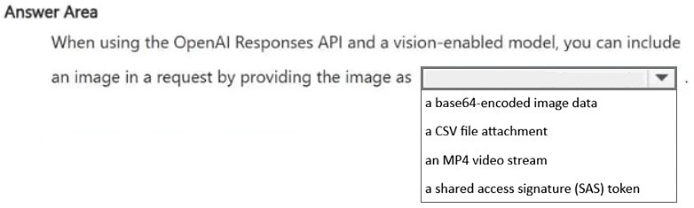

_HOTSPOT — the original ExamTopics question expects you to mark areas on the exhibit above; the correct hotspot coordinates are not published._

**Most voted:**
- Correct Answer is a base64-encoded image data.
- Becouse a base64-encoded image data: When working with vision-enabled models via API (such as OpenAI/Azure OpenAI), images can be passed directly as base64-encoded data strings within the payload or via image URLs.

### Top explanations
- **derafazu** (2 upvotes): The answer is correct by elimination — CSV, MP4, and SAS tokens have nothing to do with how the Responses API handles images. But it's worth noting the API actually supports two ways to pass an image to a vision-enabled model: either a base64-encoded string or a public image URL
- **Veenala** (1 upvotes [Most Recent]): Answer is base64-encoded image data, the other accepted version being URL which isn't given here.
- **Mary_Matic** (1 upvotes): Correct Answer is a base64-encoded image data.
  Becouse a base64-encoded image data: When working with vision-enabled models via API (such as OpenAI/Azure OpenAI), images can be passed directly as base64-encoded data strings within the payload or via image URLs.

## Q1.3 (ID 415683)

You need to create an AI agent in Microsoft Foundry that follows a specific role and behavior when responding to users.
What should you configure?

✅ **A.** system instructions
⭕ **B.** temperature
⭕ **C.** tokens per minute (TPM)
⭕ **D.** max completion tokens

**Correct answer:** A
**Most voted:** A

### Top explanations
- **Veenala** (1 upvotes [Most Recent, Selected Answer: A]): System instructions defines how the AI "speaks" by specifying tone, behavior and role.
- **Mary_Matic** (1 upvotes [Selected Answer: A]): This is used to define the AI agent's role, behavior, tone, and specific guidelines when responding to users (often referred to as system prompts or instructions).
- **Naesh** (1 upvotes [Selected Answer: A]): SYSTEM INSTRUCTIONS allow you to give high level instructions to the model that goversn the behaviour for all the responses.

## Q1.4 (ID 415684)

HOTSPOT
For each of the following statements, select Yes if the statement is true. Otherwise, select No.
NOTE: Each correct selection is worth one point.

**Exhibits**
- Exhibit 1: 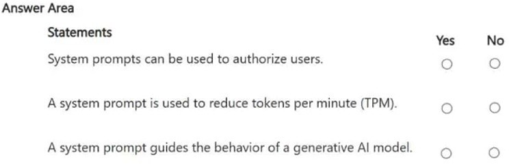

_HOTSPOT — the original ExamTopics question expects you to mark areas on the exhibit above; the correct hotspot coordinates are not published._

**Most voted:**
- System prompts can be used to authorize users → NO
- Authorization requires: identity verification
- A system prompt is used to reduce tokens per minute (TPM) → NO
- TPM is controlled by: rate limits
- A system prompt guides the behavior of a generative AI model → YES
- A system prompt: sets tone

### Top explanations
- **nap61** (8 upvotes [Highly Voted]): 1. System prompts can be used to authorize users. → NO
  A system prompt cannot authorize anyone.
  Authorization requires:
  identity verification
  tokens
  roles
  permissions
  authentication flows
  A system prompt is just text that guides the model’s behavior.
  It has zero security authority.
  So the correct answer is NO.
  2. A system prompt is used to reduce tokens per minute (TPM). → NO
  A system prompt does not reduce TPM.
  TPM is controlled by:
  rate limits
  model usage
  request size
  API quotas
  A system prompt does not influence billing or throughput.
  It only influences behavior, not performance.
  So the correct answer is NO.
  3. A system prompt guides the behavior of a generative AI model. → YES
  This is the true statement.
  A system prompt:
  sets tone
  defines rules
  establishes constraints
  guides how the model responds
  This is exactly what system prompts are designed for.
  So the correct answer is YES.
- **Veenala** (4 upvotes [Most Recent]): No
  No
  Yes
  The system prompt is an instruction given to the model on how to behave, not a part of the configurations.
- **RRandell** (4 upvotes): 1. Yes
  2. No
  3. No
  A system prompt guides model behaviour, improves response quality, and can reduce harmful outputs. It's core purpose isn't managing TPM
- **Trinayana** (3 upvotes): 1: No
  2: No
  3: Yes
- **Shifin** (3 upvotes): System prompts can be used to authorize users - No (Authorization is handled through authentication and access control mechanisms, not system prompts.)
  A system prompt is used to reduce tokens per minute (TPM) - No (TPM is a service quota/rate-limit metric. System prompts do not exist to reduce TPM usage.)
  A system prompt guides the behavior of a generative AI model - Yes  (System prompts provide instructions that define the model's role, tone, constraints, and behavior, guiding how it responds to users.)

## Q1.5 (ID 415685)

You are developing a web app that processes invoices to calculate expenses.
You need to extract structured fields, including nested values, from the invoices by using a defined schema.
What should you use?

⭕ **A.** an optical character recognition (OCR)-only document processing pipeline
⭕ **B.** a transcription workflow in Azure Speech in Foundry Tools
✅ **C.** an analyzer in Azure Content Understanding in Foundry Tools
⭕ **D.** an Azure AI Search service

**Correct answer:** C
**Most voted:** C

### Top explanations
- **roopansh.gupta2** (3 upvotes [Selected Answer: C]): Azure Content Understanding analyzers are designed to process documents and extract structured information based on a schema you define, including complex and nested fields.
  Why not the others?
  A. OCR-only document processing pipeline
  OCR extracts text, but it does not natively map that text into a structured schema with nested fields.
  B. Azure Speech transcription workflow
  Speech services are for audio/video transcription, not invoice document extraction.
  D. Azure AI Search
  AI Search is used for indexing and searching content, not for schema-based field extraction from invoices.
- **Veenala** (2 upvotes [Most Recent, Selected Answer: C]): Azure Content Understanding is the required service since it leverages schemas which are able to handle nested input. OCR can extract words and recognise them but holds no understanding of relationships.
- **Mary_Matic** (1 upvotes [Selected Answer: C]): Azure Content Understanding (in Foundry Tools): This service is designed to extract structured fields, including nested values and complex schemas, from unstructured or semi-structured documents like invoices and receipts.
- **vbhoyar54** (1 upvotes [Selected Answer: C]): Answer is C

## Q1.6 (ID 415686)

HOTSPOT
For each of the following statements, select Yes if the statement is true. Otherwise, select No.
NOTE: Each correct selection is worth one point.

**Exhibits**
- Exhibit 1: 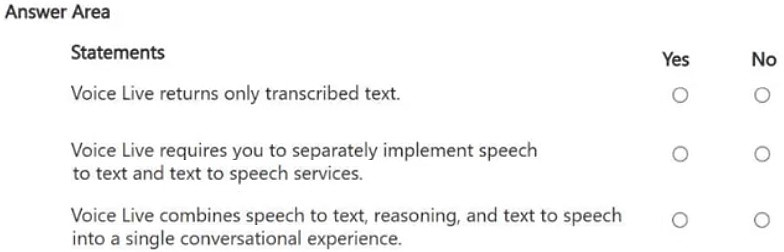

_HOTSPOT — the original ExamTopics question expects you to mark areas on the exhibit above; the correct hotspot coordinates are not published._

**Most voted:**
- Voice Live returns only transcribed text → NO
- It produces: transcribed text
- Voice Live requires you to separately implement STT and TTS → NO
- You do not: create a SpeechRecognizer
- Voice Live combines STT, reasoning, and TTS into one conversational experience → YES
- Voice Live provides: real‑time speech recognition

### Top explanations
- **nap61** (5 upvotes [Most Recent]): 1. Voice Live returns only transcribed text → NO
  Voice Live is not just STT (speech‑to‑text).
  It produces:
  transcribed text
  model reasoning
  synthesized speech
  So it returns more than text.
  2. Voice Live requires you to separately implement STT and TTS → NO
  This is the whole point of Voice Live — it removes the need to wire STT and TTS manually.
  You do not:
  create a SpeechRecognizer
  create a SpeechSynthesizer
  stitch them together
  manage audio routing
  Voice Live handles the entire pipeline.
  3. Voice Live combines STT, reasoning, and TTS into one conversational experience → YES
  This is the correct statement.
  Voice Live provides:
  real‑time speech recognition
  model reasoning
  real‑time speech synthesis
  All in one unified loop, ideal for conversational agents.
  Final answers
  NO — NO — YES

## Q1.7 (ID 415687)

HOTSPOT
You are developing a voice application that listens for spoken commands and converts them into text by using Azure Speech in Foundry Tools.
How should you complete the Python code? To answer, select the appropriate option in the answer area.
NOTE: Each correct selection is worth one point.

**Exhibits**
- Exhibit 1: 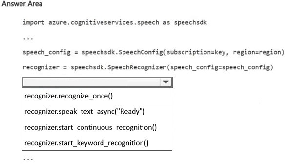

_HOTSPOT — the original ExamTopics question expects you to mark areas on the exhibit above; the correct hotspot coordinates are not published._

**Most voted:**
- Correct: recognizer.start_continuous_recognition()
- Use this when you want: real‑time, ongoing speech recognition

### Top explanations
- **nap61** (8 upvotes [Highly Voted]): Correct: recognizer.start_continuous_recognition()
  Use this when you want:
  real‑time, ongoing speech recognition
  the microphone to stay open
  multiple utterances to be captured
  a conversational or streaming scenario
  This matches the context:
  “real-time spoken conversations”
  So yes — continuous recognition is the right answer.
  Why not the others?
  1. recognizer.recognize_once()
  Captures one single utterance, then stops
  Good for commands like “Turn on the lights”
  Not suitable for conversations
  2. recognizer.speak_text_async("Ready")
  This is text‑to‑speech, not speech recognition
  Wrong object (SpeechRecognizer cannot speak)
  3. recognizer.start_keyword_recognition()
  Used for wake words (“Hey Copilot”, “Computer, start listening”)
  Not for general conversation
  Requires a keyword model file
  Final answer
  recognizer.start_continuous_recognition()
- **patng** (4 upvotes [Most Recent]): Why: the application needs to keep listening for spoken commands and convert speech to text continuously.
  recognize_once() → listens for only a single utterance
  start_continuous_recognition() → ✅ keeps listening continuously
  start_keyword_recognition() → used for keyword/wake-word detection
  speak_text_async() → related to text-to-speech, not speech recognition
  ✅ Answer: recognizer.start_continuous_recognition()
- **acloudnerd** (2 upvotes): recognize_once() listens for speech, converts it to text, and then stops after detecting a single utterance.
- **jucasino** (2 upvotes): the word command is the key. (single utterance) very confusing but it makes sense
- **Jedi_Jeremy** (2 upvotes): I have to disagree with provided answer of "recognize_once()" unless you are specifically pushing one button for one phrase, most apps need to listen continuously for spoken utterances. Poorly worded question

## Q1.8 (ID 415688)

What are two purposes of instructions when prompting a generative AI model? Each correct answer presents part of the solution.
NOTE: Each correct selection is worth one point.

✅ **A.** defines the agent’s role and behavior
⭕ **B.** selects which model to use
⭕ **C.** defines the Azure region where inference occurs
⭕ **D.** defines the tokens per minute (TPM) allocation for the model
✅ **E.** defines constraints on the model’s responses

**Correct answer:** A, E
**Most voted:** AE

### Top explanations
- **acloudnerd** (2 upvotes [Selected Answer: AE]): Instructions in a prompt are used to define the role and behaviour of the AI. They are also used to set constrainst on how the AI should respond(for example, the length and tone of the response)
- **vbhoyar54** (1 upvotes [Most Recent, Selected Answer: AE]): Answer is AE
- **akajanko** (1 upvotes [Selected Answer: AE]): Las instrucciones sirven para establecer cómo debe comportarse el modelo, qué rol debe asumir y qué límites o restricciones debe respetar.

## Q1.9 (ID 415689)

HOTSPOT
You are developing an application that converts text into spoken audio and saves the synthesized audio to a file by using Azure Speech in Foundry Tools.
How should you complete the Python code? To answer, select the appropriate option in the answer area.
NOTE: Each correct selection is worth one point.

**Exhibits**
- Exhibit 1: 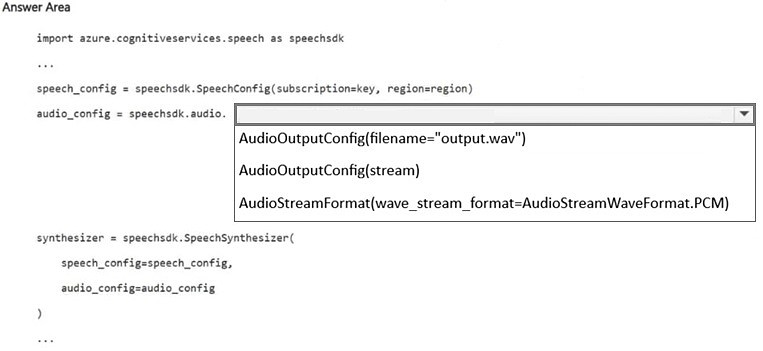

_HOTSPOT — the original ExamTopics question expects you to mark areas on the exhibit above; the correct hotspot coordinates are not published._

**Most voted:**
- AudioOutputConfig(filename="output.wav") → ✅ saves audio to a WAV file
- AudioOutputConfig(stream) → outputs to a stream, not directly to a file
- AudioStreamFormat(...) → defines the audio format, but does not specify a file destination

### Top explanations
- **patng** (1 upvotes [Most Recent]): Why: you want the synthesized speech to be saved to an audio file.
  AudioOutputConfig(filename="output.wav") → ✅ saves audio to a WAV file
  AudioOutputConfig(stream) → outputs to a stream, not directly to a file
  AudioStreamFormat(...) → defines the audio format, but does not specify a file destination
  ✅ Answer: AudioOutputConfig(filename="output.wav")
- **roopansh** (1 upvotes): ❌ AudioOutputConfig(stream)
  Used when sending audio to a stream (memory, custom processing, network stream, etc.).
  Not specifically saving to a file.
  ❌ AudioStreamFormat(wave_stream_format=AudioStreamWaveFormat.PCM)
  Defines the audio format.
  It does not specify where the audio should be saved.
  By process of elimination - correct Answer - AudioOutputConfig(filename="output.wav") which tells Synthesizer to save the file with that filename directly

## Q1.11 (ID 415691)

HOTSPOT
You are developing an application that analyze invoices by using Azure Content Understanding in Foundry Tools.
You need to ensure that the application retrieves the analysis results after processing completes.
How should you complete the Python code? To answer, select the appropriate option in the answer area.
NOTE: Each correct selection is worth one point.

**Exhibits**
- Exhibit 1: 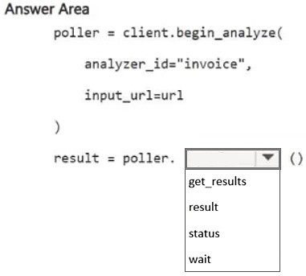

_HOTSPOT — the original ExamTopics question expects you to mark areas on the exhibit above; the correct hotspot coordinates are not published._

**Most voted:** result = poller.result()

### Top explanations
- **Sr18** (7 upvotes [Highly Voted]): result is correct answer as 'poller.result' keeps waiting for success or fail
- **sampy28** (2 upvotes [Most Recent]): The other options are incorrect:
  status() only reports the operation’s current status.
  wait() waits for completion but does not return the analysis output.
  get_results() is not the correct poller method.
  Question asks to get the result
- **Feliphus** (2 upvotes): ✅ Correct answer: result = poller.result()
  Explanation:
  In Azure AI services, including Azure Content Understanding, the begin_analyze() method starts a long-running operation and returns a poller object. To wait for the analysis to complete and retrieve the final results, you use:
  Python
  result = poller.result()
  The other options are not appropriate:
  ❌ get_results() – Not the standard method provided by the poller object.
  ❌ status() – Returns the status of the operation, but not the analysis results.
  ❌ wait() – Waits for the operation to finish, but does not return the results.
- **arunAI901** (1 upvotes): wait.
  Why: begin_analyze() returns a poller for the asynchronous analysis operation. wait() waits until processing is complete, after which the analysis results can be retrieved.

## Q1.12 (ID 415692)

DRAG DROP
You have a Microsoft Foundry project named project1 that contains an Azure OpenAI resource named Resource1.
To Resource1, you deploy a gpt-4.1-mini model by using a model deployment named my-mini-gpt.
You need to connect to my-mini-gpt from an application.
How should you complete the Python code? To answer, drag the appropriate values to the correct targets. Each value may be used once, more than once, or not at all.
NOTE: Each correct selection is worth one point.

**Exhibits**
- Exhibit 1: 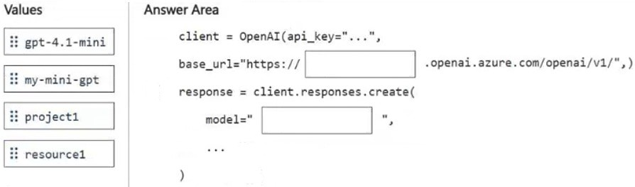

_DRAG DROP — the original ExamTopics question expects you to drag and drop items; the correct targets are not published._

**Most voted:**
- base_url: → resource1
- model → my-mini-gpt
- resource1 → Azure OpenAI resource name → used in the endpoint URL.
- my-mini-gpt → deployment name → used as the model value.
- gpt-4.1-mini → underlying model name, but not the deployment identifier required here.
- project1 → Foundry project name, not used in this connection.

### Top explanations
- **arunAI901** (2 upvotes [Most Recent]): base_url	->  resource1
  model -> my-mini-gpt
  resource1 -> Azure OpenAI resource name → used in the endpoint URL.
  my-mini-gpt -> deployment name → used as the model value.
  gpt-4.1-mini -> underlying model name, but not the deployment identifier required here.
  project1 -> Foundry project name, not used in this connection.
- **Qmpel** (1 upvotes): you do not use model name directly. my-mini-gpt should be used - how you name model deployment matters. resource1 goes to the endpoint url
- **acloudnerd** (1 upvotes): got-4.1-mini is the model being called. Project organises resources in Foundry. Resource is where the model is hosted

## Q1.13 (ID 415693)

HOTSPOT
For each of the following statements, select Yes if the statement is true. Otherwise, select No.
NOTE: Each correct selection is worth one point.

**Exhibits**
- Exhibit 1: 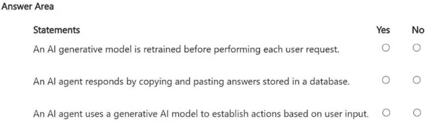

_HOTSPOT — the original ExamTopics question expects you to mark areas on the exhibit above; the correct hotspot coordinates are not published._

**Most voted:** No, No, Yes

### Top explanations
- **Manasi K** (1 upvotes [Most Recent]): No. No. Yes
- **acloudnerd** (1 upvotes): No. No. Yes.
  Models are pre-trained, not retrained for every prompt.
  Generative AI creates responses.
  Agents reason about user requests and decide actions or tools to use

## Q1.14 (ID 415694)

DRAG DROP
You are reviewing best practices for using AI at your company.
Which Microsoft responsible AI principle is each task an example of? To answer, drag the appropriate principles to the correct tasks. Each task may be used once, more than once, or not at all. You may need to drag the split bar between panes or scroll to view content.
NOTE: Each correct match is worth one point.

**Exhibits**
- Exhibit 1: 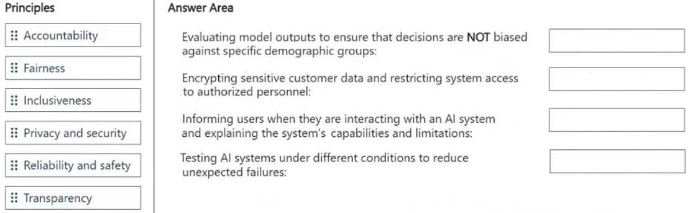

_DRAG DROP — the original ExamTopics question expects you to drag and drop items; the correct targets are not published._

**Most voted:** Not provided

### Top explanations
- **imran78690** (1 upvotes [Most Recent]): Fairness
  Privacy and security
  Transparency
  Reliability and safety

## Q1.16 (ID 415696)

You need to build an AI solution that produces new product images based on written descriptions provided by users.
Which AI workload should you use?

⭕ **A.** image analysis
✅ **B.** image generation
⭕ **C.** object detection
⭕ **D.** optical character recognition (OCR)

**Correct answer:** B
**Most voted:** B

### Top explanations
- **Tony5487** (1 upvotes [Most Recent, Selected Answer: B]): key is "produces new product images based on written descriptions", ans is B-Image Generation.
- **adithyakodali05** (1 upvotes [Selected Answer: B]): Question says which AI Workload is used to generate new images based on user input which already has the answer.
  Answer: Image generation

## Q1.17 (ID 415697)

HOTSPOT
Select the answer that correctly completes the sentence.

**Exhibits**
- Exhibit 1: 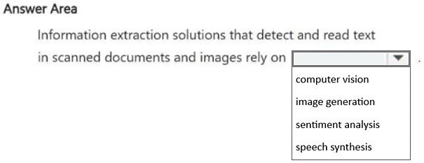

_HOTSPOT — the original ExamTopics question expects you to mark areas on the exhibit above; the correct hotspot coordinates are not published._

**Most voted:** Not provided

### Top explanations
- **Manasi K** (2 upvotes [Most Recent]): Computer Vision - This is the technique by which scanned document are read and converted to text
- **Sr18** (2 upvotes): Very bad formulated question,  Document intelligence is better for structured docs, images and computer vision will also work.

## Q1.18 (ID 415698)

You have a Microsoft Foundry project that has a generative AI model deployment.
You need to ensure that responses generated by the model minimize costs and remain within a defined length.
Which parameter should you configure?

⭕ **A.** Top P
⭕ **B.** Temperature
✅ **C.** Max Completion Tokens
⭕ **D.** Model version settings

**Correct answer:** C
**Most voted:** C

### Top explanations
- **taravu** (1 upvotes [Most Recent, Selected Answer: C]): Top P - controls diversity of token selection. does not affect response length
  Temperature - controls randomness/creativity, does not limit response size
  Model version settings - selects the model version.

## Q1.19 (ID 415699)

HOTSPOT
For each of the following statements, select Yes if the statement is true. Otherwise, select No.
NOTE: Each correct selection is worth one point.

**Exhibits**
- Exhibit 1: 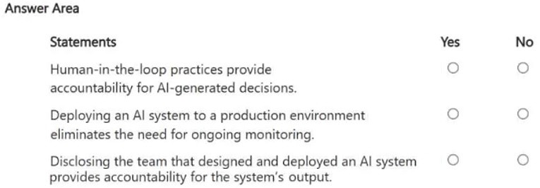

_HOTSPOT — the original ExamTopics question expects you to mark areas on the exhibit above; the correct hotspot coordinates are not published._

**Most voted:** Yes, No, Yes

### Top explanations
- **Sr18** (6 upvotes): Yes, No, Yes
  Accountability means a person/team/company/organize responsible if something goes wrong.
  It does helps with Transparency but does not solely account for Transparency.
- **Er_01** (2 upvotes): Naming the team provides tranparency.  Accountability requires, governance, documentation, monitoring and audit.
  Yes
  No
  No
- **Feliphus** (1 upvotes [Most Recent]): Human-in-the-loop practices provide accountability for AI-generated decisions. → No ❌
  Human-in-the-loop practices are primarily associated with Reliability and Safety, not Accountability.
  Deploying an AI system to a production environment eliminates the need for ongoing monitoring. → No ✅
  AI systems require ongoing monitoring, tracing, and observability after deployment to track performance, safety signals, and other operational metrics.
  Disclosing the team that designed and deployed an AI system provides accountability for the system's output. → Yes ✅
  Accountability is about identifying who is responsible for an AI system and its outcomes. Naming owners and maintaining governance structures are examples of this principle.

## Q1.20 (ID 415700)

Your company processes customer support emails.
You need to implement an AI solution that automatically identifies mentions of people, organizations, and locations in the emails.
Which text analysis technique should you use?

✅ **A.** Named Entity Recognition (NER)
⭕ **B.** key phrase extraction
⭕ **C.** sentiment analysis
⭕ **D.** summarization

**Correct answer:** A
**Most voted:** A

### Top explanations
- **Tony5487** (2 upvotes [Most Recent, Selected Answer: A]): automatically identifies mentions of people, organizations, and locations is Named Entity Recognition (NER)

## Q1.21 (ID 415701)

HOTSPOT
Select the answer that correctly completes the sentence.

**Exhibits**
- Exhibit 1: 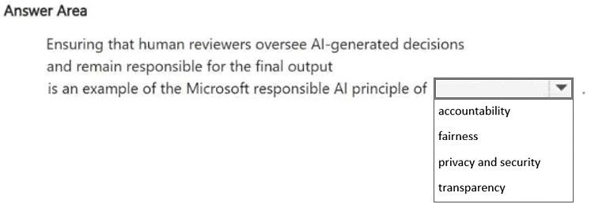

_HOTSPOT — the original ExamTopics question expects you to mark areas on the exhibit above; the correct hotspot coordinates are not published._

**Most voted:** Accountability.   Explanation: Microsoft's Accountability principle dictates that people must remain accountable and responsible for how AI systems operate and for the decisions they make. Having human reviewers oversee AI-generated decisions and take ultimate responsibility for the final output directly reflects this principle.

### Top explanations
- **buianhthang** (2 upvotes): Answer: Accountability.   Explanation: Microsoft's Accountability principle dictates that people must remain accountable and responsible for how AI systems operate and for the decisions they make. Having human reviewers oversee AI-generated decisions and take ultimate responsibility for the final output directly reflects this principle.
- **gangadhar07** (1 upvotes [Most Recent]): Answer: Accountability.
- **Tony5487** (1 upvotes): key point human reviewers oversee AI-generated decisions and remain responsible for the final output, ans is Accountability.

## Q1.22 (ID 415702)

You need to build an AI solution that generates marketing email drafts based on a short description of a product and its target audience.
Which AI workload should you use?

⭕ **A.** speech recognition
⭕ **B.** text classification
✅ **C.** generative AI
⭕ **D.** computer vision

**Correct answer:** C
**Most voted:** C

### Top explanations
- **Tony5487** (3 upvotes [Most Recent, Selected Answer: C]): key word is generates marketing email drafts based on a short description, ans is generative ai.
- **japete** (2 upvotes [Selected Answer: C]): La generación automática de textos nuevos a partir de instrucciones proporcionadas por el usuario es un caso clásico de IA generativa. El sistema crea contenido original en lugar de clasificar o analizar información existente.

## Q1.23 (ID 415703)

HOTSPOT
For each of the following statements, select Yes if the statement is true. Otherwise, select No.
NOTE: Each correct selection is worth one point.

**Exhibits**
- Exhibit 1: 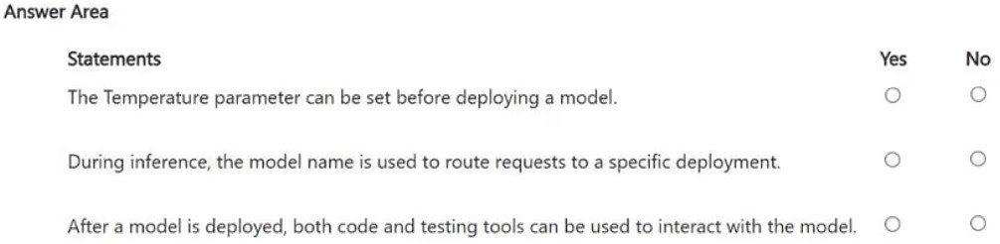

_HOTSPOT — the original ExamTopics question expects you to mark areas on the exhibit above; the correct hotspot coordinates are not published._

**Most voted:**
- Temperature → No
- Model name → No
- Code + testing tools → Yes

### Top explanations
- **Lathi123** (12 upvotes [Highly Voted]): Temperature → No
  Temperature is an inference/request parameter, not a deployment setting. It can be specified when making requests to the deployed model.
  Model name → No
  This is a common exam trap. You use the deployment name in the model parameter to route the request to a particular deployment—not the underlying model name.
  Code + testing tools → Yes
  After deployment, you can interact with the model in the Foundry Playground and access the Code tab/examples to use it programmatically.
- **Avbud** (5 upvotes): 1. NO! -> temperature is a per-request inference parameter! you pass it in each API call (or set it in the playground per session)
- **3839ee0** (3 upvotes): ✅ The Temperature parameter can be set before deploying a model.
  Temperature controls how random/creative the model's responses can be.
  ✅ During inference, the model name is used to route requests to a specific deployment.
  The deployment/model name tells the service which deployed model should process the request.
  ✅ After a model is deployed, both code and testing tools can be used to interact with the model.
  You can test it through tools such as a playground/testing interface or call it programmatically through an API/SDK.
- **Ama100** (2 upvotes [Most Recent]): No - Temperature is an inference-time parameter specified in the API request or playground, not during deployment.
  No - In Azure OpenAI, requests are routed using the deployment name, not the model name. Multiple deployments can use the same model.
  Yes	- A deployed model can be accessed through SDKs/APIs and through tools such as the Azure AI Foundry playground/testing interface.
- **jucasino** (2 upvotes): 1 --> NO
  2 --> YES
  3 --> YES

## Q1.24 (ID 415704)

HOTSPOT
Select the answer that correctly completes the sentence.

**Exhibits**
- Exhibit 1: 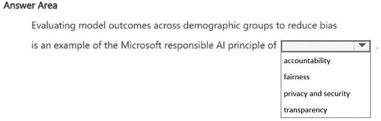

_HOTSPOT — the original ExamTopics question expects you to mark areas on the exhibit above; the correct hotspot coordinates are not published._

**Most voted:** The Answer by elimination is fairness but the wording of the question would suggest the answer is inclusiveness if it was an option.

### Top explanations
- **WHUSAM101** (1 upvotes [Most Recent]): The Answer by elimination is fairness but the wording of the question would suggest the answer is inclusiveness if it was an option.

## Q1.26 (ID 415706)

You are developing an AI-powered customer support application.
Which task is an example of the Microsoft responsible AI principle of inclusiveness?

⭕ **A.** Encrypt stored customer data and restrict access by using role-based controls.
⭕ **B.** Evaluate model outputs across demographic groups to reduce bias.
✅ **C.** Design the interface to support multiple languages and screen readers.
⭕ **D.** Provide explanations about how predictions are generated.

**Correct answer:** C
**Most voted:** C

### Top explanations
- **slabrigui** (2 upvotes [Most Recent, Selected Answer: C]): C is the correct answer

## Q1.28 (ID 415708)

HOTSPOT
For each of the following statements, select Yes if the statement is true. Otherwise, select No.
NOTE: Each correct selection is worth one point.

**Exhibits**
- Exhibit 1: 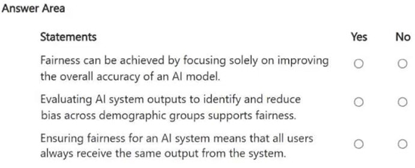

_HOTSPOT — the original ExamTopics question expects you to mark areas on the exhibit above; the correct hotspot coordinates are not published._

**Most voted:**
- Statement 1 (No): High overall accuracy can often hide significant biases against smaller, underrepresented demographic groups. To achieve fairness, metrics must look beyond overall accuracy and specifically track performance across distinct sub-groups.
- Statement 2 (Yes): Proactively evaluating and comparing outputs across different demographics helps engineers identify disparities and actively mitigate systemic bias, which directly supports the principle of fairness.
- Statement 3 (No): Fairness does not mean everyone gets the same generic output; instead, it means the system provides equitable treatment based on relevant inputs without discriminating against protected characteristics (like race, gender, or age).

### Top explanations
- **Tony5487** (2 upvotes [Most Recent]): 1.no,fairness is not the overall accuracy.
  2.yes,fairness is reduce bias and demographic groups.
  3.no,fairness is not output the same ans.
- **77750sr** (2 upvotes): Statement 1 (No): High overall accuracy can often hide significant biases against smaller, underrepresented demographic groups. To achieve fairness, metrics must look beyond overall accuracy and specifically track performance across distinct sub-groups.
  Statement 2 (Yes): Proactively evaluating and comparing outputs across different demographics helps engineers identify disparities and actively mitigate systemic bias, which directly supports the principle of fairness.
  Statement 3 (No): Fairness does not mean everyone gets the same generic output; instead, it means the system provides equitable treatment based on relevant inputs without discriminating against protected characteristics (like race, gender, or age).

## Q1.30 (ID 415710)

You have a Microsoft Foundry project that contains a generative AI model deployment.
You test the model by using the Foundry playground.
You need to develop an application that sends requests to the deployed model.
Which information must the application include to call the model?

⭕ **A.** The exported playground session history
⭕ **B.** The model training dataset
⭕ **C.** The Foundry project display name
✅ **D.** The model endpoint and authentication credentials

**Correct answer:** D
**Most voted:** D

### Top explanations
- **pawandeep** (2 upvotes [Most Recent, Selected Answer: D]): The model endpoint and the authentication key are the unique aspects to call the model.The project display name is not correct call cause under the MS-foundry.we could have duplicates name.
- **Tony5487** (2 upvotes [Selected Answer: D]): call generative ai need model enpoint and auth credentials.

## Q1.32 (ID 415712)

HOTSPOT
For each of the following statements, select Yes if the statement is true. Otherwise, select No.
NOTE: Each correct selection is worth one point.

**Exhibits**
- Exhibit 1: 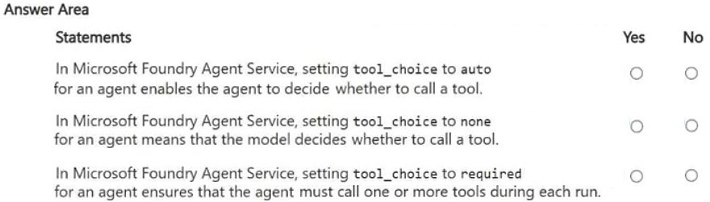

_HOTSPOT — the original ExamTopics question expects you to mark areas on the exhibit above; the correct hotspot coordinates are not published._

**Most voted:**
- auto → the model decides whether to call a tool or answer directly
- required → the model must call one or more tools, cannot answer without them
- none → the model is not allowed to call tools, must answer directly

### Top explanations
- **GrandWizard_007** (1 upvotes [Most Recent]): 1. Yes
  2. No
  3. Yes
  auto -> the model decides whether to call a tool or answer directly
  required -> the model must call one or more tools, cannot answer without them
  none -> the model is not allowed to call tools, must answer directly

## Q1.35 (ID 415715)

You have a Microsoft Foundry project that contains a vision-enabled model deployment.
You need to develop an application that sends a message containing text and an image URL. The solution must ensure the quickest response time.
Which message structure should you include in the request?

⭕ **A.** a system message that includes both a text item and an image item in the content array
⭕ **B.** a system message that includes only a text item and sends an image item in a separate request
⭕ **C.** a user message that includes only a text item and sends an image item in a separate request
✅ **D.** a user message that includes both a text item and an image item in the content array

**Correct answer:** D
**Most voted:** D

### Top explanations
- **nicolase** (1 upvotes [Most Recent, Selected Answer: D]): To get the fastest response with a vision model in Microsoft Foundry, you should send everything in a single request. The correct structure is a user message (role: "user") whose `content` field is an array containing two elements:

## Q1.36 (ID 415716)

HOTSPOT
For each of the following statements, select Yes if the statement is true. Otherwise, select No.
NOTE: Each correct selection is worth one point.

**Exhibits**
- Exhibit 1: 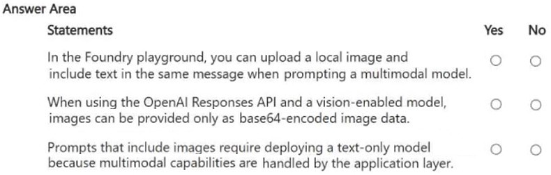

_HOTSPOT — the original ExamTopics question expects you to mark areas on the exhibit above; the correct hotspot coordinates are not published._

**Most voted:**
1. Yes - in the Microsoft Foundry playground, you can upload a local image and include text in the same prompt when using a vision‑enabled (multimodal) model.
2. No - It is false that vision‑enabled models in the OpenAI Responses API only accept base64‑encoded images — you can also pass images as publicly accessible HTTP URLs.

### Top explanations
- **GrandWizard_007** (1 upvotes [Most Recent]): 1. Yes - in the Microsoft Foundry playground, you can upload a local image and include text in the same prompt when using a vision‑enabled (multimodal) model.
  2. No - It is false that vision‑enabled models in the OpenAI Responses API only accept base64‑encoded images — you can also pass images as publicly accessible HTTP URLs.
  3. No - Prompts that include images do not require you to deploy a text‑only model; many modern systems are natively multimodal and can process both text and images directly, without needing to convert the image into text first

## Q1.37 (ID 415717)

You are developing an application that processes voicemail recordings by using Azure Content Understanding in Foundry Tools.
Which feature does Azure Content Understanding use to convert audio to text?

⭕ **A.** key phrase extraction
✅ **B.** transcription
⭕ **C.** Voice Live
⭕ **D.** optical character recognition (OCR)

**Correct answer:** B
**Most voted:** B

### Top explanations
- **NVIT2026** (1 upvotes [Most Recent, Selected Answer: B]): Azure Content Understanding processes audio content (like voicemail recordings) by generating a transcription, converting the spoken audio into text as part of its analysis output

## Q1.41 (ID 415721)

HOTSPOT
Select the answer that correctly completes the sentence.

**Exhibits**
- Exhibit 1: 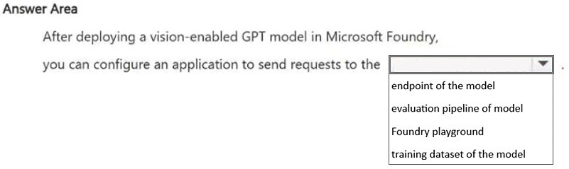

_HOTSPOT — the original ExamTopics question expects you to mark areas on the exhibit above; the correct hotspot coordinates are not published._

**Most voted:**
- endpoint of the model.
- Reason: Once you deploy a vision‑enabled GPT model in Microsoft Foundry, you can configure an application to send requests to its endpoint and call the Chat Completion API with images.

### Top explanations
- **GrandWizard_007** (1 upvotes [Most Recent]): Answer - endpoint of the model.
  Reason: Once you deploy a vision‑enabled GPT model in Microsoft Foundry, you can configure an application to send requests to its endpoint and call the Chat Completion API with images.

## Q1.42 (ID 415722)

You are developing an application that extracts fields from PDFs by using Azure Content Understanding in Foundry Tools.
You need to use the Python SDK to submit a PDF for analysis and retrieve the extraction results.
What should you do?

⭕ **A.** Call analyze() to return the extracted fields synchronously in the same request.
⭕ **B.** Submit the PDF to an analyzer and read the results from the request headers.
✅ **C.** Call begin_analyze(), and then call poller.result() to retrieve the results.
⭕ **D.** Use optical character recognition (OCR) to extract text from the PDF and map the fields in the code.

**Correct answer:** C
**Most voted:** C

### Top explanations
- **nicolase** (1 upvotes [Most Recent, Selected Answer: C]): C. Call `begin_analyze()`, and then call `poller.result()` to retrieve the results.
  Content Understanding performs the analysis as a long-running operation:
  1. `begin_analyze()` initiates the processing and returns a `poller` object.
  2. `poller.result()` waits for the processing to complete and returns the structured result.

## Q1.43 (ID 415723)

HOTSPOT
For each of the following statements, select Yes if the statement is true. Otherwise, select No.
NOTE: Each correct selection is worth one point.

**Exhibits**
- Exhibit 1: 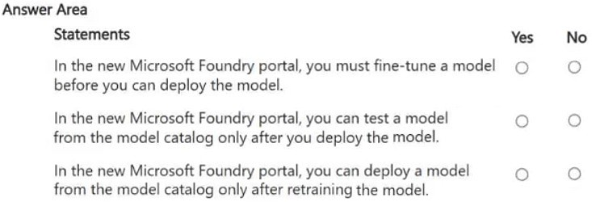

_HOTSPOT — the original ExamTopics question expects you to mark areas on the exhibit above; the correct hotspot coordinates are not published._

**Most voted:**
- In the new Microsoft Foundry portal, you must fine-tune a model before you can deploy the model → No ❌
- In the new Microsoft Foundry portal, you can test a model from the model catalog only after you deploy the model → Yes ✅
- The AI-901 study material describes the workflow as: Choose a model → Deploy it → Test it in the playground. Therefore, according to the exam objectives, testing occurs after deployment.
- In the new Microsoft Foundry portal, you can deploy a model from the model catalog only after retraining the model → No ❌

### Top explanations
- **Feliphus** (1 upvotes [Most Recent]): In the new Microsoft Foundry portal, you must fine-tune a model before you can deploy the model. → No ❌
  In Microsoft Foundry, you can select a model from the model catalog and deploy it directly. Fine-tuning is optional and is not required before deployment.
  In the new Microsoft Foundry portal, you can test a model from the model catalog only after you deploy the model. → Yes ✅
  The AI-901 study material describes the workflow as: Choose a model → Deploy it → Test it in the playground. Therefore, according to the exam objectives, testing occurs after deployment.
  In the new Microsoft Foundry portal, you can deploy a model from the model catalog only after retraining the model. → No ❌
  Retraining is not a prerequisite for deployment. Models from the catalog can be deployed and used without retraining.

## Q1.49 (ID 415729)

HOTSPOT
For each of the following statements, select Yes if the statement is true. Otherwise, select No.
NOTE: Each correct selection is worth one point.

**Exhibits**
- Exhibit 1: 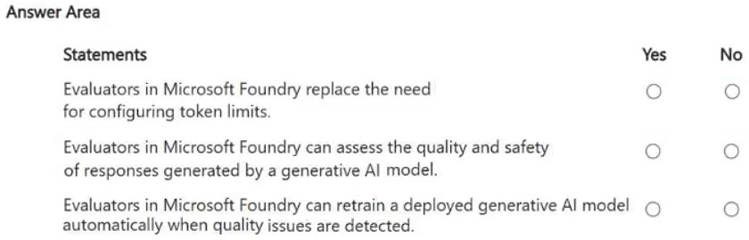

_HOTSPOT — the original ExamTopics question expects you to mark areas on the exhibit above; the correct hotspot coordinates are not published._

**Most voted:**
1. No - Microsoft Foundry evaluators do not replace the need to configure token limits
2. Yes - Microsoft Foundry provides built‑in evaluators that can assess both the quality and safety of responses generated by generative AI models
3. No - Evaluators in Microsoft Foundry do not automatically retrain a deployed generative AI model when quality issues are detected.

### Top explanations
- **GrandWizard_007** (1 upvotes [Most Recent]): 1. No - Microsoft Foundry evaluators do not replace the need to configure token limits
  2. Yes - Microsoft Foundry provides built‑in evaluators that can assess both the quality and safety of responses generated by generative AI models
  3. No - Evaluators in Microsoft Foundry do not automatically retrain a deployed generative AI model when quality issues are detected.

## Q1.54 (ID 426708)

HOTSPOT
You deploy a model named gpt-image-1 in Microsoft Foundry.
You need to ensure that an application can generate an image from a user prompt by using the OpenAI Images API.
How should you complete the Python code? To answer, select the appropriate option in the answer area.
NOTE: Each correct selection is worth one point.

**Exhibits**
- Exhibit 1: 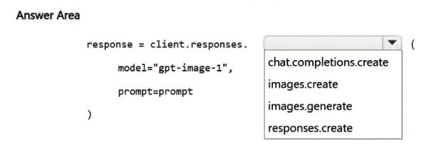

_HOTSPOT — the original ExamTopics question expects you to mark areas on the exhibit above; the correct hotspot coordinates are not published._

**Most voted:**
- client.images.generate() means: “Generate an image using the dedicated Images API.”
- client.responses.create() means: “Ask a model to produce a response,” which can involve text and, with the appropriate model/tools, more complex multimodal workflows.

### Top explanations
- **Sr18** (4 upvotes [Most Recent]): C.
  stream = client.images.generate(
  model="gpt-image-1.5",
  prompt="A cute baby sea otter",
  n=1,
  size="1024x1024",
  stream=True,
  partial_images = 2
  )
- **Jedi_Jeremy** (4 upvotes): For the OpenAI Images API, the correct choice is images.generate()
  The key difference is the API surface and intent:
  client.images.generate() means: “Generate an image using the dedicated Images API.”
  client.responses.create() means: “Ask a model to produce a response,” which can involve text and, with the appropriate model/tools, more complex multimodal workflows.
  For the exam question you showed, images.generate() is the intended answer because it explicitly says to use the OpenAI Images API.
- **BabiRahul** (4 upvotes): C.
  Reason: The question specifically says to generate an image using the OpenAI Images API with the gpt-image-1 model. Azure OpenAI documentation for GPT Image models uses the Images API with client.images.generate(...) for image generation.

## Q1.56 (ID 426725)

HOTSPOT
For each of the following statements, select Yes if the statement is true. Otherwise, select No.
NOTE: Each correct selection is worth one point.

**Exhibits**
- Exhibit 1: 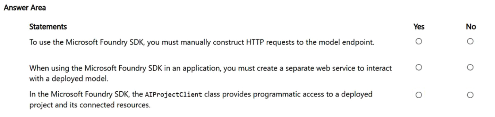

_HOTSPOT — the original ExamTopics question expects you to mark areas on the exhibit above; the correct hotspot coordinates are not published._

**Most voted:**
2. No - you do not have to create a separate web service; the Microsoft Foundry SDK can connect directly to your deployed model via the Foundry project endpoint.
3. Yes - the AIProjectClient class in the Microsoft Foundry SDK provides programmatic access to a deployed project and its connected resources.

### Top explanations
- **GrandWizard_007** (1 upvotes [Most Recent]): 1. No - You do not have to manually construct HTTP requests when using the Microsoft Foundry SDK — the SDK provides built‑in methods that handle the HTTP calls, authentication, and routing to the correct model endpoint for you.
  2. No - you do not have to create a separate web service; the Microsoft Foundry SDK can connect directly to your deployed model via the Foundry project endpoint.
  3. Yes - the AIProjectClient class in the Microsoft Foundry SDK provides programmatic access to a deployed project and its connected resources.

## Q1.57 (ID 426713)

You are developing an application that analyzes uploaded video files by using Azure Content Understanding in Foundry Tools.
You need to ensure that the application extracts structured information from the videos.
What should the application call?

⭕ **A.** Azure Language in Foundry Tools sentiment analysis
✅ **B.** the Analyze API in Content Understanding
⭕ **C.** the Image Analysis API in Azure Vision in Foundry Tools
⭕ **D.** Azure OpenAI

**Correct answer:** B
**Most voted:** B

### Top explanations
- **GrandWizard_007** (1 upvotes [Most Recent, Selected Answer: B]): B. the Analyze API in Content Understanding
  Reason: Azure Content Understanding in Foundry Tools is designed to transform unstructured media (including video) into structured, searchable data. The Analyze API is the dedicated endpoint for this purpose — it runs the prebuilt or custom video analyzer pipeline, extracting the following: Transcript, Key Frames, Descriptions, Segmentation, Custom fields. This output is ready for downstream workflows such as retrieval-augmented generation (RAG), media asset management, or custom analytics, without additional post‑processing

## Q1.61 (ID 426739)

HOTSPOT
Select the answer that correctly completes the sentence.

**Exhibits**
- Exhibit 1: 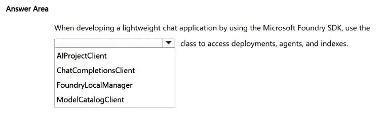

_HOTSPOT — the original ExamTopics question expects you to mark areas on the exhibit above; the correct hotspot coordinates are not published._

**Most voted:**
- AIProjectClient
- Reason: Use the AIProjectClient class from the Microsoft Foundry SDK — it’s the thin‑client entry point that provides unified access to deployments, agents, and indexes in your Foundry project

### Top explanations
- **GrandWizard_007** (1 upvotes [Most Recent]): Answer: AIProjectClient
  Reason: Use the AIProjectClient class from the Microsoft Foundry SDK — it’s the thin‑client entry point that provides unified access to deployments, agents, and indexes in your Foundry project

## Q1.62 (ID 426749)

You are developing an application that continuously transcribes speech from a default microphone by using Azure Speech in Microsoft Foundry Tools.
You need to perform speech-to-text transcription from the microphone.
Which Python class should you use?

✅ **A.** SpeechRecognizer
⭕ **B.** SpeechSynthesizer
⭕ **C.** SpeechConfig
⭕ **D.** AudioOutputConfig

**Correct answer:** A
**Most voted:** A

### Top explanations
- **GrandWizard_007** (1 upvotes [Most Recent, Selected Answer: A]): You should use the SpeechRecognizer class to perform continuous speech‑to‑text transcription from the default microphone in Microsoft Foundry’s Azure Speech service.
  In the Azure Speech SDK for Python, the SpeechRecognizer class is responsible for:
  1) Capturing audio from a microphone (audio_config)
  2) Sending it to the Azure Speech service for real‑time recognition
  3) Returning transcription results in real time

## Q1.63 (ID 426698)

You are developing a simple application that uses the Microsoft Foundry SDK to send chat prompts to a model.
Which three elements should you provide in the code to run the application? Each correct answer presents part of the solution.
NOTE: Each correct selection is worth one point.

✅ **A.** the model deployment name
⭕ **B.** the task type
⭕ **C.** the Foundry project display name
✅ **D.** Microsoft Entra ID credentials
✅ **E.** the endpoint URL

**Correct answer:** A, D, E
**Most voted:** ADE

### Top explanations
- **GrandWizard_007** (1 upvotes [Most Recent, Selected Answer: ADE]): A. Model deployment name - Identifies which deployed model your application will send chat prompts to.
  D. Microsoft Entra ID credentials - Used for authentication via DefaultAzureCredential or another Entra-based credential provider. Required for the SDK to authorize API calls.
  E. The endpoint URL - The Foundry project endpoint in the format:
  https://.services.ai.azure.com/api/projects/
  Required for the SDK client to connect to your Foundry project.

## Q1.65 (ID 426721)

You have a Microsoft Foundry project that contains a vision-enabled GPT model deployment.
You need to develop an application that sends an image and a text question to the model in a single request.
What should you use?

⭕ **A.** the Azure OpenAI Images API endpoint only
⭕ **B.** the Speech to text REST API
⭕ **C.** the Image Analysis REST API
✅ **D.** the Azure OpenAI Responses API

**Correct answer:** D
**Most voted:** D

### Top explanations
- **GrandWizard_007** (1 upvotes [Most Recent, Selected Answer: D]): You should use the Azure OpenAI Responses API from your Microsoft Foundry project endpoint, sending both the image and text in a single user message so the model can process them together in one request.
  The Azure OpenAI Responses API is the recommended endpoint for this scenario because:
  1) It supports multimodal content — you can include an image reference and text in the same request.
  2) It allows you to send both in a single payload, reducing network overhead and latency.
  3) It integrates directly with your Foundry project connection, so you can call it without needing separate APIs.

## Q1.66 (ID 426702)

HOTSPOT
Select the answer that correctly completes the sentence.

**Exhibits**
- Exhibit 1: 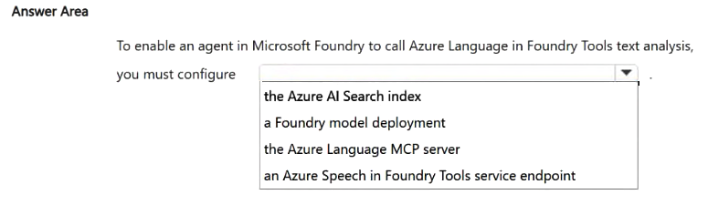

_HOTSPOT — the original ExamTopics question expects you to mark areas on the exhibit above; the correct hotspot coordinates are not published._

**Most voted:** Not provided

### Top explanations
- **Gareth Johnson** (1 upvotes [Most Recent]): To let a Microsoft Foundry agent call Azure Language text analysis capabilities, you add the Azure Language MCP server from the Foundry Tool Catalog and configure its connection/authentication. The MCP server is the standardized bridge between the agent and Azure Language services.
- **Er_01** (1 upvotes): For this it is option 4 as agents do not require MCP.  It can use one but it is not required.

## Q1.76 (ID 426733)

HOTSPOT
Select the answer that correctly completes the sentence.

**Exhibits**
- Exhibit 1: 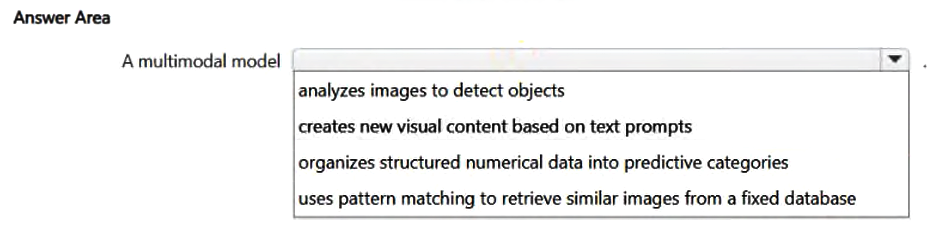

_HOTSPOT — the original ExamTopics question expects you to mark areas on the exhibit above; the correct hotspot coordinates are not published._

**Most voted:**
- Analyzes images to detect objects → This is primarily a computer vision/object detection task.
- Creates new visual content based on text prompts → ✅ Correct. A multimodal generative AI model can generate images from text descriptions.
- Organizes structured numerical data into predictive categories → This is a classification machine learning task.
- Uses pattern matching to retrieve similar images from a fixed database → This is image retrieval/search, not multimodal generation.

### Top explanations
- **Sr18** (1 upvotes [Most Recent]): B
  Object detection can be achieved by multimodel but vision is better suited for that task.
- **BabiRahul** (1 upvotes): B
  Why the other options are incorrect:
  Analyzes images to detect objects → This is primarily a computer vision/object detection task.
  Creates new visual content based on text prompts → ✅ Correct. A multimodal generative AI model can generate images from text descriptions.
  Organizes structured numerical data into predictive categories → This is a classification machine learning task.
  Uses pattern matching to retrieve similar images from a fixed database → This is image retrieval/search, not multimodal generation.

## Q1.77 (ID 426720)

HOTSPOT
Select the answer that correctly completes the sentence.

**Exhibits**
- Exhibit 1: 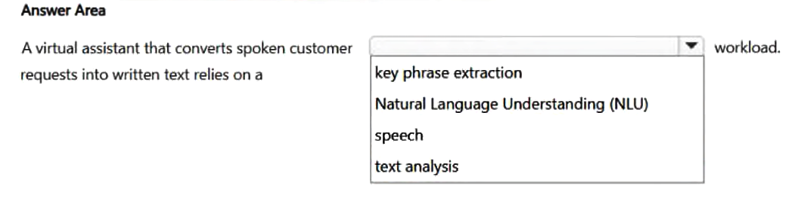

_HOTSPOT — the original ExamTopics question expects you to mark areas on the exhibit above; the correct hotspot coordinates are not published._

**Most voted:** Not provided

### Top explanations
- **Jedi_Jeremy** (2 upvotes): The scenario describes converting spoken customer requests into written text, which is a speech-to-text workload. Speech workloads are designed to recognize spoken language and transcribe it into text.
  Why the others are incorrect:
  ❌ A. Key phrase extraction: Identifies important phrases in existing text.
  ❌ B. NLU (Natural Language Understanding): Interprets the meaning, intent, or entities in language after it has been captured.
  ❌ D. Text analysis: Analyzes text for sentiment, entities, summarization, and similar tasks.
- **mk2501** (2 upvotes): SPEECH: The task described is speech recognition: converting an audio signal into text. This is what is known as a speech workload or speech-to-text.
  The other options do not apply:
  key phrase extraction — analyzing text that has already been written to extract key concepts.
  Natural Language Understanding — understanding the meaning of a text, but only after it has been transcribed.
  text analysis — processing text, not audio.
  So the first step is indeed a speech workload; only then do NLU or text analysis come into play.
- **Sr18** (1 upvotes [Most Recent]): [Speech]
  I mean its no brainer question.

## Q1.101 (ID 426751)

Which action can be performed by using the Azure Vision in Foundry Tools service?

⭕ **A.** creating thumbnails for training videos
⭕ **B.** extracting key phrases from documents
⭕ **C.** identifying breeds of animals in live video streams
✅ **D.** extracting data from handwritten letters

**Correct answer:** D
**Most voted:** D

### Top explanations
- **Gareth Johnson** (1 upvotes [Most Recent, Selected Answer: D]): A is not correct, The disqualifying wording in A is “for training videos.”
  Azure Vision’s thumbnail feature takes an image as input and returns a smart-cropped thumbnail of that image; Microsoft’s API explicitly requires an image URL and describes the operation as analysing “the image” to identify its region of interest. It does not accept a video file and generate thumbnails from the video itself
- **AbhiDon** (1 upvotes [Selected Answer: A]): The correct answer is A. creatExplanation:
  •	Azure AI Vision includes smart cropping capabilities that allow you to generate visual thumbnails by identifying the most important region of interest in an image or video frame.
  •	Option B is handled by Azure AI Language (Key Phrase Extraction).
  •	Option C would require custom object detection models or Azure Video Indexer, which isn't a standard out-of-the-box Vision Studio feature.
  •	Option D is typically performed using Azure AI Document Intelligence (formerly Form Recognizer).
  ing thumbnails for training videos.

## Q1.103 (ID 426688)

Stating the source of the data used to train a model is an example of which responsible AI principle?

⭕ **A.** privacy and security
⭕ **B.** reliability and safety
⭕ **C.** fairness
✅ **D.** transparency

**Correct answer:** D
**Most voted:** D

### Top explanations
- **john5surreal** (1 upvotes [Most Recent, Selected Answer: D]): Stating the source of the data used to train a model is an example of the transparency principle

## Q1.106 (ID 426711)

Verifying that machine learning models do NOT show racial or gender bias is an example of which Microsoft responsible AI principle?

⭕ **A.** safety
⭕ **B.** reliability
✅ **C.** fairness
⭕ **D.** privacy and security

**Correct answer:** C
**Most voted:** C

### Top explanations
- **john5surreal** (1 upvotes [Most Recent, Selected Answer: C]): Verifying that machine learning models do not show racial or gender bias is an example of the fairness principle.

## Q1.107 (ID 426715)

HOTSPOT
For each of the following statements, select Yes if the statement is true. Otherwise, select No.
NOTE: Each correct selection is worth one point.

**Exhibits**
- Exhibit 1: 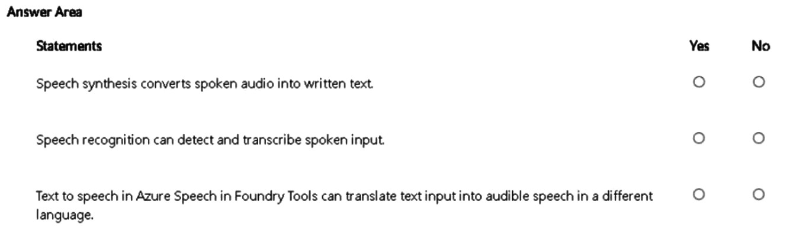

_HOTSPOT — the original ExamTopics question expects you to mark areas on the exhibit above; the correct hotspot coordinates are not published._

**Most voted:**
- The third statement is true.
- The Azure Speech service (which is part of Microsoft's Foundry Tools) offers advanced capabilities that allow you to convert text input in one language into audible speech in another language. This can be done in several ways.

### Top explanations
- **mk2501** (5 upvotes): The third statement is true.
  The Azure Speech service (which is part of Microsoft's Foundry Tools) offers advanced capabilities that allow you to convert text input in one language into audible speech in another language. This can be done in several ways.
- **Jedi_Jeremy** (1 upvotes): For an exam question, the answer is usually: No, Text-to-Speech by itself does not translate text.
  Text-to-Speech (TTS) takes text that is already in a language and converts it to spoken audio in that same language.
  Translation is a separate capability. Azure Speech provides speech translation services that can translate content and then output translated text and/or synthesized speech
- **Gareth Johnson** (1 upvotes [Most Recent]): third is No, its a trick Text-to-speech in Azure Speech converts text into audible speech in the voice/locale you select; it does not itself translate the text into a different language. Translation is performed by Speech Translation (which takes audio input) or Azure Translator, after which the translated text can be synthesized to speech.

## Q1.127 (ID 426683)

HOTSPOT
Select the answer that correctly completes the sentence.

**Exhibits**
- Exhibit 1: 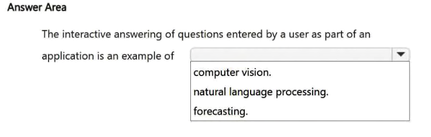

_HOTSPOT — the original ExamTopics question expects you to mark areas on the exhibit above; the correct hotspot coordinates are not published._

**Most voted:** I would say it's the correct answer by process of elimination. The other 2 make no sense so you are left with NLP.

### Top explanations
- **seoyeon_01** (2 upvotes [Most Recent]): Can someone explain why this answer holds true?
- **michael24** (1 upvotes): I would say it's the correct answer by process of elimination. The other 2 make no sense so you are left with NLP.

## Q1.132 (ID 430914)

HOTSPOT
Select the answer that correctly completes the sentence.

**Exhibits**
- Exhibit 1: 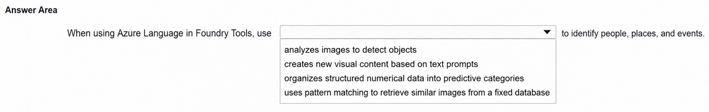

_HOTSPOT — the original ExamTopics question expects you to mark areas on the exhibit above; the correct hotspot coordinates are not published._

**Most voted:** This is the same as question above only the choices are different. Named Entity Recognition is the correct answer

### Top explanations
- **girmaye0** (1 upvotes [Most Recent]): None of those visible options match the question.
  For Azure Language / Language Understanding, the correct capability is:
  ✅ Named Entity Recognition (NER)
- **AbhiDon** (1 upvotes): None of the options in the dropdown list correspond to the standard Azure AI Language service function for identifying people, places, and events (which is Named Entity Recognition (NER)).   However, if forced to choose from the provided menu options:   Named Entity Recognition (NER) in Azure AI Language is used to extract entities such as people, locations (places), and events from unstructured text.   The options shown in the image refer to computer vision, generative AI, machine learning classification, and image retrieval tasks.   If this is a multiple-choice question with incorrect options listed, the correct feature name to complete the sentence is Named Entity Recognition (NER).
- **Jedi_Jeremy** (1 upvotes): This is the same as question above only the choices are different. Named Entity Recognition is the correct answer

## Q1.148 (ID 430902)

Which feature of the Azure Language in Foundry Tools service should you use to automate the masking of names and phone numbers in text data?

✅ **A.** Personally Identifiable Information (PII) detection
⭕ **B.** custom text classification
⭕ **C.** entity linking
⭕ **D.** custom named entity recognition (NER)

**Correct answer:** A
**Most voted:** A

### Top explanations
- **Zackuberdoop** (1 upvotes [Most Recent, Selected Answer: A]): Together we will pass this exam!
- **BabiRahul** (1 upvotes [Selected Answer: A]): Correct Answer: A. Personally Identifiable Information (PII) detection
  Why? PII Detection in Azure AI Language (Foundry Tools) is specifically designed to:
  Detect sensitive information such as names, phone numbers, email addresses, credit card numbers, and other personal data.
  Redact or mask the detected information automatically.
  Why the others are incorrect:
  B. Custom text classification → Categorizes text into predefined classes; it does not identify and mask personal data.
  C. Entity linking → Connects recognized entities to a knowledge base (for example, linking "Microsoft" to the Microsoft organization).
  D. Custom Named Entity Recognition (NER) → Identifies custom entities but does not provide built-in PII detection and redaction capabilities.
- **BabiRahul** (1 upvotes [Selected Answer: A]): Correct Answer: A. Personally Identifiable Information (PII) detection
  Why? PII Detection in Azure AI Language (Foundry Tools) is specifically designed to:
  Detect sensitive information such as names, phone numbers, email addresses, credit card numbers, and other personal data.
  Redact or mask the detected information automatically.
  Why the others are incorrect:
  B. Custom text classification → Categorizes text into predefined classes; it does not identify and mask personal data.
  C. Entity linking → Connects recognized entities to a knowledge base (for example, linking "Microsoft" to the Microsoft organization).
  D. Custom Named Entity Recognition (NER) → Identifies custom entities but does not provide built-in PII detection and redaction capabilities.
- **8ae956d** (1 upvotes [Selected Answer: A]): I belive that PII is the correct answer:
  https://learn.microsoft.com/en-us/azure/ai-services/language-service/personally-identifiable-information/overview
