# DP-600 Implementing Analytics Solutions Using Microsoft Fabric Study Guide

_199 questions generated from ExamTopics discussions._

**Official Exam & Registration:** [Register for DP-600 on Microsoft Learn](https://learn.microsoft.com/en-us/credentials/certifications/fabric-analytics-engineer-associate/?practice-assessment-type=certification)

## Table of contents

- [Q1.1](#q1-1)
- [Q1.20](#q1-20)
- [Q1.24](#q1-24)
- [Q1.34](#q1-34)
- [Q1.35](#q1-35)
- [Q1.38](#q1-38)
- [Q1.41](#q1-41)
- [Q1.42](#q1-42)
- [Q1.50](#q1-50)
- [Q1.68](#q1-68)
- [Q1.77](#q1-77)
- [Q1.86](#q1-86)
- [Q1.93](#q1-93)
- [Q1.98](#q1-98)
- [Q1.124](#q1-124)
- [Q1.131](#q1-131)
- [Q1.135](#q1-135)
- [Q1.142](#q1-142)
- [Q1.150](#q1-150)
- [Q1.151](#q1-151)
- [Q1.153](#q1-153)
- [Q1.154](#q1-154)
- [Q1.155](#q1-155)
- [Q1.157](#q1-157)
- [Q1.167](#q1-167)
- [Q1.168](#q1-168)
- [Q1.170](#q1-170)
- [Q1.181](#q1-181)
- [Q1.182](#q1-182)
- [Q1.192](#q1-192)
- [Q1.194](#q1-194)
- [Q2.2](#q2-2)
- [Q2.3](#q2-3)
- [Q2.4](#q2-4)
- [Q2.5](#q2-5)
- [Q2.6](#q2-6)
- [Q2.7](#q2-7)
- [Q2.8](#q2-8)
- [Q2.9](#q2-9)
- [Q2.10](#q2-10)
- [Q2.11](#q2-11)
- [Q2.13](#q2-13)
- [Q2.14](#q2-14)
- [Q2.15](#q2-15)
- [Q2.16](#q2-16)
- [Q2.18](#q2-18)
- [Q2.19](#q2-19)
- [Q2.23](#q2-23)
- [Q2.31](#q2-31)
- [Q2.36](#q2-36)
- [Q2.37](#q2-37)
- [Q2.40](#q2-40)
- [Q2.43](#q2-43)
- [Q2.44](#q2-44)
- [Q2.45](#q2-45)
- [Q2.46](#q2-46)
- [Q2.47](#q2-47)
- [Q2.48](#q2-48)
- [Q2.49](#q2-49)
- [Q2.51](#q2-51)
- [Q2.53](#q2-53)
- [Q2.54](#q2-54)
- [Q2.55](#q2-55)
- [Q2.56](#q2-56)
- [Q2.57](#q2-57)
- [Q2.58](#q2-58)
- [Q2.59](#q2-59)
- [Q2.60](#q2-60)
- [Q2.62](#q2-62)
- [Q2.63](#q2-63)
- [Q2.67](#q2-67)
- [Q2.70](#q2-70)
- [Q2.71](#q2-71)
- [Q2.72](#q2-72)
- [Q2.73](#q2-73)
- [Q2.74](#q2-74)
- [Q2.75](#q2-75)
- [Q2.76](#q2-76)
- [Q2.78](#q2-78)
- [Q2.79](#q2-79)
- [Q2.80](#q2-80)
- [Q2.82](#q2-82)
- [Q2.83](#q2-83)
- [Q2.84](#q2-84)
- [Q2.85](#q2-85)
- [Q2.88](#q2-88)
- [Q2.94](#q2-94)
- [Q2.95](#q2-95)
- [Q2.96](#q2-96)
- [Q2.97](#q2-97)
- [Q2.99](#q2-99)
- [Q2.101](#q2-101)
- [Q2.102](#q2-102)
- [Q2.103](#q2-103)
- [Q2.104](#q2-104)
- [Q2.105](#q2-105)
- [Q2.106](#q2-106)
- [Q2.107](#q2-107)
- [Q2.108](#q2-108)
- [Q2.109](#q2-109)
- [Q2.111](#q2-111)
- [Q2.112](#q2-112)
- [Q2.113](#q2-113)
- [Q2.114](#q2-114)
- [Q2.116](#q2-116)
- [Q2.117](#q2-117)
- [Q2.119](#q2-119)
- [Q2.121](#q2-121)
- [Q2.122](#q2-122)
- [Q2.123](#q2-123)
- [Q2.125](#q2-125)
- [Q2.126](#q2-126)
- [Q2.128](#q2-128)
- [Q2.131](#q2-131)
- [Q2.132](#q2-132)
- [Q2.136](#q2-136)
- [Q2.137](#q2-137)
- [Q2.138](#q2-138)
- [Q2.139](#q2-139)
- [Q2.146](#q2-146)
- [Q2.147](#q2-147)
- [Q2.149](#q2-149)
- [Q2.158](#q2-158)
- [Q2.159](#q2-159)
- [Q2.160](#q2-160)
- [Q2.161](#q2-161)
- [Q2.162](#q2-162)
- [Q2.166](#q2-166)
- [Q2.169](#q2-169)
- [Q2.171](#q2-171)
- [Q2.172](#q2-172)
- [Q2.173](#q2-173)
- [Q2.174](#q2-174)
- [Q2.175](#q2-175)
- [Q2.176](#q2-176)
- [Q2.177](#q2-177)
- [Q2.178](#q2-178)
- [Q2.179](#q2-179)
- [Q2.184](#q2-184)
- [Q2.186](#q2-186)
- [Q2.187](#q2-187)
- [Q2.188](#q2-188)
- [Q2.190](#q2-190)
- [Q2.191](#q2-191)
- [Q2.193](#q2-193)
- [Q2.197](#q2-197)
- [Q2.198](#q2-198)
- [Q3.12](#q3-12)
- [Q3.17](#q3-17)
- [Q3.21](#q3-21)
- [Q3.22](#q3-22)
- [Q3.25](#q3-25)
- [Q3.26](#q3-26)
- [Q3.27](#q3-27)
- [Q3.28](#q3-28)
- [Q3.29](#q3-29)
- [Q3.30](#q3-30)
- [Q3.32](#q3-32)
- [Q3.33](#q3-33)
- [Q3.52](#q3-52)
- [Q3.61](#q3-61)
- [Q3.64](#q3-64)
- [Q3.65](#q3-65)
- [Q3.66](#q3-66)
- [Q3.69](#q3-69)
- [Q3.81](#q3-81)
- [Q3.87](#q3-87)
- [Q3.89](#q3-89)
- [Q3.90](#q3-90)
- [Q3.91](#q3-91)
- [Q3.92](#q3-92)
- [Q3.100](#q3-100)
- [Q3.110](#q3-110)
- [Q3.115](#q3-115)
- [Q3.118](#q3-118)
- [Q3.120](#q3-120)
- [Q3.127](#q3-127)
- [Q3.129](#q3-129)
- [Q3.130](#q3-130)
- [Q3.133](#q3-133)
- [Q3.134](#q3-134)
- [Q3.140](#q3-140)
- [Q3.141](#q3-141)
- [Q3.143](#q3-143)
- [Q3.144](#q3-144)
- [Q3.145](#q3-145)
- [Q3.148](#q3-148)
- [Q3.152](#q3-152)
- [Q3.156](#q3-156)
- [Q3.163](#q3-163)
- [Q3.164](#q3-164)
- [Q3.165](#q3-165)
- [Q3.180](#q3-180)
- [Q3.183](#q3-183)
- [Q3.185](#q3-185)
- [Q3.189](#q3-189)
- [Q3.195](#q3-195)
- [Q3.196](#q3-196)
- [Q3.216](#q3-216)

## Q1.1 (ID 911291)

Overview -
Contoso, Ltd. is a US-based health supplements company. Contoso has two divisions named Sales and Research. The Sales division contains two departments named Online Sales and Retail Sales. The Research division assigns internally developed product lines to individual teams of researchers and analysts.
Existing Environment -
Identity Environment -
Contoso has a Microsoft Entra tenant named contoso.com. The tenant contains two groups named ResearchReviewersGroup1 and ResearchReviewersGroup2.
Data Environment -
Contoso has the following data environment:
The Sales division uses a Microsoft Power BI Premium capacity.
The semantic model of the Online Sales department includes a fact table named Orders that uses Import made. In the system of origin, the OrderID value represents the sequence in which orders are created.
The Research department uses an on-premises, third-party data warehousing product.
Fabric is enabled for contoso.com.
An Azure Data Lake Storage Gen2 storage account named storage1 contains Research division data for a product line named Productline1. The data is in the delta format.
A Data Lake Storage Gen2 storage account named storage2 contains Research division data for a product line named Productline2. The data is in the CSV format.
Requirements -
Planned Changes -
Contoso plans to make the following changes:
Enable support for Fabric in the Power BI Premium capacity used by the Sales division.
Make all the data for the Sales division and the Research division available in Fabric.
For the Research division, create two Fabric workspaces named Productline1ws and Productine2ws.
In Productline1ws, create a lakehouse named Lakehouse1.
In Lakehouse1, create a shortcut to storage1 named ResearchProduct.
Data Analytics Requirements -
Contoso identifies the following data analytics requirements:
All the workspaces for the Sales division and the Research division must support all Fabric experiences.
The Research division workspaces must use a dedicated, on-demand capacity that has per-minute billing.
The Research division workspaces must be grouped together logically to support OneLake data hub filtering based on the department name.
For the Research division workspaces, the members of ResearchReviewersGroup1 must be able to read lakehouse and warehouse data and shortcuts by using SQL endpoints.
For the Research division workspaces, the members of ResearchReviewersGroup2 must be able to read lakehouse data by using Lakehouse explorer.
All the semantic models and reports for the Research division must use version control that supports branching.
Data Preparation Requirements -
Contoso identifies the following data preparation requirements:
The Research division data for Productline1 must be retrieved from Lakehouse1 by using Fabric notebooks.
All the Research division data in the lakehouses must be presented as managed tables in Lakehouse explorer.
Semantic Model Requirements -
Contoso identifies the following requirements for implementing and managing semantic models:
The number of rows added to the Orders table during refreshes must be minimized.
The semantic models in the Research division workspaces must use Direct Lake mode.
General Requirements -
Contoso identifies the following high-level requirements that must be considered for all solutions:
Follow the principle of least privilege when applicable.
Minimize implementation and maintenance effort when possible.
You need to ensure that Contoso can use version control to meet the data analytics requirements and the general requirements.
What should you do?

⭕ **A.** Store at the semantic models and reports in Data Lake Gen2 storage.
⭕ **B.** Modify the settings of the Research workspaces to use a GitHub repository.
✅ **C.** Modify the settings of the Research division workspaces to use an Azure Repos repository.
⭕ **D.** Store all the semantic models and reports in Microsoft OneDrive.

**Correct answer:** C
**Most voted:** C

### Top explanations
- **Nicofr** (17 upvotes [Highly Voted]): "Currently, only Git in Azure Repos is supported." https://learn.microsoft.com/en-us/fabric/cicd/git-integration/intro-to-git-integration#considerations-and-limitations
- **stilferx** (9 upvotes [Highly Voted]): IMHO, the Azure Repos is the answer.
  
  It is directly mentioned here:
  https://learn.microsoft.com/en-us/fabric/cicd/git-integration/intro-to-git-integration
  Considerations and limitations
  Currently, only Git in Azure Repos with the same tenant as the Fabric tenant is supported.
  If the workspace and Git repo are in two different geographical regions, the tenant admin must enable cross-geo exports.
  Azure DevOps on-prem isn't supported.
  Sovereign clouds aren't supported.
- **Nefirs** (5 upvotes): dont trust the revealed "correct answer", always check the discussion. 
  I guess the "correct answer" is from the person who took the exam or whatever and uploaded the question and answer sheets. Of course no one except Microsoft knows the real correct answers to these questions.
- **VAzureD** (5 upvotes): Option C
  A. Storing semantic models and reports in Data Lake Gen2 storage might provide a storage solution, but it does not address the requirement for version control.
  B. While GitHub is a popular version control platform and supports branching, it may not integrate seamlessly with Contoso's Azure-based environment.
  D. Microsoft OneDrive is primarily a file hosting service and is not well-suited for version control of complex datasets, semantic models, and reports.
- **David_Webb** (4 upvotes): C as only Git in Azure Repos is supported currently.
  https://learn.microsoft.com/en-us/fabric/cicd/git-integration/intro-to-git-integration#considerations-and-limitations

## Q1.20 (ID 911310)

You have a Fabric tenant named Tenant1 that contains a workspace named WS1. WS1 uses a capacity named C1 and contains a dataset named DS1.
You need to ensure read-write access to DS1 is available by using XMLA endpoint.
What should be modified first?

⭕ **A.** the DS1 settings
⭕ **B.** the WS1 settings
✅ **C.** the C1 settings
⭕ **D.** the Tenant1 settings

**Correct answer:** C
**Most voted:** C

### Top explanations
- **a_51** (27 upvotes [Highly Voted]): As XMLA is set to Read-Only first, you must go to the capacity settings to enable read-write.
  https://learn.microsoft.com/en-us/power-bi/enterprise/service-premium-connect-tools#enable-xmla-read-write
- **STH** (11 upvotes [Highly Voted]): The question concerns changing from read-only to read-write (in the Capacity settings), not about enabling XMLA endpoints (in the Tenant settings), which, as per the query, are already set up.
- **Jons123son** (4 upvotes): The questions asked what should be modified FIRST. Therefore, I would go with D because C requires that D is activated. Although, I am not sure if D is not activated by default, thus making C the ONLY modification required.
  I hate it when MS exam questions leave room for interpretation. Why don't they ask for two answers...
  
  Weirdly enough Questions 21 covers basically the same topic and there people agree that Tenant settings are definitely required next to capacity settings.
- **thuss** (4 upvotes): Again, bad wording in the question. If it is specifically about read-write, it's C. If it's about having XMLA endpoints available in the first place, it's D. Judging by Microsoft's wordings and ways of referring to their own documentation, I guess they want us to go for C.
- **wojciech_wie** (3 upvotes): C1 
  https://learn.microsoft.com/en-us/power-bi/enterprise/service-premium-connect-tools

## Q1.24 (ID 911314)

You plan to deploy Microsoft Power BI items by using Fabric deployment pipelines. You have a deployment pipeline that contains three stages named Development, Test, and Production. A workspace is assigned to each stage.
You need to provide Power BI developers with access to the pipeline. The solution must meet the following requirements:
Ensure that the developers can deploy items to the workspaces for Development and Test.
Prevent the developers from deploying items to the workspace for Production.
Follow the principle of least privilege.
Which three levels of access should you assign to the developers? Each correct answer presents part of the solution.
NOTE: Each correct answer is worth one point.

⭕ **A.** Build permission to the production semantic models
✅ **B.** Admin access to the deployment pipeline
⭕ **C.** Viewer access to the Development and Test workspaces
✅ **D.** Viewer access to the Production workspace
✅ **E.** Contributor access to the Development and Test workspaces
⭕ **F.** Contributor access to the Production workspace

**Correct answer:** B, D, E
**Most voted:** BDE

### Top explanations
- **sraakesh95** (27 upvotes [Highly Voted]): As pointed out by XiltroX,
  B - Admin access is provided to the developers for the developers to manage the deployent process across the various stages (in this case Dev and Test). This is a basic necessary.
  
  D - To restrict the access on the Production workspace, provide an overriding Viewer access which lets the developers only view the Production environment and not make any changes.
  
  E - This is to provide the developers with the permissions to develop, edit and update the Dev and Test pipelines.
- **XiltroX** (4 upvotes): I think the answer should be BDE. If you have contributer access to the workspace, then you don't need to assign an additional viewer access (C) to the developers. One of the requirements is to grant access to the pipeline and the only option that fulfills that is (B). D and E fulfill the rest of the requirements in the question.
- **estrelle2008** (4 upvotes): I think build permission to the production semantic model, conflicts with requirement that any changes to the Production workspace should be prevented.
  If question really requires 3 answers, I think both Viewer access (C) and Contributor access (E) can coexist effectively for the Development and Test workspaces.
- **72bd3bc** (3 upvotes): I see that contributors aren't able to deploy. Only members
  
  Workspace contributor
  (and pipeline admin)	
  Consume content​
  Compare stages
  View semantic models
  Unassign a workspace from a stage
  
  Workspace member
  (and pipeline admin)	
  View workspace content​
  Compare stages
  Deploy items (must be a member or admin of both source and target workspaces)
  Update semantic models
  Unassign a workspace from a stage
  Configure semantic model rules (you must be the semantic model owner)
  
  https://learn.microsoft.com/en-us/fabric/cicd/deployment-pipelines/understand-the-deployment-process#permissions-table
- **thuss** (3 upvotes): I get a feeling the "trick" is making you think that B would allow publishing on Prod, but I think if you don't give them access to the workspace, they can indeed have admin rights on the build pipeline but not deploy on Prod? So BDE would be my guess. Also B is the only option granting access to the pipeline at all, and D and E are a must.

## Q1.34 (ID 911324)

HOTSPOT -
You have a Fabric tenant that contains two lakehouses.
You are building a dataflow that will combine data from the lakehouses. The applied steps from one of the queries in the dataflow is shown in the following exhibit.
Use the drop-down menus to select the answer choice that completes each statement based on the information presented in the graphic.
NOTE: Each correct selection is worth one point.

**Exhibits**
- Exhibit 1: 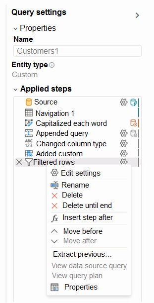
- Exhibit 2: 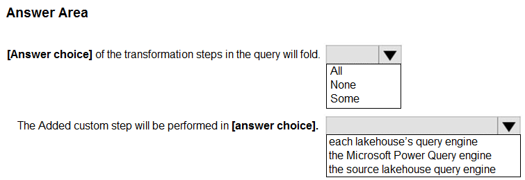

_HOTSPOT — the original ExamTopics question expects you to mark areas on the exhibit above; the correct hotspot coordinates are not published._

**Most voted:**
- 1: Some.blue icone fold and red dont fold
- 2 : on power query. all process after the step that dont fold are on power query

### Top explanations
- **Momoanwar** (28 upvotes [Highly Voted]): 1: Some.blue icone fold and red dont fold
  2 : on power query. all process after the step that dont fold are on power query
- **SamuComqi** (7 upvotes [Highly Voted]): The red icon suggests where query folding is interrupted, therefore only SOME steps are folded. All the other steps after the red icon will not fold and will be executed by the POWER QUERY engine.
- **a_51** (5 upvotes): Correct as shown. If the query folded the work is pushed to the data source. the icons help to tell you if folding is occurring or not.
  
  https://learn.microsoft.com/en-us/power-query/step-folding-indicators#step-diagnostics-indicators
- **Spam_Account** (3 upvotes): Isn't query folding when the query steps are pushed back into the engine, in order to optimise queries? This isn't happening at all, since the red icon occurs immediately after the navigation step. So the entire query WILL necessarily be pulled into power query, so no query folding will occur.
- **NewB87** (3 upvotes): Reference in MS Learn: 
  https://learn.microsoft.com/en-us/power-query/step-folding-indicators

## Q1.35 (ID 911325)

You have a Fabric tenant that contains a lakehouse named Lakehouse’. Lakehouse1 contains a table named Tablet.
You are creating a new data pipeline.
You plan to copy external data to Table’. The schema of the external data changes regularly.
You need the copy operation to meet the following requirements:
Replace Table1 with the schema of the external data.
Replace all the data in Table1 with the rows in the external data.
You add a Copy data activity to the pipeline.
What should you do for the Copy data activity?

⭕ **A.** From the Source tab, add additional columns.
✅ **B.** From the Destination tab, set Table action to Overwrite.
⭕ **C.** From the Settings tab, select Enable staging.
⭕ **D.** From the Source tab, select Enable partition discovery.
⭕ **E.** From the Source tab, select Recursively.

**Correct answer:** B
**Most voted:** B

### Top explanations
- **Momoanwar** (8 upvotes [Highly Voted]): Replace all with overwrite
- **Nefirs** (3 upvotes): this answer option is not available. Additionally, truncate a table does only delete the data but does not touch schema.
- **2dc6125** (2 upvotes): B Since the plan is to drop the destination schema and replace it with data source schema.
- **IshtarSQL** (2 upvotes): Correct: Enable "Truncate table" option: This option truncates the target table before copying data, ensuring that all existing data is replaced with the new data from the external source.
- **Egocentric** (1 upvotes [Most Recent]): Destination tab set table action to overwrite

## Q1.38 (ID 911328)

You have a Fabric tenant that contains a lakehouse named Lakehouse1. Lakehouse1 contains an unpartitioned table named Table1.
You plan to copy data to Table1 and partition the table based on a date column in the source data.
You create a Copy activity to copy the data to Table1.
You need to specify the partition column in the Destination settings of the Copy activity.
What should you do first?

⭕ **A.** From the Destination tab, set Mode to Append.
⭕ **B.** From the Destination tab, select the partition column.
⭕ **C.** From the Source tab, select Enable partition discovery.
✅ **D.** From the Destination tabs, set Mode to Overwrite.

**Correct answer:** D
**Most voted:** D

### Top explanations
- **SamuComqi** (15 upvotes [Highly Voted]): D. From the Destination tabs, set Mode to Overwrite.
  
  When setting up the Copy Activity, you need to choose the Overwrite mode to make the partition option appear (not visibile in Append mode).
- **VAzureD** (7 upvotes [Highly Voted]): D. From the Destination tabs, set Mode to Overwrite.
  
  https://learn.microsoft.com/en-us/fabric/data-factory/tutorial-lakehouse-partition#load-data-to-lakehouse-using-partition-columns
  
  Expand Advanced, in Table action, select Overwrite, and then select Enable partition, under Partition columns, select Add column, and choose the column you want to use as the partition column. You can choose to use a single column or multiple columns as the partition column.
- **estrelle2008** (6 upvotes): A makes no sense, it leaves data that is already in table1 unpartitioned
  B makes no sense, it is the statement that you are asked to decide for the step before that. 
  C MIGHT assign date column in source data as requested partition column, but only and if source data is complete and unambiguous
  D re-creates table1, ensuring that the partitioning is applied consistently.
  
  Hoping that the data that is already in table1 is also in this source data, D should be recommended answer, I guess?
- **Pegooli** (4 upvotes): In Microsoft Fabric, partitioning a table during a Copy activity is only supported in "Append" mode, not "Overwrite" mode.
- **stilferx** (4 upvotes): IMHO, the answer is "D".
  
  Because:
  Expand Advanced, in Table action, select Overwrite, and then select Enable partition, under Partition columns, select Add column, and choose the column you want to use as the partition column. You can choose to use a single column or multiple columns as the partition column.
  
  in https://learn.microsoft.com/en-us/fabric/data-factory/tutorial-lakehouse-partition#load-data-to-lakehouse-using-partition-columns

## Q1.41 (ID 911331)

HOTSPOT -
You have a Fabric tenant that contains a lakehouse.
You are using a Fabric notebook to save a large DataFrame by using the following code. df.write.partitionBy(“year”, “month”, “day”).mode(“overwrite”).parquet(“Files/SalesOrder”)
For each of the following statements, select Yes if the statement is true. Otherwise, select No.
NOTE: Each correct selection is worth one point.

**Exhibits**
- Exhibit 1: 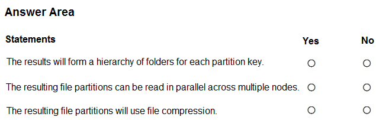

_HOTSPOT — the original ExamTopics question expects you to mark areas on the exhibit above; the correct hotspot coordinates are not published._

**Most voted:**
- Yes: When using partitionBy in Spark, the data is organized into a hierarchical directory structure based on the specified partition keys. Therefore, you will see directories like year=YYYY/month=MM/day=DD within the specified output path.
- Yes: Parquet files are designed for efficient querying and support parallel processing. Spark can read these partitions in parallel, enabling distributed query execution across multiple nodes.
- No: While Parquet format supports compression, it is not enabled by default in the code snippet provided. Compression needs to be explicitly specified if required. For example, you could use .option("compression", "snappy") to enable Snappy compression.

### Top explanations
- **Momoanwar** (39 upvotes [Highly Voted]): I think yes yes yes. 
  Parquet= compression
- **estrelle2008** (8 upvotes [Highly Voted]): I think so too: YYY
  code snippet according to Learn
- **Blue_MSBI** (7 upvotes): I think the same
- **vernillen** (6 upvotes): Snappy is the default compression type of parquet, though. So it will create chunks of your file by default and compress them. If you want to have it all in one file, that's when you have to overwrite your default compression. So I disagree with the 'No'
- **estrelle2008** (5 upvotes): additional: Parquet files are compressed by default, and you don’t need to take any additional actions to enable compression. When writing Parquet files, you can specify the desired compression codec (if needed) to further optimize storage and performance

## Q1.42 (ID 911332)

You have a Fabric workspace named Workspace1 that contains a data flow named Dataflow1 contains a query that returns the data shown in the following exhibit.
You need to transform the data columns into attribute-value pairs, where columns become rows.
You select the VendorID column.
Which transformation should you select from the context menu of the VendorID column?

**Exhibits**
- Exhibit 1: 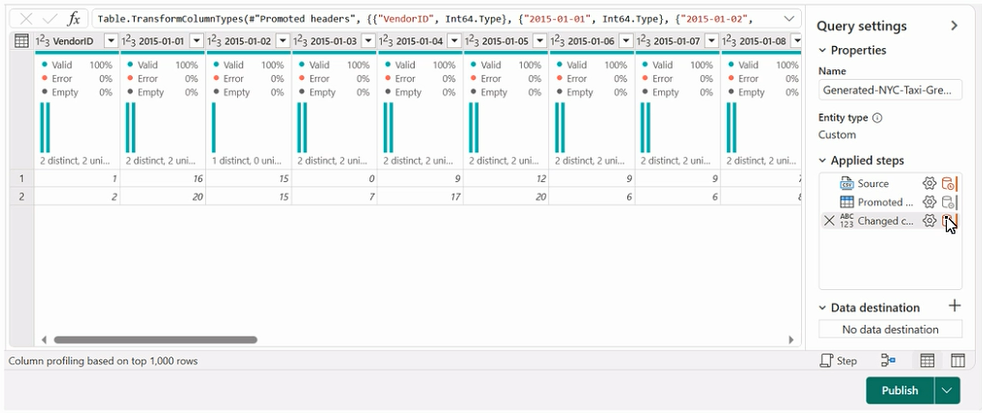

⭕ **A.** Group by
⭕ **B.** Unpivot columns
✅ **C.** Unpivot other columns
⭕ **D.** Split column
⭕ **E.** Remove other columns

**Correct answer:** C
**Most voted:** C

### Top explanations
- **Momoanwar** (11 upvotes [Highly Voted]): Correct
- **stilferx** (3 upvotes [Most Recent]): IMHO, "C",
  
  Because of: Unpivot other columns
   This command unpivots unselected columns. Use this command in a query when not all columns are known. New columns added during a refresh operation are also unpivoted.
  
  description is here: https://support.microsoft.com/en-us/office/unpivot-columns-power-query-0f7bad4b-9ea1-49c1-9d95-f588221c7098#:~:text=Select%20the%20columns%20you%20do,Transform%20%3E%20Unpivot%20Only%20Selected%20Columns.
- **XiltroX** (3 upvotes): C is the correct answer
- **Nefirs** (1 upvotes): clearly C

## Q1.50 (ID 911340)

HOTSPOT -
You have a Fabric workspace named Workspace1 and an Azure Data Lake Storage Gen2 account named storage1. Workspace1 contains a lakehouse named Lakehouse1.
You need to create a shortcut to storage1 in Lakehouse1.
Which connection and endpoint should you specify? To answer, select the appropriate options in the answer area.
NOTE: Each correct selection is worth one point.

**Exhibits**
- Exhibit 1: 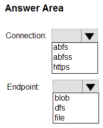

_HOTSPOT — the original ExamTopics question expects you to mark areas on the exhibit above; the correct hotspot coordinates are not published._

**Most voted:** • Connection (abfss): The abfss (Azure Blob File System Secure) protocol is used for secure connections to Azure Data Lake Storage Gen2. This protocol ensures that the connection is encrypted, providing a secure method to access the storage.

### Top explanations
- **wellingtonluis** (43 upvotes [Highly Voted]): HTTPS, DFS
  https://learn.microsoft.com/en-us/fabric/onelake/create-adls-shortcut
- **Felgas** (12 upvotes [Highly Voted]): It's asking to create a shortcut in the lakehouse. To do that, the URL should be https://adls.dfs.core.windows.net/file.
  To access the shortcut in Fabric, you use the abfss path
- **282b85d** (8 upvotes): • Connection (abfss): The abfss (Azure Blob File System Secure) protocol is used for secure connections to Azure Data Lake Storage Gen2. This protocol ensures that the connection is encrypted, providing a secure method to access the storage.
  • Endpoint (dfs): The dfs (Data Lake Storage) endpoint is used to connect to the hierarchical namespace of Azure Data Lake Storage Gen2, which is optimized for big data analytics workloads. It allows for file and directory-based operations, making it suitable for data lake scenarios.
- **ca63a55** (7 upvotes): I have just passed the exam, instead of 'connection' the question said: 'protocol'
- **testtaker45** (5 upvotes): Someone give WellingtonLuis a medal for this answer. Spot on. 
  So if we are working in apache spark, we would use the abfss protocol. 
  As we are creating the shortcut in Fabric the protocol is https, and the endpoint is dfs.core.windows.net. I had to go deep to figure this out, and your documentation was very helpful.

## Q1.68 (ID 916070)

HOTSPOT
You have a Fabric tenant.
You need to configure OneLake security for users shown in the following table.
The solution must follow the principle of least privilege.
Which permission should you assign to each user? To answer, select the appropriate options in the answer area.
NOTE: Each correct selection is worth one point.

**Exhibits**
- Exhibit 1: 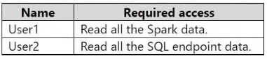
- Exhibit 2: 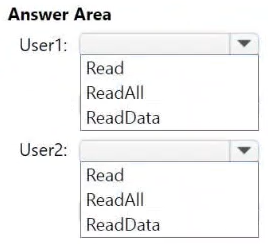

_HOTSPOT — the original ExamTopics question expects you to mark areas on the exhibit above; the correct hotspot coordinates are not published._

**Most voted:**
- Req: user1 - spark → ReadAll, user 2 - SQL endpoint -> ReadData.
- Roles: ReadData permission on SQL endpoint to access data without SQL policy.

### Top explanations
- **neoverma** (18 upvotes [Highly Voted]): Correct! ReadAll and readData
  https://learn.microsoft.com/en-us/fabric/data-engineering/lakehouse-sharing#sharing-and-permissions
- **stilferx** (5 upvotes [Highly Voted]): IMHO,
  
  Req: user1 - spark -> **ReadAll**, user 2 - SQL endpoint -> **ReadData**.
  
  Roles: 
  ReadData permission on SQL endpoint to access data without SQL policy.
  ReadAll permission on the lakehouse to access all data using Apache Spark.
  from https://learn.microsoft.com/en-us/fabric/data-engineering/lakehouse-sharing#sharing-and-permissions
- **282b85d** (3 upvotes): • User1: Assign ReadAll. This is because User1 needs to read all Spark data, which would require broad access across multiple datasets and objects managed by Spark.
  • User2: Assign ReadData. This permission is more likely to be specific to data endpoints, including SQL endpoints.
- **a998450** (3 upvotes): ReadAll and ReadData is Correct
  https://blog.fabric.microsoft.com/en/blog/lakehouse-sharing-and-access-permission-management?ft=All
- **AbhiShar** (2 upvotes [Most Recent]): the selections of ReadAll for User1 and Read for User2 ensure that each user gets the appropriate level of access according to their stated needs while adhering to the principle of least privilege. ReadData may imply limited access and could restrict User2 from reading all SQL endpoint data effectively.

## Q1.77 (ID 916079)

You have a Fabric tenant that contains a lakehouse named Lakehouse1. Lakehouse1 contains a Delta table that has one million Parquet files.
You need to remove files that were NOT referenced by the table during the past 30 days. The solution must ensure that the transaction log remains consistent, and the ACID properties of the table are maintained.
What should you do?

⭕ **A.** From OneLake file explorer, delete the files.
⭕ **B.** Run the OPTIMIZE command and specify the Z-order parameter.
⭕ **C.** Run the OPTIMIZE command and specify the V-order parameter.
✅ **D.** Run the VACUUM command.

**Correct answer:** D
**Most voted:** D

### Top explanations
- **Nefirs** (10 upvotes [Highly Voted]): D: https://learn.microsoft.com/en-us/fabric/data-engineering/lakehouse-table-maintenance
- **vernillen** (4 upvotes [Most Recent]): Just think of the aspect of a real VACUUM: Cleanup of dust just lying around
- **prabhjot** (4 upvotes): Yes D - To remove files from a Delta table that are no longer referenced by the current version of the table, you should run the VACUUM command.
- **stilferx** (2 upvotes): IMHO, D) Vacuum is good

## Q1.86 (ID 916088)

You have a Fabric tenant.
You plan to create a data pipeline named Pipeline1. Pipeline1 will include two activities that will execute in sequence.
You need to ensure that a failure of the first activity will NOT block the second activity.
Which conditional path should you configure between the first activity and the second activity?

⭕ **A.** Upon Failure
✅ **B.** Upon Completion
⭕ **C.** Upon Skip
⭕ **D.** Upon Skip

**Correct answer:** B
**Most voted:** B

### Top explanations
- **2dc6125** (4 upvotes): B: Upon Complete will move to next activities regardless of its success or failure.
- **Nefirs** (4 upvotes): completion is correct
- **vernillen** (3 upvotes): A: Will only launch the second one if the first one fails, but it's not given that it will ALWAYS fail
  
  C&D: Upon skip -> activity should be executed
- **clux** (2 upvotes): Correct
- **luiruipu** (2 upvotes): B. Its correct

## Q1.93 (ID 916095)

DRAG DROP
You create a semantic model by using Microsoft Power BI Desktop. The model contains one security role named SalesRegionManager and the following tables:
•	Sales
•	SalesRegion
•	SalesAddress
You need to modify the model to ensure that users assigned the SalesRegionManager role cannot see a column named Address in SalesAddress.
Which three actions should you perform in sequence? To answer, move the appropriate actions from the list of actions to the answer area and arrange them in the correct order.

**Exhibits**
- Exhibit 1: 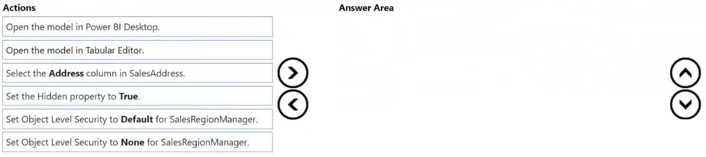

_DRAG DROP — the original ExamTopics question expects you to drag and drop items; the correct targets are not published._

**Most voted:**
- Because: To create roles on Power BI Desktop semantic models, use external tools such as Tabular Editor.
- None: OLS is enforced and the table or column will be hidden from that role
- Read: The table or column will be visible to that role

### Top explanations
- **554b579** (36 upvotes [Highly Voted]): Setting OLS to None:
  When you set OLS to None for a table or column:
  o	For viewers without the appropriate access levels, it’s as if the secured tables or columns don’t exist.
  •	The table or column will be hidden from that role.
  •	Users won’t be able to see or interact with the secured data.
  How To:
  https://www.insightsarena.com/post/mastering-object-level-security-in-power-bi-fixing-broken-visuals#:~:text=Configure%20Object-Level%20Security%3A%201%20In%20Tabular%20Editor%2C%20navigate,need%20to%20be%20restricted%20for%20a%20particular%20role.
  •	In Tabular Editor, navigate to Tables and select the specific column names.
  •	Under Object-Level Security, set the security level to "None" for the role that needs restrictions.
  
  1 Open the model in Tabular Editor
  2 Select the address column in SalesAddress
  3 Set the Object Level Security to None for the sales manager role.
- **e4e2ec8** (7 upvotes [Highly Voted]): Answer is correct; ref: https://learn.microsoft.com/en-us/fabric/security/service-admin-object-level-security?tabs=table
- **stilferx** (2 upvotes): 1) Tabular Editor - Open the Model
  2) Select Address
  3) Object Level Security (OLS) = None
  
  Because: 
  To create roles on Power BI Desktop semantic models, use external tools such as Tabular Editor.
  ...
  Object-level security (OLS) enables model authors to secure specific tables or columns from report viewers.
  ...
  None: OLS is enforced and the table or column will be hidden from that role
  Read: The table or column will be visible to that role
  
  Link: https://learn.microsoft.com/en-us/fabric/security/service-admin-object-level-security?tabs=table
- **282b85d** (1 upvotes [Most Recent]): Not 100% sure, but I would:
  1. Open the model in Tabular Editor.
  2. Select the Address column in SalesAddress.
  3. Set the Hidden property to True.

## Q1.98 (ID 916100)

You have a Fabric notebook that has the Python code and output shown in the following exhibit.
Which type of analytics are you performing?

**Exhibits**
- Exhibit 1: 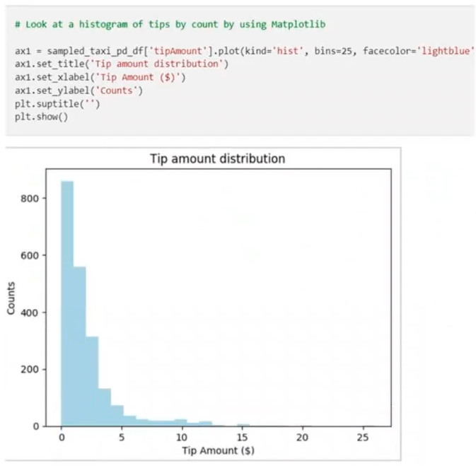

✅ **A.** descriptive
⭕ **B.** diagnostic
⭕ **C.** prescriptive
⭕ **D.** predictive

**Correct answer:** A
**Most voted:** A

### Top explanations
- **stilferx** (4 upvotes): IMHO, definitely A) Descriptive
  
  Link: https://azure.microsoft.com/es-es/blog/answering-whats-happening-whys-happening-and-what-will-happen-with-iot-analytics/
  
  Because of it is "What is happening"
- **Nefirs** (3 upvotes): classic descriptive visual
- **clux** (3 upvotes): Correct

## Q1.124 (ID 934202)

You have an Amazon Web Services (AWS) subscription that contains an Amazon Simple Storage Service (Amazon S3) bucket named bucket1.
You have a Fabric tenant that contains a lakehouse named LH1.
In LH1, you plan to create a OneLake shortcut to bucket1.
You need to configure authentication for the connection.
Which two values should you provide? Each correct answer presents part of the solution.
NOTE: Each correct selection is worth one point.

⭕ **A.** the shared access signature (SAS) token
✅ **B.** the secret access key
⭕ **C.** the access ID
✅ **D.** the access key ID
⭕ **E.** the certificate thumbprint

**Correct answer:** B, D
**Most voted:** BD

### Top explanations
- **Pegooli** (4 upvotes): https://learn.microsoft.com/en-us/fabric/onelake/create-s3-shortcut
- **NikeshShah** (3 upvotes): https://learn.microsoft.com/sl-si/fabric/onelake/create-s3-compatible-shortcut
  Correct Answer BD
- **helmon** (3 upvotes): https://learn.microsoft.com/sl-si/fabric/onelake/create-s3-compatible-shortcut
- **b8ef1c5** (2 upvotes): https://learn.microsoft.com/en-au/fabric/onelake/create-s3-compatible-shortcut#:~:text=Access%20Key%20ID,Your%20secret%20key.

## Q1.131 (ID 936832)

HOTSPOT
You have a Fabric tenant that contains a PySpark notebook named Notebook1.
You define sas_token as a variable in the first cell of Notebook1 and store a shared access signature (SAS) token in the variable.
In the second cell, you run the following code.
For each of the following statements, select Yes if the statement is true. Otherwise, select No.
NOTE: Each correct selection is worth one point.

**Exhibits**
- Exhibit 1: 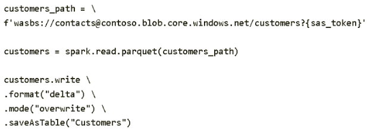
- Exhibit 2: 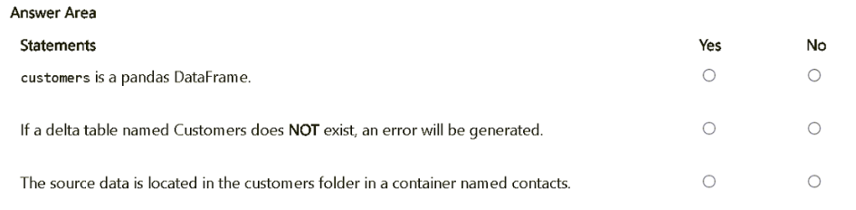

_HOTSPOT — the original ExamTopics question expects you to mark areas on the exhibit above; the correct hotspot coordinates are not published._

**Most voted:** No, No, Yes

### Top explanations
- **b01d700** (11 upvotes [Highly Voted]): Is the correct answer No, No, Yes
- **Lotusss** (9 upvotes [Highly Voted]): No, No, Yes
  1. No. The code `customers = spark.read.parquet(customers_path)` creates a Spark DataFrame, not a Pandas DataFrame.
  
  2. No. The code `customers.write.format("delta").mode("overwrite").saveAsTable("Customers")` will create the Delta table named "Customers" if it does not already exist. The `mode("overwrite")` ensures that the table is created or overwritten if it exists.
  
  3. Yes.  The path `wasbs://
  [email protected]
  /customers?{sas.token}` indicates that the source data is located in the `customers` folder within a container named `contacts` in the Azure Blob Storage account `contoso`.
- **Sr18** (3 upvotes): 1. NO: Spark Data Frame 
  2. NO: It will create one, if already exists then overwrite it
  3. YES: contacts is container and folder is customer
- **Sowwy1** (1 upvotes [Most Recent]): No, no, yes
- **MYPE** (1 upvotes): Yes No No
  1. customers is a pandas dataframe 
  2. no error if the file is saved with another name
  3. the container is not named contacts but customers

## Q1.135 (ID 936836)

You have a Fabric tenant that contains two workspaces named Workspace1 and Workspace2 and a user named User1.
You need to ensure that User1 can perform the following tasks:
•	Create a new domain.
•	Create two subdomains named subdomain1 and subdomain2.
•	Assign Workspace1 to subdomain1.
•	Assign Workspace2 to subdomain2.
The solution must follow the principle of least privilege.
Which role should you assign to User1?

⭕ **A.** domain admin
⭕ **B.** domain contributor
✅ **C.** Fabric admin
⭕ **D.** workspace Admin

**Correct answer:** C
**Most voted:** C

### Top explanations
- **zmeya** (7 upvotes [Highly Voted]): https://learn.microsoft.com/en-us/fabric/governance/domains#create-a-domain
  
  (third line under "Create a domain" section)
- **SVCDIA** (7 upvotes [Highly Voted]): You can only create a new domain as a fabric admin
- **Sowwy1** (1 upvotes [Most Recent]): I think it s A
- **ab483f6** (1 upvotes): Correct Answer: A. Domain admin
  This role provides the necessary permissions to create domains and subdomains and assign workspaces, without granting excessive tenant-level rights.
  
  Answer C is wrong because it has full tenant-level permissions (too much privilege, violates least privilege principle).
- **elimey** (1 upvotes): Create a new domain → Only Domain Admins can create domains
  also
  Principle of least privilege → Assign Domain Admin role only for the domain-related tasks, not Fabric Admin.

## Q1.142 (ID 936843)

You have a Microsoft Power BI project that contains a semantic model.
You plan to use Azure DevOps for version control.
You need to modify the .gitignore file to prevent the data values from the data sources from being pushed to the repository.
Which file should you reference?

⭕ **A.** unappliedChanges.json
✅ **B.** cache.abf
⭕ **C.** localSettings.json
⭕ **D.** model.bim

**Correct answer:** B
**Most voted:** B

### Top explanations
- **pk07** (4 upvotes): B. cache.abf
  Justification: This file contains the cached data for the semantic model. It is a binary file and can be very large. Excluding this file from version control is necessary to prevent pushing large amounts of unnecessary data, and will prevent data from data sources from being pushed to the repository.
  Why it's the correct option: Contains the cached data from the data model.
- **pk07** (3 upvotes): You have a Microsoft Power BI project that contains a semantic model.
  
  You plan to use Azure DevOps for version control.
  
  You need to modify the .gitignore file to prevent the data values from the data sources from being pushed to the repository.
  
  Which file should you reference?
  
  B. cache.abf
- **73f4438** (2 upvotes): A, C, and D options are of JSON format files needed by the project as reference, which makes sense to be in git. B is of binary format type which typically is large in size. Storage of this file might be for other options like git-lfs.
- **Sowwy1** (1 upvotes): I think it s B
- **CamiU** (1 upvotes): When you save as a project, Power BI Desktop saves report and semantic model items as folders, each containing text files that define the item:
  
  Project/
  ├── AdventureWorks.Report/
  ├── AdventureWorks.SemanticModel/
  ├── .gitignore
  └── AdventureWorks.pbip
  
  .gitIgnore
  Specifies intentionally untracked files Git should ignore for Power BI Project files, such as the cache.abf and localSettings.json.
  
  **/.pbi/localSettings.json
  **/.pbi/cache.abf

## Q1.150 (ID 939100)

HOTSPOT
You have a Fabric tenant that contains a workspace named Workspace1. Workspace1 contains a warehouse named DW1. DW1 contains two tables named Employees and Sales. All users have read access to Dw1.
You need to implement access controls to meet the following requirements:
•	For the Sales table, ensure that the users can see only the sales data from their respective region.
•	For the Employees table, restrict access to all Personally Identifiable Information (PII).
•	Maintain access to unrestricted data for all the users.
What should you use for each table? To answer, select the appropriate options in the answer area.
NOTE: Each correct selection is worth one point.

**Exhibits**
- Exhibit 1: 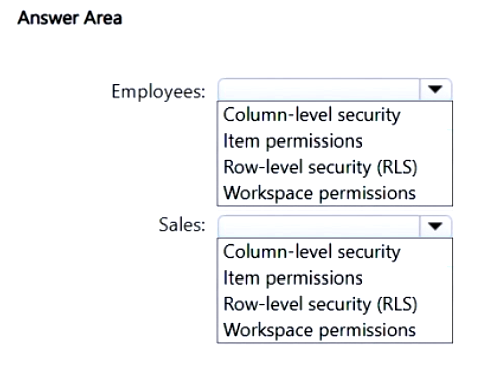

_HOTSPOT — the original ExamTopics question expects you to mark areas on the exhibit above; the correct hotspot coordinates are not published._

**Most voted:**
- Employees: Column-level security
- Column-Level-Security (CLS): "allowing you to restrict column access to protect sensitive data..."
- Sales: Row-Level-Security (RLS)

### Top explanations
- **CHZW** (4 upvotes): Employees: Column-level security: 
  Column-Level-Security (CLS):
  https://learn.microsoft.com/en-us/fabric/data-warehouse/column-level-security
  "allowing you to restrict column access to protect sensitive data..."
  
  Sales: Row-Level-Security (RLS):
  https://learn.microsoft.com/en-us/fabric/data-warehouse/row-level-security
  "control access to rows in a database table. For example, you can ensure that workers access only those data rows that are pertinent to their department." (or Sales Region in this case)
- **testtaker45** (3 upvotes): PII is a classic Column Level Security Problem
  Sales by Region is a classic Row Level Security Problem.

## Q1.151 (ID 939101)

You need to create a Microsoft Power BI file that will be used to create multiple reports. The solution must meet the following requirements:
•	The file must include predefined data source connections.
•	The file must include the report structure and formatting.
•	The file must NOT contain any data.
Which file format should you use?

✅ **A.** PBIT
⭕ **B.** PBIDS
⭕ **C.** PBIX
⭕ **D.** PBIP

**Correct answer:** A
**Most voted:** A

### Top explanations
- **tizian10** (5 upvotes [Highly Voted]): PBIT (Power BI Template File) ✅
  Why?
  A PBIT (Power BI Template file):
  ✔️ Includes predefined data source connections.
  ✔️ Includes report structure and formatting.
  ✔️ Does NOT contain any actual data—only metadata (queries, measures, visual
- **marp94** (3 upvotes): PBIT is a Power BI Template file, which is designed to meet the requirements specified in your question
- **testtaker45** (2 upvotes [Most Recent]): PBIT is the answer for sure.

## Q1.153 (ID 939103)

You have a Fabric tenant that contains a workspace named Workspace1 and a user named User1. User1 is assigned the Contributor role for Workspace1.
You plan to configure Workspace1 to use an Azure DevOps repository for version control.
You need to ensure that User1 can commit items to the repository.
Which two settings should you enable for User1? Each correct answer presents part of the solution.
NOTE: Each correct selection is worth one point.

⭕ **A.** Users can sync workspace items with GitHub repositories
⭕ **B.** Users can create and use Data workflows
✅ **C.** Users can create Fabric items
✅ **D.** Users can synchronize workspace items with their Git repositories

**Correct answer:** C, D
**Most voted:** CD

### Top explanations
- **testtaker45** (10 upvotes [Highly Voted]): C. Users need to be able to Create Fabric Items to satisfy 'User1 can commit Items to the repository. 
  D. They try to trick you with 'GITHUB'. Azure Devops uses GIT, but GITHUB is different. You want to sync your 'GIT Repositories'. Has nothing to do with GITHUB...
- **Sowwy1** (1 upvotes [Most Recent]): I think it s CD
- **solorumore** (1 upvotes): To allow a user like User1 to commit to the Git repository (in this case an Azure DevOps repository), you need specifications that enable synchronization and version control via Git.
  
  A. Users can sync workspace items with GitHub repositories:
  
  This option allows users to link workspace items to a Git repository, including GitHub and Azure DevOps repositories (since Azure DevOps uses the same Git infrastructure).
  You must configure workspace synchronization with an associated repository.
  D. Users can sync workspace items with their Git repositories:
  
  This setting enables synchronization of workspace items with users' Git repository, allowing them to commit and push.
  This feature is essential to ensure that User1 can synchronize his local items with the remote repository.
- **4e5cf3d** (1 upvotes): Im not sure. Github is already supported. 
  You can find both options here:
  https://learn.microsoft.com/en-us/fabric/admin/git-integration-admin-settings

## Q1.154 (ID 939104)

You have a Fabric tenant that contains a workspace named Workspace1. Workspace1 contains a data pipeline named Pipeline1 and a lakehouse named Lakehouse1.
You perform the following actions:
•	Create a workspace named Workspace2.
•	Create a deployment pipeline named DeployPipeline1 that will deploy items from Workspace1 to Workspace2.
•	Add a folder named Folder1 to Workspace1.
•	Move Lakehouse1 to Folder1.
•	Run DeployPipeline1.
Which structure will Workspace2 have when DeployPipeline1 is complete?

⭕ **A.** \Folder1\Pipeline1\Folder1\Lakehouse1
⭕ **B.** \Pipeline1\Lakehouse1
⭕ **C.** \Pipeline1\Folder1\Lakehouse1
✅ **D.** \Folder1\Lakehouse1

**Correct answer:** D
**Most voted:** D

### Top explanations
- **HUSSAIN_ALYAFEI** (10 upvotes [Highly Voted]): Answer: C. \Pipeline1 and \Folder1\Lakehouse1
  
  Reference from Microsoft Documentation:
  https://learn.microsoft.com/en-us/fabric/cicd/deployment-pipelines/understand-the-deployment-process?tabs=new-ui
  
  Under the "Folders in deployment pipelines (preview)" section in the provided text:
  Folders representation:
  "Folders are considered part of an item’s name (an item name includes its full path). When an item is deployed, after its path was changed (moved from folder A to folder B, for example), then Deployment pipelines applies this change to its paired item during deployment - the paired item will be moved as well to folder B. If folder B doesn't exist in the stage we're deploying to, it's created in its workspace first."
- **testtaker45** (7 upvotes [Highly Voted]): It just makes the most sense from the question. Like, the pipeline isn't a folder, and it goes between the workspaces. You have Folder1 added to Workspace1, and then you add Lakehouse1 in Folder1. This gives \Folder1\Lakehouse1.
- **Tika989** (5 upvotes): B. \Pipeline1 \Lakehouse1
  
  Explanation:
  Deployment pipelines in Microsoft Fabric are used to promote items between workspaces (e.g., from Workspace1 to Workspace2).
  Folders are not part of the deployment pipeline process—they are a workspace-level organization feature but do not impact how items are deployed.
  When DeployPipeline1 runs, it will deploy Pipeline1 and Lakehouse1 to Workspace2, but Folder1 will not be replicated.
  Thus, Workspace2 will contain only Pipeline1 and Lakehouse1 at the root level, without Folder1.
- **aks2304** (4 upvotes): The correct answer is D. \Folder1\Lakehouse1.
  
  When you run DeployPipeline1, it will replicate the structure from Workspace1 to Workspace2. Since you moved Lakehouse1 to Folder1 before running the deployment pipeline, Workspace2 will have the following structure:
  
  Workspace2
  Folder1
  Lakehouse1
  Pipeline1 will not be inside Folder1, so it won't be included in the structure of Workspace2 as described in the other options.
- **Devoteam2025** (3 upvotes): In Microsoft Fabric, when you deploy content from one workspace to another using a deployment pipeline, the folder structure is preserved. This means that if you have a folder named Folder1 in Workspace1 containing Lakehouse1, deploying to Workspace2 via DeployPipeline1 will replicate Folder1 and its contents in Workspace2. The folder hierarchy of the deployed items is automatically applied in the target workspace.

## Q1.155 (ID 939105)

Your company has a finance department.
You have a Fabric tenant, an Azure Storage account named storage1, and a Microsoft Entra group named Group1. Group1 contains the users in the finance department.
You need to create a new workspace named Workspace1 in the tenant. The solution must meet the following requirements:
•	Ensure that the finance department users can create and edit items in Workspace1.
•	Ensure that Workspace1 can securely access storage1 to read and write data.
•	Ensure that you are the only admin of Workspace1.
•	Minimize administrative effort.
You create Workspace1.
Which two actions should you perform next? Each correct answer presents part of the solution.
NOTE: Each correct selection is worth one point.

✅ **A.** Assign the Contributor role to Group1.
✅ **B.** Create a workspace identity.
⭕ **C.** Assign the Admin role to yourself.
⭕ **D.** Assign the Contributor role to each finance department user.

**Correct answer:** A, B
**Most voted:** AB

### Top explanations
- **Rahalcer** (4 upvotes): correct :
  A. Assign the Contributor role to Group1:
  Since Group1 already contains all finance department users, assigning the Contributor role to the group grants them the necessary permissions (create and edit items) in Workspace1 with minimal administrative effort. This avoids having to assign roles to each user individually.
  B. Create a workspace identity:
  A workspace identity (or managed identity) allows Workspace1 to securely access external resources like storage1. By creating and configuring a workspace identity, you can grant it the appropriate permissions on storage1 for secure read and write access.
  Additionally, because you created the workspace, you are automatically the admin—meeting the requirement that you are the only admin of Workspace1.
- **aks2304** (2 upvotes): Assign the Contributor role to Group1: This ensures that all finance department users can create and edit items in Workspace1 with minimal administrative effort1.
  Create a workspace identity: This allows Workspace1 to securely access storage1 for reading and writing data.
  These actions will help you maintain control as the sole admin while enabling the finance department to work efficiently.

## Q1.157 (ID 939107)

HOTSPOT
You have a Fabric tenant that contains a workspace named Workspace_DEV. Workspace_DEV contains the semantic models shown in the following table.
Workspace_DEV contains the dataflows shown in the following table.
You create a new workspace named Workspace_TEST.
You create a deployment pipeline named Pipeline1 to move items from Workspace_DEV to Workspace_TEST.
You run Pipeline1.
For each of the following statements, select Yes if the statement is true. Otherwise, select No.
NOTE: Each correct selection is worth one point.

**Exhibits**
- Exhibit 1: 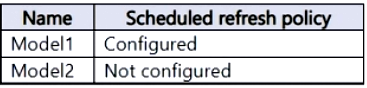
- Exhibit 2: 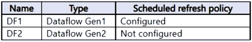
- Exhibit 3: 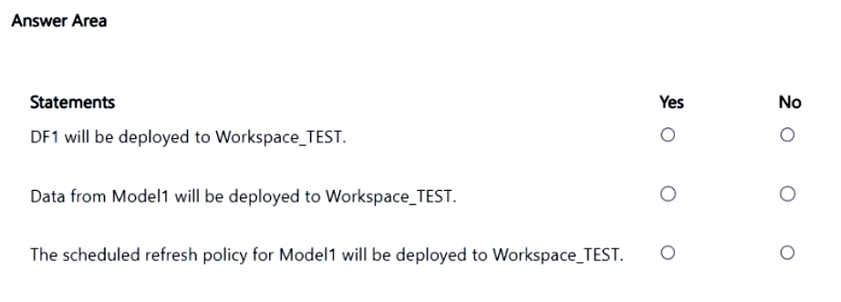

_HOTSPOT — the original ExamTopics question expects you to mark areas on the exhibit above; the correct hotspot coordinates are not published._

**Most voted:**
- Slot 1: Yes
- Slot 2: No
- Slot 3: No

### Top explanations
- **testtaker45** (20 upvotes [Highly Voted]): I am thoroughly confused by this question. I had to use ChatGPT 4o. 
  It says : Yes, No, No. Here is the reasoning: 
  
  1. DF1 will be deployed to Workspace_TEST.
  Reasoning:
  Dataflows (including Gen1) are deployed to the next workspace during pipeline runs.
  This includes DF1, but its refresh policy will not be automatically applied.
  Answer: Yes.
  2. Data from Model1 will be deployed to Workspace_TEST.
  Reasoning:
  Deployment pipelines do not transfer the data associated with a model. Only the model structure is deployed, and data must be refreshed in the target workspace after deployment.
  Answer: No.
  3. The scheduled refresh policy for Model1 will be deployed to Workspace_TEST.
  Reasoning:
  Refresh policies for models are not deployed automatically through deployment pipelines. You need to manually configure refresh policies in the target workspace after deployment.
  Answer: No.
  
  Do with this information what you will. Enjoy -
- **jackjack1** (11 upvotes [Highly Voted]): data and refresh schedule are not copied, https://learn.microsoft.com/en-us/fabric/cicd/deployment-pipelines/understand-the-deployment-process?tabs=new-ui#item-properties-copied-during-deployment dataflow gen1 also not listed as supported (only gen2) so no,no,no
- **97b39d5** (5 upvotes): I tested and refesh schedule is not deployed: Y,N,N
- **wgaignard2** (4 upvotes): Y,N,N
  Item properties that are not copied
  The following item properties aren't copied during deployment:
  •	Data - Data isn't copied. Only metadata is copied
  •	URL
  •	ID
  •	Permissions - For a workspace or a specific item
  •	Workspace settings - Each stage has its own workspace
  •	App content and settings - To update your apps, see Update content to Power BI apps
  •	Personal bookmarks
  The following semantic model properties are also not copied during deployment:
  •	Role assignment
  •	Refresh schedule
  •	Data source credentials
  •	Query caching settings (can be inherited from the capacity)
  •	Endorsement settings
  
  https://learn.microsoft.com/en-us/fabric/cicd/deployment-pipelines/understand-the-deployment-process?tabs=new-ui#item-properties-copied-during-deployment%20dataflow%20gen1
- **jakkuc92** (3 upvotes): N N N
  
  Reports	✅ Yes	Report definitions are deployed, not the data.
  Semantic Models (Datasets)	✅ Yes	Model structure is deployed; data is not copied.
  Paginated Reports	✅ Yes	Supported in Premium capacities.
  Dataflows Gen2	✅ Yes	Fully supported in deployment pipelines.
  Dataflows Gen1	❌ No	Must be migrated to Gen2 for pipeline deployment.
  Dashboards	✅ Yes	Deployed along with reports.
  Refresh Schedules	❌ No	Must be reconfigured in the target workspace.
  Permissions (Access)	❌ No	Not copied; must be set manually or via scripts.
  Row-Level Security (RLS)	✅ Yes	RLS roles and definitions are deployed with the dataset.
  Subscriptions	❌ No	Not deployed.
  Alerts	❌ No	Not deployed.

## Q1.167 (ID 939117)

DRAG DROP
You have a Fabric tenant that contains a workspace named Workspace1. Workspace1 uses the Pro license mode and contains a semantic model named Model1.
You have an Azure DevOps organization.
You need to enable version control for Workspace1. The solution must ensure that Model1 is added to the repository.
Which three actions should you perform in sequence? To answer, move the appropriate actions from the list of actions to the answer area and arrange them in the correct order.

**Exhibits**
- Exhibit 1: 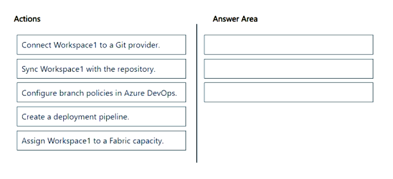

_DRAG DROP — the original ExamTopics question expects you to drag and drop items; the correct targets are not published._

**Most voted:**
1. Connect Wokspace1 to a Git provider
2. Sync Workspace1 with the repository.
3. Configure branch policies in Azure DevOps

### Top explanations
- **b01d700** (3 upvotes): 1. Connect Wokspace1 to a Git provider 
  2. Sync Workspace1 with the repository.
  3. Configure branch policies in Azure DevOps
  
  Create a deployment pipeline is for CI/CD automation bout not for versioning, Power BI Pro support Git integration so is not necessary a Fabric capacity.
- **c51777f** (3 upvotes): Power BI Pro does not support Git integration, you need a Fabric oder Premium-Capacity for Git integration.
- **JuanGonzalezT** (2 upvotes): Correct:
  
  Assing Workspace1 to Fabric Capacity
  https://learn.microsoft.com/en-us/fabric/cicd/git-integration/git-get-started?tabs=azure-devops%2CAzure%2Ccommit-to-git#fabric-prerequisites
  To access the Git integration feature, you need a Fabric capacity. A Fabric capacity is required to use all supported Fabric items.
  
  then Connect and Sync:
  https://learn.microsoft.com/en-us/fabric/cicd/git-integration/git-get-started?tabs=azure-devops%2CAzure%2Ccommit-to-git#connect-to-a-git-repo
  https://learn.microsoft.com/en-us/fabric/cicd/git-integration/git-get-started?tabs=azure-devops%2CAzure%2Ccommit-to-git#connect-to-a-workspace
- **Sowwy1** (1 upvotes): Assign to Fabric capacity
  Connect
  Sync
- **PradeepikaGadai** (1 upvotes): Assign to Fabric capacity – unlocks Git capabilities.
  
  Connect Workspace1 to Git provider – connects to Azure DevOps.
  
  Sync Workspace1 with repository – this is the step that pushes Model1 to the repository.

## Q1.168 (ID 939118)

HOTSPOT
You have a Fabric tenant that contains a workspace named Enterprise. Enterprise contains a semantic model named Model1. Model1 contains a date parameter named Date1 that was created in Power Query.
You build a deployment pipeline named Enterprise Data that includes two stages named Development and Test. You assign the Enterprise workspace to the Development stage.
You need to perform the following actions:
•	Create a workspace named Enterprise [Test] and assign the workspace to the Test stage.
•	Configure a rule that will modify the value of Date1 when changes are deployed to the Test stage.
Which two settings should you use? To answer, select the appropriate settings in the answer area.
NOTE: Each correct answer is worth one point.

**Exhibits**
- Exhibit 1: 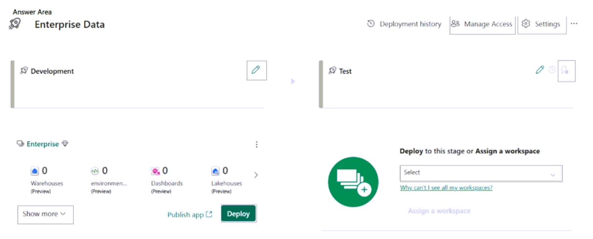

_HOTSPOT — the original ExamTopics question expects you to mark areas on the exhibit above; the correct hotspot coordinates are not published._

**Most voted:**
- Workspace: Enterprise [Test]
- Stage: Test
- Parameter: Date1
- Value: Set the desired value for the Test stage

### Top explanations
- **aks2304** (2 upvotes): i guess the question and answer options is incomplete , but refer to the below answer from gpt
  
  To achieve the required actions, you should use the following settings:
  
  Create a workspace named Enterprise [Test] and assign the workspace to the Test stage:
  
  Workspace: Enterprise [Test]
  Stage: Test
  Configure a rule that will modify the value of Date1 when changes are deployed to the Test stage:
  
  Parameter: Date1
  Value: Set the desired value for the Test stage (e.g., a specific date or a relative date like "today").
  These settings will ensure that the workspace is correctly assigned to the Test stage and that the date parameter is modified as needed during deployment.
- **JuanGonzalezT** (2 upvotes): It's not incomplete, you need to select in the screen the places where those configurations are made.
  The Assign a Workspace is right there in the name, you select your created workspace from the dropdown and the click on Assign a workspace
  The configure a rule I think is the Pencil icon which let's you edit the stage

## Q1.170 (ID 942881)

You have a Fabric tenant that contains a workspace named Workspace1 and a user named User1. Workspace1 contains a warehouse named DW1.
You share DW1 with User1 and assign User1 the default permissions for DW1.
What can User1 do?

⭕ **A.** Build reports by using the default dataset.
⭕ **B.** Read data from the tables in DW1.
✅ **C.** Connect to DW1 via the Azure SQL Analytics endpoint.
⭕ **D.** Read the underlying Parquet files from OneLake.

**Correct answer:** C
**Most voted:** C

### Top explanations
- **Azure_2023** (4 upvotes): https://learn.microsoft.com/en-us/fabric/data-warehouse/share-warehouse-manage-permissions#share-a-warehouse
  
  "If no additional permissions are selected - The shared recipient by default receives "Read" permission, which only allows the recipient to connect to the SQL analytics endpoint"
- **osaid** (2 upvotes): https://learn.microsoft.com/en-us/fabric/data-warehouse/share-warehouse-manage-permissions#share-a-warehouse
- **c21f505** (2 upvotes): A. Build reports by using the default dataset
  → This is possible only if the user has Build permission on the dataset. Default sharing does not grant this.
  
  
  C. Connect to DW1 via the Azure SQL Analytics endpoint
  → This requires specific permissions and enabling the endpoint. Default sharing does not guarantee this.
  
  
  D. Read the underlying Parquet files from OneLake
  → Access to OneLake files requires Lakehouse or OneLake permissions, not just Warehouse sharing.
- **c21f505** (2 upvotes): When you share a warehouse (DW1) in Microsoft Fabric with a user (User1) and assign default permissions, the user is granted read-only access to the data in the warehouse. This means:
  
  ✅ User1 can query and read data from the tables in DW1.
  ❌ User1 cannot build reports using the default dataset unless explicitly granted permissions to the dataset.
  ❌ User1 cannot connect via the Azure SQL Analytics endpoint unless they have specific permissions and the endpoint is enabled.
  ❌ User1 cannot access the underlying Parquet files in OneLake unless they have OneLake file-level access, which is not part of default warehouse permissions.
- **b8ef1c5** (2 upvotes): I just tried it. By default, only "Build reports on the default semantic model (Build)" is selected. Others can be selected, but this is the default.

## Q1.181 (ID 942892)

You have a Fabric workspace named Workspace1.
You need to create a semantic model named Model1 and publish Model1 to Workspace1. The solution must meet the following requirements:
•	Can revert to previous versions of Model1 as required.
•	Identifies differences between saved versions of Model1.
•	Uses Microsoft Power Bl=I Desktop to publish to Workspace1.
•	Can edit item definition files by using Microsoft Visual Studio Code.
Which two actions should you perform? Each correct answer presents part of the solution.
NOTE: Each correct selection is worth one point.

✅ **A.** Enable Git integration for Workspace1.
⭕ **B.** Save Model1 in Power BI Desktop as a PBIT file.
⭕ **C.** Enable users to edit data models in the Power BI service.
✅ **D.** Save Model1 in Power BI Desktop as a PBIP file.

**Correct answer:** A, D
**Most voted:** AD

### Top explanations
- **praticewizards** (3 upvotes): Correct!
  A. Enable Git integration for Workspace1:
  Git integration allows version control, enabling you to revert to previous versions of Model1 and identify differences between saved versions. This meets the requirement for managing and tracking changes.
  
  D. Save Model1 in Power BI Desktop as a PBIP file:
  PBIP format is ideal for development workflows. It supports editing item definition files using tools like Visual Studio Code, making it suitable for collaborative and detailed editing. 
  
  Why not the other options?
  B. Save Model1 in Power BI Desktop as a PBIT file:
  PBIT files are template files, but they do not support editing definition files with tools like Visual Studio Code or version control features.
  
  C. Enable users to edit data models in the Power BI service:
  This option does not meet the requirement for identifying version differences or editing with Visual Studio Code.
- **KalinT** (2 upvotes): A and D
- **PradeepikaGadai** (2 upvotes): Correct Option
- **c88fc0c** (2 upvotes): The correct
- **Sowwy1** (1 upvotes): I think it s A and D

## Q1.182 (ID 942893)

You have a Fabric workspace named Workspace1 that is assigned to a newly created Fabric capacity named Capacity1.
You create a semantic model named Model1 and deploy Model1 to Workspace1.
You need to publish changes to Model1 directly from Tabular Editor.
What should you do?

⭕ **A.** For Workspace1, enable Git integration.
⭕ **B.** For Model1, enable external sharing.
⭕ **C.** For Workspace1, create a managed private endpoint.
✅ **D.** For Capacity1, set XMLA Endpoint to Read Write.

**Correct answer:** D
**Most voted:** D

### Top explanations
- **JuanGonzalezT** (4 upvotes): answer: D
  
  https://learn.microsoft.com/en-us/power-bi/enterprise/service-premium-connect-tools#client-applications-and-tools
  Tabular Editor - An open-source tool ... Requires XMLA read-only for query operations. Requires read-write for metadata operations.
- **ba2bfdf** (3 upvotes): D is right
- **Sowwy1** (1 upvotes): I think it s D
- **hecke** (1 upvotes): 100% agree and thank you for sharing the source.
- **Azure_2023** (1 upvotes): You need Git for publishing changes

## Q1.192 (ID 955739)

You have a Fabric tenant that contains the workspaces shown in the following table.
You have a deployment pipeline named Pipeline1 that deploys items from Workspace_DEV to Workspace_TEST. In Pipeline1, all items that have matching names are paired.
You deploy the contents of Workspace_DEV to Workspace_TEST by using Pipeline1.
What will the contents of Workspace_TEST be once the deployment is complete?

**Exhibits**
- Exhibit 1: 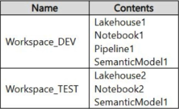

⭕ **A.** Lakehouse2 -Notebook2 -SemanticModel1 -
⭕ **B.** Lakehouse1 -Notebook1 -Pipeline1 -SemanticModel1 -
✅ **C.** Lakehouse1 -Lakehouse2 -Notebook1 -Notebook2 -Pipeline1 -SemanticModel1 -
⭕ **D.** Lakehouse2 -Notebook2 -Pipeline1 -SemanticModel1

**Correct answer:** C
**Most voted:** C

### Top explanations
- **Dusica** (1 upvotes): Answer is C, question repeated
- **hhhhh123** (1 upvotes): Answer is C. Same question of Q156

## Q1.194 (ID 955741)

You have a Fabric tenant that contains two workspaces named Workspace1 and Workspace2.
Workspace1 is used as the development environment. Workspace2 is used as the production environment. Each environment uses a different storage account.
Workspace1 contains a Dataflow Gen2 named Dataflow1. The data source of Dataflow1 is a CSV file in blob storage.
You plan to implement a deployment pipeline to deploy items from Workspace1 to Workspace2.
You need to ensure that the data source references the correct location in the production environment.
What should you do?

✅ **A.** Create a data source rule only.
⭕ **B.** Create a parameter rule only.
⭕ **C.** Create a data source rule and a parameter rule.
⭕ **D.** After implementing the deployment pipeline, manually change the data source

**Correct answer:** A
**Most voted:** A

### Top explanations
- **Juanes55** (3 upvotes): - Data source: a data source rule tells the deployment pipeline to automatically replace the connection with the correct one in the target workspace.
  
  -Parameter rule: Even if the connection changes, the path inside the storage often also changes between dev and prod.
  A parameter rule lets you override these values during deployment.
- **Aiden90** (2 upvotes): A. Create a data source rule only.
  ✅ Correct — this remaps the storage account from dev → prod during deployment.
- **a8d510b** (1 upvotes): first modify Dataflow in Workspace1 so that the "Path" or "Connection" string for the blob storage is controlled by a Power Query Parameter
- **21ad543** (1 upvotes): a is answer but idk
- **LILIA97** (1 upvotes): C, Data source: a data source rule tells the deployment pipeline to automatically replace the connection with the correct one in the target workspace.

## Q2.2 (ID 911292)

HOTSPOT -
Overview -
Contoso, Ltd. is a US-based health supplements company. Contoso has two divisions named Sales and Research. The Sales division contains two departments named Online Sales and Retail Sales. The Research division assigns internally developed product lines to individual teams of researchers and analysts.
Existing Environment -
Identity Environment -
Contoso has a Microsoft Entra tenant named contoso.com. The tenant contains two groups named ResearchReviewersGroup1 and ResearchReviewersGroup2.
Data Environment -
Contoso has the following data environment:
The Sales division uses a Microsoft Power BI Premium capacity.
The semantic model of the Online Sales department includes a fact table named Orders that uses Import made. In the system of origin, the OrderID value represents the sequence in which orders are created.
The Research department uses an on-premises, third-party data warehousing product.
Fabric is enabled for contoso.com.
An Azure Data Lake Storage Gen2 storage account named storage1 contains Research division data for a product line named Productline1. The data is in the delta format.
A Data Lake Storage Gen2 storage account named storage2 contains Research division data for a product line named Productline2. The data is in the CSV format.
Requirements -
Planned Changes -
Contoso plans to make the following changes:
Enable support for Fabric in the Power BI Premium capacity used by the Sales division.
Make all the data for the Sales division and the Research division available in Fabric.
For the Research division, create two Fabric workspaces named Productline1ws and Productine2ws.
In Productline1ws, create a lakehouse named Lakehouse1.
In Lakehouse1, create a shortcut to storage1 named ResearchProduct.
Data Analytics Requirements -
Contoso identifies the following data analytics requirements:
All the workspaces for the Sales division and the Research division must support all Fabric experiences.
The Research division workspaces must use a dedicated, on-demand capacity that has per-minute billing.
The Research division workspaces must be grouped together logically to support OneLake data hub filtering based on the department name.
For the Research division workspaces, the members of ResearchReviewersGroup1 must be able to read lakehouse and warehouse data and shortcuts by using SQL endpoints.
For the Research division workspaces, the members of ResearchReviewersGroup2 must be able to read lakehouse data by using Lakehouse explorer.
All the semantic models and reports for the Research division must use version control that supports branching.
Data Preparation Requirements -
Contoso identifies the following data preparation requirements:
The Research division data for Productline1 must be retrieved from Lakehouse1 by using Fabric notebooks.
All the Research division data in the lakehouses must be presented as managed tables in Lakehouse explorer.
Semantic Model Requirements -
Contoso identifies the following requirements for implementing and managing semantic models:
The number of rows added to the Orders table during refreshes must be minimized.
The semantic models in the Research division workspaces must use Direct Lake mode.
General Requirements -
Contoso identifies the following high-level requirements that must be considered for all solutions:
Follow the principle of least privilege when applicable.
Minimize implementation and maintenance effort when possible.
You need to recommend a solution to group the Research division workspaces.
What should you include in the recommendation? To answer, select the appropriate options in the answer area.
NOTE: Each correct selection is worth one point.

**Exhibits**
- Exhibit 1: 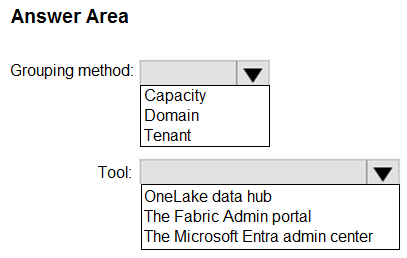

_HOTSPOT — the original ExamTopics question expects you to mark areas on the exhibit above; the correct hotspot coordinates are not published._

**Most voted:**
1. "In Fabric, a domain is a way to logically group together services in the organization"
2. You have to use Fabric Admin portal to do the groupings.

### Top explanations
- **Momoanwar** (63 upvotes [Highly Voted]): Domain\Fabric Admin Portal
- **XiltroX** (17 upvotes [Highly Voted]): https://learn.microsoft.com/en-us/fabric/governance/domains#create-a-domain
  From MS Learn
  1. "In Fabric, a domain is a way to logically group together services in the organization"
  2. You have to use Fabric Admin portal to do the groupings.
- **testtaker45** (4 upvotes [Most Recent]): The right answer is Doamin \ OneLake Data Hub. 
  The key wording is the Research Group will use 'Lakehouse Explorer'. This tool will connect to the Onelake Data Hub. 
  From an admin perspective, you use the Fabric Admin portal to create the Domain Grouping. I think that is the confusion. Hope that helps someone.
- **David_Webb** (4 upvotes): Group method: Domain
  Tool: The Fabric Admin Portal
  The tool here should mean the tool to implement the grouping solution. Thus, the answer should be the Fabric admin portal instead.
  https://learn.microsoft.com/en-us/fabric/governance/domains#create-a-domain
- **theseon** (4 upvotes): Should the tool not be Fabric Admin Portal?
  
  https://learn.microsoft.com/en-us/fabric/governance/domains#configure-domain-settings

## Q2.3 (ID 911293)

Overview -
Contoso, Ltd. is a US-based health supplements company. Contoso has two divisions named Sales and Research. The Sales division contains two departments named Online Sales and Retail Sales. The Research division assigns internally developed product lines to individual teams of researchers and analysts.
Existing Environment -
Identity Environment -
Contoso has a Microsoft Entra tenant named contoso.com. The tenant contains two groups named ResearchReviewersGroup1 and ResearchReviewersGroup2.
Data Environment -
Contoso has the following data environment:
The Sales division uses a Microsoft Power BI Premium capacity.
The semantic model of the Online Sales department includes a fact table named Orders that uses Import made. In the system of origin, the OrderID value represents the sequence in which orders are created.
The Research department uses an on-premises, third-party data warehousing product.
Fabric is enabled for contoso.com.
An Azure Data Lake Storage Gen2 storage account named storage1 contains Research division data for a product line named Productline1. The data is in the delta format.
A Data Lake Storage Gen2 storage account named storage2 contains Research division data for a product line named Productline2. The data is in the CSV format.
Requirements -
Planned Changes -
Contoso plans to make the following changes:
Enable support for Fabric in the Power BI Premium capacity used by the Sales division.
Make all the data for the Sales division and the Research division available in Fabric.
For the Research division, create two Fabric workspaces named Productline1ws and Productine2ws.
In Productline1ws, create a lakehouse named Lakehouse1.
In Lakehouse1, create a shortcut to storage1 named ResearchProduct.
Data Analytics Requirements -
Contoso identifies the following data analytics requirements:
All the workspaces for the Sales division and the Research division must support all Fabric experiences.
The Research division workspaces must use a dedicated, on-demand capacity that has per-minute billing.
The Research division workspaces must be grouped together logically to support OneLake data hub filtering based on the department name.
For the Research division workspaces, the members of ResearchReviewersGroup1 must be able to read lakehouse and warehouse data and shortcuts by using SQL endpoints.
For the Research division workspaces, the members of ResearchReviewersGroup2 must be able to read lakehouse data by using Lakehouse explorer.
All the semantic models and reports for the Research division must use version control that supports branching.
Data Preparation Requirements -
Contoso identifies the following data preparation requirements:
The Research division data for Productline1 must be retrieved from Lakehouse1 by using Fabric notebooks.
All the Research division data in the lakehouses must be presented as managed tables in Lakehouse explorer.
Semantic Model Requirements -
Contoso identifies the following requirements for implementing and managing semantic models:
The number of rows added to the Orders table during refreshes must be minimized.
The semantic models in the Research division workspaces must use Direct Lake mode.
General Requirements -
Contoso identifies the following high-level requirements that must be considered for all solutions:
Follow the principle of least privilege when applicable.
Minimize implementation and maintenance effort when possible.
You need to refresh the Orders table of the Online Sales department. The solution must meet the semantic model requirements.
What should you include in the solution?

⭕ **A.** an Azure Data Factory pipeline that executes a Stored procedure activity to retrieve the maximum value of the OrderID column in the destination lakehouse
⭕ **B.** an Azure Data Factory pipeline that executes a Stored procedure activity to retrieve the minimum value of the OrderID column in the destination lakehouse
⭕ **C.** an Azure Data Factory pipeline that executes a dataflow to retrieve the minimum value of the OrderID column in the destination lakehouse
✅ **D.** an Azure Data Factory pipeline that executes a dataflow to retrieve the maximum value of the OrderID column in the destination lakehouse

**Correct answer:** D
**Most voted:** D

### Top explanations
- **theseon** (29 upvotes [Highly Voted]): we need to retrieve the maximum OrderID in the destination table to minimize the number of rows added during refresh. this would be an incremental load. can be done with data flows
- **Jons123son** (9 upvotes [Highly Voted]): D - As other people pointed out, the exact same use case for retrieving the max OrderID is showcased in the documentation 
  
  https://learn.microsoft.com/en-us/fabric/data-factory/tutorial-setup-incremental-refresh-with-dataflows-gen2#add-a-query-to-the-dataflow-to-filter-the-data-based-on-the-data-destination
  
  Thought at first that A would be correct because SP support least privilege and because how real incremental refresh is not yet supported in data flow gen 2 https://ideas.fabric.microsoft.com/ideas/idea/?ideaid=4814b098-efff-ed11-a81c-6045bdb98602
- **metiii** (7 upvotes): The answer is A. You should query the last ID from the destination by lookup activity which uses the stored procedure, data flow is not used for this purpose.
  https://learn.microsoft.com/en-us/azure/data-factory/tutorial-incremental-copy-portal
- **AsitTrivedi** (5 upvotes): https://learn.microsoft.com/en-au/fabric/data-factory/tutorial-setup-incremental-refresh-with-dataflows-gen2
- **NabilR** (5 upvotes): I agree.
  Azure Data Factory "pipelines" is different from Azure Data Factory "Data Flows".
  All the options are directing us to use Azure Data Factory "pipelines", so it should be using a stored procedure.

## Q2.4 (ID 911294)

Overview -
Contoso, Ltd. is a US-based health supplements company. Contoso has two divisions named Sales and Research. The Sales division contains two departments named Online Sales and Retail Sales. The Research division assigns internally developed product lines to individual teams of researchers and analysts.
Existing Environment -
Identity Environment -
Contoso has a Microsoft Entra tenant named contoso.com. The tenant contains two groups named ResearchReviewersGroup1 and ResearchReviewersGroup2.
Data Environment -
Contoso has the following data environment:
The Sales division uses a Microsoft Power BI Premium capacity.
The semantic model of the Online Sales department includes a fact table named Orders that uses Import made. In the system of origin, the OrderID value represents the sequence in which orders are created.
The Research department uses an on-premises, third-party data warehousing product.
Fabric is enabled for contoso.com.
An Azure Data Lake Storage Gen2 storage account named storage1 contains Research division data for a product line named Productline1. The data is in the delta format.
A Data Lake Storage Gen2 storage account named storage2 contains Research division data for a product line named Productline2. The data is in the CSV format.
Requirements -
Planned Changes -
Contoso plans to make the following changes:
Enable support for Fabric in the Power BI Premium capacity used by the Sales division.
Make all the data for the Sales division and the Research division available in Fabric.
For the Research division, create two Fabric workspaces named Productline1ws and Productine2ws.
In Productline1ws, create a lakehouse named Lakehouse1.
In Lakehouse1, create a shortcut to storage1 named ResearchProduct.
Data Analytics Requirements -
Contoso identifies the following data analytics requirements:
All the workspaces for the Sales division and the Research division must support all Fabric experiences.
The Research division workspaces must use a dedicated, on-demand capacity that has per-minute billing.
The Research division workspaces must be grouped together logically to support OneLake data hub filtering based on the department name.
For the Research division workspaces, the members of ResearchReviewersGroup1 must be able to read lakehouse and warehouse data and shortcuts by using SQL endpoints.
For the Research division workspaces, the members of ResearchReviewersGroup2 must be able to read lakehouse data by using Lakehouse explorer.
All the semantic models and reports for the Research division must use version control that supports branching.
Data Preparation Requirements -
Contoso identifies the following data preparation requirements:
The Research division data for Productline1 must be retrieved from Lakehouse1 by using Fabric notebooks.
All the Research division data in the lakehouses must be presented as managed tables in Lakehouse explorer.
Semantic Model Requirements -
Contoso identifies the following requirements for implementing and managing semantic models:
The number of rows added to the Orders table during refreshes must be minimized.
The semantic models in the Research division workspaces must use Direct Lake mode.
General Requirements -
Contoso identifies the following high-level requirements that must be considered for all solutions:
Follow the principle of least privilege when applicable.
Minimize implementation and maintenance effort when possible.
Which syntax should you use in a notebook to access the Research division data for Productline1?

⭕ **A.** spark.read.format(“delta”).load(“Tables/productline1/ResearchProduct”)
✅ **B.** spark.sql(“SELECT * FROM Lakehouse1.ResearchProduct ”)
⭕ **C.** external_table(‘Tables/ResearchProduct)
⭕ **D.** external_table(ResearchProduct)

**Correct answer:** B
**Most voted:** B

### Top explanations
- **David_Webb** (15 upvotes [Highly Voted]): The correct answer is B.
  The folder hierarchy of Tables in Lakehouse is incorrect for A.
- **wispa2001** (11 upvotes [Highly Voted]): df = spark.read.format("delta").load("Tables/MyShortcut")
  display(df)
  OR
  df = spark.sql("SELECT * FROM MyLakehouse.MyShortcut LIMIT 1000")
  display(df)
  https://learn.microsoft.com/en-us/fabric/onelake/onelake-shortcuts
- **a998450** (6 upvotes): Yes B is correct answer as per the requirement specified in case study - For the Research division workspaces, the members of ResearchReviewersGroup1 must be able to read lakehouse and warehouse data and shortcuts by using SQL endpoints.
- **nyoike** (6 upvotes): With the recent introduction of schema-enabled Lakehouses, BOTH A and B are correct. That is assuming ResearchProduct table was created in a schema-enabled Lakehouse in the productline1 schema. I have tested A in a Fabric Spark notebook that is schema-enabled and it works.
- **stilferx** (5 upvotes): My bad, the right answer is B.
  There is a requirement: Research Division - all tables should be managed. It means, no subfolders should be.
  
  https://learn.microsoft.com/en-us/training/modules/use-apache-spark-work-files-lakehouse/5-spark-sql

## Q2.5 (ID 911295)

HOTSPOT -
Overview -
Litware, Inc. is a manufacturing company that has offices throughout North America. The analytics team at Litware contains data engineers, analytics engineers, data analysts, and data scientists.
Existing Environment -
Fabric Environment -
Litware has been using a Microsoft Power BI tenant for three years. Litware has NOT enabled any Fabric capacities and features.
Available Data -
Litware has data that must be analyzed as shown in the following table.
The Product data contains a single table and the following columns.
The customer satisfaction data contains the following tables:
Survey -
Question -
Response -
For each survey submitted, the following occurs:
One row is added to the Survey table.
One row is added to the Response table for each question in the survey.
The Question table contains the text of each survey question. The third question in each survey response is an overall satisfaction score. Customers can submit a survey after each purchase.
User Problems -
The analytics team has large volumes of data, some of which is semi-structured. The team wants to use Fabric to create a new data store.
Product data is often classified into three pricing groups: high, medium, and low. This logic is implemented in several databases and semantic models, but the logic does NOT always match across implementations.
Requirements -
Planned Changes -
Litware plans to enable Fabric features in the existing tenant. The analytics team will create a new data store as a proof of concept (PoC). The remaining Liware users will only get access to the Fabric features once the PoC is complete. The PoC will be completed by using a Fabric trial capacity
The following three workspaces will be created:
AnalyticsPOC: Will contain the data store, semantic models, reports pipelines, dataflow, and notebooks used to populate the data store
DataEngPOC: Will contain all the pipelines, dataflows, and notebooks used to populate OneLake
DataSciPOC: Will contain all the notebooks and reports created by the data scientists
The following will be created in the AnalyticsPOC workspace:
A data store (type to be decided)
A custom semantic model -
A default semantic model -
Interactive reports -
The data engineers will create data pipelines to load data to OneLake either hourly or daily depending on the data source. The analytics engineers will create processes to ingest, transform, and load the data to the data store in the AnalyticsPOC workspace daily. Whenever possible, the data engineers will use low-code tools for data ingestion. The choice of which data cleansing and transformation tools to use will be at the data engineers’ discretion.
All the semantic models and reports in the Analytics POC workspace will use the data store as the sole data source.
Technical Requirements -
The data store must support the following:
Read access by using T-SQL or Python
Semi-structured and unstructured data
Row-level security (RLS) for users executing T-SQL queries
Files loaded by the data engineers to OneLake will be stored in the Parquet format and will meet Delta Lake specifications.
Data will be loaded without transformation in one area of the AnalyticsPOC data store. The data will then be cleansed, merged, and transformed into a dimensional model
The data load process must ensure that the raw and cleansed data is updated completely before populating the dimensional model
The dimensional model must contain a date dimension. There is no existing data source for the date dimension. The Litware fiscal year matches the calendar year. The date dimension must always contain dates from 2010 through the end of the current year.
The product pricing group logic must be maintained by the analytics engineers in a single location. The pricing group data must be made available in the data store for T-SOL. queries and in the default semantic model. The following logic must be used:
List prices that are less than or equal to 50 are in the low pricing group.
List prices that are greater than 50 and less than or equal to 1,000 are in the medium pricing group.
List prices that are greater than 1,000 are in the high pricing group.
Security Requirements -
Only Fabric administrators and the analytics team must be able to see the Fabric items created as part of the PoC.
Litware identifies the following security requirements for the Fabric items in the AnalyticsPOC workspace:
Fabric administrators will be the workspace administrators.
The data engineers must be able to read from and write to the data store. No access must be granted to datasets or reports.
The analytics engineers must be able to read from, write to, and create schemas in the data store. They also must be able to create and share semantic models with the data analysts and view and modify all reports in the workspace.
The data scientists must be able to read from the data store, but not write to it. They will access the data by using a Spark notebook
The data analysts must have read access to only the dimensional model objects in the data store. They also must have access to create Power BI reports by using the semantic models created by the analytics engineers.
The date dimension must be available to all users of the data store.
The principle of least privilege must be followed.
Both the default and custom semantic models must include only tables or views from the dimensional model in the data store. Litware already has the following Microsoft Entra security groups:
FabricAdmins: Fabric administrators
AnalyticsTeam: All the members of the analytics team
DataAnalysts: The data analysts on the analytics team
DataScientists: The data scientists on the analytics team
DataEngineers: The data engineers on the analytics team
AnalyticsEngineers: The analytics engineers on the analytics team
Report Requirements -
The data analysts must create a customer satisfaction report that meets the following requirements:
Enables a user to select a product to filter customer survey responses to only those who have purchased that product.
Displays the average overall satisfaction score of all the surveys submitted during the last 12 months up to a selected dat.
Shows data as soon as the data is updated in the data store.
Ensures that the report and the semantic model only contain data from the current and previous year.
Ensures that the report respects any table-level security specified in the source data store.
Minimizes the execution time of report queries.
You need to assign permissions for the data store in the AnalyticsPOC workspace. The solution must meet the security requirements.
Which additional permissions should you assign when you share the data store? To answer, select the appropriate options in the answer area.
NOTE: Each correct selection is worth one point.

**Exhibits**
- Exhibit 1: 
- Exhibit 2: 
- Exhibit 3: 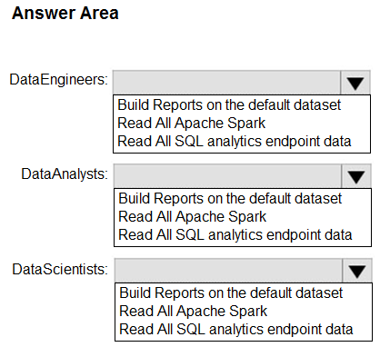

_HOTSPOT — the original ExamTopics question expects you to mark areas on the exhibit above; the correct hotspot coordinates are not published._

**Most voted:**
- Data Engineers: Read all Apache Spark - because they need to be able to work with Spark for Data curation.
- Data Analysts: Build Reports on the default dataset - because they are report builders
- Data Scientists: Read SQL Endpoints - They leverage curated data (by engineers) to do predictive analytics.

### Top explanations
- **Bharat** (91 upvotes [Highly Voted]): Here is my take on it:
  Data Engineers: Read all Apache Spark - because they need to be able to work with Spark for Data curation.
  Data Analysts: Build Reports on the default dataset - because they are report builders
  Data Scientists: Read SQL Endpoints - They leverage curated data (by engineers) to do predictive analytics.
  Let me know what you think.
- **vissu_settipally** (40 upvotes [Highly Voted]): Data Engineers = Read sql endpoints
  Data Analyst = Build Reports
  Data Scientist = They prefer Spark Always
- **stilferx** (15 upvotes): IMHO,
  - DEs - Spark, 
  - Analysts - Build Report, 
  - DS - Spark (as well). 
  
  Why?
  
  1. Here is the description of the options: https://blog.fabric.microsoft.com/en-us/blog/data-warehouse-sharing/
  
  2. Here is the role description in the question itself:
  The data engineers must be able to !!!read from and write!!! to the data store. No access must be granted to datasets or reports.
  The data scientists must be able to read from the data store, but not write to it. They will access the data by using a !!! Spark notebook
  The data analysts must have read access to only the dimensional model objects in the data store. They also must have access to create Power BI reports by !!! using the semantic models created by the analytics engineers.
  The date dimension must be available to all users of the data store.
- **dp600** (11 upvotes): stop using chatgpt as a source, it's not trustworthy
- **vish9** (10 upvotes): Data Analysts – Build Reports
  Data Scientists – Read All Apache Spark.
  The confusion is about the Data Engineers: They must be able to read and write to the data store. The SQL end point is read only. They should not have build reports. Hence the remaining option is read all Apache spark. Hence in this question no one gets access to the SQL Endpoint.

## Q2.6 (ID 911296)

HOTSPOT -
Overview -
Litware, Inc. is a manufacturing company that has offices throughout North America. The analytics team at Litware contains data engineers, analytics engineers, data analysts, and data scientists.
Existing Environment -
Fabric Environment -
Litware has been using a Microsoft Power BI tenant for three years. Litware has NOT enabled any Fabric capacities and features.
Available Data -
Litware has data that must be analyzed as shown in the following table.
The Product data contains a single table and the following columns.
The customer satisfaction data contains the following tables:
Survey -
Question -
Response -
For each survey submitted, the following occurs:
One row is added to the Survey table.
One row is added to the Response table for each question in the survey.
The Question table contains the text of each survey question. The third question in each survey response is an overall satisfaction score. Customers can submit a survey after each purchase.
User Problems -
The analytics team has large volumes of data, some of which is semi-structured. The team wants to use Fabric to create a new data store.
Product data is often classified into three pricing groups: high, medium, and low. This logic is implemented in several databases and semantic models, but the logic does NOT always match across implementations.
Requirements -
Planned Changes -
Litware plans to enable Fabric features in the existing tenant. The analytics team will create a new data store as a proof of concept (PoC). The remaining Liware users will only get access to the Fabric features once the PoC is complete. The PoC will be completed by using a Fabric trial capacity
The following three workspaces will be created:
AnalyticsPOC: Will contain the data store, semantic models, reports pipelines, dataflow, and notebooks used to populate the data store
DataEngPOC: Will contain all the pipelines, dataflows, and notebooks used to populate OneLake
DataSciPOC: Will contain all the notebooks and reports created by the data scientists
The following will be created in the AnalyticsPOC workspace:
A data store (type to be decided)
A custom semantic model -
A default semantic model -
Interactive reports -
The data engineers will create data pipelines to load data to OneLake either hourly or daily depending on the data source. The analytics engineers will create processes to ingest, transform, and load the data to the data store in the AnalyticsPOC workspace daily. Whenever possible, the data engineers will use low-code tools for data ingestion. The choice of which data cleansing and transformation tools to use will be at the data engineers’ discretion.
All the semantic models and reports in the Analytics POC workspace will use the data store as the sole data source.
Technical Requirements -
The data store must support the following:
Read access by using T-SQL or Python
Semi-structured and unstructured data
Row-level security (RLS) for users executing T-SQL queries
Files loaded by the data engineers to OneLake will be stored in the Parquet format and will meet Delta Lake specifications.
Data will be loaded without transformation in one area of the AnalyticsPOC data store. The data will then be cleansed, merged, and transformed into a dimensional model
The data load process must ensure that the raw and cleansed data is updated completely before populating the dimensional model
The dimensional model must contain a date dimension. There is no existing data source for the date dimension. The Litware fiscal year matches the calendar year. The date dimension must always contain dates from 2010 through the end of the current year.
The product pricing group logic must be maintained by the analytics engineers in a single location. The pricing group data must be made available in the data store for T-SOL. queries and in the default semantic model. The following logic must be used:
List prices that are less than or equal to 50 are in the low pricing group.
List prices that are greater than 50 and less than or equal to 1,000 are in the medium pricing group.
List prices that are greater than 1,000 are in the high pricing group.
Security Requirements -
Only Fabric administrators and the analytics team must be able to see the Fabric items created as part of the PoC.
Litware identifies the following security requirements for the Fabric items in the AnalyticsPOC workspace:
Fabric administrators will be the workspace administrators.
The data engineers must be able to read from and write to the data store. No access must be granted to datasets or reports.
The analytics engineers must be able to read from, write to, and create schemas in the data store. They also must be able to create and share semantic models with the data analysts and view and modify all reports in the workspace.
The data scientists must be able to read from the data store, but not write to it. They will access the data by using a Spark notebook
The data analysts must have read access to only the dimensional model objects in the data store. They also must have access to create Power BI reports by using the semantic models created by the analytics engineers.
The date dimension must be available to all users of the data store.
The principle of least privilege must be followed.
Both the default and custom semantic models must include only tables or views from the dimensional model in the data store. Litware already has the following Microsoft Entra security groups:
FabricAdmins: Fabric administrators
AnalyticsTeam: All the members of the analytics team
DataAnalysts: The data analysts on the analytics team
DataScientists: The data scientists on the analytics team
DataEngineers: The data engineers on the analytics team
AnalyticsEngineers: The analytics engineers on the analytics team
Report Requirements -
The data analysts must create a customer satisfaction report that meets the following requirements:
Enables a user to select a product to filter customer survey responses to only those who have purchased that product.
Displays the average overall satisfaction score of all the surveys submitted during the last 12 months up to a selected dat.
Shows data as soon as the data is updated in the data store.
Ensures that the report and the semantic model only contain data from the current and previous year.
Ensures that the report respects any table-level security specified in the source data store.
Minimizes the execution time of report queries.
You need to create a DAX measure to calculate the average overall satisfaction score.
How should you complete the DAX code? To answer, select the appropriate options in the answer area.
NOTE: Each correct selection is worth one point.

**Exhibits**
- Exhibit 1: 
- Exhibit 2: 
- Exhibit 3: 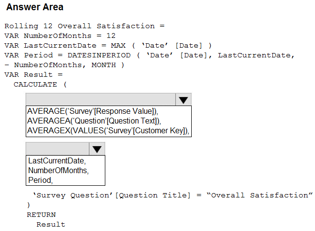

_HOTSPOT — the original ExamTopics question expects you to mark areas on the exhibit above; the correct hotspot coordinates are not published._

**Most voted:**
- For the first part, "AVERAGE('Survey'[Response Value])" because the second option uses a text column as argument, and the third option is not relevant in this context (no need to perform row calculations).
- For the second part, "Period": data is filtered to compute the average in the last 12 months (interval defined in the variable).

### Top explanations
- **theseon** (105 upvotes [Highly Voted]): Iwould say:
  AVERAGE('Survery'[Respone Value]) and Period
  
  I do not unterstand why we would use the CustomerKey for Average Calculation.
- **a_51** (11 upvotes [Highly Voted]): Average('Survey'[Response Value]) and Period
- **VAzureD** (7 upvotes): AVERAGE('Survey'[Response Value]),
  Period.
  
  
  AVERAGEA('Question'[Question Text]),
  It doesn't make much sense to average a text field when you have to extract a value from it, although AVERAGEA can do it.
  
  AVERAGEX(VALUES('Survey'[Customer Key]),
  Syntax is wrong, discarded. AVERAGEX(, )
  Additionally VALUES leaves only the distinct values
  
  
  LastCurrentDate,
  In this case we would have only half a day. Has no sense.
  
  NumberOfMonths,
  We would be filtering by 12. It doesn't make sense.
  
  Period,
  In the variable we have the dates of the last 12 months.
- **a_51** (6 upvotes): Response Value is the only one that even likely could be aggregated. The question text and customer key do not make sense.
- **SamuComqi** (6 upvotes): For the first part, "AVERAGE('Survey'[Response Value])" because the second option uses a text column as argument, and the third option is not relevant in this context (no need to perform row calculations).
  For the second part, "Period": data is filtered to compute the average in the last 12 months (interval defined in the variable).

## Q2.7 (ID 911297)

HOTSPOT -
Overview -
Litware, Inc. is a manufacturing company that has offices throughout North America. The analytics team at Litware contains data engineers, analytics engineers, data analysts, and data scientists.
Existing Environment -
Fabric Environment -
Litware has been using a Microsoft Power BI tenant for three years. Litware has NOT enabled any Fabric capacities and features.
Available Data -
Litware has data that must be analyzed as shown in the following table.
The Product data contains a single table and the following columns.
The customer satisfaction data contains the following tables:
Survey -
Question -
Response -
For each survey submitted, the following occurs:
One row is added to the Survey table.
One row is added to the Response table for each question in the survey.
The Question table contains the text of each survey question. The third question in each survey response is an overall satisfaction score. Customers can submit a survey after each purchase.
User Problems -
The analytics team has large volumes of data, some of which is semi-structured. The team wants to use Fabric to create a new data store.
Product data is often classified into three pricing groups: high, medium, and low. This logic is implemented in several databases and semantic models, but the logic does NOT always match across implementations.
Requirements -
Planned Changes -
Litware plans to enable Fabric features in the existing tenant. The analytics team will create a new data store as a proof of concept (PoC). The remaining Liware users will only get access to the Fabric features once the PoC is complete. The PoC will be completed by using a Fabric trial capacity
The following three workspaces will be created:
AnalyticsPOC: Will contain the data store, semantic models, reports pipelines, dataflow, and notebooks used to populate the data store
DataEngPOC: Will contain all the pipelines, dataflows, and notebooks used to populate OneLake
DataSciPOC: Will contain all the notebooks and reports created by the data scientists
The following will be created in the AnalyticsPOC workspace:
A data store (type to be decided)
A custom semantic model -
A default semantic model -
Interactive reports -
The data engineers will create data pipelines to load data to OneLake either hourly or daily depending on the data source. The analytics engineers will create processes to ingest, transform, and load the data to the data store in the AnalyticsPOC workspace daily. Whenever possible, the data engineers will use low-code tools for data ingestion. The choice of which data cleansing and transformation tools to use will be at the data engineers’ discretion.
All the semantic models and reports in the Analytics POC workspace will use the data store as the sole data source.
Technical Requirements -
The data store must support the following:
Read access by using T-SQL or Python
Semi-structured and unstructured data
Row-level security (RLS) for users executing T-SQL queries
Files loaded by the data engineers to OneLake will be stored in the Parquet format and will meet Delta Lake specifications.
Data will be loaded without transformation in one area of the AnalyticsPOC data store. The data will then be cleansed, merged, and transformed into a dimensional model
The data load process must ensure that the raw and cleansed data is updated completely before populating the dimensional model
The dimensional model must contain a date dimension. There is no existing data source for the date dimension. The Litware fiscal year matches the calendar year. The date dimension must always contain dates from 2010 through the end of the current year.
The product pricing group logic must be maintained by the analytics engineers in a single location. The pricing group data must be made available in the data store for T-SOL. queries and in the default semantic model. The following logic must be used:
List prices that are less than or equal to 50 are in the low pricing group.
List prices that are greater than 50 and less than or equal to 1,000 are in the medium pricing group.
List prices that are greater than 1,000 are in the high pricing group.
Security Requirements -
Only Fabric administrators and the analytics team must be able to see the Fabric items created as part of the PoC.
Litware identifies the following security requirements for the Fabric items in the AnalyticsPOC workspace:
Fabric administrators will be the workspace administrators.
The data engineers must be able to read from and write to the data store. No access must be granted to datasets or reports.
The analytics engineers must be able to read from, write to, and create schemas in the data store. They also must be able to create and share semantic models with the data analysts and view and modify all reports in the workspace.
The data scientists must be able to read from the data store, but not write to it. They will access the data by using a Spark notebook
The data analysts must have read access to only the dimensional model objects in the data store. They also must have access to create Power BI reports by using the semantic models created by the analytics engineers.
The date dimension must be available to all users of the data store.
The principle of least privilege must be followed.
Both the default and custom semantic models must include only tables or views from the dimensional model in the data store. Litware already has the following Microsoft Entra security groups:
FabricAdmins: Fabric administrators
AnalyticsTeam: All the members of the analytics team
DataAnalysts: The data analysts on the analytics team
DataScientists: The data scientists on the analytics team
DataEngineers: The data engineers on the analytics team
AnalyticsEngineers: The analytics engineers on the analytics team
Report Requirements -
The data analysts must create a customer satisfaction report that meets the following requirements:
Enables a user to select a product to filter customer survey responses to only those who have purchased that product.
Displays the average overall satisfaction score of all the surveys submitted during the last 12 months up to a selected dat.
Shows data as soon as the data is updated in the data store.
Ensures that the report and the semantic model only contain data from the current and previous year.
Ensures that the report respects any table-level security specified in the source data store.
Minimizes the execution time of report queries.
You need to resolve the issue with the pricing group classification.
How should you complete the T-SQL statement? To answer, select the appropriate options in the answer area.
NOTE: Each correct selection is worth one point.

**Exhibits**
- Exhibit 1: 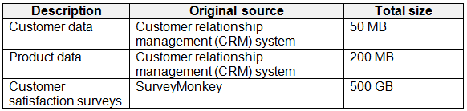
- Exhibit 2: 
- Exhibit 3: 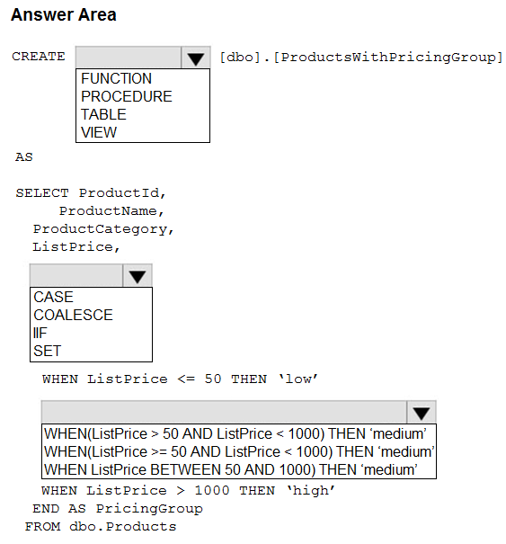

_HOTSPOT — the original ExamTopics question expects you to mark areas on the exhibit above; the correct hotspot coordinates are not published._

**Most voted:**
- VIEW: from an existing table.
- CASE: correct syntax before the WHENs.
- WHEN ListPrice BETWEEN 50 AND 1000 THEN 'medium': the other two options miss value 1000; on the other hand, the BETWEEN includes both 50 and 1000.

### Top explanations
- **SamuComqi** (77 upvotes [Highly Voted]): * VIEW: from an existing table.
  * CASE: correct syntax before the WHENs.
  * WHEN ListPrice BETWEEN 50 AND 1000 THEN 'medium': the other two options miss value 1000; on the other hand, the BETWEEN includes both 50 and 1000.
- **thuss** (31 upvotes [Highly Voted]): All options for the last one are wrong, which is irritating. Should be > 50 AND <= 1000.
- **calvintcy** (21 upvotes): I took the test a few days ago. This question was included, but Microsoft has made a change to: WHEN(ListPrice > 50 AND ListPrice <= 1000) THEN 'medium'. Therefore, I chose this option.
- **Tuki93** (13 upvotes): The range BETWEEN 50 AND 1000 is also a valid answer. However, if the value is 50, it will be returned from the previous ‘when’ clause, ListPrice <= 50 Then 'low', before reaching the second ‘when’ clause.”
- **pirate84** (12 upvotes): I took the test the last week. This question was included, with a important modification:
  They changes the information,¡ of the first option for "WHEN": ListPrice > 50 AND ListPrice  50 AND ListPrice <= 1000) THEN 'medium'.

## Q2.8 (ID 911298)

Overview -
Litware, Inc. is a manufacturing company that has offices throughout North America. The analytics team at Litware contains data engineers, analytics engineers, data analysts, and data scientists.
Existing Environment -
Fabric Environment -
Litware has been using a Microsoft Power BI tenant for three years. Litware has NOT enabled any Fabric capacities and features.
Available Data -
Litware has data that must be analyzed as shown in the following table.
The Product data contains a single table and the following columns.
The customer satisfaction data contains the following tables:
Survey -
Question -
Response -
For each survey submitted, the following occurs:
One row is added to the Survey table.
One row is added to the Response table for each question in the survey.
The Question table contains the text of each survey question. The third question in each survey response is an overall satisfaction score. Customers can submit a survey after each purchase.
User Problems -
The analytics team has large volumes of data, some of which is semi-structured. The team wants to use Fabric to create a new data store.
Product data is often classified into three pricing groups: high, medium, and low. This logic is implemented in several databases and semantic models, but the logic does NOT always match across implementations.
Requirements -
Planned Changes -
Litware plans to enable Fabric features in the existing tenant. The analytics team will create a new data store as a proof of concept (PoC). The remaining Liware users will only get access to the Fabric features once the PoC is complete. The PoC will be completed by using a Fabric trial capacity
The following three workspaces will be created:
AnalyticsPOC: Will contain the data store, semantic models, reports pipelines, dataflow, and notebooks used to populate the data store
DataEngPOC: Will contain all the pipelines, dataflows, and notebooks used to populate OneLake
DataSciPOC: Will contain all the notebooks and reports created by the data scientists
The following will be created in the AnalyticsPOC workspace:
A data store (type to be decided)
A custom semantic model -
A default semantic model -
Interactive reports -
The data engineers will create data pipelines to load data to OneLake either hourly or daily depending on the data source. The analytics engineers will create processes to ingest, transform, and load the data to the data store in the AnalyticsPOC workspace daily. Whenever possible, the data engineers will use low-code tools for data ingestion. The choice of which data cleansing and transformation tools to use will be at the data engineers’ discretion.
All the semantic models and reports in the Analytics POC workspace will use the data store as the sole data source.
Technical Requirements -
The data store must support the following:
Read access by using T-SQL or Python
Semi-structured and unstructured data
Row-level security (RLS) for users executing T-SQL queries
Files loaded by the data engineers to OneLake will be stored in the Parquet format and will meet Delta Lake specifications.
Data will be loaded without transformation in one area of the AnalyticsPOC data store. The data will then be cleansed, merged, and transformed into a dimensional model
The data load process must ensure that the raw and cleansed data is updated completely before populating the dimensional model
The dimensional model must contain a date dimension. There is no existing data source for the date dimension. The Litware fiscal year matches the calendar year. The date dimension must always contain dates from 2010 through the end of the current year.
The product pricing group logic must be maintained by the analytics engineers in a single location. The pricing group data must be made available in the data store for T-SOL. queries and in the default semantic model. The following logic must be used:
List prices that are less than or equal to 50 are in the low pricing group.
List prices that are greater than 50 and less than or equal to 1,000 are in the medium pricing group.
List prices that are greater than 1,000 are in the high pricing group.
Security Requirements -
Only Fabric administrators and the analytics team must be able to see the Fabric items created as part of the PoC.
Litware identifies the following security requirements for the Fabric items in the AnalyticsPOC workspace:
Fabric administrators will be the workspace administrators.
The data engineers must be able to read from and write to the data store. No access must be granted to datasets or reports.
The analytics engineers must be able to read from, write to, and create schemas in the data store. They also must be able to create and share semantic models with the data analysts and view and modify all reports in the workspace.
The data scientists must be able to read from the data store, but not write to it. They will access the data by using a Spark notebook
The data analysts must have read access to only the dimensional model objects in the data store. They also must have access to create Power BI reports by using the semantic models created by the analytics engineers.
The date dimension must be available to all users of the data store.
The principle of least privilege must be followed.
Both the default and custom semantic models must include only tables or views from the dimensional model in the data store. Litware already has the following Microsoft Entra security groups:
FabricAdmins: Fabric administrators
AnalyticsTeam: All the members of the analytics team
DataAnalysts: The data analysts on the analytics team
DataScientists: The data scientists on the analytics team
DataEngineers: The data engineers on the analytics team
AnalyticsEngineers: The analytics engineers on the analytics team
Report Requirements -
The data analysts must create a customer satisfaction report that meets the following requirements:
Enables a user to select a product to filter customer survey responses to only those who have purchased that product.
Displays the average overall satisfaction score of all the surveys submitted during the last 12 months up to a selected dat.
Shows data as soon as the data is updated in the data store.
Ensures that the report and the semantic model only contain data from the current and previous year.
Ensures that the report respects any table-level security specified in the source data store.
Minimizes the execution time of report queries.
What should you recommend using to ingest the customer data into the data store in the AnalyticsPOC workspace?

**Exhibits**
- Exhibit 1: 
- Exhibit 2: 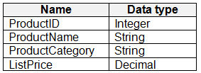

⭕ **A.** a stored procedure
⭕ **B.** a pipeline that contains a KQL activity
⭕ **C.** a Spark notebook
✅ **D.** a dataflow

**Correct answer:** D
**Most voted:** D

### Top explanations
- **David_Webb** (13 upvotes [Highly Voted]): In the Interactive reports requirement, it stated, "Whenever possible, the data engineers will use low-code tools for data ingestion".
- **VAzureD** (11 upvotes [Highly Voted]): D. a dataflow
  Es la mejor opción.
  "Whenever possible, the data engineers will use low-code tools for data ingestion."
  "Data will be loaded without transformation in one area of the AnalyticsPOC data store"
  
  
  A. a stored procedure
  No tiene sentido usar un procedimiento almacenado para hacer la carga.
  
  B. a pipeline that contains a KQL activity
  KQL es para datos en tiempo real
  
  C. a Spark notebook
  Podría valer, pero el texto pone,
  "Whenever possible, the data engineers will use low-code tools for data ingestion."
- **roflcopter123** (5 upvotes): That's a report requirement, not a data ingestion requirement. You are talking here how to get data from a place to the analyticsPOC, not getting the data from a semantic model directly into the report.
- **SamuComqi** (5 upvotes): D. a dataflow
  
  Even though the text reads "Data will be loaded without transformation in one area of the AnalyticsPOC data store": in general, dataflows are used when data transformations are involved after ingestion. As suggested by user BHARAT, the Copy Activity should be the optimal solution.
- **stilferx** (4 upvotes): IMHO,
  D (dataflow), because of this:  
  "Whenever possible, the data engineers will use low-code tools for data ingestion."

## Q2.9 (ID 911299)

Overview -
Litware, Inc. is a manufacturing company that has offices throughout North America. The analytics team at Litware contains data engineers, analytics engineers, data analysts, and data scientists.
Existing Environment -
Fabric Environment -
Litware has been using a Microsoft Power BI tenant for three years. Litware has NOT enabled any Fabric capacities and features.
Available Data -
Litware has data that must be analyzed as shown in the following table.
The Product data contains a single table and the following columns.
The customer satisfaction data contains the following tables:
Survey -
Question -
Response -
For each survey submitted, the following occurs:
One row is added to the Survey table.
One row is added to the Response table for each question in the survey.
The Question table contains the text of each survey question. The third question in each survey response is an overall satisfaction score. Customers can submit a survey after each purchase.
User Problems -
The analytics team has large volumes of data, some of which is semi-structured. The team wants to use Fabric to create a new data store.
Product data is often classified into three pricing groups: high, medium, and low. This logic is implemented in several databases and semantic models, but the logic does NOT always match across implementations.
Requirements -
Planned Changes -
Litware plans to enable Fabric features in the existing tenant. The analytics team will create a new data store as a proof of concept (PoC). The remaining Liware users will only get access to the Fabric features once the PoC is complete. The PoC will be completed by using a Fabric trial capacity
The following three workspaces will be created:
AnalyticsPOC: Will contain the data store, semantic models, reports pipelines, dataflow, and notebooks used to populate the data store
DataEngPOC: Will contain all the pipelines, dataflows, and notebooks used to populate OneLake
DataSciPOC: Will contain all the notebooks and reports created by the data scientists
The following will be created in the AnalyticsPOC workspace:
A data store (type to be decided)
A custom semantic model -
A default semantic model -
Interactive reports -
The data engineers will create data pipelines to load data to OneLake either hourly or daily depending on the data source. The analytics engineers will create processes to ingest, transform, and load the data to the data store in the AnalyticsPOC workspace daily. Whenever possible, the data engineers will use low-code tools for data ingestion. The choice of which data cleansing and transformation tools to use will be at the data engineers’ discretion.
All the semantic models and reports in the Analytics POC workspace will use the data store as the sole data source.
Technical Requirements -
The data store must support the following:
Read access by using T-SQL or Python
Semi-structured and unstructured data
Row-level security (RLS) for users executing T-SQL queries
Files loaded by the data engineers to OneLake will be stored in the Parquet format and will meet Delta Lake specifications.
Data will be loaded without transformation in one area of the AnalyticsPOC data store. The data will then be cleansed, merged, and transformed into a dimensional model
The data load process must ensure that the raw and cleansed data is updated completely before populating the dimensional model
The dimensional model must contain a date dimension. There is no existing data source for the date dimension. The Litware fiscal year matches the calendar year. The date dimension must always contain dates from 2010 through the end of the current year.
The product pricing group logic must be maintained by the analytics engineers in a single location. The pricing group data must be made available in the data store for T-SOL. queries and in the default semantic model. The following logic must be used:
List prices that are less than or equal to 50 are in the low pricing group.
List prices that are greater than 50 and less than or equal to 1,000 are in the medium pricing group.
List prices that are greater than 1,000 are in the high pricing group.
Security Requirements -
Only Fabric administrators and the analytics team must be able to see the Fabric items created as part of the PoC.
Litware identifies the following security requirements for the Fabric items in the AnalyticsPOC workspace:
Fabric administrators will be the workspace administrators.
The data engineers must be able to read from and write to the data store. No access must be granted to datasets or reports.
The analytics engineers must be able to read from, write to, and create schemas in the data store. They also must be able to create and share semantic models with the data analysts and view and modify all reports in the workspace.
The data scientists must be able to read from the data store, but not write to it. They will access the data by using a Spark notebook
The data analysts must have read access to only the dimensional model objects in the data store. They also must have access to create Power BI reports by using the semantic models created by the analytics engineers.
The date dimension must be available to all users of the data store.
The principle of least privilege must be followed.
Both the default and custom semantic models must include only tables or views from the dimensional model in the data store. Litware already has the following Microsoft Entra security groups:
FabricAdmins: Fabric administrators
AnalyticsTeam: All the members of the analytics team
DataAnalysts: The data analysts on the analytics team
DataScientists: The data scientists on the analytics team
DataEngineers: The data engineers on the analytics team
AnalyticsEngineers: The analytics engineers on the analytics team
Report Requirements -
The data analysts must create a customer satisfaction report that meets the following requirements:
Enables a user to select a product to filter customer survey responses to only those who have purchased that product.
Displays the average overall satisfaction score of all the surveys submitted during the last 12 months up to a selected dat.
Shows data as soon as the data is updated in the data store.
Ensures that the report and the semantic model only contain data from the current and previous year.
Ensures that the report respects any table-level security specified in the source data store.
Minimizes the execution time of report queries.
Which type of data store should you recommend in the AnalyticsPOC workspace?

**Exhibits**
- Exhibit 1: 
- Exhibit 2: 

⭕ **A.** a data lake
⭕ **B.** a warehouse
✅ **C.** a lakehouse
⭕ **D.** an external Hive metastore

**Correct answer:** C
**Most voted:** C

### Top explanations
- **stilferx** (17 upvotes [Highly Voted]): IMHO,
  my answer is C. Because of that: """Semi-structured and unstructured data""" in the question
- **VAzureD** (12 upvotes [Highly Voted]): C. to lakehouse
  As a concept it exists in Fabric and is the most logical response for the given requirements,
  Technical Requirements -
  Semi-structured and unstructured data
  Files loaded by the data engineers to OneLake will be stored in the Parquet format and will meet Delta Lake specifications.
  
  A. a data lake
  As an answer it could be valid, but it is not really a concept that we have in Fabric.
  
  B. a warehouse
  It is not valid, because there is unstructured data.
  
  D. an external Hive metastore
  Has no sense.
  The Hive Metastore is a centralized repository that stores metadata related to the tables, partitions, columns, schemas, and other data structures used by Hive and Spark.
  Contains information about the PHYSICAL location of the data, the schemas of the tables, and the relationships between them.
- **David_Webb** (4 upvotes): In the technical requirement, it stated "Semi-structured and unstructured data" for the AnalyticsPOC data store. Thus, it must be a lakehouse.
- **Nicofr** (4 upvotes): "Read access by using T-SQL or Python
  Semi-structured and unstructured data"
- **SamuComqi** (3 upvotes): C. a lakehouse
  
  The data store must handle semi-structured and unstructured data, therefore a Lakehouse should be the optimal solution supporting read access with T-SQL and Python.

## Q2.10 (ID 911300)

You have a Fabric warehouse that contains a table named Staging.Sales. Staging.Sales contains the following columns.
You need to write a T-SQL query that will return data for the year 2023 that displays ProductID and ProductName and has a summarized Amount that is higher than 10,000.
Which query should you use?

**Exhibits**
- Exhibit 1: 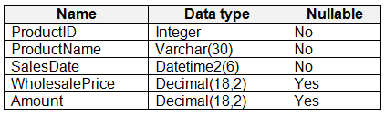

✅ **A.** 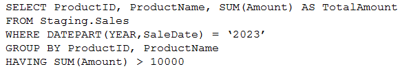
⭕ **B.** 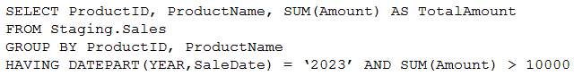
⭕ **C.** 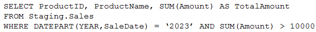
⭕ **D.** 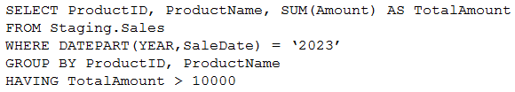

**Correct answer:** A
**Most voted:** A

### Top explanations
- **TashaP** (26 upvotes [Highly Voted]): Anything without HAVING() + an aggregate is incorrect. HAVING was created for SQL to deal with filtering using an aggregate. Any option that references TotalAmount is incorrect because there is no nested statement in the syntax. Anything that uses HAVING() + DATEPART() is incorrect because you use a where clause for that. The answer is A.
- **werka** (7 upvotes): In D TotalAmount is an alias (HAVING TotalAmount > 10000) and only ORDER BY accepts aliases.
- **rmeng** (4 upvotes): SELECT ProductID, ProductName, SUM(Amount) AS TotalAmount
  FROM Staging.Sales
  WHERE DATEPART(YEAR, SaleDate) = '2023'
  GROUP BY ProductID, ProductName
  HAVING SUM(Amount) > 10000
- **objecto** (4 upvotes): TotalAmount can not be used with HAVING. You must use SUM(Amount)
- **JpLZa** (3 upvotes): I would say Option D. 
  Sum(Amount) AS TotalAmount is effectively TotalAmount > 10000

## Q2.11 (ID 911301)

HOTSPOT -
You have a data warehouse that contains a table named Stage.Customers. Stage.Customers contains all the customer record updates from a customer relationship management (CRM) system. There can be multiple updates per customer.
You need to write a T-SQL query that will return the customer ID, name. postal code, and the last updated time of the most recent row for each customer ID.
How should you complete the code? To answer, select the appropriate options in the answer area.
NOTE: Each correct selection is worth one point.

**Exhibits**
- Exhibit 1: 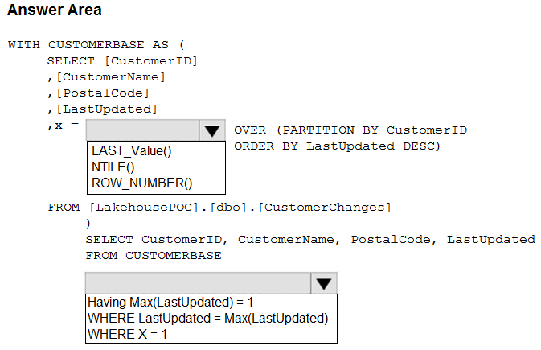

_HOTSPOT — the original ExamTopics question expects you to mark areas on the exhibit above; the correct hotspot coordinates are not published._

**Most voted:**
- First drop-down box: ROW_NUMBER()
- Second drop-down box: WHERE X = 1

### Top explanations
- **R3D_ENGINEER** (39 upvotes [Highly Voted]): The correct query is:
  WITH CUSTOMERBASE AS (
       SELECT CustomerID, CustomerName, PostalCode, LastUpdated,
            ROW_NUMBER() OVER(PARTITION BY CustomerID ORDER BY LastUpdated DESC) as X
       FROM LakehousePOC.dbo.CustomerChanges
       )
  
  SELECT CustomerID, CustomerName, PostalCode, LastUpdated
  FROM CUSTOMERBASE
  WHERE X = 1
- **varun_r** (17 upvotes [Highly Voted]): Answer is RowNumber and X=1 -- No Brainer
- **TashaP** (5 upvotes): ROW_NUMBER() + X = 1
- **David_Webb** (5 upvotes): First drop-down box:  ROW_NUMBER()
  Second drop-down box:  WHERE X = 1 
  As ORDER BY LastUpdated DESC was used, the first row will be the most recent row.
- **Momoanwar** (5 upvotes): Row_number
  X=1
  
  Row_number give row position and start from 1

## Q2.13 (ID 911303)

You are the administrator of a Fabric workspace that contains a lakehouse named Lakehouse1. Lakehouse1 contains the following tables:
Table1: A Delta table created by using a shortcut
Table2: An external table created by using Spark
Table3: A managed table -
You plan to connect to Lakehouse1 by using its SQL endpoint.
What will you be able to do after connecting to Lakehouse1?

✅ **A.** Read Table3.
⭕ **B.** Update the data Table3.
⭕ **C.** Read Table2.
⭕ **D.** Update the data in Table1.

**Correct answer:** A
**Most voted:** A

### Top explanations
- **conie** (62 upvotes [Highly Voted]): B & D is out as you can’t update a table in lakehouse using SQL endpoint as this is read only. You will need to use spark or dataflows. 
  C is out because when you create external table using spark, you can see the table from the lakehouse but you can’t see the table from SQL endpoint let alone ready.
  
  A is the answer, as I was able to see and read a managed table using SQL Endpoint
- **stilferx** (4 upvotes): IMHO, 
  the answer is A.
  
  updates are prohibited at all. reading spark external table is a big no-no.
  Link: https://www.linkedin.com/pulse/use-shortcuts-instead-external-tables-reference-data-fabric-popovic/
- **a_51** (4 upvotes): A is correct, D is not. SQL endpoint is read-only.
  https://learn.microsoft.com/en-us/fabric/data-engineering/lakehouse-sql-analytics-endpoint
- **Sara0724** (3 upvotes): The SQL analytics endpoint operates in read-only mode over lakehouse Delta tables.
  External Delta tables created with Spark code won't be visible to the SQL analytics endpoint. https://learn.microsoft.com/en-us/fabric/data-engineering/lakehouse-sql-analytics-endpoint
- **Aruuu6** (3 upvotes): A is answer

## Q2.14 (ID 911304)

You have a Fabric tenant that contains a warehouse.
You use a dataflow to load a new dataset from OneLake to the warehouse.
You need to add a PowerQuery step to identify the maximum values for the numeric columns.
Which function should you include in the step?

⭕ **A.** Table.MaxN
⭕ **B.** Table.Max
⭕ **C.** Table.Range
✅ **D.** Table.Profile

**Correct answer:** D
**Most voted:** D

### Top explanations
- **lengzhai** (41 upvotes [Highly Voted]): D. Table.Profile
  
  https://learn.microsoft.com/en-us/powerquery-m/table-profile
- **woliveiras** (10 upvotes [Highly Voted]): B guys, "you need to add a step..."
- **amar5555** (9 upvotes): you will get summary in that max will include but it doesn't add as power query step so i think it is option b
- **PazaBIandData** (7 upvotes): Table.Max provides only a row with the max value per a single column. We have multiple of columns. It's d
- **stilferx** (5 upvotes): Sorry, was wrong. Answer id D, because of "for the numeric columns.", not only for one column

## Q2.15 (ID 911305)

You have a Fabric tenant that contains a machine learning model registered in a Fabric workspace.
You need to use the model to generate predictions by using the PREDICT function in a Fabric notebook.
Which two languages can you use to perform model scoring? Each correct answer presents a complete solution.
NOTE: Each correct answer is worth one point.

⭕ **A.** T-SQL
⭕ **B.** DAX
✅ **C.** Spark SQL
✅ **D.** PySpark

**Correct answer:** C, D
**Most voted:** CD

### Top explanations
- **mtroyano** (19 upvotes [Highly Voted]): Notebook only accepts the languages: PySpark, Spark, Spark SQL and SparkR
- **dev2dev** (6 upvotes): that indicates to use spark sql language.
- **DarioReymago** (4 upvotes): yes but you can use "%%sql" in a notebook
- **gtc108** (3 upvotes): https://learn.microsoft.com/en-us/fabric/data-science/tutorial-data-science-batch-scoring
  ou'll load the test dataset into a spark DataFrame and create an MLFlowTransformer object to generate batch predictions. You can then invoke the PREDICT function using one of following three ways:
  
  Transformer API from SynapseML
  Spark SQL API
  PySpark user-defined function (UDF)
- **olavrab8** (3 upvotes): Answer CD Correct
  T-SQL Cannot be used, nor DAX

## Q2.16 (ID 911306)

You are analyzing the data in a Fabric notebook.
You have a Spark DataFrame assigned to a variable named df.
You need to use the Chart view in the notebook to explore the data manually.
Which function should you run to make the data available in the Chart view?

⭕ **A.** displayHTML
⭕ **B.** show
⭕ **C.** write
✅ **D.** display

**Correct answer:** D
**Most voted:** D

### Top explanations
- **stilferx** (17 upvotes [Highly Voted]): IMHO, 
  
  the answer is D.
  Link is here: https://learn.microsoft.com/en-us/fabric/data-engineering/notebook-visualization
  
  Point is: You can use the display function on dataframes that created in PySpark and Scala on Spark DataFrames or Resilient Distributed Datasets (RDD) functions to produce the rich dataframe table view and chart view.
- **TashaP** (5 upvotes [Highly Voted]): D is the correct answer (the keyword is chart view)
  
  A is another possibility for displaying data but not based on the requirements of this question,  it is separate from chart view. 
  
  https://learn.microsoft.com/en-us/fabric/data-engineering/notebook-visualization
- **JG1984** (3 upvotes): Out of all the reviewers, I like the way you explain all the answers. Just wondering if you were able to ace the exam
- **Miro_dd** (3 upvotes): Display dataframe function should be correct
- **arrow040** (2 upvotes): The .show function displays the contents of a Spark DataFrame in a tabular format within the notebook but does not enable interactive data exploration with the Chart view. To make the data available in the Chart view for interactive visualization, you should use the display function (Answer D)

## Q2.18 (ID 911308)

DRAG DROP -
You have a Fabric tenant that contains a semantic model. The model contains data about retail stores.
You need to write a DAX query that will be executed by using the XMLA endpoint. The query must return a table of stores that have opened since December 1, 2023.
How should you complete the DAX expression? To answer, drag the appropriate values to the correct targets. Each value may be used once, more than once, or not at all. You may need to drag the split bar between panes or scroll to view content.
NOTE: Each correct selection is worth one point.

**Exhibits**
- Exhibit 1: 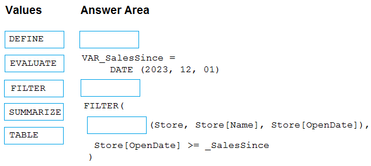

_DRAG DROP — the original ExamTopics question expects you to drag and drop items; the correct targets are not published._

**Most voted:**
1) DEFINE
2) EVALUATE
3) SUMMARIZE

### Top explanations
- **wojciech_wie** (74 upvotes [Highly Voted]): 1) DEFINE
  2) EVALUATE
  3) SUMMARIZE
- **seaverick** (11 upvotes [Highly Voted]): I have tested it in dax.do changing fields and ans is DEFINE, EVALUATE and SUMMARIZE:
  
  DEFINE
      VAR _SalesSince =
          DATE ( 2000, 12, 01 )
  
  EVALUATE
  FILTER (
      SUMMARIZE ( 'Product', 'Product'[Product Name], 'Product'[Available Date] ),
      'Product'[Available Date] >= _SalesSince
  )
- **6d1de25** (5 upvotes): The correct syntax is:
  Define
  Evaluate
  Table
  
  https://learn.microsoft.com/en-us/dax/define-statement-dax
  https://learn.microsoft.com/en-us/dax/evaluate-statement-dax
- **a_51** (5 upvotes): The VAR_SalesSince should have a space between them to be:
  VAR _SalesSince.
- **Jeff_Zhu** (4 upvotes): DEFINE
  EVALUATE
  SUMMARIZE

## Q2.19 (ID 911309)

You have a Fabric workspace named Workspace1 that contains a dataflow named Dataflow1. Dataflow1 has a query that returns 2,000 rows.
You view the query in Power Query as shown in the following exhibit.
What can you identify about the pickupLongitude column?

**Exhibits**
- Exhibit 1: 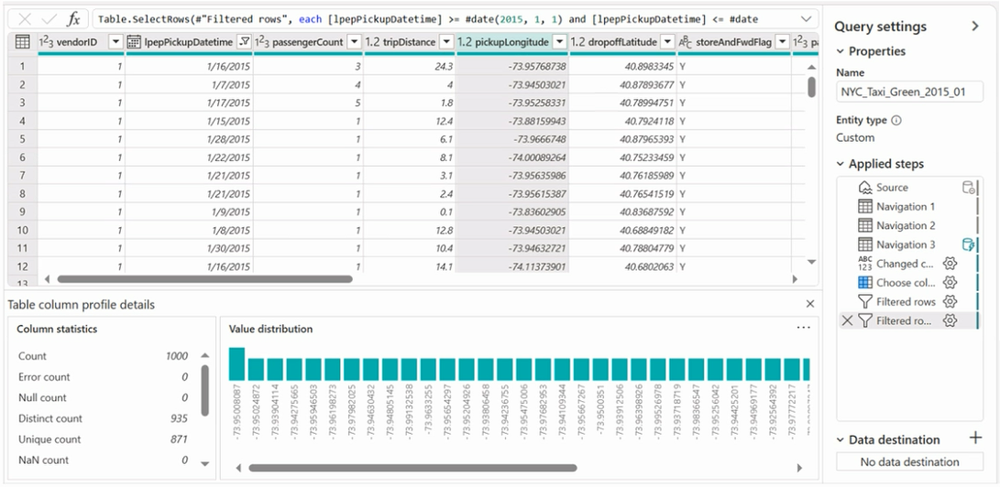

✅ **A.** The column has duplicate values.
⭕ **B.** All the table rows are profiled.
⭕ **C.** The column has missing values.
⭕ **D.** There are 935 values that occur only once.

**Correct answer:** A
**Most voted:** A

### Top explanations
- **nmosq** (34 upvotes [Highly Voted]): Answer A.
  
  B - Not all the rows are profiled in the sample (only 1000 of 2000)
  C- From the column statistics, you don't have any missing values in the sample
  D- The values that occur only once are 871 (unique count)
- **a_51** (5 upvotes [Highly Voted]): A
  We see a count of 1000 (which is the limit by default) we do not know all the data is read, but we can see of the 1000 distinct is less and so we have duplicate values.
- **Naqib** (4 upvotes): Answer A:
  
  Distinct Value: This refers to all different values present in a dataset. When you retrieve distinct values from a column, you eliminate duplicate values so that each value is shown once. For example, if a column contains the values [1, 2, 2, 3, 3, 3], the distinct values would be [1, 2, 3].
  
  Unique Value: This usually refers to values that appear only once in the dataset. Unlike distinct values, a unique value will only be considered if it has no duplicates at all. For example, if a column contains the values [1, 2, 2, 3, 3, 3], the unique values would be [1], since only 1 appears without repetition.
- **Momoanwar** (4 upvotes): Its A
  Only one column selected here
  No informations about missing values
  Distinct count not mean exist only once
- **wojciech_wie** (3 upvotes): correct

## Q2.23 (ID 911313)

HOTSPOT -
You have a Fabric tenant that contains a warehouse named Warehouse1. Warehouse1 contains three schemas named schemaA, schemaB, and schemaC.
You need to ensure that a user named User1 can truncate tables in schemaA only.
How should you complete the T-SQL statement? To answer, select the appropriate options in the answer area.
NOTE: Each correct selection is worth one point.

**Exhibits**
- Exhibit 1: 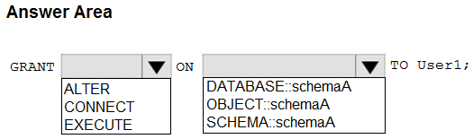

_HOTSPOT — the original ExamTopics question expects you to mark areas on the exhibit above; the correct hotspot coordinates are not published._

**Most voted:**
- ALTER → SCHEMA.
- SCHEMA: schema_name to define a particular schema for tables

### Top explanations
- **estrelle2008** (32 upvotes [Highly Voted]): ALTER/SCHEMA 
  This statement allows to alter (which includes truncating) tables within the specified schema. It ensures that the permission is restricted to schemaA and does not grant access to other schemas or objects.
- **KipngenohVinnie** (6 upvotes [Highly Voted]): GRANT ALTER ON SCHEMA::schemaA TO User1;
- **Valcon_doo_NoviSad** (5 upvotes): truncating tables is not even supported in warehouse so this question is pointless, good job microsoft...
- **VAzureD** (4 upvotes): ALTER/SCHEMA
  
  https://learn.microsoft.com/en-us/sql/t-sql/statements/grant-schema-permissions-transact-sql?view=sql-server-ver16
  
  GRANT permission  [ ,...n ] ON SCHEMA :: schema_name  
      TO database_principal [ ,...n ]  
      [ WITH GRANT OPTION ]  
      [ AS granting_principal ]
- **thomaski123** (4 upvotes): ALTER is required for Truncate https://learn.microsoft.com/en-us/sql/t-sql/statements/truncate-table-transact-sql?view=sql-server-ver16&viewFallbackFrom=fabric

## Q2.31 (ID 911321)

HOTSPOT -
You have the source data model shown in the following exhibit.
The primary keys of the tables are indicated by a key symbol beside the columns involved in each key.
You need to create a dimensional data model that will enable the analysis of order items by date, product, and customer.
What should you include in the solution? To answer, select the appropriate options in the answer area.
NOTE: Each correct selection is worth one point.

**Exhibits**
- Exhibit 1: 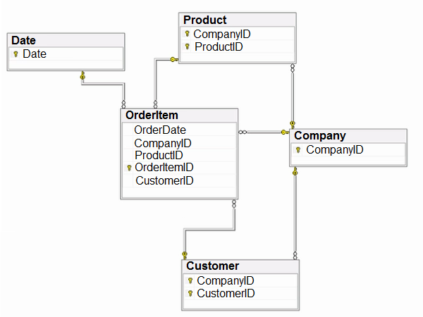
- Exhibit 2: 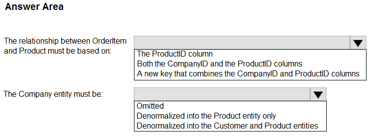

_HOTSPOT — the original ExamTopics question expects you to mark areas on the exhibit above; the correct hotspot coordinates are not published._

**Most voted:**
- the question says : "You need to create a dimensional data model that will enable the analysis of order items by date, product, and customer."
- Therefore, the analysis of order item by date, product and customer doesn't need the company table (it can be omitted) !
- The answer is A and A

### Top explanations
- **thuss** (38 upvotes [Highly Voted]): I think what they are trying to get at is that you denormalize the company information into both tables so that you do not need the CompanyID anymore, which would then make the relationship between OrderItem and Product only based on ProductID. Hence I think A and C.
  But honestly that whole model is just weird.
- **zerone72** (25 upvotes [Highly Voted]): the question says : "You need to create a dimensional data model that will enable the analysis of order items by date, product, and customer."
  Therefore, the analysis of order item by date, product and customer doesn't need the company table (it can be omitted) ! 
  The answer is A and A
- **d47320d** (16 upvotes): Agree up to the denormalization part. 
  
  But that does not imply that the relationship between OrderItem and Product should only be based on ProductID. The Product table has two columns as a primary key, ProductID and CompanyID.
  
  After denormalization, a two columns join should be performed in order to establish the proper relationships and proper analysis.
  
  So correct answers are B, C i.e. the given one.
- **metiii** (9 upvotes): The given answer is correct. 
  The company entity should be denormalized into both product and customer tables. Company ID is part of the customer table and you cannot just denormalize it into the product table.
  and for the relationship between OrderItem and Product, you cannot just reference a part of the primary key. This is not how referencing works, your relationship would be wrong, if you only use product id and a product id is repeated for two different company IDs your relationship would consider both of them as the same product.
- **IK247** (6 upvotes): C and C 
  The company ID and Product ID combined together will make a unique Identifier.  You have to denormalise to reduce the number of joins in the model.

## Q2.36 (ID 911326)

You have a Fabric tenant that contains a lakehouse.
You plan to query sales data files by using the SQL endpoint. The files will be in an Amazon Simple Storage Service (Amazon S3) storage bucket.
You need to recommend which file format to use and where to create a shortcut.
Which two actions should you include in the recommendation? Each correct answer presents part of the solution.
NOTE: Each correct answer is worth one point.

⭕ **A.** Create a shortcut in the Files section.
⭕ **B.** Use the Parquet format
⭕ **C.** Use the CSV format.
✅ **D.** Create a shortcut in the Tables section.
✅ **E.** Use the delta format.

**Correct answer:** D, E
**Most voted:** DE

### Top explanations
- **Felgas** (36 upvotes [Highly Voted]): Answer is DE.
  To be able to use the SQL Endpoint you need to create the shortcut in the Tables section. The file also needs to be in the delta format to be recognised as a managed table. If you try to add a parquet file to the tables section, it will not be recognised as a table object and you won't be able to query it.
- **d47320d** (24 upvotes [Highly Voted]): B,D are the correct answers, since the Parquet file format within S3, and the pointing to it via a lakehouse Table shortcut, allows the shorcut to be recognized by Fabric as a Delta table and hence provide access to the SQL endpoint.
  
  
  Explanation:
  As per the provided links: "If the target of the shortcut contains data in the Delta\Parquet format, the lakehouse automatically synchronizes the metadata and recognizes the folder as a table".
  It is stated that S3 contains sales data files, that is files not tables. Besides, delta tables are not supported in S3. So the file format needs to be either CSV or Parquet, leading us to choose the latter for all the reasons stated in other comments.
  So creating a shortcut in Table section that points to S3 Parquet files, will allow Fabric to recognise it as a Delta table, which in turn enables the SQL endpoint.
- **d47320d** (11 upvotes): A parquet file shortcut is recognized as a managed table. Delta format not supported by S3. The answer cannot be E.
- **woliveiras** (7 upvotes): D and E. Tested. You can turn delta files available in your AWS Service and create a shortcut here.
- **woliveiras** (4 upvotes): If you need just query, as they mentioned. Parquet (read in parallel) and shortcut in the table solve this problem. you don't need delta.

## Q2.37 (ID 911327)

You have a Fabric tenant that contains a lakehouse named Lakehouse1. Lakehouse1 contains a subfolder named Subfolder1 that contains CSV files.
You need to convert the CSV files into the delta format that has V-Order optimization enabled.
What should you do from Lakehouse explorer?

✅ **A.** Use the Load to Tables feature.
⭕ **B.** Create a new shortcut in the Files section.
⭕ **C.** Create a new shortcut in the Tables section.
⭕ **D.** Use the Optimize feature.

**Correct answer:** A
**Most voted:** A

### Top explanations
- **Sanji931** (11 upvotes [Highly Voted]): With ''Load to tables'' : tables are always loaded using the Delta Lake table format with V-Order optimization enabled.
  https://learn.microsoft.com/en-us/fabric/data-engineering/load-to-tables#load-to-table-capabilities-overview
- **XiltroX** (4 upvotes): A is the correct answer.
- **Momoanwar** (3 upvotes): Correct
- **fabric1** (3 upvotes): Hi IshtarSQL, 
  the "Optimize" feature is only applicable on already existing tables and cannot convert CSV files as far as I know. When loading a CSV file as table using the "Load to Tables" functionality, the Optimize check mark is set by default. Therefore, A should be correct. 
  Cheers fabric1
- **byyleoo** (2 upvotes): A is correct

## Q2.40 (ID 911330)

You have source data in a folder on a local computer.
You need to create a solution that will use Fabric to populate a data store. The solution must meet the following requirements:
Support the use of dataflows to load and append data to the data store.
Ensure that Delta tables are V-Order optimized and compacted automatically.
Which type of data store should you use?

✅ **A.** a lakehouse
⭕ **B.** an Azure SQL database
⭕ **C.** a warehouse
⭕ **D.** a KQL database

**Correct answer:** A
**Most voted:** A

### Top explanations
- **bvmony2294** (24 upvotes [Highly Voted]): I have recently taken the exam and this question was asked.Its a multiple choice question.we need to select 2 options.so as per the comments both lakehouse and warehouse are support delta tables and v-order optimization.Its A,C
- **bigdave987** (10 upvotes [Highly Voted]): The answer is correct - C Warehouse
  The key to this question is "Ensure that Delta tables are V-Order optimized".
  V-Order optimization isn't guaranteed in Lakehouse, and there are times when you need to run OPTIMIZE to ensure the tables are V-Order Optimized.
  This link here shows the answer:
  https://learn.microsoft.com/en-us/fabric/data-warehouse/ingest-data#best-practices
  The Note says "Regardless of how you ingest data into warehouses, the parquet files produced by the data ingestion task will be optimized using V-Order write optimization... Unlike in Fabric Data Engineering, V-Order is a global setting in Synapse Data Warehouse that cannot be disabled."
- **XiltroX** (8 upvotes): A - The only logical answer here. B is an Azure SQL database and is an Azure product but doesn't have V-Order. C is a just a generic warehouse and once again, doesn't necessarily contain any V-Order feature. D is a database that uses KQL and is irrelevant of the question.
- **Gecig** (5 upvotes): https://learn.microsoft.com/en-us/fabric/data-warehouse/ingest-data#best-practices
  The Note says "Regardless of how you ingest data into warehouses, the parquet files produced by the data ingestion task will be optimized using V-Order write optimization... Unlike in Fabric Data Engineering, V-Order is a global setting in Synapse Data Warehouse that cannot be disabled."
  
  Therefore the answer is warehouse
- **Momoanwar** (5 upvotes): Delta table... = Lakehouse

## Q2.43 (ID 911333)

You have a Fabric tenant that contains a data pipeline.
You need to ensure that the pipeline runs every four hours on Mondays and Fridays.
To what should you set Repeat for the schedule?

⭕ **A.** Daily
⭕ **B.** By the minute
✅ **C.** Weekly
⭕ **D.** Hourly

**Correct answer:** C
**Most voted:** C

### Top explanations
- **Sanji931** (18 upvotes [Highly Voted]): Answer C : Weekly.
  The only way to do this is to set the schedule to ''Weekly'', set the days on Monday and Friday and add manually 6 Time of 4 hour intervals.
- **XiltroX** (4 upvotes): This is a no-brainer as the only way to make this work is to set the schedule as weekly and specify the pipeline to run on Mondays and Wednesdays.
- **Nicofr** (4 upvotes): Weekly allow to choose the days and the time
- **282b85d** (3 upvotes): Schedule Type: Weekly
  Days: Monday, Friday
  Interval: Every 4 hours
- **Momoanwar** (3 upvotes): Weekly

## Q2.44 (ID 911334)

You have a Fabric tenant that contains a warehouse.
Several times a day, the performance of all warehouse queries degrades. You suspect that Fabric is throttling the compute used by the warehouse.
What should you use to identify whether throttling is occurring?

⭕ **A.** the Capacity settings
⭕ **B.** the Monitoring hub
⭕ **C.** dynamic management views (DMVs)
✅ **D.** the Microsoft Fabric Capacity Metrics app

**Correct answer:** D
**Most voted:** D

### Top explanations
- **XiltroX** (13 upvotes [Highly Voted]): From MS Learn: 
  The Microsoft Capacity Metrics app, also known as the metrics app, serves as a monitoring tool within the Microsoft Power BI service. It offers functionalities to track and analyze the resource utilization
- **AndreaRosho1** (3 upvotes [Most Recent]): https://learn.microsoft.com/en-us/fabric/data-warehouse/compute-capacity-smoothing-throttling
  "Just like most Warehouse operations, dynamic management views (DMVs) are also classified as background and covered by the "Background Rejection" policy. As a result, DMVs cannot be queried when capacity is throttled. Even though DMVs are not available, capacity admins can go to Microsoft Fabric Capacity Metrics app to understand the root cause."
- **Momoanwar** (2 upvotes): Microsoft Fabric Capacity Metrics app for trottling
- **stilferx** (1 upvotes): IMHO, "D"
  
  Because:
  Track rejected operations
  The Microsoft Fabric Capacity Metrics app drilldown allows admins to see operations that were rejected during a throttling event. 
  
  Here: https://learn.microsoft.com/en-us/fabric/enterprise/throttling#track-rejected-operations
- **prabhjot** (1 upvotes): yes Ans D - https://learn.microsoft.com/en-us/fabric/enterprise/metrics-app

## Q2.45 (ID 911335)

HOTSPOT -
You have a Fabric workspace that uses the default Spark starter pool and runtime version 1.2.
You plan to read a CSV file named Sales_raw.csv in a lakehouse, select columns, and save the data as a Delta table to the managed area of the lakehouse. Sales_raw.csv contains 12 columns.
You have the following code.
For each of the following statements, select Yes if the statement is true. Otherwise, select No.
NOTE: Each correct selection is worth one point.

**Exhibits**
- Exhibit 1: 
- Exhibit 2: 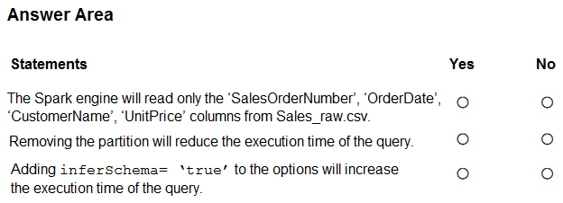

_HOTSPOT — the original ExamTopics question expects you to mark areas on the exhibit above; the correct hotspot coordinates are not published._

**Most voted:**
2. Yes partitioning creates some overhead since Spark needs to create more files
3. Yes infereSchema forces spark to read the file twice once for schema and once for data

### Top explanations
- **metiii** (44 upvotes [Highly Voted]): 1. No, this is called filter pushdown / predicate pushdown / column pruning. This config is available when reading from a columnar type like parquet, I didn't find anything related to csv, I know that you can pushdown a predicate on csv to make it only read some rows in that case it works but it probably doesn't work for selecting columns so spark will read the entire file then filters the columns.
  2. Yes partitioning creates some overhead since Spark needs to create more files
  3. Yes infereSchema forces spark to read the file twice once for schema and once for data
- **282b85d** (23 upvotes [Highly Voted]): N-N-Y
  •No: The Spark engine will initially read all columns from the CSV file because the .select() transformation is applied after the data has been read into memory. Therefore, all 12 columns from Sales_raw.csv are read before the selection of specific columns is applied.
  •No: Removing the partition might not necessarily reduce the execution time. While there might be some overhead in writing data to partitions, the overall impact on read performance, especially for large datasets, is usually beneficial. The query execution time for saving might be higher due to partitioning, but the read performance improvement usually outweighs this cost.
  •Yes: Adding inferSchema = 'true' will increase the execution time of the query because Spark will need to read through the entire dataset to determine the data types of each column. This extra pass over the data adds to the initial read time.
- **calvintcy** (11 upvotes): I took the test today. This question was included, but the option 'Removing the partition will reduce the execution time of the query' has been replaced by 'Will the Year column replace the OrderDate column?'. My answer was No.
- **XiltroX** (11 upvotes): The answer is probably YNY
  1. Those are exactly the columns that are being read. So Yes
  2. Removing the PartitionBy line would not result in any performance changes. So NO
  3. Adding inferSchema as True WILL result in extra time in execution as it will make the engine go over the data twice (one to read data and the other time to read Schema). So YES.
- **stilferx** (6 upvotes): IMHO, 
  1. N
  2. N - arguable
  3. Y
  
  1 No - because it is CSV. It will be read in full (in contrast to parquet)
  2 No - well, maybe 0.5% slower due to creating a new files. But actually - no
  3 Yes - because infering schema - it is additional process

## Q2.46 (ID 911336)

You have a Fabric tenant that contains a warehouse.
A user discovers that a report that usually takes two minutes to render has been running for 45 minutes and has still not rendered.
You need to identify what is preventing the report query from completing.
Which dynamic management view (DMV) should you use?

✅ **A.** sys.dm_exec_requests
⭕ **B.** sys.dm_exec_sessions
⭕ **C.** sys.dm_exec_connections
⭕ **D.** sys.dm_pdw_exec_requests

**Correct answer:** A
**Most voted:** A

### Top explanations
- **Sanji931** (14 upvotes [Highly Voted]): Answer is A. 
  https://learn.microsoft.com/en-us/fabric/data-warehouse/monitor-using-dmv
- **Pegooli** (3 upvotes): sys.dm_pdw_exec_requests: This DMV provides information about the status of requests (queries) executed in SQL Data Warehouse (now known as Azure Synapse Analytics) environments. It includes details about query execution, such as start time, end time, status, and any error messages. This DMV is particularly useful for diagnosing long-running or stuck queries.
- **rlo123** (3 upvotes): D.   A or D are really close, but since it is Azure Synapse Analytics D is probably the best answer.   Why sys.dm_pdw_exec_requests is better for this Fabric scenario:
  
  Fabric's MPP architecture: Fabric warehouses utilize a distributed architecture where queries are broken down and processed across multiple compute nodes. This is why sys.dm_pdw_exec_requests is the ideal tool.
  MPP-specific insights: This DMV gives you visibility into how the query is being executed across the nodes, which can reveal bottlenecks or performance issues that wouldn't be apparent in sys.dm_exec_requests.
  Targeted troubleshooting: With the MPP-specific data from sys.dm_pdw_exec_requests, you can pinpoint the exact steps or nodes causing the slow performance, leading to a more efficient resolution.
- **rlo123** (3 upvotes): sys.dm_exec_requests is the correct answer after a lot more review and searching, can't delete my original comment, but here is why....In the context of Microsoft Fabric, sys.dm_exec_requests would be the appropriate DMV to use for monitoring running queries, as it is specifically designed for the SQL engine within Fabric.
  
  sys.dm_pdw_exec_requests is a DMV designed for Azure Synapse Analytics dedicated SQL pools (formerly SQL Data Warehouse). While Fabric's warehouse engine is based on SQL Server technology, it's not directly compatible with the DMVs specific to Azure Synapse Analytics.
- **dvenkatesh** (3 upvotes): Answer would be D, I guess...
  Here the key word might be warehouse...
  The sys.dm_exec_requests dynamic management view is used in SQL Server to provide information about each request that is executing within SQL Server. On the other hand, the sys.dm_pdw_exec_requests dynamic management view is used in Azure SQL Data Warehouse to provide similar information about each request executing within the data warehouse environment. Both views offer insights into the current status and details of queries running in their respective environments.

## Q2.47 (ID 911337)

DRAG DROP -
You are creating a data flow in Fabric to ingest data from an Azure SQL database by using a T-SQL statement.
You need to ensure that any foldable Power Query transformation steps are processed by the Microsoft SQL Server engine.
How should you complete the code? To answer, drag the appropriate values to the correct targets. Each value may be used once, more than once, or not at all. You may need to drag the split bar between panes or scroll to view content.
NOTE: Each correct selection is worth one point.

**Exhibits**
- Exhibit 1: 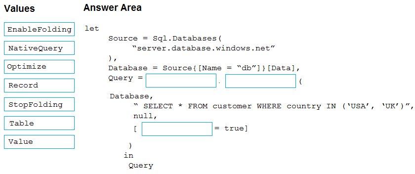

_DRAG DROP — the original ExamTopics question expects you to drag and drop items; the correct targets are not published._

**Most voted:**
- IMHO,
- Value -> NativeQuery -> EnableFolding is good :)
- Because of here:
- Value.NativeQuery(Source, "SELECT DepartmentID, Name FROM HumanResources.Department WHERE GroupName = 'Research and Development'  ", null, [EnableFolding = true])

### Top explanations
- **SamuComqi** (29 upvotes [Highly Voted]): * Value
  * NativeQuery
  * EnableFolding
  
  Source: https://learn.microsoft.com/en-us/power-query/native-query-folding
- **282b85d** (3 upvotes [Most Recent]): •Value.NativeQuery: This function is used to execute a native SQL query directly against the data source. This ensures that the query is processed on the server-side, which can significantly improve performance by leveraging the database engine's capabilities.
  •EnableFolding: By setting EnableFolding to true, you are instructing Power Query to allow query folding for any subsequent transformations that can be pushed down to the SQL Server engine. This means that Power Query will try to push as much of the query logic as possible to the database engine.
- **stilferx** (3 upvotes): IMHO,
  Value -> NativeQuery -> EnableFolding is good :)
  
  Because of here:
  Value.NativeQuery(Source, "SELECT DepartmentID, Name FROM HumanResources.Department WHERE GroupName = 'Research and Development'  ", null, [EnableFolding = true])
  
  Link: 
  https://learn.microsoft.com/en-us/power-query/native-query-folding#use-valuenativequery-function
- **XiltroX** (3 upvotes): Answer is correct
- **Momoanwar** (2 upvotes): Correct

## Q2.48 (ID 911338)

DRAG DROP -
You have a Fabric tenant that contains a lakehouse named Lakehouse1.
Readings from 100 IoT devices are appended to a Delta table in Lakehouse1. Each set of readings is approximately 25 KB. Approximately 10 GB of data is received daily.
All the table and SparkSession settings are set to the default.
You discover that queries are slow to execute. In addition, the lakehouse storage contains data and log files that are no longer used.
You need to remove the files that are no longer used and combine small files into larger files with a target size of 1 GB per file.
What should you do? To answer, drag the appropriate actions to the correct requirements. Each action may be used once, more than once, or not at all. You may need to drag the split bar between panes or scroll to view content.
NOTE: Each correct selection is worth one point.

**Exhibits**
- Exhibit 1: 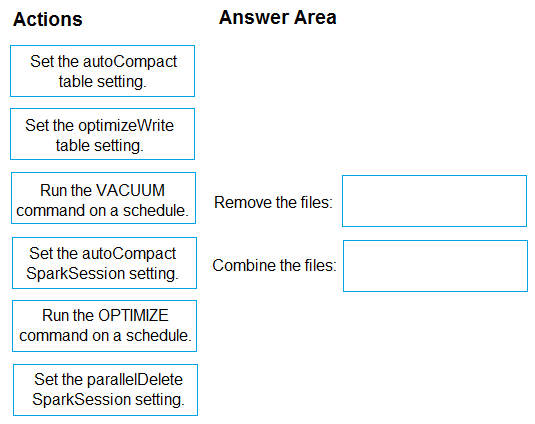

_DRAG DROP — the original ExamTopics question expects you to drag and drop items; the correct targets are not published._

**Most voted:**
- VACUUM: to remove old files no longer referenced.
- OPTIMIZE: to create fewer files with a larger size.

### Top explanations
- **SamuComqi** (24 upvotes [Highly Voted]): VACUUM: to remove old files no longer referenced.
  OPTIMIZE: to create fewer files with a larger size.
  
  Sources:
  * https://learn.microsoft.com/en-us/fabric/data-engineering/delta-optimization-and-v-order?tabs=sparksql
  * VACUUM: https://docs.delta.io/latest/delta-utility.html#-delta-vacuum
  * OPTIMIZE: https://docs.delta.io/latest/optimizations-oss.html
- **Momoanwar** (3 upvotes): Correct :
  OPTIMIZE	Improves query performance by optimizing file sizes. See Compact data files with optimize on Delta Lake.
  VACUUM	Reduces storage costs by deleting data files no longer referenced by the table. See Remove unused data files with vacuum.
- **Pegooli** (2 upvotes [Most Recent]): answer is correct :)
- **Valcon_doo_NoviSad** (2 upvotes): I agree that it is VACUUM and OPTIMIZE, but I would say Set the optimizeWrite table setting (B) and not Run the OPTIMIZE command on a schedule (E).
- **282b85d** (1 upvotes): • Remove the files that are no longer used:
  Run the VACUUM command on a schedule: The VACUUM command cleans up old files and log files that are no longer needed by the Delta table, helping to free up storage and potentially improve performance by reducing the number of files the query engine needs to consider.
  • Combine small files into larger files:
  Run the OPTIMIZE command on a schedule: The OPTIMIZE command compacts small files into larger ones, improving read performance by reducing the overhead associated with opening many small files. This can be particularly useful when you have a large number of small files due to frequent appends of small data sets.

## Q2.49 (ID 911339)

You need to create a data loading pattern for a Type 1 slowly changing dimension (SCD).
Which two actions should you include in the process? Each correct answer presents part of the solution.
NOTE: Each correct answer is worth one point.

✅ **A.** Update rows when the non-key attributes have changed.
⭕ **B.** Insert new rows when the natural key exists in the dimension table, and the non-key attribute values have changed.
⭕ **C.** Update the effective end date of rows when the non-key attribute values have changed.
✅ **D.** Insert new records when the natural key is a new value in the table.

**Correct answer:** A, D
**Most voted:** AD

### Top explanations
- **fabric1** (22 upvotes [Highly Voted]): Type 1 SCD does not preserve history, therefore no end dates for table entries exists. A and D are correct.
- **sraakesh95** (4 upvotes): AD makes sense given the type of SCD as no history is maintained and any updates on the columns are taken care of by replacing the values then and there.
  
  But, still a bit skeptical about C, since that is a part of SCD too in case we have certain audit columns that we would have to update. If the end_date is an audit column to update the date and time of last entry into a record, then, it would be required to be updated too.
- **282b85d** (3 upvotes): A. Update rows when the non-key attributes have changed: In a Type 1 SCD, when a change is detected in any of the non-key attributes of an existing row, the current row is updated with the new values. This type of SCD does not keep any historical data; it simply overwrites the old data with the new data.
  D. Insert new records when the natural key is a new value in the table: When a new record (with a new natural key) is encountered that does not already exist in the dimension table, it is inserted as a new row. This is necessary to ensure that all new entities are captured in the dimension.
- **thuss** (3 upvotes): AD = SCD1, BC = SCD2
- **stilferx** (2 upvotes): IMHO, A & D is good.
  
  Taking into account this: A Type 1 SCD always reflects the latest values, and when changes in source data are detected, the dimension table data is overwritten. 
  
  Link: https://learn.microsoft.com/en-us/training/modules/populate-slowly-changing-dimensions-azure-synapse-analytics-pipelines/3-choose-between-dimension-types

## Q2.51 (ID 911341)

You are analyzing customer purchases in a Fabric notebook by using PySpark.
You have the following DataFrames:
transactions: Contains five columns named transaction_id, customer_id, product_id, amount, and date and has 10 million rows, with each row representing a transaction. customers: Contains customer details in 1,000 rows and three columns named customer_id, name, and country.
You need to join the DataFrames on the customer_id column. The solution must minimize data shuffling.
You write the following code.
from pyspark.sql import functions as F
results =
Which code should you run to populate the results DataFrame?

✅ **A.** transactions.join(F.broadcast(customers), transactions.customer_id == customers.customer_id)
⭕ **B.** transactions.join(customers, transactions.customer_id == customers.customer_id).distinct()
⭕ **C.** transactions.join(customers, transactions.customer_id == customers.customer_id)
⭕ **D.** transactions.crossJoin(customers).where(transactions.customer_id == customers.customer_id)

**Correct answer:** A
**Most voted:** A

### Top explanations
- **Momoanwar** (33 upvotes [Highly Voted]): In Apache Spark, broadcasting refers to an optimization technique for join operations. When you join two DataFrames or RDDs and one of them is significantly smaller than the other, Spark can "broadcast" the smaller table to all nodes in the cluster. This approach avoids the need for network shuffles for each row of the larger table, significantly reducing the execution time of the join operation.
- **sraakesh95** (7 upvotes [Highly Voted]): A - Broadcasting generates a copy of the data across all the nodes in the Spark cluster. Therefore, during a join operation, it won't require any I/Os from other nodes, thereby, reducing the shuffling requirement.
- **stilferx** (3 upvotes): IMHO, "A" is correct!
  
  Broadcast joining copies the smaller table to each worker in Spark, which may significantly improve performance by reducing shuffling
- **SamuComqi** (2 upvotes): A. transactions.join(F.broadcast(customers), transactions.customer_id == customers.customer_id)
  
  Optimized method to perform a join between a very large table and a smaller one.
  
  Source: https://sparkbyexamples.com/spark/broadcast-join-in-spark/"
- **282b85d** (1 upvotes [Most Recent]): Broadcasting: The F.broadcast(customers) function is used to broadcast the smaller DataFrame (customers). This ensures that the smaller DataFrame is replicated across all nodes, and each node can perform the join locally with its partition of the larger DataFrame (transactions). This significantly reduces the data movement (shuffling) required during the join operation.

## Q2.53 (ID 911343)

HOTSPOT -
You have a Fabric tenant that contains a lakehouse named Lakehouse1. Lakehouse1 contains a table named Nyctaxi_raw. Nyctaxi_row contains the following table:
You create a Fabric notebook and attach it to Lakehouse1.
You need to use PySpark code to transform the data. The solution must meet the following requirements:
Add a column named pickupDate that will contain only the date portion of pickupDateTime.
Filter the DataFrame to include only rows where fareAmount is a positive number that is less than 100.
How should you complete the code? To answer, select the appropriate options in the answer area.
NOTE: Each correct selection is worth one point.

**Exhibits**
- Exhibit 1: 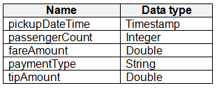
- Exhibit 2: 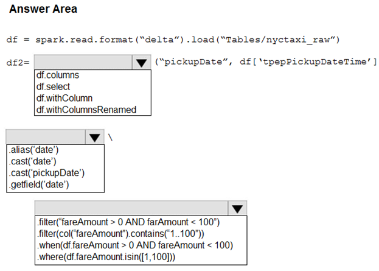

_HOTSPOT — the original ExamTopics question expects you to mark areas on the exhibit above; the correct hotspot coordinates are not published._

**Most voted:**
1. withColumn
2. cast('date')
3. .filter('fareAmount.......

### Top explanations
- **XiltroX** (45 upvotes [Highly Voted]): The correct answers:
  1. withColumn
  2. cast('date')
  3. .filter('fareAmount.......
- **Momoanwar** (13 upvotes [Highly Voted]): We need to add column not rename existing column. Here is the correct answer :
  df.withColumn('pickupDate', df['pickupDateTime'].cast(DateType())) \
               .filter("fareAmount > 0 AND fareAmount < 100")
- **woliveiras** (8 upvotes): The correct answers:
  1. withColumn
  2. cast('date')
  3. .filter('fareAmount
  Tested!!!
- **earlqq** (8 upvotes): A bit incorrect.
  .withcolumn
  .cast(date)
  .filter(fareamount >0 and <100)
- **stilferx** (6 upvotes): IMHO, 
  withColumn -> cast(dateType()) -> filter("fareAmount > 0 AND fareAmount < 100")
  is correct.
  
  As colleagues said, cast(dateType()), not cast('date'). Let's consider it a typo from Microsoft.

## Q2.54 (ID 911344)

Note: This question is part of a series of questions that present the same scenario. Each question in the series contains a unique solution that might meet the stated goals. Some question sets might have more than one correct solution, while others might not have a correct solution.
After you answer a question in this section, you will NOT be able to return to it. As a result, these questions will not appear in the review screen.
You have a Fabric tenant that contains a new semantic model in OneLake.
You use a Fabric notebook to read the data into a Spark DataFrame.
You need to evaluate the data to calculate the min, max, mean, and standard deviation values for all the string and numeric columns.
Solution: You use the following PySpark expression:
df.explain()
Does this meet the goal?

⭕ **A.** Yes
✅ **B.** No

**Correct answer:** B
**Most voted:** B

### Top explanations
- **282b85d** (10 upvotes [Highly Voted]): The df.explain() method in PySpark is used to print the logical and physical plans of a DataFrame, which helps in understanding how Spark plans to execute the query. It does not compute any statistical values like min, max, mean, or standard deviation.
  **To achieve the goal, you should use: df.describe().show()
- **SamuComqi** (5 upvotes [Highly Voted]): The correct syntax is df.describe().
  
  Sources:
  * describe --> https://spark.apache.org/docs/latest/api/python/reference/pyspark.sql/api/pyspark.sql.DataFrame.describe.html
  * explain --> https://spark.apache.org/docs/latest/api/python/reference/pyspark.sql/api/pyspark.sql.DataFrame.explain.html
- **Momoanwar** (4 upvotes): No explain is for the execut plan
- **a_51** (2 upvotes): describe is how you get the information.
- **SamuComqi** (1 upvotes): Also df.summary() is a valid solution.
  
  Source ---> https://spark.apache.org/docs/latest/api/python/reference/pyspark.sql/api/pyspark.sql.DataFrame.summary.html

## Q2.55 (ID 911345)

Note: This question is part of a series of questions that present the same scenario. Each question in the series contains a unique solution that might meet the stated goals. Some question sets might have more than one correct solution, while others might not have a correct solution.
After you answer a question in this section, you will NOT be able to return to it. As a result, these questions will not appear in the review screen.
You have a Fabric tenant that contains a new semantic model in OneLake.
You use a Fabric notebook to read the data into a Spark DataFrame.
You need to evaluate the data to calculate the min, max, mean, and standard deviation values for all the string and numeric columns.
Solution: You use the following PySpark expression:
df.show()
Does this meet the goal?

⭕ **A.** Yes
✅ **B.** No

**Correct answer:** B
**Most voted:** B

### Top explanations
- **282b85d** (3 upvotes): Correct methods: Use df.describe().show() for basic statistics and df.agg() with appropriate functions (min, max, mean, stddev) for detailed statistics.
- **stilferx** (2 upvotes): IMHO, NOOOOO
  
  df.show() - shows the data in the dataframe
- **a_51** (2 upvotes): Use describe
- **SamuComqi** (2 upvotes): The correct syntax is df.describe().
  
  Sources:
  * describe --> https://spark.apache.org/docs/latest/api/python/reference/pyspark.sql/api/pyspark.sql.DataFrame.describe.html
  * show --> https://spark.apache.org/docs/latest/api/python/reference/pyspark.sql/api/pyspark.sql.DataFrame.show.html
- **XiltroX** (1 upvotes): df.summary() is the only right answer.

## Q2.56 (ID 911346)

Note: This question is part of a series of questions that present the same scenario. Each question in the series contains a unique solution that might meet the stated goals. Some question sets might have more than one correct solution, while others might not have a correct solution.
After you answer a question in this section, you will NOT be able to return to it. As a result, these questions will not appear in the review screen.
You have a Fabric tenant that contains a new semantic model in OneLake.
You use a Fabric notebook to read the data into a Spark DataFrame.
You need to evaluate the data to calculate the min, max, mean, and standard deviation values for all the string and numeric columns.
Solution: You use the following PySpark expression:
df.summary()
Does this meet the goal?

✅ **A.** Yes
⭕ **B.** No

**Correct answer:** A
**Most voted:** A

### Top explanations
- **stilferx** (11 upvotes [Highly Voted]): IMHO, A
  
  Example:
  df1 = spark.createDataFrame([(1, 10), (2, 10), (2, 15)], schema = ['fruit_id', 'amount'])
  df1.summary()
  
  summary	fruit_id	amount
  count	3	3
  mean	1.6666666666666667	11.666666666666666
  stddev	0.5773502691896257	2.886751345948129
  min	1	10
  25%	1	10
  50%	2	10
  75%	2	15
  max	2	15
- **7d97b62** (4 upvotes): In pandas, use df.describe() for summary statistics of numeric columns.
  In PySpark, use df.summary() for summary statistics of both numeric and string columns in a distributed computing environment.
- **282b85d** (4 upvotes): while df.summary() does provide valuable information for numeric columns, it does not fully meet the goal of evaluating both string and numeric columns with the required statistical measures. Use df.summary() and df.agg() to cover numeric columns, and additional custom aggregations for string columns.
- **SamuComqi** (4 upvotes): Also df.describe() is a valid solution.
  
  Sources:
  * summary --> https://spark.apache.org/docs/latest/api/python/reference/pyspark.sql/api/pyspark.sql.DataFrame.summary.html
  * describe --> https://spark.apache.org/docs/latest/api/python/reference/pyspark.sql/api/pyspark.sql.DataFrame.describe.html
- **Aiden90** (2 upvotes): A , df1.summary()

## Q2.57 (ID 911347)

Note: This question is part of a series of questions that present the same scenario. Each question in the series contains a unique solution that might meet the stated goals. Some question sets might have more than one correct solution, while others might not have a correct solution.
After you answer a question in this section, you will NOT be able to return to it. As a result, these questions will not appear in the review screen.
You have a Fabric tenant that contains a lakehouse named Lakehouse1. Lakehouse1 contains a Delta table named Customer.
When you query Customer, you discover that the query is slow to execute. You suspect that maintenance was NOT performed on the table.
You need to identify whether maintenance tasks were performed on Customer.
Solution: You run the following Spark SQL statement:
DESCRIBE HISTORY customer -
Does this meet the goal?

✅ **A.** Yes
⭕ **B.** No

**Correct answer:** A
**Most voted:** A

### Top explanations
- **Martin_Nbg** (4 upvotes): OPTIMIZE and VACUUM activities in the last 30 days are stored in the history. So, yes, you can see using this query whether maintenance took place in the last 30 days. https://learn.microsoft.com/en-us/azure/databricks/delta/history
- **stilferx** (4 upvotes): IMHO, A
  
  Link: https://learn.microsoft.com/en-us/azure/databricks/delta/history
- **282b85d** (3 upvotes): Yes, running DESCRIBE HISTORY customer meets the goal of identifying whether maintenance tasks were performed on the Delta table.
- **a_51** (2 upvotes): A correct.
  display(spark.sql('describe history customer'))
- **XiltroX** (2 upvotes): Right answer. Describe HISTORY

## Q2.58 (ID 911348)

Note: This question is part of a series of questions that present the same scenario. Each question in the series contains a unique solution that might meet the stated goals. Some question sets might have more than one correct solution, while others might not have a correct solution.
After you answer a question in this section, you will NOT be able to return to it. As a result, these questions will not appear in the review screen.
You have a Fabric tenant that contains a lakehouse named Lakehouse1. Lakehouse1 contains a Delta table named Customer.
When you query Customer, you discover that the query is slow to execute. You suspect that maintenance was NOT performed on the table.
You need to identify whether maintenance tasks were performed on Customer.
Solution: You run the following Spark SQL statement:
REFRESH TABLE customer -
Does this meet the goal?

⭕ **A.** Yes
✅ **B.** No

**Correct answer:** B
**Most voted:** B

### Top explanations
- **282b85d** (7 upvotes [Highly Voted]): No, running REFRESH TABLE customer does not meet the goal of identifying whether maintenance tasks were performed on the Delta table. This Spark SQL command is used to refresh the metadata of a table. It ensures that the latest schema and data are available for queries but does not give any historical information about maintenance operations.
- **stilferx** (1 upvotes [Most Recent]): IMHO, NOOO
- **dp600** (1 upvotes): correct
- **Momoanwar** (1 upvotes): Correct

## Q2.59 (ID 911349)

Note: This question is part of a series of questions that present the same scenario. Each question in the series contains a unique solution that might meet the stated goals. Some question sets might have more than one correct solution, while others might not have a correct solution.
After you answer a question in this section, you will NOT be able to return to it. As a result, these questions will not appear in the review screen.
You have a Fabric tenant that contains a lakehouse named Lakehouse1. Lakehouse1 contains a Delta table named Customer.
When you query Customer, you discover that the query is slow to execute. You suspect that maintenance was NOT performed on the table.
You need to identify whether maintenance tasks were performed on Customer.
Solution: You run the following Spark SQL statement:
EXPLAIN TABLE customer -
Does this meet the goal?

⭕ **A.** Yes
✅ **B.** No

**Correct answer:** B
**Most voted:** B

### Top explanations
- **282b85d** (10 upvotes [Highly Voted]): The EXPLAIN statement in Spark SQL is used to display the execution plan of a query. This plan shows how Spark will execute the query, including details about the operations and stages involved. While it is useful for understanding and optimizing query performance, it does not provide historical information about maintenance tasks like optimization, compaction, or vacuuming performed on the table.
- **wellingtonluis** (2 upvotes): Good luck !!!
- **XiltroX** (2 upvotes): Correct answer is DESCRIBE HISTORY customer. 
  Good luck everyone.
- **Momoanwar** (2 upvotes): Given answer is correct. Explain is for query execution plan
- **stilferx** (1 upvotes [Most Recent]): IMHO, NOOOO

## Q2.60 (ID 916062)

Overview -
Litware, Inc. is a manufacturing company that has offices throughout North America. The analytics team at Litware contains data engineers, analytics engineers, data analysts, and data scientists.
Existing Environment -
Fabric Environment -
Litware has been using a Microsoft Power BI tenant for three years. Litware has NOT enabled any Fabric capacities and features.
Available Data -
Litware has data that must be analyzed as shown in the following table.
The Product data contains a single table and the following columns.
The customer satisfaction data contains the following tables:
•	Survey
•	Question
•	Response
For each survey submitted, the following occurs:
•	One row is added to the Survey table.
•	One row is added to the Response table for each question in the survey.
The Question table contains the text of each survey question. The third question in each survey response is an overall satisfaction score. Customers can submit a survey after each purchase.
User Problems -
The analytics team has large volumes of data, some of which is semi-structured. The team wants to use Fabric to create a new data store.
Product data is often classified into three pricing groups: high, medium, and low. This logic is implemented in several databases and semantic models, but the logic does NOT always match across implementations.
Requirements -
Planned Changes -
Litware plans to enable Fabric features in the existing tenant. The analytics team will create a new data store as a proof of concept (PoC). The remaining Liware users will only get access to the Fabric features once the PoC is complete. The PoC will be completed by using a Fabric trial capacity
The following three workspaces will be created:
•	AnalyticsPOC: Will contain the data store, semantic models, reports pipelines, dataflow, and notebooks used to populate the data store
•	DataEngPOC: Will contain all the pipelines, dataflows, and notebooks used to populate OneLake
•	DataSciPOC: Will contain all the notebooks and reports created by the data scientists
The following will be created in the AnalyticsPOC workspace:
•	A data store (type to be decided)
•	A custom semantic model
•	A default semantic model
•	Interactive reports
The data engineers will create data pipelines to load data to OneLake either hourly or daily depending on the data source. The analytics engineers will create processes to ingest, transform, and load the data to the data store in the AnalyticsPOC workspace daily. Whenever possible, the data engineers will use low-code tools for data ingestion. The choice of which data cleansing and transformation tools to use will be at the data engineers’ discretion.
All the semantic models and reports in the Analytics POC workspace will use the data store as the sole data source.
Technical Requirements -
The data store must support the following:
•	Read access by using T-SQL or Python
•	Semi-structured and unstructured data
•	Row-level security (RLS) for users executing T-SQL queries
Files loaded by the data engineers to OneLake will be stored in the Parquet format and will meet Delta Lake specifications.
Data will be loaded without transformation in one area of the AnalyticsPOC data store. The data will then be cleansed, merged, and transformed into a dimensional model
The data load process must ensure that the raw and cleansed data is updated completely before populating the dimensional model
The dimensional model must contain a date dimension. There is no existing data source for the date dimension. The Litware fiscal year matches the calendar year. The date dimension must always contain dates from 2010 through the end of the current year.
The product pricing group logic must be maintained by the analytics engineers in a single location. The pricing group data must be made available in the data store for T-SOL. queries and in the default semantic model. The following logic must be used:
•	List prices that are less than or equal to 50 are in the low pricing group.
•	List prices that are greater than 50 and less than or equal to 1,000 are in the medium pricing group.
•	List prices that are greater than 1,000 are in the high pricing group.
Security Requirements -
Only Fabric administrators and the analytics team must be able to see the Fabric items created as part of the PoC.
Litware identifies the following security requirements for the Fabric items in the AnalyticsPOC workspace:
•	Fabric administrators will be the workspace administrators.
•	The data engineers must be able to read from and write to the data store. No access must be granted to datasets or reports.
•	The analytics engineers must be able to read from, write to, and create schemas in the data store. They also must be able to create and share semantic models with the data analysts and view and modify all reports in the workspace.
•	The data scientists must be able to read from the data store, but not write to it. They will access the data by using a Spark notebook
•	The data analysts must have read access to only the dimensional model objects in the data store. They also must have access to create Power BI reports by using the semantic models created by the analytics engineers.
•	The date dimension must be available to all users of the data store.
•	The principle of least privilege must be followed.
Both the default and custom semantic models must include only tables or views from the dimensional model in the data store. Litware already has the following Microsoft Entra security groups:
•	FabricAdmins: Fabric administrators
•	AnalyticsTeam: All the members of the analytics team
•	DataAnalysts: The data analysts on the analytics team
•	DataScientists: The data scientists on the analytics team
•	DataEngineers: The data engineers on the analytics team
•	AnalyticsEngineers: The analytics engineers on the analytics team
Report Requirements -
The data analysts must create a customer satisfaction report that meets the following requirements:
•	Enables a user to select a product to filter customer survey responses to only those who have purchased that product.
•	Displays the average overall satisfaction score of all the surveys submitted during the last 12 months up to a selected dat.
•	Shows data as soon as the data is updated in the data store.
•	Ensures that the report and the semantic model only contain data from the current and previous year.
•	Ensures that the report respects any table-level security specified in the source data store.
•	Minimizes the execution time of report queries.
You need to recommend a solution to prepare the tenant for the PoC.
Which two actions should you recommend performing from the Fabric Admin portal? Each correct answer presents part of the solution.
NOTE: Each correct answer is worth one point.

**Exhibits**
- Exhibit 1: 
- Exhibit 2: 

⭕ **A.** Enable the Users can try Microsoft Fabric paid features option for the entire organization.
✅ **B.** Enable the Users can try Microsoft Fabric paid features option for specific security groups.
⭕ **C.** Enable the Allow Azure Active Directory guest users to access Microsoft Fabric option for specific security groups.
⭕ **D.** Enable the Users can create Fabric items option and exclude specific security groups.
✅ **E.** Enable the Users can create Fabric items option for specific security groups.

**Correct answer:** B, E
**Most voted:** BE

### Top explanations
- **282b85d** (12 upvotes [Highly Voted]): Enable the Users can try Microsoft Fabric paid features option for specific security groups: This will allow specific security groups (like the AnalyticsTeam, DataAnalysts, DataScientists, DataEngineers, and AnalyticsEngineers) to access and use the paid features of Microsoft Fabric necessary for the PoC. This is important to ensure that only the relevant team members can utilize these advanced features while preventing unnecessary access for other users.
  Enable the Users can create Fabric items option for specific security groups: This will allow only specific security groups to create Fabric items, ensuring that the creation of these items is controlled and managed by the appropriate team members. This helps maintain the principle of least privilege and ensures that only authorized personnel can create and manage Fabric items during the PoC.
- **stilferx** (2 upvotes [Most Recent]): IMHO, B & E looks good.
  
  Here, we use only for "specific groups", but not "C" which is for guests.
- **VAzureD** (2 upvotes): I agree with the answer. The POC is only for a certain group of users.
- **4371883** (2 upvotes): This is a POC with internal users, B & E make sense on the principle of least privilege.

## Q2.62 (ID 916064)

Overview -
Litware, Inc. is a manufacturing company that has offices throughout North America. The analytics team at Litware contains data engineers, analytics engineers, data analysts, and data scientists.
Existing Environment -
Fabric Environment -
Litware has been using a Microsoft Power BI tenant for three years. Litware has NOT enabled any Fabric capacities and features.
Available Data -
Litware has data that must be analyzed as shown in the following table.
The Product data contains a single table and the following columns.
The customer satisfaction data contains the following tables:
•	Survey
•	Question
•	Response
For each survey submitted, the following occurs:
•	One row is added to the Survey table.
•	One row is added to the Response table for each question in the survey.
The Question table contains the text of each survey question. The third question in each survey response is an overall satisfaction score. Customers can submit a survey after each purchase.
User Problems -
The analytics team has large volumes of data, some of which is semi-structured. The team wants to use Fabric to create a new data store.
Product data is often classified into three pricing groups: high, medium, and low. This logic is implemented in several databases and semantic models, but the logic does NOT always match across implementations.
Requirements -
Planned Changes -
Litware plans to enable Fabric features in the existing tenant. The analytics team will create a new data store as a proof of concept (PoC). The remaining Liware users will only get access to the Fabric features once the PoC is complete. The PoC will be completed by using a Fabric trial capacity
The following three workspaces will be created:
•	AnalyticsPOC: Will contain the data store, semantic models, reports pipelines, dataflow, and notebooks used to populate the data store
•	DataEngPOC: Will contain all the pipelines, dataflows, and notebooks used to populate OneLake
•	DataSciPOC: Will contain all the notebooks and reports created by the data scientists
The following will be created in the AnalyticsPOC workspace:
•	A data store (type to be decided)
•	A custom semantic model
•	A default semantic model
•	Interactive reports
The data engineers will create data pipelines to load data to OneLake either hourly or daily depending on the data source. The analytics engineers will create processes to ingest, transform, and load the data to the data store in the AnalyticsPOC workspace daily. Whenever possible, the data engineers will use low-code tools for data ingestion. The choice of which data cleansing and transformation tools to use will be at the data engineers’ discretion.
All the semantic models and reports in the Analytics POC workspace will use the data store as the sole data source.
Technical Requirements -
The data store must support the following:
•	Read access by using T-SQL or Python
•	Semi-structured and unstructured data
•	Row-level security (RLS) for users executing T-SQL queries
Files loaded by the data engineers to OneLake will be stored in the Parquet format and will meet Delta Lake specifications.
Data will be loaded without transformation in one area of the AnalyticsPOC data store. The data will then be cleansed, merged, and transformed into a dimensional model
The data load process must ensure that the raw and cleansed data is updated completely before populating the dimensional model
The dimensional model must contain a date dimension. There is no existing data source for the date dimension. The Litware fiscal year matches the calendar year. The date dimension must always contain dates from 2010 through the end of the current year.
The product pricing group logic must be maintained by the analytics engineers in a single location. The pricing group data must be made available in the data store for T-SOL. queries and in the default semantic model. The following logic must be used:
•	List prices that are less than or equal to 50 are in the low pricing group.
•	List prices that are greater than 50 and less than or equal to 1,000 are in the medium pricing group.
•	List prices that are greater than 1,000 are in the high pricing group.
Security Requirements -
Only Fabric administrators and the analytics team must be able to see the Fabric items created as part of the PoC.
Litware identifies the following security requirements for the Fabric items in the AnalyticsPOC workspace:
•	Fabric administrators will be the workspace administrators.
•	The data engineers must be able to read from and write to the data store. No access must be granted to datasets or reports.
•	The analytics engineers must be able to read from, write to, and create schemas in the data store. They also must be able to create and share semantic models with the data analysts and view and modify all reports in the workspace.
•	The data scientists must be able to read from the data store, but not write to it. They will access the data by using a Spark notebook
•	The data analysts must have read access to only the dimensional model objects in the data store. They also must have access to create Power BI reports by using the semantic models created by the analytics engineers.
•	The date dimension must be available to all users of the data store.
•	The principle of least privilege must be followed.
Both the default and custom semantic models must include only tables or views from the dimensional model in the data store. Litware already has the following Microsoft Entra security groups:
•	FabricAdmins: Fabric administrators
•	AnalyticsTeam: All the members of the analytics team
•	DataAnalysts: The data analysts on the analytics team
•	DataScientists: The data scientists on the analytics team
•	DataEngineers: The data engineers on the analytics team
•	AnalyticsEngineers: The analytics engineers on the analytics team
Report Requirements -
The data analysts must create a customer satisfaction report that meets the following requirements:
•	Enables a user to select a product to filter customer survey responses to only those who have purchased that product.
•	Displays the average overall satisfaction score of all the surveys submitted during the last 12 months up to a selected dat.
•	Shows data as soon as the data is updated in the data store.
•	Ensures that the report and the semantic model only contain data from the current and previous year.
•	Ensures that the report respects any table-level security specified in the source data store.
•	Minimizes the execution time of report queries.
You need to implement the date dimension in the data store. The solution must meet the technical requirements.
What are two ways to achieve the goal? Each correct answer presents a complete solution.
NOTE: Each correct selection is worth one point.

**Exhibits**
- Exhibit 1: 
- Exhibit 2: 

✅ **A.** Populate the date dimension table by using a dataflow.
⭕ **B.** Populate the date dimension table by using a Copy activity in a pipeline.
⭕ **C.** Populate the date dimension view by using T-SQL.
✅ **D.** Populate the date dimension table by using a Stored procedure activity in a pipeline.

**Correct answer:** A, D
**Most voted:** AD

### Top explanations
- **neoverma** (35 upvotes [Highly Voted]): as per the technical requirements - 
  "The dimensional model must contain a date dimension. There is no existing data source for the date dimension. The Litware fiscal year matches the calendar year. The date dimension must always contain dates from 2010 through the end of the current year."
  
  
  No existing data source & The date dimension must always contain dates from 2010 through the end of the current year is the Key Point here
  
  
  using the elimination method
  View wont be appropriate and COPY activity cant be used since there is no data source for DATE table. 
  
  so the answer is A and D
- **DirectX** (9 upvotes [Highly Voted]): C,D.
  I always create dimDate using a views (T-Sql select statement with recursive CTE).
  A. is too complicated.
- **c119533** (5 upvotes): It is specified: "The data store must support the following: Semi-structured and unstructured data".
  So the data store is a lakehouse.
  Stored procedures don't exist in a lakehouse.
  I think A and C
- **os_ca** (3 upvotes): I am not able to create a view with CTE. Could you let us know how?
- **stilferx** (3 upvotes): IMHO, AD may be good
  
  Agree, B is not good, C is just a weird way. But possible.
  So, the question is kind of ambiguous, with no particular directions from the Microsoft site. Among ABD, I am choosing AD

## Q2.63 (ID 916065)

Overview -
Litware, Inc. is a manufacturing company that has offices throughout North America. The analytics team at Litware contains data engineers, analytics engineers, data analysts, and data scientists.
Existing Environment -
Fabric Environment -
Litware has been using a Microsoft Power BI tenant for three years. Litware has NOT enabled any Fabric capacities and features.
Available Data -
Litware has data that must be analyzed as shown in the following table.
The Product data contains a single table and the following columns.
The customer satisfaction data contains the following tables:
•	Survey
•	Question
•	Response
For each survey submitted, the following occurs:
•	One row is added to the Survey table.
•	One row is added to the Response table for each question in the survey.
The Question table contains the text of each survey question. The third question in each survey response is an overall satisfaction score. Customers can submit a survey after each purchase.
User Problems -
The analytics team has large volumes of data, some of which is semi-structured. The team wants to use Fabric to create a new data store.
Product data is often classified into three pricing groups: high, medium, and low. This logic is implemented in several databases and semantic models, but the logic does NOT always match across implementations.
Requirements -
Planned Changes -
Litware plans to enable Fabric features in the existing tenant. The analytics team will create a new data store as a proof of concept (PoC). The remaining Liware users will only get access to the Fabric features once the PoC is complete. The PoC will be completed by using a Fabric trial capacity
The following three workspaces will be created:
•	AnalyticsPOC: Will contain the data store, semantic models, reports pipelines, dataflow, and notebooks used to populate the data store
•	DataEngPOC: Will contain all the pipelines, dataflows, and notebooks used to populate OneLake
•	DataSciPOC: Will contain all the notebooks and reports created by the data scientists
The following will be created in the AnalyticsPOC workspace:
•	A data store (type to be decided)
•	A custom semantic model
•	A default semantic model
•	Interactive reports
The data engineers will create data pipelines to load data to OneLake either hourly or daily depending on the data source. The analytics engineers will create processes to ingest, transform, and load the data to the data store in the AnalyticsPOC workspace daily. Whenever possible, the data engineers will use low-code tools for data ingestion. The choice of which data cleansing and transformation tools to use will be at the data engineers’ discretion.
All the semantic models and reports in the Analytics POC workspace will use the data store as the sole data source.
Technical Requirements -
The data store must support the following:
•	Read access by using T-SQL or Python
•	Semi-structured and unstructured data
•	Row-level security (RLS) for users executing T-SQL queries
Files loaded by the data engineers to OneLake will be stored in the Parquet format and will meet Delta Lake specifications.
Data will be loaded without transformation in one area of the AnalyticsPOC data store. The data will then be cleansed, merged, and transformed into a dimensional model
The data load process must ensure that the raw and cleansed data is updated completely before populating the dimensional model
The dimensional model must contain a date dimension. There is no existing data source for the date dimension. The Litware fiscal year matches the calendar year. The date dimension must always contain dates from 2010 through the end of the current year.
The product pricing group logic must be maintained by the analytics engineers in a single location. The pricing group data must be made available in the data store for T-SOL. queries and in the default semantic model. The following logic must be used:
•	List prices that are less than or equal to 50 are in the low pricing group.
•	List prices that are greater than 50 and less than or equal to 1,000 are in the medium pricing group.
•	List prices that are greater than 1,000 are in the high pricing group.
Security Requirements -
Only Fabric administrators and the analytics team must be able to see the Fabric items created as part of the PoC.
Litware identifies the following security requirements for the Fabric items in the AnalyticsPOC workspace:
•	Fabric administrators will be the workspace administrators.
•	The data engineers must be able to read from and write to the data store. No access must be granted to datasets or reports.
•	The analytics engineers must be able to read from, write to, and create schemas in the data store. They also must be able to create and share semantic models with the data analysts and view and modify all reports in the workspace.
•	The data scientists must be able to read from the data store, but not write to it. They will access the data by using a Spark notebook
•	The data analysts must have read access to only the dimensional model objects in the data store. They also must have access to create Power BI reports by using the semantic models created by the analytics engineers.
•	The date dimension must be available to all users of the data store.
•	The principle of least privilege must be followed.
Both the default and custom semantic models must include only tables or views from the dimensional model in the data store. Litware already has the following Microsoft Entra security groups:
•	FabricAdmins: Fabric administrators
•	AnalyticsTeam: All the members of the analytics team
•	DataAnalysts: The data analysts on the analytics team
•	DataScientists: The data scientists on the analytics team
•	DataEngineers: The data engineers on the analytics team
•	AnalyticsEngineers: The analytics engineers on the analytics team
Report Requirements -
The data analysts must create a customer satisfaction report that meets the following requirements:
•	Enables a user to select a product to filter customer survey responses to only those who have purchased that product.
•	Displays the average overall satisfaction score of all the surveys submitted during the last 12 months up to a selected dat.
•	Shows data as soon as the data is updated in the data store.
•	Ensures that the report and the semantic model only contain data from the current and previous year.
•	Ensures that the report respects any table-level security specified in the source data store.
•	Minimizes the execution time of report queries.
You need to ensure the data loading activities in the AnalyticsPOC workspace are executed in the appropriate sequence. The solution must meet the technical requirements.
What should you do?

**Exhibits**
- Exhibit 1: 
- Exhibit 2: 

⭕ **A.** Create a dataflow that has multiple steps and schedule the dataflow.
⭕ **B.** Create and schedule a Spark notebook.
⭕ **C.** Create and schedule a Spark job definition.
✅ **D.** Create a pipeline that has dependencies between activities and schedule the pipeline.

**Correct answer:** D
**Most voted:** D

### Top explanations
- **stilferx** (2 upvotes): IMHO, D is correct.
  
  I love Microsoft, ambiguity as is. But yes, generally, according to Microsoft BP, a pipeline in ADF with running all activities is the suggested solution. From it, it is easy to trigger different notebooks, for example
- **4371883** (2 upvotes): D is correct. Pipeline can ensure the activities follow the required sequence.
  https://learn.microsoft.com/en-us/fabric/data-factory/activity-overview#data-transformation-activities

## Q2.67 (ID 916069)

HOTSPOT
Overview
Contoso, Ltd. is a US-based health supplements company. Contoso has two divisions named Sales and Research. The Sales division contains two departments named Online Sales and Retail Sales. The Research division assigns internally developed product lines to individual teams of researchers and analysts.
Existing Environment
Identity Environment
Contoso has a Microsoft Entra tenant named contoso.com. The tenant contains two groups named ResearchReviewersGroup1 and ResearchReviewersGroup2.
Data Environment
Contoso has the following data environment:
•	The Sales division uses a Microsoft Power BI Premium capacity.
•	The semantic model of the Online Sales department includes a fact table named Orders that uses Import made. In the system of origin, the OrderID value represents the sequence in which orders are created.
•	The Research department uses an on-premises, third-party data warehousing product.
•	Fabric is enabled for contoso.com.
•	An Azure Data Lake Storage Gen2 storage account named storage1 contains Research division data for a product line named Productline1. The data is in the delta format.
•	A Data Lake Storage Gen2 storage account named storage2 contains Research division data for a product line named Productline2. The data is in the CSV format.
Requirements
Planned Changes
Contoso plans to make the following changes:
•	Enable support for Fabric in the Power BI Premium capacity used by the Sales division.
•	Make all the data for the Sales division and the Research division available in Fabric.
•	For the Research division, create two Fabric workspaces named Productline1ws and Productine2ws.
•	In Productline1ws, create a lakehouse named Lakehouse1.
•	In Lakehouse1, create a shortcut to storage1 named ResearchProduct.
Data Analytics Requirements
Contoso identifies the following data analytics requirements:
•	All the workspaces for the Sales division and the Research division must support all Fabric experiences.
•	The Research division workspaces must use a dedicated, on-demand capacity that has per-minute billing.
•	The Research division workspaces must be grouped together logically to support OneLake data hub filtering based on the department name.
•	For the Research division workspaces, the members of ResearchReviewersGroup1 must be able to read lakehouse and warehouse data and shortcuts by using SQL endpoints.
•	For the Research division workspaces, the members of ResearchReviewersGroup2 must be able to read lakehouse data by using Lakehouse explorer.
•	All the semantic models and reports for the Research division must use version control that supports branching.
Data Preparation Requirements
Contoso identifies the following data preparation requirements:
•	The Research division data for Productline1 must be retrieved from Lakehouse1 by using Fabric notebooks.
•	All the Research division data in the lakehouses must be presented as managed tables in Lakehouse explorer.
Semantic Model Requirements
Contoso identifies the following requirements for implementing and managing semantic models:
The number of rows added to the Orders table during refreshes must be minimized.
•	The semantic models in the Research division workspaces must use Direct Lake mode.
General Requirements
Contoso identifies the following high-level requirements that must be considered for all solutions:
•	Follow the principle of least privilege when applicable.
•	Minimize implementation and maintenance effort when possible.
Which workspace role assignments should you recommend for ResearchReviewersGroup1 and ResearchReviewersGroup2? To answer, select the appropriate options in the answer area.
NOTE: Each correct selection is worth one point.

**Exhibits**
- Exhibit 1: 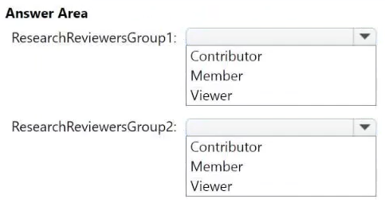

_HOTSPOT — the original ExamTopics question expects you to mark areas on the exhibit above; the correct hotspot coordinates are not published._

**Most voted:**
- Viewer+: Read Lakehouse and Data warehouse data and shortcuts2 with T-SQL through TDS endpoint.
- Contributor+: Read Lakehouse data through Lakehouse explorer.

### Top explanations
- **dp600** (18 upvotes [Highly Voted]): correct, you can see in this link: https://learn.microsoft.com/en-us/fabric/get-started/roles-workspaces
- **stilferx** (13 upvotes [Highly Voted]): IMHO, correct, Viewer & Contributor
  
  Requirements: 
  • For the Research division workspaces, the members of ResearchReviewersGroup1 must be able to read lakehouse and warehouse data and shortcuts by using SQL endpoints.
  • For the Research division workspaces, the members of ResearchReviewersGroup2 must be able to read lakehouse data by using Lakehouse explorer.
  
  From https://learn.microsoft.com/en-us/fabric/get-started/roles-workspaces
  1) Viewer+: Read Lakehouse and Data warehouse data and shortcuts2 with T-SQL through TDS endpoint.
  
  2) Contributor+: Read Lakehouse data through Lakehouse explorer.
- **dp600** (5 upvotes): Viewer and contributor
  
  Read using sql endpoint -> Min. Viewer
  Read using lakehouse explorer -> Min. Contributor
- **luiruipu** (2 upvotes): Answer is correct
- **OlivierFerrari** (1 upvotes [Most Recent]): 1--> Viewer
  2 --> Member

## Q2.70 (ID 916072)

DRAG DROP
You are implementing a medallion architecture in a single Fabric workspace.
You have a lakehouse that contains the Bronze and Silver layers and a warehouse that contains the Gold layer.
You create the items required to populate the layers as shown in the following table.
You need to ensure that the layers are populated daily in sequential order such that Silver is populated only after Bronze is complete, and Gold is populated only after Silver is complete. The solution must minimize development effort and complexity.
What should you use to execute each set of items? To answer, drag the appropriate options to the correct items. Each option may be used once, more than once, or not at all. You may need to drag the split bar between panes or scroll to view content.
NOTE: Each correct selection is worth one point.

**Exhibits**
- Exhibit 1: 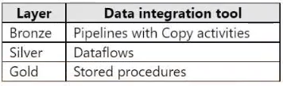
- Exhibit 2: 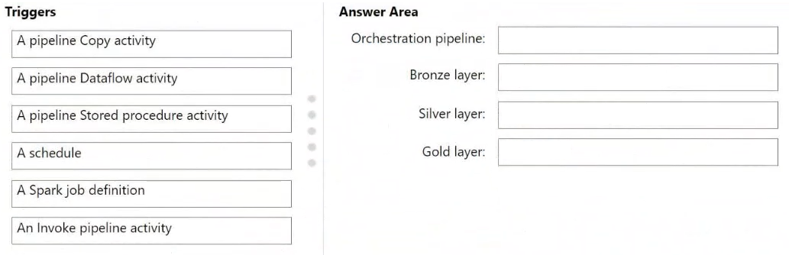

_DRAG DROP — the original ExamTopics question expects you to drag and drop items; the correct targets are not published._

**Most voted:**
- Orchestration pipeline: Schedule
- Bronze layer: An invoke pipeline activity (see table → PIPELINE is already there)
- Silver: Dataflow activity
- Gold: Stored procedure activity

### Top explanations
- **c8f5bdf** (29 upvotes [Highly Voted]): Bronze Layer answer is wrong. the Bronze Layer already has pipeline defined with it so you need an invoke pipeline activity to call them
- **vernillen** (14 upvotes [Highly Voted]): Should be;
  
  Orchestration pipeline: Schedule
  Bronze layer: An invoke pipeline activity (see table -> PIPELINE is already there)
  Silver: Dataflow activity
  Gold: Stored procedure activity
- **BRW** (8 upvotes): • Orchestration Pipeline:  Invoke pipeline activity - because the requirement is to update each layer in a sequence. So orchestration pipeline invokes Bronze, Silver and Gold pipelines one after another. 
  • Bronze Layer: Invoke pipeline activity - because there are multiple pipelines with Copy activity in this layer. We must group them together in one Bronze Layer pipeline
  • Silver Layer: A pipeline Dataflow activity
  • Gold Layer: A pipeline Stored procedure activity
  
  Schedule is type of trigger not a pipeline
- **Nefirs** (7 upvotes): I'd say answer is correct.
  However, IMO there is no suitable item for "orchestration pipeline". "A schedule" seems the most appropriate. But I'd imagine "data pipeline" would be a better option since one would use an data pipeline to orchestrate the different activities.
- **AbhiShar** (4 upvotes): Orchestration pipeline: Use An Invoke pipeline activity to manage the orchestration and invoke other pipelines in the correct sequence.
  
  Bronze layer: Use A pipeline Copy activity because the Bronze layer typically involves raw data ingestion, where data is copied into the lakehouse.
  
  Silver layer: Use A pipeline Dataflow activity as this layer involves transforming and cleaning the data, for which Dataflows are typically used.
  
  Gold layer: Use A pipeline Stored procedure activity because the Gold layer often involves aggregations and advanced processing, which can be handled using stored procedures in a warehouse.

## Q2.71 (ID 916073)

DRAG DROP
You are building a solution by using a Fabric notebook.
You have a Spark DataFrame assigned to a variable named df. The DataFrame returns four columns.
You need to change the data type of a string column named Age to integer. The solution must return a DataFrame that includes all the columns.
How should you complete the code? To answer, drag the appropriate values to the correct targets. Each value may be used once, more than once, or not at all. You may need to drag the split bar between panes or scroll to view content.
NOTE: Each correct selection is worth one point.

**Exhibits**
- Exhibit 1: 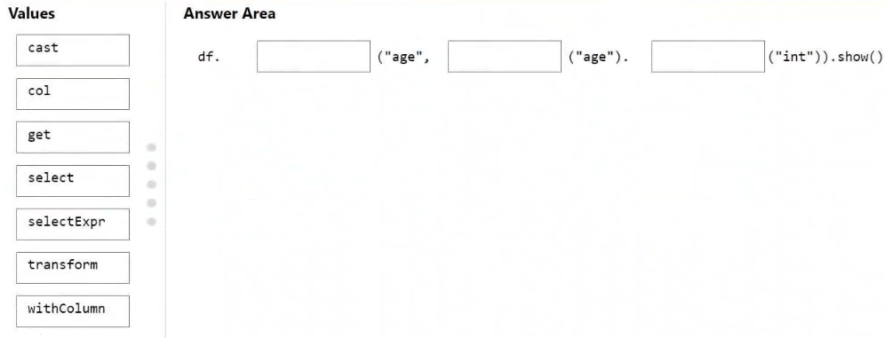

_DRAG DROP — the original ExamTopics question expects you to drag and drop items; the correct targets are not published._

**Most voted:**
- IMHO, withColumn -> col -> cast
- is good!

### Top explanations
- **neoverma** (14 upvotes [Highly Voted]): from pyspark.sql.types import IntegerType
  from pyspark.sql import functions as F
  # first method
  df = df.withColumn("Age", df.age.cast("int"))
  # second method
  df = df.withColumn("Age", df.age.cast(IntegerType()))
  # third method
  df = df.withColumn("Age", F.col("Age").cast(IntegerType()))
  
  https://aporia.com/resources/how-to/change-column-data-types-in-dataframe/
  
  considering the 3rd method for the answer
- **vernillen** (5 upvotes [Highly Voted]): Correct
  
  withColumn | col | cast
  
  It's the very basic syntax of data type allocation
- **Nefirs** (4 upvotes): correct - withColumn, col, cast
- **stilferx** (3 upvotes): IMHO, withColumn -> col -> cast 
  is good!
- **byyleoo** (1 upvotes [Most Recent]): withColumn > column> cast

## Q2.72 (ID 916074)

HOTSPOT -
You have an Azure Data Lake Storage Gen2 account named storage1 that contains a Parquet file named sales.parquet.
You have a Fabric tenant that contains a workspace named Workspace1.
Using a notebook in Workspace1, you need to load the content of the file to the default lakehouse. The solution must ensure that the content will display automatically as a table named Sales in Lakehouse explorer.
How should you complete the code? To answer, select the appropriate options in the answer area.
NOTE: Each correct selection is worth one point.

**Exhibits**
- Exhibit 1: 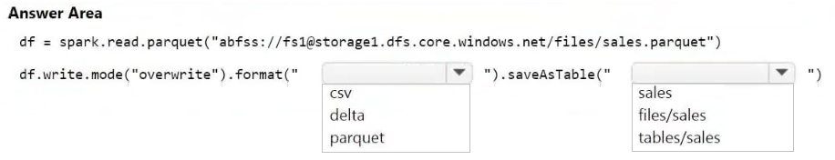

_HOTSPOT — the original ExamTopics question expects you to mark areas on the exhibit above; the correct hotspot coordinates are not published._

**Most voted:** DELTA, Sales. This is the correct answer since the destination was to loaded Delta the comand SaveAsTable you only need the table name no path. https://learn.microsoft.com/en-us/fabric/data-engineering/lakehouse-notebook-load-data

### Top explanations
- **taphyoe** (46 upvotes [Highly Voted]): delta
  sales
- **dp600dataroots** (9 upvotes [Highly Voted]): delta
  tables/sales
- **harshalt10** (15 upvotes): I think it should only be sales because if saveastable is used, the argument should only be table name. Link: https://learn.microsoft.com/en-us/fabric/data-engineering/lakehouse-notebook-load-data.
- **vernillen** (9 upvotes): Yep, you're wrong. This would have been right with .save but ALWAYS look carefully: saveAsTable can just be used with the table name
- **earlqq** (9 upvotes): i missed that it has saveastable, so "Tables/" is not needed, it`s included to save function.
  So only 
  1.Delta
  2.sales.

## Q2.73 (ID 916075)

You have a Fabric workspace named Workspace1 that contains a lakehouse named Lakehouse1.
In Workspace1, you create a data pipeline named Pipeline1.
You have CSV files stored in an Azure Storage account.
You need to add an activity to Pipeline1 that will copy data from the CSV files to Lakehouse1. The activity must support Power Query M formula language expressions.
Which type of activity should you add?

✅ **A.** Dataflow
⭕ **B.** Notebook
⭕ **C.** Script
⭕ **D.** Copy data

**Correct answer:** A
**Most voted:** A

### Top explanations
- **Nefirs** (13 upvotes [Highly Voted]): I think Dataflow since dataflow is like Power Query. But question is a bit unclear. Because data flow in itself is more like a whole, well, dataflow but not a singular activity like e.g. Copy Data.
- **Estratech** (3 upvotes): The answer is Correct! To copy data from CSV files to Lakehouse1 in Workspace1, you should add a copy activity to Pipeline1. https://learn.microsoft.com/en-us/fabric/data-factory/connector-lakehouse-copy-activity
- **werka** (2 upvotes): You can add dataflow to pipeline as activity: https://learn.microsoft.com/en-us/fabric/data-factory/tutorial-dataflows-gen2-pipeline-activity
- **vernillen** (2 upvotes): Although you're just copying data, which would result in a 'Copy Data' activity... you would preferably go with a Dataflow in Fabric. Especially because the big take away is that the activity must support Power Query M
- **2dc6125** (2 upvotes): A. Dataflow use powerquery. i don't think you have powerquery with copy data

## Q2.74 (ID 916076)

HOTSPOT -
You have a Fabric tenant that contains lakehouse named Lakehouse1. Lakehouse1 contains a Delta table with eight columns.
You receive new data that contains the same eight columns and two additional columns.
You create a Spark DataFrame and assign the DataFrame to a variable named df. The DataFrame contains the new data.
You need to add the new data to the Delta table to meet the following requirements:
•	Keep all the existing rows.
•	Ensure that all the new data is added to the table.
How should you complete the code? To answer, select the appropriate options in the answer area.
NOTE: Each correct selection is worth one point.

**Exhibits**
- Exhibit 1: 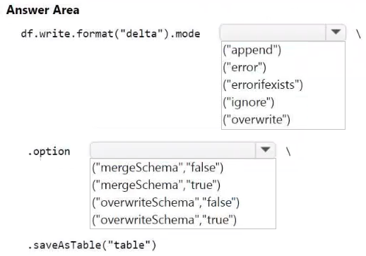

_HOTSPOT — the original ExamTopics question expects you to mark areas on the exhibit above; the correct hotspot coordinates are not published._

**Most voted:**
1. Append
2. mergeSchema, true

### Top explanations
- **SJSull** (50 upvotes [Highly Voted]): append, ("mergeschema", "true") - schema evolution, same columns and 2 added new columns
- **9878eb9** (20 upvotes [Highly Voted]): - append
  - ("mergeschema", "true")
  
  https://learn.microsoft.com/en-us/azure/databricks/delta/update-schema
  
  Add columns with automatic schema update
  Columns that are present in the DataFrame but missing from the table are automatically added as part of a write transaction when:
  
  write or writeStream have .option("mergeSchema", "true")
  spark.databricks.delta.schema.autoMerge.enabled is true
- **4371883** (7 upvotes): append
  mergeschema="true"
  
  append as all existing rows must be kept.
  according to this: https://learn.microsoft.com/en-us/azure/databricks/delta/update-schema
  overwriteschema is for "change a column’s type or name or drop a column"
  mergeschema is for "Columns that are present in the DataFrame but missing from the table are automatically added"
- **vernillen** (5 upvotes [Most Recent]): 1. Append
  --> Because of "Keep all the existing rows"
  
  2. mergeSchema, true
  --> Because there will be 2 additional columns, so it's they are not deleted from the new version. If they would have been deleted from the new version, you would have to use "overwriteSchema, true". Since that option replaces the existing schema with the schema of the new dataframe. mergeSchema, on the contrary, allows the addition of new columns rather than overwriting the schema.

## Q2.75 (ID 916077)

HOTSPOT
You have a Fabric warehouse that contains a table named Sales.Orders. Sales.Orders contains the following columns.
You need to write a T-SQL query that will return the following columns.
How should you complete the code? To answer, select the appropriate options in the answer area.
NOTE: Each correct selection is worth one point.

**Exhibits**
- Exhibit 1: 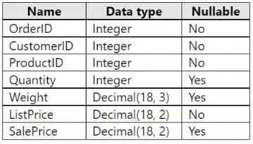
- Exhibit 2: 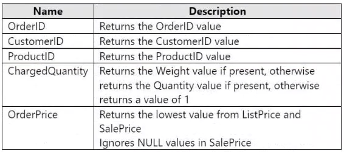
- Exhibit 3: 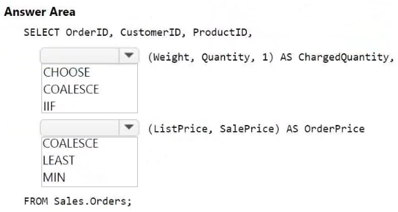

_HOTSPOT — the original ExamTopics question expects you to mark areas on the exhibit above; the correct hotspot coordinates are not published._

**Most voted:**
- IMHO, Coalesce -> Least is winner.
- Least because of that:
- If one or more arguments aren't NULL, then NULL arguments are ignored during comparison. If all arguments are NULL, then LEAST returns NULL.

### Top explanations
- **Nefirs** (23 upvotes [Highly Voted]): IMHO answer is correct:
  https://learn.microsoft.com/de-de/sql/t-sql/language-elements/coalesce-transact-sql?view=sql-server-ver16
  https://learn.microsoft.com/de-de/sql/t-sql/functions/logical-functions-least-transact-sql?view=sql-server-ver16
- **goldy29** (3 upvotes [Most Recent]): COALESCE(Weight, Quantity, 1) will return the first non-null value among Weight, Quantity, or 1, it is the most appropriate choice.
  LEAST(ListPrice, SalePrice) finds the smaller value between ListPrice and SalePrice, it is the best choice for calculating OrderPrice.
- **dev2dev** (3 upvotes): Its simple, COALESCE returns first non-null value from the parameters passed, see there are three parameters used in the specific order which is asked in the question. MIN is grouping function which is not in the query so LEAST should be used
- **serch_engine** (3 upvotes): IMHO answer is correct: COALESCE, LEAST
- **stilferx** (2 upvotes): IMHO, Coalesce -> Least is winner.
  
  Least because of that:
  If one or more arguments aren't NULL, then NULL arguments are ignored during comparison. If all arguments are NULL, then LEAST returns NULL.
  
  Link: https://learn.microsoft.com/en-us/sql/t-sql/functions/logical-functions-least-transact-sql?view=sql-server-ver16

## Q2.76 (ID 916078)

You have a Fabric tenant that contains a lakehouse.
You plan to use a visual query to merge two tables.
You need to ensure that the query returns all the rows in both tables.
Which type of join should you use?

⭕ **A.** inner
✅ **B.** full outer
⭕ **C.** left outer
⭕ **D.** right anti
⭕ **E.** right outer
⭕ **F.** left anti

**Correct answer:** B
**Most voted:** B

### Top explanations
- **VAzureD** (4 upvotes): FULL (OUTER) JOIN
  
  https://www.w3schools.com/sql/sql_join.asp
- **stilferx** (3 upvotes): IMHO, 1st grage of SQL school - FULL OUTER JOIN.
  
  Because - ALL rows, not from left, right, ... table(s)
- **2dc6125** (3 upvotes): B. Left or right will only return one table all rows and other table if exist in the other table. inner will only return if data match in both tables so Full (outer) join will return all data from both tables
- **Nefirs** (2 upvotes): full outer keeps rows from both sides
- **nappi1** (1 upvotes): since there is no other information on the tables, the answer is the academical one

## Q2.78 (ID 916080)

DRAG DROP
You are implementing two dimension tables named Customers and Products in a Fabric warehouse.
You need to use slowly changing dimension (SCD) to manage the versioning of data. The solution must meet the requirements shown in the following table.
Which type of SCD should you use for each table? To answer, drag the appropriate SCD types to the correct tables. Each SCD type may be used once, more than once, or not at all. You may need to drag the split bar between panes or scroll to view content.
NOTE: Each correct selection is worth one point.

**Exhibits**
- Exhibit 1: 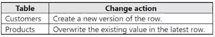
- Exhibit 2: 

_DRAG DROP — the original ExamTopics question expects you to drag and drop items; the correct targets are not published._

**Most voted:**
- Customers → Type 2
- Products → Type 1

### Top explanations
- **9878eb9** (47 upvotes [Highly Voted]): Correct. We need more questions like these. People are forgetting the importance of data modeling.
  
  Static table:
  Type 0 – Fixed Dimension. No changes allowed, dimension never changes.
  
  Commonly used SCD types:
  Type 1 – No History. Update record directly, there is no record of historical values, only current state.
  Type 2 – Row Versioning.
  Type 3 – Previous Value column.
  
  Rarely used:
  Type 4 – History Table. 
  Type 6 – Hybrid SCD.
- **prabhjot** (9 upvotes [Highly Voted]): seems correct and - Type 0 SCD, we ignore any changes and simply audit them
  
  Type 1 SCD, we overwrite existing data with new values. Historical versions are not preserved.
  
  Type 2 SCD involves adding new rows to the dimension table when changes occur. It allows us to track historical versions of attributes.
- **Nefirs** (4 upvotes): correct, Type 2 (new row) and Type 1 (overwrite)
- **nappi1** (1 upvotes [Most Recent]): Customers -> Type 2
  Products -> Type 1

## Q2.79 (ID 916081)

You have a Fabric workspace named Workspace1 and an Azure SQL database.
You plan to create a dataflow that will read data from the database, and then transform the data by performing an inner join.
You need to ignore spaces in the values when performing the inner join. The solution must minimize development effort.
What should you do?

⭕ **A.** Append the queries by using fuzzy matching.
✅ **B.** Merge the queries by using fuzzy matching.
⭕ **C.** Append the queries by using a lookup table.
⭕ **D.** Merge the queries by using a lookup table.

**Correct answer:** B
**Most voted:** B

### Top explanations
- **9878eb9** (23 upvotes [Highly Voted]): Fuzzy Matching: Fuzzy matching allows you to match data even when there are minor differences, such as extra spaces, in the values. This eliminates the need to manually clean or preprocess the data before the join.
- **stilferx** (4 upvotes): IMHO, B is good.
  
  Not append (append is like UNION).
  Not  D, because spaces, and we need minimal efforts
- **Mhunity** (3 upvotes [Most Recent]): Merge = join
  append = union
  so the answer is B 
  why?
   Fuzzy Matching: Fuzzy matching allows you to match data even when there are minor differences, such as extra spaces, in the values. This eliminates the need to manually clean or preprocess the data before the join.
- **4371883** (3 upvotes): Merge as the requirement is for inner join. 
  doc on fuzzy join and fuzzy match:
  https://learn.microsoft.com/en-us/powerquery-m/table-fuzzyjoin
  https://learn.microsoft.com/en-us/power-query/merge-queries-fuzzy-match
- **Nefirs** (3 upvotes): B should be correct

## Q2.80 (ID 916082)

You have a Fabric tenant that contains a warehouse named Warehouse1. Warehouse1 contains two schemas name schema1 and schema2 and a table named schema1.city.
You need to make a copy of schema1.city in schema2. The solution must minimize the copying of data.
Which T-SQL statement should you run?

⭕ **A.** INSERT INTO schema2.city SELECT * FROM schema1.city;
⭕ **B.** SELECT * INTO schema2.city FROM schema1.city;
✅ **C.** CREATE TABLE schema2.city AS CLONE OF schema1.city;
⭕ **D.** CREATE TABLE schema2.city AS SELECT * FROM schema1.city;

**Correct answer:** C
**Most voted:** C

### Top explanations
- **neoverma** (30 upvotes [Highly Voted]): The “CREATE TABLE … AS CLONE OF” statement is the most efficient way to create a copy of a table in the same Fabric tenant. This statement creates a new table in the specified schema that is an exact clone of the source table, including the table structure, data, and indexes. This approach minimizes the amount of data copied, as it simply creates a reference to the underlying data rather than performing a full table scan and data copy.
  
  Options A and B, which use INSERT INTO or SELECT INTO, would require scanning the entire source table and copying the data row-by-row, which is less efficient than the CLONE method.
  
  Option D, CREATE TABLE … AS SELECT, would also work to create a copy of the table, but it would perform a full table scan and data copy, which is less efficient than the CLONE approach.
- **clux** (6 upvotes [Highly Voted]): https://learn.microsoft.com/en-us/fabric/data-warehouse/clone-table
  Microsoft Fabric offers the capability to create near-instantaneous zero-copy clones with minimal storage costs.
- **utsuha** (6 upvotes): To clarify, AS CLONE OF does not copy the data. See this documentation: https://learn.microsoft.com/en-us/sql/t-sql/statements/create-table-as-clone-of-transact-sql?view=fabric
  
  Option C will only copy over the metadata of table schema1.city, so I guess it is minimizing the copying of data by copying no data, lol. Option D is most correct if we want to duplicate the table itself, data and metadata. I'm sure the question is just slightly worded wrong and the intended correct answer is C, i.e. we only want to make a copy of the metadata.
- **Karthiknaidu123** (3 upvotes): utsuha, the question clearly mentions "The solution must minimize the copying of data."
  That's why, IMO option C is correct.
- **vernillen** (3 upvotes): AS CLONE basically minimizes the copying of data. That's the biggest requirement.

## Q2.82 (ID 916084)

HOTSPOT
You have a Fabric tenant that contains a workspace named Workspace1. Workspace1 contains a lakehouse named Lakehouse1 and a warehouse named Warehouse1.
You need to create a new table in Warehouse1 named POSCustomers by querying the customer table in Lakehouse1.
How should you complete the T-SQL statement? To answer, select the appropriate options in the answer area.
NOTE: Each correct selection is worth one point.

**Exhibits**
- Exhibit 1: 

_HOTSPOT — the original ExamTopics question expects you to mark areas on the exhibit above; the correct hotspot coordinates are not published._

**Most voted:**
- CREATE TABLE dbo.POSCustomers
- AS
- SELECT DISTINCT customerid, customer, postalcode, category
- FROM lakehouse1.dbo.customer

### Top explanations
- **clux** (21 upvotes [Highly Voted]): Correct answer
- **VAzureD** (12 upvotes [Highly Voted]): https://learn.microsoft.com/en-us/fabric/data-warehouse/clone-table#limitations
  Table clones across warehouses in a workspace are not currently supported.
  
  ANSWER, AS SELECT
- **282b85d** (6 upvotes): CREATE TABLE dbo.POSCustomers
  AS
  SELECT DISTINCT customerid, customer, postalcode, category
  FROM lakehouse1.dbo.customer
- **Nefirs** (2 upvotes): answer is correct
- **Sowwy1** (1 upvotes [Most Recent]): Correct

## Q2.83 (ID 916085)

You have a Fabric tenant.
You are creating an Azure Data Factory pipeline.
You have a stored procedure that returns the number of active customers and their average sales for the current month.
You need to add an activity that will execute the stored procedure in a warehouse. The returned values must be available to the downstream activities of the pipeline.
Which type of activity should you add?

⭕ **A.** Switch
⭕ **B.** Copy data
⭕ **C.** Append variable
✅ **D.** Lookup

**Correct answer:** D
**Most voted:** D

### Top explanations
- **calvintcy** (15 upvotes [Highly Voted]): I took the test today, and this question was included. The options were: Switch, Copy Activity, Script, and Stored Procedure. I chose Script.
- **Fer079** (7 upvotes [Highly Voted]): Lookup activity reads and returns the content of a configuration file or table. It also returns the result of executing a query or stored procedure. The output can be a singleton value or an array of attributes, which can be consumed in a subsequent copy, transformation, or control flow activities like ForEach activity.
  
  https://learn.microsoft.com/en-us/azure/data-factory/control-flow-lookup-activity
- **72bd3bc** (3 upvotes): Lookup activity reads and returns the content of a configuration file or table. It also returns the result of executing a query or stored procedure. The output can be a singleton value or an array of attributes, which can be consumed in a subsequent copy, transformation, or control flow activities like ForEach activity.
  the quote from https://learn.microsoft.com/en-us/fabric/data-factory/lookup-activity
  
  so I suppose the answer is correct. But why Append variable isn't correct?
- **2fe10ed** (2 upvotes [Most Recent]): Script or Lookup activity
  
  https://learn.microsoft.com/en-us/fabric/data-factory/lookup-activity
  
  https://blog.fabric.microsoft.com/id-id/blog/automate-fabric-data-warehouse-queries-and-commands-with-data-factory?ft=All
- **matmat25810** (2 upvotes): Script -> https://learn.microsoft.com/en-us/fabric/data-factory/tutorial-preprocess-data-with-stored-procedure-load-into-lakehouse

## Q2.84 (ID 916086)

You have a Fabric tenant that contains two workspaces named Workspace1 and Workspace2. Workspace1 contains a lakehouse named Lakehouse1. Workspace2 contains a lakehouse named Lakehouse2. Lakehouse1 contains a table named dbo.Sales. Lakehouse2 contains a table named dbo.Customers.
You need to ensure that you can write queries that reference both dbo.Sales and dbo.Customers in the same SQL query without making additional copies of the tables.
What should you use?

✅ **A.** a shortcut
⭕ **B.** a dataflow
⭕ **C.** a view
⭕ **D.** a managed table

**Correct answer:** A
**Most voted:** A

### Top explanations
- **pppppppppie** (24 upvotes [Highly Voted]): you can not create view directly. you need to create shortcuts first to access table in different workspaces
  .https://community.fabric.microsoft.com/t5/General-Discussion/Cross-Workspace-access/m-p/3744282#:~:text=You%20cannot%20directly%20query%20the,and%20then%20query%20the%20shortcut.
- **vernillen** (17 upvotes [Highly Voted]): It's a fabric exam and they're really proud of their shortcuts, which are specifically designed for accessing data without making an additional copy of it.
- **woliveiras** (5 upvotes): shortcut (100%)
- **woliveiras** (3 upvotes): Shortcuts enable you to do it in an easy way.
- **prabhjot** (3 upvotes): C. a view
  A view is a virtual table that contains data from one or more tables.
  You can create a view that references tables from different lakehouses (in this case, dbo.Sales from Lakehouse1 and dbo.Customers from Lakehouse2).

## Q2.85 (ID 916087)

You have a Fabric tenant that contains a warehouse.
You are designing a star schema model that will contain a customer dimension. The customer dimension table will be a Type 2 slowly changing dimension (SCD).
You need to recommend which columns to add to the table. The columns must NOT already exist in the source.
Which three types of columns should you recommend? Each correct answer presents part of the solution.
NOTE: Each correct answer is worth one point.

⭕ **A.** a foreign key
⭕ **B.** a natural key
✅ **C.** an effective end date and time
✅ **D.** a surrogate key
✅ **E.** an effective start date and time

**Correct answer:** C, D, E
**Most voted:** CDE

### Top explanations
- **6c79d6f** (14 upvotes [Highly Voted]): Because the table is set to SCD2 there will be a new row for each change in an existing row with an start and an end date (from when to when the row was valid). therefore the ' old' primary key will be duplicated. That is why a new key, a surrogate key, is introduced which makes each row unique again
- **dp600** (7 upvotes): chatgpt is not a source
- **stilferx** (4 upvotes): IMHO, CDE,
  because:
  start & end - must
  surrogate - which is autoincremental id - is must.
  
  Link: https://learn.microsoft.com/en-us/training/modules/populate-slowly-changing-dimensions-azure-synapse-analytics-pipelines/3-choose-between-dimension-types
- **2fe10ed** (4 upvotes): A dimension's "Natural Key" is usually part of its description elements, like the SSN in the US. That information would already be present in the source table, and it's not the object of the question since it states that "The columns must NOT already exist in the source."
  Since the question states that we are building a star schema, the foreign keys should be present only on the fact table.
  
  Thus, the correct answer needs to be CDE.
- **newusername** (3 upvotes): To create SCD type 2 one needs to add a surrogate key + start/end date beside the other technical attributes. Therefore CDE.

## Q2.88 (ID 916090)

DRAG DROP
You have a Fabric tenant that contains a Microsoft Power BI report named Report1.
Report1 is slow to render. You suspect that an inefficient DAX query is being executed.
You need to identify the slowest DAX query, and then review how long the query spends in the formula engine as compared to the storage engine.
Which five actions should you perform in sequence? To answer, move the appropriate actions from the list of actions to the answer area and arrange them in the correct order.

**Exhibits**
- Exhibit 1: 

_DRAG DROP — the original ExamTopics question expects you to drag and drop items; the correct targets are not published._

**Most voted:**
1. Start Recording
2. Sort in descending order
3. Copy to DAX studio (the problematic query)
4. Enable query t and server t (to gather additional info)
5. View Server Timings

### Top explanations
- **554b579** (51 upvotes [Highly Voted]): Good Video: https://www.youtube.com/watch?v=C5HBhlLUFsE&t=176s
  From performance analyzer capture code. 
  Sort duration descending by DAX query time.
  Copy the first query over to Dax Studio
  Enable query and server timings and run the query
  View Server timings
- **calvintcy** (15 upvotes [Highly Voted]): I took the test today, and this question was included. The options 'Sort the Duration (ms) column in descending order' was not there. Hence the answer:
  -From Performance analyzer, capture a recording.
  -Sort the Duration (ms) column in descending order by DAX query time.
  -Copy the first query to Dax Studio.
  -Enable Query Timings and Server Timings. Run the query.
  -View the Server Timings tab.
- **stilferx** (3 upvotes): IMHO, 
  
  1. Start Recording
  2. Sort in descending order
  3. Copy to DAX studio (the problematic query)
  4. Enable query t and server t (to gather additional info)
  5. View Server Timings (to understand it is storage engine or formula engine)
  
  It is taken from the YouTube video below.
- **hello2tomoki** (3 upvotes): Here are the steps you should follow to identify the slowest DAX query and review how long the query spends in the formula engine compared to the storage engine:
  
  1.Open the report in Power BI Desktop. Go to the 'View' tab and click on 'Performance Analyzer' and Click on 'Start Recording', then 'Refresh Visuals' 
  2.Review the DAX query and duration in the performance analyzer pane. Sort the Duration (ms) column in descending order
  3.Copy the first query to DAX Studio 
  4.In DAX Studio, enable Query Timings and Server Timings. Run the query
  5.View the Server Timings tab to see data for the formula engine (FE) and the storage engine (SE)
- **Sowwy1** (1 upvotes [Most Recent]): From performance analyzer capture code.  Sort duration descending by DAX query time. Copy the first query over to Dax Studio Enable query and server timings and run the query View Server timings

## Q2.94 (ID 916096)

You have a Microsoft Power BI semantic model that contains measures. The measures use multiple CALCULATE functions and a FILTER function.
You are evaluating the performance of the measures.
In which use case will replacing the FILTER function with the KEEPFILTERS function reduce execution time?

⭕ **A.** when the FILTER function uses a nested calculate function
⭕ **B.** when the FILTER function references a measure
⭕ **C.** when the FILTER function references columns from multiple tables
✅ **D.** when the FILTER function references a column from a single table that uses Import mode

**Correct answer:** D
**Most voted:** D

### Top explanations
- **lpuech** (20 upvotes [Highly Voted]): Explanation here: https://learn.microsoft.com/en-us/dax/best-practices/dax-avoid-avoid-filter-as-filter-argument
  FILTER returns a table whereas KEEPFILTERS returns a Boolean. So, A, B and C are limitations of uses of Boolean expressions.
- **trietnv** (4 upvotes): D. ref: https://learn.microsoft.com/en-us/dax/best-practices/dax-avoid-avoid-filter-as-filter-argument
- **pppppppppie** (4 upvotes): he KEEPFILTERS function in Power BI is primarily designed to work with single-table or single-column filter contexts. When you use the FILTER function to reference columns from multiple tables, KEEPFILTERS may not work directly because it operates within the context of a single table or column.
  
  A is the ans
- **neoverma** (4 upvotes): can someone clarify this answer
- **IAMcertified** (3 upvotes): The answer is D based on this page: https://learn.microsoft.com/en-us/dax/best-practices/dax-avoid-avoid-filter-as-filter-argument . Check out this Note in the given link "This article is especially relevant for model calculations that apply filters to Import tables.". Also, see this section extract in the given link :  "restrictions that apply to Boolean expressions(KEEP Filters) when they're used as filter arguments. They:
  
  -Cannot reference columns from multiple tables
  -Cannot reference a measure
  -Cannot use nested CALCULATE functions
  -Cannot use functions that scan or return a table

## Q2.95 (ID 916097)

You have a semantic model named Model1. Model1 contains five tables that all use Import mode. Model1 contains a dynamic row-level security (RLS) role named HR. The HR role filters employee data so that HR managers only see the data of the department to which they are assigned.
You publish Model1 to a Fabric tenant and configure RLS role membership. You share the model and related reports to users.
An HR manager reports that the data they see in a report is incomplete.
What should you do to validate the data seen by the HR Manager?

⭕ **A.** Select Test as role to view the data as the HR role.
⭕ **B.** Filter the data in the report to match the intended logic of the filter for the HR department.
✅ **C.** Select Test as role to view the report as the HR manager.
⭕ **D.** Ask the HR manager to open the report in Microsoft Power BI Desktop.

**Correct answer:** C
**Most voted:** C

### Top explanations
- **hmntkmr** (10 upvotes [Highly Voted]): Role name is HR not HR manager so the answer is A.
- **ab695** (10 upvotes [Highly Voted]): Correct answer is C., 100%. The key is in the "dynamic" row-level security. 
  Selecting A. (HR Role only) would work for a static rule for RLS, but as it is dynamic you will need to input as well the HR manager email and make sure the rule is applied correctly.
- **belha** (4 upvotes): you can test roles on report view , so you can see the report as " " 
  answer is C
- **thisiston** (4 upvotes): A. Select Test as role to view the data as the HR role.
  This option allows you to impersonate the HR role directly within the environment where the data is published, such as Microsoft Power BI Service. By using the "Test as role" feature, you can see exactly what data the HR role (and thus the HR managers) can access according to the dynamic row-level security settings. This method provides a straightforward way to validate the RLS implementation and ensure it is working as intended.
- **Babzy** (3 upvotes): In Power BI Service, after publishing the model, you can test the report using a specific user account who is assigned to an RLS role.This allows you to simulate the exact view that the HR manager sees with their username and role membership applied.
  
  This helps confirm whether the RLS logic is working as expected for that specific user.

## Q2.96 (ID 916098)

You have a Microsoft Fabric tenant that contains a dataflow.
You are exploring a new semantic model.
From Power Query, you need to view column information as shown in the following exhibit.
Which three Data view options should you select? Each correct answer presents part of the solution.

**Exhibits**
- Exhibit 1: 

✅ **A.** Show column value distribution
⭕ **B.** Enable details pane
✅ **C.** Enable column profile
✅ **D.** Show column quality details
⭕ **E.** Show column profile in details pane

**Correct answer:** A, C, D
**Most voted:** ACD

### Top explanations
- **taphyoe** (23 upvotes [Highly Voted]): C Enable column profile
  A Show column value distribution
  D Show Column quality details
- **woliveiras** (4 upvotes): ACD for sure. Tested
- **emmanuelkech** (4 upvotes): A: Show column value 
  C: Enable column profile
  D: Show Column quality
- **d42f1dd** (3 upvotes): I find this question infuriating. There is no 'enable column profile' there is the option to show it, similar to the show value distribution and show quality. There is also no profile information stats shown in the image. I choose Enable Details pane as it is closest to View pane
- **282b85d** (3 upvotes): Show column value distribution: This option provides a visual representation of the distribution of values in each column, which is visible in the exhibit.
  
  Enable column profile: This option displays statistics and other detailed information about each column, including value distribution, which aligns with the data shown in the exhibit.
  
  Show column quality details: This option shows the quality of the data in each column, indicating valid, error, and empty values, as displayed in the exhibit.

## Q2.97 (ID 916099)

HOTSPOT
You have a Fabric warehouse that contains a table named Sales.Products. Sales.Products contains the following columns.
You need to write a T-SQL query that will return the following columns.
How should you complete the code? To answer, select the appropriate options in the answer area.
NOTE: Each correct answer is worth one point.

**Exhibits**
- Exhibit 1: 
- Exhibit 2: 
- Exhibit 3: 

_HOTSPOT — the original ExamTopics question expects you to mark areas on the exhibit above; the correct hotspot coordinates are not published._

**Most voted:** I believe that the 2nd box should be COALESCE, but if you read requirements for TradePrice column, you will realize that actually, COALESCE will not work here. Clearly there's a mistake somewhere.

### Top explanations
- **clux** (28 upvotes [Highly Voted]): GREATEST, COALESCE
- **taphyoe** (5 upvotes): correct - GREATEST  and  COALESCE
- **7d97b62** (4 upvotes): Correct Answer 
  GREATEST, COALESCE
- **OLGIS** (4 upvotes): SELECT 
      ProductID,
      GREATEST(ListPrice, WholesalePrice, AgentPrice) AS HighestSellingPrice,
      COALESCE(AgentPrice, WholesalePrice, ListPrice) AS TradePrice
  FROM 
      Sales.Products;
- **PaweuG** (4 upvotes): I believe that the 2nd box should be COALESCE, but if you read requirements for TradePrice column, you will realize that actually, COALESCE will not work here. Clearly there's a mistake somewhere.

## Q2.99 (ID 916101)

HOTSPOT
You have a Fabric warehouse that contains a table named Sales.Orders. Sales.Orders contains the following columns.
You need to write a T-SQL query that will return the following columns.
How should you complete the code? To answer, select the appropriate options in the answer area.
NOTE: Each correct answer is worth one point.

**Exhibits**
- Exhibit 1: 
- Exhibit 2: 
- Exhibit 3: 

_HOTSPOT — the original ExamTopics question expects you to mark areas on the exhibit above; the correct hotspot coordinates are not published._

**Most voted:** DATEFROMPARTS , weekday are the correct answers

### Top explanations
- **stilferx** (20 upvotes [Highly Voted]): IMHO, datetrunc & weekday
  
  https://learn.microsoft.com/en-us/sql/t-sql/functions/datetrunc-transact-sql?view=sql-server-ver16
  
  https://learn.microsoft.com/en-us/sql/t-sql/functions/datename-transact-sql?view=sql-server-ver16
- **e0f0ce6** (10 upvotes [Highly Voted]): Just echecked it. Date trunc returns the first date of the month and datepart just the month number. So given answer is correct.
- **Nefirs** (4 upvotes): answer is correct
- **clux** (2 upvotes): correct
- **Sowwy1** (1 upvotes [Most Recent]): Datetrunc and weekday

## Q2.101 (ID 916103)

You have a Fabric tenant that contains customer churn data stored as Parquet files in OneLake. The data contains details about customer demographics and product usage.
You create a Fabric notebook to read the data into a Spark DataFrame. You then create column charts in the notebook that show the distribution of retained customers as compared to lost customers based on geography, the number of products purchased, age, and customer tenure.
Which type of analytics are you performing?

⭕ **A.** diagnostic
✅ **B.** descriptive
⭕ **C.** prescriptive
⭕ **D.** predictive

**Correct answer:** B
**Most voted:** B

### Top explanations
- **hello2tomoki** (20 upvotes [Highly Voted]): Descriptive analytics tells what happened in the past, presenting it as numbers and visuals in reports and dashboards.
  Diagnostic analytics gives the reason why something happened.
  Predictive analytics determines the potential outcomes of present and past actions and trends.
  Prescriptive analytics offers decision support for the best course of action.
  Given the scenario in the question where data is read into a Spark DataFrame and column charts are created to show the distribution of retained customers compared to lost customers based on various factors, this falls under the definition of descriptive analytics. No future predictions or prescriptions are made, nor are reasons for the past events provided.
  
  Final Answer:
  
  The type of analytics being performed in the scenario described is descriptive analytics.
  https://www.selecthub.com/business-intelligence/predictive-descriptive-prescriptive-analytics/
- **slu239** (3 upvotes): Compare retained customers vs. lost customers based on geography, the number of products purchased, age, and customer tenure cannot tell us why customer churn. Factors like time spent on customer service, customer satisfaction rate will be more ... will be more effective.
- **parx** (3 upvotes): https://azure.microsoft.com/es-es/blog/answering-whats-happening-whys-happening-and-what-will-happen-with-iot-analytics/ contains text "Examine data from multiple angles to understand why something is happening." for Diagnostic. In this case we are looking at data from multiple angles.
- **manolet** (3 upvotes): No. It's just describing what happened, not explaining why.
- **THC1138** (3 upvotes): Descriptive - it's just describing the customers, not saying why they stayed or left

## Q2.102 (ID 916104)

HOTSPOT -
You have a Fabric tenant that contains a semantic model. The model contains data about retail stores.
You need to write a DAX query that will be executed by using the XMLA endpoint. The query must return the total amount of sales from the same period last year.
How should you complete the DAX expression? To answer, select the appropriate options in the answer area.
NOTE: Each correct selection is worth one point.

**Exhibits**
- Exhibit 1: 

_HOTSPOT — the original ExamTopics question expects you to mark areas on the exhibit above; the correct hotspot coordinates are not published._

**Most voted:**
- Be careful, EVALUATE in DAX queries always returns the result of a table expression, then _LYSales is a wrong answer (scalar value).
- The correct answers are then: CALCULATE, {_LYSales}

### Top explanations
- **MM_GG** (58 upvotes [Highly Voted]): Should be CALCULATE, not SUMMARIZE
- **554b579** (14 upvotes [Highly Voted]): CALCULATE([Total Sales], SAMEPERIODLASTYEAR('Order'[Order Date]))
  The entire expression calculates the sales amount for the same period last year based on the current date context.
  
  The SUMMARIZE function creates a summary table based on grouping and aggregation.
- **Lucetmi** (11 upvotes): Be careful, EVALUATE in DAX queries always returns the result of a table expression, then _LYSales is a wrong answer (scalar value). 
  The correct answers are then: CALCULATE, {_LYSales}
- **Nefirs** (7 upvotes): CALCULATE & _LYSales
- **seaverick** (6 upvotes): right ans -> CALCULATE
  I tried in DAX.do with Contoso data and return an error (In query, I have changed [Total Sales] by [Sales Amount] and Orders[Orde Date] by Sales[Order Date]):
  
  EVALUATE
  VAR _LYSales = SUMMARIZE ([Sales Amount],SAMEPERIODLASTYEAR (Sales[Order Date]))
  RETURN
  _LYSales
  
  Error:
  Query (2, 42) Function SUMMARIZE expects a column name as argument number 2.
  
  Technical Details:
  RootActivityId: 435f1c64-89c5-4587-9d79-187541b1e1e3
  Date (UTC): 9/15/2024 8:04:33 AM

## Q2.103 (ID 916105)

You have a Fabric workspace named Workspace1 that contains a dataflow named Dataflow1. Dataflow1 returns 500 rows of data.
You need to identify the min and max values for each column in the query results.
Which three Data view options should you select? Each correct answer presents part of the solution.
NOTE: Each correct answer is worth one point.

⭕ **A.** Show column value distribution
✅ **B.** Enable column profile
✅ **C.** Show column profile in details pane
⭕ **D.** Show column quality details
✅ **E.** Enable details pane

**Correct answer:** B, C, E
**Most voted:** BCE

### Top explanations
- **taphyoe** (16 upvotes [Highly Voted]): B Enable column profile
  E Enable details pane
  C Show column profile in details pane
- **AGTraining** (7 upvotes [Highly Voted]): answer is BEC
- **282b85d** (4 upvotes): Column quality: % of Valid, Error, Empty
  Column distribution: Number of distinct and unique values
- **bigdave987** (4 upvotes): B - Enable column profile; this needs to be enabled to be able to select...
  C - Show column profile in details pane
  E - Enable details pane; this needs to be enabled to be able to see the output of (C)
- **72bd3bc** (3 upvotes): I have checked in Fabric. 
  B. profile
  E. Enable detail pane
  C Show column profile in details pane.

## Q2.104 (ID 916106)

You have a Fabric tenant that contains a Microsoft Power BI report.
You are exploring a new semantic model.
You need to display the following column statistics:
•	Count
•	Average
•	Null count
•	Distinct count
•	Standard deviation
Which Power Query function should you run?

⭕ **A.** Table.schema
⭕ **B.** Table.view
⭕ **C.** Table.FuzzyGroup
✅ **D.** Table.Profile

**Correct answer:** D
**Most voted:** D

### Top explanations
- **prabhjot** (10 upvotes [Highly Voted]): Ans D correct-The Table.Profile function provides an overview of the data in a table, including basic statistics like count, average, null count, distinct count, and standard deviation for numerical columns. T
- **stilferx** (7 upvotes [Highly Voted]): IMHO, D
  
  Returns a profile for the columns in table.
  
  Because: 
  Table.Profile(table as table...
  
  The following information is returned for each column (when applicable):
  minimum
  maximum
  average
  standard deviation
  count
  null count
  distinct count
  
  Link: https://learn.microsoft.com/en-us/powerquery-m/table-profile

## Q2.105 (ID 916107)

Note: This question is part of a series of questions that present the same scenario. Each question in the series contains a unique solution that might meet the stated goals. Some question sets might have more than one correct solution, while others might not have a correct solution.
After you answer a question in this section, you will NOT be able to return to it. As a result, these questions will not appear in the review screen.
You have a Fabric tenant that contains a lakehouse named Lakehouse1. Lakehouse1 contains a Delta table named Customer.
When you query Customer, you discover that the query is slow to execute. You suspect that maintenance was NOT performed on the table.
You need to identify whether maintenance tasks were performed on Customer.
Solution: You run the following Spark SQL statement:
DESCRIBE DETAIL customer -
Does this meet the goal?

⭕ **A.** Yes
✅ **B.** No

**Correct answer:** B
**Most voted:** B

### Top explanations
- **Nefirs** (11 upvotes [Highly Voted]): should be DESCRIBE HISTORY
- **stilferx** (6 upvotes [Highly Voted]): IMHO, No.
  
  Describe Detail give general info about delta table, not the historical operations.
  https://learn.microsoft.com/en-us/azure/databricks/delta/table-details
- **bigdave987** (4 upvotes): DESCRIBE HISTORY will show maintenance history of the table.
- **ZozoG** (2 upvotes [Most Recent]): DESCRIBE DETAIL customer is not the correct answer (This command provides metadata about the Delta table, such as:
  1. Table size
  2. Number of files
  3. Format
  4. Schema
  5. Creation and modification timestamps
  
  DESCRIBE HISTORY customer will be the correct answer (This will show a log of operations performed on the table, including:
  1. OPTIMIZE
  2. VACUUM
  3. MERGE
  4. UPDATE
  5. DELETE

## Q2.106 (ID 916108)

Note: This question is part of a series of questions that present the same scenario. Each question in the series contains a unique solution that might meet the stated goals. Some question sets might have more than one correct solution, while others might not have a correct solution.
After you answer a question in this section, you will NOT be able to return to it. As a result, these questions will not appear in the review screen.
You have a Fabric tenant that contains a new semantic model in OneLake.
You use a Fabric notebook to read the data into a Spark DataFrame.
You need to evaluate the data to calculate the min, max, mean, and standard deviation values for all the string and numeric columns.
Solution: You use the following PySpark expression:
df.explain().show()
Does this meet the goal?

⭕ **A.** Yes
✅ **B.** No

**Correct answer:** B
**Most voted:** B

### Top explanations
- **bigdave987** (6 upvotes [Highly Voted]): No. describe() and summary() provide the summary statistics.
- **stilferx** (3 upvotes): IMHO, No,
  
  Because:
  df.explain gives execution plan.
  https://spark.apache.org/docs/3.1.2/api/python/reference/api/pyspark.sql.DataFrame.explain.html
- **hello2tomoki** (2 upvotes): https://www.datasciencemadesimple.com/descriptive-statistics-or-summary-statistics-of-dataframe-in-pyspark/
- **ZozoG** (1 upvotes [Most Recent]): df.explain().show() - does not meet the goal of calculating min, max, mean, and standard deviation for string and numeric columns.
  
  df.explain() - is used to display the execution plan of a DataFrame operation in PySpark.
  It helps understand how Spark will execute the query, but it does not perform any statistical analysis or return column-level metrics.
  
  df.describe().show()  - is the correct answer for this since it returns summary statistics for numeric columns (and some string columns if applicable), including: (count, mean, stddev, min, max)
- **testtaker45** (1 upvotes): Pretty sure you would need something like df.summary() to get the info they are asking for.

## Q2.107 (ID 916109)

Note: This question is part of a series of questions that present the same scenario. Each question in the series contains a unique solution that might meet the stated goals. Some question sets might have more than one correct solution, while others might not have a correct solution.
After you answer a question in this section, you will NOT be able to return to it. As a result, these questions will not appear in the review screen.
You have a Fabric tenant that contains a semantic model named Model1.
You discover that the following query performs slowly against Model1.
You need to reduce the execution time of the query.
Solution: You replace line 4 by using the following code:
ISEMPTY ( RELATEDTABLE ( 'Order Item' ) )
Does this meet the goal?

**Exhibits**
- Exhibit 1: 

⭕ **A.** Yes
✅ **B.** No

**Correct answer:** B
**Most voted:** B

### Top explanations
- **Chrys941** (4 upvotes): NOT ISEMPTY IS THE CORRECT.
- **bigdave987** (2 upvotes): No. The suggested logic would show where COUNTROWS = 0, not > 0.
  Answer is correct
- **klashxx** (2 upvotes): B is correct (NO) because the suggested change does not meet the goal because it reverses the logic of the query.
- **Lucetmi** (2 upvotes): Should be NOT ISEMPTY
- **Mr_Fabricator** (2 upvotes): Hence the answer B is only correct!!

## Q2.108 (ID 916110)

Note: This question is part of a series of questions that present the same scenario. Each question in the series contains a unique solution that might meet the stated goals. Some question sets might have more than one correct solution, while others might not have a correct solution.
After you answer a question in this section, you will NOT be able to return to it. As a result, these questions will not appear in the review screen.
You have a Fabric tenant that contains a semantic model named Model1.
You discover that the following query performs slowly against Model1.
You need to reduce the execution time of the query.
Solution: You replace line 4 by using the following code:
NOT ISEMPTY ( CALCULATETABLE ( 'Order Item ' ) )
Does this meet the goal?

**Exhibits**
- Exhibit 1: 

✅ **A.** Yes
⭕ **B.** No

**Correct answer:** A
**Most voted:** A

### Top explanations
- **282b85d** (14 upvotes [Highly Voted]): The original query uses the COUNTROWS function inside a CALCULATE function to count the number of rows in the 'Order Item' table. This approach can be inefficient because it involves counting rows even if just one row exists, which might be resource-intensive especially with large datasets.
  
  The suggested solution NOT ISEMPTY ( CALCULATETABLE ( 'Order Item' ) ) simplifies the logic to check if the 'Order Item' table related to the customer is empty or not. This approach can be faster as it stops as soon as it finds one row, rather than counting all rows.
- **hello2tomoki** (4 upvotes): Yes, replacing CALCULATE ( COUNTROWS( 'Order Item' ) ) > 0 with NOT ISEMPTY ( CALCULATETABLE ( 'Order Item ' ) ) should reduce the execution time of the query. It is a simpler, more meaningful, and faster way to check if a table is empty. https://www.sqlbi.com/articles/check-empty-table-condition-with-dax/
- **neoverma** (4 upvotes): isnt the syntax incorrect? 
  NOT(ISEMPTY(Calculate ... 
  
  there should be a ( after NOT
- **bigdave987** (3 upvotes): Yes. Answer is correct.
  CALCULATETABLE will accept the row context for each of the rows returned by VALUES, and in turn NOT ISEMPTY will check if the calculated table has rows. This is like using EXISTS in T-SQL. It will check if any rows exists, but doesn't return rows, thus improving performance.
- **nappi1** (2 upvotes): as shown in DAX Studio under "Server Timings" --> "Query".

## Q2.109 (ID 916111)

Note: This question is part of a series of questions that present the same scenario. Each question in the series contains a unique solution that might meet the stated goals. Some question sets might have more than one correct solution, while others might not have a correct solution.
After you answer a question in this section, you will NOT be able to return to it. As a result, these questions will not appear in the review screen.
You have a Fabric tenant that contains a semantic model named Model1.
You discover that the following query performs slowly against Model1.
You need to reduce the execution time of the query.
Solution: You replace line 4 by using the following code:
CALCULATE ( COUNTROWS ( 'Order Item' ) ) >= 0
Does this meet the goal?

**Exhibits**
- Exhibit 1: 

⭕ **A.** Yes
✅ **B.** No

**Correct answer:** B
**Most voted:** B

### Top explanations
- **Test_1132** (13 upvotes [Highly Voted]): No - Good luck everyone :)
- **282b85d** (8 upvotes [Highly Voted]): The provided solution does not meet the goal as it does not correctly filter out customers without orders and does not provide an optimization in terms of performance.
- **Mitchell12345** (4 upvotes [Most Recent]): Well, we made it boys!
- **b6daab0** (4 upvotes): A silly question..
- **VAzureD** (4 upvotes): No.
  By adding the = the only thing we achieve is changing the logic, not the performance.

## Q2.111 (ID 931007)

Overview -
Contoso, Ltd. is a US-based health supplements company. Contoso has two divisions named Sales and Research. The Sales division contains two departments named Online Sales and Retail Sales. The Research division assigns internally developed product lines to individual teams of researchers and analysts.
Existing Environment -
Identity Environment -
Contoso has a Microsoft Entra tenant named contoso.com. The tenant contains two groups named ResearchReviewersGroup1 and ResearchReviewersGroup2.
Data Environment -
Contoso has the following data environment:
•	The Sales division uses a Microsoft Power BI Premium capacity.
•	The semantic model of the Online Sales department includes a fact table named Orders that uses Import made. In the system of origin, the OrderID value represents the sequence in which orders are created.
•	The Research department uses an on-premises, third-party data warehousing product.
•	Fabric is enabled for contoso.com.
•	An Azure Data Lake Storage Gen2 storage account named storage1 contains Research division data for a product line named Productline1. The data is in the delta format.
•	A Data Lake Storage Gen2 storage account named storage2 contains Research division data for a product line named Productline2. The data is in the CSV format.
Requirements -
Planned Changes -
Contoso plans to make the following changes:
•	Enable support for Fabric in the Power BI Premium capacity used by the Sales division.
•	Make all the data for the Sales division and the Research division available in Fabric.
•	For the Research division, create two Fabric workspaces named Productline1ws and Productline2ws.
•	In Productline1ws, create a lakehouse named Lakehouse1.
•	In Lakehouse1, create a shortcut to storage1 named ResearchProduct.
Data Analytics Requirements -
Contoso identifies the following data analytics requirements:
•	All the workspaces for the Sales division and the Research division must support all Fabric experiences.
•	The Research division workspaces must use a dedicated, on-demand capacity that has per-minute billing.
•	The Research division workspaces must be grouped together logically to support OneLake data hub filtering based on the department name.
•	For the Research division workspaces, the members of ResearchReviewersGroup1 must be able to read lakehouse and warehouse data and shortcuts by using SQL endpoints.
•	For the Research division workspaces, the members of ResearchReviewersGroup2 must be able to read lakehouse data by using Lakehouse explorer.
•	All the semantic models and reports for the Research division must use version control that supports branching.
Data Preparation Requirements -
Contoso identifies the following data preparation requirements:
•	The Research division data for Productline1 must be retrieved from Lakehouse1 by using Fabric notebooks.
•	All the Research division data in the lakehouses must be presented as managed tables in Lakehouse explorer.
Semantic Model Requirements -
Contoso identifies the following requirements for implementing and managing semantic models:
•	The number of rows added to the Orders table during refreshes must be minimized.
•	The semantic models in the Research division workspaces must use Direct Lake mode.
General Requirements -
Contoso identifies the following high-level requirements that must be considered for all solutions:
•	Follow the principle of least privilege when applicable.
•	Minimize implementation and maintenance effort when possible.
Which syntax should you use in a notebook to access the Research division data for Productline1?

⭕ **A.** spark.read.format(“delta”).load(“Files/ResearchProduct”)
✅ **B.** spark.sql(“SELECT * FROM Lakehouse1.ResearchProduct ”)
⭕ **C.** spark.sql(“SELECT * FROM Lakehouse1.Tables.ResearchProduct ”)
⭕ **D.** external_table(ResearchProduct)

**Correct answer:** B
**Most voted:** B

### Top explanations
- **MAKI911** (7 upvotes [Highly Voted]): The main reason why options B and C are incorrect is that they assume “ResearchProduct” has already been registered as a table in Lakehouse1. In this scenario, however, “ResearchProduct” is simply a shortcut (folder) pointing to Delta files. Because no managed table has been created for that folder yet, you cannot use SQL syntax like
  • spark.sql("SELECT * FROM Lakehouse1.ResearchProduct") or
  • spark.sql("SELECT * FROM Lakehouse1.Tables.ResearchProduct")
  to query the data.
  Instead, you must read directly from the underlying Delta files by referencing the “Files/ResearchProduct” path. That is why option A (spark.read.format("delta").load("Files/ResearchProduct")) is the correct choice in a Fabric notebook.
- **4b35503** (7 upvotes [Highly Voted]): REF https://learn.microsoft.com/en-us/fabric/onelake/access-onelake-shortcuts
  
  Correct Sintax
  spark.sql("SELECT * FROM .")
- **chq23** (5 upvotes): ResearchProduct is a shortcut
- **4e5cf3d** (4 upvotes): A is wrong: Table not Files
- **f0dd605** (3 upvotes): A according to ChatGPT:
  The question requires accessing Research division data for Productline1 stored in delta format from the lakehouse (Lakehouse1) in a Fabric notebook. Here’s why option A is the correct choice:
  
  Delta Format Access in Spark:
  The data for Productline1 is stored in Delta format, as per the scenario.
  When working with Delta format in Spark notebooks, the standard way to read data is using spark.read.format("delta").load().
  Files/ResearchProduct Path:
  
  A shortcut named ResearchProduct has been created in Lakehouse1. In Microsoft Fabric, the Files/ResearchProduct path refers to the shortcut to the Delta Lake storage (storage1), which makes the data available within the lakehouse.

## Q2.112 (ID 931008)

HOTSPOT
You have a Fabric workspace that uses the default Spark starter pool and runtime version 1.2.
You plan to read a CSV file named Sales_raw.csv in a lakehouse, select columns, and save the data as a Delta table to the managed area of the lakehouse. Sales_raw.csv contains 12 columns.
You have the following code.
For each of the following statements, select Yes if the statement is true. Otherwise, select No.
NOTE: Each correct selection is worth one point.

**Exhibits**
- Exhibit 1: 
- Exhibit 2: 

_HOTSPOT — the original ExamTopics question expects you to mark areas on the exhibit above; the correct hotspot coordinates are not published._

**Most voted:** No, No, Yes

### Top explanations
- **mghf61** (41 upvotes [Highly Voted]): No, No, Yes
  The spark reads all columns first before selection , so spark.read , read all columns
- **Mike5611** (12 upvotes [Highly Voted]): 1. YES - The .select() function in the code specifies the exact columns ('SalesOrderNumber', 'OrderDate', 'CustomerName', and 'UnitPrice') to be selected. 
                Therefore, only these columns will be read from the CSV.
  2. NO - The withColumn("Year", year("OrderDate")) function adds a new column called "Year" by extracting the year from the "OrderDate" column. 
               However, it does not replace the "OrderDate" column—it only adds the new "Year" column.
  3. YES - The inferSchema='true' tells Spark to infer the data types of each column in the CSV, which requires an extra scan of the data to determine these types. 
               This can indeed increase execution time.
- **Mhunity** (9 upvotes): correct N,N,Y
- **nappi1** (5 upvotes): Yes, No, Yes is right
- **zxc01** (3 upvotes): No, No, Yes. 
  you need to use paraquet/orc or some similar file formats where they can provide file metadata and searchable organization of data. otherwise, spark will load the complete record in-memory, apply schema and can pick that particular column. CSV file will load whole file in Spark engine memory, then get columns with select.

## Q2.113 (ID 931009)

Note: This question is part of a series of questions that present the same scenario. Each question in the series contains a unique solution that might meet the stated goals. Some question sets might have more than one correct solution, while others might not have a correct solution.
After you answer a question in this section, you will NOT be able to return to it. As a result, these questions will not appear in the review screen.
You have a Fabric tenant that contains a new semantic model in OneLake.
You use a Fabric notebook to read the data into a Spark DataFrame.
You need to evaluate the data to calculate the min, max, mean, and standard deviation values for all the string and numeric columns.
Solution: You use the following PySpark expression:
df.describe().show()
Does this meet the goal?

✅ **A.** Yes
⭕ **B.** No

**Correct answer:** A
**Most voted:** A

### Top explanations
- **Martin_Nbg** (16 upvotes [Highly Voted]): I think A is correct https://learn.microsoft.com/en-us/dotnet/api/microsoft.spark.sql.dataframe.describe?view=spark-dotnet
- **maia01** (6 upvotes [Highly Voted]): describe: only numeric columns with limited summary
  summary: numeric and non-numeric, broader summary
- **Gunstsings** (6 upvotes): DataFrame.Describe = Computes basic statistics for numeric and string columns, including count, mean, stddev, min, and max. If no columns are given, this function computes statistics for all numerical or string columns.
- **zeeneuser** (5 upvotes): A is correct, confirming after trying the command from Notebook. Displays count as well in addition to min, max, mean, and standard deviation.
- **Gunstsings** (3 upvotes): DataFrame.Describe = Computes basic statistics for numeric and string columns, including count, mean, stddev, min, and max. If no columns are given, this function computes statistics for all numerical or string columns.

## Q2.114 (ID 931010)

You have a Fabric tenant.
You are creating a Fabric Data Factory pipeline.
You have a stored procedure that returns the number of active customers and their average sales for the current month.
You need to add an activity that will execute the stored procedure in a warehouse. The returned values must be available to the downstream activities of the pipeline.
Which type of activity should you add?

⭕ **A.** Switch
⭕ **B.** KQL
⭕ **C.** Append variable
✅ **D.** Lookup

**Correct answer:** D
**Most voted:** D

### Top explanations
- **Pegooli** (3 upvotes): D is correct - A Lookup activity in Fabric Data Factory is specifically designed to execute a query or stored procedure and retrieve data from a data source.
- **2fe10ed** (2 upvotes): Script or Lookup activity
  
  https://learn.microsoft.com/en-us/fabric/data-factory/lookup-activity
  
  https://blog.fabric.microsoft.com/id-id/blog/automate-fabric-data-warehouse-queries-and-commands-with-data-factory?ft=All
- **nappi1** (2 upvotes): to execute a stored procedure in a Fabric Data Factory pipeline and make the returned values available for downstream activities, you should use the Lookup activity.
  the Lookup activity allows you to execute a query or stored procedure and retrieve the results, which can then be used in subsequent activities within the pipeline.
- **ZozoG** (1 upvotes): The Lookup activity is the right choice.
  
  It allows you to:
  
  1. Run a SQL query or stored procedure
  2. Retrieve single values or a dataset
  3. Use the output in expressions, conditions, or parameters in later pipeline steps
- **nappi1** (1 upvotes): Lookup is correct

## Q2.116 (ID 931012)

DRAG DROP
You have a Fabric tenant that contains a data warehouse named DW1. DW1 contains a table named DimCustomer. DimCustomer contains the fields shown in the following table.
You need to identify duplicate email addresses in DimCustomer. The solution must return a maximum of 1,000 records.
Which four T-SQL statements should you run in sequence? To answer, move the appropriate statements from the list of statements to the answer area and arrange them in the correct order.

**Exhibits**
- Exhibit 1: 
- Exhibit 2: 

_DRAG DROP — the original ExamTopics question expects you to drag and drop items; the correct targets are not published._

**Most voted:** Not provided

### Top explanations
- **Pegooli** (15 upvotes [Highly Voted]): Answer is correct
- **Martin_Nbg** (6 upvotes [Highly Voted]): Answer is correct

## Q2.117 (ID 931013)

HOTSPOT
You have a Fabric tenant that contains a warehouse named WH1.
You run the following T-SQL query against WH1.
For each of the following statements, select Yes if the statement is true. Otherwise, select No.
NOTE: Each correct selection is worth one point.

**Exhibits**
- Exhibit 1: 
- Exhibit 2: 

_HOTSPOT — the original ExamTopics question expects you to mark areas on the exhibit above; the correct hotspot coordinates are not published._

**Most voted:** Correct answer is no-no-yes. You couldn't select columns from the return value of a scalar function as done in line 4 and 5 of the SQL code.

### Top explanations
- **Martin_Nbg** (22 upvotes [Highly Voted]): Correct answer is no-no-yes. You couldn't select columns from the return value of a scalar function as done in line 4 and 5 of the SQL code.
- **adane** (10 upvotes): Agree
  NO NO YES
  No, Dimension.getDirectReports is not a scalar function; it is a table-valued function (TVF).
  Why is it a Table-Valued Function (TVF)?
  1.	OUTER APPLY Usage:
  o	The OUTER APPLY operator is specifically designed to work with functions that return a result set, which can be thought of as a table. This indicates that Dimension.getDirectReports returns multiple rows and columns, making it a table-valued function.
  No, the Dimension.getDirectReports function will run once for every row in the Dimension.employee table when the query runs. This is because OUTER APPLY evaluates the function for each row in the outer (main) table.
  Yes, the output of the query using OUTER APPLY will include at least one row for each row in Dimension.employee, even if the Dimension.getDirectReports function does not return any results for some rows.
- **4f3a33d** (6 upvotes): A scalar function returns one value. (Ref No for the first)
- **Sowwy1** (1 upvotes [Most Recent]): No, no, yes
- **d91f9ca** (1 upvotes): The Correct Order is NO-NO-YES:
  1- a scalar function retur only one values  or in this case we have a Dimension.GetDirectReports which is used with a outer Apply this means the result will be a set of ligne in this case we are talking about a funtion table TVF not a scalar

## Q2.119 (ID 931015)

Overview -
Contoso, Ltd. is a US-based health supplements company. Contoso has two divisions named Sales and Research. The Sales division contains two departments named Online Sales and Retail Sales. The Research division assigns internally developed product lines to individual teams of researchers and analysts.
Existing Environment -
Identity Environment -
Contoso has a Microsoft Entra tenant named contoso.com. The tenant contains two groups named ResearchReviewersGroup1 and ResearchReviewersGroup2.
Data Environment -
Contoso has the following data environment:
•	The Sales division uses a Microsoft Power BI Premium capacity.
•	The semantic model of the Online Sales department includes a fact table named Orders that uses Import made. In the system of origin, the OrderID value represents the sequence in which orders are created.
•	The Research department uses an on-premises, third-party data warehousing product.
•	Fabric is enabled for contoso.com.
•	An Azure Data Lake Storage Gen2 storage account named storage1 contains Research division data for a product line named Productline1. The data is in the delta format.
•	A Data Lake Storage Gen2 storage account named storage2 contains Research division data for a product line named Productline2. The data is in the CSV format.
Requirements -
Planned Changes -
Contoso plans to make the following changes:
•	Enable support for Fabric in the Power BI Premium capacity used by the Sales division.
•	Make all the data for the Sales division and the Research division available in Fabric.
•	For the Research division, create two Fabric workspaces named Productline1ws and Productline2ws.
•	In Productline1ws, create a lakehouse named Lakehouse1.
•	In Lakehouse1, create a shortcut to storage1 named ResearchProduct.
Data Analytics Requirements -
Contoso identifies the following data analytics requirements:
•	All the workspaces for the Sales division and the Research division must support all Fabric experiences.
•	The Research division workspaces must use a dedicated, on-demand capacity that has per-minute billing.
•	The Research division workspaces must be grouped together logically to support OneLake data hub filtering based on the department name.
•	For the Research division workspaces, the members of ResearchReviewersGroup1 must be able to read lakehouse and warehouse data and shortcuts by using SQL endpoints.
•	For the Research division workspaces, the members of ResearchReviewersGroup2 must be able to read lakehouse data by using Lakehouse explorer.
•	All the semantic models and reports for the Research division must use version control that supports branching.
Data Preparation Requirements -
Contoso identifies the following data preparation requirements:
•	The Research division data for Productline1 must be retrieved from Lakehouse1 by using Fabric notebooks.
•	All the Research division data in the lakehouses must be presented as managed tables in Lakehouse explorer.
Semantic Model Requirements -
Contoso identifies the following requirements for implementing and managing semantic models:
•	The number of rows added to the Orders table during refreshes must be minimized.
•	The semantic models in the Research division workspaces must use Direct Lake mode.
General Requirements -
Contoso identifies the following high-level requirements that must be considered for all solutions:
•	Follow the principle of least privilege when applicable.
•	Minimize implementation and maintenance effort when possible.
Which syntax should you use in a notebook to access the Research division data for Productline1?

✅ **A.** spark.read.format(“delta”).load(“Tables/ResearchProduct”)
⭕ **B.** spark.read.format(“delta”).load(“Files/ResearchProduct”)
⭕ **C.** external_table(‘Tables/ResearchProduct)
⭕ **D.** external_table(ResearchProduct)

**Correct answer:** A
**Most voted:** A

### Top explanations
- **Martin_Nbg** (9 upvotes): My bad, A is correct, I found the example: https://learn.microsoft.com/en-us/fabric/onelake/onelake-shortcuts#apache-spark
  Although, technically both, A and B, could be correct, looking at the requirements, the datalake should be linked as a table shortcut, not as a file shortcut, and then A is correct.
- **Pegooli** (4 upvotes): A is loading the data from the ResearchProduct table stored in Delta format within the Tables directory of your lakehouse
- **EdwardLiang** (3 upvotes): B I think
- **mishravikas7** (2 upvotes): "df = spark.read.format("delta").load("Tables/MyShortcut")" or
  "df = spark.sql("SELECT * FROM MyLakehouse.MyShortcut")"
- **zxc01** (2 upvotes): No, you can create shortcut as table in lakehouse if source file has been formatted by delta format.

## Q2.121 (ID 934199)

HOTSPOT
You have a Fabric tenant that contains a warehouse named WH1.
You have source data in a CSV file that has the following fields:
•	SalesTransactionID
•	SaleDate
•	CustomerCode
•	CustomerName
•	CustomerAddress
•	ProductCode
•	ProductName
•	Quantity
•	UnitPrice
You plan to implement a star schema for the tables in WH1. The dimension tables in WH1 will implement Type 2 slowly changing dimension (SCD) logic.
You need to design the tables that will be used for sales transaction analysis and load the source data.
Which type of target table should you specify for the CustomerName, CustomerCode, and SaleDate fields? To answer, select the appropriate options in the answer area.
NOTE: Each correct selection is worth one point.

**Exhibits**
- Exhibit 1: 

_HOTSPOT — the original ExamTopics question expects you to mark areas on the exhibit above; the correct hotspot coordinates are not published._

**Most voted:** Dim, Dim, Fact

### Top explanations
- **abhijitger12** (20 upvotes [Highly Voted]): Fact tables record the "events" or "transactions" that you want to analyze. SaleDate represents the date of a sales transaction, which is a key aspect of the event itself.
  
  Answer : Dim, Dim, Fact
- **6f38739** (11 upvotes [Highly Voted]): Dim, Dim, Fact
- **ba2bfdf** (4 upvotes): Answer : Dim, Dim, Fact
- **ba2bfdf** (4 upvotes): Dim, Dim, Fact
- **a89bfbf** (2 upvotes): Couldn't it be part of a DimDate table? And you would have DateKey in the fact table as a FK.

## Q2.122 (ID 934200)

You have a Fabric tenant.
You are creating a Fabric Data Factory pipeline.
You have a stored procedure that returns the number of active customers and their average sales for the current month.
You need to add an activity that will execute the stored procedure in a warehouse. The returned values must be available to the downstream activities of the pipeline.
Which type of activity should you add?

⭕ **A.** Get metadata
⭕ **B.** Copy data
✅ **C.** Lookup
⭕ **D.** Append variable

**Correct answer:** C
**Most voted:** C

### Top explanations
- **MultiCloudIronMan** (7 upvotes [Highly Voted]): The Lookup activity allows you to execute a stored procedure and retrieve the results, which can then be used in subsequent activities within the pipeline.
- **adane** (2 upvotes): Lookup activity
- **32950cb** (1 upvotes [Most Recent]): repeted question

## Q2.123 (ID 934201)

HOTSPOT -
You have a Fabric tenant that contains a warehouse named Warehouse1. Warehouse1 contains a fact table named FactSales that has one billion rows.
You run the following T-SQL statement.
CREATE TABLE test.FactSales AS CLONE OF dbo.FactSales;
For each of the following statements, select Yes if the statement is true. Otherwise, select No.
NOTE: Each correct selection is worth one point.

**Exhibits**
- Exhibit 1: 

_HOTSPOT — the original ExamTopics question expects you to mark areas on the exhibit above; the correct hotspot coordinates are not published._

**Most voted:**
- it should be Yes.No.No
- the clone will create same table structure as first one

### Top explanations
- **mghf61** (24 upvotes [Highly Voted]): it should be Yes.No.No
  
  the clone will create same table structure as first one
- **MultiCloudIronMan** (7 upvotes): I disagree, No No No - No, the CREATE TABLE ... AS CLONE statement does not copy only the metadata. It creates a new table that includes both the structure (metadata) and the data of the original table. This means that the new table test.FactSales will have the same columns, data types, and data as the original table dbo.FactSales.
- **4b35503** (6 upvotes): Yes, No, No
  
  REF https://learn.microsoft.com/en-us/sql/t-sql/statements/create-table-as-clone-of-transact-sql?view=fabric&preserve-view=true
  Creates a new table as a zero-copy clone of another table in Warehouse in Microsoft Fabric. Only the metadata of the table is copied. The underlying data of the table, stored as parquet files, is not copied.
  
  REF https://learn.microsoft.com/en-us/fabric/data-warehouse/clone-table
  Separate and independent
  Upon creation, a table clone is an independent and separate copy of the data from its source.
  Any changes made through DML or DDL on the source of the clone table are not reflected in the clone table.Similarly, any changes made through DDL or DML on the table clone are not reflected on the source of the clone table.
- **SKM1964** (5 upvotes): Creates a new table as a zero-copy clone of another table in Warehouse in Microsoft Fabric. Only the metadata of the table is copied. The underlying data of the table, stored as parquet files, is not copied.
  Reference: https://learn.microsoft.com/en-us/sql/t-sql/statements/create-table-as-clone-of-transact-sql?view=fabric
- **shorymor** (4 upvotes): Agree. Correct answer should be 
  yes 
  no 
  no

## Q2.125 (ID 934203)

You have a Fabric tenant that contains a data warehouse.
You need to load rows into a large Type 2 slowly changing dimension (SCD). The solution must minimize resource usage.
Which T-SQL statement should you use?

⭕ **A.** UPDATE AND INSERT
✅ **B.** MERGE
⭕ **C.** TRUNCATE TABLE and INSERT
⭕ **D.** CREATE TABLE AS SELECT

**Correct answer:** B
**Most voted:** B

### Top explanations
- **AdventureChick** (6 upvotes [Highly Voted]): MERGE is not currently supported in Fabric:  https://learn.microsoft.com/en-us/fabric/data-warehouse/tsql-surface-area#limitations 
  so it must be UPDATE and INSERT
  C – TRUNCATE TABLE AND INSERT would eliminate history (which is the whole point of SCD Type 2)
  D – CREATE TABLE AS SELECT – this can be used for an initial load if the table doesn’t exist, but it won’t work for an SCD Type 2 because it would eliminate retention of historical changes.
- **notsqlbot** (5 upvotes [Highly Voted]): Normally I would say its MERGE.  However MERGE is not currently supported by Fabric (I think its due to be GA Q1 2025),so the answer needs to be UPDATE and INSERT.
- **liou_gr** (4 upvotes): it is now supported
- **Pegooli** (3 upvotes): Merg allow you to do :
  -Insert new records for changes.
  -Update existing records to mark them as historical.
  -Maintain the history of changes efficiently.
- **MultiCloudIronMan** (3 upvotes): Its a merge with merge you can define what happens after the merge

## Q2.126 (ID 934204)

Overview -
Contoso, Ltd. is a US-based health supplements company. Contoso has two divisions named Sales and Research. The Sales division contains two departments named Online Sales and Retail Sales. The Research division assigns internally developed product lines to individual teams of researchers and analysts.
Existing Environment -
Identity Environment -
Contoso has a Microsoft Entra tenant named contoso.com. The tenant contains two groups named ResearchReviewersGroup1 and ResearchReviewersGroup2.
Data Environment -
Contoso has the following data environment:
•	The Sales division uses a Microsoft Power BI Premium capacity.
•	The semantic model of the Online Sales department includes a fact table named Orders that uses Import made. In the system of origin, the OrderID value represents the sequence in which orders are created.
•	The Research department uses an on-premises, third-party data warehousing product.
•	Fabric is enabled for contoso.com.
•	An Azure Data Lake Storage Gen2 storage account named storage1 contains Research division data for a product line named Productline1. The data is in the delta format.
•	A Data Lake Storage Gen2 storage account named storage2 contains Research division data for a product line named Productline2. The data is in the CSV format.
Requirements -
Planned Changes -
Contoso plans to make the following changes:
•	Enable support for Fabric in the Power BI Premium capacity used by the Sales division.
•	Make all the data for the Sales division and the Research division available in Fabric.
•	For the Research division, create two Fabric workspaces named Productline1ws and Productline2ws.
•	In Productline1ws, create a lakehouse named Lakehouse1.
•	In Lakehouse1, create a shortcut to storage1 named ResearchProduct.
Data Analytics Requirements -
Contoso identifies the following data analytics requirements:
•	All the workspaces for the Sales division and the Research division must support all Fabric experiences.
•	The Research division workspaces must use a dedicated, on-demand capacity that has per-minute billing.
•	The Research division workspaces must be grouped together logically to support OneLake data hub filtering based on the department name.
•	For the Research division workspaces, the members of ResearchReviewersGroup1 must be able to read lakehouse and warehouse data and shortcuts by using SQL endpoints.
•	For the Research division workspaces, the members of ResearchReviewersGroup2 must be able to read lakehouse data by using Lakehouse explorer.
•	All the semantic models and reports for the Research division must use version control that supports branching.
Data Preparation Requirements -
Contoso identifies the following data preparation requirements:
•	The Research division data for Productline2 must be retrieved from Lakehouse1 by using Fabric notebooks.
•	All the Research division data in the lakehouses must be presented as managed tables in Lakehouse explorer.
Semantic Model Requirements -
Contoso identifies the following requirements for implementing and managing semantic models:
•	The number of rows added to the Orders table during refreshes must be minimized.
•	The semantic models in the Research division workspaces must use Direct Lake mode.
General Requirements -
Contoso identifies the following high-level requirements that must be considered for all solutions:
•	Follow the principle of least privilege when applicable.
•	Minimize implementation and maintenance effort when possible.
Which syntax should you use in a notebook to access the Research division data for Productline1?

⭕ **A.** spark.sql("SELECT * FROM Lakehouse1.Tables.ResearchProduct")
⭕ **B.** spark.read.format("delta").load("Tables/productline1/ResearchProduct")
⭕ **C.** external_table(ResearchProduct)
✅ **D.** spark.read.format("delta").load("Tables/ResearchProduct")

**Correct answer:** D
**Most voted:** D

### Top explanations
- **Pegooli** (3 upvotes): B is not correct because it specifies an incorrect path
- **joedxb** (2 upvotes): There must be a typo! none of the answers is correct. Shortcut named ResearchProduct can be found only in Files section of the Lakehouse1. Closest is C, if it had used single quotes for external_table('ResearchProduct')
- **c21f505** (1 upvotes): In Microsoft Fabric, when you create a shortcut in a lakehouse (like ResearchProduct pointing to Delta data in storage1), it becomes accessible under the Tables/ directory.
  The correct way to read Delta-formatted data from a shortcut in a notebook is using the Spark DataFrame API with the delta format.
  "Tables/ResearchProduct" is the correct path to the shortcut inside the lakehouse.
- **Aiden90** (1 upvotes): spark.sql("SELECT * FROM Lakehouse1.Tables.ResearchProduct").
  
  D (spark.read.format("delta").load("Tables/ResearchProduct")) — might work only if you use the exact internal lakehouse filesystem path (and even then you should prefer the fully qualified SQL/catalog access). The SQL/catalog approach avoids path details and respects table metadata and permissions.
- **MultiCloudIronMan** (1 upvotes): This syntax correctly specifies the format as Delta and loads the data from the specified table in the lakehouse.

## Q2.128 (ID 934206)

You have a Fabric tenant.
You are creating a Fabric Data Factory pipeline.
You have a stored procedure that returns the number of active customers and their average sales for the current month.
You need to add an activity that will execute the stored procedure in a warehouse. The returned values must be available to the downstream activities of the pipeline.
Which type of activity should you add?

⭕ **A.** Append variable
✅ **B.** Lookup
⭕ **C.** Copy data
⭕ **D.** KQL

**Correct answer:** B
**Most voted:** B

### Top explanations
- **MultiCloudIronMan** (8 upvotes [Highly Voted]): Asked multiple times
- **Pegooli** (2 upvotes): B Lookup activity is the correct answer
- **32950cb** (1 upvotes [Most Recent]): repeted question

## Q2.131 (ID 934209)

Note: This section contains one or more sets of questions with the same scenario and problem. Each question presents a unique solution to the problem. You must determine whether the solution meets the stated goals. More than one solution in the set might solve the problem. It is also possible that none of the solutions in the set solve the problem.
After you answer a question in this section, you will NOT be able to return. As a result, these questions do not appear on the Review Screen.
Your network contains an on-premises Active Directory Domain Services (AD DS) domain named contoso.com that syncs with a Microsoft Entra tenant by using Microsoft Entra Connect.
You have a Fabric tenant that contains a semantic model.
You enable dynamic row-level security (RLS) for the model and deploy the model to the Fabric service.
You query a measure that includes the USERNAME() function, and the query returns a blank result.
You need to ensure that the measure returns the user principal name (UPN) of a user.
Solution: You add user objects to the list of synced objects in Microsoft Entra Connect.
Does this meet the goal?

⭕ **A.** Yes
✅ **B.** No

**Correct answer:** B
**Most voted:** B

### Top explanations
- **MultiCloudIronMan** (8 upvotes [Highly Voted]): To ensure that the measure returns the user principal name (UPN) of a user, you need to make sure that the USERNAME() function is correctly configured to retrieve the UPN. This typically involves ensuring that the UPN is correctly mapped and available in the data model.
- **Mhunity** (8 upvotes [Highly Voted]): Key Points for Evaluation:
  The USERNAME() function in Power BI returns the UPN of the logged-in user, which corresponds to the user's identity in Microsoft Entra ID (Azure AD).
  If the query returns a blank result, it indicates:
  Either the UPN is not properly synced between AD DS and Microsoft Entra ID.
  Or the user object is missing from the sync configuration.
  By adding the user objects to the list of synced objects in Microsoft Entra Connect:
  The UPNs for the users will be synced from AD DS to Microsoft Entra ID.
  This ensures that the USERNAME() function can retrieve the UPN correctly.
  
  Does the solution meet the goal?
  Yes.
  Adding the user objects to the sync configuration in Microsoft Entra Connect ensures that the UPNs are available in Microsoft Entra ID, allowing the USERNAME() function to return the correct result.
- **VojtechSima** (6 upvotes): I think it should be No. 
  You should use USERPRINCIPALNAME(), if you want to make sure, you get always UPN.
- **Stants** (3 upvotes): The answer is A: Yes
  
  Here's why:
  
  The USERNAME() function requirement:
  USERNAME() returns the UPN of the current user
  UPN is needed for dynamic RLS to work properly
  UPN must be available in Microsoft Entra ID
  Microsoft Entra Connect sync:
  By default, not all user attributes might be synced
  User objects need to be explicitly included in sync configuration
  UPN is a critical attribute for user identification
  Why this solution works:
  Adding user objects to sync ensures UPN attributes are synchronized
  Ensures proper user identity flow from AD DS to Microsoft Entra ID
  Enables USERNAME() function to retrieve the correct UPN
  Completes the identity chain needed for dynamic RLS
- **joedxb** (2 upvotes): absolutely right!

## Q2.132 (ID 936833)

You have a Fabric tenant that contains a warehouse named DW1 and a lakehouse named LH1. DW1 contains a table named Sales.Product. LH1 contains a table named Sales.Orders.
You plan to schedule an automated process that will create a new point-in-time (PIT) table named Sales.ProductOrder in DW1. Sales.ProductOrder will be built by using the results of a query that will join Sales.Product and Sales.Orders.
You need to ensure that the types of columns in Sales.ProductOrder match the column types in the source tables. The solution must minimize the number of operations required to create the new table.
Which operation should you use?

⭕ **A.** INSERT INTO
✅ **B.** CREATE TABLE AS SELECT (CTAS)
⭕ **C.** CREATE TABLE AS CLONE OF
⭕ **D.** CREATE MATERIALIZED VIEW AS SELECT

**Correct answer:** B
**Most voted:** B

### Top explanations
- **nappi1** (8 upvotes [Highly Voted]): since it must be a table and it comes from a join, it cannot be a clone, it must be B.
- **adane** (5 upvotes [Highly Voted]): The CREATE TABLE AS SELECT (CTAS) statement allows you to create a new table directly from the results of a query, including joining tables. It automatically determines the column types based on the query's result set, ensuring they match the source tables. This minimizes the number of operations required
- **b8ef1c5** (1 upvotes): B: CTAS. I was thinking CLONE as it minimizes operations and allows for point in time, but you're right, you can't clone a query that uses a join. You can only clone a table.
- **Dusica** (1 upvotes [Most Recent]): Why not D - materialized view as select?
  Looking at: "automated process" and "point-in-time": table would have to be refreshed all the time - like full load. View would be alive and showing new coming orders.
- **Dusica** (1 upvotes): withdrawing the above; just read about the current limitations of materialised views - amongst others : no incremental refresh. So table is then better choice

## Q2.136 (ID 936837)

HOTSPOT
You have a Fabric tenant that contains three users named User1, User2, and User3. The tenant contains a security group named Group1. User1 and User3 are members of Group1.
The tenant contains the workspaces shown in the following table.
The tenant contains the domains shown in the following table.
User1 creates a new workspace named Workspace3.
You assign Domain1 as the default domain of Group1.
For each of the following statements, select Yes if the statement is true. Otherwise, select No.
NOTE: Each correct selection is worth one point.

**Exhibits**
- Exhibit 1: 
- Exhibit 2: 
- Exhibit 3: 

_HOTSPOT — the original ExamTopics question expects you to mark areas on the exhibit above; the correct hotspot coordinates are not published._

**Most voted:** No, Yes, No

### Top explanations
- **testtaker45** (6 upvotes [Highly Voted]): No, Yes, No
  
  User2 is assigned the Contributor role for Workspace3.
  
  No. User2 is not a member of Group1 and has no direct association with Domain1 or Workspace3. There's no indication User2 has inherited any role here.
  User3 is assigned the Viewer role for Workspace3.
  
  Yes. User3 is a member of Group1, which is associated with Domain1 because it was created by User 1. When Workspace3 is created under Domain1, User3 likely inherits the Viewer role.
  User3 is assigned the Contributor role for Workspace1.
  
  No. User3 is a member of Group1, but Workspace1 is not linked to Domain1. It's directly tied to User1 as the admin. There's no evidence User3 has any Contributor role in Workspace1.
  
  Hope this helps someone!
- **Jonelp** (2 upvotes): Users must be explicitly assigned roles within a specific workspace. Being in the same domain does not grant automatic access.
  
  Answer: N, N, N
- **Sowwy1** (1 upvotes [Most Recent]): I think it s no, no, no
- **Stef6108** (1 upvotes): No-No-No
  All three statements are false. Setting a default domain for a security group only associates new (and certain existing) workspaces with that domain and grants domain-level contributor rights—it does not assign or modify any workspace-level roles such as Contributor or Viewer. Workspace access always requires an explicit assignment of the appropriate role to the user or group.

## Q2.137 (ID 936838)

You have a Fabric warehouse named Warehouse1 that contains a table named Table1. Table1 contains customer data.
You need to implement row-level security (RLS) for Table1. The solution must ensure that users can see only their respective data.
Which two objects should you create? Each correct answer presents part of the solution.
NOTE: Each correct selection is worth one point.

⭕ **A.** DATABASE ROLE
⭕ **B.** STORED PROCEDURE
⭕ **C.** CONSTRAINT
✅ **D.** FUNCTION
✅ **E.** SECURITY POLICY

**Correct answer:** D, E
**Most voted:** DE

### Top explanations
- **adane** (13 upvotes [Highly Voted]): To implement RLS for Table1 in Fabric, create a FUNCTION to define row-filtering logic and a SECURITY POLICY to enforce it. This ensures users only see the rows they are permitted to access.
- **nappi1** (4 upvotes): correct
- **73f4438** (2 upvotes): AE
  A. DATABASE ROLE
  Assigning users to roles is essential for managing which users can access which rows. You associate users with database roles, and your RLS logic can use this mapping to filter data.
  E. SECURITY POLICY
  A security policy enforces a predicate function that defines which rows are visible to which users. It's what actually applies the RLS logic to the table.
  
  Note on D. FUNCTION
  Inline Table-Valued Functions (TVFs) are often used within RLS, but they must be bound to a SECURITY POLICY to take effect. So on its own, a function is not sufficient unless combined with a security policy.
- **5099e2d** (2 upvotes): To implement row-level security (RLS) for the Table1 in your Fabric warehouse (Warehouse1), ensuring that users can only see their respective data, the solution would typically involve the following objects:
  
  Correct Answers:
  A. DATABASE ROLE
  
  A DATABASE ROLE defines a group of users and their permissions. When implementing RLS, roles are often used to determine which users or groups of users have access to specific rows in the table.
  
  E. SECURITY POLICY
  
  A SECURITY POLICY is essential for enforcing row-level security. It allows you to filter rows in a table based on a predicate function, ensuring that users can only view the data they are authorized to access. 
  
  Why Not FUNCTION: While functions (e.g., inline table-valued functions) might be involved in defining RLS filters, they are not the solution by themselves. Instead, they are used alongside SECURITY POLICY.
- **Sowwy1** (1 upvotes [Most Recent]): I think it s DE

## Q2.138 (ID 936839)

You have a Fabric workspace named Workspace1 that contains a lakehouse named Lakehouse1. Lakehouse1 contains a table named Table1. Table1 contains the following data.
You need to perform the following actions:
•	Load the data from Table1 into a star schema.
•	Create a product dimension table named DimProduct and a fact table named FactSales.
Which three columns should you include in DimProduct?

**Exhibits**
- Exhibit 1: 

✅ **A.** ProductColor, ProductID, and ProductName.
⭕ **B.** ProductName, SalesAmount, and TransactionlD.
⭕ **C.** Date, ProductID, and TransactionlD.
⭕ **D.** ProductID, ProductName, and SalesAmount

**Correct answer:** A
**Most voted:** A

### Top explanations
- **orallony** (3 upvotes): correct
- **MYPE** (2 upvotes): A is the only suggestion that does not have columns that should be part of facts tables = salesAmount, Date.
- **JWJW1234** (2 upvotes): They are the Dimension(Characteristics) of the product

## Q2.139 (ID 936840)

DRAG DROP
You have a Fabric workspace that contains a Dataflow Gen2 query. The query returns the following data.
You need to filter the results to ensure that only the latest version of each customer’s record is retained. The solution must ensure that no new columns are loaded to the semantic model.
Which four actions should you perform in sequence in Power Query Editor? To answer, move the appropriate actions from the list of actions to the answer area and arrange them in the correct order.

**Exhibits**
- Exhibit 1: 
- Exhibit 2: 

_DRAG DROP — the original ExamTopics question expects you to drag and drop items; the correct targets are not published._

**Most voted:**
1. Group by CustID, use All Rows, and calc max version date per cust id
2. Expand All Rows detail column
3. Filter where version date eq max version date
4. Remove max vers date

### Top explanations
- **b8ef1c5** (8 upvotes [Highly Voted]): 1. Group by CustID, use All Rows, and calc max version date per cust id 
  Note that if you Group By CustID and calc max date, you will lose the Customer Name column.
  
  2. Expand All Rows detail column 
  Note that this will re-create the table as it was before, but with an additional column for max date.
  
  3. Filter where version date eq max version date 
  This will effectively remove any duplicate CustID, keeping only the most recent. (If there were two at the same time, it will keep both, but let's not worry about that here.)
  
  4. Remove max vers date 
  Returning the table to the original columns.
- **wgaignard2** (6 upvotes [Highly Voted]): Step 1: Group by CustomerID and calculate the max version date per customer ID
  This step groups the data by CustomerID and determines the maximum VersionDate for each customer. This identifies the latest record for each customer.
  
  Step 2: Expand the All Rows detail column
  This step expands the detail column, making all the data within each group accessible. This is necessary to access the other columns associated with the maximum VersionDate.
  
  Step 3: Filter the query where the version date value equals the max version date value
  This step filters the data, keeping only the rows where the VersionDate matches the maximum VersionDate calculated in Step 1. This ensures that only the latest record for each customer is retained.
  
  Step 4: Remove duplicates based on CustomerID
  This step removes any remaining duplicate rows based on CustomerID. Since we've already filtered for the latest record, this step ensures only one record per customer remains.
- **zxc01** (2 upvotes): Step 1: Group by CustomerID, use "All Rows" operation, and calculate the max version date per customer ID.  
  In Group by advance setting, you can build a new column, such as "Customer" which choose option "All rows". 
  Step 2: Expand the All Rows details column. 
  you just choose which columns do you need to add in table
  Step 3: Filter the query where the version date value equals the max version date value: 
  in same table, you can filter 2 columns and only keep max value rows.
  Step 4: Remove the max version date column
- **zxc01** (2 upvotes): I cannot understand this question. after step "Group by CustomerID and calculate the max version date per customer ID", we just can get 2 columns, CustomerID and Max version date. How can we expand the all rows detail column? 
  Normally I tend to choose these steps: 
  Step 1: duplicate or reference source customer table 
  Step 2: Group by CustomerID and calculate the max version date per customer ID in duplicated table 
  Step 3: merge customer table and new grouped table with inner join 
  Step 4: drop extended column which come from grouped table in this table.
- **Stef6108** (1 upvotes): Step 4 is: Remove max Version date column.
  Because in the question is stated: "The solution must ensure that no new columns are loaded to the semantic model."

## Q2.146 (ID 936847)

HOTSPOT
You have the following KQL query.
For each of the following statements, select Yes if the statement is true. Otherwise, select No.
NOTE: Each correct selection is worth one point.

**Exhibits**
- Exhibit 1: 
- Exhibit 2: 

_HOTSPOT — the original ExamTopics question expects you to mark areas on the exhibit above; the correct hotspot coordinates are not published._

**Most voted:** Yes, Yes, No

### Top explanations
- **jackjack1** (4 upvotes): Would say yes no no, why would second be yes if we are filtering where sales >0?
- **testtaker45** (3 upvotes): Yes Yes No
  The code is pretty easy to read. Try to say what each line says. 
  Symbols Explination 
  != means 'is not'
  >= means greater than or equal to
  > means greater than. 
  Hope this helps!
- **testtaker45** (2 upvotes): It is yes, yes, no. 
  To answer your inquiry, 'Where OrderDate >= ago(30d)' is read 'Where Order Date is Greater than or equal to 30 days ago' or are less than 31 days old...
- **Sowwy1** (1 upvotes): Yes,yes,no
- **Acrious** (1 upvotes): I do not follow how it Yes Yes No. If I specifically state where the OrderDate is Greater than or equal to 30 days,  while you could say it includes the 30th day, is to does not include 1-29 at best case.. So why is it Yes (and the explanation at the bottom makes no sense to me)

## Q2.147 (ID 936848)

You have a Fabric warehouse that contains a table named SalesOrderDetail, SalesOrderDetail contains three columns named OrderQty, ProductID and SalesOrderlD. SalesOrderDetail contains one row per combination of SalesOrderlD and ProductID.
You need to calculate the proportion of the total quantity of each sales order represented by each product within the sales order.
Which T-SQL statement should you run?

⭕ **A.** 
⭕ **B.** 
⭕ **C.** 
✅ **D.** 

**Correct answer:** D
**Most voted:** D

### Top explanations
- **kaixin** (3 upvotes): partition by salesorder ID
- **JuanGonzalezT** (2 upvotes): I had a hard time noticing that B said Order and not Partition. The answer is D. You need to do the operation over the whole sale by product.
- **Sowwy1** (1 upvotes): I think it’s D
- **Rataxe** (1 upvotes): This partitions by SalesOrderID, which calculates the proportion within each sales order, ensuring the correct context for the calculation.
- **Acrious** (1 upvotes): excepts it an order by , not partition in B, so is D

## Q2.149 (ID 939099)

HOTSPOT
You have a Fabric lakehouse named Lakehouse1 that contains the following data.
You need build a T-SQL statement that will return the total sales amount by OrderDate only for the days that are holidays in Australia. The total sales amount must sum the quantity multiplied by the price on each row in the dbo.sales table.
How should you complete the statement? To answer, select the appropriate options in the answer area.
NOTE: Each correct selection is worth one point.

**Exhibits**
- Exhibit 1: 
- Exhibit 2: 

_HOTSPOT — the original ExamTopics question expects you to mark areas on the exhibit above; the correct hotspot coordinates are not published._

**Most voted:**
- Sum(s.Quantity * s.UnitPrice), Inner
- So I think the first one is just syntax. Ensure it looks correct. For the type of Joins, they only want it if it is Australia. Inner will only bring over the matches, making it an ideal Join Type. To be fair, I had to look it up, but once I learned that I wanted to share.

### Top explanations
- **testtaker45** (9 upvotes [Highly Voted]): Sum(s.Quantity * s.UnitPrice), Inner
  So I think the first one is just syntax. Ensure it looks correct. For the type of Joins, they only want it if it is Australia. Inner will only bring over the matches, making it an ideal Join Type. To be fair, I had to look it up, but once I learned that I wanted to share.
- **YellowSky002** (1 upvotes): So what is the difference between the 2 and 3 choices of the first option. If the price does not change, what difference would it make?
- **k0s** (1 upvotes): In the third option, "quantity" is written in lowercase instead of "Quantity", and that's what makes the difference and makes the second option correct.
- **Sowwy1** (1 upvotes [Most Recent]): Sum(s.Quantity * s.UnitPrice), Inner

## Q2.158 (ID 939108)

HOTSPOT
You have a Fabric warehouse that contains two tables named DimDate and Trips.
DimDate contains the following fields.
Trips contains the following fields.
You need to compare the average miles per trip for statutory holidays versus non-statutory holidays.
How should you complete the T-SQL statement? To answer, select the appropriate options in the answer area.
NOTE: Each correct selection is worth one point.

**Exhibits**
- Exhibit 1: 
- Exhibit 2: 
- Exhibit 3: 

_HOTSPOT — the original ExamTopics question expects you to mark areas on the exhibit above; the correct hotspot coordinates are not published._

**Most voted:**
- Select d.IsHoliday,
- (sum(t.tripDistance) / count(t.tripID)) as MilesPerTrip
- from dbo.Trips t
- inner join dbo.DimDate d on t.dateID = d.DateID
- group by d.IsHoliday

### Top explanations
- **aks2304** (5 upvotes [Highly Voted]): Select d.IsHoliday,  
         (sum(t.tripDistance) / count(t.tripID)) as MilesPerTrip  
  from dbo.Trips t  
  inner join dbo.DimDate d on t.dateID = d.DateID  
  group by d.IsHoliday

## Q2.159 (ID 939109)

HOTSPOT
You have a Fabric tenant that contains a workspace named Workspace1. Workspace1 contains a lakehouse named LH1 and a warehouse named DW1. LH1 contains a table named signindata that is in the dbo schema.
You need to create a stored procedure in DW1 that deduplicates the data in the signindata table.
How should you complete the T-SQL statement? To answer, select the appropriate options in the answer area.
NOTE: Each correct selection is worth one point.

**Exhibits**
- Exhibit 1: 

_HOTSPOT — the original ExamTopics question expects you to mark areas on the exhibit above; the correct hotspot coordinates are not published._

**Most voted:**
- Standard stored procedure with single-database operations: ✅ AS BEGIN
- Multi-database transaction requiring rollback if one step fails: ✅ AS BEGIN DISTRIBUTED TRANSACTION
- Changing session settings before executing queries: ✅ AS SET

### Top explanations
- **tizian10** (6 upvotes [Highly Voted]): BEGIN
  DISTINCT
  
  
  🎯 When to Use What?
  Scenario	Use
  Standard stored procedure with single-database operations	✅ AS BEGIN
  Multi-database transaction requiring rollback if one step fails	✅ AS BEGIN DISTRIBUTED TRANSACTION
  Changing session settings before executing queries	✅ AS SET
  
  
  DISTINCT because:
  Given that you need to deduplicate the signindata table, here's the logic behind choosing DISTINCT or GROUP BY:
  
  If you want to deduplicate based on certain fields (like UserID and SignInTime), DISTINCT is simpler and more straightforward.
  
  If you want to apply an aggregation (like counting, summing, etc.) while also deduplicating, GROUP BY would be appropriate.
  
  Why Choose DISTINCT in This Scenario?
  If you're simply deduplicating and not applying any aggregation, DISTINCT is the right tool. You only need to ensure that each row is unique based on a combination of columns (e.g., UserID and SignInTime).

## Q2.160 (ID 939110)

You have a Fabric tenant.
You are creating a Fabric Data Factory pipeline.
You have a stored procedure that returns the number of active customers and their average sales for the current month.
You need to add an activity that will execute the stored procedure in a warehouse. The returned values must be available to the downstream activities of the pipeline.
Which type of activity should you add?

⭕ **A.** Get metadata
⭕ **B.** Switch
✅ **C.** Lookup
⭕ **D.** Append variable

**Correct answer:** C
**Most voted:** C

### Top explanations
- **Sr18** (2 upvotes): Lookup is for running SP
- **MYPE** (2 upvotes): this question comes many times
- **32950cb** (1 upvotes): REPETED QUESTION
- **tizian10** (1 upvotes): The Lookup activity is specifically designed to execute a query or stored procedure and retrieve a single value (or a small set of values) from a data source.
  
  The Lookup activity will allow you to execute your stored procedure that returns the required values (active customers and average sales).
  The results of the stored procedure can be captured into a variable, which can then be used by downstream activities in the pipeline.

## Q2.161 (ID 939111)

HOTSPOT
You have the following T-SQL statement.
For each of the following statements, select Yes if the statement is true. Otherwise, select No.
NOTE: Each correct selection is worth one point.

**Exhibits**
- Exhibit 1: 
- Exhibit 2: 

_HOTSPOT — the original ExamTopics question expects you to mark areas on the exhibit above; the correct hotspot coordinates are not published._

**Most voted:** The 1st question is, will Region values still returned even though they have RefundStatus value of "Refunded". The answer is yes, Regions will still get returned.

### Top explanations
- **nzin** (20 upvotes [Highly Voted]): i think No,Yes,No. Region column is not in the where clause
- **AngryJack** (10 upvotes): The 1st question is, will Region values still returned even though they have RefundStatus value of "Refunded". The answer is yes, Regions will still get returned.
- **JuanGonzalezT** (6 upvotes): it always returns a value, 0 when refunded, but always a value
  Yes, Yes, No
- **Sr18** (4 upvotes): Region value will be returned no matter the refund status, look at case statement and there are no where clause for region. 
  So "Statement returns Region values when a sales item has a refund status of refunded  " : NO
  It will always return some values no matter the refund or not.
- **Pegooli** (3 upvotes): The answer is NO, Yes, NO
  
  The statement return sales items that is refunded. if status is refunded then return zero - NO
  The statement return transaction dates that created this year - Yes
  The TotalRevenue is aggregation of sales items that are Refunded - NO

## Q2.162 (ID 939112)

HOTSPOT
You have a Fabric warehouse that contains the following data.
The data has the following characteristics:
•	Each customer is assigned a unique CustomerID value.
•	Each customer is associated to a single SalesRegion value.
•	Each customer is associated to a single CustomerAddress value.
•	The Customer table contains 5 million rows.
•	All foreign key values are non-null.
You need to create a view to denormalize the data into a customer dimension that contains one row per distinct CustomerID value. The solution must minimize query processing time and resources.
How should you complete the T-SQL statement? To answer, select the appropriate options in the answer area.
NOTE: Each correct selection is worth one point.

**Exhibits**
- Exhibit 1: 
- Exhibit 2: 

_HOTSPOT — the original ExamTopics question expects you to mark areas on the exhibit above; the correct hotspot coordinates are not published._

**Most voted:**
- Inner Join and  A.AddressId = CA.AddressId
- "All foreign key values are non-null."

### Top explanations
- **wgaignard2** (15 upvotes [Highly Voted]): Inner Join and  A.AddressId = CA.AddressId
  "All foreign key values are non-null."
- **Azure_2023** (6 upvotes [Highly Voted]): Should be Inner Join, A.AddressId = CA.AddressId
- **JuanGonzalezT** (4 upvotes): A.- Inner Join
  B.- A.AdresId = CA.AddresId
- **d91f9ca** (3 upvotes): All foreign key values are non-null., it should be an inner join not a left join
- **Pegooli** (3 upvotes): A.- Inner Join - All keys are non null, Inner Join has better performance of Left Join
  B.- A.AdresId = CA.AddresId

## Q2.166 (ID 939116)

You plan to use Fabric to store data.
You need to create a data store that supports the following:
•	Writing data by using T-SQL
•	Multi-table transactions
•	Dynamic data masking
Which type of data store should you create?

⭕ **A.** KQL database
⭕ **B.** lakehouse
✅ **C.** warehouse
⭕ **D.** semantic model

**Correct answer:** C
**Most voted:** C

### Top explanations
- **4390015** (2 upvotes): Other Fabric storage options like Lakehouse or KQL Database do not fully support T-SQL transactions or dynamic data masking.
  
  Thus, the best choice for your requirements is a Warehouse in Microsoft Fabric.
- **JuanGonzalezT** (1 upvotes): Answer: C
  
  https://learn.microsoft.com/en-us/fabric/data-warehouse/dynamic-data-masking
  Applies to: ✅ SQL analytics endpoint and Warehouse in Microsoft Fabric

## Q2.169 (ID 939119)

HOTSPOT
You have two Microsoft Power BI queries named Employee and Retired Roles.
You need to merge the Employee query with the Retired Roles query. The solution must ensure that duplicate rows in each query are removed.
Which column and Join Kind should you use in Power Query Editor? To answer, select the appropriate options in the answer area.
NOTE: Each correct answer is worth one point.

**Exhibits**
- Exhibit 1: 

_HOTSPOT — the original ExamTopics question expects you to mark areas on the exhibit above; the correct hotspot coordinates are not published._

**Most voted:**
- The first answer should be Role(1) and Division(2) because we can see these columns have been selected on table Retired Roles.
- Second answer should be Inner join.

### Top explanations
- **0915fb2** (6 upvotes [Highly Voted]): How can a join ever remove duplicates at all? I dont understand this question.
- **testtaker45** (2 upvotes): They mean nulls, or only bring over matching values for sure right?
- **57f5e84** (2 upvotes): division + role
  Inner join
- **Sr18** (2 upvotes): Question is very vague. Specially if you can't see the full dataset. But with what we can see. Joining over "Role" is good, considering the fact that both tables don't have duplicates. But it will be good to have INNER JOIN, just to make sure if any role is missing in Retried Roles it should not create an null data.
- **Sowwy1** (1 upvotes [Most Recent]): Role column
  Inner join

## Q2.171 (ID 942882)

HOTSPOT
You have a Fabric tenant that contains a workspace named Workspace1 and a user named DBUser. Workspace1 contains a lakehouse named Lakehouse1. DBUser does NOT have access to the tenant.
You grant DBUser access to Lakehouse1 as shown in the following exhibit.
Use the drop-down menus to select the answer choice that completes each statement based on the information presented in the graphic.
NOTE: Each correct selection is worth one point.

**Exhibits**
- Exhibit 1: 
- Exhibit 2: 

_HOTSPOT — the original ExamTopics question expects you to mark areas on the exhibit above; the correct hotspot coordinates are not published._

**Most voted:** OneLake endpoint and Kql queryset

### Top explanations
- **solorumore** (5 upvotes [Highly Voted]): OneLake endpoint and Kql queryset
- **Sr18** (1 upvotes): OneLake Endpoint and KQL
  OneLake File Explorer is not for query
  SSMSL: SQL Endpoint
- **Sowwy1** (1 upvotes [Most Recent]): I think it s one lake and sql (not sure for the second)
- **Dusica** (1 upvotes): Tabular data stream - because spark sql reads in tabular data stream
  SSMS can connect to SQL analytics endpoint
- **b979df8** (1 upvotes): OneLake endpoint and SSMS (sql endpoint)

## Q2.172 (ID 942883)

DRAG DROP
You have a Fabric workspace named Workspace1.
You have three groups named Group1, Group2, and Group3.
You need to assign a workspace role to each group. The solution must follow the principle of least privilege and meet the following requirements:
•	Group1 must be able to write data to Workspace1, but be unable to add members to Workspace1.
•	Group2 must be able to configure and maintain the settings of Workspace1.
•	Group3 must be able to write data and add members to Workspace1, but be unable to delete Workspace1.
Which workspace role should you assign to each group? To answer, drag the appropriate roles to the correct groups. Each role may be used once, more than once, or not at all. You may need to drag the split bar between panes or scroll to view content.
NOTE: Each correct selection is worth one point.

**Exhibits**
- Exhibit 1: 

_DRAG DROP — the original ExamTopics question expects you to drag and drop items; the correct targets are not published._

**Most voted:**
- Group1: Contributor
- Group2: Admin
- Group3: Member

### Top explanations
- **5099e2d** (9 upvotes [Highly Voted]): To meet the requirements while adhering to the principle of least privilege, here are the appropriate workspace roles for each group:
  - Group1: Contributor (This role allows writing data but does not permit adding members.)
  - Group2: Admin (This role enables configuring and maintaining workspace settings.)
  - Group3: Member (This role allows writing data and adding members but does not permit deleting the workspace.)
- **4e5cf3d** (5 upvotes): Group 1: be UNABLE to add members - must be contributor because still needs to write.
  Group 3: Member: can add member but can't delete the workspace https://learn.microsoft.com/en-us/fabric/fundamentals/roles-workspaces
- **Sr18** (4 upvotes): I will suggest not misleading people, for others...
  PBI Access level work as Admin > Member > Contributor > Viewer.
  ADMIN: GOD
  MEMBER: DEMIGOD Can add user with less privileges, can add contributors and viewers
  Contributors: Mostly Developers, sometime I give this access to testers also
- **wemoe** (4 upvotes): Group1: Member
  The Member role allows users to contribute data and work with the content in the workspace, but does not grant permission to modify workspace membership.
  
  Group2: Admin
  The Admin role grants full control over workspace settings, including managing the workspace settings but not the actual data content.
  
  Group3: Contributor
  The Contributor role allows for adding data and managing workspace membership, but prevents workspace deletion, which satisfies the requirement of not allowing the deletion of Workspace1.
- **Pegooli** (3 upvotes): Group 1 : Member
  Group 2 : Admin
  Group 3 : Contributer
  
  Member can't add a member to workspace but can read and write the data
  Contributor can add a member to workspace and read and write the data

## Q2.173 (ID 942884)

You have a Fabric tenant named Tenant1 that contains a lakehouse named Lakehouse1.
You need to add data to Lakehouse1 from a CSV file in an Azure Storage account outside of Fabric. The solution must minimize development effort.
What should you use to add the data?

✅ **A.** copy job
⭕ **B.** shortcut
⭕ **C.** pipeline
⭕ **D.** Dataflow Gen2

**Correct answer:** A
**Most voted:** A

### Top explanations
- **JuanGonzalezT** (7 upvotes [Highly Voted]): Answer A: shorcut does not add the data
- **VojtechSima** (4 upvotes): If "add data" means physically add them to Lakehouse, then Copy. A.
- **wemoe** (3 upvotes): Lakehouse Shortcuts are a minimal effort solution in Fabric to reference external data. This allows you to avoid complex development processes (like writing custom scripts or transforming the data manually) and still make the external data available within Lakehouse1.
  Shortcuts in Fabric Lakehouses enable you to connect to external data sources (such as data in Azure Storage accounts) directly, without physically copying the data into Lakehouse1.
  This solution allows you to easily access and work with the CSV data as if it were part of your Lakehouse1 data store, making it a highly efficient and low-code approach.
- **SDW** (2 upvotes): Using a shortcut is closer to what Microsoft is looking for.
- **praticewizards** (2 upvotes): Using a shortcut in Microsoft Fabric allows you to create a direct reference to data in an external Azure Storage account, such as a CSV file, without physically copying the data into the lakehouse. This minimizes development effort and avoids unnecessary data duplication. Once the shortcut is created, the data can be accessed and used directly in Lakehouse1.
  
  Why not the other options?
  A. copy job: While a copy job can import data from Azure Storage into the lakehouse, it physically moves the data, which requires more effort compared to using a shortcut and increases data duplication.
  
  C. pipeline: A pipeline can automate the data movement process, but it requires setting up ETL (Extract, Transform, Load) processes, which is more complex than creating a shortcut.
  
  D. Dataflow Gen2: Dataflow Gen2 is used for data transformation and integration but is less suitable for directly accessing external data with minimal effort.

## Q2.174 (ID 942885)

HOTSPOT
You have a Fabric warehouse that contains a table named Table1. Table1 contains the following data.
You need to create a T-SQL statement that meets the following requirements:
•	Outputs the item name of each item and returns a null value if the item name is longer than 20 characters
•	Outputs the PurchaseDate value in the format of МММ dd, yy
How should you complete the statement? To answer, select the appropriate options in the answer area.
NOTE: Each correct selection is worth one point.

**Exhibits**
- Exhibit 1: 
- Exhibit 2: 

_HOTSPOT — the original ExamTopics question expects you to mark areas on the exhibit above; the correct hotspot coordinates are not published._

**Most voted:** TRY_CAST and 7.

### Top explanations
- **b8ef1c5** (15 upvotes [Highly Voted]): TRY_CAST and 7. But who on this green earth knows the date format codes off the top of their head without checking online???
- **York92** (3 upvotes): CONVERT:
  •	Syntax: CONVERT(varchar(20), item_name)
  •	Purpose: Converts the item_name to a varchar(20) data type.
  •	Behavior: If the conversion fails, it will raise an error.
  TRY_CAST:
  •	Syntax: TRY_CAST(item_name AS varchar(20))
  •	Purpose: Attempts to cast item_name to a varchar(20) data type.
  •	Behavior: If the conversion fails, it returns NULL instead of raising an error.
- **Azure_2023** (3 upvotes): Correct
- **Dusica** (1 upvotes): I don't :D
- **Sowwy1** (1 upvotes [Most Recent]): Try cast
  7

## Q2.175 (ID 942886)

DRAG DROP
You have a Fabric warehouse named Warehouse1 that contains a table named dbo.Product.
dbo.Product contains the following columns.
You need to use a T-SQL query to add a column named PriceRange to dbo.Product. The column must categorize each product based on UnitPrice. The solution must meet the following requirements:
•	If UnitPrice is 0, PriceRange is "Not for resale".
•	If UnitPrice is less than 50, PriceRange is "Under $50".
•	If UnitPrice is between 50 and 250, PriceRange is "Under $250“.
•	In all other instances, PriceRange is "$250+".
How should you complete the query? To answer, drag the appropriate values to the correct targets. Each value may be used once, more than once, or not at all. You may need to drag the split bar between panes or scroll to view content.
NOTE: Each correct selection is worth one point.

**Exhibits**
- Exhibit 1: 
- Exhibit 2: 

_DRAG DROP — the original ExamTopics question expects you to drag and drop items; the correct targets are not published._

**Most voted:** Not provided

### Top explanations
- **Sowwy1** (1 upvotes): Case
  Else
  End
- **Sr18** (1 upvotes): CASE, ELSE, END very straight forward.

## Q2.176 (ID 942887)

You have a Fabric tenant.
You are creating a Fabric Data Factory pipeline.
You have a stored procedure that returns the number of active customers and their average sales for the current month.
You need to add an activity that will execute the stored procedure in a warehouse. The returned values must be available to the downstream activities of the pipeline.
Which type of activity should you add?

⭕ **A.** Append variable
✅ **B.** Script
⭕ **C.** Stored procedure
⭕ **D.** Get metadata

**Correct answer:** B
**Most voted:** B

### Top explanations
- **4e5cf3d** (7 upvotes [Highly Voted]): "When the stored procedure has Output parameters, instead of using stored procedure activity, use lookup activity and Script activity. Stored procedure activity does not support calling SPs with Output parameter yet." Literally on MS documentation
- **hecke** (3 upvotes): To back this, here is the source: https://learn.microsoft.com/en-us/azure/data-factory/transform-data-using-stored-procedure
- **Lotusss** (3 upvotes): Script activity offers flexibility and can execute stored procedures, it is more suited for scenarios where you need to combine multiple SQL operations or handle complex workflows. For this specific task, the Stored Procedure activity is more efficient and purpose-built.
- **wudixh** (3 upvotes): According to MS Copilot:
  To execute the stored procedure and make the returned values available to downstream activities in your Fabric Data Factory pipeline, you should add a Stored procedure activity (option C). This activity is specifically designed to execute stored procedures in a database and can pass the output to subsequent activities in the pipeline.
- **nvukas** (2 upvotes): Script or lookup

## Q2.177 (ID 942888)

HOTSPOT
You have a Fabric workspace that contains a warehouse named Warehouse1. Warehouse1 contains the following data.
You need to create a T-SQL statement that will denormalize the tables and include the ContractType and StartDate attributes in the results. The solution must meet the following requirements:
•	Include attributes from matching rows in the Contract table.
•	Ensure that all the rows from the Employee table are preserved.
•	Return the total number of employees per contract type for all the contract types that have more than two employees.
How should you complete the statement? To answer, select the appropriate options in the answer area.
NOTE: Each correct selection is worth one point.

**Exhibits**
- Exhibit 1: 
- Exhibit 2: 

_HOTSPOT — the original ExamTopics question expects you to mark areas on the exhibit above; the correct hotspot coordinates are not published._

**Most voted:** Not provided

### Top explanations
- **VojtechSima** (4 upvotes): LEFT OUTER JOIN, HAVING.
- **Sowwy1** (1 upvotes): Left and having

## Q2.178 (ID 942889)

HOTSPOT
You have a KQL database that contains a table named Readings.
You need to query Readings and return the results shown in the following table.
How should you complete the query? To answer, select the appropriate options in the answer area.
NOTE: Each correct selection is worth one point.

**Exhibits**
- Exhibit 1: 
- Exhibit 2: 

_HOTSPOT — the original ExamTopics question expects you to mark areas on the exhibit above; the correct hotspot coordinates are not published._

**Most voted:**
- Extend: new columns based on calculations for each row
- Project: Works like select clause

### Top explanations
- **Azure_2023** (2 upvotes): Correct
- **Sr18** (2 upvotes): Extend : new columns based on calculations for each row
  Project: Works like select clause
  Why Not 
  Summarize: Used for aggregating data
  lookup: Similar to Join clause
  evaluate: its literally called Plugin Operator
- **Sowwy1** (1 upvotes): Extend
  Project
- **Aiden90** (1 upvotes): Readings
  | where City == "Copenhagen"
  | sort by DateTime
  | serialize
  | extend 
      PrevMeterReading = prev(MeterReading),
      PrevDateTime = prev(DateTime)
  | project City, Area, MeterReading, DateTime, PrevMeterReading, PrevDateTime

## Q2.179 (ID 942890)

HOTSPOT
You have a Fabric workspace that contains a warehouse named DW1. DW1 contains the following tables and columns.
You need to summarize order quantities by year and product. The solution must include the yearly sum of order quantities for all the products in each row.
How should you complete the T-SQL statement? To answer, select the appropriate options in the answer area.
NOTE: Each correct selection is worth one point.

**Exhibits**
- Exhibit 1: 
- Exhibit 2: 

_HOTSPOT — the original ExamTopics question expects you to mark areas on the exhibit above; the correct hotspot coordinates are not published._

**Most voted:** Not provided

### Top explanations
- **Azure_2023** (4 upvotes): This is a confusing one as both YEAR and ROLLUP would work here.
- **Sr18** (3 upvotes): Year, Year(SO.Modified Date), P.Name
  Beacause RollUp will cause few extra rows with accumulate values.
  Grouping set could have been potential ans but  Extra Year is throwing me off. But you can test and correct me.
- **zxc01** (2 upvotes): As I understood, "You need to summarize order quantities by year and product. The solution must include the yearly sum of order quantities for all the products in each row." means we need build report on 2 levels, top one is year and second level is year plus P.name. I think both ROLLUP and GROUPING SETS can match it. However, ROLLUP will give another row of total summary on whole table level. I cannot say which one this better because no enough information in question.
- **Sowwy1** (1 upvotes): I think it s year and rollup
- **liou_gr** (1 upvotes): YEAR, YEAR(SO.Modified Date), P.Name

## Q2.184 (ID 955731)

DRAG DROP
You have a Fabric lakehouse named Lakehouse1.
You have the data sources shown in the following table.
You need to ingest data from both data sources into Lakehouse1. The solution must minimize maintenance and development time.
What should you use to ingest the data into each data source? To answer, drag the appropriate options to the correct data sources. Each option may be used once, more than once, or not at all. You may need to drag the split bar between panes or scroll to view content.
NOTE: Each correct selection is worth one point.

**Exhibits**
- Exhibit 1: 
- Exhibit 2: 

_DRAG DROP — the original ExamTopics question expects you to drag and drop items; the correct targets are not published._

**Most voted:**
- A pipeline with a copy activity
- An eventstream

### Top explanations
- **maquint** (9 upvotes [Highly Voted]): A pipeline with a copy activity
  An eventstream
- **Dusica** (3 upvotes): A pipeline with a copy activity - DF gen 2 is slow and no transformation needed. Copy activity for huge amounts of data
  An eventstream
- **Sowwy1** (1 upvotes [Most Recent]): A pipeline with a copy activity 
  
  An eventstream
- **elimey** (1 upvotes): Datasource1 (Azure SQL with CDC, large daily load)
  Best option: A pipeline with a Copy activity
  
  Pipelines are designed for large batch loads and CDC scenarios.
  Handles >500,000 rows efficiently.
  Minimizes maintenance compared to notebooks.
- **Dusica** (1 upvotes): DF Gen2, Eventstream
  Only dataflow gen 2 and Copy Job in fabric support CDC.
  Copy job is not in options so Gen2

## Q2.186 (ID 955733)

DRAG DROP
You have a Fabric eventhouse named Eventhouse1 that contains a table named Weatherdata. A sample of the data in Weatherdata is shown in the following table.
You plan to use a KQL queryset to manipulate the data in Eventhouse1. The result set must have the following columns.
You need to build the query.
Which four KQL statements should you use in sequence? To answer, move the appropriate statements from the list of statements to the answer area and arrange them in the correct order.

**Exhibits**
- Exhibit 1: 
- Exhibit 2: 
- Exhibit 3: 

_DRAG DROP — the original ExamTopics question expects you to drag and drop items; the correct targets are not published._

**Most voted:**
- Sort rows by Datetime so that prev() works correctly: | sort by Datetime asc
- Use prev() to calculate difference from previous row: | extend Delta_temperature = Temperature - prev(Temperature)

### Top explanations
- **Aiden90** (7 upvotes [Highly Voted]): Weatherdata
  Sort rows by Datetime so that prev() works correctly:
  | sort by Datetime asc
  Use prev() to calculate difference from previous row:
  | extend Delta_temperature = Temperature - prev(Temperature)
  | project Datetime, Lat, Long, Temperature, Delta_temperature
- **Dusica** (3 upvotes): Weatherdata
  | sort by Datetime asc
  | extend Delta_temperature = Temperature - prev(Temperature)
  | project Datetime, Lat, Long, Temperature, Delta_temperature
- **Dusica** (2 upvotes): And my screeshot is not even showing the project ...
- **Sowwy1** (1 upvotes [Most Recent]): Weatherdata
   | sort by Datetime asc 
   | extend Delta_temperature = Temperature - prev(Temperature)

## Q2.187 (ID 955734)

You have a Fabric workspace named Workspace1 that contains an eventstream named Eventstream1.
Eventstream1 reads data from an Azure event hub named Eventhub1.
Eventhub1 contains the following columns.
You need to add a continuous percentile calculation to the Payload column. The solution must minimize development effort.
What should you do?

**Exhibits**
- Exhibit 1: 

⭕ **A.** Add a KQL queryset to Workspace1.
⭕ **B.** Add a Group by transformation to Eventstream1.
⭕ **C.** Add a Manage fields transformation to Eventstream1.
✅ **D.** Add an Aggregate transformation to Eventstream1.

**Correct answer:** D
**Most voted:** D

### Top explanations
- **Sowwy1** (1 upvotes): I think it s D
- **Adi618** (1 upvotes): D. Add an Aggregate transformation to Eventstream1
  
  Here's why this is the best choice:
  
  Aggregate transformation is specifically designed for statistical calculations like percentiles:
  
  Built-in percentile functions - Provides native support for percentile calculations (P50, P90, P95, P99, etc.)
  Continuous processing - Works with streaming data to provide real-time percentile calculations
  Minimal effort - No-code/low-code interface within the eventstream designer
  Direct integration - Works seamlessly within the existing eventstream flow
  Why other options require more effort:
  
  A. Add a KQL queryset - This would require:
  
  Writing custom KQL code
  Additional development and testing
  More complex setup outside the eventstream
  Higher maintenance overhead
- **Aiden90** (1 upvotes): D. Add an Aggregate transformation to Eventstream1
  
  Aggregate transformations in Fabric allow functions like avg, sum, min, max, percentile on a column.
  
  Since your Payload column is dynamic, Fabric can parse numeric values from dynamic columns if needed.
  
  This is the simplest way to calculate continuous percentiles directly within the eventstream.
  
  A. Add a KQL queryset to Workspace1
  
  KQL (Kusto Query Language) can calculate percentiles, including continuous percentiles, with the percentile() or percentile_cont() function.
  
  This approach would work if you are allowed to query the eventstream with KQL.
  
  However, the question emphasizes minimizing development effort inside the eventstream itself, not post-query.
- **kaushikcbs** (1 upvotes): Add an aggregate transformation to event stream
- **maquint** (1 upvotes): percentile(expr, percentile)

## Q2.188 (ID 955735)

You have a Fabric warehouse that contains a table named Table1. Table1 contains three columns named SalesAmount, ProductCategory, and TransactionDate.
You need to create a Microsoft Power BI query that will calculate the total sales amount of each product category for transactions that occurred during the last quarter.
Which two actions should you perform in the visual query editor? Each correct answer presents part of the solution.
NOTE: Each correct selection is worth one point.

⭕ **A.** For the TransactionDate column, select Remove duplicates.
⭕ **B.** For the TransactionDate column, select Keep top rows and set Number of rows to 90.
✅ **C.** For the TransactionDate column, select Filter rows and set the value to last quarter.
✅ **D.** For the ProductCategory column, select Group by and sum the SalesAmount column.
⭕ **E.** For the SalesAmount column, select Transformation number column - Standard, select Add, and then set the value to 90.

**Correct answer:** C, D
**Most voted:** CD

### Top explanations
- **Aiden90** (2 upvotes): Filter the table to only include last quarter transactions.
  Aggregate the sales by product category.
- **maquint** (2 upvotes): B does not achieve the goal.
- **Sowwy1** (1 upvotes): I think it s CD
- **VrajBhavsar** (1 upvotes): Its C and D. 
  C because Power Query has the ability to filter to the last/this/next quarter and would be dynamic and always correct. B can go wrong with the top 90 rows rule if not sorted properly first and considering that 3 months isn't always going to total to 90 days.
- **73f4438** (1 upvotes): C. This limits the dataset to only transactions in the last quarter, which is required.
  D. This groups the filtered rows by category and calculates the total sales amount for each group.

## Q2.190 (ID 955737)

You have a Fabric tenant that contains a warehouse.
You use a dataflow to load a new dataset from OneLake to the warehouse.
You need to add a Power Query step to identify the maximum values for the numeric columns.
Which function should you include in the step?

⭕ **A.** Table.Range
⭕ **B.** Table.MaxN
✅ **C.** Table.Profile

**Correct answer:** C
**Most voted:** C

### Top explanations
- **Sowwy1** (1 upvotes): I think it s C
- **elimey** (1 upvotes): Table.Profile in Power Query returns a table that contains profiling information for each column in the input table, including:
  
  Minimum value
  Maximum value
  Count of distinct values
  Count of null values
  Data type

## Q2.191 (ID 955738)

HOTSPOT
You have a Fabric warehouse named Warehouse1 that contains a table named TaxiTrips.
TaxiTrips contains the following columns.
You need to create a query that shows the top three taxi companies based on the total miles traveled.
How should you complete the T-SQL statement? To answer, select the appropriate options in the answer area.
NOTE: Each correct selection is worth one point.

**Exhibits**
- Exhibit 1: 
- Exhibit 2: 

_HOTSPOT — the original ExamTopics question expects you to mark areas on the exhibit above; the correct hotspot coordinates are not published._

**Most voted:** Not provided

### Top explanations
- **Dusica** (3 upvotes): All correct

## Q2.193 (ID 955740)

You have a Fabric tenant that contains a workspace named Workspace1 and a user named User1. Workspace1 contains a warehouse named DW1.
You share DW1 with User1 and assign User1 the default permissions for DW1.
What can User1 do?

✅ **A.** Read data from the tables in DW1.
⭕ **B.** Build reports by using the default dataset.
⭕ **C.** Read the underlying Parquet files from OneLake.
⭕ **D.** Connect to DW1 via the TDS (Tabular Data Stream) endpoint.

**Correct answer:** A
**Most voted:** A

### Top explanations
- **gwaff** (2 upvotes): Correct answer is D, as according to Microsoft doc:
  
  - The shared recipient by default receives "Read" permission, which only allows the recipient to connect to the SQL analytics endpoint
  (see https://learn.microsoft.com/en-us/fabric/data-warehouse/share-warehouse-manage-permissions#fabric-security-roles)
  
  - In Fabric, TDS endpoint and SQL analytics endpoint are basically the same
  "Each Lakehouse has a built-in TDS endpoint called the SQL analytics endpoint"
  (see https://learn.microsoft.com/en-us/fabric/data-engineering/tutorial-lakehouse-introduction#architecture)
  "In Microsoft Fabric, a Lakehouse SQL analytics endpoint or Warehouse is accessible through a Tabular Data Stream, or TDS endpoint." 
  (https://learn.microsoft.com/en-us/fabric/data-warehouse/connectivity)
- **b979df8** (2 upvotes): A is the answer
  D is for dataverse
  B is additional permission not default
  C is not relevant
- **Dusica** (1 upvotes): In warehouse you get access to default semantic model and can create reports.
  But that is only few more days until default is fully discontinued
- **c21f505** (1 upvotes): agreed
- **Aiden90** (1 upvotes): C. Read the underlying Parquet files from OneLake.
  ❌ No — users don’t get direct file-level access to OneLake storage just from warehouse sharing.
  
  D. Connect to DW1 via the TDS (Tabular Data Stream) endpoint.
  ❌ No — TDS endpoint connectivity is for semantic models (datasets), not for warehouses. Warehouses use the SQL endpoint (ODBC/JDBC, etc.), not TDS.

## Q2.197 (ID 955744)

DRAG DROP
You are implementing two dimension tables named Customers and Products in a Fabric warehouse.
You need to create two slowly changing dimensions that meet the requirements shown in the following table.
Which type of SCD should you use for each table? To answer, drag the appropriate SCD types to the correct tables. Each SCD type may be used once, more than once, or not at all. You may need to drag the split bar between panes or scroll to view content.
NOTE: Each correct selection is worth one point.

**Exhibits**
- Exhibit 1: 
- Exhibit 2: 

_DRAG DROP — the original ExamTopics question expects you to drag and drop items; the correct targets are not published._

**Most voted:** Not provided

### Top explanations
- **hhhhh123** (2 upvotes): Customer: Type 2	Products: Type 1
  Same question Q78

## Q2.198 (ID 955745)

HOTSPOT
You have a Fabric eventhouse that contains a KQL database. The database contains a table named TaxiData that stores the following data.
You need to create a column named FirstPickupDateTime that will contain the first value of each hour from tpep_pickup_datetime partitioned by payment_type.
How should you complete the query? To answer, select the appropriate options in the answer area.
NOTE: Each correct selection is worth one point.

**Exhibits**
- Exhibit 1: 
- Exhibit 2: 

_HOTSPOT — the original ExamTopics question expects you to mark areas on the exhibit above; the correct hotspot coordinates are not published._

**Most voted:**
- Slot 1: row_rank_min
- Slot 2: !=

### Top explanations
- **Aiden90** (6 upvotes [Highly Voted]): Two places to fill:
  
  1. Function for first row in a window
  
  Options:
  
  row_cumsum → cumulative sum, not relevant.
  
  row_rank_dense → dense ranking, but doesn’t directly give first row.
  
  row_rank_min → gives the first/minimum row within the window ✅ (correct).
  
  row_window_session → sessionization, not relevant.
  
  So answer = row_rank_min.
  
  2. Condition operator before prev(payment_type)
  
  The operator defines when a new partition starts.
  
  == prev(payment_type) → same payment type as previous row → continue.
  
  != prev(payment_type) → indicates boundary between different payment types → this is what we need to restart partitioning correctly. ✅
  
  = → not logical here.
  
  So answer = !=.
- **Arathy1990** (4 upvotes [Most Recent]): row_window_session is correct 
  
  https://learn.microsoft.com/en-us/kusto/query/row-window-session-function?view=microsoft-fabric

## Q3.12 (ID 911302)

HOTSPOT -
You have a Fabric tenant.
You plan to create a Fabric notebook that will use Spark DataFrames to generate Microsoft Power BI visuals.
You run the following code.
For each of the following statements, select Yes if the statement is true. Otherwise, select No.
NOTE: Each correct selection is worth one point.

**Exhibits**
- Exhibit 1: 
- Exhibit 2: 

_HOTSPOT — the original ExamTopics question expects you to mark areas on the exhibit above; the correct hotspot coordinates are not published._

**Most voted:**
- No → Yes -> Yes.
- Link is here: https://learn.microsoft.com/en-us/power-bi/create-reports/jupyter-quick-report#create-and-render-a-quick-visualize-instance

### Top explanations
- **Momoanwar** (49 upvotes [Highly Voted]): I think : No yes no
  To display summary its describe() or sumarry()
- **TashaP** (21 upvotes [Highly Voted]): Answer is No, Yes, Yes
  
  The code is displaying a summary of the data frame using the visualizations. Point 3 is a technicality and I think to some extent depends on your interpretation of the question. I am going with Yes.
- **bltemrah** (12 upvotes): The code displays a summary of the DataFrame.
  
  The last one should be Yes: The QuickVisualize function generates and displays a summary visualization of the DataFrame.
- **vka11** (11 upvotes): The answer is No Yes Yes.
  See the documentation link, contains the exact code that is in the question
  https://learn.microsoft.com/en-us/fabric/data-engineering/notebook-visualization
- **stilferx** (8 upvotes): IMHO,
  No -> Yes -> Yes.
  
  Link is here: https://learn.microsoft.com/en-us/power-bi/create-reports/jupyter-quick-report#create-and-render-a-quick-visualize-instance
  
  It is not embedded, it is an actual report. The 3rd one - is philosophical, but it summarizes the info from the data frame, so it makes sense to have "Yes" there

## Q3.17 (ID 911307)

You have a Fabric tenant that contains a Microsoft Power BI report named Report1. Report1 includes a Python visual.
Data displayed by the visual is grouped automatically and duplicate rows are NOT displayed.
You need all rows to appear in the visual.
What should you do?

⭕ **A.** Reference the columns in the Python code by index.
⭕ **B.** Modify the Sort Column By property for all columns.
✅ **C.** Add a unique field to each row.
⭕ **D.** Modify the Summarize By property for all columns.

**Correct answer:** C
**Most voted:** C

### Top explanations
- **TashaP** (72 upvotes [Highly Voted]): A - often the Microsoft learn pages give you the exact answer:
  Under tips on the link I posted:
  
  In some cases, you might not want automatic grouping to occur, or you might want all rows to appear, including duplicates. In those cases, you can add an index field to your dataset that causes all rows to be considered unique and prevents grouping.
  
  https://learn.microsoft.com/en-us/power-bi/connect-data/desktop-python-visuals
  
  There are always multiple approaches in application but if you do the MS exam give the MS answer.
- **Fermd** (14 upvotes [Highly Voted]): The right answer is D: By setting the "Summarize By" property to "None" for all columns, you disable automatic aggregation and ensure all rows, including duplicates, are displayed in the Python visual.
- **SKN08** (13 upvotes): sorry but that (A) sounds incorrect. This is from the MS documentation: "In those cases, you can add an index field to your dataset that causes all rows to be considered unique and prevents grouping." and it means create new column that has a unique value for each and every row of the dataset. *C* is correct
- **semauni** (9 upvotes): "In some cases, you might not want automatic grouping to occur, or you might want all rows to appear, including duplicates. In those cases, you can add an index field to your dataset that causes all rows to be considered unique and prevents grouping."
  
  I was leaning towards A because of the word 'index', and usually if a specific term is mentioned, Microsoft wants to hear you use that term. But option A talks about REFERENCING the index in the CODE. The quote above is not about how you write your code (like cgroven mentioned, e.g. df["streetName"] vs. df[1] for example), but it is about how you should modify your data structure and visual to handle the results. If you read the above statement with this distinction in mind, then it clearly reads C.
- **[Removed]** (8 upvotes): I think people are misunderstanding what option A is saying. The option says to reference columns INSIDE the Python code by index, which does not help. That means writing df.iloc[:, columnIndex] instead of df[columnName], see Pandas documentation for more on this:
  https://pandas.pydata.org/docs/user_guide/indexing.html
  
  The Microsoft learn article that's referenced several times in these comments clearly says that you need to add a column that's unique to all rows which "causes all rows to be considered unique and prevents grouping" -- this is what option C means.

## Q3.21 (ID 911311)

You have a Fabric tenant that contains a workspace named Workspace1. Workspace1 is assigned to a Fabric capacity.
You need to recommend a solution to provide users with the ability to create and publish custom Direct Lake semantic models by using external tools. The solution must follow the principle of least privilege.
Which three actions in the Fabric Admin portal should you include in the recommendation? Each correct answer presents part of the solution.
NOTE: Each correct answer is worth one point.

✅ **A.** From the Tenant settings, set Allow XMLA Endpoints and Analyze in Excel with on-premises datasets to Enabled.
⭕ **B.** From the Tenant settings, set Allow Azure Active Directory guest users to access Microsoft Fabric to Enabled.
⭕ **C.** From the Tenant settings, select Users can edit data model in the Power BI service.
✅ **D.** From the Capacity settings, set XMLA Endpoint to Read Write.
✅ **E.** From the Tenant settings, set Users can create Fabric items to Enabled.
⭕ **F.** From the Tenant settings, enable Publish to Web.

**Correct answer:** A, D, E
**Most voted:** ADE

### Top explanations
- **sraakesh95** (33 upvotes [Highly Voted]): D - The XMLA endpoint needs to be enabled from the capacity settings as it is crucial for allowing external tools to only read, but also, publish and manage custom Direct Lake semantic models.
  
  A - Again from Tenant settings, we need to enable XMLA endpoints ; This is to ensure that external tools interact with the data models as and when necessary within the tenant's workspace ; The analyze in excel is just complimentary to this setting in Fabric and is irrelevant
  
  E - Sets appropriate permissions to users by allowing them to edit models and publish them as when required abiding by the principle of least privilege.
  
  B&C have concerns with the principle of least privilege and security concerns while publishing to the Web
- **282b85d** (12 upvotes [Highly Voted]): A. Enabling XMLA Endpoints is crucial because it allows external tools (like SQL Server Management Studio, Tabular Editor, or any other tool that can connect via XMLA) to connect to Power BI datasets. This is essential for users who need to create, modify, or manage semantic models using these external tools. 
  D. Setting the XMLA Endpoint to Read Write allows users not only to read the data from the Power BI service but also to write back to it. This is necessary for users to create and publish custom Direct Lake semantic models. Without write access, users would be unable to publish or update their models, which is a critical part of managing semantic models.
  E. Enabling users to create Fabric items is essential because it allows users to create new Power BI datasets, dataflows, and other necessary components within the workspace.
- **kelvin3105** (3 upvotes): sraakesh95 Highly Voted  1 month, 3 weeks ago
  D - The XMLA endpoint needs to be enabled from the capacity settings as it is crucial for allowing external tools to only read, but also, publish and manage custom Direct Lake semantic models.
  
  A - Again from Tenant settings, we need to enable XMLA endpoints ; This is to ensure that external tools interact with the data models as and when necessary within the tenant's workspace ; The analyze in excel is just complimentary to this setting in Fabric and is irrelevant
  
  E - Sets appropriate permissions to users by allowing them to edit models and publish them as when required abiding by the principle of least privilege.
  
  B&C have concerns with the principle of least privilege and security concerns while publishing to the Web
     upvoted 8 times
  
  JUST TO VOTE GUYS
- **azure_bimonster** (3 upvotes): ADF seems correct answer
- **metiii** (3 upvotes): It's ADE
  from https://learn.microsoft.com/en-us/fabric/admin/tenant-settings-index
  A: We need this to connect to XMLA endpoint.
  D: Obviously this is required for Read Write access throufg XMLA endpoint.
  E: This is required to create a direct lake semantic model which is a fabrci item.
  
  C:from link above: "This setting doesn't apply to DirectLake semantic models or editing a semantic model through an API or XMLA endpoint"
  B: This setting allows guest users to access our tenant, it's Irrelevant.
  F: This is Irrelevant too, it allows us to publish a report to web.

## Q3.22 (ID 911312)

You are creating a semantic model in Microsoft Power BI Desktop.
You plan to make bulk changes to the model by using the Tabular Model Definition Language (TMDL) extension for Microsoft Visual Studio Code.
You need to save the semantic model to a file.
Which file format should you use?

✅ **A.** PBIP
⭕ **B.** PBIX
⭕ **C.** PBIT
⭕ **D.** PBIDS

**Correct answer:** A
**Most voted:** A

### Top explanations
- **Shiven** (24 upvotes [Highly Voted]): The correct file format for this purpose is:
  
  A. PBIP
  
  Explanation:
  
  PBIP (Power BI Project): This format is specifically designed for managing Power BI projects, including semantic models, in a way that supports bulk editing and version control. It allows you to use tools like Visual Studio Code to edit the model's metadata directly.
  Other formats:
  
  PBIX (Power BI Desktop File): This is the standard file format for Power BI Desktop reports, but it is not designed for direct bulk editing using TMDL.
  PBIT (Power BI Template File): This format is used for Power BI templates, which are useful for creating new reports based on a predefined structure, but it is not suitable for bulk editing using TMDL.
  PBIDS (Power BI Data Source File): This format is used for defining data sources for Power BI reports, not for semantic models.
- **mtroyano** (23 upvotes [Highly Voted]): The correct option is PBIP - https://powerbiblogscdn.azureedge.net/wp-content/uploads/2024/02/tmdlPreviewFeature.png
- **IshtarSQL** (4 upvotes): ".pbit" file is a Power BI Desktop template file. It includes both the data model and any reports or visuals you've created.
- **a_51** (3 upvotes): A https://learn.microsoft.com/en-us/power-bi/developer/projects/projects-overview
- **Jeff_Zhu** (3 upvotes): The answer is A
  The PBIP will create one file and two folders, PBIP.Dataset contains definition folder that is use to host the .tmdl files

## Q3.25 (ID 911315)

You have a Fabric workspace that contains a DirectQuery semantic model. The model queries a data source that has 500 million rows.
You have a Microsoft Power Bi report named Report1 that uses the model. Report1 contains visuals on multiple pages.
You need to reduce the query execution time for the visuals on all the pages.
What are two features that you can use? Each correct answer presents a complete solution,
NOTE: Each correct answer is worth one point.

✅ **A.** user-defined aggregations
✅ **B.** automatic aggregation
⭕ **C.** query caching
⭕ **D.** OneLake integration

**Correct answer:** A, B
**Most voted:** AB

### Top explanations
- **sraakesh95** (19 upvotes [Highly Voted]): Agree with lengzhai's reference of the 2 links:
  A - Custom aggregations enables PBI to not perform a Full Scan of the underlying datasets.
  B - The AutoAggregations feature automatically creates aggregations on large datasets and based on query optimization determines the total number of rows that requires processing based on the generated query plan.
  
  Incorrect to this question context:
  C - Although caching helps improve performance on large datasets, it doesn't support DirectQuery (Important note in https://learn.microsoft.com/en-us/power-bi/connect-data/power-bi-query-caching) ; Also, it is a feature available in PBI Service that is automatic and needs no intervention from the user.
- **Momoanwar** (11 upvotes [Highly Voted]): D: onelake integration not for Direct Query
  C: only at loading for first page
  
  So AV
- **lengzhai** (7 upvotes): Agree with A B
  https://learn.microsoft.com/en-us/power-bi/transform-model/aggregations-advanced
  https://learn.microsoft.com/en-us/power-bi/enterprise/aggregations-auto
- **Fermd** (4 upvotes): A. User-defined aggregations (UDAs) allow you to pre-aggregate specific calculations directly in the semantic model. This reduces the amount of data that needs to be retrieved from the source each time a visual requires the calculation, significantly improving query execution time.
  C. Power BI Desktop enables query caching for DirectQuery models. This stores frequently used queries on the client machine, eliminating the need to re-send them to the source data for subsequent interactions.
- **BrandonPerks** (3 upvotes): Agreed to AB.
  Both UDA's and AA optimize direct query performance. One just requires more manual work and in depth knowledge data modelling and query optimization techniques (UDA), whereas the other makes simplifies this process through the use of ML algorithms (AA).

## Q3.26 (ID 911316)

You have a Fabric tenant that contains 30 CSV files in OneLake. The files are updated daily.
You create a Microsoft Power BI semantic model named Model1 that uses the CSV files as a data source. You configure incremental refresh for Model1 and publish the model to a Premium capacity in the Fabric tenant.
When you initiate a refresh of Model1, the refresh fails after running out of resources.
What is a possible cause of the failure?

⭕ **A.** Query folding is occurring.
⭕ **B.** Only refresh complete days is selected.
⭕ **C.** XMLA Endpoint is set to Read Only.
✅ **D.** Query folding is NOT occurring.
⭕ **E.** The delta type of the column used to partition the data has changed.

**Correct answer:** D
**Most voted:** D

### Top explanations
- **282b85d** (21 upvotes [Highly Voted]): D. Query folding is NOT occurring.
  Query folding refers to the ability of Power Query to push data transformation logic back to the data source, which can perform the transformations more efficiently. When query folding does not occur, all the data is pulled into Power BI and transformations are applied locally, which can be resource-intensive and lead to running out of resources, especially with large datasets like your 30 CSV files.
  E. The delta type of the column used to partition the data has changed: While this could cause issues with incremental refresh accuracy, it would not typically result in "running out of resources" during the refresh.
- **Nefirs** (16 upvotes [Highly Voted]): i don't really know.
  But A and D regarding query folding seem for me not to be relevant since query folding does not make sense anyway on CSV/Flatfile connections. In my understanding, query folding sends a query back to the source. And what kind of query would that be to a CSV source?
- **PiyushT** (5 upvotes): For efficient data processing, Power BI aims to push as much of the filtering and calculations as possible to the source system (OneLake in this case). This is called query folding. When query folding fails, Power BI needs to pull all the raw data into the semantic model and perform operations there, increasing memory and processing strain.
  
  E This could lead to refresh errors but is less likely to cause the specific behavior of running out of resources.
- **d47320d** (5 upvotes): Correct Answer: "E. The delta type of the column used to partition the data has changed."
  
  Explanation:
  Query folding is not applicable with csv files, which rules out A,D answers.
  The provided Microsoft link related to "problem-loading-data-takes-too-long", states two causes, one related to query folding (we've already ruled it out) and another one related to the data type, which in turn leads us to answer E.
- **Plb2** (4 upvotes): Don't think so too
  https://learn.microsoft.com/en-us/power-query/query-folding-examples#no-query-folding-example

## Q3.27 (ID 911317)

You have a Fabric tenant that uses a Microsoft Power BI Premium capacity.
You need to enable scale-out for a semantic model.
What should you do first?

⭕ **A.** At the semantic model level, set Large dataset storage format to Off.
⭕ **B.** At the tenant level, set Create and use Metrics to Enabled.
✅ **C.** At the semantic model level, set Large dataset storage format to On.
⭕ **D.** At the tenant level, set Data Activator to Enabled.

**Correct answer:** C
**Most voted:** C

### Top explanations
- **Nicofr** (18 upvotes [Highly Voted]): https://learn.microsoft.com/en-us/power-bi/enterprise/service-premium-scale-out-configure
- **Charley92** (4 upvotes): To enable scale-out for a semantic model in Power BI Premium, the Large dataset storage format must first be turned On. This is because the large dataset storage format allows models to take advantage of premium capacity features, including scale-out capabilities, which help distribute the load across multiple replicas for high-concurrency scenarios.
- **DarioReymago** (3 upvotes): Defini...defini...definitively is C
- **kaixin** (1 upvotes [Most Recent]): https://learn.microsoft.com/en-us/power-bi/enterprise/service-premium-scale-out 
  "The Scale-out queries for large semantic models setting for your tenant is enabled (default)."
- **NRezgui** (1 upvotes): . At the semantic model level, set Large dataset storage format to On.

## Q3.28 (ID 911318)

You have a Fabric tenant that contains a warehouse. The warehouse uses row-level security (RLS).
You create a Direct Lake semantic model that uses the Delta tables and RLS of the warehouse.
When users interact with a report built from the model, which mode will be used by the DAX queries?

✅ **A.** DirectQuery
⭕ **B.** Dual
⭕ **C.** Direct Lake
⭕ **D.** Import

**Correct answer:** A
**Most voted:** A

### Top explanations
- **wojciech_wie** (77 upvotes [Highly Voted]): A. Direct Query "Row-level security only applies to queries on a Warehouse or SQL analytics endpoint in Fabric. Power BI queries on a warehouse in Direct Lake mode will fall back to Direct Query mode to abide by row-level security."
  https://learn.microsoft.com/en-us/fabric/data-warehouse/row-level-security
- **Estratech** (27 upvotes [Highly Voted]): Direct lake . When users interact with a report built from a Direct Lake semantic model that uses Delta tables and RLS of the warehouse, the DAX queries will operate in Direct Lake mode. This mode is specifically designed for analyzing large data volumes in Power BI and is based on loading parquet-formatted files directly from a data lake without querying a Lakehouse or Warehouse endpoint. Unlike DirectQuery, there is no translation from DAX to other query languages, and it does not execute queries on other database systems. This results in performance similar to import mode, with the added benefit of picking up any changes at the data source as they occur12.
  
  Direct Lake mode supports row-level security (RLS), ensuring that users only see the data they have permission to view. It combines the advantages of both DirectQuery and import modes while avoiding their disadvantages, making it an ideal choice for very large models and models with frequent updates at the data source2.
- **FilipKrk** (8 upvotes): Confirm:
  https://learn.microsoft.com/en-us/fabric/get-started/direct-lake-overview
  "Queries using row-level security against tables in the warehouse (including the Lakehouse SQL analytics endpoint) will fall back to DirectQuery mode."
- **Jons123son** (6 upvotes): C. https://learn.microsoft.com/en-us/fabric/get-started/direct-lake-overview
  "Before using Direct Lake, you must provision a lakehouse (or a warehouse) with one or more Delta tables in a workspace...Direct Lake also supports row-level security and object-level security so users"
  
  And it is Fabric exam, so the obvious correct answers is a Fabric feature.
- **IshtarSQL** (5 upvotes): When users interact with a report built from a Direct Lake semantic model, which leverages row-level security (RLS) and Delta tables from a warehouse, the DAX queries will operate in DirectQuery mode.

## Q3.29 (ID 911319)

You have a Fabric tenant that contains a complex semantic model. The model is based on a star schema and contains many tables, including a fact table named Sales.
You need to create a diagram of the model. The diagram must contain only the Sales table and related tables.
What should you use from Microsoft Power BI Desktop?

⭕ **A.** data categories
⭕ **B.** Data view
✅ **C.** Model view
⭕ **D.** DAX query view

**Correct answer:** C
**Most voted:** C

### Top explanations
- **XiltroX** (4 upvotes): Well this was kinda Captain Obvious.
- **DocE** (2 upvotes): See:  https://learn.microsoft.com/en-us/power-bi/transform-model/desktop-relationship-view
- **NRezgui** (2 upvotes): C. Model view
- **stilferx** (2 upvotes): IMHO, "C"
  
  Link: https://learn.microsoft.com/en-us/power-bi/transform-model/desktop-relationship-view
- **SamuComqi** (2 upvotes): C. Model view
  
  In the Model view, it is possible to analyze the semantic model and create new layouts.

## Q3.30 (ID 911320)

You have a Fabric tenant that contains a semantic model. The model uses Direct Lake mode.
You suspect that some DAX queries load unnecessary columns into memory.
You need to identify the frequently used columns that are loaded into memory.
What are two ways to achieve the goal? Each correct answer presents a complete solution.
NOTE: Each correct answer is worth one point.

⭕ **A.** Use the Analyze in Excel feature.
✅ **B.** Use the Vertipaq Analyzer tool.
✅ **C.** Query the $System.DISCOVER_STORAGE_TABLE_COLUMN_SEGMENTS dynamic management view (DMV).
⭕ **D.** Query the DISCOVER_MEMORYGRANT dynamic management view (DMV).

**Correct answer:** B, C
**Most voted:** BC

### Top explanations
- **282b85d** (15 upvotes [Highly Voted]): Methods to Identify Frequently Used Columns:
  
  B. Use the Vertipaq Analyzer tool.
  Vertipaq Analyzer: This tool helps analyze the internal structure of your Power BI model. It provides detailed information about the storage and memory usage of your model, including which columns are frequently accessed and loaded into memory. This can help you identify unnecessary columns that are consuming resources.
  Steps:
  Export your Power BI model to a .pbix file.
  Open the .pbix file in Power BI Desktop.
  Use the Vertipaq Analyzer tool to analyze the model and review the column usage statistics.
  
  C. Query the $System.DISCOVER_STORAGE_TABLE_COLUMN_SEGMENTS dynamic management view (DMV).
  DMVs: Dynamic Management Views (DMVs) provide detailed information about the operations of your Power BI models. Specifically, the $System.DISCOVER_STORAGE_TABLE_COLUMN_SEGMENTS DMV can give you insights into the storage and usage patterns of individual columns within your model.
- **Momoanwar** (8 upvotes [Highly Voted]): I think BC.
  A is only tobread data and D only memory allocations
- **FSCH_111** (5 upvotes): Other Options: WRONG
  A. Use the Analyze in Excel feature: This feature allows for interaction with the model data in Excel but does not provide detailed insights into column-level memory usage.
  
  D. Query the DISCOVER_MEMORYGRANT DMV: This DMV provides information about memory grants for queries but does not provide detailed information about the columns loaded into memory.
- **stilferx** (4 upvotes): IMHO, 
  
  B & C
  Because:
  1. The DISCOVER_STORAGE_TABLE_COLUMN_SEGMENTS schema rowset returns information about the column segments used for storing data for in-memory tables.
  2. Very often there could be a few columns that are not required in your Power BI model, but they take up a lot of space. This is easy to find with Vertipaq Analyzer.
  
  Links: https://learn.microsoft.com/en-us/openspecs/sql_server_protocols/ms-ssas/948d5135-5bf4-4cf7-82c5-3a38746c2fb8
  https://www.fourmoo.com/2020/11/11/how-to-use-vertipaq-analyzer-with-dax-studio-for-power-bi-model-analysis/
- **XiltroX** (3 upvotes): B and C is the right answer.

## Q3.32 (ID 911322)

You have a Fabric tenant that contains a semantic model named Model1. Model1 uses Import mode. Model1 contains a table named Orders. Orders has 100 million rows and the following fields.
You need to reduce the memory used by Model1 and the time it takes to refresh the model.
Which two actions should you perform? Each correct answer presents part of the solution.
NOTE: Each correct answer is worth one point.

**Exhibits**
- Exhibit 1: 

✅ **A.** Split OrderDateTime into separate date and time columns.
⭕ **B.** Replace TotalQuantity with a calculated column.
⭕ **C.** Convert Quantity into the Text data type.
✅ **D.** Replace TotalSalesAmount with a measure.

**Correct answer:** A, D
**Most voted:** AD

### Top explanations
- **Momoanwar** (28 upvotes [Highly Voted]): A : Best practice
  D : measure better than column
- **fabric1** (9 upvotes [Highly Voted]): I was under the impression that A should be correct due to the fact that separate date and time column achieve higher columnar redundancy and allow better data compression. Whereas solution B, an additional calculated column, would inflate the memory usage. Measure are not stored in memory and would therefore be favorable concerning the stated objective of reducing memory used and minimizing refresh times.
- **Momoanwar** (7 upvotes): Its AD
- **Nicofr** (3 upvotes): A should compress the memory size
  D should reduce the memory usage but
- **Nefirs** (2 upvotes): It's A D

## Q3.33 (ID 911323)

You have a Fabric tenant that contains a semantic model.
You need to prevent report creators from populating visuals by using implicit measures.
What are two tools that you can use to achieve the goal? Each correct answer presents a complete solution.
NOTE: Each correct answer is worth one point.

✅ **A.** Microsoft Power BI Desktop
✅ **B.** Tabular Editor
⭕ **C.** Microsoft SQL Server Management Studio (SSMS)
⭕ **D.** DAX Studio

**Correct answer:** A, B
**Most voted:** AB

### Top explanations
- **XiltroX** (15 upvotes [Highly Voted]): Answer is A and B. You can prevent user-defined implicit measures by turning them off in PBI Desktop or Tabular Editor.
- **a_51** (8 upvotes [Highly Voted]): A,B turn enable discourage implicit measure for the semantic model. 
  https://learn.microsoft.com/en-us/power-bi/transform-model/model-explorer#discourage-implicit-measures
  https://docs.tabulareditor.com/api/TabularEditor.TOMWrapper.Model.html#TabularEditor_TOMWrapper_Model_DiscourageImplicitMeasures
- **estrelle2008** (4 upvotes): Microsoft Power BI Desktop and Tabular Editor are your go-to for creating explicit measures.
- **stilferx** (3 upvotes): IMHO, A & B.
  
  SSMS - big NO, Dax Studio - only for DAX programming.
- **Momoanwar** (3 upvotes): Ssms have nothing to do here and dax studio not alter model

## Q3.52 (ID 911342)

HOTSPOT -
You have a Microsoft Power BI report and a semantic model that uses Direct Lake mode.
From Power BI Desktop, you open Performance analyzer as shown in the following exhibit.
Use the drop-down menus to select the answer choice that completes each statement based on the information presented in the graphic.
NOTE: Each correct selection is worth one point.

**Exhibits**
- Exhibit 1: 
- Exhibit 2: 

_HOTSPOT — the original ExamTopics question expects you to mark areas on the exhibit above; the correct hotspot coordinates are not published._

**Most voted:**
- The answer is Automatic and Direct Lake, actually the picture comes from
- In this article you can see there are table1 and view1, performance analyser shows: •. First card is linked to Table1 so direct lake is used
- •. Second card is linked to View1 so it does direct query

### Top explanations
- **lordcarlosv** (35 upvotes [Highly Voted]): The answer is Automatic and Direct Lake, actually the picture comes from
  https://learn.microsoft.com/en-us/power-bi/enterprise/directlake-analyze-qp 
  In this article you can see there are table1 and view1, performance analyser shows: 
  •	First card is linked to Table1 so direct lake is used
  •	Second card is linked to View1 so it does direct query
  As the model can use direct lake and direct query you can conclude that the fallback behavior is automatic. 
  For direct lake behavior you can read this: https://powerbi.microsoft.com/en-us/blog/leveraging-pure-direct-lake-mode-for-maximum-query-performance
- **wellingtonluis** (8 upvotes [Highly Voted]): There is no table visual in this image.
- **AndreaRosho1** (7 upvotes): Asnwer: Automatic - DirectLake.
   the image is cut bad. if you follow this link: https://learn.microsoft.com/en-us/fabric/get-started/direct-lake-analyze-query-processing you can see that in Data section of Power BI they are using two different tables
- **SKM1964** (5 upvotes): In the article mentioned, it is written 
  "If the semantic model falls back to DirectQuery mode to process the visual’s DAX query, you see a Direct query performance metric, as shown in the following image:".
  So in my opinion, it should be Automatic and DirectQuery
- **Valcon_doo_NoviSad** (5 upvotes): Additionally, this link (https://learn.microsoft.com/en-us/power-bi/enterprise/directlake-analyze-qp) explicitly says the following: If the dataset falls back to DirectQuery mode to process the visual’s DAX query, you see a Direct query performance metric, as shown in the following image --> and the image is the exact same as in the question.

## Q3.61 (ID 916063)

HOTSPOT
Overview
Litware, Inc. is a manufacturing company that has offices throughout North America. The analytics team at Litware contains data engineers, analytics engineers, data analysts, and data scientists.
Existing Environment
Fabric Environment
Litware has been using a Microsoft Power BI tenant for three years. Litware has NOT enabled any Fabric capacities and features.
Available Data
Litware has data that must be analyzed as shown in the following table.
The Product data contains a single table and the following columns.
The customer satisfaction data contains the following tables:
•	Survey
•	Question
•	Response
For each survey submitted, the following occurs:
•	One row is added to the Survey table.
•	One row is added to the Response table for each question in the survey.
The Question table contains the text of each survey question. The third question in each survey response is an overall satisfaction score. Customers can submit a survey after each purchase.
User Problems
The analytics team has large volumes of data, some of which is semi-structured. The team wants to use Fabric to create a new data store.
Product data is often classified into three pricing groups: high, medium, and low. This logic is implemented in several databases and semantic models, but the logic does NOT always match across implementations.
Requirements
Planned Changes
Litware plans to enable Fabric features in the existing tenant. The analytics team will create a new data store as a proof of concept (PoC). The remaining Liware users will only get access to the Fabric features once the PoC is complete. The PoC will be completed by using a Fabric trial capacity
The following three workspaces will be created:
•	AnalyticsPOC: Will contain the data store, semantic models, reports pipelines, dataflow, and notebooks used to populate the data store
•	DataEngPOC: Will contain all the pipelines, dataflows, and notebooks used to populate OneLake
•	DataSciPOC: Will contain all the notebooks and reports created by the data scientists
The following will be created in the AnalyticsPOC workspace:
•	A data store (type to be decided)
•	A custom semantic model
•	A default semantic model
•	Interactive reports
The data engineers will create data pipelines to load data to OneLake either hourly or daily depending on the data source. The analytics engineers will create processes to ingest, transform, and load the data to the data store in the AnalyticsPOC workspace daily. Whenever possible, the data engineers will use low-code tools for data ingestion. The choice of which data cleansing and transformation tools to use will be at the data engineers’ discretion.
All the semantic models and reports in the Analytics POC workspace will use the data store as the sole data source.
Technical Requirements
The data store must support the following:
•	Read access by using T-SQL or Python
•	Semi-structured and unstructured data
•	Row-level security (RLS) for users executing T-SQL queries
Files loaded by the data engineers to OneLake will be stored in the Parquet format and will meet Delta Lake specifications.
Data will be loaded without transformation in one area of the AnalyticsPOC data store. The data will then be cleansed, merged, and transformed into a dimensional model
The data load process must ensure that the raw and cleansed data is updated completely before populating the dimensional model
The dimensional model must contain a date dimension. There is no existing data source for the date dimension. The Litware fiscal year matches the calendar year. The date dimension must always contain dates from 2010 through the end of the current year.
The product pricing group logic must be maintained by the analytics engineers in a single location. The pricing group data must be made available in the data store for T-SOL. queries and in the default semantic model. The following logic must be used:
•	List prices that are less than or equal to 50 are in the low pricing group.
•	List prices that are greater than 50 and less than or equal to 1,000 are in the medium pricing group.
•	List prices that are greater than 1,000 are in the high pricing group.
Security Requirements
Only Fabric administrators and the analytics team must be able to see the Fabric items created as part of the PoC.
Litware identifies the following security requirements for the Fabric items in the AnalyticsPOC workspace:
•	Fabric administrators will be the workspace administrators.
•	The data engineers must be able to read from and write to the data store. No access must be granted to datasets or reports.
•	The analytics engineers must be able to read from, write to, and create schemas in the data store. They also must be able to create and share semantic models with the data analysts and view and modify all reports in the workspace.
•	The data scientists must be able to read from the data store, but not write to it. They will access the data by using a Spark notebook
•	The data analysts must have read access to only the dimensional model objects in the data store. They also must have access to create Power BI reports by using the semantic models created by the analytics engineers.
•	The date dimension must be available to all users of the data store.
•	The principle of least privilege must be followed.
Both the default and custom semantic models must include only tables or views from the dimensional model in the data store. Litware already has the following Microsoft Entra security groups:
•	FabricAdmins: Fabric administrators
•	AnalyticsTeam: All the members of the analytics team
•	DataAnalysts: The data analysts on the analytics team
•	DataScientists: The data scientists on the analytics team
•	DataEngineers: The data engineers on the analytics team
•	AnalyticsEngineers: The analytics engineers on the analytics team
Report Requirements
The data analysts must create a customer satisfaction report that meets the following requirements:
•	Enables a user to select a product to filter customer survey responses to only those who have purchased that product.
•	Displays the average overall satisfaction score of all the surveys submitted during the last 12 months up to a selected dat.
•	Shows data as soon as the data is updated in the data store.
•	Ensures that the report and the semantic model only contain data from the current and previous year.
•	Ensures that the report respects any table-level security specified in the source data store.
•	Minimizes the execution time of report queries.
You need to design a semantic model for the customer satisfaction report.
Which data source authentication method and mode should you use? To answer, select the appropriate options in the answer area.
NOTE: Each correct selection is worth one point.

**Exhibits**
- Exhibit 1: 
- Exhibit 2: 
- Exhibit 3: 

_HOTSPOT — the original ExamTopics question expects you to mark areas on the exhibit above; the correct hotspot coordinates are not published._

**Most voted:**
- Real-time data: Direct Lake reads directly from OneLake, ensuring immediate updates.
- RLS support: Paired with SSO, it enforces user-specific security natively.
- Performance: It outperforms DirectQuery, aligning with Fabric’s optimization.

### Top explanations
- **dp600** (15 upvotes [Highly Voted]): Direct Lake also supports row-level security and object-level security so that users only see the data they have permission to see.
  https://learn.microsoft.com/es-es/power-bi/enterprise/directlake-overview
- **gtc108** (8 upvotes [Highly Voted]): SSO and Direct Lake
- **Fer079** (8 upvotes): According to the link you shared, it says "By default, Direct Lake models use single sign-on (SSO), so the effective permissions of the interactive user determine if the user is allowed or denied access to the data. If the Direct Lake model is configured to use a fixed identity, the effective permission of the fixed identity determines if users interacting with the semantic model can access the data."
  Therefore, why do you think that the authentication method is Service principal (fixed identity) instead of SSO (interactive user)?.
- **dp600** (8 upvotes): Direct lake supports RLS
- **pppppppppie** (6 upvotes): it should be service principle and direct lake.
  https://learn.microsoft.com/en-us/power-bi/enterprise/directlake-fixed-identity

## Q3.64 (ID 916066)

Overview -
Contoso, Ltd. is a US-based health supplements company. Contoso has two divisions named Sales and Research. The Sales division contains two departments named Online Sales and Retail Sales. The Research division assigns internally developed product lines to individual teams of researchers and analysts.
Existing Environment -
Identity Environment -
Contoso has a Microsoft Entra tenant named contoso.com. The tenant contains two groups named ResearchReviewersGroup1 and ResearchReviewersGroup2.
Data Environment -
Contoso has the following data environment:
•	The Sales division uses a Microsoft Power BI Premium capacity.
•	The semantic model of the Online Sales department includes a fact table named Orders that uses Import made. In the system of origin, the OrderID value represents the sequence in which orders are created.
•	The Research department uses an on-premises, third-party data warehousing product.
•	Fabric is enabled for contoso.com.
•	An Azure Data Lake Storage Gen2 storage account named storage1 contains Research division data for a product line named Productline1. The data is in the delta format.
•	A Data Lake Storage Gen2 storage account named storage2 contains Research division data for a product line named Productline2. The data is in the CSV format.
Requirements -
Planned Changes -
Contoso plans to make the following changes:
•	Enable support for Fabric in the Power BI Premium capacity used by the Sales division.
•	Make all the data for the Sales division and the Research division available in Fabric.
•	For the Research division, create two Fabric workspaces named Productline1ws and Productine2ws.
•	In Productline1ws, create a lakehouse named Lakehouse1.
•	In Lakehouse1, create a shortcut to storage1 named ResearchProduct.
Data Analytics Requirements -
Contoso identifies the following data analytics requirements:
•	All the workspaces for the Sales division and the Research division must support all Fabric experiences.
•	The Research division workspaces must use a dedicated, on-demand capacity that has per-minute billing.
•	The Research division workspaces must be grouped together logically to support OneLake data hub filtering based on the department name.
•	For the Research division workspaces, the members of ResearchReviewersGroup1 must be able to read lakehouse and warehouse data and shortcuts by using SQL endpoints.
•	For the Research division workspaces, the members of ResearchReviewersGroup2 must be able to read lakehouse data by using Lakehouse explorer.
•	All the semantic models and reports for the Research division must use version control that supports branching.
Data Preparation Requirements -
Contoso identifies the following data preparation requirements:
•	The Research division data for Productline1 must be retrieved from Lakehouse1 by using Fabric notebooks.
•	All the Research division data in the lakehouses must be presented as managed tables in Lakehouse explorer.
Semantic Model Requirements -
Contoso identifies the following requirements for implementing and managing semantic models:
•	The number of rows added to the Orders table during refreshes must be minimized.
•	The semantic models in the Research division workspaces must use Direct Lake mode.
General Requirements -
Contoso identifies the following high-level requirements that must be considered for all solutions:
•	Follow the principle of least privilege when applicable.
•	Minimize implementation and maintenance effort when possible.
You need to recommend which type of Fabric capacity SKU meets the data analytics requirements for the Research division.
What should you recommend?

⭕ **A.** A
⭕ **B.** EM
⭕ **C.** P
✅ **D.** F

**Correct answer:** D
**Most voted:** D

### Top explanations
- **4371883** (11 upvotes [Highly Voted]): Fabric capacity SKUs all start with F, they allows for Pay as you go by the minute. Reserved capacity is also available. https://azure.microsoft.com/en-us/pricing/details/microsoft-fabric/
- **2dc6125** (3 upvotes): fabric capacity SKU only start with F, so F is the only option.
- **593150a** (3 upvotes): D. F  because : "The Research division workspaces must use a dedicated, on-demand capacity that has per-minute billing."
- **stilferx** (2 upvotes): IMHO, D,
  
  Requirement:  The Research division workspaces must use a dedicated, on-demand capacity that has per-minute billing.
  
  Why: Microsoft Fabric Capacity (Pay-as-you-go or Reservation)
  Get a shared pool of capacity that powers all capabilities in Microsoft Fabric, from data modeling and data warehousing to business intelligence and AI experiences (one minute minimum).
  It is F license. Link: https://azure.microsoft.com/en-us/pricing/details/microsoft-fabric/
- **282b85d** (1 upvotes [Most Recent]): Dedicated, On-Demand Capacity with Per-Minute Billing
  Support for All Fabric Experiences
  Grouping for OneLake Data Hub Filtering
  ead Access via SQL Endpoints and Lakehouse Explorer

## Q3.65 (ID 916067)

HOTSPOT
Overview
Contoso, Ltd. is a US-based health supplements company. Contoso has two divisions named Sales and Research. The Sales division contains two departments named Online Sales and Retail Sales. The Research division assigns internally developed product lines to individual teams of researchers and analysts.
Existing Environment
Identity Environment
Contoso has a Microsoft Entra tenant named contoso.com. The tenant contains two groups named ResearchReviewersGroup1 and ResearchReviewersGroup2.
Data Environment
Contoso has the following data environment:
•	The Sales division uses a Microsoft Power BI Premium capacity.
•	The semantic model of the Online Sales department includes a fact table named Orders that uses Import made. In the system of origin, the OrderID value represents the sequence in which orders are created.
•	The Research department uses an on-premises, third-party data warehousing product.
•	Fabric is enabled for contoso.com.
•	An Azure Data Lake Storage Gen2 storage account named storage1 contains Research division data for a product line named Productline1. The data is in the delta format.
•	A Data Lake Storage Gen2 storage account named storage2 contains Research division data for a product line named Productline2. The data is in the CSV format.
Requirements
Planned Changes
Contoso plans to make the following changes:
•	Enable support for Fabric in the Power BI Premium capacity used by the Sales division.
•	Make all the data for the Sales division and the Research division available in Fabric.
•	For the Research division, create two Fabric workspaces named Productline1ws and Productine2ws.
•	In Productline1ws, create a lakehouse named Lakehouse1.
•	In Lakehouse1, create a shortcut to storage1 named ResearchProduct.
Data Analytics Requirements
Contoso identifies the following data analytics requirements:
•	All the workspaces for the Sales division and the Research division must support all Fabric experiences.
•	The Research division workspaces must use a dedicated, on-demand capacity that has per-minute billing.
•	The Research division workspaces must be grouped together logically to support OneLake data hub filtering based on the department name.
•	For the Research division workspaces, the members of ResearchReviewersGroup1 must be able to read lakehouse and warehouse data and shortcuts by using SQL endpoints.
•	For the Research division workspaces, the members of ResearchReviewersGroup2 must be able to read lakehouse data by using Lakehouse explorer.
•	All the semantic models and reports for the Research division must use version control that supports branching.
Data Preparation Requirements
Contoso identifies the following data preparation requirements:
•	The Research division data for Productline1 must be retrieved from Lakehouse1 by using Fabric notebooks.
•	All the Research division data in the lakehouses must be presented as managed tables in Lakehouse explorer.
Semantic Model Requirements
Contoso identifies the following requirements for implementing and managing semantic models:
•	The number of rows added to the Orders table during refreshes must be minimized.
•	The semantic models in the Research division workspaces must use Direct Lake mode.
General Requirements
Contoso identifies the following high-level requirements that must be considered for all solutions:
•	Follow the principle of least privilege when applicable.
•	Minimize implementation and maintenance effort when possible.
You need to migrate the Research division data for Productline1. The solution must meet the data preparation requirements.
How should you complete the code? To answer, select the appropriate options in the answer area.
NOTE: Each correct selection is worth one point.

**Exhibits**
- Exhibit 1: 

_HOTSPOT — the original ExamTopics question expects you to mark areas on the exhibit above; the correct hotspot coordinates are not published._

**Most voted:**
• The Research division data for Productline1 must be retrieved from Lakehouse1 by using Fabric notebooks.
• All the Research division data in the lakehouses must be presented as managed tables in Lakehouse explorer.
- delta
- Tables/productline1 - because of the root folder in Tables, no subfolder

### Top explanations
- **9878eb9** (33 upvotes [Highly Voted]): Correct.
  - "delta"
  - "Tables/productline1"
  
  Requirements: Use managed tables.
  
  If you use saveAsTable() you don't need to specify the path "Table/"
  If you you save() you specify the full path
  
  Ignore my previous comment!
- **VAzureD** (10 upvotes [Highly Voted]): I just checked it in Fabric,
  
  df.write.mode("overwrite").format("delta").save("productline1")
  It gives an error when executed, "productline1" would be valid if we use saveAsTable().
  
  df.write.mode("overwrite").format("delta").save("Tables/productline2")
  It works, it does what we expect, it is the correct solution.
  Create a managed table.
  
  df.write.mode("overwrite").format("delta").save("Tables/research/productline3")
  What it does is load a folder with our dataframe into the lakehouse.
- **72bd3bc** (4 upvotes): can anyone explain why in the code we read csv file, not delta? if we have in the task:
   An Azure Data Lake Storage Gen2 storage account named storage1 contains Research division data for a product line named Productline1. The data is in the delta format.
  Thank you.
- **stilferx** (4 upvotes): IMHO, delta and Tables/productline1
  
  Data Preparation Requirements:
  • The Research division data for Productline1 must be retrieved from Lakehouse1 by using Fabric notebooks.
  • All the Research division data in the lakehouses must be presented as managed tables in Lakehouse explorer.
  
  Answers:
  - delta
  - Tables/productline1 - because of the root folder in Tables, no subfolder
- **9878eb9** (3 upvotes): Correct.
  - "delta" 
  - "productline1"
  
  Requirements: Use managed tables.
  
  If you use saveAsTable()  you don't need to specify the path "Table/"
  If you you save() you specify the full path

## Q3.66 (ID 916068)

Overview -
Contoso, Ltd. is a US-based health supplements company. Contoso has two divisions named Sales and Research. The Sales division contains two departments named Online Sales and Retail Sales. The Research division assigns internally developed product lines to individual teams of researchers and analysts.
Existing Environment -
Identity Environment -
Contoso has a Microsoft Entra tenant named contoso.com. The tenant contains two groups named ResearchReviewersGroup1 and ResearchReviewersGroup2.
Data Environment -
Contoso has the following data environment:
•	The Sales division uses a Microsoft Power BI Premium capacity.
•	The semantic model of the Online Sales department includes a fact table named Orders that uses Import made. In the system of origin, the OrderID value represents the sequence in which orders are created.
•	The Research department uses an on-premises, third-party data warehousing product.
•	Fabric is enabled for contoso.com.
•	An Azure Data Lake Storage Gen2 storage account named storage1 contains Research division data for a product line named Productline1. The data is in the delta format.
•	A Data Lake Storage Gen2 storage account named storage2 contains Research division data for a product line named Productline2. The data is in the CSV format.
Requirements -
Planned Changes -
Contoso plans to make the following changes:
•	Enable support for Fabric in the Power BI Premium capacity used by the Sales division.
•	Make all the data for the Sales division and the Research division available in Fabric.
•	For the Research division, create two Fabric workspaces named Productline1ws and Productine2ws.
•	In Productline1ws, create a lakehouse named Lakehouse1.
•	In Lakehouse1, create a shortcut to storage1 named ResearchProduct.
Data Analytics Requirements -
Contoso identifies the following data analytics requirements:
•	All the workspaces for the Sales division and the Research division must support all Fabric experiences.
•	The Research division workspaces must use a dedicated, on-demand capacity that has per-minute billing.
•	The Research division workspaces must be grouped together logically to support OneLake data hub filtering based on the department name.
•	For the Research division workspaces, the members of ResearchReviewersGroup1 must be able to read lakehouse and warehouse data and shortcuts by using SQL endpoints.
•	For the Research division workspaces, the members of ResearchReviewersGroup2 must be able to read lakehouse data by using Lakehouse explorer.
•	All the semantic models and reports for the Research division must use version control that supports branching.
Data Preparation Requirements -
Contoso identifies the following data preparation requirements:
•	The Research division data for Productline1 must be retrieved from Lakehouse1 by using Fabric notebooks.
•	All the Research division data in the lakehouses must be presented as managed tables in Lakehouse explorer.
Semantic Model Requirements -
Contoso identifies the following requirements for implementing and managing semantic models:
•	The number of rows added to the Orders table during refreshes must be minimized.
•	The semantic models in the Research division workspaces must use Direct Lake mode.
General Requirements -
Contoso identifies the following high-level requirements that must be considered for all solutions:
•	Follow the principle of least privilege when applicable.
•	Minimize implementation and maintenance effort when possible.
What should you use to implement calculation groups for the Research division semantic models?

⭕ **A.** Microsoft Power BI Desktop
⭕ **B.** the Power BI service
⭕ **C.** DAX Studio
✅ **D.** Tabular Editor

**Correct answer:** D
**Most voted:** D

### Top explanations
- **obii** (13 upvotes [Highly Voted]): The answer is D
  https://www.bing.com/videos/riverview/relatedvideo?q=how+to+implement+calculation+group+in+fabric&mid=DE305C502B1A6DA8AA03DE305C502B1A6DA8AA03&FORM=VIRE
- **b65ecca** (8 upvotes [Highly Voted]): I was studying with practice assessment on Microsoft Learn's own page. I came across to a similar question:
  "You have a Fabric workspace that contains a lakehouse named Lakehouse1.
  Lakehouse1 requires additional time intelligence calculations added to its semantic model. The model has XMLA read/write permissions enabled.
  You need to add a calculation group to the Lakehouse1 semantic model.
  What should you use?"
  The answer is Tabular Editor and explanation is as follows:
  
  Only Tabular Editor 2/3 can currently add calculation groups to a lakehouse semantic model. https://learn.microsoft.com/en-us/training/modules/create-calculation-groups/
- **SKM1964** (5 upvotes): I am in trouble.
  Today Power BI Desktop permits the creation of Calculation Group.
  So A seems to be a valid answer
- **MM_GG** (4 upvotes): seems the answer is really D
  https://powerbi.microsoft.com/en-us/blog/announcing-calculation-groups-for-direct-lake-datasets/
- **stilferx** (4 upvotes): IMHO, D (Tabular Editor)
  
  Requirements:
  The semantic models in the Research division workspaces must use Direct Lake mode.
  
  Considering Contoso's requirement to minimize implementation and maintenance effort (general requirement), Tabular Editor offers a more efficient way to define calculation groups compared to manually writing DAX code. Additionally, since calculation groups are part of the semantic model itself, they can be deployed and managed alongside the model, simplifying maintenance.

## Q3.69 (ID 916071)

You have an Azure Repos repository named Repo1 and a Fabric-enabled Microsoft Power BI Premium capacity. The capacity contains two workspaces named Workspace1 and Workspace2. Git integration is enabled at the workspace level.
You plan to use Microsoft Power BI Desktop and Workspace1 to make version-controlled changes to a semantic model stored in Repo1. The changes will be built and deployed to Workspace2 by using Azure Pipelines.
You need to ensure that report and semantic model definitions are saved as individual text files in a folder hierarchy. The solution must minimize development and maintenance effort.
In which file format should you save the changes?

✅ **A.** PBIP
⭕ **B.** PBIDS
⭕ **C.** PBIT
⭕ **D.** PBIX

**Correct answer:** A
**Most voted:** A

### Top explanations
- **282b85d** (6 upvotes [Highly Voted]): PBIP (Power BI Project):
  -> PBIP format is designed to work with version control systems like Azure Repos. It breaks down Power BI artifacts into individual files that can be managed and versioned separately, facilitating better collaboration and change tracking.
  -> Folder Hierarchy: It saves the project structure in a folder hierarchy, where each component of the Power BI project (like datasets, reports, data sources) is stored in separate files.
  -> Text-Based: Being a text-based format, it integrates well with Git repositories and supports diff and merge operations.
- **PaweuG** (2 upvotes [Most Recent]): A - no-brainer
- **luiruipu** (2 upvotes): A.PBIP Correct
- **stilferx** (1 upvotes): IMHO, A) PBIP is correct.
  
  Why:
  Power BI Desktop introduces a new way to author, collaborate, and save your projects. When you save your work as a Power BI Project (PBIP), report and semantic model item definitions are saved as individual plain text files in a simple, intuitive folder structure.
  
  Link: https://learn.microsoft.com/en-us/power-bi/developer/projects/projects-overview
- **ES_Capgemini_IandD** (1 upvotes): https://learn.microsoft.com/en-us/power-bi/developer/projects/projects-overview#:~:text=Power%20BI%20Desktop%20introduces%20a%20new%20way%20to%20author%2C%20collaborate%2C%20and%20save%20your%20projects.%20You%20can%20now%20save%20your%20work%20as%20a%20Power%20BI%20Project%20(PBIP).%20As%20a%20project%2C%20report%20and%20semantic%20model%20item%20definitions%20are%20saved%20as%20individual%20plain%20text%20files%20in%20a%20simple%2C%20intuitive%20folder%20structure.

## Q3.81 (ID 916083)

You have a Fabric tenant that contains a lakehouse named Lakehouse1.
You need to prevent new tables added to Lakehouse1 from being added automatically to the default semantic model of the lakehouse.
What should you configure?

✅ **A.** the SQL analytics endpoint settings
⭕ **B.** the semantic model settings
⭕ **C.** the workspace settings
⭕ **D.** the Lakehouse1 settings

**Correct answer:** A
**Most voted:** A

### Top explanations
- **gfors** (25 upvotes [Highly Voted]): Read the question carefully: "You need to prevent new tables added to Lakehouse1 from being added automatically to the default semantic model of the lakehouse." The answer is in the article https://learn.microsoft.com/en-us/fabric/data-warehouse/semantic-models but "Sync the default Power BI semantic model". The correct answer is there A
- **2fe10ed** (13 upvotes [Highly Voted]): I've confirmed it on Fabric, and the correct answer is A.
  To change this setting, you need to open the settings of either the SQL analytics endpoint object of a Lakehouse or the warehouse object of a warehouse.
- **Nefirs** (6 upvotes): A - check here: https://learn.microsoft.com/en-us/fabric/data-warehouse/default-power-bi-semantic-model#add-or-remove-objects-to-the-default-power-bi-semantic-model
- **4f3a33d** (5 upvotes): Tested in Fabric; go to >  SQL Endpoint > ... > Settings > Default Power BI semantic model > Sync the default Power BI semantic model > On | Off
  
  Add objects from the lakehouse to the default Power BI semantic model. Also, update the model with any new objects added to the lakehouse. You can use this model to build reports faster with lakehouse data.
- **ManuelG00** (4 upvotes): So, pay attention. The Answer is C
  "Previously we auto added all tables and views in the Warehouse to the default Power BI semantic model. Based on feedback, we have modified the default behavior to not automatically add tables and views to the default Power BI semantic model. This change will ensure the background sync will not get triggered. This will also disable some actions like "New Measure", "Create Report", "Analyze in Excel".
  
  If you want to change this default behavior, you can:
  
  Manually enable the Sync the default Power BI semantic model setting for each Warehouse or SQL analytics endpoint in the workspace. This will restart the background sync that will incur some consumption costs."

## Q3.87 (ID 916089)

You have a Microsoft Power BI semantic model.
You need to identify any surrogate key columns in the model that have the Summarize By property set to a value other than to None. The solution must minimize effort.
What should you use?

⭕ **A.** DAX Formatter in DAX Studio
⭕ **B.** Model explorer in Microsoft Power BI Desktop
⭕ **C.** Model view in Microsoft Power BI Desktop
✅ **D.** Best Practice Analyzer in Tabular Editor

**Correct answer:** D
**Most voted:** D

### Top explanations
- **Nefirs** (13 upvotes [Highly Voted]): Best Practice Analyzer should be able to identify these with some rules
- **harshalt10** (9 upvotes): The question is about identifying, not changing. I think it should be D.
- **Rataxe** (3 upvotes): Model view in Microsoft Power BI Desktop: This tool allows you to visually inspect and manage the relationships and properties of tables and columns in your Power BI model. You can easily identify surrogate key columns and check their Summarize By property.
- **rlo123** (3 upvotes): D (although it can be done it B, but not as efficiently as D)
  To identify surrogate key columns with the 'Summarize By' property set to a value other than 'None,' the Best Practice Analyzer in Tabular Editor is the most efficient tool. The Best Practice Analyzer can analyze the entire model and provide a report on all columns that do not meet a specified best practice, such as having the 'Summarize By' property set correctly for surrogate key columns. Here's how you would proceed:
  Open your Power BI model in Tabular Editor.
  Go to the Advanced Scripting window.
  Write or use an existing script that checks the 'Summarize By' property of each column.
  Execute the script to get a report on the surrogate key columns that do not have their 'Summarize By' property set to 'None'.
  
  You can then review and adjust the properties of the columns directly within the Tabular Editor.
- **282b85d** (2 upvotes): The Best Practice Analyzer (BPA) in Tabular Editor can be configured to check for specific properties and configurations in your model. This includes identifying columns with certain "Summarize By" settings.
  You can create or use existing BPA rules to quickly identify any surrogate key columns that do not have the "Summarize By" property set to "None," thus minimizing the manual effort required.

## Q3.89 (ID 916091)

You have a Fabric tenant that contains a semantic model. The model contains 15 tables.
You need to programmatically change each column that ends in the word Key to meet the following requirements:
•	Hide the column.
•	Set Nullable to False
•	Set Summarize By to None.
•	Set Available in MDX to False.
•	Mark the column as a key column.
What should you use?

⭕ **A.** Microsoft Power BI Desktop
⭕ **B.** ALM Toolkit
✅ **C.** Tabular Editor
⭕ **D.** DAX Studio

**Correct answer:** C
**Most voted:** C

### Top explanations
- **stilferx** (6 upvotes [Highly Voted]): IMHO, C) Tabulr Editor is good.
  
  Here's why the other options are not ideal for this scenario:
  
  1) Microsoft Power BI Desktop: doesn't offer functionalities for bulk programmatic changes based on naming conventions.
  2) ALM Toolkit: it's not specifically designed for modifying the structure of semantic models within the tool itself.
  3) DAX Studio doesn't provide functionalities for directly modifying model structure or properties en masse.
- **andrewkravchuk97** (9 upvotes): Tabular Editor allows you to use C# scripts to automate these changes. In PBI Desktop you can do this only manually
- **Nefirs** (3 upvotes): Tabular Editor seems most correct for me
- **Nefirs** (3 upvotes): yes, in theory, however, not programmatically, only manually
- **ZozoG** (1 upvotes [Most Recent]): You need a tool that allows bulk editing and scripting. Tabular Editor is the only option among the choices that:
  
  Supports C# scripting to automate changes across multiple columns.
  Provides access to advanced metadata properties.
  Can save and apply changes directly to the semantic model.

## Q3.90 (ID 916092)

HOTSPOT
You have a Microsoft Power BI semantic model.
You plan to implement calculation groups.
You need to create a calculation item that will change the context from the selected date to month-to-date (MTD).
How should you complete the DAX expression? To answer, select the appropriate options in the answer area.
NOTE: Each correct selection is worth one point.

**Exhibits**
- Exhibit 1: 

_HOTSPOT — the original ExamTopics question expects you to mark areas on the exhibit above; the correct hotspot coordinates are not published._

**Most voted:**
- CALCULATE
- SELECTEDMEASURE
- more info refer to:

### Top explanations
- **4371883** (21 upvotes [Highly Voted]): CALCULATE
  SELECTEDMEASURE
  more info refer to:
  https://www.sqlbi.com/articles/using-calculation-groups-to-selectively-replace-measures-in-dax-expressions/
- **stilferx** (7 upvotes [Highly Voted]): IMHO, Calculate / SELECTEDMEASURE,
  
  Source: https://learn.microsoft.com/en-us/dax/selectedmeasure-function-dax#example
- **andrewkravchuk97** (33 upvotes): Don't confuse people, the answer is correct. Calculate  + selectedmeasure() is a standard combination when it comes to calculation items. When Calc. Item is applied dax engine replaces selectedmeasure() with measure reference.
- **554b579** (6 upvotes): CALCULATE(Selectedvalue(), DATESMTD('Date'[Date])) combines two DAX functions to achieve a specific result
  Selectedvalue():
  This function returns the value of the currently selected item in a column.
  It is commonly used in scenarios where you want to retrieve a single value from a column (such as a slicer selection).
  DATESMTD('Date'[Date]):
  The DATESMTD function calculates the month-to-date (MTD) total for a given expression.
  It considers all dates from the beginning of the month up to the current date defined by the filter context.
  In this case, it operates on the 'Date'[Date] column.
  Overall Purpose:
  The entire expression calculates the MTD value for the currently selected item (such as a date) based on the date context.
  It’s useful for creating dynamic MTD calculations that adjust automatically based on user selections.
  For example, if you have a measure called “Sales Amount” and you want to calculate the MTD sales amount based on the selected date, this expression would give you that value.
- **Sowwy1** (1 upvotes [Most Recent]): Calculate
  Selectedmeasure

## Q3.91 (ID 916093)

You have a Microsoft Power BI report named Report1 that uses a Fabric semantic model.
Users discover that Report1 renders slowly.
You open Performance analyzer and identify that a visual named Orders By Date is the slowest to render. The duration breakdown for Orders By Date is shown in the following table.
What will provide the greatest reduction in the rendering duration of Report1?

**Exhibits**
- Exhibit 1: 

⭕ **A.** Enable automatic page refresh.
⭕ **B.** Optimize the DAX query of Orders By Date by using DAX Studio.
⭕ **C.** Change the visual type of Orders By Date.
✅ **D.** Reduce the number of visuals in Report1.

**Correct answer:** D
**Most voted:** D

### Top explanations
- **neoverma** (13 upvotes [Highly Voted]): https://learn.microsoft.com/en-us/power-bi/create-reports/desktop-performance-analyzer#display-the-performance-analyzer-pane
  
  "Other - This is the time required by the visual for preparing queries, waiting for other visuals to complete, or performing other background processing."
- **282b85d** (5 upvotes [Highly Voted]): While optimizing the DAX query could slightly improve performance, the DAX query duration (27 ms) is already very low. The "Other" duration (1047 ms) is significantly higher than the DAX query (27 ms) and the visual display (39 ms) durations combined. This indicates that most of the time is spent on backend processes such as data preparation, transformations, or communication with the data source. By reducing the number of visuals in Report1, you can decrease the overall load on the report rendering process.
- **Nefirs** (4 upvotes): "Other is slow" -> "Other" implies e.g. waiting time for other visuals. D is the solutio.
- **nappi1** (2 upvotes): very unclever question. there isn't enough context, it can be any of these.
  ofc you point to Other as the cause, so what referenced by neoverma seems reasonable
- **David_Webb** (2 upvotes): Other is referring to the time needed to waiting for other visuals to complete.

## Q3.92 (ID 916094)

You have a custom Direct Lake semantic model named Model1 that has one billion rows of data.
You use Tabular Editor to connect to Model1 by using the XMLA endpoint.
You need to ensure that when users interact with reports based on Model1, their queries always use Direct Lake mode.
What should you do?

⭕ **A.** From Model, configure the Default Mode option.
⭕ **B.** From Partitions, configure the Mode option.
⭕ **C.** From Model, configure the Storage Location option.
✅ **D.** From Model, configure the Direct Lake Behavior option.

**Correct answer:** D
**Most voted:** D

### Top explanations
- **neoverma** (9 upvotes [Highly Voted]): https://learn.microsoft.com/en-us/power-bi/enterprise/directlake-overview#fallback-behavior
  
  The DirectLakeBehavior property can be configured by using Tabular Object Model (TOM) or Tabular Model Scripting Language (TMSL).
  
  The following example specifies all queries use Direct Lake mode only:
  
  C#
  
  Copy
  // Disable fallback to DirectQuery mode.
  //
  database.Model.DirectLakeBehavior = DirectLakeBehavior.DirectLakeOnly = 1;
  database.Model.SaveChanges();
- **554b579** (6 upvotes [Highly Voted]): Click on Semantic model.
  In the Properties pane, choose the Direct Lake behavior for your custom Direct Lake semantic model:
  Automatic: This is the default behavior. It allows Direct Lake with fallback to DirectQuery mode if data can’t be efficiently loaded into memory.
  Direct Lake only: This option ensures no fallback to DirectQuery mode
  https://powerbi.microsoft.com/en-au/blog/leveraging-pure-direct-lake-mode-for-maximum-query-performance/
- **ZozoG** (2 upvotes [Most Recent]): In Microsoft Fabric, when working with a Direct Lake semantic model, ensuring that queries always use Direct Lake mode (instead of falling back to Import or DirectQuery) requires configuring the Direct Lake Behavior setting.
  
  This setting controls how the model interacts with the Delta tables in the lakehouse and ensures that query execution remains in Direct Lake mode, which is optimized for performance and scalability—especially important with large datasets like your one billion rows.
- **Ous01** (2 upvotes): In Tabular Editor version 3, it is possible to change the Default Mode to Direct Lake and it will be the right answer. Now I am confused with this question as TE version 2.5 does not allow the Default Mode of Direct Lake, so the only option is the Direct Lake Behavior.
- **stilferx** (2 upvotes): IMHO, D, 
  
  Because:
  Direct Lake models include the DirectLakeBehavior property, which has three options:
  ...
  **DirectLakeOnly** - Specifies all queries use Direct Lake mode only. Fallback to DirectQuery mode is disabled. If data can't be loaded into memory, an error is returned. Use this setting to determine if DAX queries fail to load data into memory, forcing an error to be returned.
  ...
  The DirectLakeBehavior property can be configured by using Tabular Object Model (TOM) or Tabular Model Scripting Language (TMSL).
  
  Link: https://learn.microsoft.com/en-us/power-bi/enterprise/directlake-overview#fallback-behavior

## Q3.100 (ID 916102)

You have a Fabric tenant that contains JSON files in OneLake. The files have one billion items.
You plan to perform time series analysis of the items.
You need to transform the data, visualize the data to find insights, perform anomaly detection, and share the insights with other business users. The solution must meet the following requirements:
•	Use parallel processing.
•	Minimize the duplication of data.
•	Minimize how long it takes to load the data.
What should you use to transform and visualize the data?

✅ **A.** the PySpark library in a Fabric notebook
⭕ **B.** the pandas library in a Fabric notebook
⭕ **C.** a Microsoft Power BI report that uses core visuals

**Correct answer:** A
**Most voted:** A

### Top explanations
- **282b85d** (5 upvotes [Highly Voted]): PySpark provides robust capabilities for data transformation and manipulation, making it well-suited for preparing data for time series analysis. You can then use libraries like pandas for further data manipulation if needed and leverage Spark's machine learning capabilities for anomaly detection.
- **clux** (4 upvotes): Correct
- **stilferx** (2 upvotes [Most Recent]): IMHO, A) PySpark is winner.
  
  Because of parallelization (Pandas is not distributed, PBI - has different doals)

## Q3.110 (ID 931006)

HOTSPOT
Overview
Contoso, Ltd. is a US-based health supplements company. Contoso has two divisions named Sales and Research. The Sales division contains two departments named Online Sales and Retail Sales. The Research division assigns internally developed product lines to individual teams of researchers and analysts.
Existing Environment
Identity Environment
Contoso has a Microsoft Entra tenant named contoso.com. The tenant contains two groups named ResearchReviewersGroup1 and ResearchReviewersGroup2.
Data Environment
Contoso has the following data environment:
•	The Sales division uses a Microsoft Power BI Premium capacity.
•	The semantic model of the Online Sales department includes a fact table named Orders that uses Import made. In the system of origin, the OrderID value represents the sequence in which orders are created.
•	The Research department uses an on-premises, third-party data warehousing product.
•	Fabric is enabled for contoso.com.
•	An Azure Data Lake Storage Gen2 storage account named storage1 contains Research division data for a product line named Productline1. The data is in the delta format.
•	A Data Lake Storage Gen2 storage account named storage2 contains Research division data for a product line named Productline2. The data is in the CSV format.
Requirements
Planned Changes
Contoso plans to make the following changes:
•	Enable support for Fabric in the Power BI Premium capacity used by the Sales division.
•	Make all the data for the Sales division and the Research division available in Fabric.
•	For the Research division, create two Fabric workspaces named Productline1ws and Productline2ws.
•	In Productline1ws, create a lakehouse named Lakehouse1.
•	In Lakehouse1, create a shortcut to storage1 named ResearchProduct.
Data Analytics Requirements
Contoso identifies the following data analytics requirements:
•	All the workspaces for the Sales division and the Research division must support all Fabric experiences.
•	The Research division workspaces must use a dedicated, on-demand capacity that has per-minute billing.
•	The Research division workspaces must be grouped together logically to support OneLake data hub filtering based on the department name.
•	For the Research division workspaces, the members of ResearchReviewersGroup1 must be able to read lakehouse and warehouse data and shortcuts by using SQL endpoints.
•	For the Research division workspaces, the members of ResearchReviewersGroup2 must be able to read lakehouse data by using Lakehouse explorer.
•	All the semantic models and reports for the Research division must use version control that supports branching.
Data Preparation Requirements
Contoso identifies the following data preparation requirements:
•	The Research division data for Productline1 must be retrieved from Lakehouse1 by using Fabric notebooks.
•	All the Research division data in the lakehouses must be presented as managed tables in Lakehouse explorer.
Semantic Model Requirements
Contoso identifies the following requirements for implementing and managing semantic models:
•	The number of rows added to the Orders table during refreshes must be minimized.
•	The semantic models in the Research division workspaces must use Direct Lake mode.
General Requirements
Contoso identifies the following high-level requirements that must be considered for all solutions:
•	Follow the principle of least privilege when applicable.
•	Minimize implementation and maintenance effort when possible.
You need to migrate the Research division data for Productline2. The solution must meet the data preparation requirements.
How should you complete the code? To answer, select the appropriate options in the answer area.
NOTE: Each correct selection is worth one point.

**Exhibits**
- Exhibit 1: 

_HOTSPOT — the original ExamTopics question expects you to mark areas on the exhibit above; the correct hotspot coordinates are not published._

**Most voted:** Correct. Delta & Tables/ProductLine2.

### Top explanations
- **Jowalkr** (14 upvotes [Highly Voted]): Correct. Delta & Tables/ProductLine2.

## Q3.115 (ID 931011)

HOTSPOT
You have a Fabric tenant that contains a semantic model named model1. The two largest columns in model1 are shown in the following table.
You need to optimize model1. The solution must meet the following requirements:
•	Reduce the model size.
•	Increase refresh performance when using Import mode.
•	Ensure that the datetime value for each sales transaction is available in the model.
What should you do on each column? To answer, select the appropriate options in the answer area.
NOTE: Each correct selection is worth one point.

**Exhibits**
- Exhibit 1: 
- Exhibit 2: 

_HOTSPOT — the original ExamTopics question expects you to mark areas on the exhibit above; the correct hotspot coordinates are not published._

**Most voted:**
- TransactionKey → Remove the column.
- SaleDateTime → Split the column.

### Top explanations
- **Martin_Nbg** (13 upvotes [Highly Voted]): Correct: Remove + Split
- **nappi1** (9 upvotes [Highly Voted]): TransactionKey --> Remove the column.
  There is no need to keep 160 GB for a surrogate key, it can be removed and SaleDateTime can be moved into the SalesTransaction table that will for sure "Increase refresh performance when using Import mode." and "Reduce the model size." since there is no need for an heavy join like this one.
  
  SaleDateTime --> Split the column.
  Splitting the column would lead for sure to "Ensure that the datetime value for each sales transaction is available in the model." and i think it would lead to a better segmentation of the data meaning less cardinality that would lead to "Increase refresh performance when using Import mode." and "Reduce the model size."
- **elimey** (1 upvotes [Most Recent]): TransactionKey:
   Remove the column
  Reason: Surrogate key is not needed in the semantic model for analysis. Removing it reduces size and improves refresh performance.
  
  
  SaleDateTime:
   Split the column
  Reason: Splitting into SaleDate and SaleTime reduces cardinality and improves compression while keeping the required information.

## Q3.118 (ID 931014)

Note: This question is part of a series of questions that present the same scenario. Each question in the series contains a unique solution that might meet the stated goals. Some question sets might have more than one correct solution, while others might not have a correct solution.
After you answer a question in this section, you will NOT be able to return to it. As a result, these questions will not appear in the review screen.
You have a Fabric tenant that contains a semantic model named Model1.
You discover that the following query performs slowly against Model1.
You need to reduce the execution time of the query.
Solution: You replace line 4 by using the following code:
NOT ( CALCULATE ( COUNTROWS ( 'Order Item' ) ) < 0)
Does this meet the goal?

**Exhibits**
- Exhibit 1: 

⭕ **A.** Yes
✅ **B.** No

**Correct answer:** B
**Most voted:** B

### Top explanations
- **Pegooli** (6 upvotes [Highly Voted]): This change is logically equivalent to the original condition and does not optimize the performance.
- **Martin_Nbg** (3 upvotes): No is correct. Performance would be about the same.
- **nappi1** (1 upvotes [Most Recent]): The performance must be the same

## Q3.120 (ID 934198)

You have a Microsoft Power BI Premium Per User (PPU) workspace that contains a semantic model.
You have an Azure App Service app named App1 that modifies row-level security (RLS) for the model by using the XMLA endpoint.
App1 requires users to sign in by using their Microsoft Entra credentials to access the XMLA endpoint.
You need to configure App1 to use a service account to access the model.
What should you do first?

⭕ **A.** Add a managed identity to the workspace.
⭕ **B.** Modify the XMLA Endpoint setting.
✅ **C.** Upgrade the workspace to Premium capacity.
⭕ **D.** Add a managed identity to App1.

**Correct answer:** C
**Most voted:** C

### Top explanations
- **MultiCloudIronMan** (7 upvotes [Highly Voted]): Adding a managed identity to App1 will allow it to authenticate and access resources securely without needing to manage credentials explicitly. This is the first step in configuring the app to use a service account for accessing the model via the XMLA endpoint.
- **Bumstar1** (3 upvotes): A. Add a managed identity to the workspace.
  Incorrect. Managed identities are associated with Azure resources (e.g., App Services), not directly with Power BI workspaces.
  B. Modify the XMLA Endpoint setting.
  Incorrect. While XMLA endpoints are required, modifying their settings alone won't enable service account access for App1.
  C. Upgrade the workspace to Premium capacity.
  Correct. To use a service account (managed identity or service principal), the workspace must be in Premium capacity. PPU does not support service principal authentication.
  D. Add a managed identity to App1.
  Incorrect. While adding a managed identity is necessary for App1, this step comes after ensuring the workspace supports service principal authentication, which requires Premium capacity.
- **abhijitger12** (3 upvotes): First line mentions it uses premium per user workspace
- **0954007** (2 upvotes [Most Recent]): This is the key one. PPU does NOT support service principals / service accounts via XMLA. Only Premium capacity (P-SKU) or Fabric F-SKU supports service principal access to the XMLA endpoint. PPU is limited to interactive user sign-in only — which is exactly the problem described. You must upgrade first before anything else works.
- **Dusica** (2 upvotes): PPU workspace cannot be accessed by service account

## Q3.127 (ID 934205)

You have a Fabric tenant that contains a lakehouse named LH1.
You create new tables in LH1.
You need to ensure that the tables are added automatically to the default semantic model.
What should you do?

⭕ **A.** Disable Query Caching for the default semantic model.
✅ **B.** From the settings pane of LH1, enable Sync the default Power BI semantic model.
⭕ **C.** Enable Refresh for the default semantic model.
⭕ **D.** From the Endorsement and discovery settings of LH1, select Make discoverable.

**Correct answer:** B
**Most voted:** B

### Top explanations
- **4d8d76c** (3 upvotes): Manually enable the Sync the default Power BI semantic model setting that will automatically add objects to the semantic model. For more information, see Sync the default Power BI semantic model.
  Manually add objects to the semantic model.
  The auto detect experience determines any tables or views and opportunistically adds them.
  
  The manually detect option in the ribbon allows fine grained control of which object(s), such as tables and/or views, should be added to the default Power BI semantic model:
  
  Select all
  Filter for tables or views
  Select specific objects
- **403a308** (2 upvotes): According to the documentation on Learn:
  "To add objects such as tables or views to the default Power BI semantic model, you have options:
    1. Manually enable the Sync the default Power BI semantic model setting that will automatically add objects to the semantic model. For more information, see Sync the default Power BI semantic model.
     2. Manually add objects to the semantic model.
  
  https://learn.microsoft.com/en-us/fabric/data-warehouse/default-power-bi-semantic-model
- **MultiCloudIronMan** (2 upvotes): B is correct

## Q3.129 (ID 934207)

Note: This section contains one or more sets of questions with the same scenario and problem. Each question presents a unique solution to the problem. You must determine whether the solution meets the stated goals. More than one solution in the set might solve the problem. It is also possible that none of the solutions in the set solve the problem.
After you answer a question in this section, you will NOT be able to return. As a result, these questions do not appear on the Review Screen.
Your network contains an on-premises Active Directory Domain Services (AD DS) domain named contoso.com that syncs with a Microsoft Entra tenant by using Microsoft Entra Connect.
You have a Fabric tenant that contains a semantic model.
You enable dynamic row-level security (RLS) for the model and deploy the model to the Fabric service.
You query a measure that includes the USERNAME() function, and the query returns a blank result.
You need to ensure that the measure returns the user principal name (UPN) of a user.
Solution: You update the measure to use the USEROBJECTID() function.
Does this meet the goal?

⭕ **A.** Yes
✅ **B.** No

**Correct answer:** B
**Most voted:** B

### Top explanations
- **nappi1** (2 upvotes): user principal name (UPN) of a user is returned by the USERPRINCIPALNAME() function
- **Pegooli** (2 upvotes): USERPRINCIPALNAME() is the correct answer. So B is correct
- **shorymor** (2 upvotes): Answer is correct. you should use USERPRINCIPALNAME()

## Q3.130 (ID 934208)

Note: This section contains one or more sets of questions with the same scenario and problem. Each question presents a unique solution to the problem. You must determine whether the solution meets the stated goals. More than one solution in the set might solve the problem. It is also possible that none of the solutions in the set solve the problem.
After you answer a question in this section, you will NOT be able to return. As a result, these questions do not appear on the Review Screen.
Your network contains an on-premises Active Directory Domain Services (AD DS) domain named contoso.com that syncs with a Microsoft Entra tenant by using Microsoft Entra Connect.
You have a Fabric tenant that contains a semantic model.
You enable dynamic row-level security (RLS) for the model and deploy the model to the Fabric service.
You query a measure that includes the USERNAME() function, and the query returns a blank result.
You need to ensure that the measure returns the user principal name (UPN) of a user.
Solution: You update the measure to use the USERPRINCIPALNAME() function.
Does this meet the goal?

✅ **A.** Yes
⭕ **B.** No

**Correct answer:** A
**Most voted:** A

### Top explanations
- **shorymor** (2 upvotes): Answer is correct. you should use USERPRINCIPALNAME()
- **b979df8** (1 upvotes): https://learn.microsoft.com/en-us/fabric/security/service-admin-row-level-security
  
  Within the Power BI service, username() and userprincipalname() will both return the user's User Principal Name (UPN). This looks similar to an email address.
- **nappi1** (1 upvotes): user principal name (UPN) of a user is returned by the USERPRINCIPALNAME() function

## Q3.133 (ID 936834)

HOTSPOT
You have a Fabric tenant that contains the semantic model shown in the following exhibit.
Use the drop-down menus to select the answer choice that completes each statement based on the information presented in the graphic.
NOTE: Each correct selection is worth one point.

**Exhibits**
- Exhibit 1: 
- Exhibit 2: 

_HOTSPOT — the original ExamTopics question expects you to mark areas on the exhibit above; the correct hotspot coordinates are not published._

**Most voted:** DirectLakeOnly: All queries use Direct Lake storage mode only. Fall back to DirectQuery mode is disabled. If data can't be loaded into memory, an error is returned.

### Top explanations
- **jackjack1** (12 upvotes [Highly Voted]): DirectLakeOnly: All queries use Direct Lake storage mode only. Fall back to DirectQuery mode is disabled. If data can't be loaded into memory, an error is returned.
- **Azure_2023** (6 upvotes [Highly Voted]): https://learn.microsoft.com/en-us/fabric/fundamentals/direct-lake-manage#set-the-direct-lake-behavior-property
  "DirectLakeOnly: All queries use Direct Lake storage mode only. Fall back to DirectQuery mode is disabled. If data can't be loaded into memory, an error is returned."
  
  Answer is Direct Lake
- **testtaker45** (4 upvotes): DirectQuery, Undefined
  Here is the kicker, if you are in Direct Lake Mode, and see 'Querying SQL', it will fall back to Direct Query. Direct Lake Mode can't handle SQL for various reasons, some being the type of data (likely Parquet), others being Direct Lake mode can't handle SQL Operations like Queries and Aggregations, joins, etc. 
  If you see Direct Lake, and they are talking about SQL, think Direct Query. Good luck everyone -
- **Chandler9714** (4 upvotes): Normally this would be true, but the visual shows that the Direct Lake Behavior is set to Direct Lake Only to ensure fall back to DirectQuery will not occur.
- **Sowwy1** (1 upvotes [Most Recent]): I think it s direct query and undefined

## Q3.134 (ID 936835)

Note: This section contains one or more sets of questions with the same scenario and problem. Each question presents a unique solution to the problem. You must determine whether the solution meets the stated goals. More than one solution in the set might solve the problem. It is also possible that none of the solutions in the set solve the problem.
After you answer a question in this section, you will NOT be able to return. As a result, these questions do not appear on the Review Screen.
Your network contains an on-premises Active Directory Domain Services (AD DS) domain named contoso.com that syncs with a Microsoft Entra tenant by using Microsoft Entra Connect.
You have a Fabric tenant that contains a semantic model.
You enable dynamic row-level security (RLS) for the model and deploy the model to the Fabric service.
You query a measure that includes the USERNAME() function, and the query returns a blank result.
You need to ensure that the measure returns the user principal name (UPN) of a user.
Solution: You create a role in the model.
Does this meet the goal?

⭕ **A.** Yes
✅ **B.** No

**Correct answer:** B
**Most voted:** B

### Top explanations
- **Sarvesh_D** (5 upvotes [Highly Voted]): Creating role will not solve the purpose , will have to use Userprincipalname()

## Q3.140 (ID 936841)

HOTSPOT
You have a Microsoft Power Bl project that contains a file named definition.pbir. definition.pbir contains the following JSON.
For each of the following statements, select Yes if the statement is true. Otherwise, select No.
NOTE: Each correct selection is worth one point.

**Exhibits**
- Exhibit 1: 
- Exhibit 2: 

_HOTSPOT — the original ExamTopics question expects you to mark areas on the exhibit above; the correct hotspot coordinates are not published._

**Most voted:** No, No, Yes

### Top explanations
- **testtaker45** (10 upvotes [Highly Voted]): No, No, Yes
  
  1. 1.0 isn't legacy format. It is a modern format. The Version would be blank if it was legacy. 
  
  2. The connection is null, and it looks like it is referencing a file, so it doesn't seem to be using the Service. 
  
  3. Since the semantic model is referenced locally (via byPath), Power BI Desktop can load the dataset file and allow edits to the model. This behavior aligns with how local datasets are treated in Power BI Desktop.
  
  Hope this helps!
- **4e5cf3d** (3 upvotes): 1. "definition.pbir is in the PBIR-Legacy format."
  The file uses the .pbir extension, which is associated with Power BI Report files. The JSON structure shows "version": "1.0", which is consistent with the newer format (not legacy). The legacy format typically uses .pbix or .rdl files.
  Answer: No.
  "The semantic model referenced by definition.pbir is located in the Power BI service."
  The JSON references the semantic model using "byPath" with a local path "../Sales.Dataset". This indicates the semantic model is stored locally, not in the Power BI service. If it were in the service, it would likely use "byConnection" with a service URL or similar.
  Answer: No.
  "When the related report is opened, Power BI Desktop will open the semantic model in full edit mode."
  Since the semantic model is referenced locally ("byPath"), Power BI Desktop will open it in full edit mode, allowing modifications to the model.
  Answer: Yes.
- **jackjack1** (2 upvotes): Yes, no, no https://learn.microsoft.com/en-us/power-bi/developer/projects/projects-report#definitionpbir. When byConnection is set, it will not open in full edit mode, when version 1.0 is specified it must be stored as legacy format, and there is no path specified for the pbi service
- **Sowwy1** (1 upvotes [Most Recent]): I think it s no, no, yes
- **ab483f6** (1 upvotes): No, No, Yes
  No – Version 1.0 is the new PBIR format, not legacy
  No – It references a local path (../Sales.Dataset), not the service.
  Yes – Because the dataset is local (byPath), Power BI Desktop can open it in full edit mode.

## Q3.141 (ID 936842)

You have a Fabric tenant that contains a workspace named Workspace1.
You plan to deploy a semantic model named Model1 by using the XMLA endpoint.
You need to optimize the deployment of Model1. The solution must minimize how long it takes to deploy Model1.
What should you do in Workspace1?

⭕ **A.** Select Small semantic model storage format.
⭕ **B.** Select Users can edit data models in the Power BI service.
⭕ **C.** Set Enable Cache for Shortcuts to On.
✅ **D.** Select Large semantic model storage format.

**Correct answer:** D
**Most voted:** D

### Top explanations
- **02d22cb** (5 upvotes [Highly Voted]): From Microsoft learn : If you're planning to use XMLA endpoint-based tools for semantic model write operations, be sure to enable the setting, even for semantic models that you wouldn't necessarily characterize as a large semantic model. When enabled, the large semantic model storage format can improve XMLA write operations performance.
  
  https://learn.microsoft.com/en-us/power-bi/enterprise/service-premium-large-models
- **aks2304** (2 upvotes): To optimize the deployment of Model1 using the XMLA endpoint and minimize the deployment time, you should select Large semantic model storage format. This format is designed to handle larger datasets more efficiently, which can significantly reduce the time required for deployment and processing.
  
  So, the correct answer is D. Select Large semantic model storage format.
- **Jonelp** (2 upvotes): Incorrect because small models have lower memory and storage limits, which could slow down large deployments.
- **Sowwy1** (1 upvotes [Most Recent]): I think it s D
- **g2000** (1 upvotes): smaller semantic model storage format --> remove unnecessary data model size --> faster deployment

## Q3.143 (ID 936844)

You have a Fabric tenant that contains a workspace named Workspace1. Workspace1 uses Pro license mode and contains a semantic model named Model1.
You need to ensure that Model1 supports XMLA connections.
Which setting should modify?

⭕ **A.** Users can edit data models in the Power BI service
⭕ **B.** Enforce strict access control for all data connection types
⭕ **C.** Enable Cache for Shortcuts
✅ **D.** License mode

**Correct answer:** D
**Most voted:** D

### Top explanations
- **02d22cb** (3 upvotes): XMLA Endpoints are only supported on Premium, Premium Per User, and Power BI Embedded workspaces. 
  
  https://learn.microsoft.com/en-us/power-bi/enterprise/service-premium-connect-tools
- **Sowwy1** (1 upvotes): I think it s D
- **JuanGonzalezT** (1 upvotes): "Power BI Premium, Premium Per User, and Power BI Embedded workspaces use an XMLA endpoint to support open-platform connectivity from Microsoft and third-party client applications and tools."

## Q3.144 (ID 936845)

You have a Fabric tenant that contains a complex semantic model. The model is based on a star schema and contains many tables, including a fact table named Sales.
You need to visualize a diagram of the model. The diagram must contain only the Sales table and related tables.
What should you use from Microsoft Power BI Desktop?

⭕ **A.** data categories
⭕ **B.** Data view
✅ **C.** Model view
⭕ **D.** DAX query view

**Correct answer:** C
**Most voted:** C

### Top explanations
- **zmeya** (3 upvotes): ChatGPT: The correct answer is C. Model view
  
  Explanation:
  The Model view in Microsoft Power BI Desktop allows you to visualize the relationships between tables in a semantic model. It displays a diagram of the data model, where you can focus on specific tables, such as the Sales fact table and its related tables, by arranging or filtering the view. This is the ideal tool for analyzing the structure of a star schema and understanding table relationships.
- **Sowwy1** (1 upvotes): I think it s C
- **JuanGonzalezT** (1 upvotes): Answer: C
  https://learn.microsoft.com/en-us/power-bi/transform-model/desktop-modeling-view#create-separate-diagrams
  "With Model view, you can create diagrams of your model that contain only a subset of the tables in your model."

## Q3.145 (ID 936846)

HOTSPOT
You have a Fabric tenant that contains a lakehouse named LH1.
You need to deploy a new semantic model. The solution must meet the following requirements:
•	Support complex calculated columns that include aggregate functions, calculated tables, and Multidimensional Expressions (MDX) user hierarchies.
•	Minimize page rendering times.
How should you configure the model? To answer, select the appropriate options in the answer area.
NOTE: Each correct selection is worth one point.

**Exhibits**
- Exhibit 1: 

_HOTSPOT — the original ExamTopics question expects you to mark areas on the exhibit above; the correct hotspot coordinates are not published._

**Most voted:**
- Mode: Import
- Query Caching: On

### Top explanations
- **50cd6b8** (5 upvotes [Highly Voted]): correct : 
  Mode: Import
  Provides the necessary support for calculated columns, calculated tables, and MDX hierarchies while optimizing performance.
  Query Caching: On
  Ensures minimal page rendering times by enabling caching.
- **6f38739** (4 upvotes): Import, On
  
  Calculated columns with direct lake are not supported
- **JuanGonzalezT** (1 upvotes [Most Recent]): Answer:
  A: Import
  
  https://learn.microsoft.com/en-us/fabric/fundamentals/direct-lake-overview#comparison-to-other-storage-modes
  "Capability	         Direct Lake	Import	DirectQuery
  Calculated tables	         No               Yes	       No "
  
  Direct Lake has an exception: "except calculation groups, what-if parameters, and field parameters, which implicitly create calculated tables"
  
  B: On
  
  https://learn.microsoft.com/en-us/power-bi/connect-data/power-bi-query-caching
  
  "Organizations with Power BI Premium or Power BI Embedded can take advantage of query caching to speed up reports associated with a semantic model. Query caching instructs the Power BI Premium or Power BI Embedded capacity to use its local caching service to maintain query results, avoiding having the underlying data source compute those results."

## Q3.148 (ID 939098)

Overview -
Contoso, Ltd. is a US-based health supplements company. Contoso has two divisions named Sales and Research. The Sales division contains two departments named Online Sales and Retail Sales. The Research division assigns internally developed product lines to individual teams of researchers and analysts.
Existing Environment -
Identity Environment -
Contoso has a Microsoft Entra tenant named contoso.com. The tenant contains two groups named ResearchReviewersGroup1 and ResearchReviewersGroup2.
Data Environment -
Contoso has the following data environment:
•	The Sales division uses a Microsoft Power BI Premium capacity.
•	The semantic model of the Online Sales department includes a fact table named Orders that uses Import made. In the system of origin, the OrderID value represents the sequence in which orders are created.
•	The Research department uses an on-premises, third-party data warehousing product.
•	Fabric is enabled for contoso.com.
•	An Azure Data Lake Storage Gen2 storage account named storage1 contains Research division data for a product line named Productline1. The data is in the delta format.
•	A Data Lake Storage Gen2 storage account named storage2 contains Research division data for a product line named Productline2. The data is in the CSV format.
Requirements -
Planned Changes -
Contoso plans to make the following changes:
•	Enable support for Fabric in the Power BI Premium capacity used by the Sales division.
•	Make all the data for the Sales division and the Research division available in Fabric.
•	For the Research division, create two Fabric workspaces named Productline1ws and Productline2ws.
•	In Productline1ws, create a lakehouse named Lakehouse1.
•	In Lakehouse1, create a shortcut to storage1 named ResearchProduct.
Data Analytics Requirements -
Contoso identifies the following data analytics requirements:
•	All the workspaces for the Sales division and the Research division must support all Fabric experiences.
•	The Research division workspaces must use a dedicated, on-demand capacity that has per-minute billing.
•	The Research division workspaces must be grouped together logically to support OneLake data hub filtering based on the department name.
•	For the Research division workspaces, the members of ResearchReviewersGroup1 must be able to read lakehouse and warehouse data and shortcuts by using SQL endpoints.
•	For the Research division workspaces, the members of ResearchReviewersGroup2 must be able to read lakehouse data by using Lakehouse explorer.
•	All the semantic models and reports for the Research division must use version control that supports branching.
Data Preparation Requirements -
Contoso identifies the following data preparation requirements:
•	The Research division data for Productline1 must be retrieved from Lakehouse1 by using Fabric notebooks.
•	All the Research division data in the lakehouses must be presented as managed tables in Lakehouse explorer.
Semantic Model Requirements -
Contoso identifies the following requirements for implementing and managing semantic models:
•	The number of rows added to the Orders table during refreshes must be minimized.
•	The semantic models in the Research division workspaces must use Direct Lake mode.
General Requirements -
Contoso identifies the following high-level requirements that must be considered for all solutions:
•	Follow the principle of least privilege when applicable.
•	Minimize implementation and maintenance effort when possible.
Which syntax should you use in a notebook to access the Research division data for Productline1?

✅ **A.** spark.read.format(“delta”).load(“Tables/ResearchProduct”)
⭕ **B.** spark.read.format(“delta”).load(“Files/ResearchProduct”)
⭕ **C.** spark.sql(“SELECT * FROM Lakehouse1.productline1.ResearchProduct”)
⭕ **D.** spark.read.format(“delta”).load(“Tables/productline1/ResearchProduct”)

**Correct answer:** A
**Most voted:** A

### Top explanations
- **JuanGonzalezT** (4 upvotes): It's A, we've seen it before:
  
  https://learn.microsoft.com/en-us/fabric/onelake/onelake-shortcuts#apache-spark
  
  "df = spark.read.format("delta").load("Tables/MyShortcut")" or
  "df = spark.sql("SELECT * FROM MyLakehouse.MyShortcut")"
- **7973c85** (2 upvotes): Les shortcuts dans un lakehouse apparaissent dans le dossier /Files.
  
  Pour accéder à ces shortcuts dans un notebook Spark (notamment PySpark), il faut utiliser une syntaxe du type :
  df = spark.read.format("delta").load("Files/")
  Cela s'applique aux raccourcis pointant vers Azure Data Lake, Amazon S3, ou Google Cloud Storage.
- **Sowwy1** (1 upvotes): I think it s A
- **305f883** (1 upvotes): The Delta format doesn't support tables with space characters in the name. Any shortcut containing a space in the name won't be discovered as a Delta table in the lakehouse

## Q3.152 (ID 939102)

You have a Fabric tenant that contains a workspace named Workspace1. Workspace1 contains a single semantic model that has two Microsoft Power BI reports.
You have a Microsoft 365 subscription that contains a data loss prevention (DLP) policy named DLP1.
You need to apply DLP1 to the items in Workspace1.
What should you do?

⭕ **A.** Create a workspace identity.
⭕ **B.** Apply a certified endorsement to the semantic model.
✅ **C.** Apply sensitivity labels to the semantic model and reports.
⭕ **D.** Apply a master data endorsement to the semantic model.

**Correct answer:** C
**Most voted:** Not provided

### Top explanations
- **wgaignard2** (2 upvotes): Apply sensitivity labels to the semantic model and reports.
  https://learn.microsoft.com/en-us/fabric/governance/data-loss-prevention-configure
- **testtaker45** (2 upvotes): Sensitivity Labels are usually integrated with DLP. C is the right answer.
- **JuanGonzalezT** (1 upvotes): Answer: C
  
  https://learn.microsoft.com/en-us/purview/dlp-powerbi-get-started#how-dlp-policies-for-fabric-and-power-bi-work
  
  "You define a DLP policy in the data loss prevention section of the Microsoft Purview portal. In the policy, you specify the conditions, such as which sensitivity labels and/or sensitive info types you want to detect."
- **aks2304** (1 upvotes): To apply the DLP policy (DLP1) to the items in Workspace1, you should apply sensitivity labels to the semantic model and reports. Sensitivity labels are used to classify and protect data across Microsoft 365 services, including Power BI
  
  So, the correct answer is C. Apply sensitivity labels to the semantic model and reports.

## Q3.156 (ID 939106)

You have a Fabric tenant that contains the workspaces shown in the following table.
You have a deployment pipeline named Pipeline1 that deploys items from Workspace_DEV to Workspace_TEST. In Pipeline1, all items that have matching names are paired.
You deploy the contents of Workspace_DEV to Workspace_TEST by using Pipeline1.
What will the contents of Workspace_TEST be once the deployment is complete?

**Exhibits**
- Exhibit 1: 

✅ **A.** Lakehouse1 -Lakehouse2 -Notebook1 -Notebook2 -Pipeline1 -SemanticModel1
⭕ **B.** Lakehouse1 -Notebook1 -Pipeline1 -SemanticModel1
⭕ **C.** Lakehouse2 -Notebook2 -SemanticModel1
⭕ **D.** Lakehouse2 -Notebook2 -Pipeline1 -SemanticModel1

**Correct answer:** A
**Most voted:** A

### Top explanations
- **testtaker45** (5 upvotes [Highly Voted]): This is a silly question. In the pipeline, you can copy the contents if desired, from items like Lakehouse1 to Lakehouse2, you could even rename them if you wanted. This is very specific to say the names of the matching items will be paired. I thought this was a strange way of wording it, but when I saw A, I knew what they meant. This is just a trick question. It almost got me...
- **MYPE** (3 upvotes): you are right @testtaker45.
  to find the solution, just think of elements that are currently in DEV + elements already in TEST. Add them and this is Answer A.
- **Dusica** (1 upvotes [Most Recent]): However, question says deploys using pipeline one which sounds to me like pipeline 1 is a deployment and not a data pipeline? anyone?
- **Dusica** (1 upvotes): withdrawing selection, aimed to tick A 
  comment is ok since 2 pipeline1s  make question ambiguous.
- **Dusica** (1 upvotes): what about the semantic model. It is not listed in A, should have been semantic model 1 instead of pipeline 1

## Q3.163 (ID 939113)

You have a query in Microsoft Power BI Desktop that contains two columns named Order_Date and Shipping_Date.
You need to create a column that will calculate the number of days between Order_Date and Shipping_Date for each row.
Which Power Query function should you use?

⭕ **A.** DateTime.LocalNow
✅ **B.** Duration.Days
⭕ **C.** Duration.From
⭕ **D.** Date.AddDays

**Correct answer:** B
**Most voted:** B

### Top explanations
- **tizian10** (2 upvotes): Duration.Days(duration)
  ✅ Extracts the number of days from a duration value.
  
  🔹 Example: Convert a duration to the number of days.
  
  powerquery
  Copy
  Edit
  Duration.Days(#duration(5, 12, 30, 0))
  🔹 Output:
  5 (because the duration represents 5 days, 12 hours, 30 minutes, and 0 seconds)
  
  📌 Use Case: Used when working with time differences and you only care about the number of days.
- **aks2304** (1 upvotes): Duration.Days([Shipping_Date] - [Order_Date])

## Q3.164 (ID 939114)

You have a Fabric tenant that contains a semantic model.
You need to modify object-level security (OLS) for the model.
What should you use?

⭕ **A.** the Fabric service
⭕ **B.** Microsoft Power BI Desktop
⭕ **C.** ALM Toolkit
✅ **D.** Tabular Editor

**Correct answer:** D
**Most voted:** Not provided

### Top explanations
- **JuanGonzalezT** (1 upvotes): Answer: D
  
  https://learn.microsoft.com/en-us/fabric/security/service-admin-object-level-security?tabs=table#create-a-report-that-uses-ols
  
  "Like row-level security (RLS), OLS is also defined within model roles. Currently, you can't create OLS definitions natively in Power BI Desktop. To create roles on Power BI Desktop semantic models, use external tools such as Tabular Editor."
- **Rataxe** (1 upvotes): To modify object-level security (OLS) for a semantic model in Microsoft Fabric, you can use Tabular Editor. This tool allows you to define roles and set permissions for tables or columns within your semantic model.

## Q3.165 (ID 939115)

You have a Microsoft Power BI semantic model that contains a measure named TotalSalesAmount. TotalSalesAmount returns a sales revenue amount that is translated into a selected currency.
You need to ensure that the value returned by TotalSalesAmount is formatted to use the correct currency symbol.
What should you include in the solution?

⭕ **A.** a field parameter
⭕ **B.** a linguistic schema
✅ **C.** a dynamic format string
⭕ **D.** the WINDOW DAX function

**Correct answer:** C
**Most voted:** Not provided

### Top explanations
- **Rataxe** (3 upvotes): To format the value returned by TotalSalesAmount with the correct currency symbol in your semantic model, you can use a dynamic format string in your DAX expression. Dynamic format strings allow you to apply custom formatting based on the context or user selection, such as displaying the appropriate currency symbol.
- **JuanGonzalezT** (1 upvotes): Answer: C
  
  https://learn.microsoft.com/en-us/power-bi/create-reports/desktop-dynamic-format-strings
  "With dynamic format strings for measures, you can determine how measures appear in visuals by conditionally applying a format string with a separate DAX formula."

## Q3.180 (ID 942891)

You have a Fabric workspace named Workspace1.
Workspace1 contains multiple semantic models, including a model named Model1. Model1 is updated by using an XMLA endpoint.
You need to increase the speed of the write operations of the XMLA endpoint.
What should you do?

⭕ **A.** Delete any unused semantic models from Workspace1.
✅ **B.** Select Large semantic model storage format for Workspace1.
⭕ **C.** Configure Model 1 to use the Direct Lake storage format.
⭕ **D.** Delete any unused columns from Model1.

**Correct answer:** B
**Most voted:** B

### Top explanations
- **4390015** (1 upvotes): What is the Large semantic model storage format?
  
  When you select the Large semantic model storage format, it allows higher compression and optimizations that improve write performance for XMLA endpoint operations.
  
  It is especially beneficial for large datasets, as it increases the capacity limit and enhances processing efficiency.
  
  Why not the other options?
  
  A. Delete any unused semantic models from Workspace1 ❌
  
  This might free up resources but does not directly improve XMLA write performance. The performance is tied to the individual model's processing efficiency rather than the number of models in the workspace.
  
  C. Configure Model1 to use the Direct Lake storage format ❌
  
  Direct Lake is optimized for reading, not writing. It bypasses import and DirectQuery modes, improving query performance but not XMLA write operations.
  
  D. Delete any unused columns from Model1 ❌
  
  While reducing unused columns may improve memory usage and query performance, it does not significantly impact XMLA write speed.
- **YellowSky002** (1 upvotes): The Large semantic model storage format is designed to handle larger datasets and improve performance for both read and write operations. By enabling this option, you can significantly enhance the speed of write operations when using the XMLA endpoint.
  This format is optimized for scenarios where semantic models are frequently updated or require high-performance write operations.
- **Azure_2023** (1 upvotes): https://learn.microsoft.com/en-us/power-bi/enterprise/service-premium-connect-tools#optimize-semantic-models-for-write-operations-by-enabling-large-models

## Q3.183 (ID 942894)

HOTSPOT
You are creating a report and a semantic model in Microsoft Power BI Desktop.
The Value measure has the expression shown in the following exhibit.
Use the drop-down menus to select the answer choice that completes each statement based on the information presented in the graphic.
NOTE: Each correct selection is worth one point.

**Exhibits**
- Exhibit 1: 
- Exhibit 2: 

_HOTSPOT — the original ExamTopics question expects you to mark areas on the exhibit above; the correct hotspot coordinates are not published._

**Most voted:**
- Calculation group: This is the correct choice. The measure is part of a calculation group that dynamically changes its output based on the context provided by the Metric column.
- Percentages or decimal number: This is the correct choice. The measure can return values formatted as percentages (e.g., %_of_Customers, %_of_Gross_Margin) or as decimal numbers, depending on the context and the underlying measures.

### Top explanations
- **Rataxe** (5 upvotes [Highly Voted]): Calculation group: This is the correct choice. The measure is part of a calculation group that dynamically changes its output based on the context provided by the Metric column.
  
  Percentages or decimal number: This is the correct choice. The measure can return values formatted as percentages (e.g., %_of_Customers, %_of_Gross_Margin) or as decimal numbers, depending on the context and the underlying measures.
- **zxc01** (2 upvotes [Most Recent]): answer is correct. the code shows on screen should be dynamic format string. And it should show percentage and whole number. "# of Customers" will show whole number without thousand split(#), and others will show whole number with thousand split(#,###), "Gross Margin %" will show percentage.
- **Sr18** (1 upvotes): Its Dynamic Format String
  Where as other is confusing in verbiage 
  It can be Whole Number, Percentage with 2 decimal and last part 3 decimal place number.
  So I will go with Percentages and Whole Numbers
- **Sr18** (1 upvotes): for last part I mean thousand separator

## Q3.185 (ID 955732)

HOTSPOT
You have a Fabric workspace named Workspace1 that uses the Premium Per User (PPU) license mode and contains a semantic model named Model1.
Large semantic model storage format is selected for Model1.
You need to ensure that tables imported into Model1 are written automatically to Delta tables in OneLake.
What should you do for Model1 and Workspace1? To answer, select the appropriate options in the answer area.
NOTE: Each correct selection is worth one point.

**Exhibits**
- Exhibit 1: 

_HOTSPOT — the original ExamTopics question expects you to mark areas on the exhibit above; the correct hotspot coordinates are not published._

**Most voted:** it is correct-ish; I would rather say DirectLake mode in the first option

### Top explanations
- **Sowwy1** (1 upvotes): I think it s correct AA
- **Dusica** (1 upvotes): it is correct-ish; I would rather say DirectLake mode in the first option
- **Juanes55** (1 upvotes): I dont know you, but I could not see the possible answer. However, I assume what you would  have to Workspace1 is to change it to a Fabric capacity

## Q3.189 (ID 955736)

You have a Microsoft Power BI semantic model.
You need to identify any surrogate key columns in the model that have the Summarize By property set to a value other than to None. The solution must minimize effort.
What should you use?

⭕ **A.** Performance Analyzer in Power BI Desktop
⭕ **B.** Model explorer in Microsoft Power BI Desktop
✅ **C.** Model view in Microsoft Power BI Desktop
⭕ **D.** DAX Formatter in DAX Studio

**Correct answer:** C
**Most voted:** C

### Top explanations
- **Sdigi** (4 upvotes): Model view allow to check columns. Also Tabular Editor
- **Aiden90** (3 upvotes): B. Model explorer in Microsoft Power BI Desktop
- **Sowwy1** (1 upvotes): I think it s C
- **Fawzi_94** (1 upvotes): Model view allow to check columns.

## Q3.195 (ID 955742)

You have a semantic model named Model1 that contains data that relates to customers and their bank account balances.
Model1 has the following tables and columns.
A customer can have one or more accounts. Each account can be associated to multiple customers.
You need to ensure that users can query Model1 to identify the total transaction amounts by customer.
What should you add to Model1?

**Exhibits**
- Exhibit 1: 

⭕ **A.** a many-to-many relationship between FactTransaction and Dim Customer
✅ **B.** a bridge table with relationships to DimCustomer and DimAccount
⭕ **C.** a bridge table with relationships to FactTransaction and DimCustomer
⭕ **D.** the CustomerKey column in FactTransaction and a relationship to DimCustomer

**Correct answer:** B
**Most voted:** B

### Top explanations
- **Aiden90** (3 upvotes): B. a bridge table with relationships to DimCustomer and DimAccount
  
  Yes. A bridge table (often called an account-customer mapping table) resolves the many-to-many relationship between accounts and customers.
  
  Then, FactTransaction → DimAccount → Bridge → DimCustomer allows correct aggregation.
  
  ✅ Correct.
- **Arathy1990** (2 upvotes): Bridge table or factless fact table between the two Dimension tables is right. The same example is demonstrated in the below link
  https://learn.microsoft.com/en-us/power-bi/guidance/relationships-many-to-many#relate-many-to-many-dimensions
- **21ad543** (1 upvotes): B based off links in discussion

## Q3.196 (ID 955743)

You have a Fabric tenant that contains 30 CSV files in OneLake. The files are updated daily.
You create a Microsoft Power BI semantic model named Model1 that uses the CSV files as a data source. You configure incremental refresh for Model1 and publish the model to an F64 capacity in the Fabric tenant.
When you initiate a refresh of Model1, the refresh fails after running out of resources.
What is a possible cause of the failure?

⭕ **A.** XMLA Endpoint is set to Read Only.
⭕ **B.** Query folding is occurring.
⭕ **C.** The data type of the column used to partition the data has changed.
⭕ **D.** Only refresh complete days is selected.
✅ **E.** Query folding is NOT occurring.

**Correct answer:** E
**Most voted:** E

### Top explanations
- **Dusica** (2 upvotes): The data type of the column used to partition the data has changed
- **LILIA97** (2 upvotes): The data type of the column used to partition the data has changed
- **Sowwy1** (1 upvotes): I think it s E
- **elimey** (1 upvotes): Incremental refresh in Power BI (and Fabric semantic models) relies heavily on query folding to push filtering and partitioning logic back to the data source.
  If query folding does not occur, Power BI must load all data from the source and then apply filters locally, which consumes a lot of memory and CPU resources.
- **hhhhh123** (1 upvotes): Answer is E. Same question Q26

## Q3.216 (ID 999487)

You have a Fabric tenant.
You need to create a semantic model that delivers fast report rendering, minimizes query latency, and maximizes flexibility for DAX calculations.
Which storage mode should you select?

⭕ **A.** Import
✅ **B.** Direct Lake
⭕ **C.** Composite Mode
⭕ **D.** DirectQuery

**Correct answer:** B
**Most voted:** Not provided

### Top explanations
- **geostation** (1 upvotes): Import mode would fast, low latency too
