# DP-700 Implementing Data Engineering Solutions Using Microsoft Fabric Study Guide

_139 questions generated from ExamTopics discussions._

**Official Exam & Registration:** [Register for DP-700 on Microsoft Learn](https://learn.microsoft.com/en-us/credentials/certifications/fabric-data-engineer-associate/?practice-assessment-type=certification)

## Table of contents

- [Q1.1](#q1-1)
- [Q1.2](#q1-2)
- [Q1.3](#q1-3)
- [Q1.4](#q1-4)
- [Q1.5](#q1-5)
- [Q1.6](#q1-6)
- [Q1.7](#q1-7)
- [Q1.8](#q1-8)
- [Q1.9](#q1-9)
- [Q1.10](#q1-10)
- [Q1.11](#q1-11)
- [Q1.12](#q1-12)
- [Q1.13](#q1-13)
- [Q1.14](#q1-14)
- [Q1.15](#q1-15)
- [Q1.16](#q1-16)
- [Q1.17](#q1-17)
- [Q1.18](#q1-18)
- [Q1.19](#q1-19)
- [Q1.20](#q1-20)
- [Q1.21](#q1-21)
- [Q1.22](#q1-22)
- [Q1.23](#q1-23)
- [Q1.24](#q1-24)
- [Q1.25](#q1-25)
- [Q1.26](#q1-26)
- [Q1.27](#q1-27)
- [Q1.28](#q1-28)
- [Q1.29](#q1-29)
- [Q1.30](#q1-30)
- [Q1.31](#q1-31)
- [Q1.32](#q1-32)
- [Q1.33](#q1-33)
- [Q1.34](#q1-34)
- [Q1.35](#q1-35)
- [Q1.36](#q1-36)
- [Q1.37](#q1-37)
- [Q1.38](#q1-38)
- [Q1.39](#q1-39)
- [Q1.40](#q1-40)
- [Q1.41](#q1-41)
- [Q1.42](#q1-42)
- [Q1.43](#q1-43)
- [Q1.44](#q1-44)
- [Q1.45](#q1-45)
- [Q1.46](#q1-46)
- [Q1.47](#q1-47)
- [Q1.48](#q1-48)
- [Q1.49](#q1-49)
- [Q1.50](#q1-50)
- [Q1.51](#q1-51)
- [Q1.52](#q1-52)
- [Q1.53](#q1-53)
- [Q1.54](#q1-54)
- [Q1.55](#q1-55)
- [Q1.56](#q1-56)
- [Q1.57](#q1-57)
- [Q1.58](#q1-58)
- [Q1.59](#q1-59)
- [Q1.60](#q1-60)
- [Q1.61](#q1-61)
- [Q1.62](#q1-62)
- [Q1.63](#q1-63)
- [Q1.64](#q1-64)
- [Q1.65](#q1-65)
- [Q1.66](#q1-66)
- [Q1.67](#q1-67)
- [Q1.68](#q1-68)
- [Q1.69](#q1-69)
- [Q2.1](#q2-1)
- [Q2.2](#q2-2)
- [Q2.3](#q2-3)
- [Q2.4](#q2-4)
- [Q2.5](#q2-5)
- [Q2.6](#q2-6)
- [Q2.7](#q2-7)
- [Q2.8](#q2-8)
- [Q2.9](#q2-9)
- [Q2.10](#q2-10)
- [Q2.11](#q2-11)
- [Q2.12](#q2-12)
- [Q2.13](#q2-13)
- [Q2.14](#q2-14)
- [Q2.15](#q2-15)
- [Q2.16](#q2-16)
- [Q2.17](#q2-17)
- [Q2.18](#q2-18)
- [Q2.19](#q2-19)
- [Q2.20](#q2-20)
- [Q2.21](#q2-21)
- [Q2.22](#q2-22)
- [Q2.23](#q2-23)
- [Q2.24](#q2-24)
- [Q2.25](#q2-25)
- [Q2.26](#q2-26)
- [Q2.27](#q2-27)
- [Q2.28](#q2-28)
- [Q2.29](#q2-29)
- [Q2.30](#q2-30)
- [Q2.31](#q2-31)
- [Q2.32](#q2-32)
- [Q2.33](#q2-33)
- [Q2.34](#q2-34)
- [Q2.35](#q2-35)
- [Q2.36](#q2-36)
- [Q2.37](#q2-37)
- [Q2.38](#q2-38)
- [Q2.39](#q2-39)
- [Q2.40](#q2-40)
- [Q2.41](#q2-41)
- [Q2.42](#q2-42)
- [Q2.43](#q2-43)
- [Q2.44](#q2-44)
- [Q2.45](#q2-45)
- [Q2.46](#q2-46)
- [Q2.47](#q2-47)
- [Q2.48](#q2-48)
- [Q2.49](#q2-49)
- [Q2.50](#q2-50)
- [Q2.51](#q2-51)
- [Q3.1](#q3-1)
- [Q3.2](#q3-2)
- [Q3.3](#q3-3)
- [Q3.4](#q3-4)
- [Q3.5](#q3-5)
- [Q3.6](#q3-6)
- [Q3.7](#q3-7)
- [Q3.8](#q3-8)
- [Q3.9](#q3-9)
- [Q3.10](#q3-10)
- [Q3.11](#q3-11)
- [Q3.12](#q3-12)
- [Q3.13](#q3-13)
- [Q3.14](#q3-14)
- [Q3.15](#q3-15)
- [Q3.16](#q3-16)
- [Q3.17](#q3-17)
- [Q3.18](#q3-18)
- [Q3.19](#q3-19)

## Q1.1 (ID 935966)

Clicking these buttons displays information such as business requirements, existing environment, and problem statements. If the case study has an All Information tab, note that the information displayed is identical to the information displayed on the subsequent tabs. When you are ready to answer a question, click the Question button to return to the question.
Overview. Company Overview -
Contoso, Ltd. is an online retail company that wants to modernize its analytics platform by moving to Fabric. The company plans to begin using Fabric for marketing analytics.
Overview. IT Structure -
The company’s IT department has a team of data analysts and a team of data engineers that use analytics systems.
The data engineers perform the ingestion, transformation, and loading of data. They prefer to use Python or SQL to transform the data.
The data analysts query data and create semantic models and reports. They are qualified to write queries in Power Query and T-SQL.
Existing Environment. Fabric -
Contoso has an F64 capacity named Cap1. All Fabric users are allowed to create items.
Contoso has two workspaces named WorkspaceA and WorkspaceB that currently use Pro license mode.
Existing Environment. Source Systems
Contoso has a point of sale (POS) system named POS1 that uses an instance of SQL Server on Azure Virtual Machines in the same Microsoft Entra tenant as Fabric. The host virtual machine is on a private virtual network that has public access blocked. POS1 contains all the sales transactions that were processed on the company’s website.
The company has a software as a service (SaaS) online marketing app named MAR1. MAR1 has seven entities. The entities contain data that relates to email open rates and interaction rates, as well as website interactions. The data can be exported from MAR1 by calling REST APIs. Each entity has a different endpoint.
Contoso has been using MAR1 for one year. Data from prior years is stored in Parquet files in an Amazon Simple Storage Service (Amazon S3) bucket. There are 12 files that range in size from 300 MB to 900 MB and relate to email interactions.
Existing Environment. Product Data
POS1 contains a product list and related data. The data comes from the following three tables:
Products -
ProductCategories -
ProductSubcategories -
In the data, products are related to product subcategories, and subcategories are related to product categories.
Existing Environment. Azure -
Contoso has a Microsoft Entra tenant that has the following mail-enabled security groups:
DataAnalysts: Contains the data analysts
DataEngineers: Contains the data engineers
Contoso has an Azure subscription.
The company has an existing Azure DevOps organization and creates a new project for repositories that relate to Fabric.
Existing Environment. User Problems
The VP of marketing at Contoso requires analysis on the effectiveness of different types of email content. It typically takes a week to manually compile and analyze the data. Contoso wants to reduce the time to less than one day by using Fabric.
The data engineering team has successfully exported data from MAR1. The team experiences transient connectivity errors, which causes the data exports to fail.
Requirements. Planned Changes -
Contoso plans to create the following two lakehouses:
Lakehouse1: Will store both raw and cleansed data from the sources
Lakehouse2: Will serve data in a dimensional model to users for analytical queries
Additional items will be added to facilitate data ingestion and transformation.
Contoso plans to use Azure Repos for source control in Fabric.
Requirements. Technical Requirements
The new lakehouses must follow a medallion architecture by using the following three layers: bronze, silver, and gold. There will be extensive data cleansing required to populate the MAR1 data in the silver layer, including deduplication, the handling of missing values, and the standardizing of capitalization.
Each layer must be fully populated before moving on to the next layer. If any step in populating the lakehouses fails, an email must be sent to the data engineers.
Data imports must run simultaneously, when possible.
The use of email data from the Amazon S3 bucket must meet the following requirements:
Minimize egress costs associated with cross-cloud data access.
Prevent saving a copy of the raw data in the lakehouses.
Items that relate to data ingestion must meet the following requirements:
The items must be source controlled alongside other workspace items.
Ingested data must land in the bronze layer of Lakehouse1 in the Delta format.
No changes other than changes to the file formats must be implemented before the data lands in the bronze layer.
Development effort must be minimized and a built-in connection must be used to import the source data.
In the event of a connectivity error, the ingestion processes must attempt the connection again.
Lakehouses, data pipelines, and notebooks must be stored in WorkspaceA. Semantic models, reports, and dataflows must be stored in WorkspaceB.
Once a week, old files that are no longer referenced by a Delta table log must be removed.
Requirements. Data Transformation
In the POS1 product data, ProductID values are unique. The product dimension in the gold layer must include only active products from product list. Active products are identified by an IsActive value of 1.
Some product categories and subcategories are NOT assigned to any product. They are NOT analytically relevant and must be omitted from the product dimension in the gold layer.
Requirements. Data Security -
Security in Fabric must meet the following requirements:
The data engineers must have read and write access to all the lakehouses, including the underlying files.
The data analysts must only have read access to the Delta tables in the gold layer.
The data analysts must NOT have access to the data in the bronze and silver layers.
The data engineers must be able to commit changes to source control in WorkspaceA.
You need to ensure that the data analysts can access the gold layer lakehouse.
What should you do?

⭕ **A.** Add the DataAnalyst group to the Viewer role for WorkspaceA.
⭕ **B.** Share the lakehouse with the DataAnalysts group and grant the Build reports on the default semantic model permission.
✅ **C.** Share the lakehouse with the DataAnalysts group and grant the Read all SQL Endpoint data permission.
⭕ **D.** Share the lakehouse with the DataAnalysts group and grant the Read all Apache Spark permission.

**Correct answer:** C
**Most voted:** C

### Top explanations
- **QAZdbarhate12345678** (14 upvotes [Highly Voted]): By granting Read all SQL Endpoint data permission, the analysts get the necessary and sufficient access to query the gold layer data while adhering to the principle of least privilege.
- **oluonimole** (2 upvotes): Hi QAZdbarhate12345678 I have 2 questions please
  1. Which lakehouse is Answer C referring to: Lakehouse1 or Lakehouse2?
  2. The case study overview says "The data analysts must NOT have access to the data in the bronze and silver layers." If we share the lakehouse with the DataAnalysts group will this not give the data analysts access to the data in the bronze and silver layers? 
  
  Thank you
- **Gostosao** (2 upvotes): Answering much time after, but it refer to Lakehouse2 or lakehouse3. The Lakehouse will be the Lakehouse with the gold layer.
- **ne4** (2 upvotes): Semantic model access is too limited. Requirement specifies the upstream Gold Layer Delta Tables (i.e. in the Lakehouse)
- **LasAnsias** (2 upvotes): Sharing the lakehouse with the DataAnalysts group and granting the Read all SQL Endpoint data permission would allow them to query the Delta tables in the gold layer using the SQL endpoint. This aligns with the requirement that they only have read access to the gold layer.

## Q1.2 (ID 935967)

You have a Fabric workspace.
You have semi-structured data.
You need to read the data by using T-SQL, KQL, and Apache Spark. The data will only be written by using Spark.
What should you use to store the data?

✅ **A.** a lakehouse
⭕ **B.** an eventhouse
⭕ **C.** a datamart
⭕ **D.** a warehouse

**Correct answer:** A
**Most voted:** A

### Top explanations
- **38578c4** (37 upvotes [Highly Voted]): KQL is avaialble in eventhouse only https://learn.microsoft.com/en-us/fabric/fundamentals/decision-guide-data-store
- **fffsssggg** (13 upvotes [Highly Voted]): Eventhouse:
  Read operations: KQL, Spark and T-SQL
  Write operations: KQL, Spark
  
  https://learn.microsoft.com/en-us/fabric/get-started/decision-guide-data-store
- **shmmini** (10 upvotes): I think both A and B could be a correct answer for this. 
  If my data is in an eventhouse, I can query it using T-SQL, KQL and PySpark
  If my data is in a Laekehouse, I can query it using SQL and PySpark and Create shortcuts for it in the eventhouse then query it using KQL. I guess this question needs some other precision to only one possible correct answer
- **chimuelo69** (4 upvotes): A lakehouse in Microsoft Fabric is a versatile storage option designed for semi-structured and unstructured data, combining the flexibility of a data lake with the structure of a data warehouse. It supports Apache Spark, T-SQL, and KQL queries, making it ideal for the requirements.
  
  Why the other options are not suitable:
  
  B. Eventhouse: Eventhouse is not a valid Microsoft Fabric storage option.
  C. Datamart: A datamart is designed for structured data and primarily supports T-SQL, but not Spark or KQL.
  D. Warehouse: A warehouse is optimized for structured data and supports T-SQL, but it is not designed for semi-structured data or Spark.
  
  A lakehouse is the best choice for storing data in a format that allows Spark to write it while enabling T-SQL and KQL for querying.
- **MohanNaidu08** (3 upvotes): You need a storage solution that supports:
  
  Semi-structured data
  Read access via T-SQL, KQL, and Apache Spark
  Write access via Spark
  A lakehouse in Microsoft Fabric is designed exactly for this:
  
  Supports semi-structured and structured data (e.g., JSON, Parquet, CSV).
  Can be queried using:
  T-SQL (via SQL analytics endpoint)
  KQL (via Kusto query endpoint)
  Apache Spark (via notebooks or jobs)
  Optimized for big data processing and analytics.
  Allows Spark-based writes and multi-engine reads.

## Q1.3 (ID 935968)

You have a Fabric workspace that contains a warehouse named Warehouse1.
You have an on-premises Microsoft SQL Server database named Database1 that is accessed by using an on-premises data gateway.
You need to copy data from Database1 to Warehouse1.
Which item should you use?

⭕ **A.** a Dataflow Gen1 dataflow
✅ **B.** a data pipeline
⭕ **C.** a KQL queryset
⭕ **D.** a notebook

**Correct answer:** B
**Most voted:** B

### Top explanations
- **robertlavigne** (18 upvotes [Highly Voted]): B. 
  Notebooks can’t go through a gateway, KQL isn’t appropriate for a sql db. Gen1 dataflows are deprecated. Data pipelines work through a datagateway and are fast
- **sesav4742** (3 upvotes): A data pipeline, since it has the "Copy data" activity, the most efficient way to copy data into fabric when there are no transformations to be done
- **QAZdbarhate12345678** (3 upvotes): •  In this case, a data pipeline can be used to transfer data from Database1 (the SQL Server database) to Warehouse1 (in the Fabric workspace).
- **Josekonoor** (2 upvotes): "Copy Data from SQL Server to a lakehouse" -> B. a data pipeline
- **Thatoyaka** (2 upvotes): Why B. a data pipeline is correct:
  
  Data Pipelines in Microsoft Fabric are used for data movement and orchestration, much like Azure Data Factory.
  
  They support:
  
  On-premises SQL Server as a source via the on-premises data gateway
  
  Warehouse as a sink (destination)
  
  Pipelines are designed for copying data between sources and targets — perfect for your scenario.

## Q1.4 (ID 935969)

You have a Fabric workspace that contains a warehouse named Warehouse1.
You have an on-premises Microsoft SQL Server database named Database1 that is accessed by using an on-premises data gateway.
You need to copy data from Database1 to Warehouse1.
Which item should you use?

⭕ **A.** an Apache Spark job definition
✅ **B.** a data pipeline
⭕ **C.** a Dataflow Gen1 dataflow
⭕ **D.** an eventstream

**Correct answer:** B
**Most voted:** B

### Top explanations
- **robertlavigne** (9 upvotes [Highly Voted]): B. 
  Notebooks and eventstreams can’t go through a gateway, . Gen1 dataflows are deprecated. Data pipelines work through a datagateway and are fast
- **QAZdbarhate12345678** (4 upvotes): In this case, a data pipeline can be used to transfer data from Database1 (the SQL Server database) to Warehouse1 (in the Fabric workspace).
- **Josekonoor** (2 upvotes [Most Recent]): a pipeline
- **MSka** (2 upvotes): It’s B
- **Josekonoor** (1 upvotes): Copy Data from Database1 to Warehouse1 -> B. a data pipeline

## Q1.5 (ID 935970)

You have a Fabric F32 capacity that contains a workspace. The workspace contains a warehouse named DW1 that is modelled by using MD5 hash surrogate keys.
DW1 contains a single fact table that has grown from 200 million rows to 500 million rows during the past year.
You have Microsoft Power BI reports that are based on Direct Lake. The reports show year-over-year values.
Users report that the performance of some of the reports has degraded over time and some visuals show errors.
You need to resolve the performance issues. The solution must meet the following requirements:
Provide the best query performance.
Minimize operational costs.
Which should you do?

⭕ **A.** Change the MD5 hash to SHA256.
✅ **B.** Increase the capacity.
⭕ **C.** Enable V-Order.
⭕ **D.** Modify the surrogate keys to use a different data type.
⭕ **E.** Create views.

**Correct answer:** B
**Most voted:** B

### Top explanations
- **Tuki93** (32 upvotes [Highly Voted]): Enable V-Order: This should be your first step as it directly targets performance improvements with minimal cost.
  Consider the following before deciding to disable V-Order:
  Microsoft Fabric Direct Lake mode depends on V-Order.
  
  https://learn.microsoft.com/en-us/fabric/data-warehouse/v-order#performance-considerations
- **dazero** (29 upvotes [Highly Voted]): 500 million rows is over the F32 table limit.
- **Tuki93** (20 upvotes): After reviewing the public documentation again, I understand that V-Order is enabled by default in Data Warehouses, as the documentation only refers to how it can be disabled—and notes that this action is irreversible.
  
  https://learn.microsoft.com/en-us/fabric/data-warehouse/v-order#scenarios-where-v-order-might-not-be-beneficial
  
  At the same time, I agree with my peers who mentioned that the row limit per table is 300 million in an F32 capacity. Therefore, I’m updating my answer to option B: Increase the capacity.
  
  https://learn.microsoft.com/en-us/fabric/fundamentals/direct-lake-overview#fabric-capacity-requirements
- **dazero** (8 upvotes): V-order is enabled by default.
- **IshtarSQL** (8 upvotes): While MD5 hashes are deterministic and ensure uniqueness, they can be less efficient for join operations compared to integer-based keys. This inefficiency arises because joining on lengthy string keys demands more computational resources than joining on shorter, integer-based keys.
  
  Recommendation: Modify the surrogate keys to use a different data type, specifically integers.

## Q1.6 (ID 935971)

HOTSPOT -
You have a Fabric workspace that contains a warehouse named DW1. DW1 contains the following tables and columns.
You need to create an output that presents the summarized values of all the order quantities by year and product. The results must include a summary of the order quantities at the year level for all the products.
How should you complete the code? To answer, select the appropriate options in the answer area.
NOTE: Each correct selection is worth one point.

**Exhibits**
- Exhibit 1: 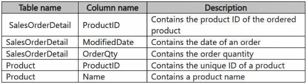
- Exhibit 2: 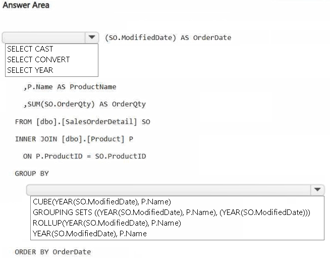

_HOTSPOT — the original ExamTopics question expects you to mark areas on the exhibit above; the correct hotspot coordinates are not published._

**Most voted:**
- Grouping Sets: Best answer. No extra stuff. Just what we want
- Cube: Lots of extra combinations. Has a row with the total for all years and all products, and rows with the total for each product for all years.
- Rollup: Has the unnecessary total of all products and all years
- Normal Group by: No summary at the year level for all products.

### Top explanations
- **robertlavigne** (43 upvotes [Highly Voted]): SELECT YEAR
  
  
  Grouping Sets: Best answer. No extra stuff. Just what we want
  Cube: Lots of extra combinations. Has a row with the total for all years and all products, and rows with the total for each product for all years. 
  Rollup: Has the unnecessary total of all products and all years
  Normal Group by: No summary at the year level for all products.
  
  https://learn.microsoft.com/en-us/sql/t-sql/queries/select-group-by-transact-sql?view=sql-server-ver16
- **mixonfreddy** (31 upvotes [Highly Voted]): SELECT YEAR
  ROLLUP(YEAR(SO.ModifiedDATE), P.Name)
- **hebertorosillo** (9 upvotes): SELECT YEAR
  GROUPING SETS(...)
- **tomaszstaroszczyk** (9 upvotes): SELECT YEAR
  GROUPING SETS(...)
  
  If you use ROLLUP then you will get an extra row that sums up the OrderQty total. 
  This is not requested, ROLLUP returns exactly what we need.
- **sakis213** (8 upvotes): Question asks for summarized values of all the order quantities by year/product AND year alone , so grouping sets its correct
  1.Year
  2. Grouping sets

## Q1.7 (ID 935972)

You have a Fabric workspace that contains a lakehouse named Lakehouse1. Data is ingested into Lakehouse1 as one flat table. The table contains the following columns.
You plan to load the data into a dimensional model and implement a star schema. From the original flat table, you create two tables named FactSales and DimProduct. You will track changes in DimProduct.
You need to prepare the data.
Which three columns should you include in the DimProduct table? Each correct answer presents part of the solution.
NOTE: Each correct selection is worth one point.

**Exhibits**
- Exhibit 1: 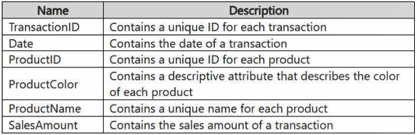

⭕ **A.** Date
✅ **B.** ProductName
✅ **C.** ProductColor
⭕ **D.** TransactionID
⭕ **E.** SalesAmount
✅ **F.** ProductID

**Correct answer:** B, C, F
**Most voted:** BCF

### Top explanations
- **QAZdbarhate12345678** (12 upvotes [Highly Voted]): Columns to Include in DimProduct
  ProductID - This is the unique identifier for each product and acts as the primary key in the DimProduct table.
  ProductName - Contains the name of the product, which is a descriptive attribute.
  ProductColor - Contains the color description of the product, which is also a descriptive attribute.
- **Tuki93** (4 upvotes): I believe the provided answer is correct
- **fdsdfgxcvbdsfhshfg** (3 upvotes): BCF seem to be correct, but it won't allow us to track changes so on a fence with these answer, some additional logic coming from Date column is required
- **shmmini** (3 upvotes): in this case, the transaction date is referenced. you cannot use it as it is. If you have to track SCD, you have to create your own Date Column, and populate it differently, not from this table
- **balanceBananes** (2 upvotes): Everything about the products

## Q1.8 (ID 935973)

You have a Fabric workspace named Workspace1 that contains a notebook named Notebook1.
In Workspace1, you create a new notebook named Notebook2.
You need to ensure that you can attach Notebook2 to the same Apache Spark session as Notebook1.
What should you do?

✅ **A.** Enable high concurrency for notebooks.
⭕ **B.** Enable dynamic allocation for the Spark pool.
⭕ **C.** Change the runtime version.
⭕ **D.** Increase the number of executors.

**Correct answer:** A
**Most voted:** A

### Top explanations
- **Tuki93** (18 upvotes [Highly Voted]): Enabling high concurrency allows multiple notebooks to share the same Spark session.
  
  https://learn.microsoft.com/en-us/fabric/data-engineering/configure-high-concurrency-session-notebooks
  
  https://learn.microsoft.com/en-us/fabric/data-engineering/high-concurrency-overview
- **QAZdbarhate12345678** (7 upvotes [Highly Voted]): In Azure Fabric, when you want to share the same Apache Spark session across multiple notebooks, enabling high concurrency mode is essential. High concurrency mode allows multiple notebooks to share the same Spark session, facilitating collaboration and efficient resource usage.
- **AbhirupAz900** (2 upvotes): A is correct because without high concurrency multiple notebook can not use same spark session
- **sesav4742** (2 upvotes): https://learn.microsoft.com/en-us/fabric/data-engineering/configure-high-concurrency-session-notebooks
  
  In Azure Fabric, when you want to share the same Apache Spark session across multiple notebooks, enabling high concurrency mode is essential. High concurrency mode allows multiple notebooks to share the same Spark session, facilitating collaboration and efficient resource usage.
- **Josekonoor** (1 upvotes [Most Recent]): 2 notebooks attached to same session -> High Concurrency

## Q1.9 (ID 935974)

You have a Fabric workspace named Workspace1 that contains a lakehouse named Lakehouse1. Lakehouse1 contains the following tables:
Orders -
Customer -
Employee -
The Employee table contains Personally Identifiable Information (PII).
A data engineer is building a workflow that requires writing data to the Customer table, however, the user does NOT have the elevated permissions required to view the contents of the Employee table.
You need to ensure that the data engineer can write data to the Customer table without reading data from the Employee table.
Which three actions should you perform? Each correct answer presents part of the solution.
NOTE: Each correct selection is worth one point.

⭕ **A.** Share Lakehouse1 with the data engineer.
⭕ **B.** Assign the data engineer the Contributor role for Workspace2.
⭕ **C.** Assign the data engineer the Viewer role for Workspace2.
✅ **D.** Assign the data engineer the Contributor role for Workspace1.
✅ **E.** Migrate the Employee table from Lakehouse1 to Lakehouse2.
✅ **F.** Create a new workspace named Workspace2 that contains a new lakehouse named Lakehouse2.
⭕ **G.** Assign the data engineer the Viewer role for Workspace1.

**Correct answer:** D, E, F
**Most voted:** DEF

### Top explanations
- **robertlavigne** (20 upvotes [Highly Voted]): First we need to do F and E to separate the Employee table from the other tables. Then they need contributor access to be able to write to the Customer table which is in Workspace1
  
  
  A is incorrect as sharing only gives read access. https://learn.microsoft.com/en-us/fabric/data-engineering/lakehouse-sharing
  B is incorrect as Workspace2 has the Employee table which the data engineer shouldn’t access.
  C is incorrect as viewer won’t allow them to write and the Customer table isn’t even in that workspace
  E is incorrect as viewer won’t allow them to write
- **fassil** (11 upvotes [Highly Voted]): Assign the data engineer the Contributor role for Workspace1 ( D) 
  - This will provide the necessary permissions to write to the Customer table.
  Migrate the Employee table from Lakehouse1 to Lakehouse2 (E) 
  - This will isolate the table with PII in a different lakehouse.
  Create a new workspace named Workspace2 that contains a new lakehouse named Lakehouse2 (Option F) 
  - This is necessary to separate the Employee table into a different workspace to restrict access.
- **VenkataPhaniPavanKumar** (4 upvotes): Solution Steps:
  Isolate sensitive data:
  Create a new workspace (Workspace2) with a new lakehouse (Lakehouse2) to host the PII data separately.
  → F. Create a new workspace named Workspace2 that contains a new lakehouse named Lakehouse2.
  
  Move PII data:
  Migrate the Employee table (PII) from Lakehouse1 to Lakehouse2 to remove it from the original environment.
  → E. Migrate the Employee table from Lakehouse1 to Lakehouse2.
  
  Grant minimal write permissions:
  Assign the Contributor role for Workspace1 to the data engineer. This role allows writing to objects (like the Customer table) but does not grant access to Workspace2 (where PII resides).
  → D. Assign the data engineer the Contributor role for Workspace1.
- **alirana3** (4 upvotes): The three correct actions to take are:
  
  E. Migrate the Employee table from Lakehouse1 to Lakehouse2 — This isolates sensitive data (Employee table) from the data engineer’s access.
  
  D. Assign the data engineer the Contributor role for Workspace1 — This allows the data engineer to write to the Customer table in Lakehouse1.
  
  F. Create a new workspace named Workspace2 that contains a new lakehouse named Lakehouse2 — This action is a result of migrating the Employee table to Lakehouse2 in a separate workspace (Workspace2) to ensure restricted access to sensitive data (PII).
  
  Why Option A is Incorrect:
  A. Share Lakehouse1 with the data engineer:
  
  Sharing only gives read access to the lakehouse, which is not sufficient for the data engineer to write data to the Customer table in Lakehouse1. They need write permissions to modify the table, so Contributor role for Workspace1 is the correct option.
- **Tuki93** (4 upvotes): I think D, E, and F are the working solution.

## Q1.10 (ID 935975)

You have a Fabric warehouse named DW1. DW1 contains a table that stores sales data and is used by multiple sales representatives.
You plan to implement row-level security (RLS).
You need to ensure that the sales representatives can see only their respective data.
Which warehouse object do you require to implement RLS?

⭕ **A.** STORED PROCEDURE
⭕ **B.** CONSTRAINT
⭕ **C.** SCHEMA
✅ **D.** FUNCTION

**Correct answer:** D
**Most voted:** D

### Top explanations
- **QAZdbarhate12345678** (15 upvotes [Highly Voted]): To implement Row-Level Security (RLS) in a Fabric warehouse like DW1, need to use a FUNCTION to define the filtering logic. Specifically, a user-defined function (UDF) is created and associated with the RLS policy to determine which rows each user can access.
- **Adriel_1996** (13 upvotes [Highly Voted]): -- Creating schema for Security
  CREATE SCHEMA Security;
  GO
  
  -- Creating a function for the SalesRep evaluation
  CREATE FUNCTION Security.tvf_securitypredicate(@UserName AS varchar(50))
      RETURNS TABLE
  WITH SCHEMABINDING
  AS
      RETURN SELECT 1 AS tvf_securitypredicate_result
  WHERE @UserName = USER_NAME()
  OR USER_NAME() = '
  [email protected]
  ';
  GO
  
  -- Using the function to create a Security Policy
  CREATE SECURITY POLICY YourSecurityPolicy
  ADD FILTER PREDICATE Security.tvf_securitypredicate(UserName_column)
  ON sampleschema.sampletable
  WITH (STATE = ON);
  GO
- **Tuki93** (3 upvotes): https://learn.microsoft.com/en-us/fabric/data-warehouse/tutorial-row-level-security#2-define-security-policies
- **Wipag** (2 upvotes): To implement Row-Level Security (RLS) in a Microsoft Fabric warehouse (DW1), you need to define a security policy that uses a user-defined function to filter rows based on the current user.
- **prabhjot** (2 upvotes): you create a predicate function which gets evaluated to filter user access to certain rows in a Yes or No manner

## Q1.11 (ID 935976)

HOTSPOT -
You have a Fabric workspace named Workspace1_DEV that contains the following items:
10 reports
Four notebooks -
Three lakehouses -
Two data pipelines -
Two Dataflow Gen1 dataflows -
Three Dataflow Gen2 dataflows -
Five semantic models that each has a scheduled refresh policy
You create a deployment pipeline named Pipeline1 to move items from Workspace1_DEV to a new workspace named Workspace1_TEST.
You deploy all the items from Workspace1_DEV to Workspace1_TEST.
For each of the following statements, select Yes if the statement is true. Otherwise, select No.
NOTE: Each correct selection is worth one point.

**Exhibits**
- Exhibit 1: 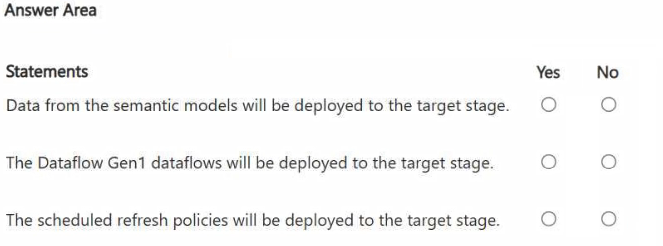

_HOTSPOT — the original ExamTopics question expects you to mark areas on the exhibit above; the correct hotspot coordinates are not published._

**Most voted:**
- NO: only metadata will be deployed to the target starge
- YES: Gen1 dataflows will be deployed
- NO: Refresh schedules will not be deployed

### Top explanations
- **SamuComqi** (50 upvotes [Highly Voted]): NO: only metadata will be deployed to the target starge (https://learn.microsoft.com/en-us/fabric/cicd/deployment-pipelines/understand-the-deployment-process?tabs=new#item-properties-copied-during-deployment)
  
  YES: Gen1 dataflows will be deployed
  
  NO: Refresh schedules will not be deployed (https://learn.microsoft.com/en-us/fabric/cicd/deployment-pipelines/understand-the-deployment-process?tabs=new#item-properties-copied-during-deployment)
- **Juanes55** (13 upvotes [Highly Voted]): Data from the semantic models will be deployed to the target stage.
  No – The data itself is not deployed. Only the structure/definition (metadata) of the semantic model is deployed. You'll need to refresh the model in the target stage to populate it with data.
  
  The Dataflow Gen1 dataflows will be deployed to the target stage.
  No – Only Dataflow Gen2 is supported in Microsoft Fabric deployment pipelines. Gen1 dataflows are not deployable through Fabric pipelines.
  
  The scheduled refresh policies will be deployed to the target stage.
  No – Scheduled refresh settings are not included in deployments. You must configure them separately in the target workspace.
- **Marco44** (9 upvotes): No/No/No
  
  Deployment pipelines do not support Dataflow Gen1 dataflows. These need to be manually migrated or recreated in the target stage. Only Dataflow Gen2 is supported in deployment pipelines.
- **GHill1982** (9 upvotes): I believe Dataflow Gen1 is supported (aka Power BI Dataflows) , see https://learn.microsoft.com/en-us/fabric/cicd/deployment-pipelines/intro-to-deployment-pipelines?tabs=new#supported-items
- **ChenFu** (8 upvotes): No
  No
  Yes

## Q1.12 (ID 935977)

You have a Fabric deployment pipeline that uses three workspaces named Dev, Test, and Prod.
You need to deploy an eventhouse as part of the deployment process.
What should you use to add the eventhouse to the deployment process?

⭕ **A.** GitHub Actions
✅ **B.** a deployment pipeline
⭕ **C.** an Azure DevOps pipeline

**Correct answer:** B
**Most voted:** B

### Top explanations
- **QAZdbarhate12345678** (16 upvotes [Highly Voted]): In Microsoft Fabric, deployment pipelines are the recommended and built-in method for managing and deploying artifacts (like eventhouses, lakehouses, datasets, and reports) across environments such as Dev, Test, and Prod.
- **Wipag** (5 upvotes [Highly Voted]): Microsoft Fabric deployment pipelines now support eventhouses along with other Fabric items like:
  	•	Lakehouses
  	•	Warehouses
  	•	Notebooks
  	•	Dataflows Gen2
  	•	Data pipelines
  	•	Semantic models
  	•	Reports
  	•	Eventhouses
- **alirana3** (2 upvotes): B. a deployment pipeline
  Here’s why:
  
  Microsoft Fabric deployment pipelines are designed for managing the deployment of resources (including eventhouses) across different environments (e.g., Dev, Test, Prod). You use a deployment pipeline to automate and control the deployment process across workspaces, ensuring that the eventhouse (along with other resources) is deployed correctly through the stages of your workflow.
  
  GitHub Actions and Azure DevOps pipelines could also be used for deployment, but the Fabric deployment pipeline is specifically built for this use case within Microsoft Fabric and integrates directly with the workspace and stage management.
  
  For details, check the official documentation:
  Get started with deployment pipelines
  https://learn.microsoft.com/en-us/fabric/cicd/deployment-pipelines/get-started-with-deployment-pipelines?tabs=from-fabric%2Cnew-ui
- **Tuki93** (2 upvotes): https://learn.microsoft.com/en-us/fabric/cicd/deployment-pipelines/get-started-with-deployment-pipelines?tabs=from-fabric%2Cnew%2Cstage-settings-new
  
  https://learn.microsoft.com/en-us/fabric/cicd/deployment-pipelines/understand-the-deployment-process?tabs=new
- **Josekonoor** (1 upvotes [Most Recent]): deployment pipeline

## Q1.13 (ID 935978)

You have a Fabric workspace named Workspace1 that contains a warehouse named Warehouse1.
You plan to deploy Warehouse1 to a new workspace named Workspace2.
As part of the deployment process, you need to verify whether Warehouse1 contains invalid references. The solution must minimize development effort.
What should you use?

⭕ **A.** a database project
✅ **B.** a deployment pipeline
⭕ **C.** a Python script
⭕ **D.** a T-SQL script

**Correct answer:** B
**Most voted:** B

### Top explanations
- **QAZdbarhate12345678** (21 upvotes [Highly Voted]): Microsoft Fabric's deployment pipelines provide a built-in mechanism to manage and validate the deployment of artifacts like warehouses. When you use a deployment pipeline to move Warehouse1 from one workspace (Workspace1) to another (Workspace2), the pipeline automatically checks for issues such as invalid references or missing dependencies during the deployment process.
- **hebertorosillo** (5 upvotes [Highly Voted]): A. a database project  for minimal effor
- **tomaszstaroszczyk** (4 upvotes): What kind of references may a Warehouse have? We don't have shortcuts in a warehouse. It seems to be an indepentent item, there is no possiblity to break a reference to anything external. Therfor I think this relates to internal references, i.e. stored procedure operating on non-existing table. In this case a database project (answer A) would be necessary, but I don't find it related to a Deployment Pipeline in any way.
- **toniteo** (4 upvotes): agreed with answer A. Here is the hint.
  https://community.fabric.microsoft.com/t5/Data-Engineering/Microsoft-fabric-WareHouse-migration-issue-via-deployment/td-p/4281976
- **8115575** (3 upvotes): a database project is more relevant for traditional SQL Server development using tools like Visual Studio; not integrated with Fabric's deployment model.
  Scripts are not minimizing effort.

## Q1.14 (ID 935979)

You have a Fabric workspace that contains a Real-Time Intelligence solution and an eventhouse.
Users report that from OneLake file explorer, they cannot see the data from the eventhouse.
You enable OneLake availability for the eventhouse.
What will be copied to OneLake?

⭕ **A.** only data added to new databases that are added to the eventhouse
⭕ **B.** only the existing data in the eventhouse
⭕ **C.** no data
✅ **D.** both new data and existing data in the eventhouse
⭕ **E.** only new data added to the eventhouse

**Correct answer:** D
**Most voted:** D

### Top explanations
- **Tuki93** (25 upvotes [Highly Voted]): - Existing tables aren't affected. New tables are made available in OneLake.
  
  https://learn.microsoft.com/en-us/fabric/real-time-intelligence/event-house-onelake-availability#how-it-works
- **IshtarSQL** (9 upvotes [Highly Voted]): When you enable OneLake availability for an eventhouse in Microsoft Fabric, only new data ingested into the eventhouse will be synced and made available in OneLake.
- **exnaniantwort** (8 upvotes): It is still E.
  
  You can turn on OneLake availability at the database or table level. When enabled at the database level, all new tables and their data are made available in OneLake. When turning on the feature, >>. Turning on at the table level makes only that table and its data available in OneLake
  
  Only if the question mentions explicitly together the "Apply to existing tables option", otherwise, only "enable OneLake availability" does not do the backfill.
- **Sr18** (7 upvotes): As per documentation, now you have option to select historical backfill. So I think question's verbiage is incomplete now. 
  Answer D : Seems more right answer now, because you have this option and may be it was selected while making the One Lake Availability.
- **Bin_Hashim** (6 upvotes): Microsoft’s current docs say when you turn on OneLake availability for an eventhouse (KQL database), you can apply it to existing tables to include historic backfill, and once enabled it continues to sync new data as it arrives. So users will see both the historical data and ongoing new data in OneLake. Microsoft Learn
  
  
  “When enabled at the database level… you can also choose to apply this option to existing tables, to include historic backfill.” Microsoft Learn
  
  
  “When you turn availability back on, all data is made available in OneLake, including historic backfill.” Microsoft Learn
  
  
  
  Note: Earlier guidance (pre-2025) often said “only new data” with no backfill. The behavior has since changed/been clarified in the official docs.

## Q1.15 (ID 935980)

You have a Fabric workspace named Workspace1.
You plan to integrate Workspace1 with Azure DevOps.
You will use a Fabric deployment pipeline named deployPipeline1 to deploy items from Workspace1 to higher environment workspaces as part of a medallion architecture. You will run deployPipeline1 by using an API call from an Azure DevOps pipeline.
You need to configure API authentication between Azure DevOps and Fabric.
Which type of authentication should you use?

✅ **A.** service principal
⭕ **B.** Microsoft Entra username and password
⭕ **C.** managed private endpoint
⭕ **D.** workspace identity

**Correct answer:** A
**Most voted:** A

### Top explanations
- **VenkataPhaniPavanKumar** (6 upvotes [Highly Voted]): A service principal is the recommended authentication method when automating deployments and integrations between Azure DevOps and Microsoft Fabric. It provides a secure, scalable, and manageable way to authenticate API calls—especially from CI/CD systems like Azure DevOps pipelines—without requiring user credentials.
- **Meir** (4 upvotes): See https://learn.microsoft.com/en-us/answers/questions/2074603/run-pipeline-via-azure-function-by-rest-api
- **hebertorosillo** (3 upvotes): Microsoft Entra supported identities
  This API supports the Microsoft identities listed in this section.
  
  Identity	Support
  User	Yes
  Service principal and Managed identities	Only Power BI Items are supported   . ref https://learn.microsoft.com/en-us/rest/api/fabric/core/deployment-pipelines/deploy-stage-content?tabs=HTTP
- **henryphchan** (3 upvotes): A service principal is an identity created for use with applications, hosted services, and automated tools to access Azure resources. It provides a secure, non-interactive way for Azure DevOps pipelines to authenticate and interact with Fabric APIs without needing user credentials.
- **robertlavigne** (3 upvotes): https://learn.microsoft.com/en-us/rest/api/fabric/core/deployment-pipelines/deploy-stage-content?tabs=HTTP
  The above documentation shows that the deploy pipeline API can only use a service principal to deploy PowerBI content. Since we are deploying content related to a medallion architecture we will need to use user based authentication. 
  Workspace ID is for fabric to reach out to other things which isn't what we want. And a managed private-endpoint is not relevant.

## Q1.16 (ID 935981)

You have a Google Cloud Storage (GCS) container named storage1 that contains the files shown in the following table.
You have a Fabric workspace named Workspace1 that has the cache for shortcuts enabled. Workspace1 contains a lakehouse named Lakehouse1. Lakehouse1 has the shortcuts shown in the following table.
You need to read data from all the shortcuts.
Which shortcuts will retrieve data from the cache?

**Exhibits**
- Exhibit 1: 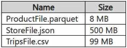
- Exhibit 2: 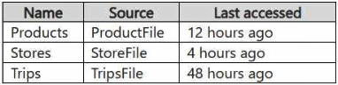

⭕ **A.** Stores only
⭕ **B.** Products only
✅ **C.** Stores and Products only
⭕ **D.** Products, Stores, and Trips
⭕ **E.** Trips only
⭕ **F.** Products and Trips only

**Correct answer:** C
**Most voted:** C

### Top explanations
- **Tuki93** (21 upvotes [Highly Voted]): Shortcut caching can be used to reduce egress costs associated with cross-cloud data access. As files are read through an external shortcut, the files are stored in a cache for the Fabric workspace. Subsequent read requests are served from cache rather than the remote storage provider. Cached files have a retention period of 24 hours.
  
  https://learn.microsoft.com/en-us/fabric/onelake/onelake-shortcuts#caching
- **ts_au** (19 upvotes [Highly Voted]): caching can now be retained up to 28 days
- **Kiket2ride** (6 upvotes): By default is C but now D can also be true. See here:
  The retention period for cached files can be set from 1-28 days
  https://learn.microsoft.com/en-us/fabric/onelake/onelake-shortcuts#caching
- **Sr18** (5 upvotes): My bad this is answer for 18. Here it should be all 3. As all of them are less than 2 gb and 28 days is now max retention.
- **YeloDeo01_** (5 upvotes): The retention period for cached files can be set from 1-28 days.
  https://learn.microsoft.com/en-us/fabric/onelake/onelake-shortcuts

## Q1.17 (ID 935982)

You have a Fabric workspace named Workspace1 that contains an Apache Spark job definition named Job1.
You have an Azure SQL database named Source1 that has public internet access disabled.
You need to ensure that Job1 can access the data in Source1.
What should you create?

⭕ **A.** an on-premises data gateway
✅ **B.** a managed private endpoint
⭕ **C.** an integration runtime
⭕ **D.** a data management gateway

**Correct answer:** B
**Most voted:** B

### Top explanations
- **GHill1982** (7 upvotes [Highly Voted]): To ensure that Job1 can access the data in Source1, you need to create a managed private endpoint. This will allow the Spark job to securely connect to the Azure SQL database without requiring public internet access.
- **realexamguru** (5 upvotes): correct
  https://learn.microsoft.com/en-us/fabric/security/security-managed-private-endpoints-overview#supported-item-types
- **Tuki93** (3 upvotes): Provided answer is correct
- **Hanif53** (1 upvotes [Most Recent]): In Fabric, when accessing Azure resources that are behind private networking:
  
  Azure SQL Database
  Azure Storage
  Azure Key Vault
  
  You create a Managed Private Endpoint (MPE) from Fabric.
  
  This provides secure private connectivity from Fabric compute (Spark) to the Azure resource.
- **smanzana** (1 upvotes): Correct

## Q1.18 (ID 935983)

You have an Azure Data Lake Storage Gen2 account named storage1 and an Amazon S3 bucket named storage2.
You have the Delta Parquet files shown in the following table.
You have a Fabric workspace named Workspace1 that has the cache for shortcuts enabled. Workspace1 contains a lakehouse named Lakehouse1. Lakehouse1 has the following shortcuts:
A shortcut to ProductFile aliased as Products
A shortcut to StoreFile aliased as Stores
A shortcut to TripsFile aliased as Trips
The data from which shortcuts will be retrieved from the cache?

**Exhibits**
- Exhibit 1: 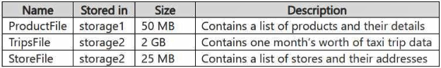

⭕ **A.** Trips and Stores only
⭕ **B.** Products and Store only
✅ **C.** Stores only
⭕ **D.** Products only
⭕ **E.** Products, Stores, and Trips

**Correct answer:** C
**Most voted:** C

### Top explanations
- **Tuki93** (32 upvotes [Highly Voted]): Shortcut caching is currently only supported for GCS, S3 and S3 compatible shortcuts.
  
   If a file hasn’t been accessed for more than 24 hrs it's purged from the cache. Individual files greater than 1 GB in size aren't cached
  
  https://learn.microsoft.com/en-us/fabric/onelake/onelake-shortcuts#caching
- **prabhjot** (11 upvotes [Highly Voted]): Shortcuts are accessible from both ADLS and Amazon S3 as of the time of writing this answer. Trips is too large to be cached
- **DarioReymago** (8 upvotes): for this reason is B
- **exnaniantwort** (8 upvotes): ADLS supports shortcuts, BUT the question is asking "The data from which shortcuts will be retrieved FROM THE CACHE?".
  ADLS does NOT need a cache. -> Products is incorrect
- **AnetaK** (5 upvotes): The retention period for cached files can be set from 1-28 days.
  (same link as obove)

## Q1.19 (ID 935984)

HOTSPOT -
You have a Fabric workspace named Workspace1 that contains the items shown in the following table.
For Model1, the Keep your Direct Lake data up to date option is disabled.
You need to configure the execution of the items to meet the following requirements:
Notebook1 must execute every weekday at 8:00 AM.
Notebook2 must execute when a file is saved to an Azure Blob Storage container.
Model1 must refresh when Notebook1 has executed successfully.
How should you orchestrate each item? To answer, select the appropriate options in the answer area.
NOTE: Each correct selection is worth one point.

**Exhibits**
- Exhibit 1: 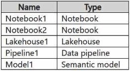
- Exhibit 2: 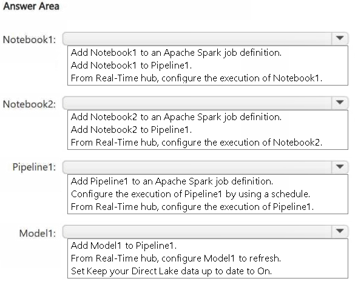

_HOTSPOT — the original ExamTopics question expects you to mark areas on the exhibit above; the correct hotspot coordinates are not published._

**Most voted:**
- Must run every weekday at 8:00 AM → that is a scheduled job.
- Best option: Add Notebook1 to an Apache Spark job definition
- Best option: From Real-Time hub, configure the execution of Notebook2.
- Best option: Configure the execution of Pipeline1 by using a schedule.
- Best option: Add Model1 to Pipeline1

### Top explanations
- **GHill1982** (20 upvotes [Highly Voted]): All four answers are correct.
- **4371883** (10 upvotes [Highly Voted]): Notebook 1 runs at 8AM, this can be scheduled via Pipeline (Pipeline1), so the configuration of scheduling is in Pipeline 1. Because Model1 refreshes on completion of Notebook1, it should be added to Pipeline 1 after Notebook 1. Notebook 2 is separate to the Pipeline 1 sequence, it requires a trigger (file saved in Blob) from real-time hub.
- **wellingtonluis** (6 upvotes): Totally agree with the answer.
  N1 - Pipeline
  N2 - Real-time Hub
  Pipeline - Schedule
  Model - Add to pipeline
- **DarioReymago** (2 upvotes): NB1 add to Pipeline
  NB2 realtime hub
  Pipeline: Schedule
  M1: add to Pipeline
  :
  In Microsoft Fabric, the Real-Time hub allows you to ingest and manage streaming data from various sources, including Azure Blob Storage events. You can create event streams in Fabric that connect to your Azure Blob Storage account and trigger actions based on events like file creation, deletion, or modification. These event streams can then be used to process and analyze the real-time data for various applications like data analysis, machine learning, or creating alerts
- **boonfidelio** (2 upvotes): Based on the information provided, I believe A is correct.

## Q1.20 (ID 935985)

Your company has a sales department that uses two Fabric workspaces named Workspace1 and Workspace2.
The company decides to implement a domain strategy to organize the workspaces.
You need to ensure that a user can perform the following tasks:
Create a new domain for the sales department.
Create two subdomains: one for the east region and one for the west region.
Assign Workspace1 to the east region subdomain.
Assign Workspace2 to the west region subdomain.
The solution must follow the principle of least privilege.
Which role should you assign to the user?

⭕ **A.** workspace Admin
⭕ **B.** domain admin
⭕ **C.** domain contributor
✅ **D.** Fabric admin

**Correct answer:** D
**Most voted:** D

### Top explanations
- **neo_20** (24 upvotes [Highly Voted]): Only a Fabric Admin can create Domains.
- **MDWPartners** (5 upvotes [Highly Voted]): Fabric admin (or higher) are the only ones who can create domains
- **fdsdfgxcvbdsfhshfg** (5 upvotes): Domain Admin can work on already created domain, not create it and appoint himself as the admin out of thin air.
  Fabric Admin is required
- **harshalt10** (5 upvotes): The question states that user should be able to create Domains. Hence, answer should be D.
  
  https://learn.microsoft.com/en-us/fabric/onelake/onelake-shortcuts
- **GHill1982** (5 upvotes): After further research it appears only a Fabric Admin can create Domains.
  
  https://learn.microsoft.com/en-us/fabric/governance/domains#create-a-domain

## Q1.21 (ID 935986)

You have a Fabric workspace named Workspace1 that contains a warehouse named DW1 and a data pipeline named Pipeline1.
You plan to add a user named User3 to Workspace1.
You need to ensure that User3 can perform the following actions:
View all the items in Workspace1.
Update the tables in DW1.
The solution must follow the principle of least privilege.
You already assigned the appropriate object-level permissions to DW1.
Which workspace role should you assign to User3?

⭕ **A.** Admin
⭕ **B.** Member
✅ **C.** Viewer
⭕ **D.** Contributor

**Correct answer:** C
**Most voted:** C

### Top explanations
- **Bovote** (23 upvotes [Highly Voted]): Viewer                  - Can view all content in the workspace, but can't modify it.
  Contributor         - Can view and modify all content in the workspace.
  Member              -  Can view, modify, and share all content in the workspace.          Can add Members
  Admin                   - Can view, modify, share, and manage all content in the workspace, including managing permissions. 
                                  - Can add Admins, Members and can delete workspace.
  
  So Contributor is the least role who can view and update the tables (modify the content).
- **01ceacf** (8 upvotes [Highly Voted]): Only member or above can modify warehouse items
  
  https://learn.microsoft.com/en-us/fabric/get-started/roles-workspaces
- **vish9** (5 upvotes): Assign the Viewer role to User3 to allow viewing all workspace items.
  Object-level permissions already cover updates to DW1, ensuring least privilege is maintained.
- **GadAugust** (5 upvotes): This is a really tricky question and the answer does not just lay in the coarse grained workspace roles
  https://learn.microsoft.com/en-us/fabric/get-started/roles-workspaces
  The user should be able to view the items in the workspace - VIEWER
  The user can already update the tables in the DW1 database through object-level permissions
  So if you apply the Principle of Least privilege, VIEWER is all that is required. All other roles will elevate the user privilege over and above the requirements.
- **ShazzyHawk** (4 upvotes): “You already assigned the appropriate object-level permissions to DW1”
  
  changes everything.
  
  Object-level permissions on DW1 override workspace-level edit restrictions.
  
  A Viewer role on the workspace allows the user to see all workspace items,
  while the object-level permissions on DW1 allow them to update data in the warehouse.
  
  Therefore, granting Contributor or higher would violate least privilege, since those roles allow editing other workspace items.

## Q1.22 (ID 935987)

You have a Fabric capacity that contains a workspace named Workspace1. Workspace1 contains a lakehouse named Lakehouse1, a data pipeline, a notebook, and several Microsoft Power BI reports.
A user named User1 wants to use SQL to analyze the data in Lakehouse1.
You need to configure access for User1. The solution must meet the following requirements:
Provide User1 with read access to the table data in Lakehouse1.
Prevent User1 from using Apache Spark to query the underlying files in Lakehouse1.
Prevent User1 from accessing other items in Workspace1.
What should you do?

✅ **A.** Share Lakehouse1 with User1 directly and select Read all SQL endpoint data.
⭕ **B.** Assign User1 the Viewer role for Workspace1. Share Lakehouse1 with User1 and select Read all SQL endpoint data.
⭕ **C.** Share Lakehouse1 with User1 directly and select Build reports on the default semantic model.
⭕ **D.** Assign User1 the Member role for Workspace1. Share Lakehouse1 with User1 and select Read all SQL endpoint data.

**Correct answer:** A
**Most voted:** A

### Top explanations
- **01ceacf** (12 upvotes [Highly Voted]): Read Access to Table Data.
  
  B/D - Viewer/Member can access other items
  C - cannot access SQL DB
- **IshtarSQL** (7 upvotes [Highly Voted]): Assigning the Viewer role would grant User1 access to all items in the workspace, violating the requirement to restrict access to Lakehouse1 only.
- **e71e79b** (3 upvotes [Most Recent]): Read table data using SQL:
  The SQL endpoint provides a structured interface for querying lakehouse tables without invoking Apache Spark.
  
  Selecting “Read all SQL endpoint data” gives User1 SQL read access to the tables in Lakehouse1.
  Prevent Apache Spark access:
  
  By not assigning workspace-level roles (like Viewer, Member, or Admin), User1 won't see or access notebooks or Spark-powered tools.
  Limit visibility to only Lakehouse1:
  
  Sharing Lakehouse1 directly (instead of the entire workspace) ensures User1 has visibility only into what you explicitly share.
- **benni_ale** (3 upvotes): Agree with other solutions
- **smanzana** (2 upvotes): A is correct

## Q1.23 (ID 935988)

DRAG DROP -
You are implementing the following data entities in a Fabric environment:
Entity1: Available in a lakehouse and contains data that will be used as a core organization entity
Entity2: Available in a semantic model and contains data that meets organizational standards
Entity3: Available in a Microsoft Power BI report and contains data that is ready for sharing and reuse
Entity4: Available in a Power BI dashboard and contains approved data for executive-level decision making
Your company requires that specific governance processes be implemented for the data.
You need to apply endorsement badges to the entities based on each entity’s use case.
Which badge should you apply to each entity? To answer, drag the appropriate badges the correct entities. Each badge may be used once, more than once, or not at all. You may need to drag the split bar between panes or scroll to view content.
NOTE: Each correct selection is worth one point.

**Exhibits**
- Exhibit 1: 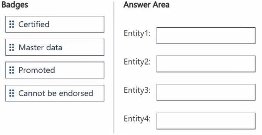

_DRAG DROP — the original ExamTopics question expects you to drag and drop items; the correct targets are not published._

**Most voted:**
- Entity1: core organization entity → Master Data
- Entity2: meets organizational standards → Certified
- Entity3: ready for sharing and reuse → Promoted
- Entity4: Power BI dashboard, executive-level decision making → Cannot be endorsed, The reason is Types of items that can be endorsed

### Top explanations
- **fassil** (55 upvotes [Highly Voted]): Entity1: core organization entity --> Master Data
  Entity2: meets organizational standards --> Certified
  Entity3: ready for sharing and reuse --> Promoted
  Entity4: Power BI dashboard, executive-level decision making --> Cannot be endorsed, The reason is Types of items that can be endorsed
  All Fabric items and Power BI items except Power BI dashboards can be promoted or certified.
- **doctordodge** (6 upvotes [Highly Voted]): All are correct EXCEPT Entity4: Power BI dashboards cannot be endorsed, according to Microsoft official documentation.
  https://learn.microsoft.com/en-us/fabric/governance/endorsement-overview#types-of-items-that-can-be-endorsed
- **DarioReymago** (7 upvotes): this is correct
- **henryphchan** (6 upvotes): Entity1: core organization entity --> Master Data
  Entity2: meets organizational standards --> Certified
  Entity3: ready for sharing and reuse --> Promoted
  Entity4: Power BI dashboard, executive-level decision making --> Cannot be endorsed, The reason is Master data can only be applied to lakehouse and models.
- **Tuki93** (5 upvotes): Entity 4 should be 'Cannot be endorsed.' In my opinion, 
  "The master data label can only be applied to items that contain data, such as lakehouses and semantic models."
  https://learn.microsoft.com/en-us/fabric/governance/endorsement-overview

## Q1.24 (ID 935989)

HOTSPOT -
You have three users named User1, User2, and User3.
You have the Fabric workspaces shown in the following table.
You have a security group named Group1 that contains User1 and User3.
The Fabric admin creates the domains shown in the following table.
User1 creates a new workspace named Workspace3.
You add Group1 to the default domain of Domain1.
For each of the following statements, select Yes if the statement is true. Otherwise, select No.
NOTE: Each correct selection is worth one point.

**Exhibits**
- Exhibit 1: 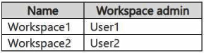
- Exhibit 2: 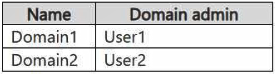
- Exhibit 3: 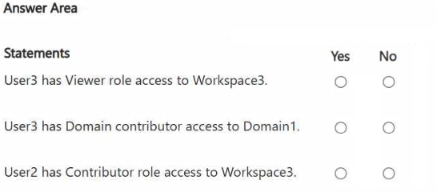

_HOTSPOT — the original ExamTopics question expects you to mark areas on the exhibit above; the correct hotspot coordinates are not published._

**Most voted:**
- N Y N
- Being a domain contributor doesn't give you any permissions on the workspace itself, only on the domain. Workspace roles are set differently. This excludes the first and last option.
- User 3 will be domain contributor on the new workspace. Even though without domain admin permissions, there's nothing user 3 can do with Workspace 3.

### Top explanations
- **giraf** (41 upvotes [Highly Voted]): NYN
  Being a domain contributor doesn't give you any permissions on the workspace itself, only on the domain. Workspace roles are set differently. This excludes the first and last option.
  User 3 will be domain contributor on the new workspace. Even though without domain admin permissions, there's nothing user 3 can do with Workspace 3.
- **38578c4** (17 upvotes [Highly Voted]): N Y N
  https://learn.microsoft.com/en-us/fabric/governance/domains
  Being a domain contributor doesn't give you any permissions on the workspace itself, only on the domain. Workspace roles are set differently. This excludes the first and last option.
  User 3 will be domain contributor on the new workspace. Even though without domain admin permissions, there's nothing user 3 can do with Workspace 3.
- **vish9** (11 upvotes): N,N,N
  User3 doesn't have Viewer or Domain contributor access because Group1 was only added to the default domain, not explicitly granted permissions. User2 has no access to Workspace3 since User1 created it and didn’t add User2. Therefore, all three statements are false.
- **larinate** (5 upvotes): Domain permissions = metadata + catalog governance
  Workspace permissions = item-level access
  These are completely separate.
   answer is NO / YES / NO
- **Rozamunde** (5 upvotes): NYN
  User1 creates a new workspace named Workspace3 - at this moment the Workspace3 is unassigned, i.e. no domain.
  When Group1 (User1 and User3) is added to the default domain of Domain1:
   1. "When you add people to the default domain list, unassigned workspaces they're admins of, and new workspaces they create, will automatically be assigned to the domain". 
  I.e. Workspace3 is assigned to Domain1
  	2. "The users and/or members of the security groups specified in the default domain definition generally automatically become domain contributors of the workspaces that get assigned to the domain via the default domain mechanism."
  I.e User3 becomes Domain1 contributor, not Viewer. 
  From

## Q1.25 (ID 935990)

You have two Fabric workspaces named Workspace1 and Workspace2.
You have a Fabric deployment pipeline named deployPipeline1 that deploys items from Workspace1 to Workspace2. DeployPipeline1 contains all the items in Workspace1.
You recently modified the items in Workspaces1.
The workspaces currently contain the items shown in the following table.
Items in Workspace1 that have the same name as items in Workspace2 are currently paired.
You need to ensure that the items in Workspace1 overwrite the corresponding items in Workspace2. The solution must minimize effort.
What should you do?

**Exhibits**
- Exhibit 1: 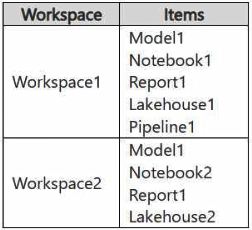

⭕ **A.** Delete all the items in Workspace2, and then run deployPipeline1.
⭕ **B.** Rename each item in Workspace2 to have the same name as the items in Workspace1.
⭕ **C.** Back up the items in Workspace2, and then run deployPipeline1.
✅ **D.** Run deployPipeline1 without modifying the items in Workspace2.

**Correct answer:** D
**Most voted:** D

### Top explanations
- **benni_ale** (6 upvotes [Highly Voted]): Given minimal effort is required deploying the deploymentpipeline is enough
- **exnaniantwort** (5 upvotes [Highly Voted]): Item pairing
  Pairing is the process by which an item in one stage of the deployment pipeline is associated with the same item in the adjacent stage. If items aren't paired, even if they have the same name and type, the item in the target stage isn't overwritten during a deploy. A deploy of an unpaired item is known as a clean deploy and creates a copy of that item in the adjacent stage.
  
  Simply deploying will overwrite the corresponding items in Workspace2 by those in Workspace 1
  https://learn.microsoft.com/en-us/fabric/cicd/deployment-pipelines/assign-pipeline?tabs=new-ui#item-pairing
- **GHill1982** (4 upvotes): This requires minimal effort as it has no additional steps such as renaming of deleting items.
- **fdsdfgxcvbdsfhshfg** (2 upvotes [Most Recent]): There is no information on whether the new items from Workspace1 should be deployed or not, but the only answer that does make sense is D, although some new objects will be created in Workspace2
- **smanzana** (2 upvotes): D is correct

## Q1.26 (ID 935991)

You have a Fabric workspace named Workspace1 that contains a data pipeline named Pipeline1 and a lakehouse named Lakehouse1.
You have a deployment pipeline named deployPipeline1 that deploys Workspace1 to Workspace2.
You restructure Workspace1 by adding a folder named Folder1 and moving Pipeline1 to Folder1.
You use deployPipeline1 to deploy Workspace1 to Workspace2.
What occurs to Workspace2?

✅ **A.** Folder1 is created, Pipeline1 moves to Folder1, and Lakehouse1 is deployed.
⭕ **B.** Only Pipeline1 and Lakehouse1 are deployed.
⭕ **C.** Folder1 is created, and Pipeline1 and Lakehouse1 move to Folder1.
⭕ **D.** Only Folder1 is created and Pipeline1 moves to Folder1.

**Correct answer:** A
**Most voted:** A

### Top explanations
- **learnazureportal** (7 upvotes [Highly Voted]): Only Pipeline1 and Lakehouse1 are deployed. Only the artifacts themselves (Pipeline1, Lakehouse1) are deployed, not the folder hierarchy.
- **smanzana** (4 upvotes): A is correct
- **8d6881f** (4 upvotes): https://learn.microsoft.com/en-us/fabric/cicd/deployment-pipelines/understand-the-deployment-process?tabs=new-ui#deploy-content-from-one-stage-to-another
  
  "When content from the source stage is copied to the target stage, Fabric identifies existing content in the target stage and overwrites it. "
- **57f5e84** (3 upvotes [Most Recent]): i make test and A is corret.
  Folder1 will be create in workspace2 and contain Pipeline1 deploye, Lakehouse will be deploye in workspace2
- **8115575** (3 upvotes): No reason for Lakehouse1 to be deployed when question only mentions a restructuring, meaning Lakehouse1 is already in workspace2

## Q1.27 (ID 935992)

DRAG DROP -
Your company has a team of developers. The team creates Python libraries of reusable code that is used to transform data.
You create a Fabric workspace name Workspace1 that will be used to develop extract, transform, and load (ETL) solutions by using notebooks.
You need to ensure that the libraries are available by default to new notebooks in Workspace1.
Which three actions should you perform in sequence? To answer, move the appropriate actions from the list of actions to the answer area and arrange them in the correct order.

**Exhibits**
- Exhibit 1: 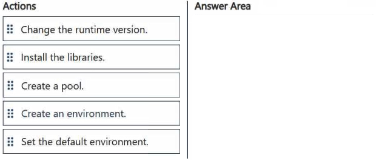

_DRAG DROP — the original ExamTopics question expects you to drag and drop items; the correct targets are not published._

**Most voted:**
1) Create a pool
2) Create an environment
3) Set the default environment

### Top explanations
- **Tuki93** (13 upvotes [Highly Voted]): Seems correct.
- **Sunnyb** (5 upvotes [Highly Voted]): Create an environment
  
  You define a Spark environment that can hold runtime and library settings.
  
  Install the libraries
  
  Upload or reference your custom Python libraries (e.g., .whl, .egg, or .py files) in this environment.
  
  Set the default environment
  
  Assign this environment as the default for the workspace so that every new notebook automatically uses it.
- **92ef42d** (3 upvotes): I tried this in the Fabric.
  First you should toggle ON "Set the default environment".
  Then you can create a new environment and set it as default.
  And only after that you can install additional libraries (if needed). 
  So, the answer is correct.
- **benni_ale** (3 upvotes): Seems corret: Create (virtual) environment, install libraries, set the newly created environment as default from workspace settings
- **henryphchan** (3 upvotes): The answer is correct

## Q1.28 (ID 935993)

You have a Fabric workspace that contains a lakehouse and a notebook named Notebook1. Notebook1 reads data into a DataFrame from a table named Table1 and applies transformation logic. The data from the DataFrame is then written to a new Delta table named Table2 by using a merge operation.
You need to consolidate the underlying Parquet files in Table1.
Which command should you run?

⭕ **A.** VACUUM
⭕ **B.** BROADCAST
✅ **C.** OPTIMIZE
⭕ **D.** CACHE

**Correct answer:** C
**Most voted:** C

### Top explanations
- **henryphchan** (7 upvotes [Highly Voted]): In Delta Lake, the OPTIMIZE command is used to consolidate small Parquet files into larger ones. This improves query performance by reducing the overhead of managing many small files.
  
  VACUUM command is used to clean up and remove files that are no longer needed (e.g., old versions of data files, deleted files)
- **GHill1982** (5 upvotes [Highly Voted]): To consolidate the underlying Parquet files in Table1, you should run the OPTIMIZE command.
- **prabhjot** (3 upvotes): Optimize solves the "small file problem" by consolidating multiple small files into larger parquet files
- **smanzana** (2 upvotes [Most Recent]): C is correct
- **benni_ale** (2 upvotes): Optimise!

## Q1.29 (ID 935994)

You have five Fabric workspaces.
You are monitoring the execution of items by using Monitoring hub.
You need to identify in which workspace a specific item runs.
Which column should you view in Monitoring hub?

⭕ **A.** Start time
⭕ **B.** Capacity
⭕ **C.** Activity name
⭕ **D.** Submitter
⭕ **E.** Item type
⭕ **F.** Job type
✅ **G.** Location

**Correct answer:** G
**Most voted:** G

### Top explanations
- **GHill1982** (10 upvotes [Highly Voted]): Correct. The Location shows the Workspace.
  
  https://learn.microsoft.com/en-us/training/modules/monitor-fabric-items/3-use-monitor-hub
- **henryphchan** (2 upvotes): In Monitoring Hub, Location = Workspace
- **92ef42d** (1 upvotes [Most Recent]): I've checked Fabric. It is location.
- **NickNnack** (1 upvotes): Looking at Fabric, the answer is Location = Workspace
- **ExamWiner** (1 upvotes): Ubicación. Confirmado!

## Q1.30 (ID 935995)

You have a Fabric workspace that contains a warehouse named DW1. DW1 is loaded by using a notebook named Notebook1.
You need to identify which version of Delta was used when Notebook1 was executed.
What should you use?

⭕ **A.** Real-Time hub
⭕ **B.** OneLake data hub
⭕ **C.** the Admin monitoring workspace
✅ **D.** Fabric Monitor
⭕ **E.** the Microsoft Fabric Capacity Metrics app

**Correct answer:** D
**Most voted:** D

### Top explanations
- **GHill1982** (17 upvotes [Highly Voted]): You can see this in the Monitor. On the Details section for a Notebook there is Runtime information which gives the version i.e. Runtime 1.3 (Spark 3.5, Delta 3.2)
- **Tuki93** (4 upvotes): We can find this in Monitor. example: Runtime information
  Runtime 1.2 (Spark 3.4, Delta 2.4)
- **smanzana** (2 upvotes [Most Recent]): Monitor
- **benni_ale** (2 upvotes): Monitor

## Q1.31 (ID 935996)

DRAG DROP -
You have a Fabric workspace that contains a warehouse named Warehouse1.
In Warehouse1, you create a table named DimCustomer by running the following statement.
You need to set the Customerkey column as a primary key of the DimCustomer table.
Which three code segments should you run in sequence? To answer, move the appropriate code segments from the list of code segments to the answer area and arrange them in the correct order.

**Exhibits**
- Exhibit 1: 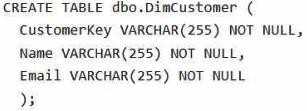
- Exhibit 2: 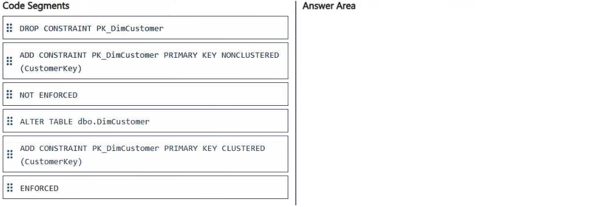

_DRAG DROP — the original ExamTopics question expects you to drag and drop items; the correct targets are not published._

**Most voted:**
- ALTER TABLE dbo.DimCustomer
- → Prepares the table to modify its structure.
- ADD CONSTRAINT PK_DimCustomer PRIMARY KEY CLUSTERED (CustomerKey)
- → Adds the primary key constraint to the column. Clustered is preferred by default unless specified otherwise.
- ENFORCED
- → Ensures referential integrity is applied.

### Top explanations
- **amli123** (84 upvotes [Highly Voted]): Alter table dbo.dimcustomer
  Add constraint PK_dimcustomer primary key nonclustered (customerkey) 
  not enforced 
  
  PRIMARY KEY is only supported when NONCLUSTERED and NOT ENFORCED are both used.
  https://learn.microsoft.com/en-us/fabric/data-warehouse/table-constraints
- **Othman2110** (13 upvotes [Highly Voted]): Primary Key
  Non Clustered
  Not Enforced
- **bettermakeme** (10 upvotes): This is the correct option, I have tired it in my warehouse
  ALTER TABLE [dbo].[dim_cust]
  ADD CONSTRAINT [PK_dim_cust_CustomerKey] PRIMARY KEY NONCLUSTERED (CustomerKey) NOT ENFORCED
- **mvg100** (7 upvotes): This is correct, 
  Primary Key
  Non Clustered
  Not Enforced
  
  https://learn.microsoft.com/en-us/fabric/data-warehouse/table-constraints
- **Tuki93** (7 upvotes): Provided answer is WRONG.
  https://learn.microsoft.com/en-us/fabric/data-warehouse/table-constraints
  SQL analytics endpoint and Warehouse in Microsoft Fabric support these table constraints:
  
  PRIMARY KEY is only supported when NONCLUSTERED and NOT ENFORCED are both used.
  
  FOREIGN KEY is only supported when NOT ENFORCED is used.
  
  UNIQUE constraint is only supported when NONCLUSTERED and NOT ENFORCED are both used.
  
  SQL analytics endpoint and Warehouse don't support default constraints at this time.

## Q1.32 (ID 935997)

You have a Fabric workspace that contains a semantic model named Model1.
You need to dynamically execute and monitor the refresh progress of Model1.
What should you use?

⭕ **A.** dynamic management views in Microsoft SQL Server Management Studio (SSMS)
⭕ **B.** Monitoring hub
⭕ **C.** dynamic management views in Azure Data Studio
✅ **D.** a semantic link in a notebook

**Correct answer:** D
**Most voted:** D

### Top explanations
- **GHill1982** (25 upvotes [Highly Voted]): If the definition of "dynamic" is the ability to execute and monitor in real-time, a semantic link in a notebook could be more suitable than the monitoring hub.
- **ShazzyHawk** (6 upvotes [Highly Voted]): A. dynamic management views in SSMS	DMVs in SSMS are for SQL databases or warehouses — not for Fabric semantic models.
  B. Monitoring hub	The Monitoring hub shows execution history and status after the refresh starts, but it does not allow dynamic execution or programmatic monitoring.
  C. dynamic management views in Azure Data Studio	Same limitation as SSMS — works for SQL engines, not semantic models in Fabric.
  D. a semantic link in a notebook	✅ Correct — allows dynamic execution (start refresh) and programmatic monitoring of refresh status
- **8115575** (4 upvotes): Semantic links are used to query semantic models from notebooks, not for monitoring refresh progress. In Monitoring hub its possible to monitor the refresh status and execute whenever you wish
- **toniteo** (4 upvotes): D is correct. Question partly says "dynamically execute" refresh, which is clearly illustrated below in way #4:
  https://www.kevinrchant.com/2025/01/28/four-ways-to-monitor-a-semantic-model-refresh-in-microsoft-fabric/
- **henryphchan** (4 upvotes): I think Monitor Hub is correct because you need to monitor the refresh progress. The Symantic link is designed to provide a reference or connection to your semantic model in a notebook context

## Q1.33 (ID 935998)

Note: This question is part of a series of questions that present the same scenario. Each question in the series contains a unique solution that might meet the stated goals. Some question sets might have more than one correct solution, while others might not have a correct solution.
After you answer a question in this section, you will NOT be able to return to it. As a result, these questions will not appear in the review screen.
You have a Fabric eventstream that loads data into a table named Bike_Location in a KQL database. The table contains the following columns:
BikepointID -
Street -
Neighbourhood -
No_Bikes -
No_Empty_Docks -
Timestamp -
You need to apply transformation and filter logic to prepare the data for consumption. The solution must return data for a neighbourhood named Sands End when No_Bikes is at least 15. The results must be ordered by No_Bikes in ascending order.
Solution: You use the following code segment:
Does this meet the goal?

**Exhibits**
- Exhibit 1: 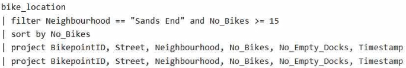

⭕ **A.** Yes
✅ **B.** No

**Correct answer:** B
**Most voted:** B

### Top explanations
- **SamuComqi** (24 upvotes [Highly Voted]): The answer is B. No because the "sort by" is sorting values in descending order (default behavior --> https://learn.microsoft.com/en-us/kusto/query/sort-operator?view=microsoft-fabric). One should add "asc" to sort values as required. The double "project" at the end does not affect the final result
- **MuffiSan** (5 upvotes [Highly Voted]): sort is desc by default in kql
- **92ef42d** (3 upvotes): B. Default KQL sorting is descending
- **8d1e8fe** (3 upvotes): https://learn.microsoft.com/en-us/kusto/query/?view=microsoft-fabric
  Kusto is case sensitive on almost anything. The table being referenced is not capitalized like the name. Could be a typo in the test or an attention to detail question.
- **GHill1982** (3 upvotes): In KQL the where keyword should be used instead of filter.

## Q1.34 (ID 935999)

Note: This question is part of a series of questions that present the same scenario. Each question in the series contains a unique solution that might meet the stated goals. Some question sets might have more than one correct solution, while others might not have a correct solution.
After you answer a question in this section, you will NOT be able to return to it. As a result, these questions will not appear in the review screen.
You have a Fabric eventstream that loads data into a table named Bike_Location in a KQL database. The table contains the following columns:
BikepointID -
Street -
Neighbourhood -
No_Bikes -
No_Empty_Docks -
Timestamp -
You need to apply transformation and filter logic to prepare the data for consumption. The solution must return data for a neighbourhood named Sands End when No_Bikes is at least 15. The results must be ordered by No_Bikes in ascending order.
Solution: You use the following code segment:
Does this meet the goal?

**Exhibits**
- Exhibit 1: 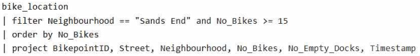

⭕ **A.** Yes
✅ **B.** No

**Correct answer:** B
**Most voted:** B

### Top explanations
- **benni_ale** (11 upvotes [Highly Voted]): no, order by by default is desc in kql
- **mauriciorosa8** (5 upvotes [Highly Voted]): The default sorting order in KQL is **descending (desc)**; **ascending (asc) must be explicitly specified when needed.**
- **GHill1982** (8 upvotes): The answer is no. The default for order by in KQL in desc therefore asc must be specified. Confusing at first as it is the opposite of SQL.
  
  https://learn.microsoft.com/en-gb/kusto/query/sort-operator?view=azure-data-explorer#parameters
- **Tuki93** (5 upvotes): default is desc in Kusto
- **Rozamunde** (4 upvotes [Most Recent]): Duplicate of previous question

## Q1.35 (ID 936000)

Note: This question is part of a series of questions that present the same scenario. Each question in the series contains a unique solution that might meet the stated goals. Some question sets might have more than one correct solution, while others might not have a correct solution.
After you answer a question in this section, you will NOT be able to return to it. As a result, these questions will not appear in the review screen.
You have a Fabric eventstream that loads data into a table named Bike_Location in a KQL database. The table contains the following columns:
BikepointID -
Street -
Neighbourhood -
No_Bikes -
No_Empty_Docks -
Timestamp -
You need to apply transformation and filter logic to prepare the data for consumption. The solution must return data for a neighbourhood named Sands End when No_Bikes is at least 15. The results must be ordered by No_Bikes in ascending order.
Solution: You use the following code segment:
Does this meet the goal?

**Exhibits**
- Exhibit 1: 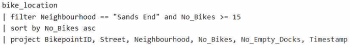

⭕ **A.** Yes
✅ **B.** No

**Correct answer:** B
**Most voted:** B

### Top explanations
- **GHill1982** (15 upvotes [Highly Voted]): The sort and order operators are equivalent. 
  
  https://learn.microsoft.com/en-us/kusto/query/sort-operator?view=microsoft-fabric
- **rc012345** (5 upvotes [Highly Voted]): in KQL, both table and column names are case sensitive. Hence, the table name doesn't match with description.  Hence, this query will fail.
  NO issues with filter as both "where" and "filter" keywords work in KQL.
- **evest** (5 upvotes [Most Recent]): KQL is case-sensitive and the table name is written in different way in the requirements and in the question with the script.
- **Bin_Hashim** (4 upvotes): why we are not Considering Table Name 
  **Table name is incorrect. It is case-sensitive.
  In the scenario the table is named Bike_Location.
  The query uses bike_location (all lowercase).
  
  In KQL, identifiers (table/column names) are case-sensitive. Using the wrong case for the table name will cause the query to fail to resolve the table, even though the rest of the query logic is correct:
- **92ef42d** (3 upvotes): Table name is incorrect. It is case-sensitive.
  https://learn.microsoft.com/en-us/kusto/query/schema-entities/entity-names?view=azure-data-explorer&preserve-view=true#reference-identifiers-in-queries

## Q1.36 (ID 936001)

Note: This question is part of a series of questions that present the same scenario. Each question in the series contains a unique solution that might meet the stated goals. Some question sets might have more than one correct solution, while others might not have a correct solution.
After you answer a question in this section, you will NOT be able to return to it. As a result, these questions will not appear in the review screen.
You have a Fabric eventstream that loads data into a table named Bike_Location in a KQL database. The table contains the following columns:
BikepointID -
Street -
Neighbourhood -
No_Bikes -
No_Empty_Docks -
Timestamp -
You need to apply transformation and filter logic to prepare the data for consumption. The solution must return data for a neighbourhood named Sands End when No_Bikes is at least 15. The results must be ordered by No_Bikes in ascending order.
Solution: You use the following code segment:
Does this meet the goal?

**Exhibits**
- Exhibit 1: 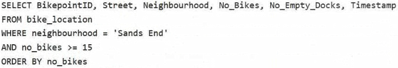

✅ **A.** Yes
⭕ **B.** No

**Correct answer:** A
**Most voted:** A

### Top explanations
- **Mourya959595** (29 upvotes [Highly Voted]): SQL By default shows ASC order
- **JensQ** (16 upvotes [Highly Voted]): You need to use "--" to tell the KQL DB to read code as SQL.
  Otherwise it tries to read it as KQL
- **ziggy1117** (7 upvotes): I tried it in Fabric and it works.
  Order By is ascending order by default in SQL. (It is desc order in KQL)
  No need to use "--" in the Eventhouse.
  Also it is case insensitive so even if Neighbourhood is the column, WHERE neihborhood >=15 works
- **xmh5025** (6 upvotes): Remember to preface T-SQL queries with a T-SQL comment line, --, to tell the query editor to interpret the following query as T-SQL and not KQL. https://learn.microsoft.com/en-us/kusto/query/t-sql?view=microsoft-fabric#query-with-t-sql
- **GHill1982** (6 upvotes): In Fabric you can query a KQL database with SQL. I tested creating a new Eventhouse and ingesting an eventstream and this SQL querying functionality is available by default.

## Q1.37 (ID 943817)

Overview -
Litware, Inc. is a publishing company that has an online bookstore and several retail bookstores worldwide. Litware also manages an online advertising business for the authors it represents.
Existing Environment. Fabric Environment
Litware has a Fabric workspace named Workspace1. High concurrency is enabled for Workspace1.
The company has a data engineering team that uses Python for data processing.
Existing Environment. Data Processing
The retail bookstores send sales data at the end of each business day, while the online bookstore constantly provides logs and sales data to a central enterprise resource planning (ERP) system.
Litware implements a medallion architecture by using the following three layers: bronze, silver, and gold. The sales data is ingested from the ERP system as Parquet files that land in the Files folder in a lakehouse. Notebooks are used to transform the files in a Delta table for the bronze and silver layers. The gold layer is in a warehouse that has V-Order disabled.
Litware has image files of book covers in Azure Blob Storage. The files are loaded into the Files folder.
Existing Environment. Sales Data
Month-end sales data is processed on the first calendar day of each month. Data that is older than one month never changes.
In the source system, the sales data refreshes every six hours starting at midnight each day.
The sales data is captured in a Dataflow Gen1 dataflow. When the dataflow runs, new and historical data is captured. The dataflow captures the following fields of the source:
•	Sales Date
•	Author
•	Price
•	Units
•	SKU
A table named AuthorSales stores the sales data that relates to each author. The table contains a column named AuthorEmail. Authors authenticate to a guest Fabric tenant by using their email address.
Existing Environment. Security Groups
Litware has the following security groups:
•	Sales
•	Fabric Admins
•	Streaming Admins
Existing Environment. Performance Issues
Business users perform ad-hoc queries against the warehouse. The business users indicate that reports against the warehouse sometimes run for two hours and fail to load as expected. Upon further investigation, the data engineering team receives the following error message when the reports fail to load: “The SQL query failed while running.”
The data engineering team wants to debug the issue and find queries that cause more than one failure.
When the authors have new book releases, there is often an increase in sales activity. This increase slows the data ingestion process.
The company’s sales team reports that during the last month, the sales data has NOT been up-to-date when they arrive at work in the morning.
Requirements. Planned Changes -
Litware recently signed a contract to receive book reviews. The provider of the reviews exposes the data in Amazon Simple Storage Service (Amazon S3) buckets.
Litware plans to manage Search Engine Optimization (SEO) for the authors. The SEO data will be streamed from a REST API.
Requirements. Version Control -
Litware plans to implement a version control solution in Fabric that will use GitHub integration and follow the principle of least privilege.
Requirements. Governance Requirements
To control data platform costs, the data platform must use only Fabric services and items. Additional Azure resources must NOT be provisioned.
Requirements. Data Requirements -
Litware identifies the following data requirements:
•	Process the SEO data in near-real-time (NRT).
•	Make the book reviews available in the lakehouse without making a copy of the data.
•	When a new book cover image arrives in the Files folder, process the image as soon as possible.
You need to ensure that processes for the bronze and silver layers run in isolation.
How should you configure the Apache Spark settings?

⭕ **A.** Disable high concurrency.
✅ **B.** Create a custom pool.
⭕ **C.** Modify the number of executors.
⭕ **D.** Set the default environment.

**Correct answer:** B
**Most voted:** B

### Top explanations
- **12a2ecc** (10 upvotes [Highly Voted]): In Microsoft Fabric, when you want to isolate different workloads, such as data processing jobs for different medallion layers (bronze, silver, gold), the best practice is to use custom Spark pools. This allows:
  
  Isolation of resources: Ensuring the bronze and silver layers don’t interfere with each other in terms of compute or memory.
  
  Dedicated execution environments: Each pool can be optimized/configured differently based on the workload characteristics.
  
  Better performance and reliability: Avoid contention in high-load scenarios like month-end processing or spikes during new book releases.
- **5e89616** (6 upvotes [Highly Voted]): The requirement is to run notebook sessions for Bronze and Silver in isolation -> disable high concurrency:
  High concurrency mode allows users to share the same Spark sessions in Apache Spark for Fabric data engineering and data science workloads. An item like a notebook uses a Spark session for its execution and when enabled allows users to share a single Spark session across multiple notebooks.
  https://learn.microsoft.com/en-us/fabric/data-engineering/workspace-admin-settings#high-concurrency
- **12a2ecc** (5 upvotes): I think it is (B), custom pools:
  Why Not the Other Options?
  A. Disable high concurrency:
  Not suitable here. High concurrency mode allows multiple lightweight queries to run simultaneously. Disabling it doesn't help with workload isolation and might reduce performance for concurrent jobs.
  
  C. Modify the number of executors:
  This affects how Spark parallelizes tasks within a single job but doesn’t isolate workloads or prevent resource contention between different jobs.
  
  D. Set the default environment:
  This option just sets where notebooks run by default. It doesn't provide isolation between different layers.
- **Mustafa_Shazly** (3 upvotes): When H Concurrency is enabled 
  - the standard and custom pool will shared and no run Isolation
  "For custom pools with high concurrency mode, users get 36X faster session start experience compared to a standard Spark session."
  https://learn.microsoft.com/en-us/fabric/data-engineering/high-concurrency-overview
- **zulajariwala** (1 upvotes [Most Recent]): B. Create a custom pool.
  
  Why: the workspace already has high concurrency enabled, which is designed to share Spark sessions across workloads for better startup time and cost efficiency. That is the opposite of running bronze and silver processes in isolation. Microsoft’s docs describe high concurrency as one Spark application hosting multiple workloads in a shared session model, while custom Spark pools provide deeper control over compute for specific workloads.
  
  So, to ensure the bronze and silver processes run in isolation, use a custom Spark pool for those workloads.

## Q1.38 (ID 943818)

DRAG DROP
Overview
Litware, Inc. is a publishing company that has an online bookstore and several retail bookstores worldwide. Litware also manages an online advertising business for the authors it represents.
Existing Environment. Fabric Environment
Litware has a Fabric workspace named Workspace1. High concurrency is enabled for Workspace1.
The company has a data engineering team that uses Python for data processing.
Existing Environment. Data Processing
The retail bookstores send sales data at the end of each business day, while the online bookstore constantly provides logs and sales data to a central enterprise resource planning (ERP) system.
Litware implements a medallion architecture by using the following three layers: bronze, silver, and gold. The sales data is ingested from the ERP system as Parquet files that land in the Files folder in a lakehouse. Notebooks are used to transform the files in a Delta table for the bronze and silver layers. The gold layer is in a warehouse that has V-Order disabled.
Litware has image files of book covers in Azure Blob Storage. The files are loaded into the Files folder.
Existing Environment. Sales Data
Month-end sales data is processed on the first calendar day of each month. Data that is older than one month never changes.
In the source system, the sales data refreshes every six hours starting at midnight each day.
The sales data is captured in a Dataflow Gen1 dataflow. When the dataflow runs, new and historical data is captured. The dataflow captures the following fields of the source:
•	Sales Date
•	Author
•	Price
•	Units
•	SKU
A table named AuthorSales stores the sales data that relates to each author. The table contains a column named AuthorEmail. Authors authenticate to a guest Fabric tenant by using their email address.
Existing Environment. Security Groups
Litware has the following security groups:
•	Sales
•	Fabric Admins
•	Streaming Admins
Existing Environment. Performance Issues
Business users perform ad-hoc queries against the warehouse. The business users indicate that reports against the warehouse sometimes run for two hours and fail to load as expected. Upon further investigation, the data engineering team receives the following error message when the reports fail to load: “The SQL query failed while running.”
The data engineering team wants to debug the issue and find queries that cause more than one failure.
When the authors have new book releases, there is often an increase in sales activity. This increase slows the data ingestion process.
The company’s sales team reports that during the last month, the sales data has NOT been up-to-date when they arrive at work in the morning.
Requirements. Planned Changes
Litware recently signed a contract to receive book reviews. The provider of the reviews exposes the data in Amazon Simple Storage Service (Amazon S3) buckets.
Litware plans to manage Search Engine Optimization (SEO) for the authors. The SEO data will be streamed from a REST API.
Requirements. Version Control
Litware plans to implement a version control solution in Fabric that will use GitHub integration and follow the principle of least privilege.
Requirements. Governance Requirements
To control data platform costs, the data platform must use only Fabric services and items. Additional Azure resources must NOT be provisioned.
Requirements. Data Requirements
Litware identifies the following data requirements:
•	Process the SEO data in near-real-time (NRT).
•	Make the book reviews available in the lakehouse without making a copy of the data.
•	When a new book cover image arrives in the Files folder, process the image as soon as possible.
You need to ensure that the authors can see only their respective sales data.
How should you complete the statement? To answer, drag the appropriate values the correct targets. Each value may be used once, more than once, or not at all. You may need to drag the split bar between panes or scroll to view content.
NOTE: Each correct selection is worth one point.

**Exhibits**
- Exhibit 1: 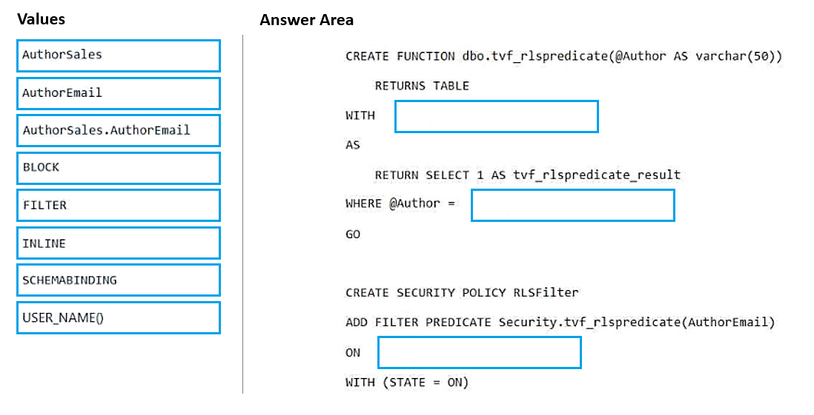

_DRAG DROP — the original ExamTopics question expects you to drag and drop items; the correct targets are not published._

**Most voted:** Not provided

### Top explanations
- **5e89616** (13 upvotes [Highly Voted]): The answer is correct.
  - USER_NAME is compared the value of a column to the user currently running the query.
  If they match, the user can see the row; if not, they can’t.
  - SCHEMABINDING - used in security policy function to prevent structural changes on the tables that are bound to the policy
  - TableName on which the security policy function should be applied
- **Azure-JL** (4 upvotes): Source: https://learn.microsoft.com/en-us/fabric/data-warehouse/row-level-security
- **mujicalj** (2 upvotes): Create a Security schema, a function Security.tvf_securitypredicate, and a security policy SalesFilter.
  
  SQL
  
  Copy
  -- Creating schema for Security
  CREATE SCHEMA Security;
  GO
   
  -- Creating a function for the SalesRep evaluation
  CREATE FUNCTION Security.tvf_securitypredicate(@SalesRep AS nvarchar(50))
      RETURNS TABLE
  WITH SCHEMABINDING
  AS
      RETURN SELECT 1 AS tvf_securitypredicate_result
  WHERE @SalesRep = USER_NAME() OR USER_NAME() = '
  [email protected]
  ';
  GO
   
  -- Using the function to create a Security Policy
  CREATE SECURITY POLICY SalesFilter
  ADD FILTER PREDICATE Security.tvf_securitypredicate(SalesRep)
  ON sales.Orders
  WITH (STATE = ON);
  GO
- **92ef42d** (1 upvotes [Most Recent]): - INLINE
  - USER_NAME()
  - AuthorSales
  INLINE functions are more performant and required for RLS predicates.
  SCHEMABINDING ensures the function is tightly bound to the schema, preventing changes that could break RLS logic.
- **hergoi** (1 upvotes): - INLINE
  - USER_NAME 
  - AuthorSales
  
  When implementing Row-Level Security (RLS) in Fabric, the goal is to ensure that each author only sees their own sales data. 
  
  1. INLINE vs SCHEMABINDING
  
  INLINE is the recommended option for RLS because it integrates the predicate directly into the query execution plan, resulting in better performance.
  
  
  Microsoft documentation and best practices specifically recommend INLINE for RLS predicates
  
  CREATE FUNCTION dbo.tvf_rlspredicate(@Author AS varchar(50))
  RETURNS TABLE
  WITH INLINE
  AS
  RETURN SELECT 1 AS tvf_rlspredicate_result
  WHERE @Author = USER_NAME()
  GO
  
  CREATE SECURITY POLICY RLSFilter
  ADD FILTER PREDICATE Security.tvf_rlspredicate(AuthorEmail)
  ON AuthorSales
  WITH (STATE = ON);

## Q1.39 (ID 943819)

Note: This question is part of a series of questions that present the same scenario. Each question in the series contains a unique solution that might meet the stated goals. Some question sets might have more than one correct solution, while others might not have a correct solution.
After you answer a question in this section, you will NOT be able to return to it. As a result, these questions will not appear in the review screen.
You have an Azure key vault named KeyVault1 that contains secrets.
You have a Fabric workspace named Workspace1. Workspace contains a notebook named Notebook1 that performs the following tasks:
•	Loads stage data to the target tables in a lakehouse
•	Triggers the refresh of a semantic model
You plan to add functionality to Notebook1 that will use the Fabric API to monitor the semantic model refreshes.
You need to retrieve the registered application ID and secret from KeyVault1 to generate the authentication token.
Solution: You use the following code segment:
Use notebookutils.credentials.getSecret and specify the key vault URL and key vault secret.
Does this meet the goal?

⭕ **A.** Yes
✅ **B.** No

**Correct answer:** B
**Most voted:** B

### Top explanations
- **Jennyfly** (9 upvotes [Highly Voted]): Answer: B
  The use cased mentioned “and specify the key vault URL and key vault SECRET”. 
  NOT secret name.
  Key vault secret is different from secret name
  
  Reference: https://learn.microsoft.com/en-us/fabric/data-engineering/notebook-utilities#get-secret
  notebookutils.credentials.getSecret('https://.vault.azure.net/', 'secret name')
- **zxc01** (7 upvotes [Highly Voted]): Answer should be Yes. We normally use Key Vault name and linked service, but we still can use Key Vault URL.
  notebookutils.credentials.getSecret('https://.vault.azure.net/', 'secret name')
  
  ref link: https://learn.microsoft.com/en-us/fabric/data-engineering/notebook-utilities
- **92ef42d** (5 upvotes): No.
  notebookutils.credentials.getSecret("https://.vault.azure.net/", "mySecretName")
  URL works
  Secret name should be provided instead of secret itself (why do you need a kv, if you show the secret in your code?)
- **riccardodeana93** (3 upvotes): According to the documentation, the name of the secret is simply called secret. So I think that's correct.
  
  Help on module notebookutils.credentials in notebookutils:
  
  NAME
      notebookutils.credentials - Utility for credentials operations in Fabric
  
  FUNCTIONS
      getSecret(akvName, secret) -> str
          Gets a secret from the given Azure Key Vault.
          :param akvName: The name of the Azure Key Vault.
          :param secret: The name of the secret.
          :return: The secret value.
- **Maryam3018** (3 upvotes): You do not specify the Key Vault URL. You do specify the Linked Service Name that represents the Key Vault (as configured in Microsoft Fabric). Then you specify the Secret Name within that Key Vault.

## Q1.40 (ID 943820)

Note: This question is part of a series of questions that present the same scenario. Each question in the series contains a unique solution that might meet the stated goals. Some question sets might have more than one correct solution, while others might not have a correct solution.
After you answer a question in this section, you will NOT be able to return to it. As a result, these questions will not appear in the review screen.
You have an Azure key vault named KeyVault1 that contains secrets.
You have a Fabric workspace named Workspace1. Workspace contains a notebook named Notebook1 that performs the following tasks:
•	Loads stage data to the target tables in a lakehouse
•	Triggers the refresh of a semantic model
You plan to add functionality to Notebook1 that will use the Fabric API to monitor the semantic model refreshes.
You need to retrieve the registered application ID and secret from KeyVault1 to generate the authentication token.
Solution: You use the following code segment:
Use notebookutils.credentials.putSecret and specify the key vault URL and key vault secret.
Does this meet the goal?

⭕ **A.** Yes
✅ **B.** No

**Correct answer:** B
**Most voted:** B

### Top explanations
- **5e89616** (11 upvotes [Highly Voted]): You need to retrieve the registered application ID and secret from KeyVault1 to generate the authentication token. 
  The function notebookutils.credentials.putSecret is used to store a secret into a secret scope — not retrieve it.
- **92ef42d** (2 upvotes [Most Recent]): B
  putSecret writes the secret, while you need get it
- **smanzana** (1 upvotes): B - No

## Q1.41 (ID 943821)

Note: This question is part of a series of questions that present the same scenario. Each question in the series contains a unique solution that might meet the stated goals. Some question sets might have more than one correct solution, while others might not have a correct solution.
After you answer a question in this section, you will NOT be able to return to it. As a result, these questions will not appear in the review screen.
You have an Azure key vault named KeyVault1 that contains secrets.
You have a Fabric workspace named Workspace1. Workspace contains a notebook named Notebook1 that performs the following tasks:
•	Loads stage data to the target tables in a lakehouse
•	Triggers the refresh of a semantic model
You plan to add functionality to Notebook1 that will use the Fabric API to monitor the semantic model refreshes.
You need to retrieve the registered application ID and secret from KeyVault1 to generate the authentication token.
Solution: You use the following code segment:
Use notebookutils.credentials.getSecret and specify the key vault URL and the name of a linked service.
Does this meet the goal?

⭕ **A.** Yes
✅ **B.** No

**Correct answer:** B
**Most voted:** B

### Top explanations
- **LasAnsias** (5 upvotes [Highly Voted]): No, this solution does not meet the goal. The notebookutils.credentials.getSecret method requires the key vault URL and the name of the secret, not the name of a linked service.
- **92ef42d** (4 upvotes [Most Recent]): B
  secret name is needed instead of linked service
- **aaef3f4** (4 upvotes): Correct answer is B
  
  https://learn.microsoft.com/en-us/azure/synapse-analytics/spark/microsoft-spark-utilities?pivots=programming-language-python is mssparkutils 
  
  https://learn.microsoft.com/en-us/fabric/data-engineering/notebook-utilities#get-secret-using-user-credentials is NotebookUtils (former MSSparkUtils) for Fabric
  
  Get secret
  getSecret returns an Azure Key Vault secret for a given Azure Key Vault endpoint and secret name using user credentials.
  notebookutils.credentials.getSecret('https://.vault.azure.net/', 'secret name')
- **minami1998** (3 upvotes): It's B without the name of the secret
- **5e89616** (3 upvotes): In my understating (A) is the correct answer:
  
  notebookutils.credentials.getSecret("", "")
  
  is used to retrieve secrets (such as client IDs and secrets) from Azure Key Vault using a linked service.

## Q1.42 (ID 943822)

DRAG DROP
You have two Fabric notebooks named Load_Salesperson and Load_Orders that read data from Parquet files in a lakehouse. Load_Salesperson writes to a Delta table named dim_salesperson. Load_Orders writes to a Delta table named fact_orders and is dependent on the successful execution of Load_Salesperson.
You need to implement a pattern to dynamically execute Load_Salesperson and Load_Orders in the appropriate order by using a notebook.
How should you complete the code? To answer, drag the appropriate values the correct targets. Each value may be used once, more than once, or not at all. You may need to drag the split bar between panes or scroll to view content.
NOTE: Each correct selection is worth one point.

**Exhibits**
- Exhibit 1: 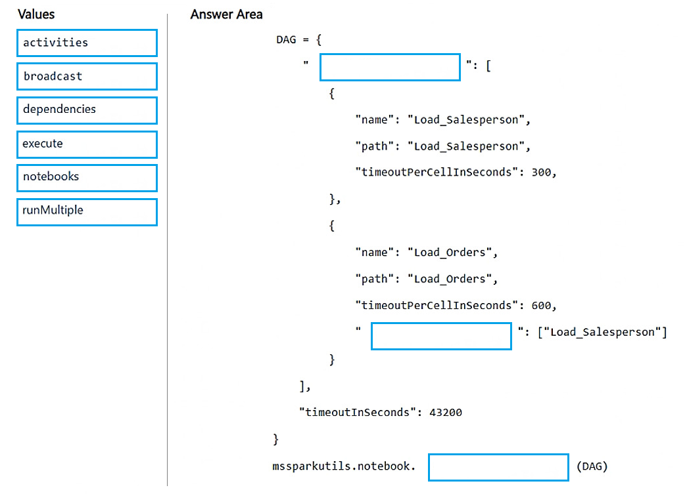

_DRAG DROP — the original ExamTopics question expects you to drag and drop items; the correct targets are not published._

**Most voted:**
- activities: to list the activities
- dependencies: to make sure the order and dependency of running
- runMultiple: there are 2 notebooks to be executed

### Top explanations
- **5e89616** (17 upvotes [Highly Voted]): Correct
  activities: to list the activities
  dependencies: to make sure the order and dependency of running
  runMultiple: there are 2 notebooks to be executed
- **Rull** (4 upvotes): Agree. https://learn.microsoft.com/en-us/fabric/data-engineering/microsoft-spark-utilities#reference-run-multiple-notebooks-in-parallel
- **kim32** (3 upvotes): https://learn.microsoft.com/en-us/fabric/data-engineering/microsoft-spark-utilities#reference-run-multiple-notebooks-in-parallel
- **Sunnyb** (3 upvotes): Correct answer should be:
  
  "notebooks" defines the list of notebook execution steps.
  
  "dependencies" specifies that Load_Orders depends on Load_Salesperson.
  
  mssparkutils.notebook.runMultiple() is the correct API call to execute a DAG of notebooks in Fabric.
  
  In Azure Data Factory and Synapse Pipelines, workflows use activities ...not in Fabric
- **bcbc59b** (1 upvotes): Although nothing will run in parallel here because of the dependency, the code is correct.

## Q1.43 (ID 943823)

HOTSPOT
You have a Fabric workspace named Workspace1 that contains a warehouse named Warehouse2.
A team of data analysts has Viewer role access to Workspace1.
You create a table by running the following statement.
You need to ensure that the team can view only the first two characters and the last four characters of the CreditCard attribute.
How should you complete the statement? To answer, select the appropriate options in the answer area.
NOTE: Each correct selection is worth one point.

**Exhibits**
- Exhibit 1: 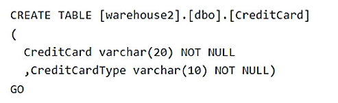
- Exhibit 2: 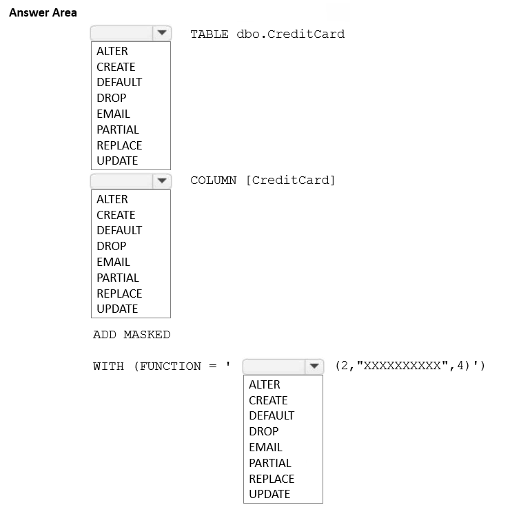

_HOTSPOT — the original ExamTopics question expects you to mark areas on the exhibit above; the correct hotspot coordinates are not published._

**Most voted:**
- ALTER TABLE- to modify the tabel
- ALTER COLUMN - to modify the column
- PARTIAL(prefix padding, padding string, suffix padding) - to expose first and last n characters, adding custom padding 'xxx' of a text field

### Top explanations
- **5e89616** (21 upvotes [Highly Voted]): Correct
  ALTER TABLE- to modify the tabel
  ALTER COLUMN - to modify the column
  PARTIAL(prefix padding, padding string, suffix padding) - to expose first and last n characters, adding custom padding 'xxx' of a text field
- **13d2a97** (10 upvotes [Highly Voted]): ALTER / ALTER / PARTIAL
- **smanzana** (6 upvotes [Most Recent]): The answer is correct: ALTER - ALTER - PARTIAL

## Q1.44 (ID 943824)

HOTSPOT
You are building a data orchestration pattern by using a Fabric data pipeline named Dynamic Data Copy as shown in the exhibit. (Click the Exhibit tab.)
Dynamic Data Copy does NOT use parametrization.
You need to configure the ForEach activity to receive the list of tables to be copied.
How should you complete the pipeline expression? To answer, select the appropriate options in the answer area.
NOTE: Each correct selection is worth one point.

**Exhibits**
- Exhibit 1: 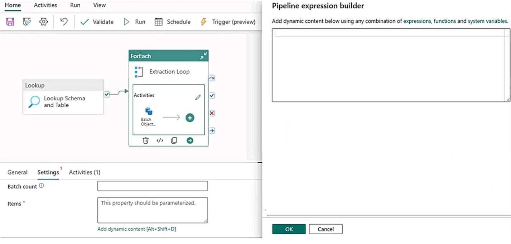
- Exhibit 2: 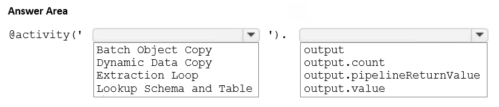

_HOTSPOT — the original ExamTopics question expects you to mark areas on the exhibit above; the correct hotspot coordinates are not published._

**Most voted:**
- Lookup Schema and Table
- output.value

### Top explanations
- **LasAnsias** (6 upvotes [Highly Voted]): i agree.
  Lookup Schema and Table
  output.value
- **smanzana** (4 upvotes [Most Recent]): The answer is correct:
  Lookup Schema and Table
  output.value
- **vernillen** (3 upvotes): Your activity output always has a .value attribute. Use that.
- **DarioReymago** (3 upvotes): correct
- **MasterOfData** (3 upvotes): @activity('Lookup Schema and Table').output

## Q1.45 (ID 943825)

HOTSPOT
You have a Fabric workspace that contains a warehouse named Warehouse1. Warehouse1 contains a table named DimCustomers. DimCustomers contains the following columns:
•	CustomerName
•	CustomerID
•	BirthDate
•	EmailAddress
You need to configure security to meet the following requirements:
•	BirthDate in DimCustomer must be masked and display 1900-01-01.
•	EmailAddress in DimCustomer must be masked and display only the first leading character and the last five characters.
How should you complete the statement? To answer, select the appropriate options in the answer area.
NOTE: Each correct selection is worth one point.

**Exhibits**
- Exhibit 1: 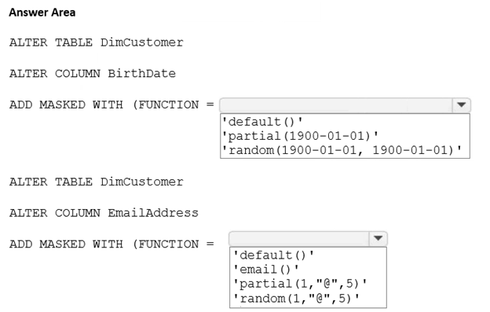

_HOTSPOT — the original ExamTopics question expects you to mark areas on the exhibit above; the correct hotspot coordinates are not published._

**Most voted:**
- BirthDate: default() <- each datatype has a default
- EmailAddress: partial()

### Top explanations
- **Biju1** (25 upvotes [Highly Voted]): default()
  Partial()
  are correct. verified. you can try it in azure sql too
- **PJLB** (10 upvotes [Highly Voted]): BirthDate: default() <- each datatype has a default
  EmailAddress: partial()
- **92ef42d** (8 upvotes [Most Recent]): default()
  partial(1,"@",5)
  default() is based on data type:
  Strings → 'XXXX'
  Numbers → 0
  Dates → '1900-01-01 00:00:00.0000000'
  Binary → ASCII 0
  
  random() takes only 2 parameters (start, end) and is only for numeric data types
  
  email() returns the first letter
  [email protected]
  (always .com), for ex,
  [email protected]
  >
  [email protected]
  .
  partial(prefix_length, "padding_string", suffix_length), where prefix_length: Number of characters to show from the beginning.
  padding_string: The string used to mask the middle portion.
  suffix_length: Number of characters to show from the end.
- **ziggy1117** (4 upvotes): default
  partial
  Random is only applicable to numeric and binary data types.
- **DarioReymago** (4 upvotes): default and partial

## Q1.46 (ID 943826)

You have a Fabric workspace named Workspace1 that contains the following items:
•	A Microsoft Power BI report named Report1
•	A Power BI dashboard named Dashboard1
•	A semantic model named Model1
•	A lakehouse name Lakehouse1
Your company requires that specific governance processes be implemented for the items.
Which items can you endorse in Fabric?

⭕ **A.** Lakehouse1, Model1, and Dashboard1 only
⭕ **B.** Lakehouse1, Model1, Report1 and Dashboard1
⭕ **C.** Report1 and Dashboard1 only
⭕ **D.** Model1, Report1, and Dashboard1 only
✅ **E.** Lakehouse1, Model1, and Report1 only

**Correct answer:** E
**Most voted:** E

### Top explanations
- **13d2a97** (12 upvotes [Highly Voted]): All Fabric items and Power BI items except Power BI dashboards can be promoted or certified.
- **5e89616** (6 upvotes [Highly Voted]): Dashboard cannot be endorsed
- **92ef42d** (4 upvotes): E
  Dashboard cannot be endorsed
- **smanzana** (4 upvotes): E is correct
- **Biju1** (3 upvotes): Power BI dashboards cannot be promoted or certified.

## Q1.47 (ID 943827)

You have a Fabric workspace named Workspace1.
Your company acquires GitHub licenses.
You need to configure source control for Workpace1 to use GitHub. The solution must follow the principle of least privilege.
Which permissions do you require to ensure that you can commit code to GitHub?

⭕ **A.** Actions (Read and write) and Contents (Read and write)
⭕ **B.** Actions (Read and write) only
✅ **C.** Contents (Read and write) only
⭕ **D.** Contents (Read) and Commit statuses (Read and write)

**Correct answer:** C
**Most voted:** C

### Top explanations
- **5e89616** (8 upvotes [Highly Voted]): Contents (Read and write):
  Allows reading repository content.
  Allows pushing commits, creating branches, updating files — everything you need to commit code.
- **92ef42d** (2 upvotes [Most Recent]): To commit code to GitHub from a Microsoft Fabric workspace, you need a GitHub fine-grained personal access token with:
  
  Contents → Read and Write permission
  This allows you to:
  View repository content
  Commit changes
  Sync updates
  You do not need Actions or Commit statuses permissions for basic commit operations from Fabric.
  See https://learn.microsoft.com/en-us/fabric/cicd/git-integration/git-integration-process?tabs=GitHub%2Cgithub
  GIT Roles / GitHub Repos tab / Commit workspace changes to Git
- **smanzana** (2 upvotes): C- Contents (Read and write) only
- **13d2a97** (1 upvotes): These permissions are necessary because:
  Actions (Read and write): This permission allows you to interact with GitHub Actions, which might be necessary for automated workflows related to your commits.
  Contents (Read and write): This permission allows you to read and write repository contents, which is essential for committing code.

## Q1.48 (ID 943828)

You have a Fabric workspace named Workspace1.
You plan to configure Git integration for Workspace1 by using an Azure DevOps Git repository.
An Azure DevOps admin creates the required artifacts to support the integration of Workspace1.
Which details do you require to perform the integration?

✅ **A.** the organization, project, Git repository, and branch
⭕ **B.** the personal access token (PAT) for Git authentication and the Git repository URL
⭕ **C.** the project, Git repository, branch, and Git folder
⭕ **D.** the Git repository URL and the Git folder

**Correct answer:** A
**Most voted:** A

### Top explanations
- **Clode** (6 upvotes [Highly Voted]): A is correct
  https://learn.microsoft.com/en-us/fabric/cicd/git-integration/git-get-started?tabs=azure-devops%2CAzure%2Ccommit-to-git#connect-to-a-workspace
- **DarioReymago** (4 upvotes): folder is important too, but option A is closer
- **Yasminmv110** (3 upvotes): Correct answer: C. the project, Git repository, branch, and Git folder.
  When connecting a Fabric workspace to Azure DevOps Git, Fabric requires selecting the project, repository, branch, and folder for the connection. The Microsoft Learn guidance also shows Azure DevOps authentication is done with OAuth2 or a service principal, so a PAT isn’t the required detail here
- **smanzana** (3 upvotes): Correct is A
- **cayenne06** (3 upvotes): This is correct

## Q1.49 (ID 943829)

You have a Fabric workspace that contains a lakehouse and a semantic model named Model1.
You use a notebook named Notebook1 to ingest and transform data from an external data source.
You need to execute Notebook1 as part of a data pipeline named Pipeline1. The process must meet the following requirements:
•	Run daily at 07:00 AM UTC.
•	Attempt to retry Notebook1 twice if the notebook fails.
•	After Notebook1 executes successfully, refresh Model1.
Which three actions should you perform? Each correct answer presents part of the solution.
NOTE: Each correct selection is worth one point.

✅ **A.** Place the Semantic model refresh activity after the Notebook activity and link the activities by using the On success condition.
✅ **B.** From the Schedule settings of Pipeline1, set the time zone to UTC.
✅ **C.** Set the Retry setting of the Notebook activity to 2.
⭕ **D.** From the Schedule settings of Notebook1, set the time zone to UTC.
⭕ **E.** Set the Retry setting of the Semantic model refresh activity to 2.
⭕ **F.** Place the Semantic model refresh activity after the Notebook activity and link the activities by using an On completion condition.

**Correct answer:** A, B, C
**Most voted:** ABC

### Top explanations
- **5e89616** (10 upvotes [Highly Voted]): Correct
- **13d2a97** (3 upvotes): Correct
- **toure1** (2 upvotes [Most Recent]): ABC est correct
- **92ef42d** (2 upvotes): ABC are correct
- **smanzana** (2 upvotes): ABC is correct

## Q1.50 (ID 943830)

You have a Fabric workspace that contains a lakehouse named Lakehouse1.
You plan to create a data pipeline named Pipeline1 to ingest data into Lakehouse1. You will use a parameter named param1 to pass an external value into Pipeline1. The param1 parameter has a data type of int.
You need to ensure that the pipeline expression returns param1 as an int value.
How should you specify the parameter value?

✅ **A.** "@pipeline().parameters.param1"
⭕ **B.** "@{pipeline().parameters.param1}"
⭕ **C.** "@{pipeline().parameters.[param1]}"
⭕ **D.** "@@{pipeline().parameters.param1}"

**Correct answer:** A
**Most voted:** A

### Top explanations
- **12a2ecc** (11 upvotes [Highly Voted]): Should be "A"; "B" will be result in string, not int:
  https://learn.microsoft.com/en-us/fabric/data-factory/parameters#parameter-and-expression-concepts
- **13d2a97** (4 upvotes): @{pipeline().parameters.param1}
  This syntax correctly references the parameter param1 and ensures that it is treated as an integer value within the pipeline expression.
- **zxc01** (4 upvotes): answer A will get int data output. answer B will get string.
- **zxc01** (2 upvotes): "@pipeline().parameters.myNumber"	Returns 42 as a number. This one comes from that document.
- **92ef42d** (2 upvotes [Most Recent]): A
  B. "@{pipeline().parameters.param1}" → Returns the value as a string, due to string interpolation.
  C. "@{pipeline().parameters.[param1]}" → Invalid syntax.
  D. "@@{pipeline().parameters.param1}" → Escapes the @, returns the literal string "@{pipeline().parameters.param1}".

## Q1.51 (ID 943831)

You have a Fabric workspace named Workspace1 that contains a lakehouse named Lakehouse1. Workspace1 contains the following items:
•	A Dataflow Gen2 dataflow that copies data from an on-premises Microsoft SQL Server database to Lakehouse1
•	A notebook that transforms files and loads the data to Lakehouse1
•	A data pipeline that loads a CSV file to Lakehouse1
You need to develop an orchestration solution in Fabric that will load each item one after the other. The solution must be scheduled to run every 15 minutes.
Which type of item should you use?

⭕ **A.** notebook
⭕ **B.** warehouse
⭕ **C.** Dataflow Gen2 dataflow
✅ **D.** data pipeline

**Correct answer:** D
**Most voted:** D

### Top explanations
- **smanzana** (4 upvotes): D is correct
- **5e89616** (4 upvotes): correct
- **13d2a97** (3 upvotes): Data Pipeline

## Q1.52 (ID 943832)

You are building a Fabric notebook named MasterNotebook1 in a workspace. MasterNotebook1 contains the following code.
You need to ensure that the notebooks are executed in the following sequence:
1. Notebook_03
2. Notebook_01
3. Notebook_02
Which two actions should you perform? Each correct answer presents part of the solution.
NOTE: Each correct selection is worth one point.

**Exhibits**
- Exhibit 1: 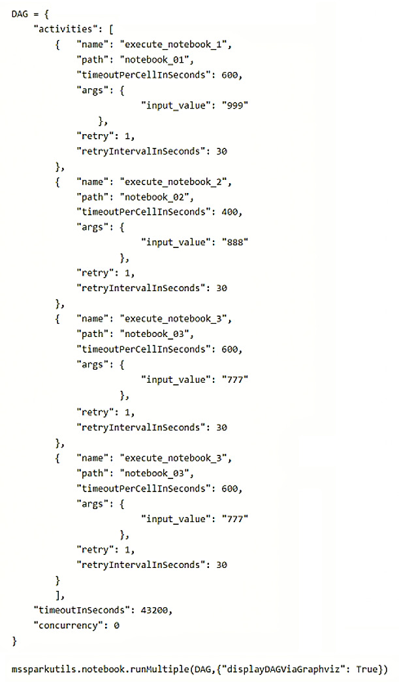

⭕ **A.** Move the declaration of Notebook_02 to the bottom of the Directed Acyclic Graph (DAG) definition.
⭕ **B.** Add dependencies to the execution of Notebook_03.
⭕ **C.** Split the Directed Acyclic Graph (DAG) definition into three separate definitions.
✅ **D.** Add dependencies to the execution of Notebook_02.
⭕ **E.** Change the concurrency to 3.
✅ **F.** Move the declaration of Notebook_03 to the top of the Directed Acyclic Graph (DAG) definition.

**Correct answer:** D, F
**Most voted:** DF

### Top explanations
- **5e89616** (12 upvotes [Highly Voted]): I would also add dependencies to Notebook_01 but it was not listed
- **moons_123** (7 upvotes [Highly Voted]): D,F - Concurrency set to 0 means they will start all at once. So add dependencies and change the order. https://learn.microsoft.com/en-us/azure/synapse-analytics/spark/microsoft-spark-utilities?pivots=programming-language-python#reference-run-multiple-notebooks-in-parallel
- **NickNnack** (4 upvotes): There is an error in the answers, or question. 
  
  Concurrency specifies the number of parallel threads. 
  3 would mean all 3 can run simultaneously. 
  0 means no limit and all 3 can run simultaneously. 
  If it were 1, so there had to execute one at a time. The order would be determined by the internal logical of the executor, unless specified by the user via dependencies.
  The order of the statements does not affect execution. 
  
  It won't matter which order the objects are specified in.
  02 needs to depend on 01
  01 needs to depend on 02
  03 needs no dependencies.
- **wellingtonluis** (3 upvotes): I think that is all wrong in this question, the subject query and the answers. But, besides of that, what seems to be more racional here is D and F .
- **e35e079** (3 upvotes): Explanation:
  To enforce the required sequence:
  
  Set Notebook_03 to execute first (no dependencies needed).
  
  Then set Notebook_01 to depend on Notebook_03.
  
  Then set Notebook_02 to depend on Notebook_01.
  
  This is achieved by adding the "dependsOn" key to each not

## Q1.53 (ID 943833)

You have a Fabric workspace that contains a data pipeline named Pipeline1 as shown in the exhibit. (Click the Exhibit tab.)
What will occur the next time Pipeline1 runs?

**Exhibits**
- Exhibit 1: 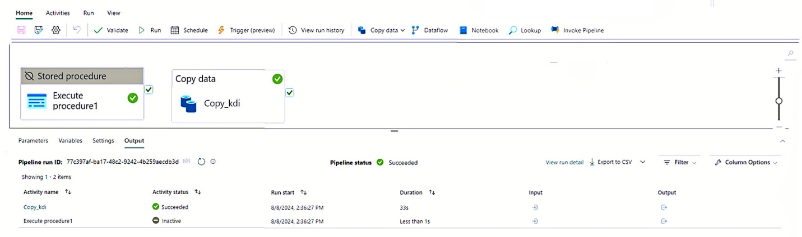

⭕ **A.** Copy_kdi will run first, and then Execute procedure1 will run.
⭕ **B.** Execute procedure1 will run first, and then Copy_kdi will run.
⭕ **C.** Execute procedure1 will run and Copy_kdi will be skipped.
✅ **D.** Copy_kdi will run and Execute procedure1 will be skipped.
⭕ **E.** Both activities will run simultaneously.
⭕ **F.** Both activities will be skipped.

**Correct answer:** D
**Most voted:** D

### Top explanations
- **kim32** (6 upvotes [Highly Voted]): No need to complicate things , Stored procedure activity is inactive
- **tczubat** (5 upvotes [Highly Voted]): I just tested this. If you set the activity state of any acitity to deactivated, it wwiwll show as inactive when run since it will be skipped over.
- **fdsdfgxcvbdsfhshfg** (7 upvotes): buddy, what you see in the top left corner of Execute procedure1 - the crossed circle - it means that the activity is deactivated. It won't run unless you active it again
- **92ef42d** (2 upvotes [Most Recent]): My first taught was E, because there is no connection between the activities and they should run both in parallel. 
  However, Stored Procedure is deactivated, meaning it would not run.
  So, the correct answer is D: the only copy activity would run, sp would be skipped
- **f6f3e50** (2 upvotes): Here's what happens:
  If one activity (e.g., a Copy activity) is active and connected, and another (like a Stored Procedure activity) is inactive and unconnected, only the active one runs.
  Inactive activities do not execute, just like in Azure Data Factory.
  Unconnected activities are not part of the execution graph, so Fabric does not trigger them.

## Q1.54 (ID 943834)

Overview. Company Overview -
Contoso, Ltd. is an online retail company that wants to modernize its analytics platform by moving to Fabric. The company plans to begin using Fabric for marketing analytics.
Overview. IT Structure -
The company’s IT department has a team of data analysts and a team of data engineers that use analytics systems.
The data engineers perform the ingestion, transformation, and loading of data. They prefer to use Python or SQL to transform the data.
The data analysts query data and create semantic models and reports. They are qualified to write queries in Power Query and T-SQL.
Existing Environment. Fabric -
Contoso has an F64 capacity named Cap1. All Fabric users are allowed to create items.
Contoso has two workspaces named WorkspaceA and WorkspaceB that currently use Pro license mode.
Existing Environment. Source Systems
Contoso has a point of sale (POS) system named POS1 that uses an instance of SQL Server on Azure Virtual Machines in the same Microsoft Entra tenant as Fabric. The host virtual machine is on a private virtual network that has public access blocked. POS1 contains all the sales transactions that were processed on the company’s website.
The company has a software as a service (SaaS) online marketing app named MAR1. MAR1 has seven entities. The entities contain data that relates to email open rates and interaction rates, as well as website interactions. The data can be exported from MAR1 by calling REST APIs. Each entity has a different endpoint.
Contoso has been using MAR1 for one year. Data from prior years is stored in Parquet files in an Amazon Simple Storage Service (Amazon S3) bucket. There are 12 files that range in size from 300 MB to 900 MB and relate to email interactions.
Existing Environment. Product Data
POS1 contains a product list and related data. The data comes from the following three tables:
•	Products
•	ProductCategories
•	ProductSubcategories
In the data, products are related to product subcategories, and subcategories are related to product categories.
Existing Environment. Azure -
Contoso has a Microsoft Entra tenant that has the following mail-enabled security groups:
•	DataAnalysts: Contains the data analysts
•	DataEngineers: Contains the data engineers
Contoso has an Azure subscription.
The company has an existing Azure DevOps organization and creates a new project for repositories that relate to Fabric.
Existing Environment. User Problems
The VP of marketing at Contoso requires analysis on the effectiveness of different types of email content. It typically takes a week to manually compile and analyze the data. Contoso wants to reduce the time to less than one day by using Fabric.
The data engineering team has successfully exported data from MAR1. The team experiences transient connectivity errors, which causes the data exports to fail.
Requirements. Planned Changes -
Contoso plans to create the following two lakehouses:
•	Lakehouse1: Will store both raw and cleansed data from the sources
•	Lakehouse2: Will serve data in a dimensional model to users for analytical queries
Additional items will be added to facilitate data ingestion and transformation.
Contoso plans to use Azure Repos for source control in Fabric.
Requirements. Technical Requirements
The new lakehouses must follow a medallion architecture by using the following three layers: bronze, silver, and gold. There will be extensive data cleansing required to populate the MAR1 data in the silver layer, including deduplication, the handling of missing values, and the standardizing of capitalization.
Each layer must be fully populated before moving on to the next layer. If any step in populating the lakehouses fails, an email must be sent to the data engineers.
Data imports must run simultaneously, when possible.
The use of email data from the Amazon S3 bucket must meet the following requirements:
•	Minimize egress costs associated with cross-cloud data access.
•	Prevent saving a copy of the raw data in the lakehouses.
Items that relate to data ingestion must meet the following requirements:
•	The items must be source controlled alongside other workspace items.
•	Ingested data must land in the bronze layer of Lakehouse1 in the Delta format.
•	No changes other than changes to the file formats must be implemented before the data lands in the bronze layer.
•	Development effort must be minimized and a built-in connection must be used to import the source data.
•	In the event of a connectivity error, the ingestion processes must attempt the connection again.
Lakehouses, data pipelines, and notebooks must be stored in WorkspaceA. Semantic models, reports, and dataflows must be stored in WorkspaceB.
Once a week, old files that are no longer referenced by a Delta table log must be removed.
Requirements. Data Transformation
In the POS1 product data, ProductID values are unique. The product dimension in the gold layer must include only active products from product list. Active products are identified by an IsActive value of 1.
Some product categories and subcategories are NOT assigned to any product. They are NOT analytically relevant and must be omitted from the product dimension in the gold layer.
Requirements. Data Security -
Security in Fabric must meet the following requirements:
•	The data engineers must have read and write access to all the lakehouses, including the underlying files.
•	The data analysts must only have read access to the Delta tables in the gold layer.
•	The data analysts must NOT have access to the data in the bronze and silver layers.
•	The data engineers must be able to commit changes to source control in WorkspaceA.
You need to ensure that WorkspaceA can be configured for source control.
Which two actions should you perform? Each correct answer presents part of the solution.
NOTE: Each correct selection is worth one point.

✅ **A.** From Tenant setting, set Users can synchronize workspace items with their Git repositories to Enabled.
⭕ **B.** From Tenant setting, set Users can sync workspace items with GitHub repositories to Enabled.
⭕ **C.** Configure WorkspaceA to use a Premium Per User (PPU) license.
✅ **D.** Assign WorkspaceA to Cap1.

**Correct answer:** A, D
**Most voted:** AD

### Top explanations
- **5e89616** (8 upvotes [Highly Voted]): (A) 
  https://learn.microsoft.com/en-us/fabric/admin/git-integration-admin-settings?utm_source=chatgpt.com#users-can-synchronize-workspace-items-with-their-git-repositories
  (D)
  https://learn.microsoft.com/en-us/fabric/cicd/git-integration/git-get-started?utm_source=chatgpt.com&tabs=azure-devops%2CAzure%2Ccommit-to-git#prerequisites
- **92ef42d** (1 upvotes [Most Recent]): AD
  AzDevOps - A, this one is used
  Git - B
  C - something strange :)
  D - for sure. see link below

## Q1.55 (ID 943835)

HOTSPOT
You have a Fabric workspace that contains a warehouse named Warehouse1. Warehouse1 contains a table named Customer. Customer contains the following data.
You have an internal Microsoft Entra user named User1 that has an email address of
[email protected]
.
You need to provide User1 with access to the Customer table. The solution must prevent User1 from accessing the CreditCard column.
How should you complete the statement? To answer, select the appropriate options in the answer area.
NOTE: Each correct selection is worth one point.

**Exhibits**
- Exhibit 1: 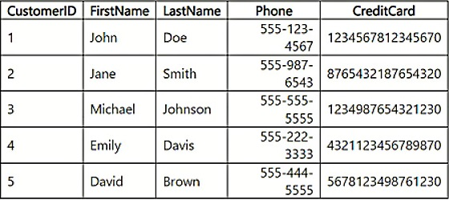
- Exhibit 2: 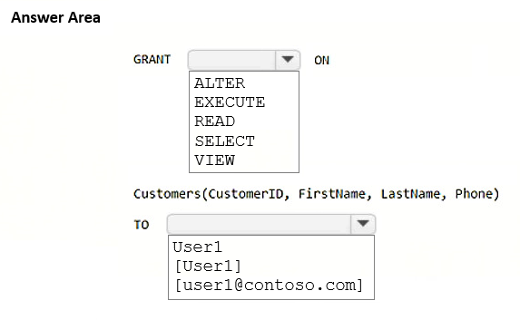

_HOTSPOT — the original ExamTopics question expects you to mark areas on the exhibit above; the correct hotspot coordinates are not published._

**Most voted:** answer should be GRANT SELECT ON Customers(CustomerID, FirstName, LastName, Phone) TO [email protected]

### Top explanations
- **12a2ecc** (48 upvotes [Highly Voted]): answer should be GRANT SELECT ON Customers(CustomerID, FirstName, LastName, Phone) TO [
  [email protected]
  ]
  
  https://learn.microsoft.com/en-us/fabric/data-warehouse/column-level-security
- **Biju1** (15 upvotes [Highly Voted]): GRANT SELECT ON Customers(CustomerID, FirstName, LastName, Phone) TO [
  [email protected]
  ] is corrected. I tested
- **zxc01** (8 upvotes): answer should be GRANT SELECT ON Customers(CustomerID, FirstName, LastName, Phone) TO [
  [email protected]
  ]
- **5e89616** (4 upvotes): Correct.
  GRANT SELECT ON Customers(CustomerID, FirstName, LastName, Phone) TO [User1]
  Alternatively:
  DENY SELECT ON Customers(CreditCard) TO [User1]
- **ziggy1117** (3 upvotes [Most Recent]): GRANT SELECT
  must be the complete email address
  [email protected]

## Q1.56 (ID 949560)

You have a Fabric deployment pipeline that uses three workspaces named Dev, Test, and Prod.
You need to deploy an Eventhouse as part of the deployment process.
What should you use to add the Eventhouse to the deployment process?

✅ **A.** an Azure DevOps pipeline
⭕ **B.** an eventstream
⭕ **C.** GitHub Actions

**Correct answer:** A
**Most voted:** A

### Top explanations
- **wellingtonluis** (7 upvotes [Highly Voted]): Guys, It is missing answers. Deployment Pipelines supports EventHouses. https://learn.microsoft.com/en-us/fabric/cicd/deployment-pipelines/intro-to-deployment-pipelines?tabs=new-ui#supported-items
- **NickNnack** (4 upvotes): It might be the details in the question are not correct.
  But since Deployment Pipelines do not copy data, the Eventhouse will have the table schemas but no rows of data. An associated Eventstream will be required to run and populate the data in the eventhosue. With the implication being a blank eventhouse has no value.
- **kaushikcbs** (3 upvotes): Devops Pipeline
- **e0f0ce6** (2 upvotes): An Item should be added to a Fabric Deployment Pipeline. So the only choice is B.
- **e392998** (2 upvotes): The correct answer is A as DevOps is dedicated to control creation and deployment of fabric item through script, api and rules. 
  
  B is false because the evenstream is a current association with the eventhouse but is not linked to any direct deployment control ability.

## Q1.57 (ID 949561)

You have a Fabric warehouse named DW1. DW1 contains a table that stores sales data and is used by multiple sales representatives.
You plan to implement row-level security (RLS).
You need to ensure that the sales representatives can see only their respective data.
Which warehouse object do you require to implement RLS?

⭕ **A.** TRIGGER
⭕ **B.** SCHEMA
✅ **C.** FUNCTION
⭕ **D.** DATABASE ROLE

**Correct answer:** C
**Most voted:** C

### Top explanations
- **rehoboth2165** (5 upvotes [Highly Voted]): FUNCTION	✅ Used to define the logic to filter rows based on user identity (predicate function)	✅ Yes
  D. DATABASE ROLE	Can assign permissions, but not used for filtering rows dynamically	❌ No
- **kaushikcbs** (3 upvotes): Function and Security Policy is used. So as per the options available it is Function.
- **toure1** (1 upvotes [Most Recent]): La Fonction est la reponse correct
- **e392998** (1 upvotes): function is the the way to control filtering. Role control access permission to the table and database
- **Jay63002** (1 upvotes): Correct answer is function not database role

## Q1.58 (ID 949562)

You have a Fabric warehouse named DW1. DW1 contains a table that stores sales data and is used by multiple sales representatives.
You plan to implement row-level security (RLS).
You need to ensure that the sales representatives can see only their respective data.
Which warehouse object do you require to implement RLS?

✅ **A.** SECURITY POLICY
⭕ **B.** TABLE
⭕ **C.** TRIGGER
⭕ **D.** STORED PROCEDURE

**Correct answer:** A
**Most voted:** A

### Top explanations
- **kaushikcbs** (6 upvotes [Highly Voted]): Function and Security Policy is used. So as per the options available it is Security Policy.
- **gretito_g** (2 upvotes [Most Recent]): Without a SECURITY POLICY, the filtering logic won't be applied, even if the function exists.

## Q1.59 (ID 949563)

You have a Fabric F32 capacity that contains a workspace. The workspace contains a warehouse named DW1 that is modelled by using MD5 hash surrogate keys.
DW1 contains a single fact table that has grown from 200 million rows to 500 million rows during the past year.
You have Microsoft Power BI reports that are based on Direct Lake. The reports show year-over-year values.
Users report that the performance of some of the reports has degraded over time and some visuals show errors.
You need to resolve the performance issues. The solution must meet the following requirements:
•	Provide the best query performance.
•	Minimize operational costs.
Which should you do?

⭕ **A.** Create views.
⭕ **B.** Modify the surrogate keys to use a different data type.
⭕ **C.** Change the MD5 hash to SHA256.
✅ **D.** Increase the capacity.
⭕ **E.** Disable V-Order on the warehouse.

**Correct answer:** D
**Most voted:** D

### Top explanations
- **PBridge** (7 upvotes [Highly Voted]): Changing surrogate keys from MD5 (string) to integers improves query speed, storage efficiency, and reduces costs.
- **2bc006e** (4 upvotes): D. 
  
  https://learn.microsoft.com/en-us/fabric/fundamentals/direct-lake-overview#fabric-capacity-requirements
  
  '' For Direct Lake semantic models, Max Memory represents the upper memory resource limit for how much data can be paged in. For this reason, it's not a guardrail because exceeding it doesn't result in a fallback to DirectQuery mode; however, it can have a performance impact if the amount of data is large enough to cause excessive paging in and out of the model data from the OneLake data. ''
- **92ef42d** (4 upvotes): D - Capacity. F32 is too low
- **Rozamunde** (4 upvotes): Duplicate of Question#5
- **kaushikcbs** (4 upvotes): Modify the surrogate keys to use a different data type
  
  Why?
  - MD5 hash surrogate keys are 128-bit values, which can be inefficient for large datasets.
  - Switching to a more efficient data type (such as BIGINT or INT) reduces storage and processing overhead, improving query performance.
  - Smaller data types are faster to process, leading to better indexing and query execution.
  Answer validated with ChatGPT

## Q1.60 (ID 949564)

You have a Fabric workspace named Workspace1 that contains a warehouse named Warehouse1.
You plan to deploy Warehouse 1 to a new workspace named Workspace2.
As part of the deployment process, you need to verify whether Warehouse1 contains invalid references. The solution must minimize development effort and provide detailed information about the invalid references.
What should you use?

⭕ **A.** a dbt project
✅ **B.** a deployment pipeline
⭕ **C.** a Python script
⭕ **D.** a database project

**Correct answer:** B
**Most voted:** B

### Top explanations
- **ganga85cusat** (3 upvotes): Q13 repetition
- **gretito_g** (3 upvotes): For detecting invalid references in a Fabric warehouse with minimal effort and detailed diagnostics, use:
  
  B. a deployment pipeline 
  
  It’s the purpose-built solution in Microsoft Fabric for deployment, validation, and environment management.
- **32950cb** (2 upvotes): A Fabric database project (SQL database project) is the correct tool here because it provides built-in, native support for validating object references before deployment. When you build a database project, it performs static analysis of all SQL objects (views, stored procedures, functions, tables, etc.) and surfaces invalid references — broken object names, missing dependencies, incorrect schemas — as build errors with detailed diagnostic information.
  
  Fabric deployment pipelines deploy items but do not perform static reference validation or provide detailed error information about invalid references
- **moons_123** (2 upvotes): A Deployment pipeline: https://learn.microsoft.com/en-us/azure/data-factory/control-flow-validation-activity
- **inter00** (1 upvotes): Almost but not quite. Here we have "The solution must minimize development effort and provide detailed information about the invalid references." instead of "The solution must minimize development effort." Does it change the answer?

## Q1.61 (ID 979604)

DRAG DROP
In the Development workspace, you build a new feature named Feature1.
You need to deploy Feature1 to the Test workspace. The solution must ensure that only a pipeline is deployed.
Which four actions should you perform in sequence? To answer, move the appropriate actions from the list of actions to the answer area and arrange them in the correct order.

**Exhibits**
- Exhibit 1: 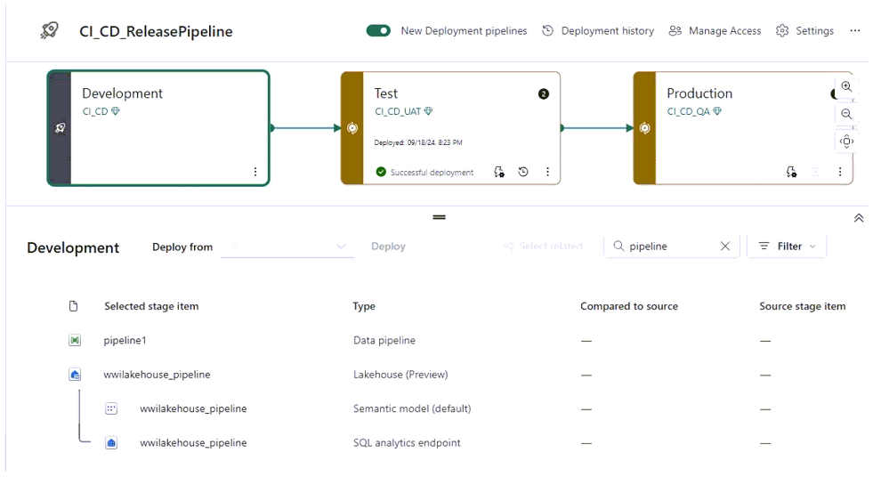
- Exhibit 2: 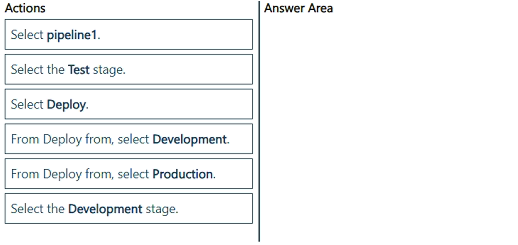

_DRAG DROP — the original ExamTopics question expects you to drag and drop items; the correct targets are not published._

**Most voted:**
- Select test stage
- From deploy from select Development
- Select pipeline1
- Deploy

### Top explanations
- **EddEe** (18 upvotes [Highly Voted]): Select test stage
  From deploy from select Development
  Select pipeline1
  Deploy
- **IgorP** (2 upvotes [Most Recent]): So in that state, the correct 4-step sequence to deploy only the pipeline item to Test is:
  
  Select pipeline1.
  
  Select the Test stage.
  
  Select Deploy.
  
  From Deploy from, select Development.
  
  Why this fits the requirement “only a pipeline is deployed”: selecting pipeline1 in the stage item list scopes the deployment to that single item; you’re not deploying “all items in stage.”
- **8d82b67** (1 upvotes): Correct. The pipeline1 selection step can be 1st, 2nd or 3rd.

## Q1.62 (ID 995011)

HOTSPOT
You have a Fabric tenant that is linked to a Microsoft Entra tenant. The Microsoft Entra tenant contains a user named User1 and two groups named Group1 and Group2.
The Fabric tenant contains the workspaces shown in the following table.
You need to meet the following access requirements:
•	User1 must have read access to the following:
•	The operations department reports
•	The HR department warehouse and reports
•	The legal department warehouse and reports
•	User1 must be able to create new items in Workspace2.
•	Group1 must have access to the finance department warehouse and reports.
•	Group1 must be able to add new users to the finance department workspace.
•	Group2 must have access to only the HR warehouse and the legal warehouse.
The solution must follow the principle of least privilege.
What should you do? To answer, select the appropriate options in the answer area.
NOTE: Each correct selection is worth one point.

**Exhibits**
- Exhibit 1: 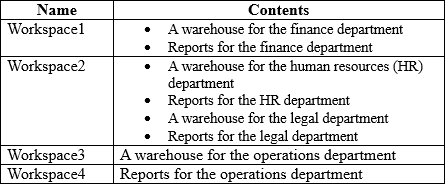
- Exhibit 2: 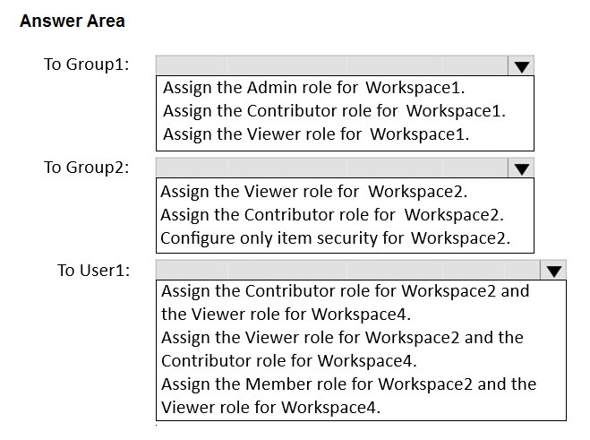

_HOTSPOT — the original ExamTopics question expects you to mark areas on the exhibit above; the correct hotspot coordinates are not published._

**Most voted:**
- To Group1: Assign the Admin role for Workspace1
- To Group2: Configure only item security for Workspace2
- To User1: Assign the Contributor role for Workspace2 and the Viewer role for Workspace4

### Top explanations
- **32950cb** (6 upvotes [Highly Voted]): To Group1: Assign the Admin role for Workspace1
  To Group2: Configure only item security for Workspace2
  To User1: Assign the Contributor role for Workspace2 and the Viewer role for Workspace4
  
  In Microsoft Fabric, only the Admin (and Member) workspace role can manage workspace membership . Since Member is not an option and Contributor/Viewer cannot add users, Admin is required.
- **Beshko** (1 upvotes [Most Recent]): Group 1: Assign the Admin role for Workspace1.
  Group 2: Configure only item security for Workspace2.
  User 1: Assign the Contributor role for Workspace2 and the Viewer role for Workspace4.

## Q1.63 (ID 995012)

You have a Fabric workspace named Workspace1 that is connected to a GitHub repository named repo1. Workspace1 contains the items shown in the following table.
You modify Semanticmodel1, Semanticmodel2, and Report2.
You need to commit the changes to repo1.
What is the minimum number of commits you should perform?

**Exhibits**
- Exhibit 1: 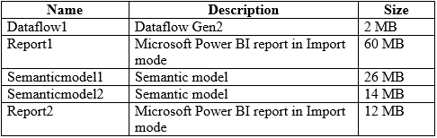

⭕ **A.** 1
✅ **B.** 2
⭕ **C.** 3
⭕ **D.** 4

**Correct answer:** B
**Most voted:** B

### Top explanations
- **luckybalaji** (2 upvotes): Github having restriction on total size 50 Mb and individual file 25MB. The 26MB file should be shrinked with that there are two commits required. There is commit constraints  by artifact type.
- **mustafaalhnuty** (2 upvotes): Anwer is 3: commits are constrained by artifact type. You cannot commit all modified items together if they belong to different commit groups.
- **AxelF** (2 upvotes): Isn’t there a commit limit size of 50Gb, so this would need 2 commits.
- **toon2110** (1 upvotes): Power BI report and its semantic model are committed together. Commit 1
  
  Semanticmodel2
  Report2
  
  Commit 2
  
  Semanticmodel1
- **Yasminmv110** (1 upvotes): 1 commit is needed

## Q1.64 (ID 995013)

You have a Fabric workspace that contains a lakehouse named Lakehouse1. Lakehouse1 contains a table named Table1.
You need to ensure that a user named User1 can view only specific rows in Table1.
What should you do first?

⭕ **A.** Create a security predicate.
✅ **B.** Create a function.
⭕ **C.** Create a security policy.
⭕ **D.** Grant User1 the SELECT permission for Table1.

**Correct answer:** B
**Most voted:** B

### Top explanations
- **Yasminmv110** (4 upvotes): first create a function
- **luckybalaji** (1 upvotes): Security Predicates should be created 1st followed by table valued function
- **32950cb** (1 upvotes): Step 1: Create a Function (The Predicate)
  Step 2: Create a Security Policy
  Step 3: Grant Permissions

## Q1.65 (ID 995014)

You have a Fabric workspace named Workspace1 that contains a lakehouse.
You have a Microsoft Entra tenant that contains a user named User1.
You need to ensure that User1 can create items in Workspace1. The solution must follow the principle of least privilege.
Which workspace role should you assign to User1?

⭕ **A.** Member
✅ **B.** Contributor
⭕ **C.** Admin
⭕ **D.** Viewer

**Correct answer:** B
**Most voted:** Not provided

### Top explanations
- **Beshko** (1 upvotes): Answer is correct, create is the key word and it is always contributor.

## Q1.66 (ID 995015)

Note: This question is part of a series of questions that present the same scenario. Each question in the series contains a unique solution that might meet the stated goals. Some question sets might have more than one correct solution, while others might not have a correct solution.
After you answer a question in this section, you will NOT be able to return to it. As a result, these questions will not appear in the review screen.
You have an Azure key vault named KeyVault1 that contains secrets.
You have a Fabric workspace named Workspace1. Workspace contains a notebook named Notebook1 that performs the following tasks:
•	Loads stage data to the target tables in a lakehouse
•	Triggers the refresh of a semantic model
You plan to add functionality to Notebook1 that will use the Fabric API to monitor the semantic model refreshes.
You need to retrieve the registered application ID and secret from KeyVault1 to generate the authentication token.
Solution: You use the following code segment:
Use notebookutils.credentials.putSecret and specify the key vault URL and the name of a linked service.
Does this meet the goal?

⭕ **A.** Yes
✅ **B.** No

**Correct answer:** B
**Most voted:** Not provided

### Top explanations
- **Yasminmv110** (3 upvotes): GetSecret is correct

## Q1.67 (ID 995016)

You have a Fabric workspace named Workspace1 that uses version control. Workspace1 and Azure DevOps are integrated.
In Azure DevOps, developers create a branch named Branch1 to test extract, transform, and load (ETL) updates.
You need to connect Workspace1 to Branch1. The solution must ensure that all the existing content in Branch1 is available in Workspace1.
What should you do?

✅ **A.** From Workspace1, select Source control, and then select Sync.
⭕ **B.** From Workspace1, select Source control, select Current branch, select Branch1, and then select Commit.
⭕ **C.** From Azure DevOps, merge the contents of the main branch into Branch1.
⭕ **D.** From Workspace1, select Source control, and then select Branch out to new workspace.

**Correct answer:** A
**Most voted:** A

### Top explanations
- **montoya207** (2 upvotes): The correct answer is A. From Workspace1, select Source control, and then select Sync.
  To ensure that the existing content in a remote branch is available within your Fabric workspace, you must perform a Sync operation
  . This action pulls remote updates from the integrated Git repository into the workspace
  . In contrast, a Commit (Option B) would send changes from the workspace to the repository
  , and Branch out to new workspace (Option D) would create an entirely new workspace rather than updating the current one.
- **9114bc3** (2 upvotes): The requirement says:
  
  connect Workspace1 to Branch1
  AND ensure all existing content in Branch1 is available in Workspace1
  
  After switching/connecting the workspace to the branch, you must:
  
  ✅ Sync the workspace
  
  to pull the existing branch content into the Fabric workspace.
- **luckybalaji** (1 upvotes): sync will pull the object from repo into workspace.
- **Yasminmv110** (1 upvotes): Microsoft’s guidance for Fabric Git integration says developers should work in isolation by branching out to a separate Fabric workspace. In that model, each developer gets a workspace, connects a separate branch, and syncs the content into that workspace.
- **Yasminmv110** (1 upvotes): The best choice is D. From Workspace1, select Source control, and then select Branch out to new workspace.

## Q1.68 (ID 995017)

HOTSPOT
You have a Fabric workspace.
You plan to deploy two Apache Spark environments that will each contain one of the following notebooks:
•	Notebook1: A data ingestion notebook that will run as a scheduled Spark job
•	Notebook2: An ad hoc notebook for interactive data analysis that will be used by a team of analysts and data scientists
You need to configure the Spark environments to meet the following requirements:
•	For the environment that contains Notebook1, minimize compute costs.
•	For the environment that contains Notebook2, support multiple concurrent users.
What should you use for each environment? To answer, select the appropriate options in the answer area.
NOTE: Each correct selection is worth one point.

**Exhibits**
- Exhibit 1: 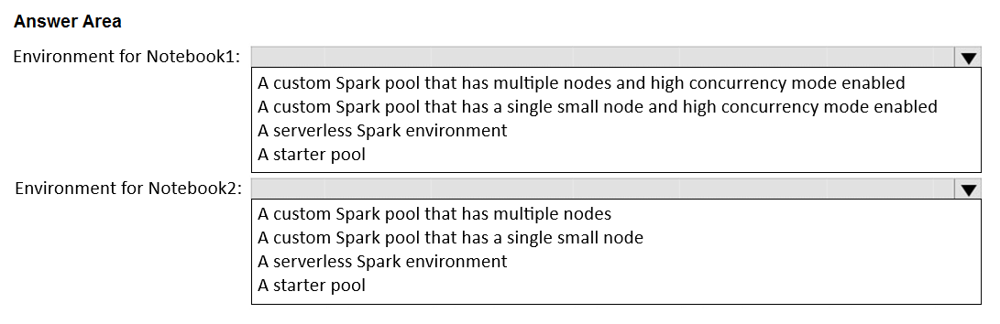

_HOTSPOT — the original ExamTopics question expects you to mark areas on the exhibit above; the correct hotspot coordinates are not published._

**Most voted:**
- Environment for Notebook1: A serverless Spark environment
- Environment for Notebook2: A custom Spark pool that has multiple nodes

### Top explanations
- **mustafaalhnuty** (2 upvotes): Environment for Notebook1: A serverless Spark environment
  Environment for Notebook2: A custom Spark pool that has multiple nodes
- **Beshko** (2 upvotes): I believe Starter pool and Custom Spark pool that has multiple nodes is the right choice here.
- **Beshko** (1 upvotes): I changed my mind, the serverless is better when it comes to minimizing costs.
- **Matej21** (1 upvotes): Environment for Notebook1: A serverless Spark environment
  Environment for Notebook2: A custom Spark pool that has multiple nodes

## Q1.69 (ID 995018)

You have a Fabric workspace named Workspace1 that contains a lakehouse named Lakehouse1.
You perform the following actions:
•	Connect Workspace1 to a Git repository and select the main branch.
•	Create a new branch named feature1 and modify Lakehouse1.
•	Merge the changes from feature1 into the main branch.
You need to ensure that the changes are available in Workspace1. The solution must minimize changes to Workspace1.
What should you do?

⭕ **A.** Disconnect Workspace1 from the Git repository and reconnect Workspace1 to the main branch.
✅ **B.** From Workspace1, select Source control, and then select Updates.
⭕ **C.** From Workspace1, select Source control, and then select Commit.
⭕ **D.** Switch Workspace1 to the feature1 branch and refresh the workspace.

**Correct answer:** B
**Most voted:** B

### Top explanations
- **9114bc3** (1 upvotes): Updates pulls/synchronizes the latest changes from the Git branch into the workspace.

## Q2.1 (ID 936002)

Overview -
Litware, Inc. is a publishing company that has an online bookstore and several retail bookstores worldwide. Litware also manages an online advertising business for the authors it represents.
Existing Environment. Fabric Environment
Litware has a Fabric workspace named Workspace1. High concurrency is enabled for Workspace1.
The company has a data engineering team that uses Python for data processing.
Existing Environment. Data Processing
The retail bookstores send sales data at the end of each business day, while the online bookstore constantly provides logs and sales data to a central enterprise resource planning (ERP) system.
Litware implements a medallion architecture by using the following three layers: bronze, silver, and gold. The sales data is ingested from the ERP system as Parquet files that land in the Files folder in a lakehouse. Notebooks are used to transform the files in a Delta table for the bronze and silver layers. The gold layer is in a warehouse that has V-Order disabled.
Litware has image files of book covers in Azure Blob Storage. The files are loaded into the Files folder.
Existing Environment. Sales Data
Month-end sales data is processed on the first calendar day of each month. Data that is older than one month never changes.
In the source system, the sales data refreshes every six hours starting at midnight each day.
The sales data is captured in a Dataflow Gen1 dataflow. When the dataflow runs, new and historical data is captured. The dataflow captures the following fields of the source:
Sales Date -
Author -
Price -
Units -
SKU -
A table named AuthorSales stores the sales data that relates to each author. The table contains a column named AuthorEmail. Authors authenticate to a guest Fabric tenant by using their email address.
Existing Environment. Security Groups
Litware has the following security groups:
Sales -
Fabric Admins -
Streaming Admins -
Existing Environment. Performance Issues
Business users perform ad-hoc queries against the warehouse. The business users indicate that reports against the warehouse sometimes run for two hours and fail to load as expected. Upon further investigation, the data engineering team receives the following error message when the reports fail to load: “The SQL query failed while running.”
The data engineering team wants to debug the issue and find queries that cause more than one failure.
When the authors have new book releases, there is often an increase in sales activity. This increase slows the data ingestion process.
The company’s sales team reports that during the last month, the sales data has NOT been up-to-date when they arrive at work in the morning.
Requirements. Planned Changes -
Litware recently signed a contract to receive book reviews. The provider of the reviews exposes the data in Amazon Simple Storage Service (Amazon S3) buckets.
Litware plans to manage Search Engine Optimization (SEO) for the authors. The SEO data will be streamed from a REST API.
Requirements. Version Control -
Litware plans to implement a version control solution in Fabric that will use GitHub integration and follow the principle of least privilege.
Requirements. Governance Requirements
To control data platform costs, the data platform must use only Fabric services and items. Additional Azure resources must NOT be provisioned.
Requirements. Data Requirements -
Litware identifies the following data requirements:
Process the SEO data in near-real-time (NRT).
Make the book reviews available in the lakehouse without making a copy of the data.
When a new book cover image arrives in the Files folder, process the image as soon as possible.
You need to implement the solution for the book reviews.
Which should you do?

⭕ **A.** Create a Dataflow Gen2 dataflow.
✅ **B.** Create a shortcut.
⭕ **C.** Enable external data sharing.
⭕ **D.** Create a data pipeline.

**Correct answer:** B
**Most voted:** B

### Top explanations
- **GHill1982** (10 upvotes [Highly Voted]): A Shortcut meets the requirement to make the book reviews in the S3 bucket available in the lakehouse without making a copy of the data.
- **5e89616** (2 upvotes): A shortcut in Fabric allows you to reference external data (e.g., from Amazon S3 or OneLake) without duplicating or copying it into the Lakehouse. It creates a virtual pointer to the data source.
- **mustafaalhnuty** (1 upvotes [Most Recent]): 100% B they said Make the book reviews available in the lakehouse without making a copy of the data.
- **DarioReymago** (1 upvotes): Shortcut
- **MultiCloudIronMan** (1 upvotes): Correct

## Q2.2 (ID 936003)

Overview -
Litware, Inc. is a publishing company that has an online bookstore and several retail bookstores worldwide. Litware also manages an online advertising business for the authors it represents.
Existing Environment. Fabric Environment
Litware has a Fabric workspace named Workspace1. High concurrency is enabled for Workspace1.
The company has a data engineering team that uses Python for data processing.
Existing Environment. Data Processing
The retail bookstores send sales data at the end of each business day, while the online bookstore constantly provides logs and sales data to a central enterprise resource planning (ERP) system.
Litware implements a medallion architecture by using the following three layers: bronze, silver, and gold. The sales data is ingested from the ERP system as Parquet files that land in the Files folder in a lakehouse. Notebooks are used to transform the files in a Delta table for the bronze and silver layers. The gold layer is in a warehouse that has V-Order disabled.
Litware has image files of book covers in Azure Blob Storage. The files are loaded into the Files folder.
Existing Environment. Sales Data
Month-end sales data is processed on the first calendar day of each month. Data that is older than one month never changes.
In the source system, the sales data refreshes every six hours starting at midnight each day.
The sales data is captured in a Dataflow Gen1 dataflow. When the dataflow runs, new and historical data is captured. The dataflow captures the following fields of the source:
Sales Date -
Author -
Price -
Units -
SKU -
A table named AuthorSales stores the sales data that relates to each author. The table contains a column named AuthorEmail. Authors authenticate to a guest Fabric tenant by using their email address.
Existing Environment. Security Groups
Litware has the following security groups:
Sales -
Fabric Admins -
Streaming Admins -
Existing Environment. Performance Issues
Business users perform ad-hoc queries against the warehouse. The business users indicate that reports against the warehouse sometimes run for two hours and fail to load as expected. Upon further investigation, the data engineering team receives the following error message when the reports fail to load: “The SQL query failed while running.”
The data engineering team wants to debug the issue and find queries that cause more than one failure.
When the authors have new book releases, there is often an increase in sales activity. This increase slows the data ingestion process.
The company’s sales team reports that during the last month, the sales data has NOT been up-to-date when they arrive at work in the morning.
Requirements. Planned Changes -
Litware recently signed a contract to receive book reviews. The provider of the reviews exposes the data in Amazon Simple Storage Service (Amazon S3) buckets.
Litware plans to manage Search Engine Optimization (SEO) for the authors. The SEO data will be streamed from a REST API.
Requirements. Version Control -
Litware plans to implement a version control solution in Fabric that will use GitHub integration and follow the principle of least privilege.
Requirements. Governance Requirements
To control data platform costs, the data platform must use only Fabric services and items. Additional Azure resources must NOT be provisioned.
Requirements. Data Requirements -
Litware identifies the following data requirements:
Process the SEO data in near-real-time (NRT).
Make the book reviews available in the lakehouse without making a copy of the data.
When a new book cover image arrives in the Files folder, process the image as soon as possible.
You need to resolve the sales data issue. The solution must minimize the amount of data transferred.
What should you do?

⭕ **A.** Spilt the dataflow into two dataflows.
⭕ **B.** Configure scheduled refresh for the dataflow.
⭕ **C.** Configure incremental refresh for the dataflow. Set Store rows from the past to 1 Month.
⭕ **D.** Configure incremental refresh for the dataflow. Set Refresh rows from the past to 1 Year.
✅ **E.** Configure incremental refresh for the dataflow. Set Refresh rows from the past to 1 Month.

**Correct answer:** E
**Most voted:** E

### Top explanations
- **Diana11** (8 upvotes [Highly Voted]): With dataflows, you can bring large amounts of data into PowerBI or your organizational’s provided storage. 
  In some cases, however, it’s not practical to update a full copy of source data in each refresh. A good alternative is incremental refresh, which provides the following benefits for dataflows : 
  Refresh occurs faster: Only data that’s changed needs to be refreshed
  Refresh is more reliable: It’s not necessary to maintain long-running connections to volatile source systems
  Resource consumption is reduced: less data to refresh reduces overall consumption of memory and other resources
- **GHill1982** (3 upvotes): Dataflow Gen1 is being used and data that is older than one month never changes.
- **8d82b67** (1 upvotes [Most Recent]): We all know that E perfectly works, but can someone explain what's wrong with current system that PowerBI report is not refreshed correctly???
- **670dd08** (1 upvotes): E. Configure incremental refresh for the dataflow. Set Refresh rows from the past to 1 Month.
  Why:
  Source data older than one month never changes.
  Using incremental refresh ensures the dataflow only pulls changed/new rows instead of reprocessing the entire history each run — which minimizes data transferred.
  Setting "Refresh rows from the past" = 1 Month means each refresh run only fetches the last month of data (the only range that can change), so morning data will be up-to-date while unnecessary data transfer for older unchanged rows is avoided. Reference ChatGPT
- **92ef42d** (1 upvotes): E: Incremental refresh ensures that only new or changed data is processed during each refresh, rather than reloading the entire dataset.
  A. it doesn’t directly address the issue of reducing data transfer or refreshing only recent data.
  B. controls when the data is refreshed, but not how much data is refreshed. It doesn’t reduce the volume of data processed.
  C. controls how much data is stored, not how much is refreshed. 
  D. This would refresh too much data unnecessarily, increasing load and defeating the goal of minimizing data transfer.

## Q2.3 (ID 936004)

HOTSPOT -
Overview. Company Overview -
Contoso, Ltd. is an online retail company that wants to modernize its analytics platform by moving to Fabric. The company plans to begin using Fabric for marketing analytics.
Overview. IT Structure -
The company’s IT department has a team of data analysts and a team of data engineers that use analytics systems.
The data engineers perform the ingestion, transformation, and loading of data. They prefer to use Python or SQL to transform the data.
The data analysts query data and create semantic models and reports. They are qualified to write queries in Power Query and T-SQL.
Existing Environment. Fabric -
Contoso has an F64 capacity named Cap1. All Fabric users are allowed to create items.
Contoso has two workspaces named WorkspaceA and WorkspaceB that currently use Pro license mode.
Existing Environment. Source Systems
Contoso has a point of sale (POS) system named POS1 that uses an instance of SQL Server on Azure Virtual Machines in the same Microsoft Entra tenant as Fabric. The host virtual machine is on a private virtual network that has public access blocked. POS1 contains all the sales transactions that were processed on the company’s website.
The company has a software as a service (SaaS) online marketing app named MAR1. MAR1 has seven entities. The entities contain data that relates to email open rates and interaction rates, as well as website interactions. The data can be exported from MAR1 by calling REST APIs. Each entity has a different endpoint.
Contoso has been using MAR1 for one year. Data from prior years is stored in Parquet files in an Amazon Simple Storage Service (Amazon S3) bucket. There are 12 files that range in size from 300 MB to 900 MB and relate to email interactions.
Existing Environment. Product Data
POS1 contains a product list and related data. The data comes from the following three tables:
Products -
ProductCategories -
ProductSubcategories -
In the data, products are related to product subcategories, and subcategories are related to product categories.
Existing Environment. Azure -
Contoso has a Microsoft Entra tenant that has the following mail-enabled security groups:
DataAnalysts: Contains the data analysts
DataEngineers: Contains the data engineers
Contoso has an Azure subscription.
The company has an existing Azure DevOps organization and creates a new project for repositories that relate to Fabric.
Existing Environment. User Problems
The VP of marketing at Contoso requires analysis on the effectiveness of different types of email content. It typically takes a week to manually compile and analyze the data. Contoso wants to reduce the time to less than one day by using Fabric.
The data engineering team has successfully exported data from MAR1. The team experiences transient connectivity errors, which causes the data exports to fail.
Requirements. Planned Changes -
Contoso plans to create the following two lakehouses:
Lakehouse1: Will store both raw and cleansed data from the sources
Lakehouse2: Will serve data in a dimensional model to users for analytical queries
Additional items will be added to facilitate data ingestion and transformation.
Contoso plans to use Azure Repos for source control in Fabric.
Requirements. Technical Requirements
The new lakehouses must follow a medallion architecture by using the following three layers: bronze, silver, and gold. There will be extensive data cleansing required to populate the MAR1 data in the silver layer, including deduplication, the handling of missing values, and the standardizing of capitalization.
Each layer must be fully populated before moving on to the next layer. If any step in populating the lakehouses fails, an email must be sent to the data engineers.
Data imports must run simultaneously, when possible.
The use of email data from the Amazon S3 bucket must meet the following requirements:
Minimize egress costs associated with cross-cloud data access.
Prevent saving a copy of the raw data in the lakehouses.
Items that relate to data ingestion must meet the following requirements:
The items must be source controlled alongside other workspace items.
Ingested data must land in the bronze layer of Lakehouse1 in the Delta format.
No changes other than changes to the file formats must be implemented before the data lands in the bronze layer.
Development effort must be minimized and a built-in connection must be used to import the source data.
In the event of a connectivity error, the ingestion processes must attempt the connection again.
Lakehouses, data pipelines, and notebooks must be stored in WorkspaceA. Semantic models, reports, and dataflows must be stored in WorkspaceB.
Once a week, old files that are no longer referenced by a Delta table log must be removed.
Requirements. Data Transformation
In the POS1 product data, ProductID values are unique. The product dimension in the gold layer must include only active products from product list. Active products are identified by an IsActive value of 1.
Some product categories and subcategories are NOT assigned to any product. They are NOT analytically relevant and must be omitted from the product dimension in the gold layer.
Requirements. Data Security -
Security in Fabric must meet the following requirements:
The data engineers must have read and write access to all the lakehouses, including the underlying files.
The data analysts must only have read access to the Delta tables in the gold layer.
The data analysts must NOT have access to the data in the bronze and silver layers.
The data engineers must be able to commit changes to source control in WorkspaceA.
You need to recommend a method to populate the POS1 data to the lakehouse medallion layers.
What should you recommend for each layer? To answer, select the appropriate options in the answer area.
NOTE: Each correct selection is worth one point.

**Exhibits**
- Exhibit 1: 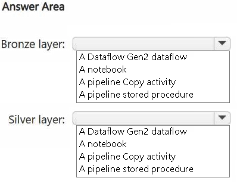

_HOTSPOT — the original ExamTopics question expects you to mark areas on the exhibit above; the correct hotspot coordinates are not published._

**Most voted:**
- Bronze Layer: A pipeline copy activity
- Silver Layer: A notebook

### Top explanations
- **doctordodge** (27 upvotes [Highly Voted]): Bronze Layer: A pipeline copy activity
  Silver Layer: A notebook (the case study information mentioned that lots of transformation work needs to be done to get data into the Silver layer. Also, it says that the engineers prefer to use Python and SQL for data transformation. A notebook is best for this kind of massive transformation work).
- **amli123** (5 upvotes [Highly Voted]): Development effort must be minimized and a built-in connection must be used to import the source data.
  
  A pipeline copy activity 
  A dataflow gen2
- **ziggy1117** (11 upvotes): The data engineers perform the ingestion, transformation, and loading of data. They prefer to use Python or SQL to transform the data. - so its a notebook
- **8d6881f** (4 upvotes): Well, if the engineers are used to python and SQL they will probably faster and more comfortable in the notebook
- **GLG** (2 upvotes): Silver: extensive datacleansing is related to MAR1 data, for POS1 the transformations are much simpeler (filter products where IsActive=1 etc) -> Dataflow Gen2.

## Q2.4 (ID 936005)

Overview. Company Overview -
Contoso, Ltd. is an online retail company that wants to modernize its analytics platform by moving to Fabric. The company plans to begin using Fabric for marketing analytics.
Overview. IT Structure -
The company’s IT department has a team of data analysts and a team of data engineers that use analytics systems.
The data engineers perform the ingestion, transformation, and loading of data. They prefer to use Python or SQL to transform the data.
The data analysts query data and create semantic models and reports. They are qualified to write queries in Power Query and T-SQL.
Existing Environment. Fabric -
Contoso has an F64 capacity named Cap1. All Fabric users are allowed to create items.
Contoso has two workspaces named WorkspaceA and WorkspaceB that currently use Pro license mode.
Existing Environment. Source Systems
Contoso has a point of sale (POS) system named POS1 that uses an instance of SQL Server on Azure Virtual Machines in the same Microsoft Entra tenant as Fabric. The host virtual machine is on a private virtual network that has public access blocked. POS1 contains all the sales transactions that were processed on the company’s website.
The company has a software as a service (SaaS) online marketing app named MAR1. MAR1 has seven entities. The entities contain data that relates to email open rates and interaction rates, as well as website interactions. The data can be exported from MAR1 by calling REST APIs. Each entity has a different endpoint.
Contoso has been using MAR1 for one year. Data from prior years is stored in Parquet files in an Amazon Simple Storage Service (Amazon S3) bucket. There are 12 files that range in size from 300 MB to 900 MB and relate to email interactions.
Existing Environment. Product Data
POS1 contains a product list and related data. The data comes from the following three tables:
Products -
ProductCategories -
ProductSubcategories -
In the data, products are related to product subcategories, and subcategories are related to product categories.
Existing Environment. Azure -
Contoso has a Microsoft Entra tenant that has the following mail-enabled security groups:
DataAnalysts: Contains the data analysts
DataEngineers: Contains the data engineers
Contoso has an Azure subscription.
The company has an existing Azure DevOps organization and creates a new project for repositories that relate to Fabric.
Existing Environment. User Problems
The VP of marketing at Contoso requires analysis on the effectiveness of different types of email content. It typically takes a week to manually compile and analyze the data. Contoso wants to reduce the time to less than one day by using Fabric.
The data engineering team has successfully exported data from MAR1. The team experiences transient connectivity errors, which causes the data exports to fail.
Requirements. Planned Changes -
Contoso plans to create the following two lakehouses:
Lakehouse1: Will store both raw and cleansed data from the sources
Lakehouse2: Will serve data in a dimensional model to users for analytical queries
Additional items will be added to facilitate data ingestion and transformation.
Contoso plans to use Azure Repos for source control in Fabric.
Requirements. Technical Requirements
The new lakehouses must follow a medallion architecture by using the following three layers: bronze, silver, and gold. There will be extensive data cleansing required to populate the MAR1 data in the silver layer, including deduplication, the handling of missing values, and the standardizing of capitalization.
Each layer must be fully populated before moving on to the next layer. If any step in populating the lakehouses fails, an email must be sent to the data engineers.
Data imports must run simultaneously, when possible.
The use of email data from the Amazon S3 bucket must meet the following requirements:
Minimize egress costs associated with cross-cloud data access.
Prevent saving a copy of the raw data in the lakehouses.
Items that relate to data ingestion must meet the following requirements:
The items must be source controlled alongside other workspace items.
Ingested data must land in the bronze layer of Lakehouse1 in the Delta format.
No changes other than changes to the file formats must be implemented before the data lands in the bronze layer.
Development effort must be minimized and a built-in connection must be used to import the source data.
In the event of a connectivity error, the ingestion processes must attempt the connection again.
Lakehouses, data pipelines, and notebooks must be stored in WorkspaceA. Semantic models, reports, and dataflows must be stored in WorkspaceB.
Once a week, old files that are no longer referenced by a Delta table log must be removed.
Requirements. Data Transformation
In the POS1 product data, ProductID values are unique. The product dimension in the gold layer must include only active products from product list. Active products are identified by an IsActive value of 1.
Some product categories and subcategories are NOT assigned to any product. They are NOT analytically relevant and must be omitted from the product dimension in the gold layer.
Requirements. Data Security -
Security in Fabric must meet the following requirements:
The data engineers must have read and write access to all the lakehouses, including the underlying files.
The data analysts must only have read access to the Delta tables in the gold layer.
The data analysts must NOT have access to the data in the bronze and silver layers.
The data engineers must be able to commit changes to source control in WorkspaceA.
You need to ensure that usage of the data in the Amazon S3 bucket meets the technical requirements.
What should you do?

⭕ **A.** Create a workspace identity and enable high concurrency for the notebooks.
⭕ **B.** Create a shortcut and ensure that caching is disabled for the workspace.
⭕ **C.** Create a workspace identity and use the identity in a data pipeline.
✅ **D.** Create a shortcut and ensure that caching is enabled for the workspace.

**Correct answer:** D
**Most voted:** D

### Top explanations
- **GHill1982** (29 upvotes [Highly Voted]): Enabling caching for the workspace will help minimize egress costs by reducing the amount of data that needs to be transferred across clouds. Creating a shortcut ensures that the raw data is not duplicated in the lakehouse.
- **DarkDerf** (16 upvotes [Highly Voted]): NOT "D": Create a shortcut and ensure that caching is enabled for the workspace.
  Enabling caching would store temporary copies of the data in Fabric, which contradicts the requirement to prevent storing raw data in the lakehouses.
  
  Final Answer:
  ✅ B. Create a shortcut and ensure that caching is disabled for the workspace.
- **670dd08** (8 upvotes): How Fabric handles this
  Shortcut (no cache):
  Data is always read directly from S3.
  ✅ No copy of the raw data is made in the lakehouse.
  ❌ But each query re-reads from S3 → high egress costs.
  
  Shortcut with cache enabled:
  First time you read, Fabric fetches from S3 and stores it in a temporary Fabric-managed cache (not in your lakehouse bronze/silver/gold folders).
  ✅ Avoids repeatedly pulling the same bytes across clouds → minimizes egress costs.
  ✅ Still no “copy” of the raw dataset inside your lakehouse — the raw data in S3 remains the source of truth.
- **DataAITraining** (7 upvotes): the requirement was to prevent storing data in the Lakehouse, not Fabric
- **prabhjot** (6 upvotes): shortcut creation and caching is available for Amazon S3 bucket and ADLS; reduces egress costs and also makes sure no data duplication done!

## Q2.5 (ID 936006)

HOTSPOT -
Overview. Company Overview -
Contoso, Ltd. is an online retail company that wants to modernize its analytics platform by moving to Fabric. The company plans to begin using Fabric for marketing analytics.
Overview. IT Structure -
The company’s IT department has a team of data analysts and a team of data engineers that use analytics systems.
The data engineers perform the ingestion, transformation, and loading of data. They prefer to use Python or SQL to transform the data.
The data analysts query data and create semantic models and reports. They are qualified to write queries in Power Query and T-SQL.
Existing Environment. Fabric -
Contoso has an F64 capacity named Cap1. All Fabric users are allowed to create items.
Contoso has two workspaces named WorkspaceA and WorkspaceB that currently use Pro license mode.
Existing Environment. Source Systems
Contoso has a point of sale (POS) system named POS1 that uses an instance of SQL Server on Azure Virtual Machines in the same Microsoft Entra tenant as Fabric. The host virtual machine is on a private virtual network that has public access blocked. POS1 contains all the sales transactions that were processed on the company’s website.
The company has a software as a service (SaaS) online marketing app named MAR1. MAR1 has seven entities. The entities contain data that relates to email open rates and interaction rates, as well as website interactions. The data can be exported from MAR1 by calling REST APIs. Each entity has a different endpoint.
Contoso has been using MAR1 for one year. Data from prior years is stored in Parquet files in an Amazon Simple Storage Service (Amazon S3) bucket. There are 12 files that range in size from 300 MB to 900 MB and relate to email interactions.
Existing Environment. Product Data
POS1 contains a product list and related data. The data comes from the following three tables:
Products -
ProductCategories -
ProductSubcategories -
In the data, products are related to product subcategories, and subcategories are related to product categories.
Existing Environment. Azure -
Contoso has a Microsoft Entra tenant that has the following mail-enabled security groups:
DataAnalysts: Contains the data analysts
DataEngineers: Contains the data engineers
Contoso has an Azure subscription.
The company has an existing Azure DevOps organization and creates a new project for repositories that relate to Fabric.
Existing Environment. User Problems
The VP of marketing at Contoso requires analysis on the effectiveness of different types of email content. It typically takes a week to manually compile and analyze the data. Contoso wants to reduce the time to less than one day by using Fabric.
The data engineering team has successfully exported data from MAR1. The team experiences transient connectivity errors, which causes the data exports to fail.
Requirements. Planned Changes -
Contoso plans to create the following two lakehouses:
Lakehouse1: Will store both raw and cleansed data from the sources
Lakehouse2: Will serve data in a dimensional model to users for analytical queries
Additional items will be added to facilitate data ingestion and transformation.
Contoso plans to use Azure Repos for source control in Fabric.
Requirements. Technical Requirements
The new lakehouses must follow a medallion architecture by using the following three layers: bronze, silver, and gold. There will be extensive data cleansing required to populate the MAR1 data in the silver layer, including deduplication, the handling of missing values, and the standardizing of capitalization.
Each layer must be fully populated before moving on to the next layer. If any step in populating the lakehouses fails, an email must be sent to the data engineers.
Data imports must run simultaneously, when possible.
The use of email data from the Amazon S3 bucket must meet the following requirements:
Minimize egress costs associated with cross-cloud data access.
Prevent saving a copy of the raw data in the lakehouses.
Items that relate to data ingestion must meet the following requirements:
The items must be source controlled alongside other workspace items.
Ingested data must land in the bronze layer of Lakehouse1 in the Delta format.
No changes other than changes to the file formats must be implemented before the data lands in the bronze layer.
Development effort must be minimized and a built-in connection must be used to import the source data.
In the event of a connectivity error, the ingestion processes must attempt the connection again.
Lakehouses, data pipelines, and notebooks must be stored in WorkspaceA. Semantic models, reports, and dataflows must be stored in WorkspaceB.
Once a week, old files that are no longer referenced by a Delta table log must be removed.
Requirements. Data Transformation
In the POS1 product data, ProductID values are unique. The product dimension in the gold layer must include only active products from product list. Active products are identified by an IsActive value of 1.
Some product categories and subcategories are NOT assigned to any product. They are NOT analytically relevant and must be omitted from the product dimension in the gold layer.
Requirements. Data Security -
Security in Fabric must meet the following requirements:
The data engineers must have read and write access to all the lakehouses, including the underlying files.
The data analysts must only have read access to the Delta tables in the gold layer.
The data analysts must NOT have access to the data in the bronze and silver layers.
The data engineers must be able to commit changes to source control in WorkspaceA.
You need to create the product dimension.
How should you complete the Apache Spark SQL code? To answer, select the appropriate options in the answer area.
NOTE: Each correct selection is worth one point.

**Exhibits**
- Exhibit 1: 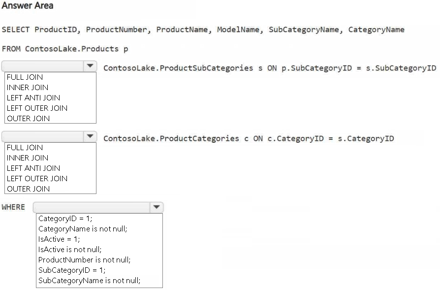

_HOTSPOT — the original ExamTopics question expects you to mark areas on the exhibit above; the correct hotspot coordinates are not published._

**Most voted:** Guys, think about it, if you are in a real project and need to build this dimension, will you use INNER ?  It could exists products without Categories, and I haven't seem anywhere saying that all products have categories. You are excluding this products. The answer should be .  LEFT OUTER JOIN, LEFT OUTER JOIN and IsActive = 1

### Top explanations
- **MDWPartners** (28 upvotes [Highly Voted]): LEFT OUTER JOIN
  
  INNER JOIN
  
  IsActive = 1
  
  the first join should be left because we want to keep all the products. Second should be inner to omit unused categories
  
  We need to keep active products
  
  In the POS1 product data, ProductID values are unique. The product dimension in the gold layer must include only active products from product list. Active products are identified by an IsActive value of 1.
  Some product categories and subcategories are NOT assigned to any product. They are NOT analytically relevant and must be omitted from the product dimension in the gold layer.
- **xmh5025** (14 upvotes [Highly Voted]): Inner Join 
  Inner Join
  Is Active
  
  If use left outer join, eventual still need a where clause to filter out the product has no category and sub-category, since they are analytic irrelevant and have to be omitted in the gold layer
- **wellingtonluis** (9 upvotes): Guys, think about it, if you are in a real project and need to build this dimension, will you use INNER ?  It could exists products without Categories, and I haven't seem anywhere saying that all products have categories. You are excluding this products. The answer should be .  LEFT OUTER JOIN, LEFT OUTER JOIN and IsActive = 1
- **realexamguru** (8 upvotes): Inner Join / Inner Join / IsActive = 1 if all products have subcategories
  Left Outer Join / Left Outer Join / IsActive = 1 if some products are missing subcategory information
  Based on the the details that we have there should be no difference between a left join and an inner join. We know there are some extra categories and subcategories but we don't know if there is any product without a subcategory. Probably we are missing another piece of information. I prefer inner join since it performs better.
  Full Join and anti join are just obviously incorrect. And there's no such thing as an outer join.
- **4371883** (6 upvotes): left outer; left outer; IsActive = 1
  The above can achieve the requirements below as well:
  - In the POS1 product data, ProductID values are unique. The product dimension in the gold layer must include only active products from product list. Active products are identified by an IsActive value of 1.
  - Some product categories and subcategories are NOT assigned to any product. They are NOT analytically relevant and must be omitted from the product dimension in the gold layer.

## Q2.6 (ID 936007)

Overview. Company Overview -
Contoso, Ltd. is an online retail company that wants to modernize its analytics platform by moving to Fabric. The company plans to begin using Fabric for marketing analytics.
Overview. IT Structure -
The company’s IT department has a team of data analysts and a team of data engineers that use analytics systems.
The data engineers perform the ingestion, transformation, and loading of data. They prefer to use Python or SQL to transform the data.
The data analysts query data and create semantic models and reports. They are qualified to write queries in Power Query and T-SQL.
Existing Environment. Fabric -
Contoso has an F64 capacity named Cap1. All Fabric users are allowed to create items.
Contoso has two workspaces named WorkspaceA and WorkspaceB that currently use Pro license mode.
Existing Environment. Source Systems
Contoso has a point of sale (POS) system named POS1 that uses an instance of SQL Server on Azure Virtual Machines in the same Microsoft Entra tenant as Fabric. The host virtual machine is on a private virtual network that has public access blocked. POS1 contains all the sales transactions that were processed on the company’s website.
The company has a software as a service (SaaS) online marketing app named MAR1. MAR1 has seven entities. The entities contain data that relates to email open rates and interaction rates, as well as website interactions. The data can be exported from MAR1 by calling REST APIs. Each entity has a different endpoint.
Contoso has been using MAR1 for one year. Data from prior years is stored in Parquet files in an Amazon Simple Storage Service (Amazon S3) bucket. There are 12 files that range in size from 300 MB to 900 MB and relate to email interactions.
Existing Environment. Product Data
POS1 contains a product list and related data. The data comes from the following three tables:
Products -
ProductCategories -
ProductSubcategories -
In the data, products are related to product subcategories, and subcategories are related to product categories.
Existing Environment. Azure -
Contoso has a Microsoft Entra tenant that has the following mail-enabled security groups:
DataAnalysts: Contains the data analysts
DataEngineers: Contains the data engineers
Contoso has an Azure subscription.
The company has an existing Azure DevOps organization and creates a new project for repositories that relate to Fabric.
Existing Environment. User Problems
The VP of marketing at Contoso requires analysis on the effectiveness of different types of email content. It typically takes a week to manually compile and analyze the data. Contoso wants to reduce the time to less than one day by using Fabric.
The data engineering team has successfully exported data from MAR1. The team experiences transient connectivity errors, which causes the data exports to fail.
Requirements. Planned Changes -
Contoso plans to create the following two lakehouses:
Lakehouse1: Will store both raw and cleansed data from the sources
Lakehouse2: Will serve data in a dimensional model to users for analytical queries
Additional items will be added to facilitate data ingestion and transformation.
Contoso plans to use Azure Repos for source control in Fabric.
Requirements. Technical Requirements
The new lakehouses must follow a medallion architecture by using the following three layers: bronze, silver, and gold. There will be extensive data cleansing required to populate the MAR1 data in the silver layer, including deduplication, the handling of missing values, and the standardizing of capitalization.
Each layer must be fully populated before moving on to the next layer. If any step in populating the lakehouses fails, an email must be sent to the data engineers.
Data imports must run simultaneously, when possible.
The use of email data from the Amazon S3 bucket must meet the following requirements:
Minimize egress costs associated with cross-cloud data access.
Prevent saving a copy of the raw data in the lakehouses.
Items that relate to data ingestion must meet the following requirements:
The items must be source controlled alongside other workspace items.
Ingested data must land in the bronze layer of Lakehouse1 in the Delta format.
No changes other than changes to the file formats must be implemented before the data lands in the bronze layer.
Development effort must be minimized and a built-in connection must be used to import the source data.
In the event of a connectivity error, the ingestion processes must attempt the connection again.
Lakehouses, data pipelines, and notebooks must be stored in WorkspaceA. Semantic models, reports, and dataflows must be stored in WorkspaceB.
Once a week, old files that are no longer referenced by a Delta table log must be removed.
Requirements. Data Transformation
In the POS1 product data, ProductID values are unique. The product dimension in the gold layer must include only active products from product list. Active products are identified by an IsActive value of 1.
Some product categories and subcategories are NOT assigned to any product. They are NOT analytically relevant and must be omitted from the product dimension in the gold layer.
Requirements. Data Security -
Security in Fabric must meet the following requirements:
The data engineers must have read and write access to all the lakehouses, including the underlying files.
The data analysts must only have read access to the Delta tables in the gold layer.
The data analysts must NOT have access to the data in the bronze and silver layers.
The data engineers must be able to commit changes to source control in WorkspaceA.
You need to populate the MAR1 data in the bronze layer.
Which two types of activities should you include in the pipeline? Each correct answer presents part of the solution.
NOTE: Each correct selection is worth one point.

✅ **A.** ForEach
✅ **B.** Copy data
⭕ **C.** WebHook
⭕ **D.** Stored procedure

**Correct answer:** A, B
**Most voted:** AB

### Top explanations
- **4371883** (16 upvotes [Highly Voted]): ForEach to loop through all files and COPY to load
- **MultiCloudIronMan** (3 upvotes): Focus on Data Movement and Monitoring: Your goal is to ensure data from MAR1 is ingested into the bronze layer efficiently and any failure triggers notifications. Copy data and WebHook are more straightforward and purpose-fit for these tasks:
  
  Copy data ensures the data is copied to the desired format and location.
  
  WebHook allows you to set up notifications if there are any failures in the process.
- **WiseAlex007** (2 upvotes): The data engineering team has successfully exported data from MAR1. So files only
- **xmh5025** (2 upvotes): WebHook is great for getting a quick callback from an external service, but it doesn’t move bulk data nor write to Delta; you’d still need a Copy data (or notebook) afterward, which adds complexity and violates “minimal development effort
- **groni84** (2 upvotes): ForEach et  COPY

## Q2.7 (ID 936008)

HOTSPOT -
You have a Fabric workspace that contains a warehouse named Warehouse1. Warehouse1 contains the following tables and columns.
You need to denormalize the tables and include the ContractType and StartDate columns in the Employee table. The solution must meet the following requirements:
Ensure that the StartDate column is of the date data type.
Ensure that all the rows from the Employee table are preserved and include any matching rows from the Contract table.
Ensure that the result set displays the total number of employees per contract type for all the contract types that have more than two employees.
How should you complete the statement? To answer, select the appropriate options in the answer area.
NOTE: Each correct selection is worth one point.

**Exhibits**
- Exhibit 1: 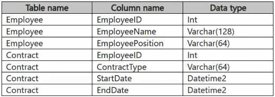
- Exhibit 2: 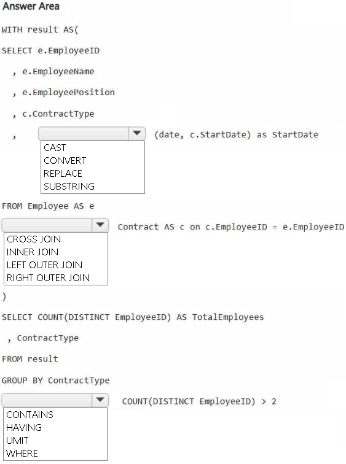

_HOTSPOT — the original ExamTopics question expects you to mark areas on the exhibit above; the correct hotspot coordinates are not published._

**Most voted:** First part is CONVERT and not CAST

### Top explanations
- **werfragt** (59 upvotes [Highly Voted]): First part is CONVERT and not CAST
- **Blue_MSBI** (28 upvotes [Highly Voted]): CONVERT, LEFT OUTER, HAVING
- **doctordodge** (7 upvotes): Agreed, based on the syntax of (, ).
- **vish9** (7 upvotes): Syntaxt for Cast is different. It does not fit here.
  CONVERT(DATE, c.startdate) AS startdate
  CAST(c.startdate AS DATE) AS startdate
- **8d6881f** (7 upvotes): CAST(c.StartDate as date)
  vs 
  CONVERT(date, c.StartDate)

## Q2.8 (ID 936009)

HOTSPOT -
You have an Azure Event Hubs data source that contains weather data.
You ingest the data from the data source by using an eventstream named Eventstream1. Eventstream1 uses a lakehouse as the destination.
You need to batch ingest only rows from the data source where the City attribute has a value of Kansas. The filter must be added before the destination. The solution must minimize development effort.
What should you use for the data processor and filtering? To answer, select the appropriate options in the answer area.
NOTE: Each correct selection is worth one point.

**Exhibits**
- Exhibit 1: 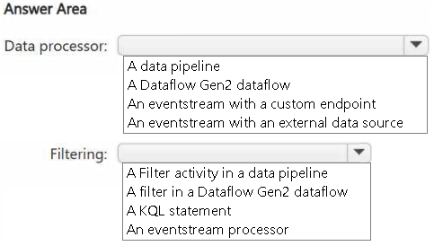

_HOTSPOT — the original ExamTopics question expects you to mark areas on the exhibit above; the correct hotspot coordinates are not published._

**Most voted:**
1. eventstream with an external data source
2. eventstream processor

### Top explanations
- **4371883** (53 upvotes [Highly Voted]): 1. eventstream with an external data source
  2. eventstream processor
  https://learn.microsoft.com/en-us/fabric/real-time-intelligence/event-streams/add-source-azure-event-hubs?pivots=enhanced-capabilities
  https://learn.microsoft.com/en-us/fabric/real-time-intelligence/event-streams/process-events-using-event-processor-editor?pivots=enhanced-capabilities
- **18e18d0** (10 upvotes [Highly Voted]): The answer is correct. The question states that eventstream already exists and uses the lakehouse as destination. The question also states that the rows need to be batch ingested. Thus 1) Dataflow and 2) Filter activity are the best in this situation
- **MJAlav** (5 upvotes): If the requirement is for scheduled batch ingestion (e.g., hourly imports), then the eventstream approach isn't ideal—you’d typically use a Dataflow Gen2 or data pipeline for scheduled, batched ETL.
  
  but real-time stream ingestion with inline filtering (i.e., data continuously flows but only rows matching City = "Kansas" pass through), then using an eventstream with an event processor is valid and requires minimal development effort.
  I think correct answer is 
  1. eventstream with an external data source
  2. eventstream processor
  and the phrase “batch ingest only rows” in the question is the tricky part.
- **JME1** (3 upvotes): A very sneaky question but the use of data flows are the correct answer. The event stream is ingesting ALL weather data live and storing with the Lakehouse. We can then assume that the source being used by the event stream matches the data in the lakehouse. It then asks about filtering it to only include Kansas. Given the data is already in the lakehouse the answers provide make sense
- **henryphchan** (3 upvotes): The provided answer. This question is asking how you can batch ingest only rows from the data source where the City attribute has a value of Kansas. To minimize development effeort, the data processor must be DataFlow Gen2 and the filtering should use the Filter in DataFlow Gen2

## Q2.9 (ID 936010)

You have a Fabric workspace that contains an eventstream named Eventstream1. Eventstream1 processes data from a thermal sensor by using event stream processing, and then stores the data in a lakehouse.
You need to modify Eventstream1 to include the standard deviation of the temperature.
Which transform operator should you include in the Eventstream1 logic?

⭕ **A.** Expand
✅ **B.** Group by
⭕ **C.** Union
⭕ **D.** Aggregate

**Correct answer:** B
**Most voted:** B

### Top explanations
- **GHill1982** (18 upvotes [Highly Voted]): The Group by transform operator contains the Standard deviation aggregation. The Aggregate transform operator only contains Average, Max, Min and Sum aggregation.
- **405a659** (10 upvotes [Highly Voted]): https://learn.microsoft.com/en-us/fabric/real-time-intelligence/event-streams/process-events-using-event-processor-editor?pivots=standard-capabilities#group-by
- **MarceloManhaes** (5 upvotes): The correct answer is: D. Aggregate
  
  To include the standard deviation of the temperature in your event stream logic in Microsoft Fabric, you need to use the Aggregate transform operator. This operator allows you to perform statistical calculations such as:
  
  Average
  Count
  Min/Max
  Sum
  Standard deviation
  Here's a quick breakdown of the other options and why they don't apply:
  
  A. Expand: Used to flatten nested data structures, not for statistical calculations.
  B. Group by Most Voted: Used to group data based on the most frequent value, not for computing standard deviation.
  C. Union: Combines multiple streams, but doesn’t perform calculations.
  D. Aggregate: ✅ Correct — used for computing metrics like standard deviation.
  Would you like help modifying the Eventstream1 logic to include this transformation?
- **MultiCloudIronMan** (4 upvotes): while Group by is useful for creating groups, it does not provide the full range of aggregate functions that Aggregate does, including the standard deviation. This is why the Aggregate operator is the correct choice.
- **670dd08** (2 upvotes [Most Recent]): In Fabric Eventstream transform events,  Standard Deviation is an option under GroupBy. In Aggregation you just have Average, Minimum, Maximum and SUM. I have checked in Fabric.

## Q2.10 (ID 936011)

You have an Azure event hub. Each event contains the following fields:
BikepointID -
Street -
Neighbourhood -
Latitude -
Longitude -
No_Bikes -
No_Empty_Docks -
You need to ingest the events. The solution must only retain events that have a Neighbourhood value of Chelsea, and then store the retained events in a Fabric lakehouse.
What should you use?

⭕ **A.** a KQL queryset
✅ **B.** an eventstream
⭕ **C.** a streaming dataset
⭕ **D.** Apache Spark Structured Streaming

**Correct answer:** B
**Most voted:** B

### Top explanations
- **GHill1982** (12 upvotes [Highly Voted]): Eventstream would be most suitable for this.
- **4371883** (5 upvotes [Highly Voted]): Eventstream is the way to go here. It allows for transformation activities such as filter.
  https://learn.microsoft.com/en-us/fabric/real-time-intelligence/event-streams/add-source-azure-event-hubs?pivots=enhanced-capabilities
- **MultiCloudIronMan** (4 upvotes): An eventstream is designed to handle this type of real-time data processing. It provides the necessary capabilities to:
  
  Ingest data from sources like Azure Event Hubs.
  
  Filter and transform the data in real-time.
  
  Store the processed data directly into a destination like a Fabric lakehouse.
- **38578c4** (4 upvotes): It's not true. Eventstream coud store into Lakehouse
- **DarioReymago** (3 upvotes [Most Recent]): b is better than D

## Q2.11 (ID 936012)

HOTSPOT -
You are building a data loading pattern for Fabric notebook workloads.
You have the following code segment:
For each of the following statements, select Yes if the statement is true. Otherwise, select No.
NOTE: Each correct selection is worth one point.

**Exhibits**
- Exhibit 1: 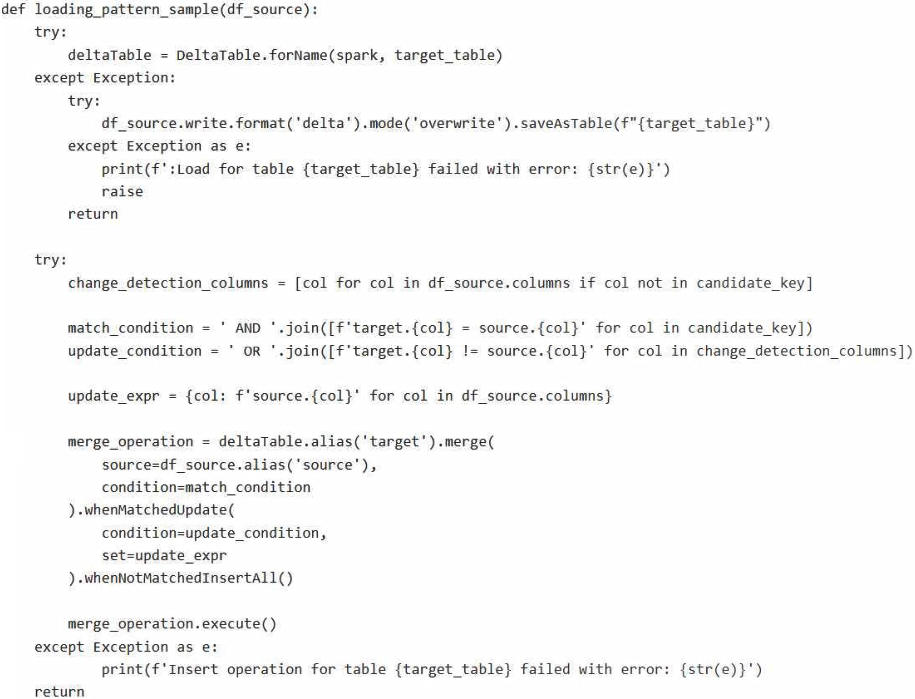
- Exhibit 2: 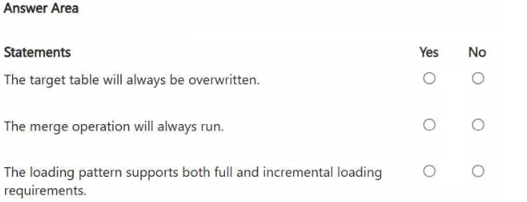

_HOTSPOT — the original ExamTopics question expects you to mark areas on the exhibit above; the correct hotspot coordinates are not published._

**Most voted:** No, No, Yes

### Top explanations
- **8d6881f** (23 upvotes [Highly Voted]): No No Yes.
  If anything goes wrong writing the existing table or when writing a new table (.targettable) the merge will not be executed.
- **MultiCloudIronMan** (7 upvotes [Highly Voted]): NNY is correct
- **fdsdfgxcvbdsfhshfg** (5 upvotes): N N Y, but the last Y is far stretched - you cannot 'switch' with a parameter to fully reload the table - this happens only if the first try fails and delta table isn't found, in other cases we merge on specified columns
- **prabhjot** (4 upvotes): No Yes Yes
  Merge operation always runs, the table is not overwritten if condition not matched
- **4371883** (4 upvotes): No; Yes: Yes
  Merge operation will always run, the matching_condition is part of the merge operation. But target table may not be overwritten if condition not met.

## Q2.12 (ID 936013)

HOTSPOT -
You have a Fabric workspace that contains two lakehouses named Lakehouse1 and Lakehouse2. Lakehouse1 contains staging data in a Delta table named Orderlines. Lakehouse2 contains a Type 2 slowly changing dimension (SCD) dimension table named Dim_Customer.
You need to build a query that will combine data from Orderlines and Dim_Customer to create a new fact table named Fact_Orders. The new table must meet the following requirements:
Enable the analysis of customer orders based on historical attributes.
Enable the analysis of customer orders based on the current attributes.
How should you complete the statement? To answer, select the appropriate options in the answer area.
NOTE: Each correct selection is worth one point.

**Exhibits**
- Exhibit 1: 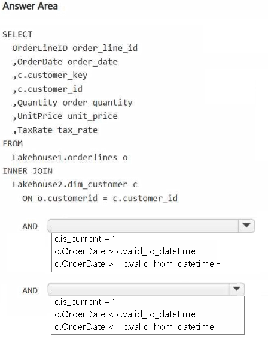

_HOTSPOT — the original ExamTopics question expects you to mark areas on the exhibit above; the correct hotspot coordinates are not published._

**Most voted:**
- First dropdown: o.OrderDate >= c.valid_from_datetime
- Second dropdown: o.OrderDate < c.valid_to_datetime

### Top explanations
- **4371883** (23 upvotes [Highly Voted]): Agree with the answers
- **werfragt** (8 upvotes [Highly Voted]): Is this correct? I would choose >= and <=.
- **DarioReymago** (3 upvotes): it is ok
- **8d6881f** (2 upvotes): No, the order has to be *before* the 'new costumer' takes effect.  Otherwise it could belong to two customers
- **DirectX** (2 upvotes): Of course that's not going to happen. Each order is linked to a customer (o.CustomerId = c.CustomerId). And new customer and old customer has different CustomerId value.
  The answer is: >= and  <=

## Q2.13 (ID 936014)

You have a Fabric workspace that contains a lakehouse named Lakehouse1.
In an external data source, you have data files that are 500 GB each. A new file is added every day.
You need to ingest the data into Lakehouse1 without applying any transformations. The solution must meet the following requirements
Trigger the process when a new file is added.
Provide the highest throughput.
Which type of item should you use to ingest the data?

⭕ **A.** Eventstream
⭕ **B.** Dataflow Gen2
⭕ **C.** Streaming dataset
✅ **D.** Data pipeline

**Correct answer:** D
**Most voted:** D

### Top explanations
- **IshtarSQL** (14 upvotes [Highly Voted]): Eventstream is designed for ingesting real-time or streaming data from sources like IoT devices or logs. It’s not optimized for batch processing or large files.
- **fassil** (8 upvotes [Highly Voted]): D. Data pipeline.
  
  Data pipelines are designed to handle large volumes of data efficiently and can be configured to trigger the ingestion process automatically when new files are added to the external data source. They also provide high throughput, making them suitable for handling 500 GB files daily without applying any transformations.
- **alex_sql** (3 upvotes): Notebook
- **2e6975f** (3 upvotes): For high-throughput, event-triggered ingestion of large files into a lakehouse without transformations, Data pipeline is the most appropriate and efficient item in Fabric.
- **e5cb566** (2 upvotes): I just took the exam. The options to choose from are different now:
  Eventstream.
  Dataflow
  Activator
  Notebook
  
  Wich one do you guess is correct?

## Q2.14 (ID 936015)

You have a Fabric workspace that contains a lakehouse named Lakehouse1.
In an external data source, you have data files that are 500 GB each. A new file is added every day.
You need to ingest the data into Lakehouse1 without applying any transformations. The solution must meet the following requirements
Trigger the process when a new file is added.
Provide the highest throughput.
Which type of item should you use to ingest the data?

✅ **A.** Data pipeline
⭕ **B.** Environment
⭕ **C.** KQL queryset
⭕ **D.** Dataflow Gen2

**Correct answer:** A
**Most voted:** A

### Top explanations
- **2e6975f** (5 upvotes [Highly Voted]): For high-throughput, event-triggered ingestion of large files into a lakehouse without transformations, Data pipeline is the most appropriate and efficient item in Fabric.
- **henryphchan** (4 upvotes): same as the previous question
- **DarioReymago** (3 upvotes): is the same previous question
- **e5cb566** (2 upvotes [Most Recent]): I just took the exam. The options to choose from are different now:
  Eventstream.
  Dataflow
  Activator
  Notebook
  
  Wich one do you guess is correct?
- **8d6881f** (2 upvotes): Data Pipeline is not right as at 2025-Jan as the storage trigger is still in preview, so it doesn't satisfy the requirement. But it's probably the best option.

## Q2.15 (ID 936016)

You have a Fabric workspace that contains an eventhouse and a KQL database named Database1. Database1 has the following:
A table named Table1 -
A table named Table2 -
An update policy named Policy1 -
Policy1 sends data from Table1 to Table2.
The following is a sample of the data in Table2.
Recently, the following actions were performed on Table1:
An additional element named temperature was added to the StreamData column.
The data type of the Timestamp column was changed to date.
The data type of the DeviceId column was changed to string.
You plan to load additional records to Table2.
Which two records will load from Table1 to Table2? Each correct answer presents a complete solution.
NOTE: Each correct selection is worth one point.

**Exhibits**
- Exhibit 1: 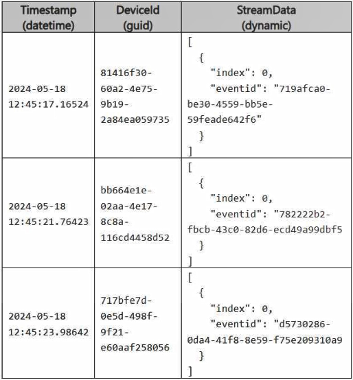

✅ **A.** 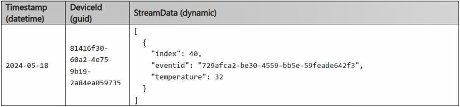
⭕ **B.** 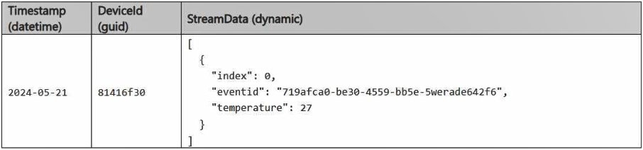
⭕ **C.** 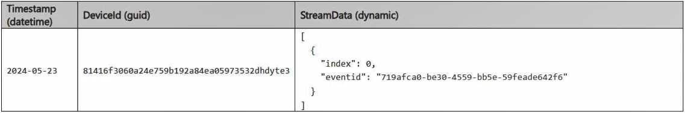
✅ **D.** 

**Correct answer:** A, D
**Most voted:** AD

### Top explanations
- **prabhjot** (17 upvotes [Highly Voted]): A and D have valid GUIds
- **ziggy1117** (5 upvotes [Highly Voted]): Even if Table 1 has device ID converted to String, Table 2 still expects the device ID to be in GUID. So only rows A and D meets that criteria.
  
  Also when you insert a date into a datetime column, SQL will automatically convert the date to datetime by adding 00:00:00.000 as the time.
- **IshtarSQL** (5 upvotes): Record B loads because it conforms to the updated schema (string DeviceId, StreamData with temperature).
  Record D loads because it conforms to the original schema (guid DeviceId, no temperature in StreamData).
- **PetJoh422** (4 upvotes): This is incorrect because it was only updated in Table 1. So passing a string to table2 which requires a GUID will fail when it is not a valid guid.
- **Attollo** (3 upvotes): Changed my answer to A and D. I initially misinterpreted the question,  since the schema of Table2 has not been updated, only records A and D conform to the existing schema and will be successfully ingested

## Q2.16 (ID 936017)

HOTSPOT -
You have a Fabric workspace.
You are debugging a statement and discover the following issues:
Sometimes, the statement fails to return all the expected rows.
The PurchaseDate output column is NOT in the expected format of mmm dd, yy.
You need to resolve the issues. The solution must ensure that the data types of the results are retained. The results can contain blank cells.
How should you complete the statement? To answer, select the appropriate options in the answer area.
NOTE: Each correct selection is worth one point.

**Exhibits**
- Exhibit 1: 

_HOTSPOT — the original ExamTopics question expects you to mark areas on the exhibit above; the correct hotspot coordinates are not published._

**Most voted:**
- First: try_cast(item_name as varchar(20))
- Second: convert(varchar, purchase_date, 7)

### Top explanations
- **henryphchan** (24 upvotes [Highly Voted]): I'm curious how can people memorize the date format code for the exam lol.
- **fdsdfgxcvbdsfhshfg** (4 upvotes): You're allowed to use documentation since a couple of years...
- **8d6881f** (4 upvotes): As a european I would not know it has to be 7, we never use that format and I do not know (or want to know) all formats by heart.....
  
  try_cast: https://learn.microsoft.com/en-us/sql/t-sql/functions/try-cast-transact-sql?view=sql-server-ver16
  
  convert: https://learn.microsoft.com/en-us/sql/t-sql/functions/cast-
  and-convert-transact-sql?view=sql-server-ver16
- **dbc2c96** (3 upvotes [Most Recent]): First: try_cast(item_name as varchar(20))
  Second: convert(varchar, purchase_date, 7)
  
  Explanation:
  I used pure SQL for testing, I assume it's very similar here, if not the same...
  
  When I execute the following commands on the SQL database,
  SELECT CONVERT(VARCHAR, GETDATE(), 7) AS PurchaseDate
  SELECT FORMAT(GETDATE(), 'MMM dd, yy') AS PurchaseDate
  I get this - both of commands give the same result:
  Oct 10, 25
  
  The other two give the following result:
  SELECT CONVERT(VARCHAR, GETDATE(), 109) AS PurchaseDate --> Oct 10 2025  9:48:40:933AM
  SELECT CONVERT(VARCHAR, GETDATE(), 112) AS PurchaseDate --> 20251010
  
  So, I'm pretty sure the correct answer would be convert(varchar, purchase_date, 7)
  which is the same as what the format function gives us in the example mentioned above.
- **DarioReymago** (3 upvotes): try_cast
  type 7: https://learn.microsoft.com/en-us/sql/t-sql/functions/cast-and-convert-transact-sql?view=sql-server-ver17#date-and-time-styles

## Q2.17 (ID 936018)

You are developing a data pipeline named Pipeline1.
You need to add a Copy data activity that will copy data from a Snowflake data source to a Fabric warehouse.
What should you configure?

⭕ **A.** Degree of copy parallelism
⭕ **B.** Fault tolerance
✅ **C.** Enable staging
⭕ **D.** Enable logging

**Correct answer:** C
**Most voted:** C

### Top explanations
- **GHill1982** (18 upvotes [Highly Voted]): Enable staging. https://learn.microsoft.com/en-us/fabric/data-factory/connector-snowflake-copy-activity
- **Tuki93** (4 upvotes): Enable staging  is the correct answer
- **MedMed009** (1 upvotes [Most Recent]): Staged copy from Snowflake : 
  When your destination data store or format isn't natively compatible with the Snowflake COPY command, as mentioned in the last section, enable the built-in staged copy using an interim Azure Blob storage instance.
  https://learn.microsoft.com/en-us/fabric/data-factory/connector-snowflake-copy-activity
- **vmisirlis** (1 upvotes): I would say Degree of copy parallelism. 
  This controls how many parallel threads are used during the copy operation. Increasing parallelism improves throughput and reduces overall execution time, especially for large datasets.

## Q2.18 (ID 936019)

Note: This question is part of a series of questions that present the same scenario. Each question in the series contains a unique solution that might meet the stated goals. Some question sets might have more than one correct solution, while others might not have a correct solution.
After you answer a question in this section, you will NOT be able to return to it. As a result, these questions will not appear in the review screen.
You have a KQL database that contains two tables named Stream and Reference. Stream contains streaming data in the following format.
Reference contains reference data in the following format.
Both tables contain millions of rows.
You have the following KQL queryset.
You need to reduce how long it takes to run the KQL queryset.
Solution: You change the join type to kind=outer.
Does this meet the goal?

**Exhibits**
- Exhibit 1: 
- Exhibit 2: 
- Exhibit 3: 

⭕ **A.** Yes
✅ **B.** No

**Correct answer:** B
**Most voted:** B

### Top explanations
- **GHill1982** (16 upvotes [Highly Voted]): No. An outer join can be more computationally intensive than an inner join because it needs to process all rows from both tables and include rows that don't have matching entries.
- **vigaro** (3 upvotes): increase data
- **13d2a97** (2 upvotes): An outer join returns all rows from both tables, with nulls where there's no match.
  
  This results in more data to process, which increases execution time, especially when both Stream and Reference tables have millions of rows.
- **8ac3742** (1 upvotes [Most Recent]): 1.tell the engine to broadcast the small reference avoids a costly distributed shuffle. In KQL:
  | join hint.strategy=broadcast kind=inner (
      Reference | project DeviceId, DeviceName
  ) on DeviceId
  
  Even if Reference is narrow, hint.strategy=broadcast gives you predictable performance.
  2.Materialize a frequently-used static table — if Reference is static but read many times in a larger query pipeline:
  let Ref = materialize(Reference | project DeviceId, DeviceName);
  ...
  | join kind=inner Ref on DeviceId
  materialize() caches the result for the query, which can help when the engine would otherwise recompute or re-read it.

## Q2.19 (ID 936020)

Note: This question is part of a series of questions that present the same scenario. Each question in the series contains a unique solution that might meet the stated goals. Some question sets might have more than one correct solution, while others might not have a correct solution.
After you answer a question in this section, you will NOT be able to return to it. As a result, these questions will not appear in the review screen.
You have a KQL database that contains two tables named Stream and Reference. Stream contains streaming data in the following format.
Reference contains reference data in the following format.
Both tables contain millions of rows.
You have the following KQL queryset.
You need to reduce how long it takes to run the KQL queryset.
Solution: You change project to extend.
Does this meet the goal?

**Exhibits**
- Exhibit 1: 
- Exhibit 2: 
- Exhibit 3: 

⭕ **A.** Yes
✅ **B.** No

**Correct answer:** B
**Most voted:** B

### Top explanations
- **GHill1982** (12 upvotes [Highly Voted]): No. The `project` operator is used to select specific columns, whereas `extend` is used to add new calculated columns to the result set. They serve different purposes.
- **13d2a97** (3 upvotes [Most Recent]): Changing project to extend does not improve performance of a KQL (Kusto Query Language) query — in fact, it may hurt performance or keep it the same depending on the query.
- **vigaro** (3 upvotes): more data

## Q2.20 (ID 936021)

Note: This question is part of a series of questions that present the same scenario. Each question in the series contains a unique solution that might meet the stated goals. Some question sets might have more than one correct solution, while others might not have a correct solution.
After you answer a question in this section, you will NOT be able to return to it. As a result, these questions will not appear in the review screen.
You have a KQL database that contains two tables named Stream and Reference. Stream contains streaming data in the following format.
Reference contains reference data in the following format.
Both tables contain millions of rows.
You have the following KQL queryset.
You need to reduce how long it takes to run the KQL queryset.
Solution: You move the filter to line 02.
Does this meet the goal?

**Exhibits**
- Exhibit 1: 
- Exhibit 2: 
- Exhibit 3: 

✅ **A.** Yes
⭕ **B.** No

**Correct answer:** A
**Most voted:** A

### Top explanations
- **GHill1982** (19 upvotes [Highly Voted]): Yes. By applying the `where` clause early in the query, you reduce the number of rows processed in subsequent operations, which improves performance.
- **13d2a97** (4 upvotes): In Kusto Query Language (KQL), the placement of the where (filter) clause significantly affects performance, especially with large datasets.
- **vigaro** (3 upvotes): reduce early the data
- **670dd08** (2 upvotes [Most Recent]): Because applying the filter before the join reduces the workload and speeds up query execution.
- **DarioReymago** (2 upvotes): a is correct

## Q2.21 (ID 936022)

Note: This question is part of a series of questions that present the same scenario. Each question in the series contains a unique solution that might meet the stated goals. Some question sets might have more than one correct solution, while others might not have a correct solution.
After you answer a question in this section, you will NOT be able to return to it. As a result, these questions will not appear in the review screen.
You have a KQL database that contains two tables named Stream and Reference. Stream contains streaming data in the following format.
Reference contains reference data in the following format.
Both tables contain millions of rows.
You have the following KQL queryset.
You need to reduce how long it takes to run the KQL queryset.
Solution: You add the make_list() function to the output columns.
Does this meet the goal?

**Exhibits**
- Exhibit 1: 
- Exhibit 2: 
- Exhibit 3: 

⭕ **A.** Yes
✅ **B.** No

**Correct answer:** B
**Most voted:** B

### Top explanations
- **GHill1982** (15 upvotes [Highly Voted]): No. The `make_list()` function aggregates values into a list, which can be useful for certain types of analysis but does not inherently improve query performance.
- **13d2a97** (4 upvotes [Most Recent]): Using the **make_list()** function in KQL does not improve performance — in fact, it often has the opposite effect, especially when working with large datasets.
- **vigaro** (4 upvotes): more processing

## Q2.22 (ID 943836)

Overview -
Litware, Inc. is a publishing company that has an online bookstore and several retail bookstores worldwide. Litware also manages an online advertising business for the authors it represents.
Existing Environment. Fabric Environment
Litware has a Fabric workspace named Workspace1. High concurrency is enabled for Workspace1.
The company has a data engineering team that uses Python for data processing.
Existing Environment. Data Processing
The retail bookstores send sales data at the end of each business day, while the online bookstore constantly provides logs and sales data to a central enterprise resource planning (ERP) system.
Litware implements a medallion architecture by using the following three layers: bronze, silver, and gold. The sales data is ingested from the ERP system as Parquet files that land in the Files folder in a lakehouse. Notebooks are used to transform the files in a Delta table for the bronze and silver layers. The gold layer is in a warehouse that has V-Order disabled.
Litware has image files of book covers in Azure Blob Storage. The files are loaded into the Files folder.
Existing Environment. Sales Data
Month-end sales data is processed on the first calendar day of each month. Data that is older than one month never changes.
In the source system, the sales data refreshes every six hours starting at midnight each day.
The sales data is captured in a Dataflow Gen1 dataflow. When the dataflow runs, new and historical data is captured. The dataflow captures the following fields of the source:
•	Sales Date
•	Author
•	Price
•	Units
•	SKU
A table named AuthorSales stores the sales data that relates to each author. The table contains a column named AuthorEmail. Authors authenticate to a guest Fabric tenant by using their email address.
Existing Environment. Security Groups
Litware has the following security groups:
•	Sales
•	Fabric Admins
•	Streaming Admins
Existing Environment. Performance Issues
Business users perform ad-hoc queries against the warehouse. The business users indicate that reports against the warehouse sometimes run for two hours and fail to load as expected. Upon further investigation, the data engineering team receives the following error message when the reports fail to load: “The SQL query failed while running.”
The data engineering team wants to debug the issue and find queries that cause more than one failure.
When the authors have new book releases, there is often an increase in sales activity. This increase slows the data ingestion process.
The company’s sales team reports that during the last month, the sales data has NOT been up-to-date when they arrive at work in the morning.
Requirements. Planned Changes -
Litware recently signed a contract to receive book reviews. The provider of the reviews exposes the data in Amazon Simple Storage Service (Amazon S3) buckets.
Litware plans to manage Search Engine Optimization (SEO) for the authors. The SEO data will be streamed from a REST API.
Requirements. Version Control -
Litware plans to implement a version control solution in Fabric that will use GitHub integration and follow the principle of least privilege.
Requirements. Governance Requirements
To control data platform costs, the data platform must use only Fabric services and items. Additional Azure resources must NOT be provisioned.
Requirements. Data Requirements -
Litware identifies the following data requirements:
•	Process the SEO data in near-real-time (NRT).
•	Make the book reviews available in the lakehouse without making a copy of the data.
•	When a new book cover image arrives in the Files folder, process the image as soon as possible.
You need to create a workflow for the new book cover images.
Which two components should you include in the workflow? Each correct answer presents part of the solution.
NOTE: Each correct selection is worth one point.

⭕ **A.** a time-based schedule
⭕ **B.** a streaming dataflow
⭕ **C.** a blob storage action
✅ **D.** a data pipeline
⭕ **E.** a notebook that uses Apache Spark Structured Streaming
✅ **F.** a reflex item

**Correct answer:** D, F
**Most voted:** DF

### Top explanations
- **indomanish** (8 upvotes [Highly Voted]): D. Data pipeline – for orchestration.
  F. Reflex item – for event-driven triggers within Fabric (e.g., file arrival in the Files folder).
  These two are fully Fabric-native, meet the real-time processing requirement, and comply with governance policies.
- **zxc01** (6 upvotes [Highly Voted]): data pipleline can match this requirement and it will create a reflex object when we set storage event triggers on a pipeline. However, it looks like Microsoft has been changed reflex item with new name as Activator in Fabric. It always changed their words and very hard to remember them. By the way, I remember Fabric has been retired streaming dataflow, why they always added it in their new exam questions?
  
  https://learn.microsoft.com/en-us/fabric/data-factory/pipeline-storage-event-triggers
- **bcbc59b** (5 upvotes): The driving event is not the arrival of the file in the Fabric folder, but the arrival of the file in the Azure blog storage - thus answer CD.
- **elaian84** (4 upvotes): ✅ Book cover images are stored in Azure Blob Storage
  ✅ Images are loaded into the Files folder of a lakehouse
  ✅ Requirement:
  
  When a new book cover image arrives, process the image as soon as possible
  
  
  ✅ Governance rule: Fabric-only services (no extra Azure resources)
  1️⃣ Data pipeline (REQUIRED)
  A Fabric Data pipeline is the correct orchestration tool because it:
  
  ✅ Supports event-based triggers for Azure Blob Storage
  ✅ Can react as soon as a new blob arrives
  ✅ Can copy files into the Lakehouse Files folder
  ✅ Can trigger downstream processing steps
  ✅ Uses Fabric-only services
- **13d2a97** (4 upvotes): A blob storage action (C): This will trigger the workflow when a new image file is uploaded to the Azure Blob Storage.
  A data pipeline (D): This will orchestrate the processing of the new image file, ensuring that the necessary transformations and actions are performed.

## Q2.23 (ID 943837)

Overview -
Litware, Inc. is a publishing company that has an online bookstore and several retail bookstores worldwide. Litware also manages an online advertising business for the authors it represents.
Existing Environment. Fabric Environment
Litware has a Fabric workspace named Workspace1. High concurrency is enabled for Workspace1.
The company has a data engineering team that uses Python for data processing.
Existing Environment. Data Processing
The retail bookstores send sales data at the end of each business day, while the online bookstore constantly provides logs and sales data to a central enterprise resource planning (ERP) system.
Litware implements a medallion architecture by using the following three layers: bronze, silver, and gold. The sales data is ingested from the ERP system as Parquet files that land in the Files folder in a lakehouse. Notebooks are used to transform the files in a Delta table for the bronze and silver layers. The gold layer is in a warehouse that has V-Order disabled.
Litware has image files of book covers in Azure Blob Storage. The files are loaded into the Files folder.
Existing Environment. Sales Data
Month-end sales data is processed on the first calendar day of each month. Data that is older than one month never changes.
In the source system, the sales data refreshes every six hours starting at midnight each day.
The sales data is captured in a Dataflow Gen1 dataflow. When the dataflow runs, new and historical data is captured. The dataflow captures the following fields of the source:
•	Sales Date
•	Author
•	Price
•	Units
•	SKU
A table named AuthorSales stores the sales data that relates to each author. The table contains a column named AuthorEmail. Authors authenticate to a guest Fabric tenant by using their email address.
Existing Environment. Security Groups
Litware has the following security groups:
•	Sales
•	Fabric Admins
•	Streaming Admins
Existing Environment. Performance Issues
Business users perform ad-hoc queries against the warehouse. The business users indicate that reports against the warehouse sometimes run for two hours and fail to load as expected. Upon further investigation, the data engineering team receives the following error message when the reports fail to load: “The SQL query failed while running.”
The data engineering team wants to debug the issue and find queries that cause more than one failure.
When the authors have new book releases, there is often an increase in sales activity. This increase slows the data ingestion process.
The company’s sales team reports that during the last month, the sales data has NOT been up-to-date when they arrive at work in the morning.
Requirements. Planned Changes -
Litware recently signed a contract to receive book reviews. The provider of the reviews exposes the data in Amazon Simple Storage Service (Amazon S3) buckets.
Litware plans to manage Search Engine Optimization (SEO) for the authors. The SEO data will be streamed from a REST API.
Requirements. Version Control -
Litware plans to implement a version control solution in Fabric that will use GitHub integration and follow the principle of least privilege.
Requirements. Governance Requirements
To control data platform costs, the data platform must use only Fabric services and items. Additional Azure resources must NOT be provisioned.
Requirements. Data Requirements -
Litware identifies the following data requirements:
•	Process the SEO data in near-real-time (NRT).
•	Make the book reviews available in the lakehouse without making a copy of the data.
•	When a new book cover image arrives in the Files folder, process the image as soon as possible.
What should you recommend that the data engineering team use to ingest the SEO data?

⭕ **A.** a streaming dataflow
⭕ **B.** a streaming dataset
⭕ **C.** a notebook that uses Apache Spark Structured Streaming
✅ **D.** an eventstream

**Correct answer:** D
**Most voted:** D

### Top explanations
- **lapiscineeviden** (11 upvotes [Highly Voted]): Eventstream in Microsoft Fabric is designed to ingest streaming data from various sources, including REST APIs via custom connectors or intermediaries like Azure Event Hubs or Power Platform
- **ShazzyHawk** (7 upvotes [Highly Voted]): C. Notebook that uses Apache Spark Structured Streaming
  
  Could technically handle streaming REST API data, but:
  
  Requires custom code and continuous compute (not cost-effective).
  
  Violates the governance requirement:
  
  “Use only Fabric services and items. Additional Azure resources must NOT be provisioned.”
  
  Notebooks are for transformation, not optimal ingestion for streaming REST APIs.
  ⚠️ Possible, but not best practice here.
  
  D. Eventstream
  
  Purpose-built Fabric item for real-time data ingestion and processing.
  
  Can connect to REST APIs, Kafka, or Event Hubs as a source, and route data to:
  
  Lakehouses,
  
  Warehouses,
  
  Real-time dashboards.
  
  Provides NRT (near real-time) streaming capability with no extra Azure services.
  ✅ Perfect match to requirements.
- **9a69b12** (2 upvotes): I don't think event stream is the best solution for REST APIs. And as the case states that the data engineers are comfortable in python, a notebook with spark structured streaming, supporting NRT and API-handling seems like the most correct answer to me.
- **AnetaK** (2 upvotes): Nobody here? Is the given answer correct?
- **mustafaalhnuty** (1 upvotes [Most Recent]): 100%  eventstream can handle it

## Q2.24 (ID 943838)

HOTSPOT
You have a Fabric warehouse named DW1 that contains four staging tables named ProductCategory, ProductSubcategory, Product, and SalesOrder. ProductCategory, ProductSubcategory, and Product are used often in analytical queries.
You need to implement a star schema for DW1. The solution must minimize development effort.
Which design approach should you use? To answer, select the appropriate options in the answer area.
NOTE: Each correct selection is worth one point.

**Exhibits**
- Exhibit 1: 

_HOTSPOT — the original ExamTopics question expects you to mark areas on the exhibit above; the correct hotspot coordinates are not published._

**Most voted:** second one should be "The unique system generated identifier"

### Top explanations
- **zxc01** (42 upvotes [Highly Voted]): second one should be "The unique system generated identifier"
- **kim32** (10 upvotes [Highly Voted]): 2. The joining key must be:
  ✅ The unique system generated identifier
  
  Why?
  Data integrity: Use ProductID (or similar surrogate key) as the primary key for the product dimension table.
  
  Efficient joins: Surrogate keys improve join performance between fact and dimension tables.
  
  Why Not Other Options?
  Product name/date: Names can change, and dates are not unique.
  
  Product category name: Not a stable or unique identifier.
- **d0bdf05** (6 upvotes): Denormalized into a single product dimension table
  The unique system-generated identifier
- **DataConsultant** (5 upvotes): The unique system generated identifier
- **DarioReymago** (3 upvotes): Request is minimize effort with start schema:
  1: combine in one products table
  2: ProductID

## Q2.25 (ID 943839)

HOTSPOT
Your company has three newly created data engineering teams named Team1, Team2, and Team3 that plan to use Fabric. The teams have the following personas:
•	Team1 consists of members who currently use Microsoft Power BI. The team wants to transform data by using by a low-code approach.
•	Team2 consists of members that have a background in Python programming. The team wants to use PySpark code to transform data.
•	Team3 consists of members who currently use Azure Data Factory. The team wants to move data between source and sink environments by using the least amount of effort.
You need to recommend tools for the teams based on their current personas.
What should you recommend for each team? To answer, select the appropriate options in the answer area.
NOTE: Each correct selection is worth one point.

**Exhibits**
- Exhibit 1: 

_HOTSPOT — the original ExamTopics question expects you to mark areas on the exhibit above; the correct hotspot coordinates are not published._

**Most voted:**
- T1 → Dataflow Gen2 dataflow; That's just normal low/no code configuration. So checks's out
- T2 → PySpark/Python: Notebooks
- T3 → Focus on moving data (Datapipeline)

### Top explanations
- **AnetaK** (14 upvotes [Highly Voted]): Looks correct.
- **vernillen** (5 upvotes [Highly Voted]): T1 -> Dataflow Gen2 dataflow; That's just normal low/no code configuration. So checks's out
  T2 -> PySpark/Python: Notebooks
  T3 -> Focus on moving data (Datapipeline)
- **be79ac3** (4 upvotes): Answer looks correct to me:
  Dataflow,
  Notebooks,
  Data Pipelines.
- **smanzana** (4 upvotes): Team1:Dataflow Gen2 dataflow
  Team2:Notebooks
  Team3:Data pipelines
- **DarioReymago** (3 upvotes): it is coorect

## Q2.26 (ID 943840)

HOTSPOT
You plan to process the following three datasets by using Fabric:
Dataset1: This dataset will be added to Fabric and will have a unique primary key between the source and the destination. The unique primary key will be an integer and will start from 1 and have an increment of 1.
Dataset2: This dataset contains semi-structured data that uses bulk data transfer. The dataset must be handled in one process between the source and the destination. The data transformation process will include the use of custom visuals to understand and work with the dataset in development mode.
Dataset3: This dataset is in a lakehouse. The data will be bulk loaded. The data transformation process will include row-based windowing functions during the loading process.
You need to identify which type of item to use for the datasets. The solution must minimize development effort and use built-in functionality, when possible.
What should you identify for each dataset? To answer, select the appropriate options in the answer area.
NOTE: Each correct selection is worth one point.

**Exhibits**
- Exhibit 1: 

_HOTSPOT — the original ExamTopics question expects you to mark areas on the exhibit above; the correct hotspot coordinates are not published._

**Most voted:**
- Slot 1: Dataflow Gen2 dataflow
- Slot 2: A notebook
- Slot 3: A T-SQL statement

### Top explanations
- **PBridge** (30 upvotes [Highly Voted]): Dataset1:
  Will be added to Fabric with a unique primary key (auto-incrementing).
  Answer: Dataflow Gen2 dataflow
  
  Dataset2:
  Contains semi-structured data, uses bulk data transfer, and requires custom visuals during transformation in development mode.
  Answer: A notebook
  
  Dataset3:
  Stored in a lakehouse, bulk loaded, and uses row-based windowing functions during transformation.
  Answer: A T-SQL statement
- **zxc01** (18 upvotes [Highly Voted]): Dataset1 -> Dataflow Gen2
  Dataset2 -> Notebook
  Dataset3 -> Dataflow Gen2 (the target is Lakehouse, we cannot use T-SQL)
- **407a475** (8 upvotes): Dataset1 -> Dataflow Gen2 (Primary key is just transfers from source to destination)
  Dataset2 -> Notebook
  Dataset3 -> T-SQL (Lakehouse is a source, not destination, only T-SQL can work with row-based windowing functions. KQL has row-based windowing functions as well but can't work with Lakehouse)
- **Rull** (3 upvotes): Agree. For dataset3 you need to use T-SQL, which is definitely supported in a lakehouse. You cannot use a Dataflow Gen2 as it does not support advanced T-SQL functions such as windowing.
- **DarioReymago** (3 upvotes): I'm agree w u but I change the first option to use all option
  Dataset1 -> T-Sql
  Dataset2 -> Notebook
  Dataset3 -> Dataflow Gen2 (the target is Lakehouse, we cannot use T-SQL)

## Q2.27 (ID 943841)

HOTSPOT
You have a Fabric workspace that contains a lakehouse named Lakehouse1. Lakehouse1 contains a table named Status_Target that has the following columns:
•	Key
•	Status
•	LastModified
The data source contains a table named Status_Source that has the same columns as Status_Target. Status_Source is used to populate Status_Target.
In a notebook name Notebook1, you load Status_Source to a DataFrame named sourceDF and Status_Target to a DataFrame named targetDF.
You need to implement an incremental loading pattern by using Notebook1. The solution must meet the following requirements:
•	For all the matching records that have the same value of key, update the value of LastModified in Status_Target to the value of LastModified in Status_Source.
•	Insert all the records that exist in Status_Source that do NOT exist in Status_Target.
•	Set the value of Status in Status_Target to inactive for all the records that were last modified more than seven days ago and that do NOT exist in Status_Source.
How should you complete the statement? To answer, select the appropriate options in the answer area.
NOTE: Each correct selection is worth one point.

**Exhibits**
- Exhibit 1: 

_HOTSPOT — the original ExamTopics question expects you to mark areas on the exhibit above; the correct hotspot coordinates are not published._

**Most voted:**
- "targetDF.Key": "sourceDF.Key",
- "targetDF.LastModified": "sourceDF.LastModified",
- "targetDF.Status": "sourceDF.Status"

### Top explanations
- **13d2a97** (23 upvotes [Highly Voted]): whenMatchedUpdate is used to update existing records — here, just LastModified.
  
  whenNotMatchedInsert handles inserting new records into the target from the source.
  
  whenNotMatchedBySourceUpdate is key for handling records that are no longer present in the source and meet a time-based condition (older than 7 days), marking them as "inactive".
- **e71e79b** (4 upvotes): targetDF.merge(sourceDF, "sourceDF.Key = targetDF.Key") \
      .whenMatchedUpdate(
          set = {"targetDF.LastModified": "sourceDF.LastModified"}
      ) \
      .whenNotMatchedInsert(
          values = {
              "targetDF.Key": "sourceDF.Key",
              "targetDF.LastModified": "sourceDF.LastModified",
              "targetDF.Status": "sourceDF.Status"
          }
      ) \
      .whenNotMatchedBySourceUpdate(
          condition = "targetDF.LastModified > (current_date() - INTERVAL '7' DAY)",
          set = {"targetDF.Status": "'inactive'"}
      ) \
      .execute()
- **Bin_Hashim** (3 upvotes [Most Recent]): Seems Correct
- **DarioReymago** (1 upvotes): .whenMatchedUpdate
  .whenNoMatchedBySourceInsert
  .whenNotMatchedUpdate

## Q2.28 (ID 943842)

DRAG DROP
You are building a data loading pattern by using a Fabric data pipeline. The source is an Azure SQL database that contains 25 tables. The destination is a lakehouse.
In a warehouse, you create a control table named Control.Object as shown in the exhibit. (Click the Exhibit tab.)
You need to build a data pipeline that will support the dynamic ingestion of the tables listed in the control table by using a single execution.
Which three actions should you perform in sequence? To answer, move the appropriate actions from the list of actions to the answer area and arrange them in the correct order.

**Exhibits**
- Exhibit 1: 
- Exhibit 2: 

_DRAG DROP — the original ExamTopics question expects you to drag and drop items; the correct targets are not published._

**Most voted:**
1. First, get the metadata (to see what you need to create). A  look up will do just fine.
2. Add a foreach to loop over them, this is essential
3. In the for each, add a copy activity

### Top explanations
- **LasAnsias** (22 upvotes [Highly Voted]): I agree with the answer given
- **Sr18** (5 upvotes): Yes, Its correct
- **smanzana** (4 upvotes): Correct
- **DarioReymago** (4 upvotes): correct 
  look up
  foreach
  copy activity
- **vernillen** (4 upvotes): Correct:
  
  1. First, get the metadata (to see what you need to create). A  look up will do just fine.
  2. Add a foreach to loop over them, this is essential
  3. In the for each, add a copy activity

## Q2.29 (ID 943843)

You are implementing a medallion architecture in a Fabric lakehouse.
You plan to create a dimension table that will contain the following columns:
•	ID
•	CustomerCode
•	CustomerName
•	CustomerAddress
•	CustomerLocation
•	ValidFrom
•	ValidTo
You need to ensure that the table supports the analysis of historical sales data by customer location at the time of each sale.
Which type of slowly changing dimension (SCD) should you use?

✅ **A.** Type 2
⭕ **B.** Type 0
⭕ **C.** Type 1
⭕ **D.** Type 3

**Correct answer:** A
**Most voted:** A

### Top explanations
- **13d2a97** (7 upvotes [Highly Voted]): In a Slowly Changing Dimension (SCD) Type 2, historical data is preserved by adding a new record each time an attribute (like CustomerLocation) changes. This makes it ideal when:
  
  You need to track historical changes over time
  You want to perform analysis as of the state at the time of the sale
- **5e89616** (4 upvotes): https://learn.microsoft.com/en-us/fabric/data-warehouse/dimensional-modeling-dimension-tables#manage-historical-change
- **smanzana** (2 upvotes): A is correct
- **be79ac3** (1 upvotes [Most Recent]): I agree, historical is type 2.

## Q2.30 (ID 943844)

You have a Fabric workspace that contains an eventstream named EventStream1. EventStream1 outputs events to a table named Table1 in a lakehouse. The streaming data is sourced from motorway sensors and represents the speed of cars.
You need to add a transformation to EventStream1 to average the car speeds. The speeds must be grouped by non-overlapping and contiguous time intervals of one minute. Each event must belong to exactly one window.
Which windowing function should you use?

⭕ **A.** sliding
⭕ **B.** hopping
✅ **C.** tumbling
⭕ **D.** session

**Correct answer:** C
**Most voted:** C

### Top explanations
- **5e89616** (8 upvotes [Highly Voted]): https://learn.microsoft.com/en-us/stream-analytics-query/tumbling-window-azure-stream-analytics
- **13d2a97** (5 upvotes [Highly Voted]): You need to group events into non-overlapping and contiguous one-minute intervals, and each event must belong to exactly one window. This is a classic use case for:
  🔹 Tumbling windows
- **smanzana** (1 upvotes [Most Recent]): C is correct
- **DarioReymago** (1 upvotes): Tumbling windows

## Q2.31 (ID 943845)

HOTSPOT
You have a table in a Fabric lakehouse that contains the following data.
You have a notebook that contains the following code segment.
For each of the following statements, select Yes if the statement is true. Otherwise, select No.
NOTE: Each correct selection is worth one point.

**Exhibits**
- Exhibit 1: 
- Exhibit 2: 
- Exhibit 3: 

_HOTSPOT — the original ExamTopics question expects you to mark areas on the exhibit above; the correct hotspot coordinates are not published._

**Most voted:** Yes, No, No

### Top explanations
- **13d2a97** (35 upvotes [Highly Voted]): Yes No No
- **Biju1** (12 upvotes [Highly Voted]): YES,NO,NO .
- **Varez** (8 upvotes): Line 01: Yes. Replaces null or empty CustomerName with "Unknown".
  
  Line 02: No. split(Email, "@").getItem(1) returns the part after @ (domain). Use getItem(0) for the value before @.
  
  Line 03: No. dropDuplicates(["OrderDate"]) keeps the first row per date, not per year. To keep one per year, first create Year = year(OrderDate) and dedupe on ["Year"] (optionally ordering to define “first”).
- **Sr18** (7 upvotes): Why 3rd No: It will get the first occurrence of order date as year, but not for each year but for first occurrence of year, customer name and username.
- **luca2712** (7 upvotes): yes, yes, no
  
  no doubts

## Q2.32 (ID 943846)

DRAG DROP
You have a Fabric workspace that contains an eventhouse named Eventhouse1.
In Eventhouse1, you plan to create a table named DeviceStreamData in a KQL database. The table will contain data based on the following sample.
You need to use a KQL query to develop the solution for Eventhouse1.
Which three code segments should you run in sequence? To answer, move the appropriate code segments from the list of code segments to the answer area and arrange them in the correct order.

**Exhibits**
- Exhibit 1: 
- Exhibit 2: 

_DRAG DROP — the original ExamTopics question expects you to drag and drop items; the correct targets are not published._

**Most voted:**
- TimeStamp: datetime, DeviceId:string
- StreamData: dynamic )

### Top explanations
- **5e89616** (10 upvotes [Highly Voted]): Correct
- **ziggy1117** (4 upvotes [Most Recent]): based on the choices, it is correct but should be create table DeviceStreamData not EventStreamData as per question
- **DarioReymago** (3 upvotes): is correct
- **PBridge** (3 upvotes): 1	.create table EventStreamData (
  2	TimeStamp:datetime, DeviceId:string
  3	StreamData:dynamic )
- **PBridge** (1 upvotes): EventData
  
  extend Lab = EventData.StreamData
  
  mv-expand Lab

## Q2.33 (ID 943847)

You have a Fabric workspace that contains a warehouse named Warehouse1.
You have an on-premises Microsoft SQL Server database named Database1 that is accessed by using an on-premises data gateway.
You need to copy data from Database1 to Warehouse1.
Which item should you use?

✅ **A.** a data pipeline
⭕ **B.** an Apache Spark job definition
⭕ **C.** a streaming dataflow
⭕ **D.** a notebook

**Correct answer:** A
**Most voted:** A

### Top explanations
- **5e89616** (7 upvotes [Highly Voted]): A. Data Pipeline - correct
  B. Apache Spark job definition	Designed for data processing and transformation, not optimized for moving data via gateway.
  C. Streaming dataflow	Used for real-time streaming data, not batch data movement from SQL Server.
  D. Notebook	Can connect using JDBC/ODBC, but it doesn't support the gateway natively. Also requires more code and less suitable for production data movement.
- **smanzana** (3 upvotes [Most Recent]): A is correct
- **13d2a97** (3 upvotes): Data Pipeline
- **upliftinghut** (2 upvotes): duplicate question
- **DarioReymago** (1 upvotes): this question again? both add 1 point in the test?

## Q2.34 (ID 943848)

You have a Fabric warehouse named DW1 that contains a Type 2 slowly changing dimension (SCD) dimension table named DimCustomer. DimCustomer contains 100 columns and 20 million rows. The columns are of various data types, including int, varchar, date, and varbinary.
You need to identify incoming changes to the table and update the records when there is a change. The solution must minimize resource consumption.
What should you use to identify changes to attributes?

✅ **A.** a hash function to compare the attributes in the source table.
⭕ **B.** a direct attributes comparison across the attributes in the DimCustomer table.
⭕ **C.** a direct attributes comparison for the attributes in the source table.
⭕ **D.** a hash function to compare the attributes in the DimCustomer table.

**Correct answer:** A
**Most voted:** A

### Top explanations
- **12a2ecc** (6 upvotes [Highly Voted]): The correct answer is: A. a hash function to compare the attributes in the source table.
  
  Here's why:
  Context: You are dealing with a Type 2 SCD table with 100 columns and 20 million rows. You need to detect changes to update the dimension appropriately, while minimizing resource consumption.
  
  Option A: 
  A. a hash function to compare the attributes in the source table.
  
  This is the most efficient and scalable approach.
  
  You compute a hash (e.g., MD5, SHA-256) over a concatenation of all relevant (non-SCD metadata) columns in both the source and existing dimension table.
  
  By comparing the hashes, you avoid comparing each column directly.
  
  This minimizes CPU and memory usage, especially with many columns and large datasets.
  
  Commonly used in modern ETL/ELT tools for change detection in large datasets.
- **13d2a97** (4 upvotes): A. a hash function to compare the attributes in the source table.
- **DarioReymago** (3 upvotes): yeah is hash. but A or D?
  concatenate the columns and apply hash in both tables not only source or Dim
- **PBridge** (3 upvotes): Concatenate all 100 fields into one long string.
  
  Apply a hash function like SHA256 or MD5 to generate a single hash value.
  
  Compare the hash from the new data with the hash stored in the existing table.
  
  If the hash values differ → a change occurred.
- **7c35baf** (2 upvotes [Most Recent]): In my experience the source table doesn't have a hash stored and the target table does have a hash stored.
  So we need a function to generate a hash for the source table and compare to the hash present in the target table.

## Q2.35 (ID 943849)

You have an Azure SQL database named DB1.
In a Fabric workspace, you deploy an eventstream named EventStreamDB1 to stream record changes from DB1 into a lakehouse.
You discover that events are NOT being propagated to EventStreamDB1.
You need to ensure that the events are propagated to EventStreamDB1.
What should you do?

⭕ **A.** Create a read-only replica of DB1.
⭕ **B.** Create an Azure Stream Analytics job.
⭕ **C.** Enable Extended Events for DB1.
✅ **D.** Enable change data capture (CDC) for DB1.

**Correct answer:** D
**Most voted:** D

### Top explanations
- **13d2a97** (6 upvotes [Highly Voted]): Correct, enable CDC
- **92ef42d** (3 upvotes [Most Recent]): D - Enable Change Data Capture (CDC) on DB1:
  Fabric uses CDC to stream changes from Azure SQL.
- **DarioReymago** (3 upvotes): I guess D

## Q2.36 (ID 943850)

Overview. Company Overview -
Contoso, Ltd. is an online retail company that wants to modernize its analytics platform by moving to Fabric. The company plans to begin using Fabric for marketing analytics.
Overview. IT Structure -
The company’s IT department has a team of data analysts and a team of data engineers that use analytics systems.
The data engineers perform the ingestion, transformation, and loading of data. They prefer to use Python or SQL to transform the data.
The data analysts query data and create semantic models and reports. They are qualified to write queries in Power Query and T-SQL.
Existing Environment. Fabric -
Contoso has an F64 capacity named Cap1. All Fabric users are allowed to create items.
Contoso has two workspaces named WorkspaceA and WorkspaceB that currently use Pro license mode.
Existing Environment. Source Systems
Contoso has a point of sale (POS) system named POS1 that uses an instance of SQL Server on Azure Virtual Machines in the same Microsoft Entra tenant as Fabric. The host virtual machine is on a private virtual network that has public access blocked. POS1 contains all the sales transactions that were processed on the company’s website.
The company has a software as a service (SaaS) online marketing app named MAR1. MAR1 has seven entities. The entities contain data that relates to email open rates and interaction rates, as well as website interactions. The data can be exported from MAR1 by calling REST APIs. Each entity has a different endpoint.
Contoso has been using MAR1 for one year. Data from prior years is stored in Parquet files in an Amazon Simple Storage Service (Amazon S3) bucket. There are 12 files that range in size from 300 MB to 900 MB and relate to email interactions.
Existing Environment. Product Data
POS1 contains a product list and related data. The data comes from the following three tables:
•	Products
•	ProductCategories
•	ProductSubcategories
In the data, products are related to product subcategories, and subcategories are related to product categories.
Existing Environment. Azure -
Contoso has a Microsoft Entra tenant that has the following mail-enabled security groups:
•	DataAnalysts: Contains the data analysts
•	DataEngineers: Contains the data engineers
Contoso has an Azure subscription.
The company has an existing Azure DevOps organization and creates a new project for repositories that relate to Fabric.
Existing Environment. User Problems
The VP of marketing at Contoso requires analysis on the effectiveness of different types of email content. It typically takes a week to manually compile and analyze the data. Contoso wants to reduce the time to less than one day by using Fabric.
The data engineering team has successfully exported data from MAR1. The team experiences transient connectivity errors, which causes the data exports to fail.
Requirements. Planned Changes -
Contoso plans to create the following two lakehouses:
•	Lakehouse1: Will store both raw and cleansed data from the sources
•	Lakehouse2: Will serve data in a dimensional model to users for analytical queries
Additional items will be added to facilitate data ingestion and transformation.
Contoso plans to use Azure Repos for source control in Fabric.
Requirements. Technical Requirements
The new lakehouses must follow a medallion architecture by using the following three layers: bronze, silver, and gold. There will be extensive data cleansing required to populate the MAR1 data in the silver layer, including deduplication, the handling of missing values, and the standardizing of capitalization.
Each layer must be fully populated before moving on to the next layer. If any step in populating the lakehouses fails, an email must be sent to the data engineers.
Data imports must run simultaneously, when possible.
The use of email data from the Amazon S3 bucket must meet the following requirements:
•	Minimize egress costs associated with cross-cloud data access.
•	Prevent saving a copy of the raw data in the lakehouses.
Items that relate to data ingestion must meet the following requirements:
•	The items must be source controlled alongside other workspace items.
•	Ingested data must land in the bronze layer of Lakehouse1 in the Delta format.
•	No changes other than changes to the file formats must be implemented before the data lands in the bronze layer.
•	Development effort must be minimized and a built-in connection must be used to import the source data.
•	In the event of a connectivity error, the ingestion processes must attempt the connection again.
Lakehouses, data pipelines, and notebooks must be stored in WorkspaceA. Semantic models, reports, and dataflows must be stored in WorkspaceB.
Once a week, old files that are no longer referenced by a Delta table log must be removed.
Requirements. Data Transformation
In the POS1 product data, ProductID values are unique. The product dimension in the gold layer must include only active products from product list. Active products are identified by an IsActive value of 1.
Some product categories and subcategories are NOT assigned to any product. They are NOT analytically relevant and must be omitted from the product dimension in the gold layer.
Requirements. Data Security -
Security in Fabric must meet the following requirements:
•	The data engineers must have read and write access to all the lakehouses, including the underlying files.
•	The data analysts must only have read access to the Delta tables in the gold layer.
•	The data analysts must NOT have access to the data in the bronze and silver layers.
•	The data engineers must be able to commit changes to source control in WorkspaceA.
You need to recommend a solution to resolve the MAR1 connectivity issues. The solution must minimize development effort.
What should you recommend?

⭕ **A.** Add a ForEach activity to the data pipeline.
✅ **B.** Configure retries for the Copy data activity.
⭕ **C.** Call a notebook from the data pipeline.
⭕ **D.** Configure Fault tolerance for the Copy data activity.

**Correct answer:** B
**Most voted:** B

### Top explanations
- **Biju1** (8 upvotes [Highly Voted]): B is correct. Retries is the right solution
  Fault tolerance helps continue the pipeline after failure, not fix or retry the error.
- **DarioReymago** (3 upvotes): B se ve como la mas probable
- **smanzana** (2 upvotes [Most Recent]): B is correct
- **13d2a97** (2 upvotes): Configure retries for the Copy data activity.

## Q2.37 (ID 943851)

Overview. Company Overview -
Contoso, Ltd. is an online retail company that wants to modernize its analytics platform by moving to Fabric. The company plans to begin using Fabric for marketing analytics.
Overview. IT Structure -
The company’s IT department has a team of data analysts and a team of data engineers that use analytics systems.
The data engineers perform the ingestion, transformation, and loading of data. They prefer to use Python or SQL to transform the data.
The data analysts query data and create semantic models and reports. They are qualified to write queries in Power Query and T-SQL.
Existing Environment. Fabric -
Contoso has an F64 capacity named Cap1. All Fabric users are allowed to create items.
Contoso has two workspaces named WorkspaceA and WorkspaceB that currently use Pro license mode.
Existing Environment. Source Systems
Contoso has a point of sale (POS) system named POS1 that uses an instance of SQL Server on Azure Virtual Machines in the same Microsoft Entra tenant as Fabric. The host virtual machine is on a private virtual network that has public access blocked. POS1 contains all the sales transactions that were processed on the company’s website.
The company has a software as a service (SaaS) online marketing app named MAR1. MAR1 has seven entities. The entities contain data that relates to email open rates and interaction rates, as well as website interactions. The data can be exported from MAR1 by calling REST APIs. Each entity has a different endpoint.
Contoso has been using MAR1 for one year. Data from prior years is stored in Parquet files in an Amazon Simple Storage Service (Amazon S3) bucket. There are 12 files that range in size from 300 MB to 900 MB and relate to email interactions.
Existing Environment. Product Data
POS1 contains a product list and related data. The data comes from the following three tables:
•	Products
•	ProductCategories
•	ProductSubcategories
In the data, products are related to product subcategories, and subcategories are related to product categories.
Existing Environment. Azure -
Contoso has a Microsoft Entra tenant that has the following mail-enabled security groups:
•	DataAnalysts: Contains the data analysts
•	DataEngineers: Contains the data engineers
Contoso has an Azure subscription.
The company has an existing Azure DevOps organization and creates a new project for repositories that relate to Fabric.
Existing Environment. User Problems
The VP of marketing at Contoso requires analysis on the effectiveness of different types of email content. It typically takes a week to manually compile and analyze the data. Contoso wants to reduce the time to less than one day by using Fabric.
The data engineering team has successfully exported data from MAR1. The team experiences transient connectivity errors, which causes the data exports to fail.
Requirements. Planned Changes -
Contoso plans to create the following two lakehouses:
•	Lakehouse1: Will store both raw and cleansed data from the sources
•	Lakehouse2: Will serve data in a dimensional model to users for analytical queries
Additional items will be added to facilitate data ingestion and transformation.
Contoso plans to use Azure Repos for source control in Fabric.
Requirements. Technical Requirements
The new lakehouses must follow a medallion architecture by using the following three layers: bronze, silver, and gold. There will be extensive data cleansing required to populate the MAR1 data in the silver layer, including deduplication, the handling of missing values, and the standardizing of capitalization.
Each layer must be fully populated before moving on to the next layer. If any step in populating the lakehouses fails, an email must be sent to the data engineers.
Data imports must run simultaneously, when possible.
The use of email data from the Amazon S3 bucket must meet the following requirements:
•	Minimize egress costs associated with cross-cloud data access.
•	Prevent saving a copy of the raw data in the lakehouses.
Items that relate to data ingestion must meet the following requirements:
•	The items must be source controlled alongside other workspace items.
•	Ingested data must land in the bronze layer of Lakehouse1 in the Delta format.
•	No changes other than changes to the file formats must be implemented before the data lands in the bronze layer.
•	Development effort must be minimized and a built-in connection must be used to import the source data.
•	In the event of a connectivity error, the ingestion processes must attempt the connection again.
Lakehouses, data pipelines, and notebooks must be stored in WorkspaceA. Semantic models, reports, and dataflows must be stored in WorkspaceB.
Once a week, old files that are no longer referenced by a Delta table log must be removed.
Requirements. Data Transformation
In the POS1 product data, ProductID values are unique. The product dimension in the gold layer must include only active products from product list. Active products are identified by an IsActive value of 1.
Some product categories and subcategories are NOT assigned to any product. They are NOT analytically relevant and must be omitted from the product dimension in the gold layer.
Requirements. Data Security -
Security in Fabric must meet the following requirements:
•	The data engineers must have read and write access to all the lakehouses, including the underlying files.
•	The data analysts must only have read access to the Delta tables in the gold layer.
•	The data analysts must NOT have access to the data in the bronze and silver layers.
•	The data engineers must be able to commit changes to source control in WorkspaceA.
You need to recommend a solution for handling old files. The solution must meet the technical requirements.
What should you include in the recommendation?

⭕ **A.** a data pipeline that includes a Copy data activity
⭕ **B.** a data pipeline that includes a Delete data activity
✅ **C.** a notebook that runs the VACUUM command
⭕ **D.** a notebook that runs the OPTIMIZE command

**Correct answer:** C
**Most voted:** C

### Top explanations
- **13d2a97** (9 upvotes [Highly Voted]): C. a notebook that runs the VACUUM command
- **wellingtonluis** (2 upvotes [Most Recent]): In order to delete files, Data pipeline with delete activity.
- **92ef42d** (2 upvotes): C - VACUUM command:
  is used to clean up obsolete Parquet files in Delta tables within a Lakehouse to reduce storage costs and improve performance.
- **DarioReymago** (2 upvotes): "by a Delta table log" these logs are automatically cleaned with Vacuum
- **xmh5025** (2 upvotes): Copy or Delete data activity would require custom logic to identify the file

## Q2.38 (ID 943852)

DRAG DROP
You have a KQL database that contains a table named Readings.
You need to build a KQL query to compare the MeterReading value of each row to the previous row base on the Timestamp value.
A sample of the expected output is shown in the following table.
How should you complete the query? To answer, drag the appropriate values the correct targets. Each value may be used once, more than once, or not at all. You may need to drag the split bar between panes or scroll to view content.
NOTE: Each correct selection is worth one point.

**Exhibits**
- Exhibit 1: 
- Exhibit 2: 

_DRAG DROP — the original ExamTopics question expects you to drag and drop items; the correct targets are not published._

**Most voted:**
- datatable(City: string, Area:string, MeterReading:int, Timestamp:datetime)
- "Kansas", "Area1", 1500, datetime(2024-07-30 10: 00:00),
- "Kansas", "Area2", 1520, datetime(2024-07-30 11: 00:00),
- "Kansas", "Area1", 1550, datetime(2024-07-30 12: 00:00),
- "Kansas", "Area2", 1580, datetime(2024-07-30 13: 00:00)

### Top explanations
- **13d2a97** (13 upvotes [Highly Voted]): Correct - Sort / Extend / Project
- **MasterOfData** (10 upvotes [Highly Voted]): Here’s a sample script to test this behaviour:
  
  .create table MeterReadings (
      City: string,
      Area: string,
      MeterReading: int,
      Timestamp: datetime
  )
  
  .append MeterReadings <|
  datatable(City:string, Area:string, MeterReading:int, Timestamp:datetime)
  [
      "Kansas", "Area1", 1500, datetime(2024-07-30 10:00:00),
      "Kansas", "Area2", 1520, datetime(2024-07-30 11:00:00),
      "Kansas", "Area1", 1550, datetime(2024-07-30 12:00:00),
      "Kansas", "Area2", 1580, datetime(2024-07-30 13:00:00)
  ]
  
  MeterReadings 
  | where City == "Kansas"
  | sort by Timestamp asc 
  | extend PrevMeterReading = prev(MeterReading), PrevTimestamp = prev(Timestamp)
  | project City, Area, MeterReading, Timestamp, PrevMeterReading, PrevTimestamp
- **MasterOfData** (9 upvotes): Just a heads-up for anyone working through KQL sample questions involving the sort by operator — the default sort order is descending, not ascending.
  
  So if you're trying to use functions like prev() or next() and expect them to behave in chronological order, you must explicitly use asc in the sort by clause.
  
  See official Microsoft documentation:
  https://learn.microsoft.com/en-us/kusto/query/sort-operator?view=microsoft-fabric
- **smanzana** (3 upvotes): Sort-Extend-Project
- **DarioReymago** (3 upvotes): Correct

## Q2.39 (ID 943853)

HOTSPOT
You need to recommend a Fabric streaming solution that will use the sources shown in the following table.
The solution must minimize development effort.
What should you include in the recommendation for each source? To answer, select the appropriate options in the answer area.
NOTE: Each correct selection is worth one point.

**Exhibits**
- Exhibit 1: 
- Exhibit 2: 

_HOTSPOT — the original ExamTopics question expects you to mark areas on the exhibit above; the correct hotspot coordinates are not published._

**Most voted:**
- | Source      | Data Type                  | Message Size | Recommended Option                      | Justification                                                                |
- | Source1 | Semi-structured (bigint)   | 10 MB    | ✅ Apache Spark Structured Streaming | Streaming Dataflow can't reliably handle >4 MB; Spark handles large messages |

### Top explanations
- **contactodonuno** (9 upvotes [Highly Voted]): | Source      | Data Type                  | Message Size | Recommended Option                      | Justification                                                                |
  | ----------- | -------------------------- | ------------ | --------------------------------------- | ---------------------------------------------------------------------------- |
  | **Source1** | Semi-structured (bigint)   | **10 MB**    | ✅ **Apache Spark Structured Streaming** | Streaming Dataflow can't reliably handle >4 MB; Spark handles large messages |
  | **Source2** | Structured (19 columns)    | **25 MB**    | ✅ **Apache Spark Structured Streaming** | Too large for Streaming Dataflow; Spark is built for this scale              |
  | **Source3** | Unstructured (with images) | **5 MB**     | ✅ **Apache Spark Structured Streaming** | Binary data + medium size → Spark is the only suitable and scalable option   |
- **zxc01** (7 upvotes [Highly Voted]): Eventstream has 1MB max size limitation, streaming dataflow has been retired in Fabric. We just can choose between Apache Spark Structured Streaming and data pileline(normally it will be used for batch loging solution not Fabric streaming solution). I cannot understand if all of 3 sources have to match Apache Spark Structured Streaming. 
  I have to make these answers:
  Source 1, semi-structured, contains a bigint column, Apache Spark Structured Streaming can match it if we choose longType. 
  Source 2 is hard to make decision because lost details, I tend to choose data pipleline. 
  Source 3 has image, we can use copy activity in data pipeline and set file format to Binary.In order to match "The solution must minimize development effort."
- **upliftinghut** (5 upvotes): This is such a tricky question. Usually, data from streaming source is not so big. If data size is smaller than 1MB => event stream however data size > 1 MB => Apache Spark structured streaming. Data pipeline doesn't support streaming.
- **Sr18** (4 upvotes): Streaming is not exactly same as ETL Copy Activity.
- **Thameur01** (4 upvotes): Source1	An eventstream
  Source2	A streaming dataflow
  Source3	Apache Spark Structured Streaming

## Q2.40 (ID 949565)

HOTSPOT
You are building a data loading pattern for Fabric notebook workloads.
You have the following code segment.
For each of the following statements, select Yes if the statement is true. Otherwise, select No.
NOTE: Each correct selection is worth one point.

**Exhibits**
- Exhibit 1: 
- Exhibit 2: 

_HOTSPOT — the original ExamTopics question expects you to mark areas on the exhibit above; the correct hotspot coordinates are not published._

**Most voted:**
2. The merge operation will always run.
3. The code supports incremental loading and the initial table creation.

### Top explanations
- **vernillen** (24 upvotes [Highly Voted]): So... it's very simple:
  
  "The target table will always be overwritten."
  -> No. Because it will only overwrite everything/create the table when it doesn't already exist. So it will TRY to get the delta table, and if it doesn't, then it will create the table.
  
  2. The merge operation will always run.
  -> No, this is basic python. "In your code, any raised exceptions trigger the associated except clause. Note that where you have multiple except clauses, your program will run only the first one that triggers and then ignore the rest." So if your first exception is triggered, the second one will not succeed.
  
  3. The code supports incremental loading and the initial table creation.
  -> Yes. If the first try succeeds (and the first exception isn't triggered) it will execute the second try. In the second try, it will merge. The initial creation of the table is done when the first except is triggered (and the table doesn't exist).
  
  Hope this helps more rather than some simple combination shouting
- **0e9221a** (4 upvotes [Most Recent]): N N Y is correct
- **smanzana** (3 upvotes): No 
  No
  Yes
- **mr_corte** (2 upvotes): N, Y, Y
- **DarioReymago** (1 upvotes): I think it is Y Y N

## Q2.41 (ID 949566)

You have an Azure event hub. Each event contains the following fields:
•	BikepointID
•	Street
•	Neighbourhood
•	Latitude
•	Longitude
•	No_Bikes
•	No_Empty_Docks
You need to ingest the events. The solution must only retain events that have a Neighbourhood value of Chelsea, and then store the retained events in a Fabric lakehouse.
Data retention in case of failure is required to be two days.
What should you use?

✅ **A.** an eventstream
⭕ **B.** Apache Spark Structured Streaming
⭕ **C.** a streaming dataset
⭕ **D.** a KQL queryset

**Correct answer:** A
**Most voted:** A

### Top explanations
- **kaushikcbs** (7 upvotes [Highly Voted]): Why Eventstream?
  - Filters data before ingestion: You can apply a filter processor to retain only events where Neighbourhood = 'Chelsea'.
  - Direct integration with Fabric lakehouse: Eventstream can send filtered data directly to the lakehouse.
  - Supports data retention: You can configure event retention for two days to handle failures.
- **marinamh16** (3 upvotes): Se debe usar Eventstream porque los datos provienen de Azure Event Hub, que es una fuente de eventos en tiempo real. Además, se requiere filtrar eventos con un valor específico en el campo Neighbourhood ("Chelsea") antes de almacenarlos en un lakehouse, lo cual es una funcionalidad nativa y sin código de Eventstream. También permite configurar la retención de datos por fallo (en este caso, 2 días), lo que cumple con todos los requisitos del escenario. Esta opción minimiza el esfuerzo de desarrollo, tal como solicita el enunciado.
- **ganga85cusat** (2 upvotes [Most Recent]): Repeated question
- **smanzana** (2 upvotes): A is Correct
- **Rajib** (1 upvotes): It should be an Eventstream

## Q2.42 (ID 949567)

Overview -
Litware, Inc. is a publishing company that has an online bookstore and several retail bookstores worldwide. Litware also manages an online advertising business for the authors it represents.
Existing Environment. Fabric Environment
Litware has a Fabric workspace named Workspace1. High concurrency is enabled for Workspace1.
The company has a data engineering team that uses Python for data processing.
Existing Environment. Data Processing
The retail bookstores send sales data at the end of each business day, while the online bookstore constantly provides logs and sales data to a central enterprise resource planning (ERP) system.
Litware implements a medallion architecture by using the following three layers: bronze, silver, and gold. The sales data is ingested from the ERP system as Parquet files that land in the Files folder in a lakehouse. Notebooks are used to transform the files in a Delta table for the bronze and silver layers. The gold layer is in a warehouse that has V-Order disabled.
Litware has image files of book covers in Azure Blob Storage. The files are loaded into the Files folder.
Existing Environment. Sales Data
Month-end sales data is processed on the first calendar day of each month. Data that is older than one month never changes.
In the source system, the sales data refreshes every six hours starting at midnight each day.
The sales data is captured in a Dataflow Gen2 dataflow. When the dataflow runs, new and historical data is captured. The dataflow captures the following fields of the source:
•	Sales Date
•	Author
•	Price
•	Units
•	SKU
A table named AuthorSales stores the sales data that relates to each author. The table contains a column named AuthorEmail. Authors authenticate to a guest Fabric tenant by using their email address.
Existing Environment. Security Groups
Litware has the following security groups:
•	Sales
•	Fabric Admins
•	Streaming Admins
Existing Environment. Performance Issues
Business users perform ad-hoc queries against the warehouse. The business users indicate that reports against the warehouse sometimes run for two hours and fail to load as expected. Upon further investigation, the data engineering team receives the following error message when the reports fail to load: “The SQL query failed while running.”
The data engineering team wants to debug the issue and find queries that cause more than one failure.
When the authors have new book releases, there is often an increase in sales activity. This increase slows the data ingestion process.
The company’s sales team reports that during the last month, the sales data has NOT been up-to-date when they arrive at work in the morning.
Requirements. Planned Changes -
Litware recently signed a contract to receive book reviews. The provider of the reviews exposes the data in Amazon Simple Storage Service (Amazon S3) buckets.
Litware plans to manage Search Engine Optimization (SEO) for the authors. The SEO data will be streamed from a REST API.
Requirements. Version Control -
Litware plans to implement a version control solution in Fabric that will use GitHub integration and follow the principle of least privilege.
Requirements. Governance Requirements
To control data platform costs, the data platform must use only Fabric services and items. Additional Azure resources must NOT be provisioned.
Requirements. Data Requirements -
Litware identifies the following data requirements:
•	Process the SEO data in near-real-time (NRT).
•	Make the book reviews available in the lakehouse without making a copy of the data.
•	When a new book cover image arrives in the Files folder, process the image as soon as possible.
You need to create a workflow for the new book cover images.
Which two components should you include in the workflow? Each correct answer presents part of the solution.
NOTE: Each correct selection is worth one point.

✅ **A.** an activator item
✅ **B.** a data pipeline
⭕ **C.** a blob storage action
⭕ **D.** a time-based schedule
⭕ **E.** a streaming dataflow
⭕ **F.** a notebook that uses Apache Spark Structured Streaming

**Correct answer:** A, B
**Most voted:** AB

### Top explanations
- **Seshathri** (6 upvotes [Highly Voted]): An activator item in Microsoft Fabric can monitor a location (like the Files folder) and trigger a pipeline when new data arrives. A data pipeline orchestrates actions such as running a notebook or script once triggered.
- **smanzana** (5 upvotes [Highly Voted]): AB is correct
- **hergoi** (3 upvotes): The governance requirement prohibits additional Azure resources, and the Files folder is already in the lakehouse so C is not good solution
- **92ef42d** (2 upvotes [Most Recent]): A: Activator - to trigger the B: data pipeline. 
  C is incorrect, because Blob Storage Action refers to using Azure Blob Storage events as triggers in Microsoft Fabric's Real-Time hub via Eventstream. However, the task is not about streaming,
- **AzureGeek79** (2 upvotes): Streaming dataflows are no longer available in Microsoft Fabric, so the given answer is correct (A & B).

## Q2.43 (ID 979605)

You have a Fabric workspace that contains a lakehouse named Lakehouse1.
In an external data source, you have data files that are 500 GB each. A new file is added every day.
You need to ingest the data into Lakehouse1 without applying any transformations. The solution must meet the following requirements:
•	Trigger the process when a new file is added.
•	Provide the highest throughput.
Which type of item should you use to ingest the data?

⭕ **A.** Environment
✅ **B.** Data pipeline
⭕ **C.** Eventstream
⭕ **D.** KQL queryset

**Correct answer:** B
**Most voted:** B

### Top explanations
- **IgorP** (3 upvotes): A Fabric Data pipeline can trigger when a new file is added (event-based trigger) and use Copy activity to ingest the file into Lakehouse1 with no transformations, giving the best throughput for large (500 GB) daily files.

## Q2.44 (ID 979606)

You have a Fabric workspace that contains a lakehouse named Lakehouse1.
In an external data source, you have data files that are 500 GB each. A new file is added every day.
You need to ingest the data into Lakehouse1 without applying any transformations. The solution must meet the following requirements
•	Trigger the process when a new file is added.
•	Provide the highest throughput.
Which type of item should you use to ingest the data?

⭕ **A.** Reflex
⭕ **B.** Eventstream
✅ **C.** Notebook
⭕ **D.** KQL queryset

**Correct answer:** C
**Most voted:** C

### Top explanations
- **IgorP** (3 upvotes): A notebook (Spark) is the only option here that can actually perform the ingestion of a 500-GB file into a lakehouse with high throughput and no transformations (for example, a straight write/load into the lakehouse/Delta).
- **Yasminmv110** (2 upvotes): Notebook
- **zulajariwala** (1 upvotes): 1️⃣ File size = 500 GB each
  2️⃣ New file added every day
  3️⃣ Trigger when new file arrives
  4️⃣ Highest throughput ingestion
  5️⃣ No transformations
  Notebook
- **mphoren** (1 upvotes): Eventstream can ingest data into Lakehouse1 without applying any transformations.
- **mustafaalhnuty** (1 upvotes): Notebook is the best for batch process (500GB) after Pipeline activity

## Q2.45 (ID 979607)

HOTSPOT
You have Fabric lakehouse that contains a table named Table1. Table1 stores data in the following format.
You have a notebook that contains the following code segment.
For each of the following statements, select Yes if the statement is true. Otherwise, select No.
NOTE: Each correct selection is worth one point.

**Exhibits**
- Exhibit 1: 
- Exhibit 2: 
- Exhibit 3: 

_HOTSPOT — the original ExamTopics question expects you to mark areas on the exhibit above; the correct hotspot coordinates are not published._

**Most voted:** No, No, Yes

### Top explanations
- **Rjb_073086** (5 upvotes [Highly Voted]): should be yes no yes. getitem(1) returns the second value, not the first
- **BigMF** (3 upvotes): Actually, after further review, I believe L03 should be 'Y'. I misread the question and was confusing it with an earlier, similar question.
- **32950cb** (2 upvotes [Most Recent]): Line 01: No
  This only replaces NULL values with "Unknown". It does not handle empty string values ("")
  To handle both, you'd need isNull() | (col("CustomerName") == ""). The statement says "null and empty values" — so this is false.
  
  Line 02: No
  .getItem(1) returns awkland@fabric, not the first name
  Index 0: dennis
  Index 1: awkland@fabric
  Index 2: io
  
  Line 03: Yes
  year("OrderDate").alias("Year") correctly extracts the year portion from the OrderDate column and aliases it as Year
- **MedMed009** (2 upvotes): No, No, Yes
  Explanation : 
  Line 01 : Replaces NULL values in CustomerName with "Unknown".
  It only checks for isNull(). Empty strings ("") are not replaced → No (only nulls, not empty).
  Line 2 : Splits the Email string at "." (periods) and takes the second element (getItem(1) because indexing starts at 0).
  Example: "
  [email protected]
  " → split into ["john", "doe@email", "com"] → result = "doe@email".
  It does not take the part before "@". It specifically takes the substring after the first period → No (it extracts the part after the first period, not before).
  Line 3 : Removes duplicate rows based on OrderDate. Selects OrderDate. Extracts the year from OrderDate and names it Year. Keeps CustomerName and Username → Yes.
- **BigMF** (2 upvotes): L01 - N - It will only replace NULLS, not empty values
  L02 - N - It will grab everything AFTER the first period. It should use getItem(0)
  L03 - N - I believe all this line is doing is deduplicating the rows and not creating a new column

## Q2.46 (ID 979608)

HOTSPOT
You have the development groups shown in the following table.
You have the projects shown in the following table.
You need to recommend which Fabric item to use based on each development group’s skillset. The solution must meet the project requirements and minimize development effort.
What should you recommend for each group? To answer, select the appropriate options in the answer area.
NOTE: Each correct selection is worth one point.

**Exhibits**
- Exhibit 1: 
- Exhibit 2: 
- Exhibit 3: 

_HOTSPOT — the original ExamTopics question expects you to mark areas on the exhibit above; the correct hotspot coordinates are not published._

**Most voted:** Not provided

### Top explanations
- **AxelF** (1 upvotes): I agree with the provided answer, Event Stream, Dataflow Gen2 and Notebook for Groups 1,2 & 3 respectively.
- **nicolerita** (1 upvotes): Correct

## Q2.47 (ID 979609)

You have a Microsoft Power Apps app named App1 that has data stored in Microsoft Dataverse.
You need to access the App1 data by using Fabric.
What should you use?

⭕ **A.** a data pipeline
⭕ **B.** mirroring
⭕ **C.** Dataflow Gen2
✅ **D.** a shortcut

**Correct answer:** D
**Most voted:** D

### Top explanations
- **e0f0ce6** (3 upvotes): ShortCuts are easier
- **AxelF** (1 upvotes): The question says Access, not transform or copy. A shortcut meets exactly this read only requirement.
- **Fawzi_94** (1 upvotes): https://learn.microsoft.com/en-us/fabric/onelake/create-dataverse-shortcut
- **BigMF** (1 upvotes): This could be either A or C according to Microsoft Documentation (link below). I'm choosing pipeline because I'm assuming we would grab everything from a Dataverse table and throw it into Bronze, and then do any transformations. Pipelines are more efficient than Dataflows for that kind of work.
  
  https://learn.microsoft.com/en-us/fabric/data-factory/connector-dataverse

## Q2.48 (ID 979610)

You have a Fabric workspace named Workspace1 that contains three notebooks named notebook_01, notebook_02, and notebook_03.
You are building a new notebook in Workspace1 that will contain the following Directed Acyclic Graph (DAG) definition.
You need to modify the DAG definition to meet the following requirements:
•	Ensure that notebook_01 and notebook_02 run in parallel.
•	Ensure that notebook_02 only runs after the execution of notebook_03 is complete.
How should you modify the DAG definition?

**Exhibits**
- Exhibit 1: 

⭕ **A.** Create a second DAG definition. Move notebook_03 and notebook_02 to the new DAG definition.
⭕ **B.** Move the notebook_03 declaration to the top of the DAG definition. Add a concurrency to notebook_02 and notebook_01.
✅ **C.** Create two stages in the DAG definition. Add notebook_03 to the first stage. Add notebook_01 and notebook_02 to the second stage.
⭕ **D.** Move the declaration of notebook_03 to the top of the DAG definition. Add a new stage that contains notebook_01 and notebook_02.

**Correct answer:** C
**Most voted:** Not provided

### Top explanations
- **MedMed009** (1 upvotes): Stage 1 → Notebook_03 runs alone.
  Stage 2 → Notebook_01 and Notebook_02 run together in parallel, but only after Stage 1 finishes.
  This means:
  Notebook_03 executes first.
  Once Notebook_03 is complete, Stage 2 begins, and Notebook_01 + Notebook_02 run in parallel.
  Therefore, Notebook_02 indeed waits until Notebook_03 is finished before starting.

## Q2.49 (ID 995019)

You have an Azure subscription that contains a blob storage account named sa1. sa1 contains two files named File1.csv and File2.csv.
You have a Fabric tenant that contains the items shown in the following table.
You need to configure Pipeline1 to perform the following actions:
•	At 2 PM each day, process File1.csv and load the file into flh1.
•	At 5 PM each day, process File2.csv and load the file into flh1.
The solution must minimize development effort.
What should you use?

**Exhibits**
- Exhibit 1: 

⭕ **A.** a data pipeline trigger
✅ **B.** a data pipeline schedule
⭕ **C.** a job definition
⭕ **D.** an activator

**Correct answer:** B
**Most voted:** Not provided

### Top explanations
- **9114bc3** (1 upvotes): n Fabric/Data Factory, this is done using:
  
  ✅ scheduled triggers on the pipeline
  
  A trigger can start the pipeline on a schedule and pass parameters (for example which file to process).

## Q2.50 (ID 995020)

HOTSPOT
You have a Fabric workspace that contains a large table named Table1. Table1 contains 2 billion rows.
You have a data source that generates a data file every 30 minutes. The file contains only changes that occurred since the last file was generated.
You plan to deploy a data pipeline that will process each data file when it is generated and load the contents into Table1.
You need to recommend which loading pattern to use for the following operations:
•	Create new records.
•	Delete existing records.
The solution must support the versioning of existing records.
What should you recommend for each operation? To answer, select the appropriate options in the answer area.
NOTE: Each correct selection is worth one point.

**Exhibits**
- Exhibit 1: 

_HOTSPOT — the original ExamTopics question expects you to mark areas on the exhibit above; the correct hotspot coordinates are not published._

**Most voted:**
- Create new records → Incremental
- Delete existing records → Snapshot

### Top explanations
- **Matej21** (5 upvotes [Highly Voted]): Create new records → Incremental
  The data file contains only changes since the last file (i.e. it's already a delta/incremental feed). For inserting new records, an incremental load simply appends the new rows from each file into Table1 — efficient and appropriate for a 2-billion-row table where you don't want to reload everything every 30 minutes.
  Delete existing records → Snapshot
  Deletions are the tricky part. With an incremental pattern, you only see what arrived — you can't easily detect what was removed. A snapshot load captures the full state of the source at a point in time, allowing you to compare current vs previous state and identify records that no longer exist (i.e. were deleted). This also satisfies the versioning requirement — snapshots preserve historical states so you can track what existed before a deletion occurred.
- **mustafaalhnuty** (1 upvotes): I agree with you

## Q2.51 (ID 995021)

You have a Fabric lakehouse that contains the resources shown in the following table.
You need to use a notebook to query for customers in the United States and load the filtered data into USCustomers. The solution must minimize the number of scripts used.
Which statement should you use?

**Exhibits**
- Exhibit 1: 

⭕ **A.** customers.write.format("parquet").mode("append").saveAsTable("USCustomers")
⭕ **B.** customers.write.format("delta").mode("overwrite").save("Tables/USCustomers")
✅ **C.** customers.write.format("delta").mode("overwrite").saveAsTable("USCustomers")
⭕ **D.** customers.write. format("parquet").mode("append").save("Tables/USCustomers")

**Correct answer:** C
**Most voted:** Not provided

### Top explanations
- **Matej21** (1 upvotes): Delta format - default in lh for managed tables, we don't want raw parquet files
  Overwrite mode - it's a filtered table so will need clean load, append would add new filtered rows on top of each other
  saveAsTable - minimised effort in saving, no full path required

## Q3.1 (ID 936023)

HOTSPOT -
Overview -
Litware, Inc. is a publishing company that has an online bookstore and several retail bookstores worldwide. Litware also manages an online advertising business for the authors it represents.
Existing Environment. Fabric Environment
Litware has a Fabric workspace named Workspace1. High concurrency is enabled for Workspace1.
The company has a data engineering team that uses Python for data processing.
Existing Environment. Data Processing
The retail bookstores send sales data at the end of each business day, while the online bookstore constantly provides logs and sales data to a central enterprise resource planning (ERP) system.
Litware implements a medallion architecture by using the following three layers: bronze, silver, and gold. The sales data is ingested from the ERP system as Parquet files that land in the Files folder in a lakehouse. Notebooks are used to transform the files in a Delta table for the bronze and silver layers. The gold layer is in a warehouse that has V-Order disabled.
Litware has image files of book covers in Azure Blob Storage. The files are loaded into the Files folder.
Existing Environment. Sales Data
Month-end sales data is processed on the first calendar day of each month. Data that is older than one month never changes.
In the source system, the sales data refreshes every six hours starting at midnight each day.
The sales data is captured in a Dataflow Gen1 dataflow. When the dataflow runs, new and historical data is captured. The dataflow captures the following fields of the source:
Sales Date -
Author -
Price -
Units -
SKU -
A table named AuthorSales stores the sales data that relates to each author. The table contains a column named AuthorEmail. Authors authenticate to a guest Fabric tenant by using their email address.
Existing Environment. Security Groups
Litware has the following security groups:
Sales -
Fabric Admins -
Streaming Admins -
Existing Environment. Performance Issues
Business users perform ad-hoc queries against the warehouse. The business users indicate that reports against the warehouse sometimes run for two hours and fail to load as expected. Upon further investigation, the data engineering team receives the following error message when the reports fail to load: “The SQL query failed while running.”
The data engineering team wants to debug the issue and find queries that cause more than one failure.
When the authors have new book releases, there is often an increase in sales activity. This increase slows the data ingestion process.
The company’s sales team reports that during the last month, the sales data has NOT been up-to-date when they arrive at work in the morning.
Requirements. Planned Changes -
Litware recently signed a contract to receive book reviews. The provider of the reviews exposes the data in Amazon Simple Storage Service (Amazon S3) buckets.
Litware plans to manage Search Engine Optimization (SEO) for the authors. The SEO data will be streamed from a REST API.
Requirements. Version Control -
Litware plans to implement a version control solution in Fabric that will use GitHub integration and follow the principle of least privilege.
Requirements. Governance Requirements
To control data platform costs, the data platform must use only Fabric services and items. Additional Azure resources must NOT be provisioned.
Requirements. Data Requirements -
Litware identifies the following data requirements:
Process the SEO data in near-real-time (NRT).
Make the book reviews available in the lakehouse without making a copy of the data.
When a new book cover image arrives in the Files folder, process the image as soon as possible.
You need to troubleshoot the ad-hoc query issue.
How should you complete the statement? To answer, select the appropriate options in the answer area.
NOTE: Each correct selection is worth one point.

**Exhibits**
- Exhibit 1: 

_HOTSPOT — the original ExamTopics question expects you to mark areas on the exhibit above; the correct hotspot coordinates are not published._

**Most voted:**
- queryinsights.frequently_run_queries
- number_of_failed_runs > 1
- only this table have the fields specified in the SELECT AND WHERE statements
- The data engineering team wants to debug the issue and find queries that cause more than one failure.

### Top explanations
- **MDWPartners** (41 upvotes [Highly Voted]): queryinsights.frequently_run_queries
  
  number_of_failed_runs > 1
  
  only this table have the fields specified in the SELECT AND WHERE statements
  
  The data engineering team wants to debug the issue and find queries that cause more than one failure.
  
  https://learn.microsoft.com/en-us/sql/relational-databases/system-views/queryinsights-frequently-run-queries-transact-sql?view=fabric&preserve-view=true
- **DarioReymago** (10 upvotes [Highly Voted]): Tested
  SELECT  [last_run_start_time],[last_run_command],[last_run_total_elapsed_time_ms] 
  FROM [Datawarehouse].[queryinsights].[frequently_run_queries]
  where [last_run_total_elapsed_time_ms]>7200000
  and [number_of_failed_runs]>1
  
  only this view has all columns
- **Tuki93** (3 upvotes): I'm sorry, the provided answer is wrong. It should be queryinsights.frequently_run_queries as explained above.
- **670dd08** (2 upvotes [Most Recent]): queryinsights.long_running_queries
  D. number_of_failed_runs ≥ 1
  
  I tested in Fabric.
  
  queryinsights.long_running_queries exposes last_run_start_time, last_run_command, last_run_total_elapsed_time_ms, and summary fields such as number_of_failed_runs.
  
  https://learn.microsoft.com/en-us/sql/relational-databases/system-views/queryinsights-long-running-queries-transact-sql?view=fabric
- **smanzana** (2 upvotes): •	queryinsights.frequently_run_queries
  	•	number_of_failed_runs > 1

## Q3.2 (ID 936024)

Overview. Company Overview -
Contoso, Ltd. is an online retail company that wants to modernize its analytics platform by moving to Fabric. The company plans to begin using Fabric for marketing analytics.
Overview. IT Structure -
The company’s IT department has a team of data analysts and a team of data engineers that use analytics systems.
The data engineers perform the ingestion, transformation, and loading of data. They prefer to use Python or SQL to transform the data.
The data analysts query data and create semantic models and reports. They are qualified to write queries in Power Query and T-SQL.
Existing Environment. Fabric -
Contoso has an F64 capacity named Cap1. All Fabric users are allowed to create items.
Contoso has two workspaces named WorkspaceA and WorkspaceB that currently use Pro license mode.
Existing Environment. Source Systems
Contoso has a point of sale (POS) system named POS1 that uses an instance of SQL Server on Azure Virtual Machines in the same Microsoft Entra tenant as Fabric. The host virtual machine is on a private virtual network that has public access blocked. POS1 contains all the sales transactions that were processed on the company’s website.
The company has a software as a service (SaaS) online marketing app named MAR1. MAR1 has seven entities. The entities contain data that relates to email open rates and interaction rates, as well as website interactions. The data can be exported from MAR1 by calling REST APIs. Each entity has a different endpoint.
Contoso has been using MAR1 for one year. Data from prior years is stored in Parquet files in an Amazon Simple Storage Service (Amazon S3) bucket. There are 12 files that range in size from 300 MB to 900 MB and relate to email interactions.
Existing Environment. Product Data
POS1 contains a product list and related data. The data comes from the following three tables:
Products -
ProductCategories -
ProductSubcategories -
In the data, products are related to product subcategories, and subcategories are related to product categories.
Existing Environment. Azure -
Contoso has a Microsoft Entra tenant that has the following mail-enabled security groups:
DataAnalysts: Contains the data analysts
DataEngineers: Contains the data engineers
Contoso has an Azure subscription.
The company has an existing Azure DevOps organization and creates a new project for repositories that relate to Fabric.
Existing Environment. User Problems
The VP of marketing at Contoso requires analysis on the effectiveness of different types of email content. It typically takes a week to manually compile and analyze the data. Contoso wants to reduce the time to less than one day by using Fabric.
The data engineering team has successfully exported data from MAR1. The team experiences transient connectivity errors, which causes the data exports to fail.
Requirements. Planned Changes -
Contoso plans to create the following two lakehouses:
Lakehouse1: Will store both raw and cleansed data from the sources
Lakehouse2: Will serve data in a dimensional model to users for analytical queries
Additional items will be added to facilitate data ingestion and transformation.
Contoso plans to use Azure Repos for source control in Fabric.
Requirements. Technical Requirements
The new lakehouses must follow a medallion architecture by using the following three layers: bronze, silver, and gold. There will be extensive data cleansing required to populate the MAR1 data in the silver layer, including deduplication, the handling of missing values, and the standardizing of capitalization.
Each layer must be fully populated before moving on to the next layer. If any step in populating the lakehouses fails, an email must be sent to the data engineers.
Data imports must run simultaneously, when possible.
The use of email data from the Amazon S3 bucket must meet the following requirements:
Minimize egress costs associated with cross-cloud data access.
Prevent saving a copy of the raw data in the lakehouses.
Items that relate to data ingestion must meet the following requirements:
The items must be source controlled alongside other workspace items.
Ingested data must land in the bronze layer of Lakehouse1 in the Delta format.
No changes other than changes to the file formats must be implemented before the data lands in the bronze layer.
Development effort must be minimized and a built-in connection must be used to import the source data.
In the event of a connectivity error, the ingestion processes must attempt the connection again.
Lakehouses, data pipelines, and notebooks must be stored in WorkspaceA. Semantic models, reports, and dataflows must be stored in WorkspaceB.
Once a week, old files that are no longer referenced by a Delta table log must be removed.
Requirements. Data Transformation
In the POS1 product data, ProductID values are unique. The product dimension in the gold layer must include only active products from product list. Active products are identified by an IsActive value of 1.
Some product categories and subcategories are NOT assigned to any product. They are NOT analytically relevant and must be omitted from the product dimension in the gold layer.
Requirements. Data Security -
Security in Fabric must meet the following requirements:
The data engineers must have read and write access to all the lakehouses, including the underlying files.
The data analysts must only have read access to the Delta tables in the gold layer.
The data analysts must NOT have access to the data in the bronze and silver layers.
The data engineers must be able to commit changes to source control in WorkspaceA.
You need to schedule the population of the medallion layers to meet the technical requirements.
What should you do?

✅ **A.** Schedule a data pipeline that calls other data pipelines.
⭕ **B.** Schedule a notebook.
⭕ **C.** Schedule an Apache Spark job.
⭕ **D.** Schedule multiple data pipelines.

**Correct answer:** A
**Most voted:** A

### Top explanations
- **GHill1982** (18 upvotes [Highly Voted]): This makes it easier to manage dependencies between different stages of the data processing and ensure each step is completed before moving on to the next.
- **38578c4** (6 upvotes [Highly Voted]): Only A meet the requrements: Each layer must be fully populated before moving on to the next layer. If any step in populating the lakehouses fails, an email must be sent to the data engineers.
- **4371883** (5 upvotes): The Fabric invoke pipeline activity can execute another Microsoft Fabric pipeline. You can use it to orchestrate the execution of one or multiple pipelines from within a single pipeline.
  https://learn.microsoft.com/en-us/fabric/data-factory/invoke-pipeline-activity
- **8d6881f** (4 upvotes): The dependency is crucial to this and easiest to solve in one coordinating pipeline
- **Tuki93** (3 upvotes): Provided answer is correct

## Q3.3 (ID 936025)

DRAG DROP -
You have a Fabric eventhouse that contains a KQL database. The database contains a table named TaxiData. The following is a sample of the data in TaxiData.
You need to build two KQL queries. The solution must meet the following requirements:
One of the queries must partition RunningTotalAmount by VendorID.
The other query must create a column named FirstPickupDateTime that shows the first value of each hour from tpep_pickup_datetime partitioned by payment_type.
How should you complete each query? To answer, drag the appropriate values the correct targets. Each value may be used once, more than once, or not at all. You may need to drag the split bar between panes or scroll to view content.
NOTE: Each correct selection is worth one point.

**Exhibits**
- Exhibit 1: 
- Exhibit 2: 

_DRAG DROP — the original ExamTopics question expects you to drag and drop items; the correct targets are not published._

**Most voted:**
- Row_cumsum
- Row_windows_session

### Top explanations
- **2e6975f** (18 upvotes [Highly Voted]): The answers are correct!
  row_cumsum
  row_window_session
- **DarioReymago** (5 upvotes [Highly Voted]): is ok
  Row_cumsum
  Row_windows_session
- **smanzana** (5 upvotes [Most Recent]): Row_cumsum 
  Row_windows_session
- **MasterOfData** (5 upvotes): TaxiData
  | sort by VendorID asc
  | extend RunningTotalAmount = row_cumsum(total_amount, VendorID != prev(VendorID))
  
  TaxiData
  | sort by tpep_pickup_datetime asc, payment_type asc
  | extend FirstPickupDateTime = row_window_session(tpep_pickup_datetime, 1h, 0m, payment_type != prev(payment_type))
- **zxc01** (5 upvotes): the reason is row_rank_min only has one parameter but question give 3 parameters. Only row_window_session can match it.

## Q3.4 (ID 936026)

HOTSPOT -
You are processing streaming data from an external data provider.
You have the following code segment.
For each of the following statements, select Yes if the statement is true. Otherwise, select No.
NOTE: Each correct selection is worth one point.

**Exhibits**
- Exhibit 1: 
- Exhibit 2: 

_HOTSPOT — the original ExamTopics question expects you to mark areas on the exhibit above; the correct hotspot coordinates are not published._

**Most voted:** No, Yes, Yes

### Top explanations
- **MDWPartners** (55 upvotes [Highly Voted]): NO, YES, YES
  
  First row will be Washington, Contoso, 400
  
  Fabrikam in Seattle will have 2 because row_rank_dense allows ties
  
  Yes, in both cases it will be 1
- **Tuki93** (43 upvotes [Highly Voted]): NO, YES, YES
  
  Location	Company	UnitsSold	Rank
  Washington DC	Contoso	400	1
  Washington DC	Litware	300	2
  Seattle	Contoso	300	1
  Seattle	Litware	100	2
  Seattle	Fabrikam	100	2
  San Francisco	Relecloud	500	1
  San Francisco	Litware	500	1
  New York	Litware	1000	1
  New York	Contoso	300	2
  New York	Relecloud	300	2
  New York	Fabrikam	200	3
- **MasterOfData** (5 upvotes): All the answers are wrong. The correct answers are no, yes, yes:
  
  datatable(Location:string, Company:string, UnitsSold:long)
  [
      "New York", "Contoso", 300,
      "New York", "Litware", 1000,
      "New York", "Relecloud", 300,
      "New York", "Fabrikam", 200,
      "Seattle", "Contoso", 300,
      "Seattle", "Litware", 100,
      "Seattle", "Fabrikam", 100,
      "San Francisco", "Relecloud", 500,
      "San Francisco", "Litware", 500,
      "Washington DC", "Litware", 300,
      "Washington DC", "Contoso", 400
  ]
  | sort by Location desc, UnitsSold desc
  | extend Rank = row_rank_dense(UnitsSold, prev(Location) != Location)
- **nicknamealready** (5 upvotes): No, Yes Yes
- **MultiCloudIronMan** (5 upvotes): No Yes Yes

## Q3.5 (ID 936027)

You have a Fabric workspace that contains a lakehouse named Lakehouse1. Lakehouse1 contains a Delta table named Table1.
You analyze Table1 and discover that Table1 contains 2,000 Parquet files of 1 MB each.
You need to minimize how long it takes to query Table1.
What should you do?

⭕ **A.** Disable V-Order and run the OPTIMIZE command.
⭕ **B.** Disable V-Order and run the VACUUM command.
✅ **C.** Run the OPTIMIZE and VACUUM commands.

**Correct answer:** C
**Most voted:** C

### Top explanations
- **GHill1982** (12 upvotes [Highly Voted]): OPTIMIZE: This will help compact the small Parquet files into larger files, improving the efficiency of queries. VACUUM: This will remove old versions of files that are no longer needed, freeing up storage and further optimizing performance.
- **prabhjot** (4 upvotes): Optimize command solves the "small file" problem and the "VACUUM" command erases the older versions of the parquet files thus optimizing on storage and better readability
- **Tuki93** (4 upvotes): Provided answer C is correct
- **smanzana** (3 upvotes [Most Recent]): C is correct
- **DarioReymago** (3 upvotes): C is the correct

## Q3.6 (ID 936028)

You have a Fabric workspace that contains a warehouse named Warehouse1. Data is loaded daily into Warehouse1 by using data pipelines and stored procedures.
You discover that the daily data load takes longer than expected.
You need to monitor Warehouse1 to identify the names of users that are actively running queries.
Which view should you use?

⭕ **A.** sys.dm_exec_connections
⭕ **B.** sys.dm_exec_requests
⭕ **C.** queryinsights.long_running_queries
⭕ **D.** queryinsights.frequently_run_queries
✅ **E.** sys.dm_exec_sessions

**Correct answer:** E
**Most voted:** E

### Top explanations
- **GHill1982** (16 upvotes [Highly Voted]): Use sys.dm_exec_sessions. This view has info about all active user sessions, including user names, session IDs and status.
- **doctordodge** (5 upvotes): Don't we want to know about actively-running queries? Shouldn't we run sys.dm_exec_requests as that will give us that information?
  
  https://learn.microsoft.com/en-us/sql/relational-databases/system-dynamic-management-views/sys-dm-exec-requests-transact-sql?view=sql-server-ver16
- **8d6881f** (4 upvotes): I think the STATUS field in sys.dm_exec_sessions gives us that info
- **a823528** (4 upvotes): We have to identify the names of users that are actively running queries. sys.dm_exec_requests only gives us user_id but sys.dm_exec_sessions gives us the name (nt_user_name).
- **92ef42d** (3 upvotes): Yes, you can solve the task with E. sys.dm_exec_sessions.
  
  Explanation:
  
  While sys.dm_exec_requests (Option B) shows actively running queries, sys.dm_exec_sessions shows all active sessions. To identify users running queries, you can filter sys.dm_exec_sessions on the status column for values like 'running' and check the login_name column.
  
  Conclusion:
  
  Both B and E can be used, but for the specific task of identifying users who are active, sys.dm_exec_sessions is a valid and often more direct choice.

## Q3.7 (ID 936029)

You have a Fabric workspace that contains an eventstream named EventStream1. EventStream1 outputs events to a table in a lakehouse.
You need to remove files that are older than seven days and are no longer in use.
Which command should you run?

✅ **A.** VACUUM
⭕ **B.** COMPUTE
⭕ **C.** OPTIMIZE
⭕ **D.** CLONE

**Correct answer:** A
**Most voted:** A

### Top explanations
- **GHill1982** (8 upvotes [Highly Voted]): The default retention period for the VACUUM command is 7 days, therefore it will remove files older than 7 days.
- **Tuki93** (6 upvotes [Highly Voted]): VACUUM is the corrected answer
- **38578c4** (4 upvotes): https://learn.microsoft.com/en-us/fabric/data-engineering/lakehouse-table-maintenance
- **friik** (1 upvotes [Most Recent]): It's worth noting that none of the other answers removes any files, only VACUUM does this.
- **smanzana** (1 upvotes): A is correct

## Q3.8 (ID 936030)

You have a Fabric warehouse named DW1 that loads data by using a data pipeline named Pipeline1. Pipeline1 uses a Copy data activity with a dynamic SQL source. Pipeline1 is scheduled to run every 15 minutes.
You discover that Pipeline1 keeps failing.
You need to identify which SQL query was executed when the pipeline failed.
What should you do?

⭕ **A.** From Monitoring hub, select the latest failed run of Pipeline1, and then view the output JSON.
✅ **B.** From Monitoring hub, select the latest failed run of Pipeline1, and then view the input JSON.
⭕ **C.** From Real-time hub, select Fabric events, and then review the details of Microsoft.Fabric.ItemReadFailed.
⭕ **D.** From Real-time hub, select Fabric events, and then review the details of Microsoft. Fabric.ItemUpdateFailed.

**Correct answer:** B
**Most voted:** B

### Top explanations
- **GHill1982** (16 upvotes [Highly Voted]): Correct the input JSON from the Copy data activity in the Pipeline will show the SQL query.
- **exnaniantwort** (4 upvotes): No, the question asks for "which SQL query" (input), not the query result (output)
- **gretito_g** (3 upvotes): When a pipeline in Microsoft Fabric (or Azure Data Factory, which shares many concepts) fails, you can diagnose the issue by examining the input and output JSON of the activity run.
  
  -The input JSON shows the configuration and parameters sent into the activity at runtime—including dynamic SQL queries that were resolved from expressions.
  
  -The output JSON shows the result or error returned after the activity was executed.
- **Tuki93** (3 upvotes): Seems to be the correct answer.
- **92ef42d** (2 upvotes): B - to identify which SQL query was executed when the pipeline failed
  You check A, when you want to check the result of pipeline run

## Q3.9 (ID 936031)

You have a Fabric notebook named Notebook1 that has been executing successfully for the last week.
During the last run, Notebook1executed nine jobs.
You need to view the jobs in a timeline chart.
What should you use?

⭕ **A.** Real-Time hub
⭕ **B.** Monitoring hub
⭕ **C.** the job history from the application run
⭕ **D.** Spark History Server
✅ **E.** the run series from the details of the application run

**Correct answer:** E
**Most voted:** E

### Top explanations
- **GHill1982** (11 upvotes [Highly Voted]): Correct. The Run series is where you will see a timeline vertical bar chart.
- **Tuki93** (5 upvotes [Highly Voted]): I'm going with E, 'the run series from the details of the application run.' 
  This question is confusing, as we find the run series in the Monitoring hub
- **hebertorosillo** (5 upvotes): The Spark History Server is the most suitable option if you're looking for a graphical and detailed timeline of all jobs executed in a Spark environment, with statuses such as Succeeded, Failed, and Running. Additionally, it provides access to more specific details of each job, such as:
  
  Performance information.
  
  Detailed execution logs.
  
  Resource usage metrics during the process.
- **Kiket2ride** (4 upvotes): Run series can be shown on the details of the application run as shown on the documentation: https://learn.microsoft.com/en-us/fabric/data-engineering/apache-spark-monitor-run-series
- **wellingtonluis** (2 upvotes): This is a non sense question , because monitor run series feature is inside of monitor Hub. So it is a little ambiguos for me.

## Q3.10 (ID 936032)

HOTSPOT -
You have a Fabric workspace that contains an eventstream named EventStream1.
You discover that an EventStream1 transformation fails.
You need to find the following error information:
The error details, including the occurrence time
The total number of errors -
What should you use? To answer, select the appropriate options in the answer area.
NOTE: Each correct selection is worth one point.

**Exhibits**
- Exhibit 1: 

_HOTSPOT — the original ExamTopics question expects you to mark areas on the exhibit above; the correct hotspot coordinates are not published._

**Most voted:**
- To find the error details (including the occurrence time): Runtime logs
- To find the total number of errors: Data insights

### Top explanations
- **Kiket2ride** (30 upvotes [Highly Voted]): Runtime logs to find error details. 
  Data insights to get the total number of errors:
  https://learn.microsoft.com/en-us/fabric/data-engineering/apache-spark-monitor-run-series
- **DarkDerf** (13 upvotes [Highly Voted]): For this scenario involving a failed transformation in EventStream1, here are the correct selections:
  
  To find the error details, including the occurrence time:
  ✅ Runtime logs
  Runtime logs provide detailed error messages and timestamps when the error occurred.
  
  To find the total number of errors:
  ✅ Data insights
  Data insights summarize metrics such as the total number of errors, throughput, and performance statistics.
- **AndrewsOtis** (4 upvotes): I agree.
  Images ⬇️
  Runtime logs:
  https://learn.microsoft.com/en-us/fabric/real-time-intelligence/event-streams/media/monitor/source-destination-runtime-logs.png
  Data Insights:
  https://learn.microsoft.com/en-us/fabric/real-time-intelligence/event-streams/media/monitor/source-destination-metrics.png
  You can filter by RuntimeErrors and in the Graph appears the Count.
  😉
- **DarioReymago** (3 upvotes): Runtime logs
  Data Insight
  https://learn.microsoft.com/en-us/fabric/real-time-intelligence/event-streams/monitor#data-insights
- **vish9** (3 upvotes): Total number of errors should be data insights. If you see this url https://learn.microsoft.com/en-us/fabric/real-time-intelligence/event-streams/monitor#data-insights
  It provides the following: Runtime errors	Count	Total number of errors related to event processing.

## Q3.11 (ID 943854)

Overview -
Litware, Inc. is a publishing company that has an online bookstore and several retail bookstores worldwide. Litware also manages an online advertising business for the authors it represents.
Existing Environment. Fabric Environment
Litware has a Fabric workspace named Workspace1. High concurrency is enabled for Workspace1.
The company has a data engineering team that uses Python for data processing.
Existing Environment. Data Processing
The retail bookstores send sales data at the end of each business day, while the online bookstore constantly provides logs and sales data to a central enterprise resource planning (ERP) system.
Litware implements a medallion architecture by using the following three layers: bronze, silver, and gold. The sales data is ingested from the ERP system as Parquet files that land in the Files folder in a lakehouse. Notebooks are used to transform the files in a Delta table for the bronze and silver layers. The gold layer is in a warehouse that has V-Order disabled.
Litware has image files of book covers in Azure Blob Storage. The files are loaded into the Files folder.
Existing Environment. Sales Data
Month-end sales data is processed on the first calendar day of each month. Data that is older than one month never changes.
In the source system, the sales data refreshes every six hours starting at midnight each day.
The sales data is captured in a Dataflow Gen1 dataflow. When the dataflow runs, new and historical data is captured. The dataflow captures the following fields of the source:
•	Sales Date
•	Author
•	Price
•	Units
•	SKU
A table named AuthorSales stores the sales data that relates to each author. The table contains a column named AuthorEmail. Authors authenticate to a guest Fabric tenant by using their email address.
Existing Environment. Security Groups
Litware has the following security groups:
•	Sales
•	Fabric Admins
•	Streaming Admins
Existing Environment. Performance Issues
Business users perform ad-hoc queries against the warehouse. The business users indicate that reports against the warehouse sometimes run for two hours and fail to load as expected. Upon further investigation, the data engineering team receives the following error message when the reports fail to load: “The SQL query failed while running.”
The data engineering team wants to debug the issue and find queries that cause more than one failure.
When the authors have new book releases, there is often an increase in sales activity. This increase slows the data ingestion process.
The company’s sales team reports that during the last month, the sales data has NOT been up-to-date when they arrive at work in the morning.
Requirements. Planned Changes -
Litware recently signed a contract to receive book reviews. The provider of the reviews exposes the data in Amazon Simple Storage Service (Amazon S3) buckets.
Litware plans to manage Search Engine Optimization (SEO) for the authors. The SEO data will be streamed from a REST API.
Requirements. Version Control -
Litware plans to implement a version control solution in Fabric that will use GitHub integration and follow the principle of least privilege.
Requirements. Governance Requirements
To control data platform costs, the data platform must use only Fabric services and items. Additional Azure resources must NOT be provisioned.
Requirements. Data Requirements -
Litware identifies the following data requirements:
•	Process the SEO data in near-real-time (NRT).
•	Make the book reviews available in the lakehouse without making a copy of the data.
•	When a new book cover image arrives in the Files folder, process the image as soon as possible.
What should you do to optimize the query experience for the business users?

⭕ **A.** Enable V-Order.
✅ **B.** Create and update statistics.
⭕ **C.** Run the VACUUM command.
⭕ **D.** Introduce primary keys.

**Correct answer:** B
**Most voted:** B

### Top explanations
- **a85becd** (16 upvotes [Highly Voted]): Lets check all options:
  A. Enable V-Order: Optimizes read performance by reordering data for faster retrieval, but it primarily addresses storage efficiency rather than query execution. Best for improving large-scale analytics. 
  
  B. Create and update statistics: Enhances query optimization by enabling the query engine to make better execution plans, directly addressing the root cause of query performance issues. 
  
  C. Run the VACUUM command: Removes obsolete files from storage to free up space. It improves storage maintenance but has minimal impact on query execution performance. 
  
  D. Introduce primary keys: Ensures data integrity, but it does not significantly improve query performance in this scenario. 
  
  Given the context of query optimization issues, Option B (Create and update statistics) is likely the most relevant.
- **LasAnsias** (7 upvotes [Highly Voted]): To optimize the query experience for the business users, you should create and update statistics. This helps the query optimizer to generate efficient execution plans by providing relevant information about the data.
  
  Enabling V-Order can indeed improve query performance by optimizing read times through special sorting, row group distribution, dictionary encoding, and compression. However, in your scenario, the primary issue seems to be related to query optimization rather than read performance.
- **zxc01** (7 upvotes): Currently, disabling V-Order can only be done at the warehouse level, and it is irreversible: once disabled, it cannot be enabled again.
  https://learn.microsoft.com/en-us/fabric/data-warehouse/v-order
- **DataAITraining** (5 upvotes): Create and update statistics helps the query optimizer generate more efficient query plans reducing time-outs. VOrder can optimise query times but once disabled at the warehouse level it cannot be enabled. 
  https://learn.microsoft.com/en-us/fabric/data-warehouse/v-order
  The other options are valid for storage and query optimisation but the question specifies execution failure rather than extremely slow performance.
- **ka05** (4 upvotes): The current gold layer is stored in the warehouse, and it is explicitly stated that "V-Order is disabled."
  Enabling V-Order would be a highly reasonable and effective action.

## Q3.12 (ID 943855)

You have a Fabric workspace that contains a warehouse named Warehouse1.
While monitoring Warehouse1, you discover that query performance has degraded during the last 60 minutes.
You need to isolate all the queries that were run during the last 60 minutes. The results must include the username of the users that submitted the queries and the query statements.
What should you use?

⭕ **A.** the Microsoft Fabric Capacity Metrics app
✅ **B.** views from the queryinsights schema
⭕ **C.** Query activity
⭕ **D.** the sys.dm_exec_requests dynamic management view

**Correct answer:** B
**Most voted:** B

### Top explanations
- **PBridge** (9 upvotes [Highly Voted]): B. views from the queryinsights schema
  
  Option	Why it’s not correct
  A. Microsoft Fabric Capacity Metrics app	High-level view of capacity usage, not query-level detail.
  C. Query activity	Surface-level monitoring, doesn't include query text or usernames.
  D. sys.dm_exec_requests	Only shows currently executing queries, not queries from the last 60 minutes.
- **5a51eb2** (3 upvotes): I thought it's B too, but IO just opened the Query Activity documentation and right here in the list of info you can check are both Query text and Submitter -> https://learn.microsoft.com/en-us/fabric/data-warehouse/query-activity
- **DarioReymago** (2 upvotes): queryinsights.exec_requests_history
- **Biju1** (2 upvotes): B is the answer
  SELECT * FROM queryinsights.exec_requests_history 
  WHERE start_time >= DATEADD(MINUTE, -30, GETUTCDATE())
  AND login_name = USER_NAME();
- **zxc01** (2 upvotes): I think both [queryinsights].[exec_requests_history] and Query activity can match "username of the users that submitted the queries and the query statements". However, query activity just can set filter on "last 24 hours", "last 7 days" and "last 30 days", the question need filter it with last 60 minutes. [queryinsights].[exec_requests_history] is easy to set filter with where condition on submit time column.

## Q3.13 (ID 943856)

You have a Fabric workspace that contains a semantic model named Model1.
You need to monitor the refresh history of Model1 and visualize the refresh history in a chart.
What should you use?

⭕ **A.** the refresh history from the settings of Model1
✅ **B.** a notebook
⭕ **C.** a Dataflow Gen2 dataflow
⭕ **D.** a data pipeline

**Correct answer:** B
**Most voted:** B

### Top explanations
- **8d1e8fe** (7 upvotes [Highly Voted]): The answer is B. We can't visualize the refresh hitory of model 1 in the settings only in a notebook. (Or in FUAM)
- **d1bccbb** (7 upvotes [Highly Voted]): the question asks for visualize it in a chart. How can you do that with option A? I will go with B.
- **DarioReymago** (5 upvotes): the request is "visualize it in a chart". The setting option just show a table
- **DarioReymago** (4 upvotes): requested "visualize it in a chart". Export to create a chart is not correct
- **wellingtonluis** (3 upvotes): No it is a Microsoft sugestion, look at the end of this Learn:  https://learn.microsoft.com/en-us/power-bi/connect-data/refresh-data

## Q3.14 (ID 943857)

You have a Fabric workspace that contains a write-intensive warehouse named DW1. DW1 stores staging tables that are used to load a dimensional model. The tables are often read once, dropped, and then recreated to process new data.
You need to minimize the load time of DW1.
What should you do?

⭕ **A.** Enable V-Order.
⭕ **B.** Create statistics.
⭕ **C.** Drop statistics.
✅ **D.** Disable V-Order.

**Correct answer:** D
**Most voted:** D

### Top explanations
- **a85becd** (8 upvotes [Highly Voted]): Option A is wrong, V-Order is enabled by default, there wouldn’t be a need to enable it again, even if not enabled, In staging scenarios like this—where tables are short-lived, often read once, and then dropped—read performance is not critical. The focus is instead on minimizing. V-Order introduces an average of 15% overhead on write times, which can negatively impact scenarios where load time is the top priority.
  
  Option D is correct: you can avoid the write-time overhead associated with V-Order optimization, making it the most suitable choice for your requirements.
- **13d2a97** (4 upvotes): Disable V-Order - This avoids the write-time overhead of applying V-Order optimization
  Perfect for staging scenarios where:
  Tables are short-lived
  Read performance is not the priority
  Load time is more important
- **tarmapas** (4 upvotes): D is the correct answer
- **92ef42d** (2 upvotes [Most Recent]): Disabling V-Order can be useful for write-intensive warehouses, such as for warehouses that are dedicated to staging data as part of a data ingestion process. Staging tables are often dropped and recreated (or truncated) to process new data. These staging tables might then be read only once or twice, which might not justify the ingestion time added by applying V-Order. By disabling V-Order and reducing the time to ingest data, your overall time to process data during ingestion jobs might be reduced.
  https://learn.microsoft.com/en-us/fabric/data-warehouse/v-order
- **8ac3742** (2 upvotes): A staging table is a temporary landing area where raw data is loaded before it’s transformed into your final dimensional model (fact/dim tables).
  It’s not meant to be queried by end users.
  It only exists to hold raw data temporarily, help you process it, and then be discarded.
  What “read once, dropped, recreated” means
  Load raw data into staging table
  Example:
  CREATE TABLE Staging_Sales (...);
  INSERT INTO Staging_Sales VALUES (...); -- Load 1M rows
  This loads data (say from CSVs, ERP, or API).
  Read the staging table once
  Use the data to transform & load into the dimensional model:
  INSERT INTO FactSales
  SELECT SaleDate, ProductID, SUM(SalesAmount)
  FROM Staging_Sales
  GROUP BY SaleDate, ProductID;
  Here, Staging_Sales is only read once during the ETL/ELT process.
  Drop the staging table
  After the load is finished, you remove the staging table:
  DROP TABLE Staging_Sales;
  
  When you disable V-Order, it affects the entire warehouse (all tables inside).
  in Microsoft exam questions, the canonical best practice for staging tables = drop statistics.

## Q3.15 (ID 949568)

HOTSPOT
Overview. Company Overview
Contoso, Ltd. is an online retail company that wants to modernize its analytics platform by moving to Fabric. The company plans to begin using Fabric for marketing analytics.
Overview. IT Structure
The company’s IT department has a team of data analysts and a team of data engineers that use analytics systems.
The data engineers perform the ingestion, transformation, and loading of data. They prefer to use Python or SQL to transform the data.
The data analysts query data and create semantic models and reports. They are qualified to write queries in Power Query and T-SQL.
Existing Environment. Fabric
Contoso has an F64 capacity named Cap1. All Fabric users are allowed to create items.
Contoso has two workspaces named WorkspaceA and WorkspaceB that currently use Pro license mode.
Existing Environment. Source Systems
Contoso has a point of sale (POS) system named POS1 that uses an instance of SQL Server on Azure Virtual Machines in the same Microsoft Entra tenant as Fabric. The host virtual machine is on a private virtual network that has public access blocked. POS1 contains all the sales transactions that were processed on the company’s website.
The company has a software as a service (SaaS) online marketing app named MAR1. MAR1 has seven entities. The entities contain data that relates to email open rates and interaction rates, as well as website interactions. The data can be exported from MAR1 by calling REST APIs. Each entity has a different endpoint.
Contoso has been using MAR1 for one year. Data from prior years is stored in Parquet files in an Amazon Simple Storage Service (Amazon S3) bucket. There are 12 files that range in size from 300 MB to 900 MB and relate to email interactions.
Existing Environment. Product Data
POS1 contains a product list and related data. The data comes from the following three tables:
•	Products
•	ProductCategories
•	ProductSubcategories
In the data, products are related to product subcategories, and subcategories are related to product categories.
Existing Environment. Azure
Contoso has a Microsoft Entra tenant that has the following mail-enabled security groups:
•	DataAnalysts: Contains the data analysts
•	DataEngineers: Contains the data engineers
Contoso has an Azure subscription.
The company has an existing Azure DevOps organization and creates a new project for repositories that relate to Fabric.
Existing Environment. User Problems
The VP of marketing at Contoso requires analysis on the effectiveness of different types of email content. It typically takes a week to manually compile and analyze the data. Contoso wants to reduce the time to less than one day by using Fabric.
The data engineering team has successfully exported data from MAR1. The team experiences transient connectivity errors, which causes the data exports to fail.
Requirements. Planned Changes
Contoso plans to create the following two lakehouses:
•	Lakehouse1: Will store both raw and cleansed data from the sources
•	Lakehouse2: Will serve data in a dimensional model to users for analytical queries
Additional items will be added to facilitate data ingestion and transformation.
Contoso plans to use Azure Repos for source control in Fabric.
Requirements. Technical Requirements
The new lakehouses must follow a medallion architecture by using the following three layers: bronze, silver, and gold. There will be extensive data cleansing required to populate the MAR1 data in the silver layer, including deduplication, the handling of missing values, and the standardizing of capitalization.
Each layer must be fully populated before moving on to the next layer. If any step in populating the lakehouses fails, an email must be sent to the data engineers.
Data imports must run simultaneously, when possible.
The use of email data from the Amazon S3 bucket must meet the following requirements:
•	Minimize egress costs associated with cross-cloud data access.
•	Prevent saving a copy of the raw data in the lakehouses.
Items that relate to data ingestion must meet the following requirements:
•	The items must be source controlled alongside other workspace items.
•	Ingested data must land in the bronze layer of Lakehouse1 in the Delta format.
•	No changes other than changes to the file formats must be implemented before the data lands in the bronze layer.
•	Development effort must be minimized and a built-in connection must be used to import the source data.
•	In the event of a connectivity error, the ingestion processes must attempt the connection again.
Lakehouses, data pipelines, and notebooks must be stored in WorkspaceA. Semantic models, reports, and dataflows must be stored in WorkspaceB.
Once a week, old files that are no longer referenced by a Delta table log must be removed.
Requirements. Data Transformation
In the POS1 product data, ProductID values are unique. The product dimension in the gold layer must include only active products from product list. Active products are identified by an IsActive value of 1.
Some product categories and subcategories are NOT assigned to any product. They are NOT analytically relevant and must be omitted from the product dimension in the gold layer.
Requirements. Data Security
Security in Fabric must meet the following requirements:
•	The data engineers must have read and write access to all the lakehouses, including the underlying files.
•	The data analysts must only have read access to the Delta tables in the gold layer.
•	The data analysts must NOT have access to the data in the bronze and silver layers.
•	The data engineers must be able to commit changes to source control in WorkspaceA.
You need to ensure that the data engineers are notified if any step in populating the lakehouses fails. The solution must meet the technical requirements and minimize development effort.
What should you use? To answer, select the appropriate options in the answer area.
NOTE: Each correct selection is worth one point.

**Exhibits**
- Exhibit 1: 

_HOTSPOT — the original ExamTopics question expects you to mark areas on the exhibit above; the correct hotspot coordinates are not published._

**Most voted:**
- In case you're doubting between Teams or Outlook, in the technical requirements is something like: "If any step in populating the lakehouses fails, an email must be sent to the data engineers.".
- On Fail is good. Just makes the most sense

### Top explanations
- **DarioReymago** (7 upvotes [Highly Voted]): correct
- **vernillen** (5 upvotes [Highly Voted]): In case you're doubting between Teams or Outlook, in the technical requirements is something like: "If any step in populating the lakehouses fails, an email must be sent to the data engineers.".
  
  On Fail is good. Just makes the most sense
- **smanzana** (4 upvotes): On failure dependency condition
  Office365Outlook activity
- **Bin_Hashim** (2 upvotes [Most Recent]): Seems Correct.

## Q3.16 (ID 949569)

You have a Fabric workspace that contains a lakehouse named Lakehouse1.
In an external data source, you have data files that are 500 GB each. A new file is added every day.
You need to ingest the data into Lakehouse1 without applying any transformations. The solution must meet the following requirements:
•	Trigger the process when a new file is added.
•	Provide the highest throughput.
Which type of item should you use to ingest the data?

⭕ **A.** KQL queryset
⭕ **B.** Streaming dataset
✅ **C.** Notebook
⭕ **D.** Dataflow Gen2

**Correct answer:** C
**Most voted:** C

### Top explanations
- **kaushikcbs** (9 upvotes [Highly Voted]): The best choice is D. Dataflow Gen2.
  Why Dataflow Gen2?
  - Optimized for large-scale ingestion: Handles high-throughput data ingestion efficiently.
  - Supports automatic triggers: Can detect new files and start ingestion immediately.
  - No transformations required: Dataflow Gen2 allows direct ingestion into Lakehouse1 without modification.
  Why Not Other Options?
  - A. KQL queryset → Used for querying data, not for ingestion.
  - B. Streaming dataset → Designed for real-time reporting, not batch ingestion.
  - C. Notebook → Requires manual execution or scheduling, making it less efficient for automated ingestion.
  For more details, check out Microsoft's documentation on Dataflow Gen2 ingestion in Fabric. 🚀 Let me know if you need further clarification!
- **AzureGeek79** (4 upvotes): Answer: C. Notebook
  Why Notebook?
  For ingesting very large files (e.g., 500 GB per file, daily) into a Lakehouse with no transformations, and to trigger when a new file arrives while achieving the highest throughput, the best-fit item is a Notebook (or Spark Job Definition) using Spark Structured Streaming.
- **bcbc59b** (4 upvotes): I am team C. The throughput requirement is better met by a notebook, and for on demand ingestion when a file arrives, I need to embed the solution into a pipeline anyway. Remember: The file arrives at an external file storage. There is no native Fabric event for this. We need an external trigger.
- **DarioReymago** (4 upvotes): por el tamaño del archivo
- **vernillen** (3 upvotes): The Dataflow Gen2 is the best, and basically because of "Trigger automatically when a new file arrives". A DFGEN2 supports event-based triggers, where a notebook needs to be added to a pipeline, this pipeline needs to be configured with an event-based trigger, ... 
  
  So, notebook DOES provide high throughput, but requires too much extra configuration. If you're looking at the stand-alone items, it's 100% Dataflow Gen2

## Q3.17 (ID 995022)

You have a Fabric workspace that contains a lakehouse named Lakehouse1, a Dataflow Gen2 named Dataflow1, and a pipeline named Pipeline1. Dataflow1 loads data into Lakehouse1.
You need to ensure that Dataflow1 always performs a full data load into Lakehouse1. The solution must minimize how long it takes to load the data.
What should you do?

⭕ **A.** Change the pipeline templates.
✅ **B.** For Dataflow1, set Update method to Replace.
⭕ **C.** To Dataflow1, add a data preview.
⭕ **D.** To Pipeline1, add an activity to invoke a SQL script.

**Correct answer:** B
**Most voted:** Not provided

### Top explanations
- **Matej21** (2 upvotes): Setting the Update method to "Replace" in Dataflow Gen2 tells the dataflow to fully overwrite the destination table on each run.

## Q3.18 (ID 995023)

HOTSPOT
You have a Fabric workspace named Workspace1 that contains an Azure Data Factory pipeline named Pipeline1.
You need to monitor the execution and activity status of Pipeline1 and automatically email an alert if the pipeline fails. The solution must minimize development and administrative effort.
What should you use to monitor Pipeline1, and what should you use to email the alert? To answer, select the appropriate options in the answer area.
NOTE: Each correct selection is worth one point.

**Exhibits**
- Exhibit 1: 

_HOTSPOT — the original ExamTopics question expects you to mark areas on the exhibit above; the correct hotspot coordinates are not published._

**Most voted:** Not provided

### Top explanations
- **pawspick** (1 upvotes): Monitor hub and microsoft power automate flow

## Q3.19 (ID 995024)

You have a Fabric workspace that contains a data pipeline named Pipeline1 and a notebook named Notebook1. Pipeline1 contains an activity that is used to run Notebook1. Pipeline1 is scheduled to run every 10 minutes.
You receive an alert that Pipeline1 failed during the notebook execution activity.
You need to identify in which cell the failure occurred.
What should you do from Monitor in the Fabric admin center?

⭕ **A.** Select the entry for the notebook execution, and then select the logs.
✅ **B.** Select the entry for the notebook execution, and then view the item snapshot.
⭕ **C.** Select the entry for the pipeline execution, and then view the activity run.
⭕ **D.** Select the entry for the pipeline execution, and then select the output.

**Correct answer:** B
**Most voted:** Not provided

### Top explanations
- **pawspick** (2 upvotes): Correct answer is A
- **Matej21** (2 upvotes): The goal is to identify which cell caused the failure — this is notebook-level detail, not pipeline-level detail.
  
  Pipeline execution → tells you which activity failed
  Notebook execution logs → tells you which cell failed
- **sandy789** (1 upvotes): Would say B:
  Item Snapshots tab: Shows the notebook code, parameter values, and execution status at the time of submission. This is invaluable for debugging, because you can see exactly what code was running when the job failed.
