# DP-750 Implementing Data Engineering Solutions Using Azure Databricks Study Guide

_39 questions generated from ExamTopics discussions._

## Table of contents

- [Q1.1](#q1-1)
- [Q1.2](#q1-2)
- [Q1.3](#q1-3)
- [Q1.4](#q1-4)
- [Q1.5](#q1-5)
- [Q1.6](#q1-6)
- [Q1.7](#q1-7)
- [Q1.8](#q1-8)
- [Q1.9](#q1-9)
- [Q1.10](#q1-10)
- [Q1.11](#q1-11)
- [Q1.12](#q1-12)
- [Q1.13](#q1-13)
- [Q1.14](#q1-14)
- [Q1.15](#q1-15)
- [Q1.16](#q1-16)
- [Q2.1](#q2-1)
- [Q2.2](#q2-2)
- [Q2.3](#q2-3)
- [Q2.4](#q2-4)
- [Q2.5](#q2-5)
- [Q2.6](#q2-6)
- [Q2.7](#q2-7)
- [Q2.10](#q2-10)
- [Q2.11](#q2-11)
- [Q2.12](#q2-12)
- [Q2.18](#q2-18)
- [Q2.20](#q2-20)
- [Q3.1](#q3-1)
- [Q3.3](#q3-3)
- [Q3.12](#q3-12)
- [Q3.16](#q3-16)
- [Q3.20](#q3-20)
- [Q3.21](#q3-21)
- [Q3.26](#q3-26)
- [Q4.4](#q4-4)
- [Q4.8](#q4-8)
- [Q4.18](#q4-18)
- [Q4.20](#q4-20)

## Q1.1 (ID 416906)

Overview
Company Information
Contoso, Inc. is a renewable energy provider that operates solar and wind farms across North America.
Existing Environment
Azure Environment
Contoso has a single Azure Databricks workspace named Workspace1 in the West US Azure region. Workspace1 is enabled for Unity Catalog.
Workspace1 contains all-purpose clusters for both development and production workloads.
The company's Azure environment contains:
In the West US, Central US, and East US Azure regions, Azure event hubs that stream telemetry data and an Azure Data Lake Storage Gen2 account in each region for each hub
A single Azure SQL database in the West US region that hosts enterprise resource planning (ERP) data
An Azure Database for PostgreSQL server in the West US region that stores operational maintenance data
Data Environment
Contoso ingests the following operational and business data:
Telemetry data: More than 40,000 IoT sensors across 28 sites emit JSON telemetry events every few seconds. Each site sends the events to the nearest event hub, which writes the data into the corresponding Data Lake Storage Gen2 account. These files frequently experience schema drift.
Maintenance logs: Maintenance systems generate historical repair logs, daily incremental updates, technician notes, and unstructured attachments that are stored in the Data Lake Storage Gen2 accounts.
Operational maintenance data: Structured operational maintenance data is stored on the Azure Database for PostgreSQL server.
External weather data: Hourly weather forecasts are retrieved from a REST API and written to the Data Lake Storage Gen2 accounts.
ERP data: Daily CSV extracts of 50 to 100 GB contain equipment metadata, work orders, and purchase order information.
Problem Statements
The company’s existing analytics environment has several issues:
Ingestion
Telemetry pipelines fall behind during peak loads.
Telemetry ingestion fails when schema drift occurs.
Streaming pipelines reprocess events after a pipeline restarts.
Compute
Production and development workloads run on the same all-purpose clusters.
Production and development workloads do NOT support autoscaling or workload isolation.
Governance
The ERP data is duplicated across systems and development teams.
Naming conventions are inconsistent across development teams, regions, and products.
Ownership of the IoT sensors changes over time, and analysts must track the full history of the ownership.
Occasionally, equipment manufacturers must correct data-entry mistakes in equipment names. Historical values are NOT required.
Pipeline operations
Pipelines lack resiliency, alerting, and centralized scheduling.
Requirements
Planned Changes
Contoso plans to implement the following changes:
Implement scalable data pipeline orchestration.
Create a managed analytics catalog in Unity Catalog.
Implement a consistent approach to creating curated datasets.
Establish a centralized governance model across ingestion, cleansed, and curated layers.
Grant data engineers access to the ERP tables by using minimal development effort.
Adopt a compute strategy that isolates production workloads and supports autoscaling.
Adopt a slowly changing dimension (SCD) approach to address current data modeling issues.
Technical Requirements
Contoso identifies the following environment and compute requirements:
Ensure that production ingestion workloads run on compute clusters that can scale automatically during telemetry spikes.
Provide fast and consistent performance for business intelligence (BI) workloads.
Prevent development activity from affecting production pipelines.
Production ingestion workloads must run as scheduled, non-interactive pipelines rather than on shared interactive development clusters.
Contoso identifies the following data ingestion and processing requirements:
Auto-scale ingestion pipelines to handle bursty workloads.
Handle schema drift for the maintenance and telemetry data.
Ingest file-based telemetry data by using minimal operational effort.
Store all the ingested data in a format that supports incremental processing.
Support the continuous ingestion of telemetry data from the event hubs by using exactly-once semantics.
Support the ingestion of the structured maintenance data from the Azure Database for PostgreSQL server.
Build a new telemetry pipeline that ingests raw events from the event hubs, cleanses the data, and publishes curated tables to Unity Catalog.
Ensure that the Apache Spark Structured Streaming pipelines reading from the event hubs write the data into a managed Delta table named telemetry.raw_events. The pipelines must support schema drift and resume processing after failures without reprocessing the data.
Contoso identifies the following data modeling and optimization requirements:
Build curated tables that standardize business logic.
Overwrite equipment metadata attributes, such as name, manufacturer, model, and commissioning date, when the attributes change. Historical values are NOT required.
Contoso identifies the following pipeline deployment and operation requirements:
Orchestrate multi-step ingestion and transformation workflows.
Define a clear execution order and dependencies.
Automatically retry failed steps and notify operators.
Schedule ingestion and transformation workloads consistently.
Governance Requirements
Contoso identifies the following governance requirements:
Centralize the metadata catalog.
Provide isolated development areas that follow standard naming conventions.
Establish a consistent structure for organizing raw, cleansed, and curated data.
Provide a read-only mechanism to reference the ERP data through a foreign catalog.
Business Requirements
Contoso identifies the following business requirements:
Improve ingestion reliability and reduce operational effort.
Standardize data definitions across development teams.
You need to configure compute for the ingestion of telemetry data. The solution must meet the data ingestion and processing requirements.
What should you do?

⭕ **A.** Move the ingestion pipelines to shared compute.
✅ **B.** Enable Photon acceleration for a job compute cluster.
⭕ **C.** Increase an all-purpose cluster to a larger fixed node type.
⭕ **D.** Disable autoscaling for a job compute cluster.

**Correct answer:** B
**Most voted:** B

### Top explanations
- **dgerok** (1 upvotes [Most Recent, Selected Answer: B]): If a Databricks question asks how to improve ingestion/transformation performance with minimal changes, Photon is often the expected answer

## Q1.2 (ID 416909)

You have an Azure Databricks workspace.
You are creating a Lakeflow Spark Declarative Pipelines (SDP) pipeline that scales automatically.
You need to configure compute for the pipeline. The solution must minimize operational costs and effort.
What should you use?

⭕ **A.** the existing SQL warehouse
⭕ **B.** an all-purpose cluster that uses autoscaling
✅ **C.** a job cluster that uses autoscaling
⭕ **D.** a single-node, all-purpose cluster

**Correct answer:** C
**Most voted:** C

### Top explanations
- **JackJung** (4 upvotes [Most Recent, Selected Answer: C]): Delta Live Tables pipelines utilize cost-efficient, automated job clusters with built-in enhanced autoscaling to handle production pipeline workloads dynamically at the lowest possible cost.

## Q1.3 (ID 416907)

DRAG DROP
You have an Azure Databricks workspace that contains an all-purpose compute cluster named Cluster1. Cluser1 is used for interactive development.
You need to configure Cluster1 to meet the following requirements:
Automatically add and remove worker nodes based on workload demand.
Automatically shut down when the cluster has been idle for a specific period.
What should you configure for each requirement? To answer, drag the appropriate options to the correct requirements. Each option may be used once, more than once, or not at all. You may need to drag the split bar between panes or scroll to view content.
NOTE: Each correct selection is worth one point.

**Exhibits**
- Exhibit 1: 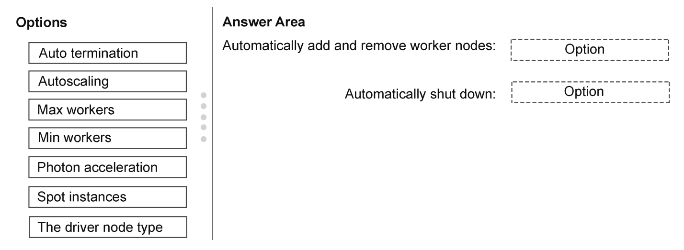

_DRAG DROP — the original ExamTopics question expects you to drag and drop items; the correct targets are not published._

**Most voted:** Autoscaling / Auto Termination

### Top explanations
- **JackJung** (3 upvotes [Most Recent]): Correct answer
  Autoscaling / Auto Termination

## Q1.4 (ID 416908)

You have an Azure Databricks workspace that is attached to a Unity Catalog metastore named metastore1, metastore1 contains a catalog named catalog1.
You need to create a new schema named schema2 that meets the following requirements:
Is contained in catalog1
Uses abfss://
[email protected]
/data as the managed location
Which SQL statement should you execute?

⭕ **A.** CREATE SCHEMA catalog1.schema2 LOCATION ‘abfss:// [email protected] /data’;
✅ **B.** CREATE SCHEMA catalog1.schema2 MANAGED LOCATION ‘abfss:// [email protected] /data’;
⭕ **C.** CREATE CATALOG schema2 MANAGED LOCATION ‘abfss:// [email protected] /data’;
⭕ **D.** CREATE SCHEMA catalog1.schema2 WITH DBPROPERTIES (LOCATION-’abfss:// [email protected] /data’);

**Correct answer:** B
**Most voted:** B

### Top explanations
- **JackJung** (4 upvotes [Most Recent, Selected Answer: B]): The reference URL is https://learn.microsoft.com/en-us/azure/databricks/sql/language-manual/sql-ref-syntax-ddl-create-schema

## Q1.5 (ID 417034)

You have an Azure Databricks workspace named Workspace1.
You create a compute cluster named Cluster1 that will be used to ingest data.
You need to install the required libraries on Cluster1. The solution must use Unity Catalog for access control.
What should you do?

⭕ **A.** Install the libraries by using pip3.
⭕ **B.** Create a custom dependency management script and run the script from a Databricks notebook.
✅ **C.** Upload the libraries to Workspace1 and install the libraries on Cluster1.
⭕ **D.** Install the libraries on Cluster1 and manually restart the cluster.

**Correct answer:** C
**Most voted:** C

### Top explanations
- **BJHardick** (3 upvotes [Most Recent, Selected Answer: C]): By uploading the library to the workspace (or a UC-governed location) and installing it on the cluster, library access can be governed and managed consistently with Unity Catalog controls.
- **dgerok** (2 upvotes [Selected Answer: C]): When using Unity Catalog, Databricks recommends managing libraries as workspace files/volumes and installing them on the cluster rather than using ad hoc pip install commands on cluster nodes. This provides governed, reusable library management compatible with Unity Catalog access control.

## Q1.6 (ID 417035)

DRAG DROP
You have an Azure Databricks workspace that is enabled for Unity Catalog and contains a catalog named finance, finance contains two schemas named default and procurement.
You need to create a table named assets in the procurement schema, assets must contain the following columns:
asset_id
asset_type
asset_name
How should you complete the SQL statement? To answer, drag the appropriate values to the correct targets. Each value may be used once, more than once, or not at all. You may need to drag the split bar between panes or scroll to view content.
NOTE: Each correct selection is worth one point.

**Exhibits**
- Exhibit 1: 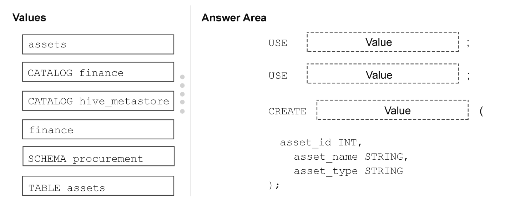

_DRAG DROP — the original ExamTopics question expects you to drag and drop items; the correct targets are not published._

**Most voted:** Provided answer is correct: USE CATALOG finance, USE SCHEM procurement, CREATE TABLE assets

### Top explanations
- **dgerok** (1 upvotes [Most Recent]): Provided answer is correct: USE CATALOG finance, USE SCHEM procurement, CREATE TABLE assets

## Q1.7 (ID 417036)

You have an Azure Databricks workspace that contains an all-purpose cluster named Cluster1.
You need to configure Cluster1 to meet the following requirements:
Scale up automatically when workloads increase
Scale down automatically when workloads decrease
Minimize costs
Which two actions should you perform? Each correct answer presents part of the solution.
NOTE: Each correct selection is worth one point.

⭕ **A.** Disable Photon acceleration.
✅ **B.** Enable autoscaling for Cluster1.
⭕ **C.** Apply a compute policy that enables users to manage the cluster settings.
⭕ **D.** Specify a fixed number of workers.
✅ **E.** Configure Cluster1 to terminate after 30 minutes of inactivity.

**Correct answer:** B, E
**Most voted:** BE

### Top explanations
- **dgerok** (2 upvotes [Most Recent, Selected Answer: BE]): A (Disable Photon) is a distraction:
  It may reduce DBU cost in some cases.
  But it can also increase runtime, potentially increasing total cost.
  Only B (Autoscaling) directly satisfies the scaling requirements, and E (Auto termination) directly reduces idle costs.
  So, the correct answer is B + E
- **mtc9** (1 upvotes [Selected Answer: AB]): I would pick disable photon for cost minimizing requirement, but autotermination also meets it.

## Q1.8 (ID 417037)

You have an Azure Databricks workspace that is enabled for Unity Catalog.
You have an Apache Spark Structured Streaming job that writes data to a Delta table.
After the cluster restarts, the streaming job reprocesses previously ingested data.
You need to prevent the streaming job from reprocessing the data after the cluster restarts.
What should you do?

✅ **A.** Configure a checkpoint location for the streaming query.
⭕ **B.** Increase the trigger interval of the streaming query.
⭕ **C.** Enable change data feed (CDF) for the target table.
⭕ **D.** Configure a watermark for the streaming query.

**Correct answer:** A
**Most voted:** A

### Top explanations
- **BJHardick** (7 upvotes [Most Recent, Highly Voted, Selected Answer: A]): Correct. A
  A checkpoint stores the streaming query progress (offsets/state). After a restart, Spark resumes from the last processed point instead of reprocessing old data.
  Why others are not:
  B. Increase trigger interval — Only changes how often data is processed; it does not track progress.
  C. Enable CDF — Tracks table changes; it does not prevent streaming source reprocessing.
  D. Configure a watermark — Handles late data and state cleanup; it does not provide restart recovery.

## Q1.9 (ID 417038)

HOTSPOT
You have an Azure Databricks workspace that is enabled for Unity Catalog and contains a managed Delta table named Table1.
Table1 is written by batch jobs every hour and is queried frequently by filtering two columns named CustomerId and EventDate.
You expect Table1 to grow significantly over time.
The rows in Table1 are frequently updated and deleted to support compliance requests.
You need to keep query performance consistent as Table1 grows. The solution must minimize update and deletion effort.
What should you include in the solution? To answer, select the appropriate options in the answer area.
NOTE: Each correct selection is worth one point.

**Exhibits**
- Exhibit 1: 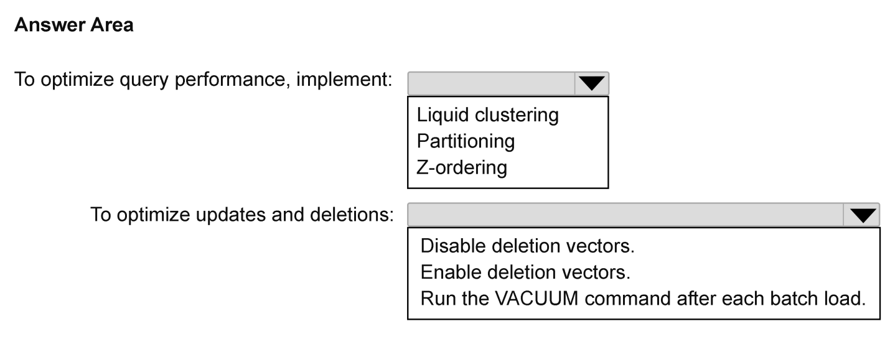

_HOTSPOT — the original ExamTopics question expects you to mark areas on the exhibit above; the correct hotspot coordinates are not published._

**Most voted:**
- -Optimize query performance: Liquid clustering
- -Optimize updates and deletions: Enable deletion vectors

### Top explanations
- **dgerok** (3 upvotes [Most Recent]): -Optimize query performance: Liquid clustering
  -Optimize updates and deletions: Enable deletion vectors
  Liquid clustering is the modern Databricks recommendation for large, growing Delta tables. It maintains data layout automatically and avoids the maintenance overhead of partitioning and repeated Z-Ordering. It works well when queries frequently filter on columns such as CustomerId and EventDate.
  Deletion vectors allow UPDATE, DELETE, and MERGE operations without rewriting entire data files, significantly reducing effort and improving performance for frequent modifications.
  Why not the others?
  Partitioning can lead to skew and requires more maintenance as the table grows.
  Z-Ordering requires periodic OPTIMIZE ZORDER BY.
  Disable deletion vectors does the opposite of what's needed.
  VACUUM after every batch load is unnecessary and doesn't optimize updates/deletes.
  Answer: Liquid clustering + Enable deletion vectors.

## Q1.10 (ID 417039)

You have an Azure Databricks workspace that contains a cluster named Cluster1.
Performance monitoring shows that Cluster1 is consistently overprovisioned for its batch workload:
CPU utilization remains below 20 percent, including peak processing periods.
The workload is highly predictable and does not spike.
The current node type already meets the workload requirements.
You need to reduce compute costs without increasing job duration.
What should you do?

⭕ **A.** Enable Photon acceleration.
⭕ **B.** Configure Cluster1 to use a larger node type.
⭕ **C.** Decrease the autotermination timeout of Cluster1.
✅ **D.** Disable autoscaling and reduce the number of worker nodes.

**Correct answer:** D
**Most voted:** D

### Top explanations
- **dgerok** (2 upvotes [Most Recent, Selected Answer: D]): D. Disable autoscaling and reduce the number of worker nodes
  The cluster is consistently overprovisioned.
  CPU utilization stays below 20% even at peak.
  The workload is predictable and does not spike.

## Q1.11 (ID 417040)

You have an Azure Databricks workspace.
You are creating a Lakeflow Spark Declarative Pipelines (SDP) pipeline that scales automatically.
You need to configure compute for the pipeline. The solution must minimize operational costs and administrative effort.
What should you use?

✅ **A.** serverless compute
⭕ **B.** a single-node, all-purpose cluster
⭕ **C.** an all-purpose cluster that uses autoscaling
⭕ **D.** an existing SQL warehouse
⭕ **E.** a job cluster that uses autoscaling

**Correct answer:** A
**Most voted:** A

### Top explanations
- **dgerok** (3 upvotes [Selected Answer: A]): Lakeflow Spark Declarative Pipelines (formerly DLT) can run on serverless compute.
  If serverless is not used, Databricks provisions and manages pipeline compute for you (effectively job-like compute), rather than using an all-purpose cluster.
  The key phrase in the question is:
  "scales automatically" + "minimize operational costs and administrative effort"
  That strongly points to:
  A. Serverless compute
  because:
  automatic scaling
  no cluster management
  Databricks manages the infrastructure
- **mtc9** (2 upvotes [Selected Answer: E]): Serverless indeed eliminates administrative effort, but it's for ad-hoc operations. Constantly running (lakeflow is usually for streaming), would no way reduce costs, I would use a job cluster for that.
- **Raja419** (1 upvotes [Most Recent, Selected Answer: A]): For Lakeflow SDP pipelines, remember:
  - Serverless compute = Minimum management + automatic scaling.
  - Classic compute = More control over infrastructure, but more administration.

## Q1.12 (ID 417041)

You have an Azure Databricks solution that was developed by multiple engineers and deployed to development, test, and production environments.
You need to implement an application lifecycle management (ALM) process that meets the following requirements:
Deploys and provides source control for Databricks notebooks, workflows, and jobs in a consistent and repeatable way
Parameterizes the target deployment environment
What should you include in the solution?

⭕ **A.** the export and import of Databricks workspaces
⭕ **B.** Databricks resources managed by using the Databricks Terraform provider
⭕ **C.** Git folders and manual promotion
✅ **D.** Declarative Automation Bundles in Git

**Correct answer:** D
**Most voted:** D

### Top explanations
- **dgerok** (4 upvotes [Most Recent, Selected Answer: D]): D. Declarative Automation Bundles in Git (Databricks Asset Bundles)
  Provides source control in Git.
  Supports consistent, repeatable deployments across dev/test/prod.
  Supports environment parameterization through target configurations.
  Deploys notebooks, jobs, workflows, pipelines, and other Databricks resources as code.

## Q1.13 (ID 417042)

HOTSPOT
You have an Azure Databricks workspace that contains a cluster named Cluster1.
Cluster1 has the following characteristics:
Configured as a single node cluster
Uses a general purpose virtual machine node type
The cluster runtime environment has the following configurations:
Uses Databricks Runtime for Machine Learning (Databricks Runtime ML)
Includes common machine learning libraries
Supports Python workloads
For each of the following statements, select Yes if the statement is true. Otherwise, select No.
NOTE: Each correct selection is worth one point.

**Exhibits**
- Exhibit 1: 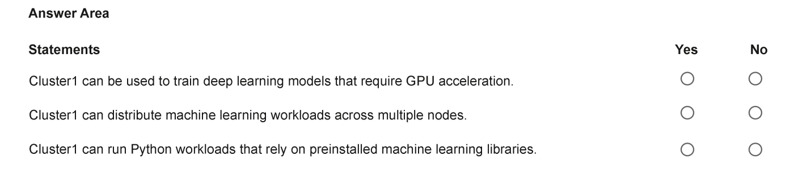

_HOTSPOT — the original ExamTopics question expects you to mark areas on the exhibit above; the correct hotspot coordinates are not published._

**Most voted:**
- GPU acceleration → No
- Distribute workloads across multiple nodes → No
- Run Python ML workloads → Yes

### Top explanations
- **dgerok** (2 upvotes [Most Recent]): GPU acceleration → No
  The cluster uses a general-purpose VM node type, not a GPU-enabled VM.
  Distribute workloads across multiple nodes → No
  It's configured as a single-node cluster, so there are no worker nodes available for distributed training.
  Run Python ML workloads → Yes
  It uses Databricks Runtime ML, which includes common ML libraries and supports Python workloads.

## Q1.14 (ID 417043)

You have an Azure Databricks workspace that contains the objects shown in the following table.
Users often use the following words to refer to a sale: transaction, event, order, and invoice.
You need to create a knowledge store. The solution must ensure that when the users use any of the words in Space1, Genie queries the Sales1 table. Any other Genie spaces must remain unaffected.
To which object should you add the instructions?

**Exhibits**
- Exhibit 1: 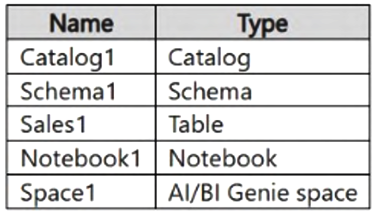

⭕ **A.** Sales1
⭕ **B.** Schema1
✅ **C.** Space1
⭕ **D.** Catalog1
⭕ **E.** Notebook1

**Correct answer:** C
**Most voted:** C

### Top explanations
- **dgerok** (1 upvotes [Most Recent, Selected Answer: C]): The question is about creating a knowledge store and custom instructions/synonyms for Genie so that terms like transaction, event, order, and invoice are interpreted as sales and cause queries to use Sales1.
  These instructions are configured at the AI/BI Genie space level, not on the table, schema, catalog, or notebook.
  The requirement that other Genie spaces remain unaffected is the key clue. Adding the instructions to Space1 scopes the behavior only to that Genie space.
  Answer: C. Space1

## Q1.15 (ID 428267)

You manage Declarative Automation Bundles by using the Databricks CLI.
You run the following command in a terminal window.
databricks bundle init
What occurs when you run the command?

⭕ **A.** The bundle configuration is validated.
✅ **B.** A new Declarative Automation Bundles project structure is created.
⭕ **C.** Bundle-defined resources are deployed to the Databricks workspace.
⭕ **D.** Jobs or pipelines defined in the bundle are run.

**Correct answer:** B
**Most voted:** B

### Top explanations
- **Raja419** (1 upvotes [Most Recent, Selected Answer: B]): bundle init ->	Initialize project
  bundle validate	-> Validate configuration
  bundle deploy -> Deploy resources
  bundle run	-> Run a resource

## Q1.16 (ID 428108)

HOTSPOT
Overview
Company Information
Contoso, Inc. is a renewable energy provider that operates solar and wind farms across North America.
Existing Environment
Azure Environment
Contoso has a single Azure Databricks workspace named Workspace1 in the West US Azure region. Workspace1 is enabled for Unity Catalog.
Workspace1 contains all-purpose clusters for both development and production workloads.
The company's Azure environment contains:
•	In the West US, Central US, and East US Azure regions, Azure event hubs that stream telemetry data and an Azure Data Lake Storage Gen2 account in each region for each hub
•	A single Azure SQL database in the West US region that hosts enterprise resource planning (ERP) data
•	An Azure Database for PostgreSQL server in the West US region that stores operational maintenance data
Data Environment
Contoso ingests the following operational and business data:
•	Telemetry data: More than 40,000 IoT sensors across 28 sites emit JSON telemetry events every few seconds. Each site sends the events to the nearest event hub, which writes the data into the corresponding Data Lake Storage Gen2 account. These files frequently experience schema drift.
•	Maintenance logs: Maintenance systems generate historical repair logs, daily incremental updates, technician notes, and unstructured attachments that are stored in the Data Lake Storage Gen2 accounts.
•	Operational maintenance data: Structured operational maintenance data is stored on the Azure Database for PostgreSQL server.
•	External weather data: Hourly weather forecasts are retrieved from a REST API and written to the Data Lake Storage Gen2 accounts.
•	ERP data: Daily CSV extracts of 50 to 100 GB contain equipment metadata, work orders, and purchase order information.
Problem Statements
The company’s existing analytics environment has several issues:
Ingestion
•	Telemetry pipelines fall behind during peak loads.
•	Telemetry ingestion fails when schema drift occurs.
•	Streaming pipelines reprocess events after a pipeline restarts.
Compute
•	Production and development workloads run on the same all-purpose clusters.
•	Production and development workloads do NOT support autoscaling or workload isolation.
Governance
•	The ERP data is duplicated across systems and development teams.
•	Naming conventions are inconsistent across development teams, regions, and products.
•	Ownership of the IoT sensors changes over time, and analysts must track the full history of the ownership.
•	Occasionally, equipment manufacturers must correct data-entry mistakes in equipment names. Historical values are NOT required.
Pipeline operations
•	Pipelines lack resiliency, alerting, and centralized scheduling.
Requirements
Planned Changes
Contoso plans to implement the following changes:
•	Implement scalable data pipeline orchestration.
•	Create a managed analytics catalog in Unity Catalog.
•	Implement a consistent approach to creating curated datasets.
•	Establish a centralized governance model across ingestion, cleansed, and curated layers.
•	Grant data engineers access to the ERP tables by using minimal development effort.
•	Adopt a compute strategy that isolates production workloads and supports autoscaling.
•	Adopt a slowly changing dimension (SCD) approach to address current data modeling issues.
Technical Requirements
Contoso identifies the following environment and compute requirements:
•	Ensure that production ingestion workloads run on compute clusters that can scale automatically during telemetry spikes.
•	Provide fast and consistent performance for business intelligence (BI) workloads.
•	Prevent development activity from affecting production pipelines.
•	Production ingestion workloads must run as scheduled, non-interactive pipelines rather than on shared interactive development clusters.
Contoso identifies the following data ingestion and processing requirements:
•	Auto-scale ingestion pipelines to handle bursty workloads.
•	Handle schema drift for the maintenance and telemetry data.
•	Ingest file-based telemetry data by using minimal operational effort.
•	Store all the ingested data in a format that supports incremental processing.
•	Support the continuous ingestion of telemetry data from the event hubs by using exactly-once semantics.
•	Support the ingestion of the structured maintenance data from the Azure Database for PostgreSQL server.
•	Build a new telemetry pipeline that ingests raw events from the event hubs, cleanses the data, and publishes curated tables to Unity Catalog.
•	Ensure that the Apache Spark Structured Streaming pipelines reading from the event hubs write the data into a managed Delta table named telemetry.raw_events. The pipelines must support schema drift and resume processing after failures without reprocessing the data.
Contoso identifies the following data modeling and optimization requirements:
•	Build curated tables that standardize business logic.
•	Overwrite equipment metadata attributes, such as name, manufacturer, model, and commissioning date, when the attributes change. Historical values are NOT required.
Contoso identifies the following pipeline deployment and operation requirements:
•	Orchestrate multi-step ingestion and transformation workflows.
•	Define a clear execution order and dependencies.
•	Automatically retry failed steps and notify operators.
•	Schedule ingestion and transformation workloads consistently.
Governance Requirements
Contoso identifies the following governance requirements:
•	Centralize the metadata catalog.
•	Provide isolated development areas that follow standard naming conventions.
•	Establish a consistent structure for organizing raw, cleansed, and curated data.
•	Provide a read-only mechanism to reference the ERP data through a foreign catalog.
Business Requirements
Contoso identifies the following business requirements:
•	Improve ingestion reliability and reduce operational effort.
•	Standardize data definitions across development teams.
You need to recommend a compute type for the production ingestion workloads and BI workloads. The solution must meet the environment and compute requirements.
What should you recommend for each type of workload? To answer, select the appropriate options in the answer area.
NOTE: Each correct selection is worth one point.

**Exhibits**
- Exhibit 1: 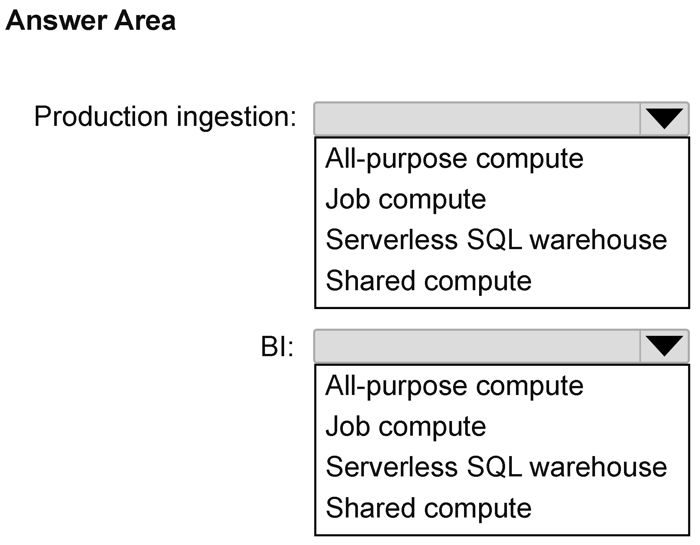

_HOTSPOT — the original ExamTopics question expects you to mark areas on the exhibit above; the correct hotspot coordinates are not published._

**Most voted:**
- Production ingestion: Jobs compute with autoscaling
- BI workloads: SQL warehouses

### Top explanations
- **Raja419** (1 upvotes [Most Recent]): 1. Production ingestion: Jobs compute with autoscaling
  - Runs scheduled, non-interactive workloads.
  - Supports automatic scaling during telemetry spikes.
  - Isolates production workloads from development activities.
  - Avoids using shared all-purpose clusters.
  - Integrates with job orchestration and retry mechanisms.
  2. BI workloads: SQL warehouses
  - Designed for SQL queries and BI workloads.
  - Provides fast and consistent query performance.
  - Serverless SQL warehouses reduce infrastructure administration.
  - Supports BI integrations such as Power BI.

## Q2.1 (ID 417044)

Overview
Company Information
Contoso, Inc. is a renewable energy provider that operates solar and wind farms across North America.
Existing Environment
Azure Environment
Contoso has a single Azure Databricks workspace named Workspace1 in the West US Azure region. Workspace1 is enabled for Unity Catalog.
Workspace1 contains all-purpose clusters for both development and production workloads.
The company's Azure environment contains:
In the West US, Central US, and East US Azure regions, Azure event hubs that stream telemetry data and an Azure Data Lake Storage Gen2 account in each region for each hub
A single Azure SQL database in the West US region that hosts enterprise resource planning (ERP) data
An Azure Database for PostgreSQL server in the West US region that stores operational maintenance data
Data Environment
Contoso ingests the following operational and business data:
Telemetry data: More than 40,000 IoT sensors across 28 sites emit JSON telemetry events every few seconds. Each site sends the events to the nearest event hub, which writes the data into the corresponding Data Lake Storage Gen2 account. These files frequently experience schema drift.
Maintenance logs: Maintenance systems generate historical repair logs, daily incremental updates, technician notes, and unstructured attachments that are stored in the Data Lake Storage Gen2 accounts.
Operational maintenance data: Structured operational maintenance data is stored on the Azure Database for PostgreSQL server.
External weather data: Hourly weather forecasts are retrieved from a REST API and written to the Data Lake Storage Gen2 accounts.
ERP data: Daily CSV extracts of 50 to 100 GB contain equipment metadata, work orders, and purchase order information.
Problem Statements
The company’s existing analytics environment has several issues:
Ingestion
Telemetry pipelines fall behind during peak loads.
Telemetry ingestion fails when schema drift occurs.
Streaming pipelines reprocess events after a pipeline restarts.
Compute
Production and development workloads run on the same all-purpose clusters.
Production and development workloads do NOT support autoscaling or workload isolation.
Governance
The ERP data is duplicated across systems and development teams.
Naming conventions are inconsistent across development teams, regions, and products.
Ownership of the IoT sensors changes over time, and analysts must track the full history of the ownership.
Occasionally, equipment manufacturers must correct data-entry mistakes in equipment names. Historical values are NOT required.
Pipeline operations
Pipelines lack resiliency, alerting, and centralized scheduling.
Requirements
Planned Changes
Contoso plans to implement the following changes:
Implement scalable data pipeline orchestration.
Create a managed analytics catalog in Unity Catalog.
Implement a consistent approach to creating curated datasets.
Establish a centralized governance model across ingestion, cleansed, and curated layers.
Grant data engineers access to the ERP tables by using minimal development effort.
Adopt a compute strategy that isolates production workloads and supports autoscaling.
Adopt a slowly changing dimension (SCD) approach to address current data modeling issues.
Technical Requirements
Contoso identifies the following environment and compute requirements:
Ensure that production ingestion workloads run on compute clusters that can scale automatically during telemetry spikes.
Provide fast and consistent performance for business intelligence (BI) workloads.
Prevent development activity from affecting production pipelines.
Production ingestion workloads must run as scheduled, non-interactive pipelines rather than on shared interactive development clusters.
Contoso identifies the following data ingestion and processing requirements:
Auto-scale ingestion pipelines to handle bursty workloads.
Handle schema drift for the maintenance and telemetry data.
Ingest file-based telemetry data by using minimal operational effort.
Store all the ingested data in a format that supports incremental processing.
Support the continuous ingestion of telemetry data from the event hubs by using exactly-once semantics.
Support the ingestion of the structured maintenance data from the Azure Database for PostgreSQL server.
Build a new telemetry pipeline that ingests raw events from the event hubs, cleanses the data, and publishes curated tables to Unity Catalog.
Ensure that the Apache Spark Structured Streaming pipelines reading from the event hubs write the data into a managed Delta table named telemetry.raw_events. The pipelines must support schema drift and resume processing after failures without reprocessing the data.
Contoso identifies the following data modeling and optimization requirements:
Build curated tables that standardize business logic.
Overwrite equipment metadata attributes, such as name, manufacturer, model, and commissioning date, when the attributes change. Historical values are NOT required.
Contoso identifies the following pipeline deployment and operation requirements:
Orchestrate multi-step ingestion and transformation workflows.
Define a clear execution order and dependencies.
Automatically retry failed steps and notify operators.
Schedule ingestion and transformation workloads consistently.
Governance Requirements
Contoso identifies the following governance requirements:
Centralize the metadata catalog.
Provide isolated development areas that follow standard naming conventions.
Establish a consistent structure for organizing raw, cleansed, and curated data.
Provide a read-only mechanism to reference the ERP data through a foreign catalog.
Business Requirements
Contoso identifies the following business requirements:
Improve ingestion reliability and reduce operational effort.
Standardize data definitions across development teams.
You need to organize Unity Catalog. The solution must meet the governance requirements.
What should you do?

⭕ **A.** Use a single shared schema for all the development teams and rely on table-level permissions for isolation.
⭕ **B.** Enable the development teams to create objects directly in the default catalog and schema.
⭕ **C.** Create a separate catalog for each development team and enable each team to choose its own schema names.
✅ **D.** Create a shared development catalog, enforce a standardized naming convention, and assign each development team its own schema.

**Correct answer:** D
**Most voted:** D

### Top explanations
- **pietjapie** (1 upvotes [Most Recent, Selected Answer: D]): D is the only option that meets all the governance requirements. A shared development catalog with a schema per team gives each team an isolated area while keeping metadata centralized, and enforcing a naming convention satisfies the standardization requirement. A and B provide no real isolation, and C lets each team choose its own schema names, which breaks the naming-convention requirement.

## Q2.2 (ID 417045)

DRAG DROP
You have an Azure Databricks workspace named Workspace1 that is attached to a Unity Catalog metastore named metastore1.
You need to register an Azure Storage account named account1 that has a hierarchical namespace enabled as an external location. The external location must use a managed identity to authenticate to account1 and the solution must follow the principle of least privilege.
Which three actions should you perform in sequence? To answer, move the appropriate actions from the list of actions to the answer area and arrange them in the correct order.

**Exhibits**
- Exhibit 1: 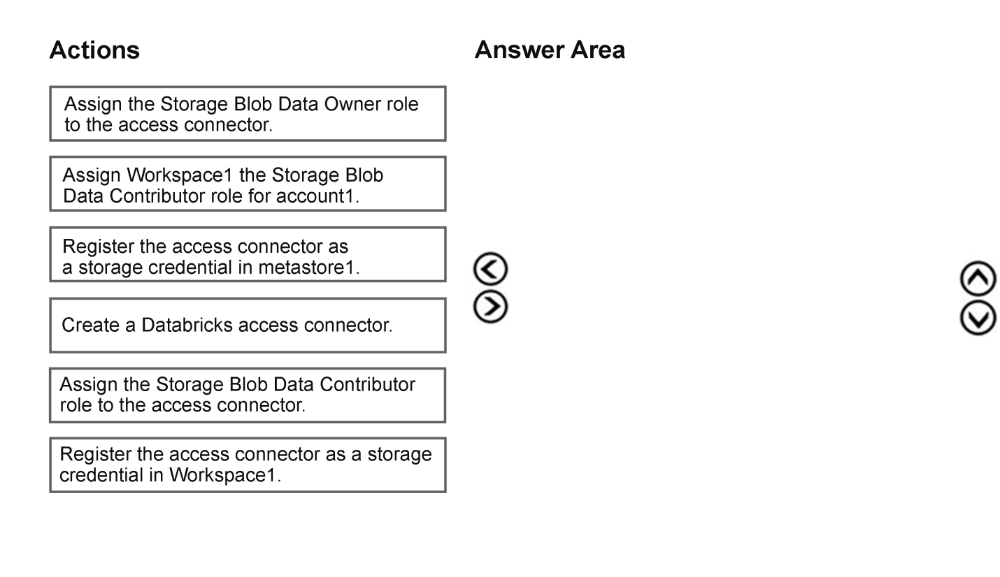

_DRAG DROP — the original ExamTopics question expects you to drag and drop items; the correct targets are not published._

**Most voted:**
1. Create a Databricks access connector
2. Assign the Storage Blob Data Contributor role to the access connector
3. Register the access connector as a storage credential in metastore1

### Top explanations
- **OliverBH** (7 upvotes [Most Recent, Highly Voted]): 1. Create a Databricks access connector
  2. Assign the Storage Blob Data Contributor role to the access connector
  3. Register the access connector as a storage credential in metastore1

## Q2.3 (ID 417046)

HOTSPOT
You have an Azure Databricks workspace that is enabled for Unity Catalog.
You need to ensure that data lineage is captured and can be reviewed for tables accessed by Databricks notebooks and jobs. The solution must minimize administrative effort.
Which compute configuration should you use to capture the data lineage and what should you use to review the data lineage? To answer, select the appropriate options in the answer area.
NOTE: Each correct selection is worth one point.

**Exhibits**
- Exhibit 1: 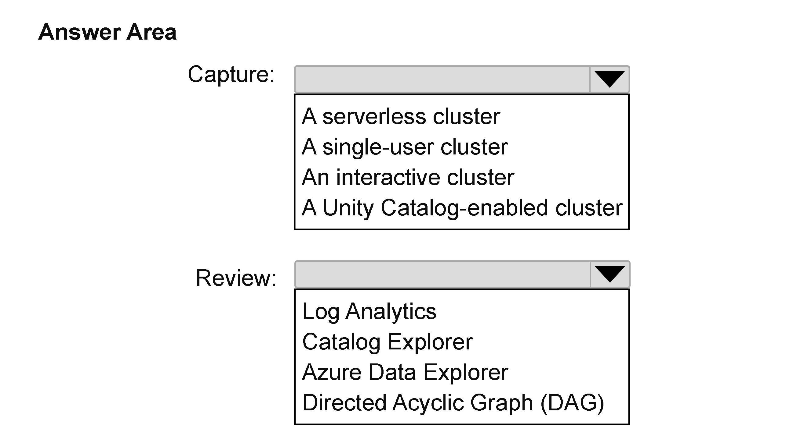

_HOTSPOT — the original ExamTopics question expects you to mark areas on the exhibit above; the correct hotspot coordinates are not published._

**Most voted:**
- Capture: A Unity Catalog-enabled cluster
- Review: Catalog Explorer

### Top explanations
- **Frazer1** (6 upvotes [Most Recent]): Correct Answers
  Capture: A Unity Catalog-enabled cluster
  Review: Catalog Explorer
  Explanation
  Capture: A Unity Catalog-enabled cluster
  Unity Catalog automatically captures lineage for:
  Notebooks
  Jobs
  SQL queries
  Delta tables
  Views
  provided the workload runs on Unity Catalog-enabled compute.
  Other options are incorrect:
  ❌ Serverless cluster: May support lineage, but lineage is not tied specifically to serverless.
  ❌ Single-user cluster: Access mode, not the lineage requirement.
  ❌ Interactive cluster: Cluster type, not the lineage requirement.
  The key requirement is that the compute is Unity Catalog-enabled.
  Review: Catalog Explorer
  Unity Catalog lineage is reviewed directly in Catalog Explorer:
- **dgerok** (5 upvotes): Capture: A Unity Catalog-enabled cluster
  Review: Catalog Explorer
  Unity Catalog automatically captures data lineage for tables accessed through notebooks, jobs, dashboards, and queries when they run on Unity Catalog-enabled compute.
  The easiest way to review lineage is in Catalog Explorer, which provides built-in lineage visualization.
- **51e3df9** (1 upvotes): Capture: Serverless,
  Unity catalog-enabled cluster cannot be correct due to the requirement to "minimize administrative effort". Serverless compute is automatically configured by Databricks
  Review: Catalog Explorer

## Q2.4 (ID 417047)

HOTSPOT
You have an Azure Databricks workspace.
You have an Azure key vault named kv-secure that stores a secret named storageKey. The value of storageKey is managed and updated by the cloud security team at your company.
You need to enable a Databricks notebook named Notebook1 to retrieve the value of storageKey securely at runtime. The solution must follow the principle of least privilege and always retrieve the latest value.
What should you do? To answer, select the appropriate options in the answer area.
NOTE: Each correct selection is worth one point.

**Exhibits**
- Exhibit 1: 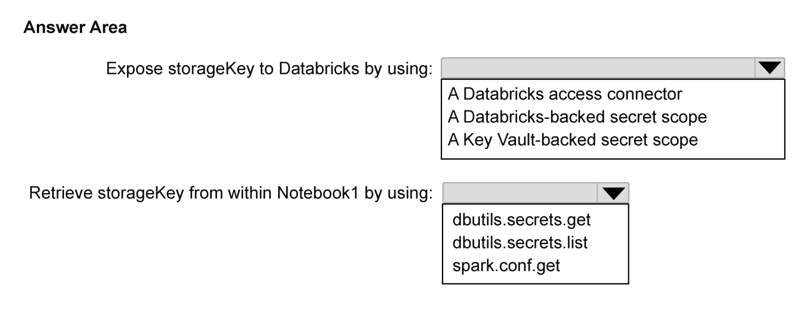

_HOTSPOT — the original ExamTopics question expects you to mark areas on the exhibit above; the correct hotspot coordinates are not published._

**Most voted:**
- create a kv backed secred scope
- dbutils.secret.get

### Top explanations
- **mtc9** (2 upvotes [Most Recent]): create a kv backed secred scope
  dbutils.secret.get

## Q2.5 (ID 417048)

HOTSPOT
You have an Azure Databricks workspace that is enabled for Unity Catalog and contains a catalog named Catalog1. Catalog1 contains a schema named Schema1 and a table named Table1.
You need to ensure that access to the data in Table1 is controlled by using attribute-based access control (ABAC).
What should you apply to Table1, and how should you control access for users? To answer, select the appropriate options in the answer area.
NOTE: Each correct selection is worth one point.

**Exhibits**
- Exhibit 1: 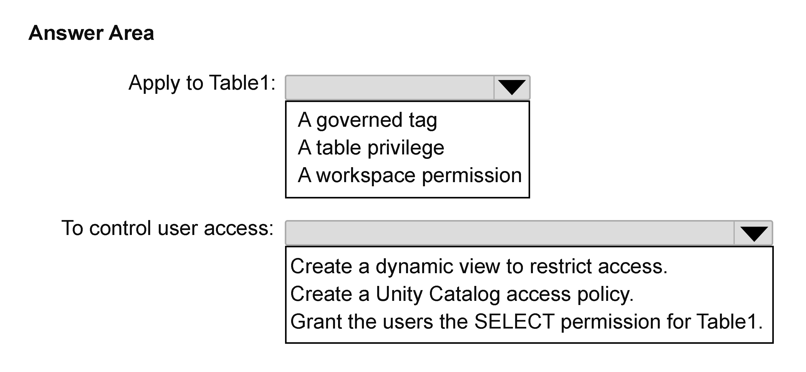

_HOTSPOT — the original ExamTopics question expects you to mark areas on the exhibit above; the correct hotspot coordinates are not published._

**Most voted:**
- Apply to Table1: A governed tag
- To control user access: Create a Unity Catalog access policy

### Top explanations
- **Frazer1** (4 upvotes [Most Recent]): Correct Answers
  Apply to Table1:  A governed tag
  To control user access: Create a Unity Catalog access policy
  Explanation
  Attribute-Based Access Control (ABAC) in Unity Catalog works by:
  Applying governed tags to securable objects (tables, columns, schemas, catalogs).
  Creating ABAC policies (access policies) that evaluate those tags and determine what data users can access.

## Q2.6 (ID 417049)

HOTSPOT
You have an Azure Databricks workspace that is enabled for Unity Catalog.
You need to implement a data lifecycle and expiration solution that meets the following requirements:
Transaction logs and deleted data files that are older than 90 days must be removed from Delta tables to reclaim storage.
All the tables must remain available for querying during the cleanup process.
Administrative effort must be minimized.
What should you do for each requirement? To answer, select the appropriate options in the answer area.
NOTE: Each correct selection is worth one point.

**Exhibits**
- Exhibit 1: 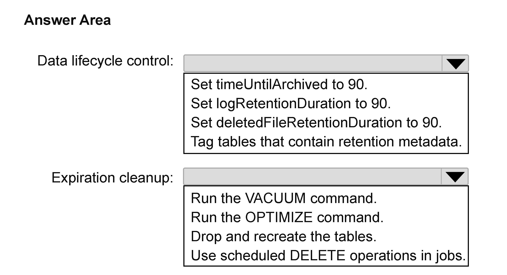

_HOTSPOT — the original ExamTopics question expects you to mark areas on the exhibit above; the correct hotspot coordinates are not published._

**Most voted:** In real Delta Lake, you could argue that logRetentionDuration is needed because the requirement also mentions transaction logs. However, since the second dropdown only offers cleanup mechanisms and the first dropdown allows selecting only one property, Microsoft exams typically expect the property that enables reclaiming storage from deleted files...

### Top explanations
- **dgerok** (2 upvotes): In real Delta Lake, you could argue that logRetentionDuration is needed because the requirement also mentions transaction logs. However, since the second dropdown only offers cleanup mechanisms and the first dropdown allows selecting only one property, Microsoft exams typically expect the property that enables reclaiming storage from deleted files (deletedFileRetentionDuration) together with VACUUM.
- **zxc01** (2 upvotes [Most Recent]): for data lifecycle control, we should set both delta.deletedFileRetentionDuration and delta.logRetentionDuration to 90 because both of them cannot match default value. However, it just can choose one option.

## Q2.7 (ID 417050)

You have an Azure Databricks workspace that is enabled for Unity Catalog and contains a managed Delta table named Table1. Table1 stores customer data.
You need to implement a data retention solution that meets the following requirements:
Deleted data must be retained for 30 days to support audits.
Deleted data that is older than 30 days must be removed permanently.
The solution must minimize administrative effort
Which two properties should you configure? Each correct answer presents part of the solution.
NOTE: Each correct selection is worth one point.

⭕ **A.** delta.timeUntilArchived
⭕ **B.** delta.enableDeletionVectors
✅ **C.** delta.logRetentionDuration
✅ **D.** delta.deletedFileRetentionDuration
⭕ **E.** delta.autoOptimize.autoCompact

**Correct answer:** C, D
**Most voted:** CD

### Top explanations
- **Abhi_007** (4 upvotes [Selected Answer: CD]): delta.logRetentionDuration controls how long transaction history/logs are retained (default 30 days).
  delta.deletedFileRetentionDuration controls how long deleted data files are retained before they become eligible for permanent removal by VACUUM (default 7 days). Setting it to 30 days supports the audit retention requirement.
- **JudgeMaster** (2 upvotes [Selected Answer: CD]): The two properties you should configure are C. delta.logRetentionDuration and D. delta.deletedFileRetentionDuration.
  Explanation
  Delta Lake manages its data retention and historical point-in-time querying (time travel) using two interrelated table properties:
  • delta.deletedFileRetentionDuration: This property determines how long physically deleted data files (from operations like DELETE or MERGE) are kept before they are eligible for permanent removal by a VACUUM operation. Setting this to 30 days satisfies the auditing constraint by ensuring data files are not removed prematurely.
  • delta.logRetentionDuration: This property dictates how long the table's transaction log (commit history) is kept. To query data as it existed up to 30 days ago for auditing purposes, the log must also be preserved for at least 30 days to re-construct historical states.
- **zxc01** (2 upvotes): enableDeletionVectors to true will mark changes to rows as soft-deletes that logically modify existing Parquet data files in the table. marked files will be kept forever until you execute REORG TABLE.  you still can query deleted data by SELECT * FROM my_table VERSION AS OF version number. question said you must confirm order than 30days data has been dropped and minimize admin.
- **zxc01** (2 upvotes [Selected Answer: BD]): It should be B and D. deletedFileRetentionDuration default value is 7 days, you should change it to 30 days. logRetentionDuration default setting is 30 days, you don't need change it. enableDeletionVectors default setting to true which means keep deleted data until you REORG table. you should change it to false.
- **Raja419** (1 upvotes [Most Recent, Selected Answer: CD]): C. delta.logRetentionDuration
  - Controls how long the Delta transaction log history is retained.
  - Default is 30 days.
  - Supports audit requirements by retaining table history.
  D. delta.deletedFileRetentionDuration
  - Controls how long deleted data files are retained before they can be physically removed.
  - Set it to 30 days.
  - After 30 days, VACUUM can permanently remove the obsolete data files.

## Q2.10 (ID 417053)

HOTSPOT
You have an Azure Databricks workspace that is enabled for Unity Catalog and contains a catalog named catalog1.
You have a group named group1.
You plan to create a schema named schema1 in catalog1.
You need to ensure that group1 meets the following requirements:
Can create tables in schema1
Can modify and query tables
Cannot grant permissions for the schema and its objects
How should you complete the SQL statements? To answer, select the appropriate options in the answer area.
NOTE: Each correct selection is worth one point.

**Exhibits**
- Exhibit 1: 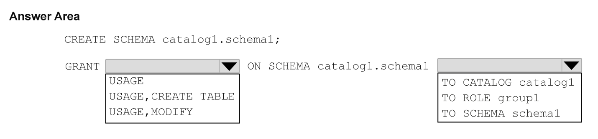

_HOTSPOT — the original ExamTopics question expects you to mark areas on the exhibit above; the correct hotspot coordinates are not published._

**Most voted:**
- Can create tables → needs CREATE TABLE
- Can query tables → needs USAGE on the schema (and later SELECT on tables)
- Can modify tables → table owners can modify their own tables after creating them
- Cannot grant permissions → do not grant MANAGE/OWNERSHIP

### Top explanations
- **dgerok** (3 upvotes): GRANT USAGE, CREATE TABLE
  ON SCHEMA catalog1.schema1
  TO ROLE group1;
  Can create tables → needs CREATE TABLE
  Can query tables → needs USAGE on the schema (and later SELECT on tables)
  Can modify tables → table owners can modify their own tables after creating them
  Cannot grant permissions → do not grant MANAGE/OWNERSHIP
- **zxc01** (2 upvotes [Most Recent]): I cannot understand this answer, question ask create table, modify and query tables. It should grant usage,create table,modify and select. I cannot get any correct option in first list.

## Q2.11 (ID 417054)

HOTSPOT
You have an Azure Databricks workspace that is enabled for Unity Catalog.
You need to create an external volume named Volume1 in an existing schema. Volume1 must expose files from an Azure Storage container. The solution must meet the following requirements:
Ensure that authentication does NOT require storing credentials in Databricks.
Ensure that users can access the files, but NOT modify the files.
Follow the principle of least privilege.
Which type of authentication should you configure, and which permission should you grant to the users? To answer, select the appropriate options in the answer area.
NOTE: Each correct selection is worth one point.

**Exhibits**
- Exhibit 1: 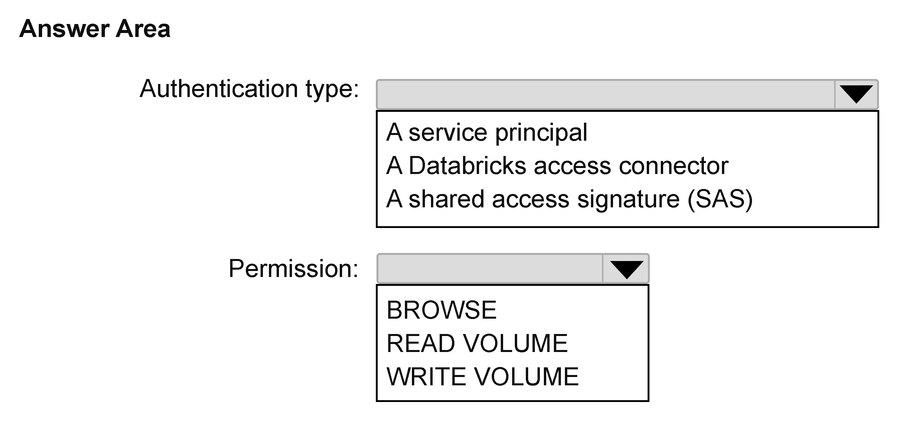

_HOTSPOT — the original ExamTopics question expects you to mark areas on the exhibit above; the correct hotspot coordinates are not published._

**Most voted:**
- Databricks Access connector: It uses an Azure managed identity, so no secrets or tokens are stored in Databricks. A service principal requires a client secret, and a SAS requires a token, so both fail the “no stored credentials” requirement.
- READ VOLUME: It lets users read and list the files in the volume without modifying them. WRITE VOLUME would allow changes, which violates the requirement. BROWSE only lets users see the volume’s metadata in the catalog, not read its files, so it doesn’t give them access to the files.

### Top explanations
- **Pranav Neharkar** (2 upvotes [Most Recent]): Databricks Access connector: It uses an Azure managed identity, so no secrets or tokens are stored in Databricks. A service principal requires a client secret, and a SAS requires a token, so both fail the “no stored credentials” requirement.
  READ VOLUME: It lets users read and list the files in the volume without modifying them. WRITE VOLUME would allow changes, which violates the requirement. BROWSE only lets users see the volume’s metadata in the catalog, not read its files, so it doesn’t give them access to the files.
- **zxc01** (2 upvotes): The first question ask authentication type which Azure Databricks Access Connector is not authentication. It should be managed identity. However I cannot get it in list. service principal is possible solution.
- **Pranav Neharkar** (1 upvotes): Databricks Access connector: It uses an Azure managed identity, so no secrets or tokens are stored in Databricks. A service principal requires a client secret, and a SAS requires a token, so both fail the “no stored credentials” requirement.
  READ VOLUME: It lets users read and list the files in the volume without modifying them. WRITE VOLUME would allow changes, which violates the requirement. BROWSE only lets users see the volume’s metadata in the catalog, not read its files, so it doesn’t give them access to the files.

## Q2.12 (ID 417055)

Note: This section contains one or more sets of questions with the same scenario and problem. Each question presents a unique solution to the problem. You must determine whether the solution meets the stated goals. More than one solution in the set might solve the problem. It is also possible that none of the solutions in the set solve the problem.
After you answer a question in this section, you will NOT be able to return. As a result, these questions do not appear on the Review Screen.
You have an Azure Databricks workspace named Workspace1 that contains a lakehouse and is enabled for Unity Catalog.
You have a connection to a Microsoft SQL Server database named DB1.
You need to expose the schemas and tables of DB1 to meet the following requirements:
The schemas and tables can be queried in Databricks.
The schemas and tables appear alongside other Unity Catalog objects.
The data is NOT copied into Databricks-managed storage.
Solution: You create a Lakeflow Connect pipeline and connect it to DB1.
Does this meet the goal?

⭕ **A.** Yes
✅ **B.** No

**Correct answer:** B
**Most voted:** B

### Top explanations
- **dgerok** (2 upvotes [Most Recent, Selected Answer: B]): B. No
  The requirement says:
  Tables must be queryable in Databricks
  Objects must appear alongside Unity Catalog objects
  Data must NOT be copied into Databricks-managed storage !!!
  A Lakeflow Connect pipeline ingests/replicates data from Microsoft SQL Server into Databricks-managed Delta tables. That means the data is copied into Databricks storage.
- **dgerok** (1 upvotes [Selected Answer: B]): B. No
  The requirement says:
  Tables must be queryable in Databricks
  Objects must appear alongside Unity Catalog objects
  Data must NOT be copied into Databricks-managed storage !!!
  A Lakeflow Connect pipeline ingests/replicates data from Microsoft SQL Server into Databricks-managed Delta tables. That means the data is copied into Databricks storage.
- **Khan_ss** (1 upvotes [Selected Answer: B]): B.) NO: its talking about foreign catalog

## Q2.18 (ID 417061)

You have an Azure Databricks workspace that is enabled for Unity Catalog.
You have a CSV file stored in an Azure Data Lake Storage Gen2 container.
You plan to ingest the data into an existing table by running the following SQL statement.
COPY INTO Customer
FROM ‘abfss://
[email protected]
/data/customer’
FILEFORMAT = CSV
You need to ensure that the statement can access the data in the container.
What should you configure?

⭕ **A.** an external table named Customer in the CSV file format
⭕ **B.** a Lakeflow ingestion gateway
✅ **C.** an external location that uses a storage credential
⭕ **D.** a volume in a catalog

**Correct answer:** C
**Most voted:** C

### Top explanations
- **mtc9** (1 upvotes [Most Recent, Selected Answer: C]): C, all of the other solutions could access stodage in different ways, but the script is already given and it needs access to storage

## Q2.20 (ID 417063)

HOTSPOT
You have an Azure Databricks workspace that is attached to a Unity Catalog metastore named metastore1.metastore1 contains:
A catalog named Sales
A schema named Customers in the Sales catalog
A table named Customer_details in the Customers schema
You need to ensure that a user named User1 can update the data in Customer_details. The solution must meet the following requirements:
Ensure that User1 cannot create new tables.
Follow the principle of least privilege.
Which permission should you grant to User1 for each object? To answer, select the appropriate options in the answer area.
NOTE: Each correct selection is worth one point.

**Exhibits**
- Exhibit 1: 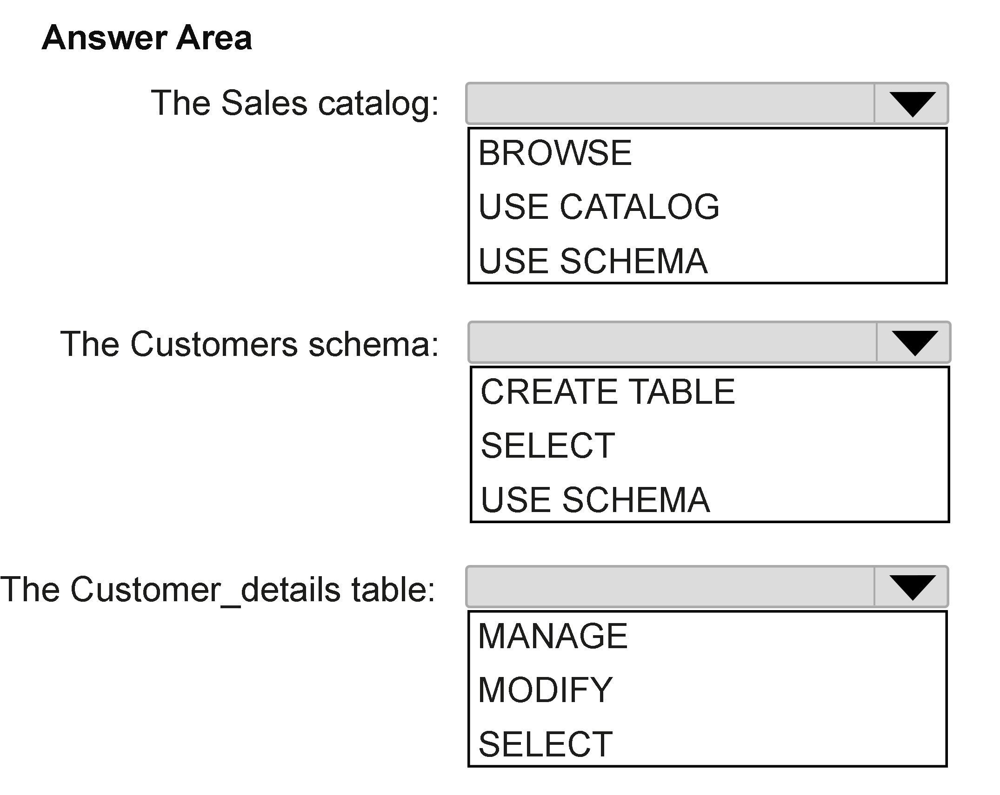

_HOTSPOT — the original ExamTopics question expects you to mark areas on the exhibit above; the correct hotspot coordinates are not published._

**Most voted:**
- the sales catalog - use catalog
- the customers schema - use schema
- the customer_details table - modify

### Top explanations
- **SarathChandra** (11 upvotes [Highly Voted]): the sales catalog - use catalog
  the customers schema - use schema
  the customer_details table - modify
- **fd21624** (4 upvotes): the sales catalog - use schema
  the customers schema - use schema
  the customer_details table - modify
  MANAGE	Ability to grant/revoke privileges on the object	Violates least privilege — User1 would gain control over others' access
  MODIFY	INSERT, UPDATE, DELETE on the table	Correct — update data without any schema/table creation rights
  SELECT	Read-only query access	Insufficient — cannot update data
- **pietjapie** (1 upvotes): The last one is select, the requirement is that User1 can update data. SELECT only allows reading, so with SELECT alone, an UPDATE statement fails with a permission error. MODIFY is the Unity Catalog privilege that allows INSERT, UPDATE, and DELETE. Without it, updating is impossible.
- **pietjapie** (1 upvotes [Most Recent]): Meant Modify*

## Q3.1 (ID 417064)

HOTSPOT
You have an Azure Databricks account that contains a single workspace named Workspace1. Workspace1 is enabled for Unity Catalog.
You discover that data access events for Unity Catalog tables fail to appear in the logs.
You need to ensure that all the data access events are captured centrally for auditing purposes. The log data must be available for analysis as quickly as possible.
What should you do?
To answer, select the appropriate options in the answer area.
NOTE: Each correct selection is worth one point.

**Exhibits**
- Exhibit 1: 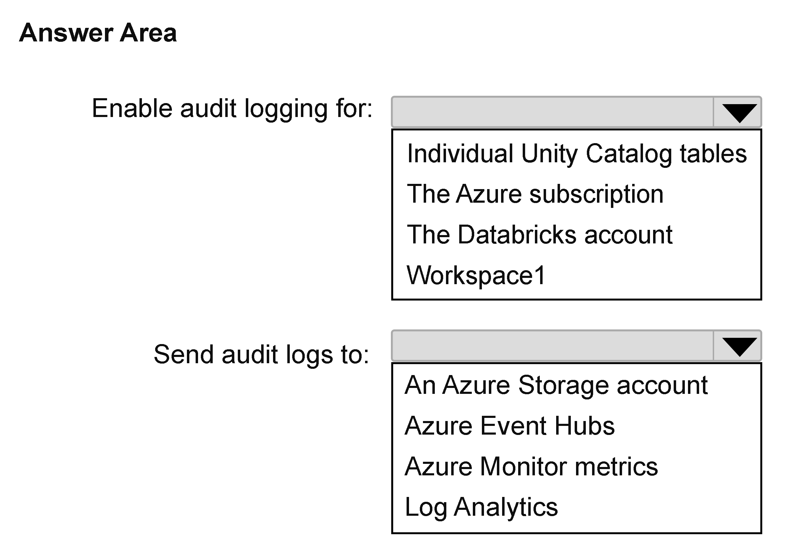

_HOTSPOT — the original ExamTopics question expects you to mark areas on the exhibit above; the correct hotspot coordinates are not published._

**Most voted:**
- workspace1
- Log Analytics

### Top explanations
- **da42cb8** (5 upvotes [Most Recent]): workspace1
  Log Analytics

## Q3.3 (ID 417066)

DRAG DROP
Overview
Company Information
Contoso, Inc. is a renewable energy provider that operates solar and wind farms across North America.
Existing Environment
Azure Environment
Contoso has a single Azure Databricks workspace named Workspace1 in the West US Azure region. Workspace1 is enabled for Unity Catalog.
Workspace1 contains all-purpose clusters for both development and production workloads.
The company's Azure environment contains:
In the West US, Central US, and East US Azure regions, Azure event hubs that stream telemetry data and an Azure Data Lake Storage Gen2 account in each region for each hub
A single Azure SQL database in the West US region that hosts enterprise resource planning (ERP) data
An Azure Database for PostgreSQL server in the West US region that stores operational maintenance data
Data Environment
Contoso ingests the following operational and business data:
Telemetry data: More than 40,000 IoT sensors across 28 sites emit JSON telemetry events every few seconds. Each site sends the events to the nearest event hub, which writes the data into the corresponding Data Lake Storage Gen2 account. These files frequently experience schema drift.
Maintenance logs: Maintenance systems generate historical repair logs, daily incremental updates, technician notes, and unstructured attachments that are stored in the Data Lake Storage Gen2 accounts.
Operational maintenance data: Structured operational maintenance data is stored on the Azure Database for PostgreSQL server.
External weather data: Hourly weather forecasts are retrieved from a REST API and written to the Data Lake Storage Gen2 accounts.
ERP data: Daily CSV extracts of 50 to 100 GB contain equipment metadata, work orders, and purchase order information.
Problem Statements
The company’s existing analytics environment has several issues:
Ingestion
Telemetry pipelines fall behind during peak loads.
Telemetry ingestion fails when schema drift occurs.
Streaming pipelines reprocess events after a pipeline restarts.
Compute
Production and development workloads run on the same all-purpose clusters.
Production and development workloads do NOT support autoscaling or workload isolation.
Governance
The ERP data is duplicated across systems and development teams.
Naming conventions are inconsistent across development teams, regions, and products.
Ownership of the IoT sensors changes over time, and analysts must track the full history of the ownership.
Occasionally, equipment manufacturers must correct data-entry mistakes in equipment names. Historical values are NOT required.
Pipeline operations
Pipelines lack resiliency, alerting, and centralized scheduling.
Requirements
Planned Changes
Contoso plans to implement the following changes:
Implement scalable data pipeline orchestration.
Create a managed analytics catalog in Unity Catalog.
Implement a consistent approach to creating curated datasets.
Establish a centralized governance model across ingestion, cleansed, and curated layers.
Grant data engineers access to the ERP tables by using minimal development effort.
Adopt a compute strategy that isolates production workloads and supports autoscaling.
Adopt a slowly changing dimension (SCD) approach to address current data modeling issues.
Technical Requirements
Contoso identifies the following environment and compute requirements:
Ensure that production ingestion workloads run on compute clusters that can scale automatically during telemetry spikes.
Provide fast and consistent performance for business intelligence (BI) workloads.
Prevent development activity from affecting production pipelines.
Production ingestion workloads must run as scheduled, non-interactive pipelines rather than on shared interactive development clusters.
Contoso identifies the following data ingestion and processing requirements:
Auto-scale ingestion pipelines to handle bursty workloads.
Handle schema drift for the maintenance and telemetry data.
Ingest file-based telemetry data by using minimal operational effort.
Store all the ingested data in a format that supports incremental processing.
Support the continuous ingestion of telemetry data from the event hubs by using exactly-once semantics.
Support the ingestion of the structured maintenance data from the Azure Database for PostgreSQL server.
Build a new telemetry pipeline that ingests raw events from the event hubs, cleanses the data, and publishes curated tables to Unity Catalog.
Ensure that the Apache Spark Structured Streaming pipelines reading from the event hubs write the data into a managed Delta table named telemetry.raw_events. The pipelines must support schema drift and resume processing after failures without reprocessing the data.
Contoso identifies the following data modeling and optimization requirements:
Build curated tables that standardize business logic.
Overwrite equipment metadata attributes, such as name, manufacturer, model, and commissioning date, when the attributes change. Historical values are NOT required.
Contoso identifies the following pipeline deployment and operation requirements:
Orchestrate multi-step ingestion and transformation workflows.
Define a clear execution order and dependencies.
Automatically retry failed steps and notify operators.
Schedule ingestion and transformation workloads consistently.
Governance Requirements
Contoso identifies the following governance requirements:
Centralize the metadata catalog.
Provide isolated development areas that follow standard naming conventions.
Establish a consistent structure for organizing raw, cleansed, and curated data.
Provide a read-only mechanism to reference the ERP data through a foreign catalog.
Business Requirements
Contoso identifies the following business requirements:
Improve ingestion reliability and reduce operational effort.
Standardize data definitions across development teams.
Which ingestion option should you recommend for each data source? To answer, drag the appropriate options to the correct data sources. Each option may be used once, more than once, or not at all. You may need to drag the split bar between panes or scroll to view content.
NOTE: Each correct selection is worth one point.

**Exhibits**
- Exhibit 1: 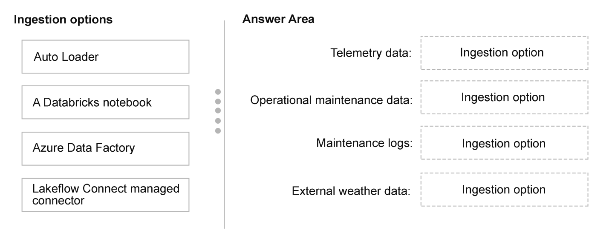

_DRAG DROP — the original ExamTopics question expects you to drag and drop items; the correct targets are not published._

**Most voted:**
- Telemetry data → Auto Loader
- Operational maintenance data → Lakeflow Connect managed connector
- Maintenance logs → Auto Loader
- External weather data → A Databricks notebook

### Top explanations
- **Frazer1** (4 upvotes): Answer
  Telemetry data → Auto Loader
  Operational maintenance data → Lakeflow Connect managed connector
  Maintenance logs → Auto Loader
  External weather data → A Databricks notebook
- **DimaH** (1 upvotes [Most Recent]): Telemetry data: Auto Loader
  Operational maintenance data: Azure Data Factory
  Maintenance logs: A Databricks notebook
  External weather data: Lakeflow Connect managed connector

## Q3.12 (ID 417075)

HOTSPOT
You have an Azure Databricks workspace that is enabled for Unity Catalog and contains a Delta table named db1.sales_orders.
db1.sales_orders is updated nightly and has change data feed (CDF) enabled.
You need to ingest all the changes from the db1.sales_orders table, including inserts, updates, and deletes, into a downstream pipeline.
How should you complete the PsySpark code segment? To answer, select the appropriate options in the answer area.
NOTE: Each correct selection is worth one point.

**Exhibits**
- Exhibit 1: 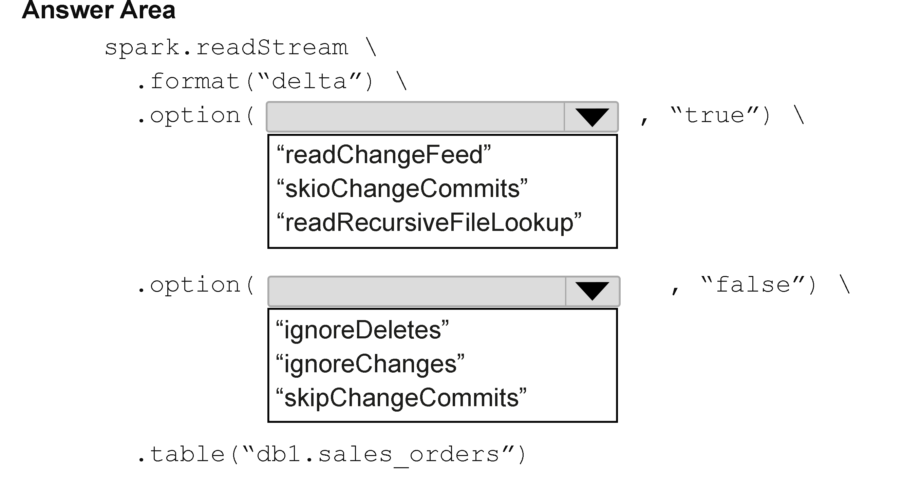

_HOTSPOT — the original ExamTopics question expects you to mark areas on the exhibit above; the correct hotspot coordinates are not published._

**Most voted:** Not provided

### Top explanations
- **zxc01** (2 upvotes [Most Recent]): it should use skipChangeCommits = false(defult setting). ignoreChanges is old setting and don't use in new versions. And setting ignoreChanges = false will conflict with readChangeFeed = true and trigger errors in stream.

## Q3.16 (ID 417079)

Note: This section contains one or more sets of questions with the same scenario and problem. Each question presents a unique solution to the problem. You must determine whether the solution meets the stated goals. More than one solution in the set might solve the problem. It is also possible that none of the solutions in the set solve the problem.
After you answer a question in this section, you will NOT be able to return. As a result, these questions do not appear on the Review Screen.
You have an Azure Databricks workspace that is enabled for Unity Catalog and contains a Delta table named Orders.
You load the Orders table into an Apache Spark DataFrame named df.
You need to create a DataFrame that excludes rows where the order amount is null.
Solution: You run the following expression.
df.dropna(subset=[“order_amount”])
Does this meet the goal?

✅ **A.** Yes
⭕ **B.** No

**Correct answer:** A
**Most voted:** A

### Top explanations
- **zxc01** (4 upvotes [Most Recent, Selected Answer: A]): It will drop rows for both null and NaN. It means null value will be dropped and match the requirement. However, in real production, must take care if we want to keep NaN values.
- **zxc01** (2 upvotes [Selected Answer: B]): It will drop rows which include null or NaN. the question only asks to filter out null values. I am not sure it needs to keep NaN?

## Q3.20 (ID 417083)

HOTSPOT
You have an Azure Databricks workspace that is enabled for Unity Catalog and contains a managed Delta table named Table1. Table1 stores customer profile data.
Business users must analyze how customer profile records change over time. They must also be able to query earlier versions of the table.
You need to implement a solution that:
Maintains persistent historical versions of customer profile records for long-term analysis.
Allows users to query earlier versions of the Delta table.
Minimizes maintenance effort.
What should you do? To answer, select the appropriate options in the answer area.
NOTE: Each correct selection is worth one point.

**Exhibits**
- Exhibit 1: 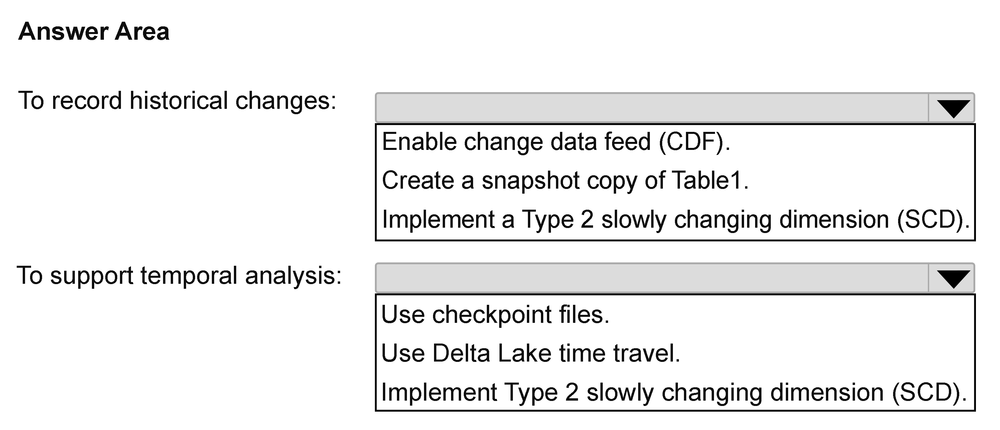

_HOTSPOT — the original ExamTopics question expects you to mark areas on the exhibit above; the correct hotspot coordinates are not published._

**Most voted:**
- For "To record historical changes": Implement a Type 2 slowly changing dimension (SCD) is a better option. CDF captures row-level changes (insert/update/delete) for downstream streaming consumers. It is not designed for long-term historical analysis — changes are only retained for the table's delta.deletedFileRetentionDuration window.
- For "To support temporal analysis": Use Delta Lake time travel is the correct answer indeed.

### Top explanations
- **fd21624** (9 upvotes [Highly Voted]): For "To record historical changes"	Implement a Type 2 slowly changing dimension (SCD) is a better option. CDF captures row-level changes (insert/update/delete) for downstream streaming consumers. It is not designed for long-term historical analysis — changes are only retained for the table's delta.deletedFileRetentionDuration window.
  For "To support temporal analysis"	Use Delta Lake time travel is the correct answer indeed.
- **Frazer1** (5 upvotes [Most Recent]): To record historical changes: Implement a Type 2 slowly changing dimension (SCD).
  ​To support temporal analysis: Use Delta Lake time travel.

## Q3.21 (ID 417084)

HOTSPOT
You have an Azure Databricks workspace that is enabled for Unity Catalog.
You need to ingest data from the CSV files stored in an external Azure Data Lake Storage Gen2 container into a managed Delta table. The solution must meet the following requirements:
Load data incrementally as new files arrive.
Minimize custom code and operational effort.
How should you complete the SQL statement? To answer, select the appropriate options in the answer area.
NOTE: Each correct selection is worth one point.

**Exhibits**
- Exhibit 1: 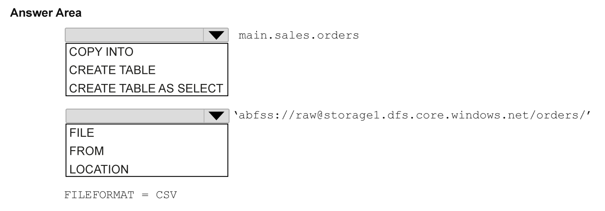

_HOTSPOT — the original ExamTopics question expects you to mark areas on the exhibit above; the correct hotspot coordinates are not published._

**Most voted:** I was thinking about - create table - location - because that could permanently define the files at storage as table content, but the key word was managed table, so target table couldn't be at external location, so copy - from.

### Top explanations
- **mtc9** (1 upvotes [Most Recent]): I was thinking about - create table - location - because that could permanently define the files at storage as table content, but the key word was managed table, so target table couldn't be at external location, so copy - from.

## Q3.26 (ID 428351)

You have an Azure Databricks workspace that is enabled for Unity Catalog.
You need to profile a table to meet the following requirements:
•	The count of null values per column must be evaluated repeatedly as new records are added to the table.
•	Changes in the count of null values must be observable over the progression of the dataset.
Which type of profile should you create?

⭕ **A.** snapshot
⭕ **B.** inference
✅ **C.** time series

**Correct answer:** C
**Most voted:** C

### Top explanations
- **zxc01** (3 upvotes [Most Recent, Selected Answer: C]): TimeSeries need column with data type TIMESTAMP but question doesn't say it. I am not sure the correct answer is A or C. Microsoft is better to add "table has TIMESTAMP data type column or table size is larger than 4 TB. However, timeseries is possible better solution if we enable change data feed (CDF) on table.

## Q4.4 (ID 417089)

HOTSPOT
You have an Azure Databricks workspace that contains an all-purpose cluster named Cluster1.
You discover that out-of-memory (OOM) errors intermittently cause jobs running on Cluster1 to fail.
You need to identify the root cause of the failures by analyzing the runtime execution behavior.
What should you do? To answer, select the appropriate options in the answer area.
NOTE: Each correct selection is worth one point.

**Exhibits**
- Exhibit 1: 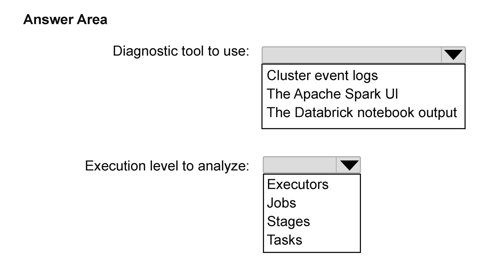

_HOTSPOT — the original ExamTopics question expects you to mark areas on the exhibit above; the correct hotspot coordinates are not published._

**Most voted:** To identify the root cause of out-of-memory (OOM) errors in Azure Databricks, you should access and analyze the Spark UI and review the cluster's driver and executor logs.

### Top explanations
- **Abhi_007** (3 upvotes): Execution level to analyze: Tasks
  Copilot said:
  Because OOM (Out Of Memory) errors occur at the task/executor level, and the Spark UI lets you drill down to the exact task causing the memory pressure.
- **Frazer1** (2 upvotes): To identify the root cause of out-of-memory (OOM) errors in Azure Databricks, you should access and analyze the Spark UI and review the cluster's driver and executor logs.
- **mtc9** (1 upvotes [Most Recent]): I would then say executor level, not task

## Q4.8 (ID 417093)

HOTSPOT
You have an Azure Databricks workspace that contains a job in Lakeflow Jobs named Job1.
Job1 runs every hour.
Occasionally, the job run takes longer than one hour to complete. Overlapping runs must be prevented to avoid data corruption.
You need to configure the job scheduling behavior.
What should you configure? To answer, select the appropriate options in the answer area.
NOTE: Each correct selection is worth one point.

**Exhibits**
- Exhibit 1: 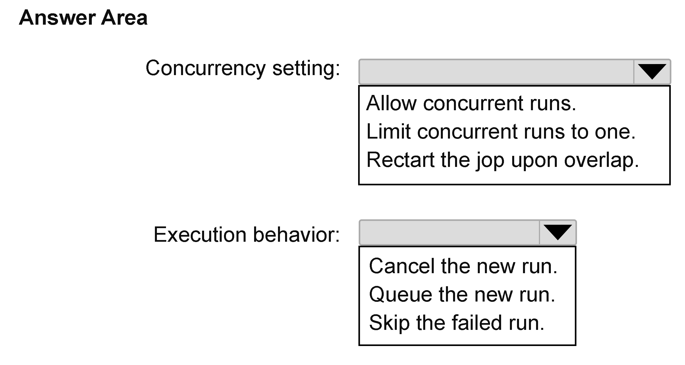

_HOTSPOT — the original ExamTopics question expects you to mark areas on the exhibit above; the correct hotspot coordinates are not published._

**Most voted:**
- Concurrency setting: Limit concurrent runs to one.
- Execution behavior: Queue the new run.
- Concurrency setting: Setting the limit to Limit concurrent runs to one. It prevents multiple instances of Job1 from executing simultaneously, avoiding data race conditions and storage corruption.
- Execution behavior: Selecting Queue the new run. ensures that when a new scheduled run is triggered while the previous instance is still executing, the new run waits in the queue until the active run finishes, rather than being cancelled or skipped.

### Top explanations
- **SarathChandra** (8 upvotes [Highly Voted]): Execution behavior: Queue the new run
  New runs are queued and start after the current run completes.
- **Frazer1** (5 upvotes): Concurrency setting: Limit concurrent runs to one.
  Execution behavior: Queue the new run.
  ​Concurrency setting: Setting the limit to Limit concurrent runs to one. It prevents multiple instances of Job1 from executing simultaneously, avoiding data race conditions and storage corruption.
  ​Execution behavior: Selecting Queue the new run. ensures that when a new scheduled run is triggered while the previous instance is still executing, the new run waits in the queue until the active run finishes, rather than being cancelled or skipped.
- **mtc9** (1 upvotes [Most Recent]): the requirements didn't specify what to do with concurrent run, only to avoid overlapping, but the fact that extended run over 1h happens only occasionally, would make queue runs possible without growing the queue, assuming that next runs would take LESS than 1h, to reduce back the queue to 0. But without this knowledge and not relying on assumption, cancel paralel run would be safer option, especially that the jobs are frequrnt, so not much loss waiting less than 1h for next run. So I would pick CANCEL for second question.

## Q4.18 (ID 417103)

You have an Azure Databricks workspace that contains a job in Lakeflow Jobs named Job1. Job1 contains multiple tasks.
Failures of non-critical tasks must be logged but must NOT trigger notifications. Notifications must be triggered only when critical tasks have failed, and Job1 has completed.
You need to configure the job alerting behavior.
What should trigger a notification?

⭕ **A.** task success
✅ **B.** a job failure
⭕ **C.** a task failure
⭕ **D.** job success

**Correct answer:** B
**Most voted:** B

### Top explanations
- **Frazer1** (5 upvotes [Most Recent, Selected Answer: B]): Job-level notifications in Azure Databricks allow you to trigger alerts on overall run completion events like success or failure rather than on individual non-critical task errors.
  Triggering on a task failure (Option C) would cause notifications to fire for every individual failing task, including non-critical ones that you only want logged.
  Configuring the alert on a job failure (Option B) ensures that notifications are suppressed for minor task anomalies and are only sent out when critical tasks fail and cause the final job execution to fail.
  Option B is correct.
- **senn333** (4 upvotes [Selected Answer: B]): Notifications must be triggered only when critical tasks have failed, and Job1 has completed

## Q4.20 (ID 417105)

You have a Lakeflow Spark Declarative Pipelines (SDP) pipeline in Azure Databricks. The pipeline ingests transaction data into a table named Table1.
You need to ensure that in the event of an invalid record, the pipeline continues to run. The solution must meet the following requirements:
Invalid records must NOT be written to Table1.
Invalid records must be preserved for review.
Minimize development effort.
What should you do?

⭕ **A.** Add a CHECK constraint to Table1.
⭕ **B.** Run WHERE clauses in downstream queries to filter out invalid records.
⭕ **C.** Define a pipeline expectation.
✅ **D.** Implement advanced logic to quarantine the invalid records.

**Correct answer:** D
**Most voted:** D

### Top explanations
- **51e3df9** (3 upvotes [Most Recent, Selected Answer: D]): Defining pipeline expectations (C), does NOT save invalid records for review.
