# DP-800 Developing AI-Enabled Database Solutions Study Guide

_48 questions generated from ExamTopics discussions._

## Table of contents

- [Q1.1](#q1-1)
- [Q1.3](#q1-3)
- [Q1.4](#q1-4)
- [Q1.5](#q1-5)
- [Q1.7](#q1-7)
- [Q1.9](#q1-9)
- [Q1.12](#q1-12)
- [Q1.13](#q1-13)
- [Q1.15](#q1-15)
- [Q1.16](#q1-16)
- [Q1.17](#q1-17)
- [Q1.19](#q1-19)
- [Q1.20](#q1-20)
- [Q1.21](#q1-21)
- [Q1.22](#q1-22)
- [Q1.23](#q1-23)
- [Q1.24](#q1-24)
- [Q1.26](#q1-26)
- [Q2.1](#q2-1)
- [Q2.2](#q2-2)
- [Q2.3](#q2-3)
- [Q2.4](#q2-4)
- [Q2.7](#q2-7)
- [Q2.10](#q2-10)
- [Q2.12](#q2-12)
- [Q2.13](#q2-13)
- [Q2.14](#q2-14)
- [Q2.18](#q2-18)
- [Q2.19](#q2-19)
- [Q2.20](#q2-20)
- [Q2.30](#q2-30)
- [Q2.32](#q2-32)
- [Q2.33](#q2-33)
- [Q2.34](#q2-34)
- [Q2.36](#q2-36)
- [Q2.40](#q2-40)
- [Q2.41](#q2-41)
- [Q2.42](#q2-42)
- [Q2.45](#q2-45)
- [Q2.48](#q2-48)
- [Q3.3](#q3-3)
- [Q3.4](#q3-4)
- [Q3.6](#q3-6)
- [Q3.7](#q3-7)
- [Q3.8](#q3-8)
- [Q3.12](#q3-12)
- [Q3.14](#q3-14)
- [Q3.16](#q3-16)

## Q1.1 (ID 404372)

HOTSPOT
Existing Environment
Azure Environment
Contoso has an Azure subscription in North Europe that contains the corporate infrastructure. The current infrastructure contains a Microsoft SQL Server 2017 database. The database contains the following tables.
The FeedbackJson column has a full-text index and stores JSON documents in the following format.
The support staff at Contoso never has the UNMASK permission.
Problem Statements
Contoso is deploying a new Azure SQL database that will become the authoritative data store for the following:
AI workloads
Vector search
Modernized API access
Retrieval Augmented Generation (RAG) pipelines
Sometimes the ingestion pipeline fails due to malformed JSON and duplicate payloads.
The engineers at Contoso report that the following dashboard query runs slowly.
You review the execution plan and discover that the plan shows a clustered index scan.
VehicleIncidentReports often contains details about the weather, traffic conditions, and location. Analysts report that it is difficult to find similar incidents based on these details.
Requirements
Planned Changes
Contoso wants to modernize Fleet Intelligence Platform to support AI-powered semantic search over incident reports.
Security Requirements
Contoso identifies the following security requirements:
Restrict the support staff from viewing Personally Identifiable Information (PII) data, which is full email addresses and phone numbers.
Enforce row-level filtering so that analysts see only incidents for the fleets to which they are assigned. The analysts can be assigned to multiple fleets.
Database Performance and Requirements
Contoso identifies the following telemetry requirements:
Telemetry data must be stored in a partitioned table.
Telemetry data must provide predictable performance for ingestion and retention operations.
latitude, longitude, and accuracy JSON properties must be filtered by using an index seek.
Contoso identifies the following maintenance data requirements:
Ensure that any changes to a row in the MaintenanceEvents table updates the corresponding value in the LastModifiedUtc column to the time of the change.
Avoid recursive updates.
AI Search, Embeddings, and Vector Indexing
Contoso plans to implement semantic search over incident data to meet the following requirements:
Embeddings must be stored in dedicated Azure SQL Database tables.
Embeddings must be generated from rich natural language fields.
Chunking must preserve semantic coherence.
Hybrid search must combine the following:
Vector similarity
Keyword filtering or boosting
Development Requirements
The development team at Contoso will use Microsoft Visual Studio Code and GitHub Copilot and will retrieve live metadata from the databases.
Contoso identifies the following requirements for querying data in the FeedbackJson column of the CustomerFeedback table:
Extract the customer feedback text from the JSON document.
Filter rows where the JSON text contains a keyword.
Calculate a fuzzy similarity score between the feedback text and a known issue description.
Order the results by similarity score, with the highest score first.
You need to meet the development requirements for the FeedbackJson column.
How should you complete the Transact-SQL query? To answer, select the appropriate options in the answer area.
NOTE: Each correct selection is worth one point.

**Exhibits**
- Exhibit 1: 
- Exhibit 2: 
- Exhibit 3: 
- Exhibit 4: 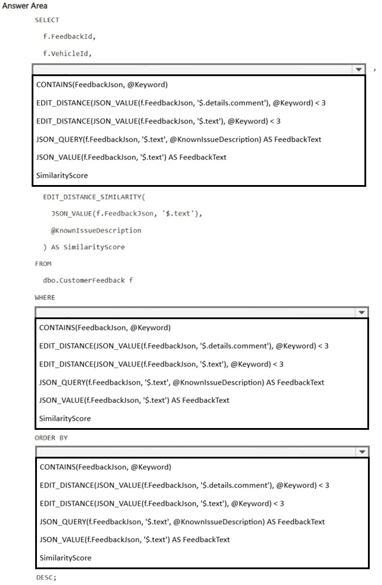

_HOTSPOT — the original ExamTopics question expects you to mark areas on the exhibit above; the correct hotspot coordinates are not published._

**Most voted:**
- SELECT: JSON_VALUE(f.FeedbackJson, '$.text') AS FeedbackText
- WHERE: CONTAINS(FeedbackJson, @Keyword)
- ORDER BY: SimilarityScore

### Top explanations
- **Mustafa_Shazly** (8 upvotes [Most Recent, Highly Voted]): Extract the customer feedback text from the JSON document.
  - JSON_VALUE(f.FeedbackJson, '$.text') AS FeedbackText
  Filter rows where the JSON text contains a keyword.
  - CONTAINS(FeedbackJson, @Keyword)
  Calculate a fuzzy similarity score between the feedback text and a known issue description.
  - He calc it in query
  Order the results by similarity score, with the highest score first.
  - SimilarityScore

## Q1.3 (ID 404374)

Your team is developing an Azure SQL dataset solution from a locally cloned GitHub repository by using Microsoft Visual Studio Code and GitHub Copilot Chat.
You need to disable the GitHub Copilot repository-level instructions for yourself without affecting other users.
What should you do?

✅ **A.** From Visual Studio Code, modify your GitHub Copilot Chat user settings.
⭕ **B.** Add a --debug flag when you start the GitHub Copilot Chat extension.
⭕ **C.** Delete .github/copilot-instructions.md.

**Correct answer:** A
**Most voted:** A

### Top explanations
- **JanusQi** (1 upvotes [Most Recent, Selected Answer: A]): A is correct.
  Option A: Modify your GitHub Copilot Chat user settings — Correct
  User settings are applied only to your local Visual Studio Code environment.
  Other users continue to use the repository-level instructions.
  This satisfies the requirement of disabling the instructions for yourself only.
  Option B: Add a --debug flag when starting GitHub Copilot Chat — Incorrect
  The --debug flag enables debugging and diagnostic information.
  It does not control repository-level instructions.
  Option C: Delete .github/copilot-instructions.md — Incorrect
  Removing the file changes the repository itself.
  All users cloning or using the repository would lose the instructions.
  This violates the requirement of not affecting other users.

## Q1.4 (ID 404375)

You have an Azure SQL database that contains the following SQL graph tables:
A NODE table named dbo.Person
An EDGE table named dbo.Knows
Each row in dbo.Person contains the following columns:
PersonID (int)
DisplayName (nvarchar(100))
You need to use a MATCH operator and exactly two directed Knows relationships to return the PersonID and DisplayName of people that are reachable from the person identified by an input parameter named @StartPersonId.
Which Transact-SQL query should you use?

⭕ **A.** 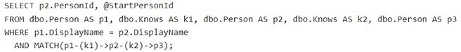
⭕ **B.** 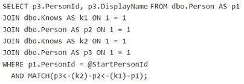
⭕ **C.** 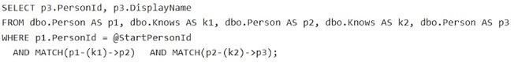
✅ **D.** 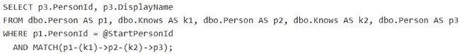

**Correct answer:** D
**Most voted:** D

### Top explanations
- **AlltheMSCerts** (1 upvotes [Most Recent, Selected Answer: D]): This pattern for 2-person match is referenced in the Microsoft documentation.

## Q1.5 (ID 404376)

You have a SQL database in Microsoft Fabric that contains a column named Payload. Payload stores customer data in JSON documents that have the following format.
Data analysis shows that some customers have subaddressing in their email address, for example,
[email protected]
.
You need to return a normalized email value that removes the subaddressing, for example, user1
[email protected]
must be normalized to
[email protected]
.
Which Transact-SQL expression should you use?

**Exhibits**
- Exhibit 1: 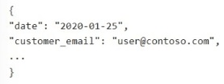

⭕ **A.** REGEXP_REPLACE(JSON_VALUE(Payload, ‘$.customer_email’), ‘\+.*$’, ‘’)
⭕ **B.** REGEXP_SUBSTR(JSON_VALUE(Payload, ‘$.customer_email’), ‘^[^+]+@.*$=’)
✅ **C.** REGEXP_REPLACE(JSON_VALUE(Payload, ‘$.customer_email’), ‘\+.*@’, ‘@’)
⭕ **D.** REGEXP_REPLACE(JSON_VALUE(Payload, ‘$.customer_email’), ‘\+.*’, ‘’)

**Correct answer:** C
**Most voted:** C

### Top explanations
- **Sr18** (4 upvotes [Selected Answer: C]): C: Pattern provided will remove anything from + to last @ and replacing it with @ will do the work.
- **dabhelia** (2 upvotes [Most Recent, Selected Answer: C]): Why C is correct:
  JSON_VALUE(Payload, '$.customer_email') pulls the email string out of the JSON document.
  +
  matches a literal plus sign, .* matches the subaddress tag, and @ anchors the match at the start of the domain.
  Replacing that match with @ removes only the tag and keeps the local part and the domain.
  An address without a + doesn't match the pattern, so it's returned unchanged.
- **BeingAbhi** (1 upvotes [Selected Answer: A]): $ means until the end of the string. So, A is correct.
- **Jaz_Muthini** (1 upvotes): wait... but does that not mean remove the plus sign and everything after it, leaving us with just user1 ?

## Q1.7 (ID 404378)

You have an Azure SQL database.
You need to create a scalar user-defined function (UDF) that returns the number of whole years between an input parameter named @OrderDate and the current date/time as a single positive integer. The function must be created in Azure SQL Database.
You write the following code.
What should you insert at line 05?

**Exhibits**
- Exhibit 1: 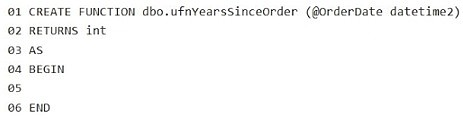

⭕ **A.** RETURN DATEDIFF(year, GETDATE(), @OrderDate);
⭕ **B.** DATEDIFF(month, @orderdate, GETDATE()) / 12
⭕ **C.** DATEPART(year, GETDATE()) - DATEPART(year, @orderdate)
✅ **D.** RETURN DATEDIFF(year, @OrderDate, GETDATE());

**Correct answer:** D
**Most voted:** D

### Top explanations
- **Testeador** (1 upvotes [Most Recent, Selected Answer: D]): Confusing options.
  DateDiff is not accurate. It only subtracts years (ignoring months and days).
  It should be the DATEDIFF(month,@OrderDate, GETDATE())/12 option, but without RETURN in front, it won't work.

## Q1.9 (ID 403592)

You have a SQL database in Microsoft Fabric that contains a nvarchar (max) column named MessageText. An ID is always contained within the first paragraph of MessageText.
You need to write a Transact-SQL query that uses REGEXP_SUBSTR to extract the ID from MessageText.
What should you include in the query?

⭕ **A.** Apply STRING_ESCAPE(MessageText, ‘json’) before calling REGEXP_SUBSTR.
✅ **B.** Cast MessageText to nvarchar (4000) before calling REGEXP_SUBSTR.
⭕ **C.** Add a COLLATE Latin1_General_CS_AS clause to MessageText before calling REGEXP_SUBSTR.
⭕ **D.** Run TRY_CONVERT(varchar(max), MessageText) before calling REGEXP_SUBSTR.

**Correct answer:** B
**Most voted:** B

### Top explanations
- **AhmadSVPN** (3 upvotes [Selected Answer: B]): For the SQL Server 2025/Fabric regular expression functions used in DP-800, large object types such as nvarchar(max) are not supported directly by some pattern-matching operations. The safe approach is to cast the value to a supported fixed-length string type before applying REGEXP_SUBSTR. The exam question specifically highlights that the ID is contained in the first paragraph, making a cast to nvarchar(4000) sufficient for extraction.
- **rhr** (2 upvotes [Selected Answer: B]): current Microsoft documentation says REGEXP_SUBSTR supports nvarchar(max) inputs up to 2 MB. Therefore, in current Fabric SQL, the cast may not be technically required
- **gilles87** (1 upvotes [Most Recent, Selected Answer: B]): B : Pour les fonctions d'expressions régulières SQL Server 2025/Fabric utilisées dans DP-800, les types d'objets volumineux tels que nvarchar(max) ne sont pas directement pris en charge par certaines opérations de correspondance de modèles. Il est recommandé de convertir la valeur en un type de chaîne de longueur fixe pris en charge avant d'appliquer REGEXP_SUBSTR. L'énoncé de l'examen précise que l'identifiant figure dans le premier paragraphe ; une conversion en nvarchar(4000) est donc suffisante pour son extraction.

## Q1.12 (ID 403595)

You have an Azure SQL database named AdventureWorksDB that contains a table named dbo.Employee.
You have a C# Azure Functions app that uses an HTTP-triggered function with an Azure SQL input binding to query dbo.Employee.
You are adding a second function that will react to row changes in dbo.Employee and write structured logs.
You need to configure AdventureWorksDB and the app to meet the following requirements:
Changes to dbo.Employee must trigger the new function within five seconds.
Each invocation must process no more than 100 changes.
Which two database configurations should you perform? Each correct answer presents part of the solution.
NOTE: Each correct selection is worth one point.

⭕ **A.** Create an AFTER trigger on dbo.Employee for Data Manipulation Language (DML).
⭕ **B.** Set Sql_Trigger_MaxBatchSize to 100.
✅ **C.** Enable change tracking on the dbo.Employee table.
✅ **D.** Enable change tracking at the database level.
⭕ **E.** Set Sql_Trigger_PollingIntervalMs to 5000.
⭕ **F.** Enable change data capture (CDC) for dbo.Employee table changes.

**Correct answer:** C, D
**Most voted:** CD

### Top explanations
- **Mustafa_Shazly** (2 upvotes [Most Recent, Selected Answer: CD]): the full answer is
  -    change to app
  in host.json file
  "sql": {
  "pollingIntervalMs": 5000,
  "maxBatchSize": 100
  }
  - change in Database
  Enable change tracking at the database level.
  Enable change tracking on the dbo.Employee table.
  In question he ask about change to DB only So C, D
- **AlltheMSCerts** (2 upvotes [Selected Answer: CD]): Other options are generally set on the function app. First things to do at the DB level is turn on change tracking.

## Q1.13 (ID 403596)

DRAG DROP
You have a Microsoft SQL Server 2025 database that contains a table named dbo.CustomerMessages. dbo.CustomerMessages contains two columns named MessageID (int) and MessageRaw (nvarchar(max)).
MessageRaw can contain a phone number in multiple formats, and some rows do NOT contain a phone number.
You need to write a single SELECT query that meets the following requirements:
The query must return MessageID, RawNumber, DigitsOnly, and PhoneStatus.
RawNumber must contain the first substring that matches a phone-number pattern, or NULL if no match exists.
DigitsOnly must remove all non-digit characters from RawNumber, or return NULL.
PhoneStatus must return valid when a phone number exists in MessageRaw, otherwise return Missing.
How should you complete the Transact-SQL query? To answer, drag the appropriate values to the correct targets. Each value may be used once, more than once, or not at all. You may need to drag the split bar between panes or scroll to view content.
NOTE: Each correct selection is worth one point.

**Exhibits**
- Exhibit 1: 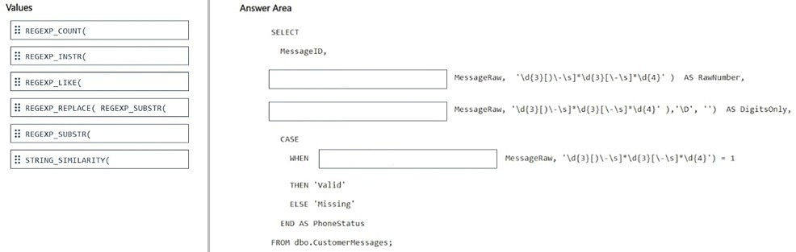

_DRAG DROP — the original ExamTopics question expects you to drag and drop items; the correct targets are not published._

**Most voted:**
- RawNumber: REGEXP_SUBSTR(
- DigitsOnly: REGEXP_REPLACE( REGEXP_SUBSTR(
- WHEN ... = 1: REGEXP_LIKE(

### Top explanations
- **BeingAbhi** (4 upvotes): REGEXP_SUBSTR()
  ↓
  "Give me the matching text"
  REGEXP_REPLACE()
  ↓
  "Change/remove matching text"
  REGEXP_LIKE()
  ↓
  "Does matching text exist?"
- **Guru_1** (2 upvotes): 1) REGEXP_SUBSTR()
  2) REGEXP_REPLACE(REGEXP_SUBSTR())
  3) REGEXP_COUNT()
  CREATE TABLE dbo.CustomerMessages (
  MessageID INT IDENTITY(1,1) PRIMARY KEY,
  MessageRaw VARCHAR(8000)
  );
  INSERT INTO dbo.CustomerMessages (MessageRaw)
  VALUES
  ('Please call me at (123) 456-7890 as soon as possible.'),
  ('No phone number provided in this text message.'),
  ('Contact office: 987-654-3210 or email us.'),
  ('My new mobile number is 555 555 5555.'),
  ('Send a text to 444-555-6666 to opt-in.'),
  ('Send a text also to 414-505-666 to opt-in.');
  GO
  /*REGEXP_LIKE WITH =1*/
  SELECT
  MessageID,
  REGEXP_SUBSTR(MessageRaw, '\d{3}[()\- \s]*\d{3}[ \-\s]*\d{4}' ) AS RawNumber,
  REGEXP_REPLACE( REGEXP_SUBSTR(MessageRaw, '\d{3}[()\- \s]*\d{3}[ \-\s]*\d{4}'), '\D', '') AS DigitsOnly,
  CASE
  WHEN REGEXP_LIKE(MessageRaw, '\d{3}[()\- \s]*\d{3}[ \-\s]*\d{4}')=1
  THEN 'Valid'
  ELSE 'Missing'
  END AS PhoneStatus
  FROM dbo.CustomerMessages;
  Error: Msg 102, Level 15, State 1, Line 22
  Incorrect syntax near '='.
  /*REGEXP_LIKE WITH Boolean*/
  SELECT
  MessageID,
  REGEXP_SUBSTR(MessageRaw, '\d{3}[()\- \s]*\d{3}[ \-\s]*\d{4}' ) AS RawNumber,
  REGEXP_REPLACE( REGEXP_SUBSTR(MessageRaw, '\d{3}[()\- \s]*\d{3}[ \-\s]*\d{4}'), '\D', '') AS DigitsOnly,
  CASE
  WHEN REGEXP_LIKE(MessageRaw, '\d{3}[()\- \s]*\d{3}[ \-\s]*\d{4}')
  THEN 'Valid'
  ELSE 'Missing'
  END AS PhoneStatus
  FROM dbo.CustomerMessages;
  --Works Fine
  /*REGEXP_COUNT WITH =1*/
  SELECT
  MessageID,
  REGEXP_SUBSTR(MessageRaw, '\d{3}[()\- \s]*\d{3}[ \-\s]*\d{4}' ) AS RawNumber,
  REGEXP_REPLACE( REGEXP_SUBSTR(MessageRaw, '\d{3}[()\- \s]*\d{3}[ \-\s]*\d{4}'), '\D', '') AS DigitsOnly,
  CASE
  WHEN REGEXP_COUNT(MessageRaw, '\d{3}[()\- \s]*\d{3}[ \-\s]*\d{4}')=1
  THEN 'Valid'
  ELSE 'Missing'
  END AS PhoneStatus
  FROM dbo.CustomerMessages;
  --Works fine
- **gangreja** (2 upvotes): 1)REGEXP_SUBSTR(
  2)REGEXP_REPLACE(REGEXP_SUBSTR(
  3)REGEXP_COUNT(  because it returns an integer if it finds the pattern
- **authemany2k** (1 upvotes [Most Recent]): SELECT
  MessageID,
  REGEXP_SUBSTR(MessageRaw, '') AS RawNumber,
  REGEXP_REPLACE(
  REGEXP_SUBSTR(MessageRaw, ''),
  '[^0-9]',
  ''
  ) AS DigitsOnly,
  CASE
  WHEN REGEXP_SUBSTR(MessageRaw, '') IS NOT NULL
  THEN 'valid'
  ELSE 'Missing'
  END AS PhoneStatus
  FROM dbo.CustomerMessages;

## Q1.15 (ID 403598)

DRAG DROP
You have a SQL database in Microsoft Fabric that contains a table named WebSite.Logs. WebSite.Logs stores application telemetry data. WebSite.Logs contains a nvarchar (max) column named log that stores JSON documents.
You have a daily report that filters by the $.severity JSON property and returns LogId, LogDateTime, and log. The report frequently causes full table scans.
You need to modify WebSite.Logs to support efficient filtering by $.severity and avoid key lookups for the columns returned by the report.
How should you complete the Transact-SQL code to avoid full table scans? To answer, drag the appropriate values to the correct targets. Each value may be used once, more than once, or not at all. You may need to drag the split bar between panes or scroll to view content.
NOTE: Each correct selection is worth one point.

**Exhibits**
- Exhibit 1: 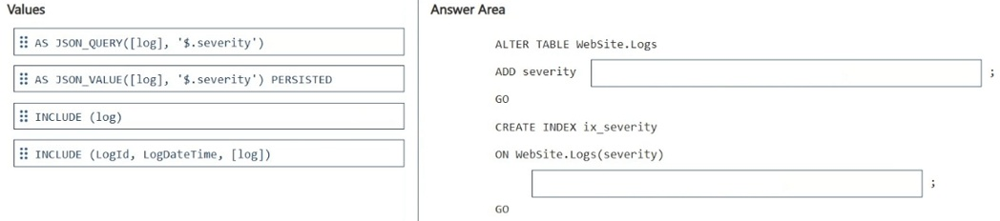

_DRAG DROP — the original ExamTopics question expects you to drag and drop items; the correct targets are not published._

**Most voted:**
- ADD severity: AS JSON_VALUE([log], '$.severity') PERSISTED
- ON WebSite.Logs(severity): INCLUDE (LogId, LogDateTime, [log])

### Top explanations
- **authemany2k** (1 upvotes [Most Recent]): ALTER TABLE WebSite.Logs
  ADD Severity AS JSON_VALUE(log, '$.severity');
  CREATE INDEX IX_Logs_Severity
  ON WebSite.Logs (Severity)
  INCLUDE (LogId, LogDateTime, log);

## Q1.16 (ID 419635)

HOTSPOT
Existing Environment
Azure Environment
Fabrikam has a single Azure subscription in the East US 2 Azure region. The subscription contains an Azure SQL database named DB1. DB1 contains the following tables:
•	Patients
•	Employees
•	Procedures
•	Transactions
•	UsefulPrompts
•	ProcedureDocuments
You store a column master key as a secret in Azure Key Vault.
You have an on-premises application named TransactionProcessing that uses a hard-coded username and password in a connection string to access DB1.
Problem Statements
Users report that after executing a long-running stored procedure named sp_UpdateProcedureForPatient, updates to the underlying data are sometimes inconsistent.
Requirements
Planned Changes
Fabrikam plans to manage all changes to Azure SQL Database objects by using source control in GitHub. Every pull request submitted to production will be validated before it can be merged. Deployments must use the Release configuration.
Security Requirements
Fabrikam identifies the following security requirements:
•	The TransactionProcessing application must use a passwordless connection to DB1.
•	The Employees table contains two columns named TaxID and Salary that must be encrypted at rest.
•	Auditors must have a tamper-evident history of transactions with cryptographic proof of changes to the employee data.
Database Performance Requirements
Records accessed by using sp_UpdateProcedureForPatient must NOT be changed by other transactions while the stored procedure runs.
AI Search, Embeddings, and Vector Indexing
Fabrikam identifies the following AI-related requirements:
•	Queries to the ProcedureDocuments table must use Reciprocal Rank Fusion (RRF).
•	Users must be able to query the data in DB1 by using prompts in Copilot in Microsoft Fabric.
•	The UsefulPrompts table will store prompts that doctors can use to help diagnose patient illness by connecting to an Azure OpenAI endpoint.
Development Requirements
Fabrikam identifies the following development requirements:
•	Provide the functionality to retrieve all the transactions of a given patient between two dates, showing a running total.
•	Expose a Data API builder (DAB) configuration file to enable Azure services to perform the following operations over a REST API:
o	Read data from the procedures table without authentication.
o	Read and insert data into the Transactions table once authenticated.
o	Execute the sp_UpdateProcedurePatient stored procedure.
•	Provide the functionality to retrieve a list of the names of patients who underwent medical procedures during the last 30 days.
•	Information for each medical procedure will be stored in a table. The table will be used with a large language model (LLM) for user querying and will have the following structure.
DAB
You create a DAB configuration file that meets the development requirements for DB1 and includes the following entities.
You need to create a solution that meets the development requirements for retrieving the patient lists.
How should you complete the Transact-SQL code? To answer, select the appropriate options
in the answer area.
NOTE: Each correct selection is worth one point.

**Exhibits**
- Exhibit 1: 
- Exhibit 2: 
- Exhibit 3: 

_HOTSPOT — the original ExamTopics question expects you to mark areas on the exhibit above; the correct hotspot coordinates are not published._

**Most voted:**
- FROM dbo.Patients AS p: WHERE EXISTS
- FROM dbo.Procedures AS pr: WHERE p.PatientId = pr.PatientId

### Top explanations
- **pmajo** (4 upvotes [Most Recent]): WHERE EXISTS
  WHERE p.PatientId = pr.PatientId
  It is classic example of correlated query from Microsoft Learn course for this exam.
- **opec1** (3 upvotes): 1. where exists 2. where p.PatientID = pr.PatientID
  Otherwise we filter PatientID twice.
  Having in the subquery does not work without group by and the date filter does not work without where.
- **MaxEL** (1 upvotes): I'm for WHERE EXISTS against WHERE p.PatienID IN ..., and only because of the incorrect field name. T letter is missing in patienTid.

## Q1.17 (ID 419653)

You have an Azure SQL database named ToDo that contains a table named dbo.ToDo.
Your company plans to develop an Azure Functions app to run whenever the rows in dbo.ToDo change. The app will process INSERT, UPDATE, and DELETE events by using the Azure SQL trigger binding.
You need to configure ToDo to support the planned app.
What should you do?

✅ **A.** Enable change tracking on ToDo and dbo.ToDo.
⭕ **B.** On dbo.ToDo, create a Data Manipulation Language (DML) trigger that calls the Azure Functions HTTP endpoint.
⭕ **C.** Enable change data capture (CDC) on ToDo and dbo.ToDo.
⭕ **D.** On dbo.ToDo, create a Data Definition Language (DDL) trigger that calls the Azure Functions HTTP endpoint.

**Correct answer:** A
**Most voted:** A

### Top explanations
- **rehoboth2165** (3 upvotes [Selected Answer: A]): The Azure Functions SQL trigger binding is built specifically on SQL Server/Azure SQL change tracking. It has to be enabled both at the database level (ToDo) and on the specific table (dbo.ToDo) for the binding to detect INSERT/UPDATE/DELETE row changes. CDC (C) is a different mechanism not used by this binding, and DML/DDL triggers (B, D) calling an HTTP endpoint directly is not how the SQL trigger binding is designed to work (and is a fragile anti-pattern regardless).
- **authemany2k** (1 upvotes [Most Recent, Selected Answer: A]): ALTER DATABASE ToDo
  SET CHANGE_TRACKING = ON
  (
  CHANGE_RETENTION = 2 DAYS,
  AUTO_CLEANUP = ON
  );
  ALTER TABLE dbo.ToDo
  ENABLE CHANGE_TRACKING;

## Q1.19 (ID 419640)

DRAG DROP
You have an Azure SQL database named SalesDB that supports an ecommerce application. SalesDB contains a table named dbo.Orders that has a clustered index on a column named OrderId.
dbo.Orders receives continuous OLTP inserts and updates during business hours.
Your analytics team runs hourly aggregate queries that scan dbo.Orders to calculate revenue trends for recent dates.
You need to improve the performance of the hourly analytics queries without significantly affecting OLTP throughput. The solution must meet the following requirements:
•	Support near-real-time (NRT) analytics on the dbo.Orders table.
•	Reduce read time when retrieving analytical data from dbo.Orders.
•	Support indexing only rows that match a predicate, such as Active = 1.
Which type of index should you use for each requirement? To answer, drag the appropriate index types to the correct requirements. Each index type may be used once, more than once, or not at all. You may need to drag the split bar between panes or scroll to view content.
NOTE: Each correct selection is worth one point.

**Exhibits**
- Exhibit 1: 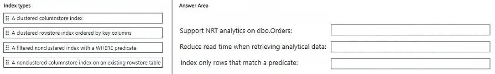

_DRAG DROP — the original ExamTopics question expects you to drag and drop items; the correct targets are not published._

**Most voted:**
- Support NRT analytics on dbo.Orders: A nonclustered columnstore index on an existing rowstore table
- Reduce read time when retrieving analytical data: A nonclustered columnstore index on an existing rowstore table
- Index only rows that match a predicate: A filtered nonclustered index with a WHERE predicate

### Top explanations
- **BozaXephon** (9 upvotes [Highly Voted]): Support NRT analytics on dbo.Orders: A nonclustered columnstore index on an existing rowstore table
  Reduce read time when retrieving analytical data: A nonclustered columnstore index on an existing rowstore table
  Index only rows that match a predicate: A filtered nonclustered index with a WHERE predicate
- **authemany2k** (2 upvotes [Most Recent]): Support NRT analytics
  ↓
  Nonclustered columnstore index
  Reduce analytical read time
  ↓
  Nonclustered columnstore index
  Index only rows matching Active = 1
  ↓
  Filtered index

## Q1.20 (ID 419657)

DRAG DROP
You have an Azure SQL database that stores sales data and contains tables named Sales and Products. Sales contains three columns named SalesDate, ProductKey, and TotalSale,
Sales is 10 TB and is loaded nightly by using a batch process. Most reporting queries scan large portions of Sales, filter on SalesDate or ProductKey, and use SUM() to aggregate TotalSale.
Products is relatively small and is used primarily for point lookups and joins to Sales.
You need to recommend which indexes to create to optimize the reporting queries. The solution must minimize storage requirements.
Which type of index should you recommend for each table? To answer, drag the appropriate index types to the correct tables. Each index type may be used once, more than once, or not at all. You may need to drag the split bar between panes or scroll to view content.
NOTE: Each correct selection is worth one point.

**Exhibits**
- Exhibit 1: 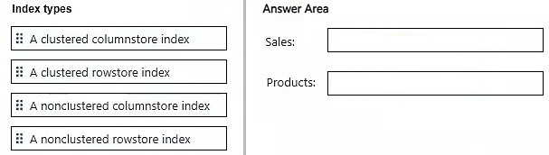

_DRAG DROP — the original ExamTopics question expects you to drag and drop items; the correct targets are not published._

**Most voted:**
- Sales → Clustered columnstore index
- Products → Clustered rowstore index

### Top explanations
- **strikersree** (6 upvotes): Clustered Columnstore Index & Clustered RowStore Index
- **authemany2k** (2 upvotes [Most Recent]): Sales     → Clustered columnstore index
  Products  → Clustered rowstore index

## Q1.21 (ID 419634)

HOTSPOT
You have an Azure SQL database that contains a table named dbo.SupportTickets. dbo.SupportTickets contains a JSON column named Payload and a datetime column CreatedAt.
You need to generate a report for the last seven days that meets the following requirements:
•	Returns exactly one row per customer per day
•	For each customer and day, returns the earliest ticket
•	Includes the customer ID stored in Payload
How should you complete the Transact-SQL query? To answer, select the appropriate options in the answer area.
NOTE: Each correct selection is worth one point.

**Exhibits**
- Exhibit 1: 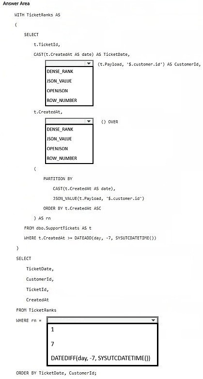

_HOTSPOT — the original ExamTopics question expects you to mark areas on the exhibit above; the correct hotspot coordinates are not published._

**Most voted:**
1. JSON_VALUE
2. ROW_NUMBER
3. 1

### Top explanations
- **gangreja** (4 upvotes [Most Recent]): 1. JSON_VALUE
  2. ROW_NUMBER
  3. 1
- **gangreja** (3 upvotes): A JSON_VALUE
  B ROW_NUMBER
  C 1
- **Skri113xX** (1 upvotes [Selected Answer: A]): Well, [Option A] and [Option C] are definitely wrong. Between the other two, A is the better fit.

## Q1.22 (ID 419648)

You are developing an Azure SQL database solution from a locally cloned GitHub repository by using Microsoft Visual Studio Code and GitHub Copilot Chat.
You need to ensure that GitHub Copilot Chat can call the hosted GitHub MCP Server tools by using OAuth. The MCP server configuration must be scoped to the repository.
What should you do in Visual Studio Code?

⭕ **A.** Create a personal access token (PAT) that has the repo scope and store the PAT in the .vscode\mcp.json file as the Authorization header.
✅ **B.** From the Command Palette, enter MCP: add server, select HTTP (HTTP or Server-Sent Events), enter https://api.githubcopilot.com/mcp/, and then save the configuration to the workspace settings.
⭕ **C.** From the Command Palette, enter MCP: add server, select HTTP (HTTP or Server-Sent Events), enter https://api.githubcopilot.com/mcp/, and then save the configuration to the user settings.
⭕ **D.** Create a personal access token (PAT) that has the repo scope and store the PAT in the .github\mcp.json file as the Authorization header.

**Correct answer:** B
**Most voted:** B

### Top explanations
- **Yasminmv110** (2 upvotes [Most Recent, Selected Answer: B]): Why B is correct
  The question requires the hosted GitHub MCP Server using OAuth authentication.
  VS Code supports adding a remote MCP server through MCP: Add Server and specifying the HTTP endpoint.
  The configuration must be scoped to the repository, which means saving it in the workspace (repository) configuration rather than user-level settings. Workspace installation/configuration updates the repository's .vscode/mcp.json and is scoped to that workspace.
  The hosted GitHub MCP server supports OAuth sign-in; manually supplying a PAT is not the recommended approach for this scenario

## Q1.23 (ID 419643)

HOTSPOT
You have an Azure SQL database that contains a table named Table1. Table1 contains 25,000,000 rows of data and a datetime2 column named DateKey. The data in Table1 spans the years 2020 through 2021.
You need to partition the data in Table1 by year. The solution must minimize how long it takes to rebuild or reindex the table.
How should you complete the Transact-SQL code? To answer, select the appropriate options in the answer area.
NOTE: Each correct selection is worth one point.

**Exhibits**
- Exhibit 1: 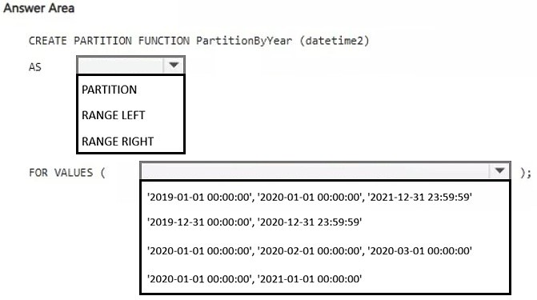

_HOTSPOT — the original ExamTopics question expects you to mark areas on the exhibit above; the correct hotspot coordinates are not published._

**Most voted:**
- AS: RANGE RIGHT
- FOR VALUES: '2020-01-01 00:00:00', '2021-01-01 00:00:00'

### Top explanations
- **gangreja** (1 upvotes [Most Recent]): AS	                RANGE RIGHT
  FOR VALUES	'2020-01-01 00:00:00', '2021-01-01 00:00:00'

## Q1.24 (ID 419652)

You are developing an Azure SQL solution by using Microsoft Visual Studio 2026. The solution uses a GitHub repository.
You plan to use GitHub Copilot Chat to access the GitHub repository tools by connecting to the GitHub MCP Server.
You need to configure Visual Studio to support the planned configuration. The solution must rely on OAuth to access the MCP server.
What should you create?

⭕ **A.** the \.vs\settings.json file that contains the personal access token (PAT) that has the repo scope
✅ **B.** the \.mcp.json file that contains a URL of https://api.githubcopilot.com/mcp/
⭕ **C.** the \.vscode\settings.json file that contains a URL of https://api.githubcopilot.com/mcp/
⭕ **D.** the \.github\mcp.json file that contains the personal access token (PAT) that has the repo scope

**Correct answer:** B
**Most voted:** B

### Top explanations
- **gangreja** (2 upvotes [Most Recent, Selected Answer: B]): never a PAT in the file and
  VS Code → .vscode/mcp.json
  Visual Studio → .mcp.json in the solution root.

## Q1.26 (ID 419637)

Existing Environment
Azure Environment
Fabrikam has a single Azure subscription in the East US 2 Azure region. The subscription contains an Azure SQL database named DB1. DB1 contains the following tables:
•	Patients
•	Employees
•	Procedures
•	Transactions
•	UsefulPrompts
•	ProcedureDocuments
You store a column master key as a secret in Azure Key Vault.
You have an on-premises application named TransactionProcessing that uses a hard-coded username and password in a connection string to access DB1.
Problem Statements
Users report that after executing a long-running stored procedure named sp_UpdateProcedureForPatient, updates to the underlying data are sometimes inconsistent.
Requirements
Planned Changes
Fabrikam plans to manage all changes to Azure SQL Database objects by using source control in GitHub. Every pull request submitted to production will be validated before it can be merged. Deployments must use the Release configuration.
Security Requirements
Fabrikam identifies the following security requirements:
•	The TransactionProcessing application must use a passwordless connection to DB1.
•	The Employees table contains two columns named TaxID and Salary that must be encrypted at rest.
•	Auditors must have a tamper-evident history of transactions with cryptographic proof of changes to the employee data.
Database Performance Requirements
Records accessed by using sp_UpdateProcedureForPatient must NOT be changed by other transactions while the stored procedure runs.
AI Search, Embeddings, and Vector Indexing
Fabrikam identifies the following AI-related requirements:
•	Queries to the ProcedureDocuments table must use Reciprocal Rank Fusion (RRF).
•	Users must be able to query the data in DB1 by using prompts in Copilot in Microsoft Fabric.
•	The UsefulPrompts table will store prompts that doctors can use to help diagnose patient illness by connecting to an Azure OpenAI endpoint.
Development Requirements
Fabrikam identifies the following development requirements:
•	Provide the functionality to retrieve all the transactions of a given patient between two dates, showing a running total.
•	Expose a Data API builder (DAB) configuration file to enable Azure services to perform the following operations over a REST API:
o	Read data from the procedures table without authentication.
o	Read and insert data into the Transactions table once authenticated.
o	Execute the sp_UpdateProcedurePatient stored procedure.
•	Provide the functionality to retrieve a list of the names of patients who underwent medical procedures during the last 30 days.
•	Information for each medical procedure will be stored in a table. The table will be used with a large language model (LLM) for user querying and will have the following structure.
DAB
You create a DAB configuration file that meets the development requirements for DB1 and includes the following entities.
You plan to implement changes to sp_UpdateProcedureForPatient to meet the performance requirements.
You change the stored procedure to run all its code within a transaction.
Which transaction level should you use?

**Exhibits**
- Exhibit 1: 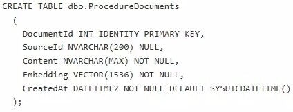
- Exhibit 2: 

✅ **A.** REPEATABLE READ
⭕ **B.** SERIALIZABLE
⭕ **C.** SNAPSHOT
⭕ **D.** READ COMMITTED SNAPSHOT

**Correct answer:** A
**Most voted:** A

### Top explanations
- **FelixI** (4 upvotes [Selected Answer: A]): Rows that are read cannot be modified by other transactions until the transaction finishes.
- **Yatajga** (4 upvotes [Selected Answer: A]): A is correct: It keeps shared locks on every row read by sp_UpdateProcedureForPatient until the transaction completes. Therefore, other transactions cannot update or delete those rows while the stored procedure is running. SERIALIZABLE would also work, but it is unnecessarily restrictive because it additionally prevents new rows from being inserted into the ranges read by the procedure. The requirement only says that the existing records accessed must not be changed.
- **robertcuhk** (2 upvotes [Selected Answer: C]): C is correct: It keeps shared locks on every row read by sp_UpdateProcedureForPatient until the transaction completes. Therefore, other transactions cannot update or delete those rows while the stored procedure is running. SERIALIZABLE would also work, but it is unnecessarily restrictive because it additionally prevents new rows from being inserted into the ranges read by the procedure. The requirement only says that the existing records accessed must not be changed.
- **Skri113xX** (2 upvotes [Selected Answer: C]): I’m thinking it’s C, but not 100%. The question could be interpreted in two ways.
- **bifektm** (1 upvotes [Most Recent, Selected Answer: C]): SNAPSHOT: Ensures a consistent read at the transaction level (using row versioning without blocking readers/writers) and detects update conflicts if another transaction modifies the same data concurrently, preventing inconsistencies while maintaining good performance during long-running operations.

## Q2.1 (ID 403599)

HOTSPOT
Existing Environment
Azure Environment
Contoso has an Azure subscription in North Europe that contains the corporate infrastructure. The current infrastructure contains a Microsoft SQL Server 2017 database. The database contains the following tables.
The FeedbackJson column has a full-text index and stores JSON documents in the following format.
The support staff at Contoso never has the UNMASK permission.
Problem Statements
Contoso is deploying a new Azure SQL database that will become the authoritative data store for the following:
AI workloads
Vector search
Modernized API access
Retrieval Augmented Generation (RAG) pipelines
Sometimes the ingestion pipeline fails due to malformed JSON and duplicate payloads.
The engineers at Contoso report that the following dashboard query runs slowly.
You review the execution plan and discover that the plan shows a clustered index scan.
VehicleIncidentReports often contains details about the weather, traffic conditions, and location. Analysts report that it is difficult to find similar incidents based on these details.
Requirements
Planned Changes
Contoso wants to modernize Fleet Intelligence Platform to support AI-powered semantic search over incident reports.
Security Requirements
Contoso identifies the following security requirements:
Restrict the support staff from viewing Personally Identifiable Information (PII) data, which is full email addresses and phone numbers.
Enforce row-level filtering so that analysts see only incidents for the fleets to which they are assigned. The analysts can be assigned to multiple fleets.
Database Performance and Requirements
Contoso identifies the following telemetry requirements:
Telemetry data must be stored in a partitioned table.
Telemetry data must provide predictable performance for ingestion and retention operations.
latitude, longitude, and accuracy JSON properties must be filtered by using an index seek.
Contoso identifies the following maintenance data requirements:
Ensure that any changes to a row in the MaintenanceEvents table updates the corresponding value in the LastModifiedUtc column to the time of the change.
Avoid recursive updates.
AI Search, Embeddings, and Vector Indexing
Contoso plans to implement semantic search over incident data to meet the following requirements:
Embeddings must be stored in dedicated Azure SQL Database tables.
Embeddings must be generated from rich natural language fields.
Chunking must preserve semantic coherence.
Hybrid search must combine the following:
Vector similarity
Keyword filtering or boosting
Development Requirements
The development team at Contoso will use Microsoft Visual Studio Code and GitHub Copilot and will retrieve live metadata from the databases.
Contoso identifies the following requirements for querying data in the FeedbackJson column of the CustomerFeedback table:
Extract the customer feedback text from the JSON document.
Filter rows where the JSON text contains a keyword.
Calculate a fuzzy similarity score between the feedback text and a known issue description.
Order the results by similarity score, with the highest score first.
You need to create a table in the database to store the telemetry data.
You have the following Transact-SQL code.
For each of the following statements, select Yes if the statement is true. Otherwise, select No.
NOTE: Each correct selection is worth one point.

**Exhibits**
- Exhibit 1: 
- Exhibit 2: 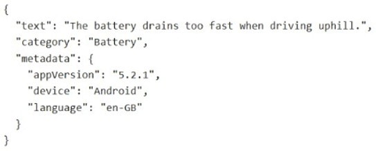
- Exhibit 3: 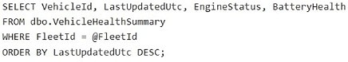
- Exhibit 4: 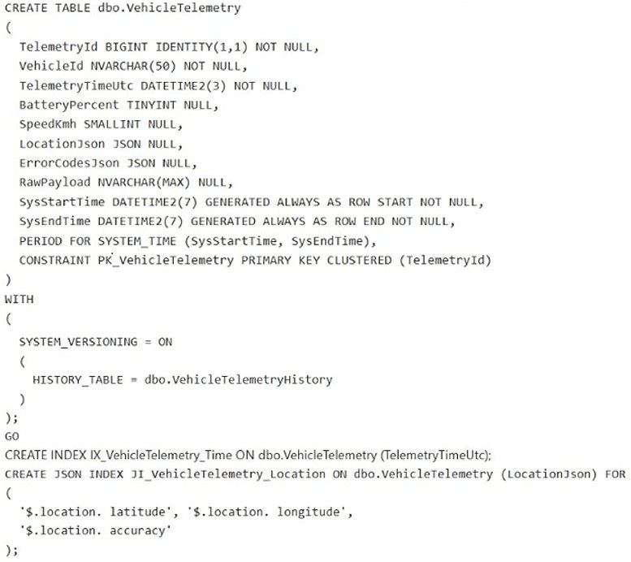
- Exhibit 5: 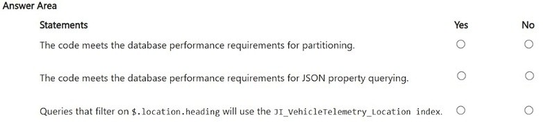

_HOTSPOT — the original ExamTopics question expects you to mark areas on the exhibit above; the correct hotspot coordinates are not published._

**Most voted:**
- The code meets the database performance requirements for partitioning: No
- The code meets the database performance requirements for JSON property querying: Yes
- Queries that filter on $.location.heading will use the JI_VehicleTelemetry_Location index: No

### Top explanations
- **pmajo** (8 upvotes [Most Recent, Highly Voted]): N – nothing about partitioning in the T-SQL code
  Y – CREATE JSON INDEX
  N - $.location.heading is not part of the JSON INDEX

## Q2.2 (ID 403600)

HOTSPOT
Existing Environment
Azure Environment
Contoso has an Azure subscription in North Europe that contains the corporate infrastructure. The current infrastructure contains a Microsoft SQL Server 2017 database. The database contains the following tables.
The FeedbackJson column has a full-text index and stores JSON documents in the following format.
The support staff at Contoso never has the UNMASK permission.
Problem Statements
Contoso is deploying a new Azure SQL database that will become the authoritative data store for the following:
AI workloads
Vector search
Modernized API access
Retrieval Augmented Generation (RAG) pipelines
Sometimes the ingestion pipeline fails due to malformed JSON and duplicate payloads.
The engineers at Contoso report that the following dashboard query runs slowly.
You review the execution plan and discover that the plan shows a clustered index scan.
VehicleIncidentReports often contains details about the weather, traffic conditions, and location. Analysts report that it is difficult to find similar incidents based on these details.
Requirements
Planned Changes
Contoso wants to modernize Fleet Intelligence Platform to support AI-powered semantic search over incident reports.
Security Requirements
Contoso identifies the following security requirements:
Restrict the support staff from viewing Personally Identifiable Information (PII) data, which is full email addresses and phone numbers.
Enforce row-level filtering so that analysts see only incidents for the fleets to which they are assigned. The analysts can be assigned to multiple fleets.
Database Performance and Requirements
Contoso identifies the following telemetry requirements:
Telemetry data must be stored in a partitioned table.
Telemetry data must provide predictable performance for ingestion and retention operations.
latitude, longitude, and accuracy JSON properties must be filtered by using an index seek.
Contoso identifies the following maintenance data requirements:
Ensure that any changes to a row in the MaintenanceEvents table updates the corresponding value in the LastModifiedUtc column to the time of the change.
Avoid recursive updates.
AI Search, Embeddings, and Vector Indexing
Contoso plans to implement semantic search over incident data to meet the following requirements:
Embeddings must be stored in dedicated Azure SQL Database tables.
Embeddings must be generated from rich natural language fields.
Chunking must preserve semantic coherence.
Hybrid search must combine the following:
Vector similarity
Keyword filtering or boosting
Development Requirements
The development team at Contoso will use Microsoft Visual Studio Code and GitHub Copilot and will retrieve live metadata from the databases.
Contoso identifies the following requirements for querying data in the FeedbackJson column of the CustomerFeedback table:
Extract the customer feedback text from the JSON document.
Filter rows where the JSON text contains a keyword.
Calculate a fuzzy similarity score between the feedback text and a known issue description.
Order the results by similarity score, with the highest score first.
You are creating a table that will store customer profiles.
You have the following Transact-SQL code.
For each of the following statements, select Yes if the statement is true. Otherwise, select No.
NOTE: Each correct selection is worth one point.

**Exhibits**
- Exhibit 1: 
- Exhibit 2: 
- Exhibit 3: 
- Exhibit 4: 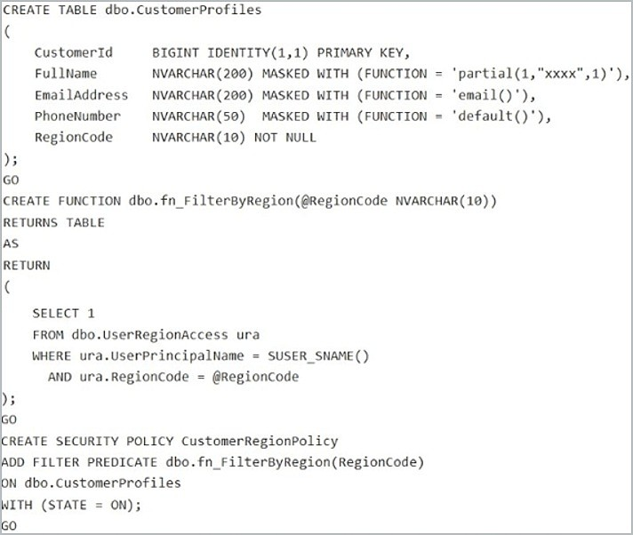
- Exhibit 5: 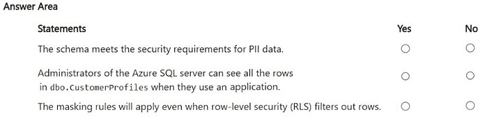

_HOTSPOT — the original ExamTopics question expects you to mark areas on the exhibit above; the correct hotspot coordinates are not published._

**Most voted:**
- The schema meets the security requirements for PII data: Yes
- Administrators of the Azure SQL server can see all the rows in dbo.CustomerProfiles when they use an application: No
- The masking rules will apply even when row-level security (RLS) filters out rows: No

### Top explanations
- **pmajo** (4 upvotes): Y – masking is defined for EmailAddress and PhoneNumber (PII requirements fullfilled).
  N – ROW LEVEL SECURITY (RLS) is enabled; SUSER_NAME() and data in table UserRegionAccess are filters.
  N – RLS is first, masking is done of filtered records.
- **gangreja** (2 upvotes [Most Recent]): The schema meets the security requirements for PII data.	Yes
  Administrators of the Azure SQL server can see all the rows in dbo.CustomerProfiles when they use an application.	No
  The masking rules will apply even when RLS filters out rows.	Yes (
  The two features are independent and stack. Rows that RLS removes are never returned, so there’s nothing to mask there. Every row that is returned still has its masks applied. RLS doesn’t switch masking off, and masking doesn’t affect which rows RLS returns.
  )

## Q2.3 (ID 403601)

DRAG DROP
Existing Environment
Azure Environment
Contoso has an Azure subscription in North Europe that contains the corporate infrastructure. The current infrastructure contains a Microsoft SQL Server 2017 database. The database contains the following tables.
The FeedbackJson column has a full-text index and stores JSON documents in the following format.
The support staff at Contoso never has the UNMASK permission.
Problem Statements
Contoso is deploying a new Azure SQL database that will become the authoritative data store for the following:
AI workloads
Vector search
Modernized API access
Retrieval Augmented Generation (RAG) pipelines
Sometimes the ingestion pipeline fails due to malformed JSON and duplicate payloads.
The engineers at Contoso report that the following dashboard query runs slowly.
You review the execution plan and discover that the plan shows a clustered index scan.
VehicleIncidentReports often contains details about the weather, traffic conditions, and location. Analysts report that it is difficult to find similar incidents based on these details.
Requirements
Planned Changes
Contoso wants to modernize Fleet Intelligence Platform to support AI-powered semantic search over incident reports.
Security Requirements
Contoso identifies the following security requirements:
Restrict the support staff from viewing Personally Identifiable Information (PII) data, which is full email addresses and phone numbers.
Enforce row-level filtering so that analysts see only incidents for the fleets to which they are assigned. The analysts can be assigned to multiple fleets.
Database Performance and Requirements
Contoso identifies the following telemetry requirements:
Telemetry data must be stored in a partitioned table.
Telemetry data must provide predictable performance for ingestion and retention operations.
latitude, longitude, and accuracy JSON properties must be filtered by using an index seek.
Contoso identifies the following maintenance data requirements:
Ensure that any changes to a row in the MaintenanceEvents table updates the corresponding value in the LastModifiedUtc column to the time of the change.
Avoid recursive updates.
AI Search, Embeddings, and Vector Indexing
Contoso plans to implement semantic search over incident data to meet the following requirements:
Embeddings must be stored in dedicated Azure SQL Database tables.
Embeddings must be generated from rich natural language fields.
Chunking must preserve semantic coherence.
Hybrid search must combine the following:
Vector similarity
Keyword filtering or boosting
Development Requirements
The development team at Contoso will use Microsoft Visual Studio Code and GitHub Copilot and will retrieve live metadata from the databases.
Contoso identifies the following requirements for querying data in the FeedbackJson column of the CustomerFeedback table:
Extract the customer feedback text from the JSON document.
Filter rows where the JSON text contains a keyword.
Calculate a fuzzy similarity score between the feedback text and a known issue description.
Order the results by similarity score, with the highest score first.
You need to meet the database performance requirements for maintenance data.
How should you complete the Transact-SQL code? To answer, drag the appropriate values to the correct targets. Each value may be used once, more than once, or not at all. You may need to drag the split bar between panes or scroll to view content.
NOTE: Each correct selection is worth one point.

**Exhibits**
- Exhibit 1: 
- Exhibit 2: 
- Exhibit 3: 
- Exhibit 4: 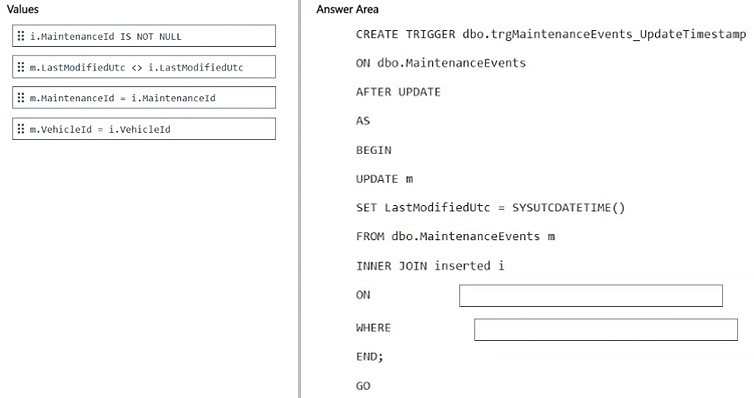

_DRAG DROP — the original ExamTopics question expects you to drag and drop items; the correct targets are not published._

**Most voted:**
- INNER JOIN inserted i ON: m.MaintenanceId = i.MaintenanceId
- WHERE: m.LastModifiedUtc <> i.LastModifiedUtc

### Top explanations
- **Ahmadpbi** (9 upvotes [Most Recent, Highly Voted]): First answer should be
  m.MaintenanceID = i.MaintenanceID
  The join must use MaintenanceId because that is the primary key of MaintenanceEvents in the case study.

## Q2.4 (ID 403602)

Existing Environment
Azure Environment
Contoso has an Azure subscription in North Europe that contains the corporate infrastructure. The current infrastructure contains a Microsoft SQL Server 2017 database. The database contains the following tables.
The FeedbackJson column has a full-text index and stores JSON documents in the following format.
The support staff at Contoso never has the UNMASK permission.
Problem Statements
Contoso is deploying a new Azure SQL database that will become the authoritative data store for the following:
AI workloads
Vector search
Modernized API access
Retrieval Augmented Generation (RAG) pipelines
Sometimes the ingestion pipeline fails due to malformed JSON and duplicate payloads.
The engineers at Contoso report that the following dashboard query runs slowly.
You review the execution plan and discover that the plan shows a clustered index scan.
VehicleIncidentReports often contains details about the weather, traffic conditions, and location. Analysts report that it is difficult to find similar incidents based on these details.
Requirements
Planned Changes
Contoso wants to modernize Fleet Intelligence Platform to support AI-powered semantic search over incident reports.
Security Requirements
Contoso identifies the following security requirements:
Restrict the support staff from viewing Personally Identifiable Information (PII) data, which is full email addresses and phone numbers.
Enforce row-level filtering so that analysts see only incidents for the fleets to which they are assigned. The analysts can be assigned to multiple fleets.
Database Performance and Requirements
Contoso identifies the following telemetry requirements:
Telemetry data must be stored in a partitioned table.
Telemetry data must provide predictable performance for ingestion and retention operations.
latitude, longitude, and accuracy JSON properties must be filtered by using an index seek.
Contoso identifies the following maintenance data requirements:
Ensure that any changes to a row in the MaintenanceEvents table updates the corresponding value in the LastModifiedUtc column to the time of the change.
Avoid recursive updates.
AI Search, Embeddings, and Vector Indexing
Contoso plans to implement semantic search over incident data to meet the following requirements:
Embeddings must be stored in dedicated Azure SQL Database tables.
Embeddings must be generated from rich natural language fields.
Chunking must preserve semantic coherence.
Hybrid search must combine the following:
Vector similarity
Keyword filtering or boosting
Development Requirements
The development team at Contoso will use Microsoft Visual Studio Code and GitHub Copilot and will retrieve live metadata from the databases.
Contoso identifies the following requirements for querying data in the FeedbackJson column of the CustomerFeedback table:
Extract the customer feedback text from the JSON document.
Filter rows where the JSON text contains a keyword.
Calculate a fuzzy similarity score between the feedback text and a known issue description.
Order the results by similarity score, with the highest score first.
You need to recommend a solution to resolve the slow dashboard query issue.
What should you recommend?

**Exhibits**
- Exhibit 1: 
- Exhibit 2: 
- Exhibit 3: 

⭕ **A.** Create a clustered index on LastUpdatedUtc.
✅ **B.** On FleetId, create a nonclustered index that includes LastUpdatedUtc, EngineStatus, and BatteryHealth.
⭕ **C.** On LastUpdatedUtc, create a nonclustered index that includes FleetId.
⭕ **D.** On FleetId, create a filtered index where LastUpdatedUtc > DATEADD(DAY, -7, SYSUTCDATETIME()).

**Correct answer:** B
**Most voted:** B

### Top explanations
- **gangreja** (2 upvotes [Most Recent, Selected Answer: B]): Key on FleetId: WHERE FleetId = @FleetId becomes an index seek instead of the clustered index scan.
  INCLUDE the other columns: every column the query returns is in the index. VehicleId comes free as the clustered key. So there are no key lookups and the index covers the query.

## Q2.7 (ID 403605)

You have an Azure SQL database named SalesDB that contains a table named dbo.Articles. dbo.Articles contains two million articles with embeddings. The articles are updated frequently throughout the day.
You query the embeddings by using VECTOR_SEARCH.
Users report that semantic search results do NOT reflect the updates until the following day.
You need to ensure that the embeddings are updated whenever the articles change. The solution must minimize CPU usage on SalesDB.
Which embedding maintenance method should you implement?

⭕ **A.** Modify the query to use VECTOR_DISTANCE instead of VECTOR_SEARCH.
✅ **B.** Enable change data capture (CDC) on dbo.Articles and use an Azure Functions app to process CDC changes.
⭕ **C.** Run an hourly Transact-SQL job that regenerates embeddings for all the rows in dbo.Articles.
⭕ **D.** On dbo.Articles, create a trigger that calls AI_GENERATE_EMBEDDINGS for each inserted or updated row.

**Correct answer:** B
**Most voted:** B

### Top explanations
- **gangreja** (1 upvotes [Most Recent, Selected Answer: B]): Embeddings update whenever articles change	CDC records every insert and update, and the Function picks up the changed rows soon after
  Minimize CPU on SalesDB	The heavy work runs in Azure Functions, not inside the database. SQL only records changes and accepts the final UPDATE

## Q2.10 (ID 403608)

DRAG DROP
You have a database named DB1. The schema is stored in a GitHub repository as an SDK-style SQL database project.
You use a feature branch workflow to deploy changes to DB1.
You need to update the local feature branch with the latest changes to main, and then create a pull request to merge the feature branch into main for review.
How should you complete the GitHub CLI script? To answer, drag the appropriate values to the correct targets. Each value may be used once, more than once, or not at all. You may need to drag the split bar between panes or scroll to view content.
NOTE: Each correct selection is worth one point.

**Exhibits**
- Exhibit 1: 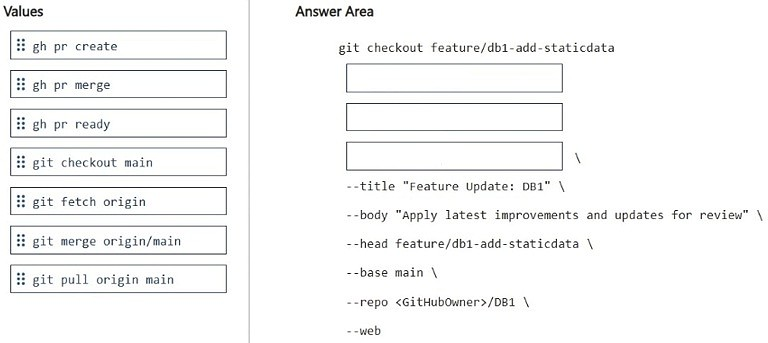

_DRAG DROP — the original ExamTopics question expects you to drag and drop items; the correct targets are not published._

**Most voted:**
- Step 1: git fetch origin
- Step 2: git merge origin/main
- Step 3: gh pr create

### Top explanations
- **gangreja** (1 upvotes [Most Recent]): git fetch origin           # 1. download the latest from GitHub (doesn't change your files)
  git merge origin/main      # 2. merge the latest main into your feature branch
  gh pr create \             # 3. open the pull request

## Q2.12 (ID 403610)

HOTSPOT
You have a database named db1. The schema is stored in a Git repository as an SDK-style SQL database project. The repository contains the following GitHub Action workflow.
For each of the following statements, select Yes if the statement is true. Otherwise, select No.
NOTE: Each correct selection is worth one point.

**Exhibits**
- Exhibit 1: 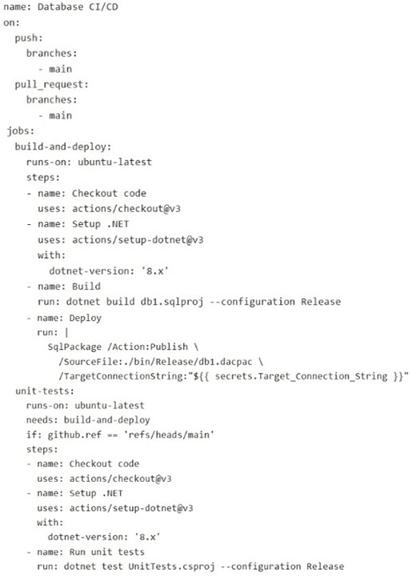
- Exhibit 2: 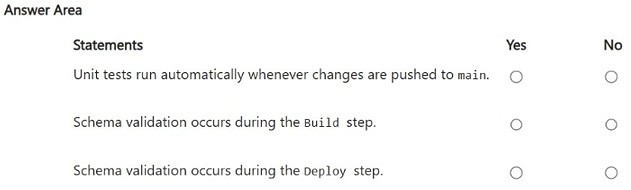

_HOTSPOT — the original ExamTopics question expects you to mark areas on the exhibit above; the correct hotspot coordinates are not published._

**Most voted:**
- Unit tests run automatically whenever changes are pushed to main: Yes
- Schema validation occurs during the Build step: Yes
- Schema validation occurs during the Deploy step: Yes

### Top explanations
- **a13b6ea** (1 upvotes [Most Recent]): Answers: Yes / Yes / Yes.
  Unit tests run after a successful build and deployment on pushes to main; schema validation occurs during both Build and Deploy.

## Q2.13 (ID 403611)

You have a Microsoft SQL Server 2025 instance that contains a database named SalesDB. SalesDB supports a Retrieval Augmented Generation (RAG) pattern for internal support tickets. The SQL Server instance runs without any outbound network connectivity.
You plan to generate embeddings inside the SQL Server instance and store them in a table for vector similarity queries.
You need to ensure that only a database user account named AIApplicationUser can run embedding generation by using the model.
Which two actions should you perform? Each correct answer presents part of the solution.
NOTE: Each correct selection is worth one point.

⭕ **A.** Grant the CONTROL permission on SalesDB to AIApplicationUser.
⭕ **B.** Create a database audit specification on SalesDB owned by AIApplicationUser.
✅ **C.** Grant the EXECUTE permission on the external model project to AIApplicationUser.
✅ **D.** Create an external model project by using ONNX runtime and local paths.
⭕ **E.** Create an external model project that points to a Microsoft Foundry REST endpoint.

**Correct answer:** C, D
**Most voted:** CD

### Top explanations
- **Yatajga** (4 upvotes [Selected Answer: CD]): Because the SQL Server instance has no outbound connectivity, the model and ONNX runtime must be hosted locally. LOCATION identifies the local model files, while LOCAL_RUNTIME_PATH identifies the ONNX runtime libraries.
- **CoolSmartDude** (2 upvotes [Most Recent, Selected Answer: CD]): the SQL Server has no outbound connectivity, so a Microsoft Foundry REST endpoint won’t work. SQL Server 2025 supports running an ONNX embedding model locally through CREATE EXTERNAL MODEL, and Microsoft specifically documents that users who need to invoke that model can be granted EXECUTE on the external model object.

## Q2.14 (ID 403612)

DRAG DROP
You have an Azure SQL database that supports an OLTP application.
You need to write Transact-SQL code that returns blocking chain details. The output must return only sessions that are blocked or are blocking other sessions.
How should you complete the code? To answer, drag the appropriate values to the correct targets. Each value may be used once, more than once, or not at all. You may need to drag the split bar between panes or scroll to view content.
NOTE: Each correct selection is worth one point.

**Exhibits**
- Exhibit 1: 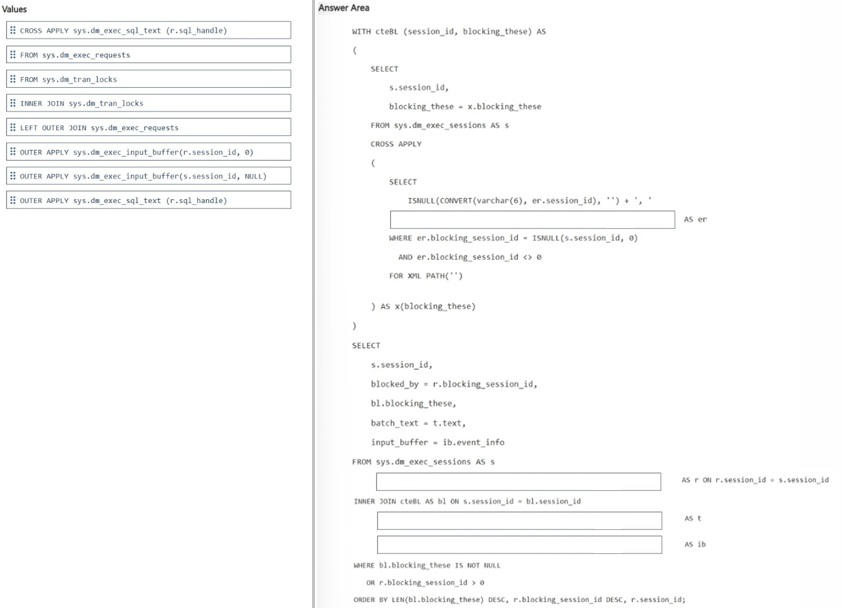

_DRAG DROP — the original ExamTopics question expects you to drag and drop items; the correct targets are not published._

**Most voted:**
- Box 1 (inside the CTE, AS er): FROM sys.dm_exec_requests
- Box 2 (AS r ON r.session_id = s.session_id): LEFT OUTER JOIN sys.dm_exec_requests
- Box 3 (AS t): OUTER APPLY sys.dm_exec_sql_text (r.sql_handle)
- Box 4 (AS ib): OUTER APPLY sys.dm_exec_input_buffer(s.session_id, NULL)

### Top explanations
- **gangreja** (2 upvotes [Most Recent]): Box 1 (inside the CTE, AS er)	FROM sys.dm_exec_requests
  Box 2 (AS r ON r.session_id = s.session_id)	LEFT OUTER JOIN sys.dm_exec_requests
  Box 3 (AS t)	OUTER APPLY sys.dm_exec_sql_text (r.sql_handle)
  Box 4 (AS ib)	OUTER APPLY sys.dm_exec_input_buffer(s.session_id, NULL)

## Q2.18 (ID 403616)

HOTSPOT
You have a Microsoft Fabric workspace named Workspace1 that contains a SQL database named SalesDB and an API for GraphQL item named SalesApi.
You have a Microsoft Entra group named SqlUsers.
From Workspace1, you assign permission to SalesApi as shown in the following exhibit.
The connection to SalesDB has the connectivity option configured as shown in the following exhibit.
SqlUsers has the Viewer role for Workspace1.
For each of the following statements, select Yes if the statement is true. Otherwise, select No.
NOTE: Each correct selection is worth one point.

**Exhibits**
- Exhibit 1: 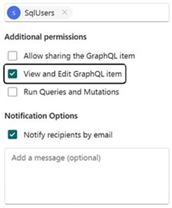
- Exhibit 2: 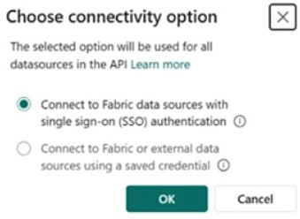
- Exhibit 3: 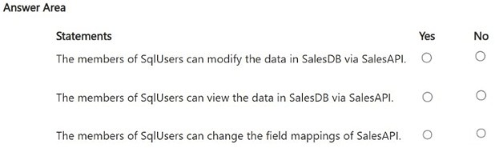

_HOTSPOT — the original ExamTopics question expects you to mark areas on the exhibit above; the correct hotspot coordinates are not published._

**Most voted:**
- Members of SqlUsers can modify the data in SalesDB via SalesApi: No
- Members of SqlUsers can view the data in SalesDB via SalesApi: No
- Members of SqlUsers can change the field mappings of SalesApi: Yes

### Top explanations
- **Ahmadpbi** (3 upvotes): I think last one should be "yes".
  The permission View and Edit GraphQL item is explicitly checked for SqlUsers.
  This allows them to modify the GraphQL schema, including field mappings, relationships, and other configuration of the API item itself.
  This permission is independent of the Run Queries and Mutations permission.
- **gangreja** (1 upvotes [Most Recent]): Members of SqlUsers can modify the data in SalesDB via SalesApi.	No
  --Modifying data means running a mutation, which requires Run Queries and Mutations. That box isn’t ticked.
  Members of SqlUsers can view the data in SalesDB via SalesApi.		No
  --Reading data means running a query, which needs the same missing permission, Run Queries and Mutations.“View” in “View and Edit GraphQL item” means viewing the API item itself (its definition) in the Fabric portal, not viewing the data behind it
  Members of SqlUsers can change the field mappings of SalesApi.		Yes
  --Field mappings are part of the API’s definition: which tables and columns are exposed, renamed fields, and relationships. Editing them is editing the item, which is exactly what View and Edit GraphQL item grants. This item-level permission works even though the workspace role is only Viewer.

## Q2.19 (ID 403617)

You have an Azure SQL database that supports the OLTP workload of an order-processing application.
During a 10-minute incident window, you run a dynamic management view query and discover the following:
Session 72 is sleeping with open_transaction_count = 1.
Multiple other sessions show blocking_session_id = 72 in sys.dm_exec_requests.
sys.dm_exec_input_buffer(72, NULL) returns only BEGIN TRANSACTION UPDATE Sales.Orders.
Users report that updates to Sales.Orders intermittently time out during the incident window. The timeouts stop only after you manually terminate session 72.
What is a possible cause of the blocking?

⭕ **A.** A long-running SELECT statement is blocking writers.
⭕ **B.** Session 72 caused a deadlock.
✅ **C.** An explicit transaction was started but not committed or rolled back.
⭕ **D.** A lock escalation occurred.

**Correct answer:** C
**Most voted:** C

### Top explanations
- **gangreja** (2 upvotes [Most Recent, Selected Answer: C]): sleeping + open_transaction_count > 0 + blocking others means an orphaned open transaction and it blocks until someone commits, rolls back or kills the session

## Q2.20 (ID 403618)

HOTSPOT
You have a SQL database in Microsoft Fabric that contains the following functions:
A multi-statement table-valued function (TVF) named Sales.mstvf_OrderStatus() that returns order status information
A scalar user-defined function (UDF) named dbo.ufn_GetTaxMultiplier (@TaxAmt money, @StateCode char(2)) that returns a numeric multiplier used in tax calculations
Reporting queries frequently join Sales.mstvf_OrderStatus() to a table named Sales.SalesOrderHeader and return large result sets. A performance review shows that the queries produce inconsistent execution plans.
During a code review, a developer discovers that the following Transact-SQL statement produced an error.
EXEC @ret = ufn_GetTaxMultiplier @TaxAmt = 100.00, @StateCode = ‘WA’;
For each of the following statements, select Yes if the statement is true. Otherwise, select No.
NOTE: Each correct selection is worth one point.

**Exhibits**
- Exhibit 1: 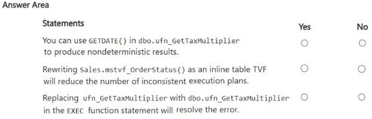

_HOTSPOT — the original ExamTopics question expects you to mark areas on the exhibit above; the correct hotspot coordinates are not published._

**Most voted:**
- You can use GETDATE() in dbo.ufn_GetTaxMultiplier to produce nondeterministic results: Yes
- Rewriting Sales.mstvf_OrderStatus() as an inline table TVF will reduce the number of inconsistent execution plans: Yes
- Replacing ufn_GetTaxMultiplier with dbo.ufn_GetTaxMultiplier in the EXEC function statement will resolve the error: Yes

### Top explanations
- **Sr18** (2 upvotes [Most Recent]): I mean, one should not use. But it can be used and adding dbo. schema will fix the issue also.
  So YES, YES, YES
- **pmajo** (1 upvotes): I think last should be NO, you should not use EXEC with user-definied function; you should use SELECT or SET.

## Q2.30 (ID 403628)

Note: This question is part of a series of questions that present the same scenario. Each question in the series contains a unique solution that might meet the stated goals. Some question sets might have more than one correct solution, while others might not have a correct solution.
After you answer a question in this section, you will NOT be able to return to it. As a result, these questions will not appear in the review screen.
You have an SDK-style SQL database project stored in a Git repository. The project targets an Azure SQL database.
The CI build fails with unresolved reference errors when the project references system objects.
You need to update the SQL database project to ensure that dotnet build validates successfully by including the correct system objects in the database model for Azure SQL Database.
Solution: Add an artifact reference to the Azure SQL Database master.dacpac file.
Does this meet the goal?

✅ **A.** Yes
⭕ **B.** No

**Correct answer:** A
**Most voted:** A

### Top explanations
- **AlltheMSCerts** (2 upvotes [Most Recent, Selected Answer: A]): Adding the reference is totally possible but not the easiest option. I see no requirement to minimize effort, therefore A is correct.
- **Ahmadpbi** (2 upvotes [Selected Answer: A]): A. Yes
  Adding an artifact reference to the Azure SQL Database master.dacpac file is a valid and documented method to resolve unresolved reference errors for system objects in an SDK-style SQL database project. This approach works because the artifact reference explicitly includes the correct system model for the target platform (Azure SQL Database) in the project's build process, allowing dotnet build to validate references to system objects successfully.

## Q2.32 (ID 419647)

HOTSPOT
Existing Environment
Azure Environment
Fabrikam has a single Azure subscription in the East US 2 Azure region. The subscription contains an Azure SQL database named DB1. DB1 contains the following tables:
•	Patients
•	Employees
•	Procedures
•	Transactions
•	UsefulPrompts
•	ProcedureDocuments
You store a column master key as a secret in Azure Key Vault.
You have an on-premises application named TransactionProcessing that uses a hard-coded username and password in a connection string to access DB1.
Problem Statements
Users report that after executing a long-running stored procedure named sp_UpdateProcedureForPatient, updates to the underlying data are sometimes inconsistent.
Requirements
Planned Changes
Fabrikam plans to manage all changes to Azure SQL Database objects by using source control in GitHub. Every pull request submitted to production will be validated before it can be merged. Deployments must use the Release configuration.
Security Requirements
Fabrikam identifies the following security requirements:
•	The TransactionProcessing application must use a passwordless connection to DB1.
•	The Employees table contains two columns named TaxID and Salary that must be encrypted at rest.
•	Auditors must have a tamper-evident history of transactions with cryptographic proof of changes to the employee data.
Database Performance Requirements
Records accessed by using sp_UpdateProcedureForPatient must NOT be changed by other transactions while the stored procedure runs.
AI Search, Embeddings, and Vector Indexing
Fabrikam identifies the following AI-related requirements:
•	Queries to the ProcedureDocuments table must use Reciprocal Rank Fusion (RRF).
•	Users must be able to query the data in DB1 by using prompts in Copilot in Microsoft Fabric.
•	The UsefulPrompts table will store prompts that doctors can use to help diagnose patient illness by connecting to an Azure OpenAI endpoint.
Development Requirements
Fabrikam identifies the following development requirements:
•	Provide the functionality to retrieve all the transactions of a given patient between two dates, showing a running total.
•	Expose a Data API builder (DAB) configuration file to enable Azure services to perform the following operations over a REST API:
o	Read data from the procedures table without authentication.
o	Read and insert data into the Transactions table once authenticated.
o	Execute the sp_UpdateProcedurePatient stored procedure.
•	Provide the functionality to retrieve a list of the names of patients who underwent medical procedures during the last 30 days.
•	Information for each medical procedure will be stored in a table. The table will be used with a large language model (LLM) for user querying and will have the following structure.
DAB
You create a DAB configuration file that meets the development requirements for DB1 and includes the following entities.
You need to create a solution that meets the development requirements for retrieving the patient transaction data. The solution must ensure that database developers use the resulting data to join to other tables.
How should you complete the Transact-SQL code? To answer, select the appropriate options in the answer area.
NOTE: Each correct selection is worth one point.

**Exhibits**
- Exhibit 1: 
- Exhibit 2: 
- Exhibit 3: 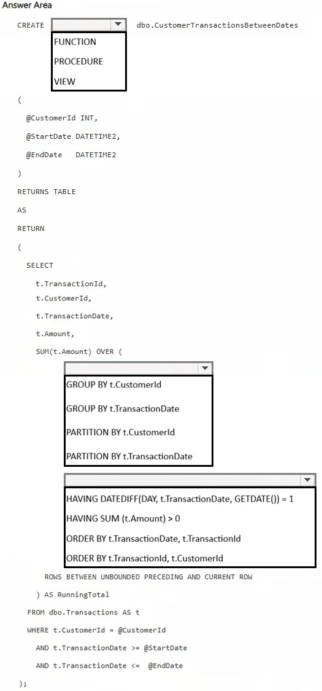

_HOTSPOT — the original ExamTopics question expects you to mark areas on the exhibit above; the correct hotspot coordinates are not published._

**Most voted:**
- CREATE: FUNCTION
- OVER (first clause): PARTITION BY t.CustomerId
- OVER (second clause): ORDER BY t.TransactionDate, t.TransactionId

### Top explanations
- **gangreja** (1 upvotes [Most Recent]): CREATE					FUNCTION
  Inside OVER, first		PARTITION BY t.CustomerId: The running total restarts for each customer
  Inside OVER, second		ORDER BY t.TransactionDate, t.TransactionId: A running total needs a time order: each row adds to the ones before it.TransactionId as a tie-breaker: two transactions on the same date get a fixed order, so the total increases one row at a time and the result is deterministic

## Q2.33 (ID 419649)

Existing Environment
Azure Environment
Fabrikam has a single Azure subscription in the East US 2 Azure region. The subscription contains an Azure SQL database named DB1. DB1 contains the following tables:
•	Patients
•	Employees
•	Procedures
•	Transactions
•	UsefulPrompts
•	ProcedureDocuments
You store a column master key as a secret in Azure Key Vault.
You have an on-premises application named TransactionProcessing that uses a hard-coded username and password in a connection string to access DB1.
Problem Statements
Users report that after executing a long-running stored procedure named sp_UpdateProcedureForPatient, updates to the underlying data are sometimes inconsistent.
Requirements
Planned Changes
Fabrikam plans to manage all changes to Azure SQL Database objects by using source control in GitHub. Every pull request submitted to production will be validated before it can be merged. Deployments must use the Release configuration.
Security Requirements
Fabrikam identifies the following security requirements:
•	The TransactionProcessing application must use a passwordless connection to DB1.
•	The Employees table contains two columns named TaxID and Salary that must be encrypted at rest.
•	Auditors must have a tamper-evident history of transactions with cryptographic proof of changes to the employee data.
Database Performance Requirements
Records accessed by using sp_UpdateProcedureForPatient must NOT be changed by other transactions while the stored procedure runs.
AI Search, Embeddings, and Vector Indexing
Fabrikam identifies the following AI-related requirements:
•	Queries to the ProcedureDocuments table must use Reciprocal Rank Fusion (RRF).
•	Users must be able to query the data in DB1 by using prompts in Copilot in Microsoft Fabric.
•	The UsefulPrompts table will store prompts that doctors can use to help diagnose patient illness by connecting to an Azure OpenAI endpoint.
Development Requirements
Fabrikam identifies the following development requirements:
•	Provide the functionality to retrieve all the transactions of a given patient between two dates, showing a running total.
•	Expose a Data API builder (DAB) configuration file to enable Azure services to perform the following operations over a REST API:
o	Read data from the procedures table without authentication.
o	Read and insert data into the Transactions table once authenticated.
o	Execute the sp_UpdateProcedurePatient stored procedure.
•	Provide the functionality to retrieve a list of the names of patients who underwent medical procedures during the last 30 days.
•	Information for each medical procedure will be stored in a table. The table will be used with a large language model (LLM) for user querying and will have the following structure.
DAB
You create a DAB configuration file that meets the development requirements for DB1 and includes the following entities.
You need to recommend a solution for the TransactionProcessing application that meets the security requirements.
What should you include in the recommendation?

**Exhibits**
- Exhibit 1: 
- Exhibit 2: 

✅ **A.** a service principal
⭕ **B.** a system-assigned managed identity
⭕ **C.** a shared access key
⭕ **D.** a user-assigned managed identity

**Correct answer:** A
**Most voted:** A

### Top explanations
- **gangreja** (1 upvotes [Most Recent, Selected Answer: A]): The key detail from the Fabrikam case is that TransactionProcessing is an on-premises application.A service principal is an app identity registered in Microsoft Entra ID that can sign in from anywhere, including on-premises.

## Q2.34 (ID 419650)

HOTSPOT
Existing Environment
Azure Environment
Fabrikam has a single Azure subscription in the East US 2 Azure region. The subscription contains an Azure SQL database named DB1. DB1 contains the following tables:
•	Patients
•	Employees
•	Procedures
•	Transactions
•	UsefulPrompts
•	ProcedureDocuments
You store a column master key as a secret in Azure Key Vault.
You have an on-premises application named TransactionProcessing that uses a hard-coded username and password in a connection string to access DB1.
Problem Statements
Users report that after executing a long-running stored procedure named sp_UpdateProcedureForPatient, updates to the underlying data are sometimes inconsistent.
Requirements
Planned Changes
Fabrikam plans to manage all changes to Azure SQL Database objects by using source control in GitHub. Every pull request submitted to production will be validated before it can be merged. Deployments must use the Release configuration.
Security Requirements
Fabrikam identifies the following security requirements:
•	The TransactionProcessing application must use a passwordless connection to DB1.
•	The Employees table contains two columns named TaxID and Salary that must be encrypted at rest.
•	Auditors must have a tamper-evident history of transactions with cryptographic proof of changes to the employee data.
Database Performance Requirements
Records accessed by using sp_UpdateProcedureForPatient must NOT be changed by other transactions while the stored procedure runs.
AI Search, Embeddings, and Vector Indexing
Fabrikam identifies the following AI-related requirements:
•	Queries to the ProcedureDocuments table must use Reciprocal Rank Fusion (RRF).
•	Users must be able to query the data in DB1 by using prompts in Copilot in Microsoft Fabric.
•	The UsefulPrompts table will store prompts that doctors can use to help diagnose patient illness by connecting to an Azure OpenAI endpoint.
Development Requirements
Fabrikam identifies the following development requirements:
•	Provide the functionality to retrieve all the transactions of a given patient between two dates, showing a running total.
•	Expose a Data API builder (DAB) configuration file to enable Azure services to perform the following operations over a REST API:
o	Read data from the procedures table without authentication.
o	Read and insert data into the Transactions table once authenticated.
o	Execute the sp_UpdateProcedurePatient stored procedure.
•	Provide the functionality to retrieve a list of the names of patients who underwent medical procedures during the last 30 days.
•	Information for each medical procedure will be stored in a table. The table will be used with a large language model (LLM) for user querying and will have the following structure.
DAB
You create a DAB configuration file that meets the development requirements for DB1 and includes the following entities.
You create an SDK-style SQL database project in Microsoft Visual Studio Code named Database.sqlproj and add the project to a GitHub repository.
You need to configure a GitHub Actions workflow to support the planned changes for DB1.
How should you complete the workflow? To answer, select the appropriate options in the
answer area.
NOTE: Each correct selection is worth one point.

**Exhibits**
- Exhibit 1: 
- Exhibit 2: 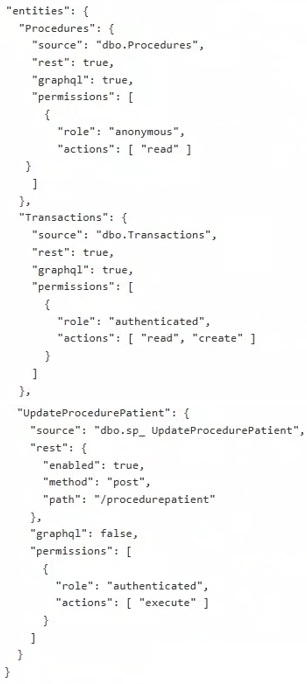
- Exhibit 3: 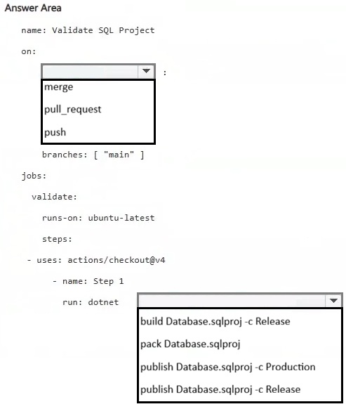

_HOTSPOT — the original ExamTopics question expects you to mark areas on the exhibit above; the correct hotspot coordinates are not published._

**Most voted:**
- on: pull_request
- run: dotnet: build Database.sqlproj -c Release

### Top explanations
- **pmajo** (2 upvotes [Most Recent]): I think first should be pull_requests.
  Case study says: Every pull request submitted to production will be validated before it can be merged.

## Q2.36 (ID 419645)

Note: This question is part of a series of questions that present the same scenario. Each question in the series contains a unique solution that might meet the stated goals. Some question sets might have more than one correct solution, while others might not have a correct solution.
After you answer a question in this section, you will NOT be able to return to it. As a result, these questions will not appear in the review screen.
You have an SDK-style SQL database project stored in a Git repository. The project targets an Azure SQL database.
The CI build fails with unresolved reference errors when the project references system objects.
You need to update the SQL database project to ensure that dotnet build validates successfully by including the correct system objects in the database model for Azure SQL Database.
Solution: Build the project by running dotnet build -bl -flp:v=diag.
Does this meet the goal?

⭕ **A.** Yes
✅ **B.** No

**Correct answer:** B
**Most voted:** B

### Top explanations
- **gangreja** (2 upvotes [Most Recent, Selected Answer: B]): Those flags only change logging. They don’t add anything to the project

## Q2.40 (ID 419638)

HOTSPOT
You have an Azure SQL database named ProductsDB.
You deploy Data API builder (DAB) to Azure Container Apps.
You discover that the container app cannot connect to ProductsDB.
Your development team reports that the container app is unreachable from the internet for integration tests.
You need to update Azure SQL Database and Container Apps to meet the following requirements:
•	Ensure that the Azure SQL logical server allows connections from Azure services.
•	Ensure that the Container Apps environment accepts inbound requests from the public internet.
What should you configure? To answer, select the appropriate options in the answer area.
NOTE: Each correct selection is worth one point.

**Exhibits**
- Exhibit 1: 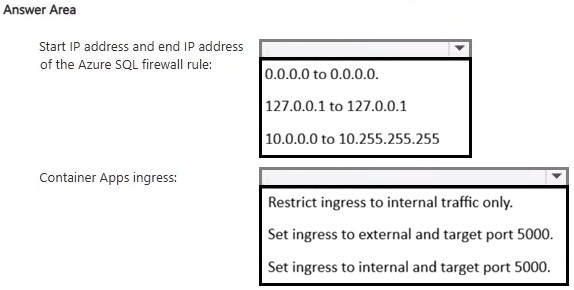

_HOTSPOT — the original ExamTopics question expects you to mark areas on the exhibit above; the correct hotspot coordinates are not published._

**Most voted:**
- Start IP address and end IP address of the Azure SQL firewall rule: 0.0.0.0 to 0.0.0.0.
- Container Apps ingress: Set ingress to external and target port 5000.

### Top explanations
- **ItsMompo** (2 upvotes [Most Recent]): The answer of examtopics is correct
- **Skri113xX** (1 upvotes [Selected Answer: B]): This seems like a trick question. I'm tentatively choosing B.

## Q2.41 (ID 419636)

You have a database that contains production data. The schema is stored in a Git repository as an SDK-style SQL database project and contains the following reference data.
A deployment pipeline can be rerun automatically when a transient failure occurs.
You need to deploy the reference data as part of the same CI/CD process. Rerunning the pipeline must produce the same outcome and must NOT create duplicate rows.
What should you do?

**Exhibits**
- Exhibit 1: 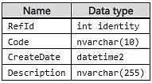

✅ **A.** Add a post-deployment script that inserts reference rows by using IF NOT EXISTS or MERGE logic.
⭕ **B.** Restore a backup after each deployment.
⭕ **C.** Store the reference values in GitHub repository secrets.

**Correct answer:** A
**Most voted:** A

### Top explanations
- **exam_upskill** (5 upvotes [Selected Answer: A]): using IF NOT EXISTS or MERGE logic
- **BozaXephon** (4 upvotes [Most Recent, Selected Answer: A]): Correct Answer: A. Add a post-deployment script that inserts reference rows by using IF NOT EXISTS or MERGE logic.
  Post-Deployment Scripts: DACPAC deployments manage database schema but do not manage static or seed data by default. Adding a post-deployment script (Script.PostDeployment.sql) containing conditional IF NOT EXISTS or MERGE statements guarantees that data is only inserted if missing, updated if changed, and never duplicated upon rerun.
  Why other options are incorrect:
  Option B: Restoring a backup on every deployment would overwrite existing production data and cause severe downtime/data loss.
  Option C: GitHub repository secrets are designed for securing sensitive credentials (e.g., connection strings or tokens), not for storing or populating database reference datasets.
- **Skri113xX** (1 upvotes [Selected Answer: C]): Locked in on C. The other choices are clearly distractors.

## Q2.42 (ID 419633)

You have an Azure SQL database named ProductsDB.
You deploy Data API builder (DAB) to Azure Container Apps by using the mcr.microsoft.com/azure-databases /data-api-builder:latest image.
The container app has the following configurations:
•	Secrets: mssql-connection-string, dab-config-base64
•	Environment variables:
•	MSSQL_CONNECTION_STRING=secretref:mssql-connection-string
•	DAB_CONFIG_BASE64=secretref:dab-config-base64
•	Ingress: External on port 5000
Users report that the /health endpoint returns a healthy response, but all requests that query an entity named Products fail and generate a connection error.
You confirm that the SQL login in the connection string is correct and the database exists.
You need to ensure that the container app can establish connections to the Azure SQL logical server without changing the container app deployment settings or the DAB configuration file.
What should you do on the Azure SQL logical server?

⭕ **A.** Create an auto-failover group for ProductsDB.
⭕ **B.** Run DBCC CHECKDB on ProductsDB.
✅ **C.** Create a firewall rule that allows a start and end IP address of 0.0.0.0.
⭕ **D.** Enable FORCE_LAST_GOOD_PLAN automatic tuning for ProductsDB.

**Correct answer:** C
**Most voted:** C

### Top explanations
- **Ahmadpbi** (2 upvotes [Most Recent, Selected Answer: C]): The /health endpoint responds successfully, but entity queries fail with a connection error. This indicates that the Data API builder (DAB) container app can reach the SQL logical server (the health check passes), but the actual SQL connection is being blocked.
  The firewall rule 0.0.0.0 to 0.0.0.0 enables the "Allow Azure services and resources to access this server" setting. This allows Azure services (like Container Apps) to connect to the SQL logical server, even though the traffic originates from Azure's internal IP ranges.
- **Skri113xX** (1 upvotes [Selected Answer: C]): I'm torn between C and [Option X]. Can someone explain why C is the better choice?

## Q2.45 (ID 419674)

HOTSPOT
You have a SQL database in Microsoft Fabric that uses the default settings for a newly created database and contains a table named Sales.Orders.
You have an application that uses two stored procedures to access Sales.Orders.
While monitoring database activity, you discover the following:
•	sys.dm_exec_requests shows multiple sessions in a suspended state with wait_type = LCK_M_X. All the sessions show the same wait_resource, which maps to Sales.Orders, and the same nonzero blocking_session_id.
•	sys.dm_exec_input_buffer(blocking_session_id, NULL) returns a last submitted command of BEGIN TRANSACTION UPDATE Sales.Orders.
•	sys.dm_exec_sessions for the blocking session shows status = sleeping and open_transaction_count = 1.
For each of the following statements, select Yes if the statement is true. Otherwise, select No.
NOTE: Each correct selection is worth one point.

**Exhibits**
- Exhibit 1: 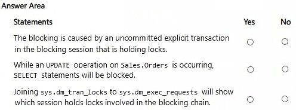

_HOTSPOT — the original ExamTopics question expects you to mark areas on the exhibit above; the correct hotspot coordinates are not published._

**Most voted:**
- The blocking is caused by an uncommitted explicit transaction in the blocking session that is holding locks: Yes
- While an UPDATE operation on Sales.Orders is occurring, SELECT statements will be blocked: No
- Joining sys.dm_tran_locks to sys.dm_exec_requests will show which session holds locks involved in the blocking chain: No

### Top explanations
- **BozaXephon** (2 upvotes): Yes, No, No
- **BozaXephon** (1 upvotes [Most Recent]): Statement 1: The blocking is caused by an uncommitted explicit transaction in the blocking session that is holding locks.
  Answer: Yes
  Explanation: The blocking session exhibits open_transaction_count = 1, a status of sleeping, and a last command starting with BEGIN TRANSACTION. This indicates that an explicit transaction was opened and modified data but was never closed with a COMMIT or ROLLBACK, leaving exclusive locks active on Sales.Orders.
- **BozaXephon** (1 upvotes): Statement 2: While an UPDATE operation on Sales.Orders is occurring, SELECT statements will be blocked.
  Answer: No
  Explanation: SQL Database in Microsoft Fabric (and Azure SQL Database) operates with Read Committed Snapshot Isolation (RCSI) enabled by default. Under RCSI, read operations (SELECT) use row-versioning to retrieve a consistent snapshot of the data without requesting shared locks, preventing SELECT statements from being blocked by concurrent UPDATE locks
- **BozaXephon** (1 upvotes): Statement 3: Joining sys.dm_tran_locks to sys.dm_exec_requests will show which session holds locks involved in the blocking chain.
  Answer: No
  Explanation: The blocking session is in a sleeping state because it is waiting for client interaction (or a commit) while holding locks; it is not currently executing an active request. Because sys.dm_exec_requests only tracks sessions with active, running requests, joining sys.dm_tran_locks to sys.dm_exec_requests will omit the sleeping blocking session. To identify the lock holder, sys.dm_tran_locks should instead be joined with sys.dm_exec_sessions.

## Q2.48 (ID 419673)

You have an Azure SQL database that contains a table named Customer. Customer contains the following columns:
•	NationalIDNumber is unique per customer.
•	InvestigationNotes contains free-form text.
You have a stored procedure that performs point lookups by NationalIDNumber and returns InvestigationNotes in the query results without filtering on InvestigationNotes.
You need to encrypt both columns by using Always Encrypted and the highest security possible.
Which type of Always Encrypted encryption should you use for each column?

✅ **A.** deterministic for NationalIDNumber and randomized for InvestigationNotes
⭕ **B.** deterministic for NationalIDNumber and deterministic for InvestigationNotes
⭕ **C.** randomized for NationalIDNumber and randomized for InvestigationNotes
⭕ **D.** randomized for NationalIDNumber and deterministic for InvestigationNotes

**Correct answer:** A
**Most voted:** A

### Top explanations
- **BozaXephon** (4 upvotes [Selected Answer: A]): NationalIDNumber (Deterministic):
  Requirement: The stored procedure performs point lookups (equality searches, e.g., WHERE NationalIDNumber = @NationalIDNumber) on this column.
  Encryption Type: Deterministic encryption always generates the same encrypted value for a given plaintext value. This allows the database engine to perform equality comparisons, point lookups, and joins on the encrypted column.
- **BozaXephon** (4 upvotes [Most Recent]): InvestigationNotes (Randomized):
  Requirement: This column is returned in the query results but is never filtered on (no WHERE clause, joins, or indexing required). The prompt also requires the highest security possible.
  Encryption Type: Randomized encryption uses a method that encrypts data in a less predictable manner (the same plaintext yields different ciphertext each time). It provides a higher level of security because it prevents pattern analysis, but it does not support searching, grouping, or indexing. Since InvestigationNotes only needs to be selected and returned without filtering, randomized encryption is the most secure and appropriate choice.
- **Karnak** (1 upvotes [Selected Answer: C]): NationalIDNumber: Since this column is used strictly for point lookups (exact equality matches like ⁠WHERE NationalIDNumber = @val⁠) and does not perform range or wildcard searches, Randomized encryption provides the highest level of security. While deterministic encryption is often used for equality searching, randomized encryption can be queried securely for point lookups when using Always Encrypted with secure enclaves (or through parameterized equality queries via enclaves).
  InvestigationNotes: Because this column stores free-form text, is never used in filtering/predicates (⁠WHERE⁠, ⁠JOIN⁠, ⁠GROUP BY⁠), and is only returned in the SELECT projection list, it requires no equality or range indexing. Therefore, Randomized encryption should be used as it is the most secure method available in Always Encrypted.

## Q3.3 (ID 403631)

Existing Environment
Azure Environment
Contoso has an Azure subscription in North Europe that contains the corporate infrastructure. The current infrastructure contains a Microsoft SQL Server 2017 database. The database contains the following tables.
The FeedbackJson column has a full-text index and stores JSON documents in the following format.
The support staff at Contoso never has the UNMASK permission.
Problem Statements
Contoso is deploying a new Azure SQL database that will become the authoritative data store for the following:
AI workloads
Vector search
Modernized API access
Retrieval Augmented Generation (RAG) pipelines
Sometimes the ingestion pipeline fails due to malformed JSON and duplicate payloads.
The engineers at Contoso report that the following dashboard query runs slowly.
You review the execution plan and discover that the plan shows a clustered index scan.
VehicleIncidentReports often contains details about the weather, traffic conditions, and location. Analysts report that it is difficult to find similar incidents based on these details.
Requirements
Planned Changes
Contoso wants to modernize Fleet Intelligence Platform to support AI-powered semantic search over incident reports.
Security Requirements
Contoso identifies the following security requirements:
Restrict the support staff from viewing Personally Identifiable Information (PII) data, which is full email addresses and phone numbers.
Enforce row-level filtering so that analysts see only incidents for the fleets to which they are assigned. The analysts can be assigned to multiple fleets.
Database Performance and Requirements
Contoso identifies the following telemetry requirements:
Telemetry data must be stored in a partitioned table.
Telemetry data must provide predictable performance for ingestion and retention operations.
latitude, longitude, and accuracy JSON properties must be filtered by using an index seek.
Contoso identifies the following maintenance data requirements:
Ensure that any changes to a row in the MaintenanceEvents table updates the corresponding value in the LastModifiedUtc column to the time of the change.
Avoid recursive updates.
AI Search, Embeddings, and Vector Indexing
Contoso plans to implement semantic search over incident data to meet the following requirements:
Embeddings must be stored in dedicated Azure SQL Database tables.
Embeddings must be generated from rich natural language fields.
Chunking must preserve semantic coherence.
Hybrid search must combine the following:
Vector similarity
Keyword filtering or boosting
Development Requirements
The development team at Contoso will use Microsoft Visual Studio Code and GitHub Copilot and will retrieve live metadata from the databases.
Contoso identifies the following requirements for querying data in the FeedbackJson column of the CustomerFeedback table:
Extract the customer feedback text from the JSON document.
Filter rows where the JSON text contains a keyword.
Calculate a fuzzy similarity score between the feedback text and a known issue description.
Order the results by similarity score, with the highest score first.
You need to recommend a solution for the development team to retrieve the live metadata. The solution must meet the development requirements.
What should you include in the recommendation?

**Exhibits**
- Exhibit 1: 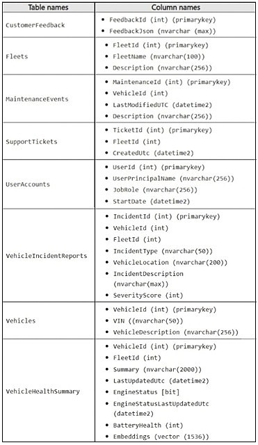
- Exhibit 2: 
- Exhibit 3: 

⭕ **A.** Export the database schema as a .dacpac file and load the schema into a GitHub Copilot context window.
⭕ **B.** Add the schema to a GitHub Copilot instruction file.
✅ **C.** Use an MCP server.
⭕ **D.** Include the database project in the code repository.

**Correct answer:** C
**Most voted:** C

### Top explanations
- **014c97d** (3 upvotes [Selected Answer: C]): It appears that MCP server is a more suited option for a live metadata
- **alexander_korn** (1 upvotes [Most Recent, Selected Answer: C]): C — use an MCP server — is the only option that gives Copilot live access. An MCP server (e.g., the MSSQL MCP server Microsoft ships for exactly this scenario)

## Q3.4 (ID 403632)

DRAG DROP
You have an Azure SQL database named SalesDB that contains tables named Sales.Orders and Sales.OrderLines. Both tables contain sales data.
You have a Retrieval Augmented Generation (RAG) service that queries SalesDB to retrieve order details and passes the results to a large language model (LLM) as JSON text. The following is a simple of the JSON.
You need to return one JSON document per order that includes the order header fields and an array of related order lines. The LLM must receive a single JSON array of orders, where each order contains a lines property that is a JSON array of line items.
Which Transact-SQL commands should you use to produce the required JSON shape from the relational tables? To answer, drag the appropriate commands to the correct operations. Each command may be used once, more than once, or not at all. You may need to drag the split bar between panes or scroll to view content.
NOTE: Each correct selection is worth one point.

**Exhibits**
- Exhibit 1: 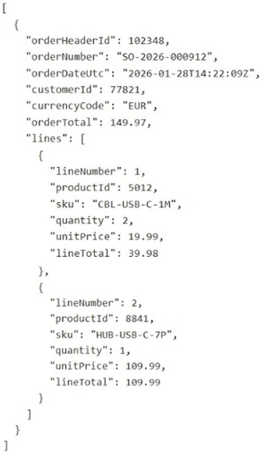
- Exhibit 2: 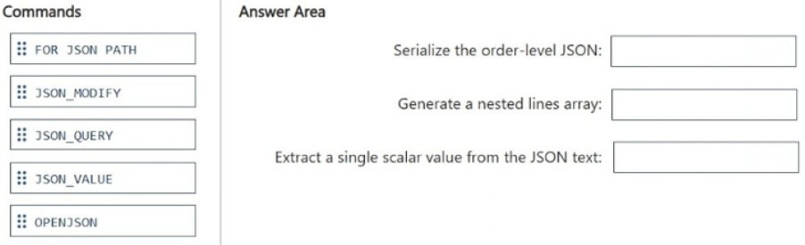

_DRAG DROP — the original ExamTopics question expects you to drag and drop items; the correct targets are not published._

**Most voted:**
- 1-Serializing the order-level JSON: FOR JSON PATH.
- 2-Generate a nested lines array: FOR JSON PATH
- 3-Extract a single scalar value from the JSON text: JSON_VALUE.

### Top explanations
- **Ahmadpbi** (3 upvotes [Most Recent]): 1-Serializing the order-level JSON: FOR JSON PATH.
  This is the standard T-SQL clause to format relational query results as JSON text. Using FOR JSON PATH allows you to shape the output as a single JSON document per order.
  2-Generate a nested lines array: FOR JSON PATH
  A FOR JSON PATH subquery is used inside the main query's column definition to generate the nested lines array from the Sales.OrderLines table, producing the required nested structure.
  3-Extract a single scalar value from the JSON text: JSON_VALUE.
  JSON_VALUE extracts a scalar value (string, number, or boolean) from a JSON string using a path expression. This is used when retrieving a single field like $.orderNumber from existing JSON data.
- **Imagar** (1 upvotes): for json path
  for json path
  json value
  to get the header properties, a nested array of order lines we need for json path

## Q3.6 (ID 403634)

HOTSPOT
You have a SQL database in Microsoft Fabric named SalesDB that contains a table named dbo.Products.
You need to modify SalesDB to meet the following requirements:
Create a vector index on the appropriate column.
Use a supplied natural language query vector.
How should you complete the Transact-SQL code? To answer, select the appropriate options in the answer area.
NOTE: Each correct selection is worth one point.

**Exhibits**
- Exhibit 1: 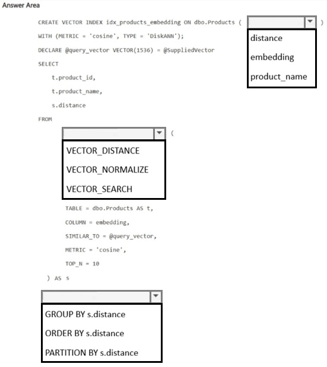

_HOTSPOT — the original ExamTopics question expects you to mark areas on the exhibit above; the correct hotspot coordinates are not published._

**Most voted:**
- -Column name for the vector index: embedding
- -Function for the subquery: VECTOR_SEARCH
- -ORDER BY clause: distance.

### Top explanations
- **Ahmadpbi** (8 upvotes [Most Recent, Highly Voted]): -Column name for the vector index: embedding
  -Function for the subquery: VECTOR_SEARCH
  -ORDER BY clause: distance.
  product_name is a text column, not the vector column, and not used for distance ordering.
  The vector column in dbo.Products is named embedding. This is the column that will be indexed for vector searches.

## Q3.7 (ID 403635)

You have an Azure SQL database that contains a table named dbo.Products. dbo.Products contains three columns named Embedding, Category, and Price. The Embedding column is defined as VECTOR(1536).
You use AI_GENERATE_EMBEDDINGS and VECTOR_SEARCH to support semantic search and apply additional filters on two columns named Category and Price.
You plan to change the embedding model from text-embedding-ada-002 to text-embedding-3-small. Existing rows already contain embeddings in the Embedding column.
You need to implement the model change. Applications must be able to use VECTOR_SEARCH without runtime errors.
What should you do first?

✅ **A.** Regenerate embeddings for the existing rows.
⭕ **B.** Normalize the vector lengths before storing new embeddings.
⭕ **C.** Convert the Embedding column to nvarchar(max).
⭕ **D.** Create a vector index on dbo.Products.Embedding.

**Correct answer:** A
**Most voted:** A

### Top explanations
- **Ahmadpbi** (3 upvotes [Most Recent, Selected Answer: A]): A. Regenerate embeddings for the existing rows.
  When changing from text-embedding-ada-002 to text-embedding-3-small, the existing vectors were generated in a different embedding space. Mixing embeddings from different models makes vector similarity comparisons invalid and can lead to incompatibilities with vector search/indexing.
  Therefore, regenerate the embeddings for the existing rows using the new model first, ensuring all stored embeddings are compatible with the model used for query vectors.
- **Yatajga** (3 upvotes [Selected Answer: A]): Before transitioning your application to search using the new model, all existing rows in dbo.Products must have their embeddings re-generated with text-embedding-3-small to maintain corpus consistency.

## Q3.8 (ID 403636)

DRAG DROP
You have an Azure SQL database named DB1 that contains two tables named knowledge_base and query_cache. knowledge_base contains support articles and embeddings. query_cache contains chat questions, responses, and embeddings. DB1 supports an AI-enabled chat agent.
You need to design a solution that meets the following requirements:
Serializes the retrieved rows from knowledge_base
Extracts the answer field from the response
Extracts the embeddings to store in query_cache
You will call the external large language model (LLM) by using the sp_invoke_external_rest_endpoint stored procedure.
Which Transact-SQL commands should you use for each requirement? To answer, drag the appropriate commands to the correct requirements. Each command may be used once, more than once, or not at all. You may need to drag the split bar between panes or scroll to view content.
NOTE: Each correct selection is worth one point.

**Exhibits**
- Exhibit 1: 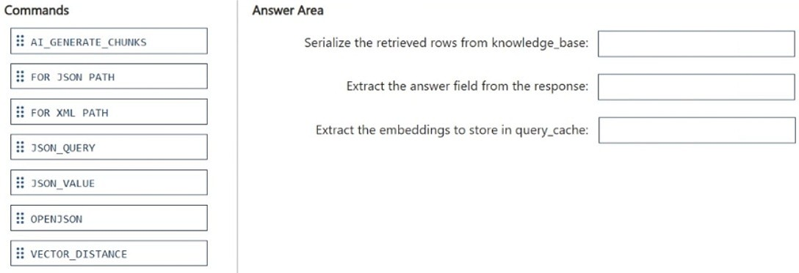

_DRAG DROP — the original ExamTopics question expects you to drag and drop items; the correct targets are not published._

**Most voted:**
- Serialized the retrieved rows from knowledge_base: FOR JSON PATH
- Extract the answer field from the response: JSON_VALUE
- Extract the embeddings to store in query_cache: JSON_QUERY

### Top explanations
- **Ahmadpbi** (4 upvotes [Most Recent]): Serialized the retrieved rows from knowledge_base: FOR JSON PATH
  Extract the answer field from the response: JSON_VALUE
  Extract the embeddings to store in query_cache: JSON_QUERY
  AI_GENERATE_CHUNKS Used for splitting text into chunks, not for serialization or JSON extraction.

## Q3.12 (ID 403640)

HOTSPOT
Your company has an ecommerce catalog in a Microsoft SQL Server 2025 database named SalesDB. SalesDB contains a table named products. products contains the following columns:
product_id (int)
product_name (nvarchar(200))
description (nvarchar(max))
category (nvarchar(50))
brand (nvarchar(50))
price (decimal)
sku (nvarchar(40))
The description fields are updated daily by a content pipeline, and price can change multiple times per day.
You want customers to be able to submit natural language queries and apply structured filters for brand and price.
You plan to store embeddings in a new VECTOR(1536) column and use VECTOR_SEARCH(... METRIC=‘cosine’ ...).
For each of the following statements, select Yes if the statement is true. Otherwise, select No.
NOTE: Each correct selection is worth one point.

**Exhibits**
- Exhibit 1: 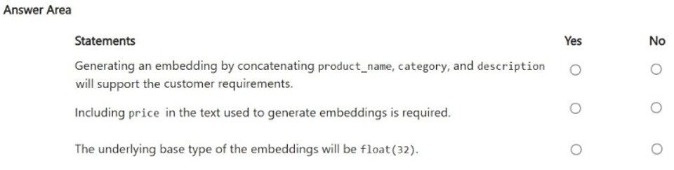

_HOTSPOT — the original ExamTopics question expects you to mark areas on the exhibit above; the correct hotspot coordinates are not published._

**Most voted:**
- Generating an embedding by concatenating product_name, category, and description will support the customer requirements: Yes
- Including price in the text used to generate embeddings is required: No
- The underlying base type of the embeddings will be float(32): Yes

### Top explanations
- **Ahmadpbi** (6 upvotes [Most Recent]): Yes — No — Yes
  Semantic attributes belong in the embedding text. Price should remain a structured filter, especially because it changes frequently; changing price should not require regenerating the embedding. A SQL Server 2025 VECTOR(1536) uses 32-bit floating-point (float32) values by default.

## Q3.14 (ID 403642)

HOTSPOT
You have an Azure SQL database that contains a table named stores. stores contains a column named description and a vector column named embedding.
You need to implement a hybrid search query that meets the following requirements:
Uses full-text search on description for the keyword portion
Returns the top 20 results based on a combined score that uses a weighted formula of 60% vector distance and 40% full-text rank
How should you configure the query components? To answer, select the appropriate options in the answer area.
NOTE: Each correct selection is worth one point.

**Exhibits**
- Exhibit 1: 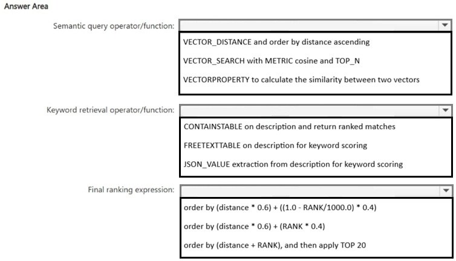

_HOTSPOT — the original ExamTopics question expects you to mark areas on the exhibit above; the correct hotspot coordinates are not published._

**Most voted:**
- Semantic query operator/function: VECTOR_SEARCH with METRIC cosine and TOP_N
- Keyword retrieval operator/function: CONTAINSTABLE on description and return ranked matches
- Final ranking expression: order by (distance * 0.6) + ((1.0 - RANK/1000.0) * 0.4)

### Top explanations
- **Ahmadpbi** (4 upvotes [Most Recent]): - Semantic query operator/function: VECTOR_SEARCH with METRIC cosine and TOP_N
  - Keyword retrieval operator/function: CONTAINSTABLE on description and return ranked matches
  - Final ranking expression: order by (distance * 0.6) + ((1.0 - RANK/1000.0) * 0.4)

## Q3.16 (ID 419664)

Existing Environment
Azure Environment
Fabrikam has a single Azure subscription in the East US 2 Azure region. The subscription contains an Azure SQL database named DB1. DB1 contains the following tables:
•	Patients
•	Employees
•	Procedures
•	Transactions
•	UsefulPrompts
•	ProcedureDocuments
You store a column master key as a secret in Azure Key Vault.
You have an on-premises application named TransactionProcessing that uses a hard-coded username and password in a connection string to access DB1.
Problem Statements
Users report that after executing a long-running stored procedure named sp_UpdateProcedureForPatient, updates to the underlying data are sometimes inconsistent.
Requirements
Planned Changes
Fabrikam plans to manage all changes to Azure SQL Database objects by using source control in GitHub. Every pull request submitted to production will be validated before it can be merged. Deployments must use the Release configuration.
Security Requirements
Fabrikam identifies the following security requirements:
•	The TransactionProcessing application must use a passwordless connection to DB1.
•	The Employees table contains two columns named TaxID and Salary that must be encrypted at rest.
•	Auditors must have a tamper-evident history of transactions with cryptographic proof of changes to the employee data.
Database Performance Requirements
Records accessed by using sp_UpdateProcedureForPatient must NOT be changed by other transactions while the stored procedure runs.
AI Search, Embeddings, and Vector Indexing
Fabrikam identifies the following AI-related requirements:
•	Queries to the ProcedureDocuments table must use Reciprocal Rank Fusion (RRF).
•	Users must be able to query the data in DB1 by using prompts in Copilot in Microsoft Fabric.
•	The UsefulPrompts table will store prompts that doctors can use to help diagnose patient illness by connecting to an Azure OpenAI endpoint.
Development Requirements
Fabrikam identifies the following development requirements:
•	Provide the functionality to retrieve all the transactions of a given patient between two dates, showing a running total.
•	Expose a Data API builder (DAB) configuration file to enable Azure services to perform the following operations over a REST API:
o	Read data from the procedures table without authentication.
o	Read and insert data into the Transactions table once authenticated.
o	Execute the sp_UpdateProcedurePatient stored procedure.
•	Provide the functionality to retrieve a list of the names of patients who underwent medical procedures during the last 30 days.
•	Information for each medical procedure will be stored in a table. The table will be used with a large language model (LLM) for user querying and will have the following structure.
DAB
You create a DAB configuration file that meets the development requirements for DB1 and includes the following entities.
You implement ProcedureDocuments to support the planned changes.
When users consume data through the Retrieval Augmented Generation (RAG) pattern, they experience data retrieval delays.
You need to improve the data retrieval performance and reduce the number of tokens per retrieval.
What should you implement?

**Exhibits**
- Exhibit 1: 
- Exhibit 2: 

✅ **A.** chunking
⭕ **B.** embeddings
⭕ **C.** a small language model (SLM)
⭕ **D.** JSON content

**Correct answer:** A
**Most voted:** A

### Top explanations
- **Ahmadpbi** (9 upvotes [Most Recent, Highly Voted, Selected Answer: A]): A. chunking
  Embeddings are already stored in ProcedureDocuments (the Embedding column). Adding more embeddings without chunking does not solve the token or performance problem.
