# DP-900 Microsoft Azure Data Fundamentals Study Guide

_288 questions generated from ExamTopics discussions._

**Official Exam & Registration:** [Register for DP-900 on Microsoft Learn](https://learn.microsoft.com/en-us/credentials/certifications/azure-data-fundamentals/?practice-assessment-type=certification)

## Table of contents

- [Q1.1](#q1-1)
- [Q1.2](#q1-2)
- [Q1.3](#q1-3)
- [Q1.4](#q1-4)
- [Q1.5](#q1-5)
- [Q1.6](#q1-6)
- [Q1.7](#q1-7)
- [Q1.8](#q1-8)
- [Q1.9](#q1-9)
- [Q1.10](#q1-10)
- [Q1.11](#q1-11)
- [Q1.12](#q1-12)
- [Q1.13](#q1-13)
- [Q1.14](#q1-14)
- [Q1.15](#q1-15)
- [Q1.16](#q1-16)
- [Q1.17](#q1-17)
- [Q1.18](#q1-18)
- [Q1.19](#q1-19)
- [Q1.20](#q1-20)
- [Q1.21](#q1-21)
- [Q1.22](#q1-22)
- [Q1.23](#q1-23)
- [Q1.24](#q1-24)
- [Q1.25](#q1-25)
- [Q1.26](#q1-26)
- [Q1.27](#q1-27)
- [Q1.28](#q1-28)
- [Q1.29](#q1-29)
- [Q1.30](#q1-30)
- [Q1.32](#q1-32)
- [Q1.33](#q1-33)
- [Q1.34](#q1-34)
- [Q1.35](#q1-35)
- [Q1.36](#q1-36)
- [Q1.38](#q1-38)
- [Q1.39](#q1-39)
- [Q1.41](#q1-41)
- [Q1.42](#q1-42)
- [Q1.44](#q1-44)
- [Q1.45](#q1-45)
- [Q1.46](#q1-46)
- [Q1.47](#q1-47)
- [Q1.48](#q1-48)
- [Q1.49](#q1-49)
- [Q1.50](#q1-50)
- [Q1.51](#q1-51)
- [Q1.52](#q1-52)
- [Q1.53](#q1-53)
- [Q1.54](#q1-54)
- [Q1.55](#q1-55)
- [Q1.56](#q1-56)
- [Q1.57](#q1-57)
- [Q1.58](#q1-58)
- [Q1.59](#q1-59)
- [Q1.60](#q1-60)
- [Q1.62](#q1-62)
- [Q1.63](#q1-63)
- [Q1.64](#q1-64)
- [Q1.65](#q1-65)
- [Q1.66](#q1-66)
- [Q1.67](#q1-67)
- [Q1.68](#q1-68)
- [Q1.69](#q1-69)
- [Q1.70](#q1-70)
- [Q1.71](#q1-71)
- [Q1.72](#q1-72)
- [Q1.73](#q1-73)
- [Q1.74](#q1-74)
- [Q1.75](#q1-75)
- [Q1.76](#q1-76)
- [Q1.77](#q1-77)
- [Q1.78](#q1-78)
- [Q1.79](#q1-79)
- [Q1.80](#q1-80)
- [Q1.81](#q1-81)
- [Q1.82](#q1-82)
- [Q1.83](#q1-83)
- [Q1.84](#q1-84)
- [Q1.85](#q1-85)
- [Q1.86](#q1-86)
- [Q1.87](#q1-87)
- [Q1.88](#q1-88)
- [Q1.89](#q1-89)
- [Q1.90](#q1-90)
- [Q1.91](#q1-91)
- [Q1.92](#q1-92)
- [Q1.93](#q1-93)
- [Q1.94](#q1-94)
- [Q1.95](#q1-95)
- [Q1.96](#q1-96)
- [Q1.97](#q1-97)
- [Q1.98](#q1-98)
- [Q1.99](#q1-99)
- [Q1.100](#q1-100)
- [Q1.101](#q1-101)
- [Q1.102](#q1-102)
- [Q1.104](#q1-104)
- [Q1.105](#q1-105)
- [Q1.106](#q1-106)
- [Q1.107](#q1-107)
- [Q1.108](#q1-108)
- [Q1.109](#q1-109)
- [Q1.110](#q1-110)
- [Q1.111](#q1-111)
- [Q1.112](#q1-112)
- [Q1.113](#q1-113)
- [Q1.114](#q1-114)
- [Q1.115](#q1-115)
- [Q1.116](#q1-116)
- [Q1.117](#q1-117)
- [Q1.118](#q1-118)
- [Q1.119](#q1-119)
- [Q1.120](#q1-120)
- [Q1.121](#q1-121)
- [Q1.122](#q1-122)
- [Q1.123](#q1-123)
- [Q1.124](#q1-124)
- [Q1.125](#q1-125)
- [Q1.126](#q1-126)
- [Q1.127](#q1-127)
- [Q1.128](#q1-128)
- [Q1.129](#q1-129)
- [Q1.130](#q1-130)
- [Q1.131](#q1-131)
- [Q1.132](#q1-132)
- [Q1.133](#q1-133)
- [Q1.134](#q1-134)
- [Q1.135](#q1-135)
- [Q1.136](#q1-136)
- [Q1.137](#q1-137)
- [Q1.138](#q1-138)
- [Q1.139](#q1-139)
- [Q1.140](#q1-140)
- [Q1.141](#q1-141)
- [Q1.142](#q1-142)
- [Q1.143](#q1-143)
- [Q1.144](#q1-144)
- [Q1.145](#q1-145)
- [Q1.146](#q1-146)
- [Q1.147](#q1-147)
- [Q1.148](#q1-148)
- [Q1.149](#q1-149)
- [Q1.150](#q1-150)
- [Q1.151](#q1-151)
- [Q1.152](#q1-152)
- [Q1.153](#q1-153)
- [Q1.154](#q1-154)
- [Q1.155](#q1-155)
- [Q1.156](#q1-156)
- [Q1.157](#q1-157)
- [Q1.158](#q1-158)
- [Q1.159](#q1-159)
- [Q1.160](#q1-160)
- [Q1.161](#q1-161)
- [Q1.162](#q1-162)
- [Q1.163](#q1-163)
- [Q1.164](#q1-164)
- [Q1.165](#q1-165)
- [Q1.166](#q1-166)
- [Q1.167](#q1-167)
- [Q1.168](#q1-168)
- [Q1.169](#q1-169)
- [Q1.170](#q1-170)
- [Q1.171](#q1-171)
- [Q1.173](#q1-173)
- [Q1.174](#q1-174)
- [Q1.175](#q1-175)
- [Q1.176](#q1-176)
- [Q1.178](#q1-178)
- [Q1.179](#q1-179)
- [Q1.180](#q1-180)
- [Q1.181](#q1-181)
- [Q1.184](#q1-184)
- [Q1.186](#q1-186)
- [Q1.187](#q1-187)
- [Q1.188](#q1-188)
- [Q1.189](#q1-189)
- [Q1.190](#q1-190)
- [Q1.191](#q1-191)
- [Q1.194](#q1-194)
- [Q1.195](#q1-195)
- [Q1.196](#q1-196)
- [Q1.197](#q1-197)
- [Q1.200](#q1-200)
- [Q1.201](#q1-201)
- [Q1.202](#q1-202)
- [Q1.203](#q1-203)
- [Q1.204](#q1-204)
- [Q1.205](#q1-205)
- [Q1.206](#q1-206)
- [Q1.207](#q1-207)
- [Q1.208](#q1-208)
- [Q1.209](#q1-209)
- [Q1.210](#q1-210)
- [Q1.211](#q1-211)
- [Q1.212](#q1-212)
- [Q1.213](#q1-213)
- [Q1.214](#q1-214)
- [Q1.215](#q1-215)
- [Q1.216](#q1-216)
- [Q1.217](#q1-217)
- [Q1.218](#q1-218)
- [Q1.219](#q1-219)
- [Q1.220](#q1-220)
- [Q1.221](#q1-221)
- [Q1.222](#q1-222)
- [Q1.223](#q1-223)
- [Q1.224](#q1-224)
- [Q1.225](#q1-225)
- [Q1.226](#q1-226)
- [Q1.227](#q1-227)
- [Q1.229](#q1-229)
- [Q1.231](#q1-231)
- [Q1.232](#q1-232)
- [Q1.234](#q1-234)
- [Q1.236](#q1-236)
- [Q1.237](#q1-237)
- [Q1.238](#q1-238)
- [Q1.239](#q1-239)
- [Q1.240](#q1-240)
- [Q1.241](#q1-241)
- [Q1.242](#q1-242)
- [Q1.243](#q1-243)
- [Q1.244](#q1-244)
- [Q1.245](#q1-245)
- [Q1.246](#q1-246)
- [Q1.247](#q1-247)
- [Q1.248](#q1-248)
- [Q1.249](#q1-249)
- [Q1.250](#q1-250)
- [Q1.251](#q1-251)
- [Q1.252](#q1-252)
- [Q1.253](#q1-253)
- [Q1.254](#q1-254)
- [Q1.255](#q1-255)
- [Q1.257](#q1-257)
- [Q1.258](#q1-258)
- [Q1.259](#q1-259)
- [Q1.260](#q1-260)
- [Q1.261](#q1-261)
- [Q1.262](#q1-262)
- [Q1.263](#q1-263)
- [Q1.264](#q1-264)
- [Q1.265](#q1-265)
- [Q1.266](#q1-266)
- [Q1.267](#q1-267)
- [Q1.268](#q1-268)
- [Q1.269](#q1-269)
- [Q1.270](#q1-270)
- [Q1.271](#q1-271)
- [Q1.272](#q1-272)
- [Q1.273](#q1-273)
- [Q1.274](#q1-274)
- [Q1.275](#q1-275)
- [Q1.276](#q1-276)
- [Q1.277](#q1-277)
- [Q1.278](#q1-278)
- [Q1.279](#q1-279)
- [Q1.280](#q1-280)
- [Q1.281](#q1-281)
- [Q1.282](#q1-282)
- [Q1.283](#q1-283)
- [Q1.284](#q1-284)
- [Q1.285](#q1-285)
- [Q1.286](#q1-286)
- [Q1.287](#q1-287)
- [Q1.288](#q1-288)
- [Q1.289](#q1-289)
- [Q1.290](#q1-290)
- [Q1.291](#q1-291)
- [Q1.292](#q1-292)
- [Q1.293](#q1-293)
- [Q1.294](#q1-294)
- [Q1.295](#q1-295)
- [Q1.296](#q1-296)
- [Q1.297](#q1-297)
- [Q1.298](#q1-298)
- [Q1.299](#q1-299)
- [Q1.300](#q1-300)
- [Q1.301](#q1-301)
- [Q1.302](#q1-302)
- [Q1.303](#q1-303)
- [Q1.304](#q1-304)
- [Q1.309](#q1-309)
- [Q1.310](#q1-310)
- [Q1.316](#q1-316)
- [Q1.322](#q1-322)

## Q1.1 (ID 34472)

HOTSPOT
To complete the sentence, select the appropriate option in the answer area.
Hot Area:
[sampleXML/xmlfile-2_1.png]

_HOTSPOT — the original ExamTopics question expects you to mark areas on the exhibit above; the correct hotspot coordinates are not published._

**Most voted:**
- B
- A is "Predictive"
- C is "Prescriptive"
- D is "Diagnostic"

### Top explanations
- **AWSCloud** (71 upvotes [Highly Voted]): Descriptive analytics tells "What happened in the past". So B is the right choice.
- **AZ5cert** (16 upvotes [Highly Voted]): Correct Answer: B
  A is "Predictive"
  C is "Prescriptive"
  D is "Diagnostic"
- **SamuelSami** (14 upvotes [Highly Voted]): Descriptive Analytics tells you what happened in the past. Diagnostic Analytics helps you understand why something happened in the past.
  Diagnostic analytics ask about the present. They drill down into why something has happened and helps users diagnose issues. Descriptive analytics ask about the past. They want to know what has been happening to the business and how this is likely to affect future sales.
- **fflyin2k** (10 upvotes [Highly Voted]): Thanks.
  Following is an abstract from the link you provided.
  Descriptive Analytics - tells you what happened in the past.
  Diagnostic Analytics - helps you understand why something happened in the past.
  Predictive Analytics - predicts what is most likely to happen in the future.
  Prescriptive Analytics - recommends actions you can take to affect those outcomes.
- **Anirban_Bose** (4 upvotes): B is the correct Answer

## Q1.2 (ID 32790)

HOTSPOT
For each of the following statements, select Yes if the statement is true. Otherwise, select No.
NOTE: Each correct selection is worth one point.
Hot Area:
[sampleXML/xmlfile-3_1.png]

_HOTSPOT — the original ExamTopics question expects you to mark areas on the exhibit above; the correct hotspot coordinates are not published._

**Most voted:** No, Yes, Yes

### Top explanations
- **giventheman** (63 upvotes [Highly Voted]): no yes yes
- **yeanlingmedal71** (20 upvotes [Highly Voted]): Normalization is the process of organizing data in a database. This includes creating tables and establishing relationships between those tables according to rules designed both to protect the data and to make the database more flexible by eliminating redundancy and inconsistent dependency.
  https://docs.microsoft.com/en-us/office/troubleshoot/access/database-normalization-description#:~:text=Normalization%20is%20the%20process%20of,eliminating%20redundancy%20and%20inconsistent%20dependency
- **mnsait** (5 upvotes): Without normalization, one may end up with the same data being maintained in more than one place. It may possibly lead to updating the data in one but not the other places leading to data integrity issues.
- **man5484** (4 upvotes): Normalization involves eliminating relationships between database tables:
  No
  Explanation: Normalization is about organizing data to reduce redundancy and improve data integrity. It does not eliminate relationships but instead structures tables to ensure relationships are properly maintained, typically using foreign keys.
  Normalizing a database reduces data redundancy:
  Yes
  Explanation: The primary goal of normalization is to reduce or eliminate data redundancy. By organizing data into multiple related tables, the same piece of data is stored only once.
  Normalization improves data integrity:
  Yes
  Explanation: Normalization improves data integrity by ensuring that data is stored logically and consistently. It prevents anomalies and ensures that updates, deletions, or inserts do not compromise the quality of the data.
- **dimejibayo** (4 upvotes): Normalization divides larger table into smaller tables and link them using relationship. It minimizes redundancy in a relational db. It also improves data integrity. The answer is correct NYY

## Q1.3 (ID 73920)

HOTSPOT
To complete the sentence, select the appropriate option in the answer area.
Hot Area:
[sampleXML/xmlfile-4_1.jpg]

_HOTSPOT — the original ExamTopics question expects you to mark areas on the exhibit above; the correct hotspot coordinates are not published._

**Most voted:** C

### Top explanations
- **muks1003** (31 upvotes [Highly Voted]): For ETL it should be C, for ELT it will be B.
- **TiTe123** (4 upvotes): I think this is a misleading question. Clearly it is not A or D. ETL process can be run in parallel to save time. While data is being extracted, a transformation process could be working on data already received and prepare it for loading, and a loading process can begin working on the prepared data, rather than waiting for the entire extraction process to complete. (https://docs.microsoft.com/en-us/azure/architecture/data-guide/relational-data/etl). This suggests that C is also incorrect.
  This leaves B. By the book, this would be correct for ELT but appears incorrect for ETL because the transformation process occurs in an isolated specialized engine prior to loading. However, in reality, a lot of older ETL routines are actually ELT based on their infrastructure. Therefore, I would be inclined to go for B.
  Nonetheless another poorly chosen question though.
- **chiiiweiii** (3 upvotes): Correct Answer
  ELT-a target data store powerful enough to transform data.
  ETL-data that is fully processed before being loaded to the target data store.
- **kingzmole** (3 upvotes): Transform mean processed. so the answer should be B
- **man5484** (2 upvotes [Most Recent]): a. a matching schema in the data source and the data target
  Incorrect. While having a well-defined schema can help, ETL processes are designed to handle differences between schemas in the source and target. ETL can transform data to fit the target schema.
  b. a target data store powerful enough to transform data
  Incorrect. ETL processes transform data in transit, typically in an ETL tool or engine, before loading it into the target data store. The transformation does not rely on the processing power of the target store.
  c. data that is fully processed before being loaded to the target data store
  Correct. In a typical ETL process, data is extracted from the source, transformed as needed (e.g., cleaned, aggregated, formatted), and then loaded into the target data store.
  d. that the data target be a relational database
  Incorrect. The target data store can be various types, including relational databases, data lakes, or NoSQL databases. ETL processes are not limited to relational databases.

## Q1.4 (ID 78935)

HOTSPOT
To complete the sentence, select the appropriate option in the answer area.
Hot Area:
[sampleXML/xmlfile-5_1.png]

_HOTSPOT — the original ExamTopics question expects you to mark areas on the exhibit above; the correct hotspot coordinates are not published._

**Most voted:**
1. Exam 80-90% consisted from questions from this site.
2. Answers on this site for this questions are not always correct, and comments with answers are not always correct.
4) Everyone good luck!  You can do it.

### Top explanations
- **dataalex** (12 upvotes [Highly Voted]): Hi everyone! I just passed exam, my score is more then 900.
  1. Exam 80-90% consisted from questions from this site.
  2. Answers on this site for this questions are not always correct, and comments with answers are not always correct.
  3. If you are reading in comments "I passed exam and this question was on exam, the answers is __ (gives you some answer)"  - dont trust it blindly! They just tells their opinion about the answer. Because when you recieve you certification, your score, you do not recieve informations on what questions exactly you answered right or wrong! You just know your score and your score on every section. You dont know the answer and you no longer have access to question that you answered.
  4) Everyone good luck!  You can do it.
- **Vanessa23** (4 upvotes): Batch = latency ~ minutes or hours
- **Abhi256** (4 upvotes): Latency is expected.
- **zekblue** (4 upvotes): correct answer
- **chiiiweiii** (2 upvotes): Correct Answer.

## Q1.5 (ID 30634)

HOTSPOT
To complete the sentence, select the appropriate option in the answer area.
Hot Area:
[sampleXML/xmlfile-7_1.png]

_HOTSPOT — the original ExamTopics question expects you to mark areas on the exhibit above; the correct hotspot coordinates are not published._

**Most voted:** Transcribe means converting from Audio to Text. This is similar to Alexa, Alexa is a Cognitive device. Cognitive is the correct answer.

### Top explanations
- **jasu** (149 upvotes [Highly Voted]): Transcribe means converting from Audio to Text. This is similar to Alexa, Alexa is a Cognitive device. Cognitive is the correct answer.
- **Sc2** (40 upvotes [Highly Voted]): I agree with cognitive
- **keyss** (12 upvotes [Highly Voted]): It can't be predictive, transcribe means converting from Audio to Text. Therefore the answer is cognitive.
- **Deb999** (6 upvotes): Here you are getting information about the audio text via transcribing the files. Answer is "Descriptive".
- **Alex4190** (5 upvotes): Only showing 5 questions per page to force non contributors to do more annoying captcha? Great way to push someone to find and use a different site.....
  Cognitive is correct

## Q1.6 (ID 63839)

DRAG DROP
Match the types of analytics that can be used to answer the business questions.
To answer, drag the appropriate analytics type from the column on the left to its question on the right. Each analytics type may be used once, more than once, or
not at all.
NOTE: Each correct match is worth one point.
Select and Place:
[sampleXML/xmlfile-8_1.jpg]

_DRAG DROP — the original ExamTopics question expects you to drag and drop items; the correct targets are not published._

**Most voted:**
- 1 diagnostic: it answers the question "why did it happen?"
- 2 prescritive: it answers the question "how can we make it happen?"
- 3 descriptive: it answers the question "what happened'"
- ref: Microsoft Azure Data Fundamentals - page 23-24

### Top explanations
- **WillyMac** (49 upvotes [Highly Voted]): The last must be "Cognitivive".
  That's what about Azure Cognitive Services
- **gs23mi** (46 upvotes [Highly Voted]): 1 diagnostic : it answers the question "why did it happen?"
  2 prescritive : it answers the question "how can we make it happen?"
  3 descriptive: it answers the question "what happened'"
  ref: Microsoft Azure Data Fundamentals - page 23-24
- **Yaizapez** (35 upvotes [Highly Voted]): The third scenario doesn't look into "what happened": It's asking for text analytics, which is not a descriptive function but a cognitive one.
- **jomtnez** (9 upvotes [Highly Voted]): I would say descriptive for the last one, cognitive would be a process in which the scanned documents are processed automatically by an AI system, but it does not say anything like that, so descriptive is correct.
- **floop92** (8 upvotes [Highly Voted]): Agreed! Had this in the course

## Q1.7 (ID 34081)

HOTSPOT
You have the following JSON document.
[sampleXML/xmlfile-10_1.png]
Use the drop-down menus to select the answer choice that completes each statement based on the information presented in the JSON document.
NOTE: Each correct selection is worth one point.
Hot Area:
[sampleXML/xmlfile-11_1.png]

_HOTSPOT — the original ExamTopics question expects you to mark areas on the exhibit above; the correct hotspot coordinates are not published._

**Most voted:** Root Object, Nested Root Object, and Array because of [ ]

### Top explanations
- **PM2** (50 upvotes [Most Recent, Highly Voted]): Correct Answer
- **Armandoo** (24 upvotes [Highly Voted]): Root Object, Nested Root Object, and Array because of [ ]
- **theLazyGuy** (6 upvotes): SocialMedia is an Array object, as someone underline due to [ ], references:
  https://docs.microsoft.com/en-us/answers/questions/200268/adf-reading-array-of-objects-in-data-flow.html
  https://docs.microsoft.com/en-us/azure/data-factory/format-json
- **AGTraining** (4 upvotes): root object
  nested object
  nested array
- **mattvasc** (4 upvotes): Social Media is an array of objects. You can check the syntax in json.org website.

## Q1.8 (ID 49714)

HOTSPOT
You are reviewing the data model shown in the following exhibit.
[sampleXML/xmlfile-13_1.png]
Use the drop-down menus to select the answer choice that completes each statement based on the information presented in the graphic.
NOTE: Each correct selection is worth one point
Hot Area:
[sampleXML/xmlfile-14_1.png]

_HOTSPOT — the original ExamTopics question expects you to mark areas on the exhibit above; the correct hotspot coordinates are not published._

**Most voted:**
- Model: Star Schema
- Customer: Dimension

### Top explanations
- **chaudha4** (28 upvotes [Highly Voted]): Seems like this question is outside the scope of DP-900 exam. It is not covered in Azure training for DP-900 exam.
- **yeanlingmedal71** (23 upvotes [Highly Voted]): Star Schema in data warehouse, in which the center of the star can have one fact table and a number of associated dimension tables. It is known as star schema as its structure resembles a star.
  Dimension tables describe business entities—the things you model. Entities can include products, people, places, and concepts including time itself.
  Fact tables store observations or events, and can be sales orders, stock balances, exchange rates, temperatures, etc. A fact table contains dimension key columns that relate to dimension tables, and numeric measure columns.
  https://docs.microsoft.com/en-us/power-bi/guidance/star-schema
- **xRiot007** (7 upvotes [Highly Voted]): Star schema - you have multiple dimension tables linked by a fact table.
  Customer is one of the dimension tables.
- **Armandoo** (6 upvotes): Model: Star Schema
  Customer: Dimension
- **DrCloud** (6 upvotes): Correct Answer.
  https://docs.microsoft.com/en-us/azure/architecture/guide/technology-choices/data-store-overview#column-family-databases
  Under "Data analytics" section:
  Data type
  Usually denormalized in a "star" or "snowflake" schema, consisting of fact and dimension tables.

## Q1.9 (ID 34325)

HOTSPOT
To complete the sentence, select the appropriate option in the answer area.
Hot Area:
[sampleXML/xmlfile-17_1.png]

_HOTSPOT — the original ExamTopics question expects you to mark areas on the exhibit above; the correct hotspot coordinates are not published._

**Most voted:** The correct answer is "across compute nodes". Distributions map to Compute nodes for processing. As you pay for more compute resources, distributions are remapped to available Compute nodes.

### Top explanations
- **hmAZtime** (54 upvotes [Highly Voted]): It's A.
- **sreekarv** (14 upvotes [Highly Voted]): The correct answer is "across compute nodes". Distributions map to Compute nodes for processing. As you pay for more compute resources, distributions are remapped to available Compute nodes.
  Reference: https://docs.microsoft.com/en-us/azure/synapse-analytics/sql-data-warehouse/massively-parallel-processing-mpp-architecture [see the architecture diagram]
- **valente_sven1** (6 upvotes): agree. Yes it should be A.
- **Armandoo** (4 upvotes): The control node gets the process and distributes it across compute node. Therefore the answer is A.
- **busyb** (4 upvotes): It's A.
  Dedicated SQL pool (formerly SQL DW) uses a node-based architecture. Applications connect and issue T-SQL commands to a Control node. The Control node hosts the distributed query engine, which optimizes queries for parallel processing, and then passes operations to Compute nodes to do their work in parallel.

## Q1.10 (ID 34326)

HOTSPOT
To complete the sentence, select the appropriate option in the answer area.
Hot Area:
[sampleXML/xmlfile-18_1.jpg]

_HOTSPOT — the original ExamTopics question expects you to mark areas on the exhibit above; the correct hotspot coordinates are not published._

**Most voted:** A, Clustered Index

### Top explanations
- **Chandra111** (44 upvotes [Highly Voted]): Cluster Index.
- **yeanlingmedal71** (32 upvotes [Highly Voted]): Clustered indexes sort and store the data rows in the table or view based on their key values. These are the columns included in the index definition. There can be only one clustered index per table, because the data rows themselves can be stored in only one order.
- **BD_YOO** (11 upvotes [Highly Voted]): I'm married
- **objecto** (7 upvotes [Highly Voted]): Correct
- **Alpyas** (5 upvotes): Clustered indexes sort and store the data rows in the table or view based on their key values. These are the columns included in the index definition. There can be only one clustered index per table, because the data rows themselves can be stored in only one order.
  Nonclustered indexes have a structure separate from the data rows. A nonclustered index contains the nonclustered index key values and each key value entry has a pointer to the data row that contains the key value.

## Q1.11 (ID 49148)

HOTSPOT
To complete the sentence, select the appropriate option in the answer area.
Hot Area:
[sampleXML/xmlfile-19_1.jpg]

_HOTSPOT — the original ExamTopics question expects you to mark areas on the exhibit above; the correct hotspot coordinates are not published._

**Most voted:** C     (Transaction Writes)

### Top explanations
- **Armandoo** (32 upvotes [Highly Voted]): Correct Answer: C     (Transaction Writes)
- **ranimswami** (9 upvotes [Highly Voted]): correct
- **WillPassExam** (6 upvotes): non SQL db is more suitable for answer D as the schema is not fixed.
- **man5484** (5 upvotes [Most Recent]): c. transactional writes
  Explanation:
  a. changes to relationships between entities
  Incorrect. Although relational databases support relationships between entities, they are not necessarily optimized for scenarios that frequently change these relationships.
  b. geographically distributed writes
  Incorrect. Relational databases are typically not ideal for geographically distributed writes due to latency and consistency issues. NoSQL databases, like those supporting multi-master configurations, are often better suited for this purpose.
  c. transactional writes
  Correct. Relational databases are well-suited for handling high volumes of transactional writes due to their ACID (Atomicity, Consistency, Isolation, Durability) compliance, ensuring data consistency and integrity.
  d. writes that have varying data structures
  Incorrect. Relational databases are typically schema-based, meaning they require a fixed schema and are not flexible for handling writes with varying data structures. NoSQL databases are more suitable for such scenarios.
- **PhyoPluto** (5 upvotes): the exam on 07/03/2023

## Q1.12 (ID 48682)

HOTSPOT
For each of the following statements, select Yes if the statement is true. Otherwise, select No.
NOTE: Each correct selection is worth one point.
Hot Area:
[sampleXML/xmlfile-20_1.jpg]

_HOTSPOT — the original ExamTopics question expects you to mark areas on the exhibit above; the correct hotspot coordinates are not published._

**Most voted:** Yes, Yes, Yes

### Top explanations
- **DemoBoy** (255 upvotes [Highly Voted]): All 3 are Yes. This is not just a big data question.
- **Armandoo** (75 upvotes [Highly Voted]): YES, YES, YES
  Batch processing can have output to SQL Database, Hive, HBase, Spark SQL. Look at the link and the diagram there
  https://docs.microsoft.com/en-us/azure/architecture/data-guide/big-data/batch-processing
- **elrusdi** (7 upvotes [Highly Voted]): If all Anwer is Yes, who put  Yes, No, No in solution?
- **ravinperera** (5 upvotes): Statement 1: Batch processing can output data to a file store.
  Yes. Batch processing can indeed output data to a file store. This is a common use case where processed data is stored in file systems like Azure Blob Storage or other similar cloud-based or on-premises file storage systems.
  Statement 2: Batch processing can output data to a relational database.
  Yes. Batch processing can output data to relational databases. After processing, the data can be structured and stored in relational database systems like Azure SQL Database, MySQL, PostgreSQL, or other relational databases.
  Statement 3: Batch processing can output data to a NoSQL database.
  Yes. Batch processing can also output data to NoSQL databases. This is particularly useful for unstructured or semi-structured data. NoSQL databases like Azure Cosmos DB, MongoDB, or others can be used for storing the results of batch processing tasks.
- **NareshKothari** (5 upvotes): Agree. All 3 are yes.

## Q1.13 (ID 48809)

DRAG DROP
Your company plans to load data from a customer relationship management (CRM) system to a data warehouse by using an extract, load, and transform (ELT)
process.
Where does data processing occur for each stage of the ELT process? To answer, drag the appropriate locations to the correct stages. Each location may be
used once, more than once, or not at all. You may need to drag the split bar between panes or scroll to view content.
NOTE: Each correct selection is worth one point.
Select and Place:
[sampleXML/xmlfile-22_1.png]

_DRAG DROP — the original ExamTopics question expects you to drag and drop items; the correct targets are not published._

**Most voted:**
- The answer is CRM - DWH - DWH.
- I got all the questions on analytics answered correctly in the exam.

### Top explanations
- **JayRee** (185 upvotes [Highly Voted]): The answer is CRM - DWH - DWH.
  I got all the questions on analytics answered correctly in the exam.
- **ANath** (42 upvotes [Highly Voted]): This question is related to ELT(Extract-Load-Transform) not ETL (Extract-Transform-Load). In ELT, transformation happens on Target. So, Load and Transform should happen on 'Data Warehouse'.
  The answer given here is for ETL not for ELT.
- **notem** (26 upvotes [Highly Voted]): Agree! Go to https://docs.microsoft.com/en-us/azure/architecture/data-guide/relational-data/etl
  In the ELT pipeline, the transformation occurs in the target data store. Instead of using a separate transformation engine, the processing capabilities of the target data store are used to transform data.
- **researched_answer_boi** (15 upvotes [Highly Voted]): From the question: "Each location may be used once, more than once, or not at all.", so yep.
- **researched_answer_boi** (15 upvotes [Highly Voted]): From the question: "Each location may be used once, more than once, or not at all.", so yep.

## Q1.14 (ID 49379)

HOTSPOT
To complete the sentence, select the appropriate option in the answer area.
Hot Area:
[sampleXML/xmlfile-24_1.jpg]

_HOTSPOT — the original ExamTopics question expects you to mark areas on the exhibit above; the correct hotspot coordinates are not published._

**Most voted:** It is talking about what is happening or What has happened. Therefore the Answer is Descriptive

### Top explanations
- **hmAZtime** (66 upvotes [Highly Voted]): Descriptive
- **ANath** (21 upvotes [Highly Voted]): Descriptive is 100% correct.
- **jantoniocesargatica** (14 upvotes [Highly Voted]): Precriptive would be when you need to take actions about your analysis. For example if you max capacity is always exceeding according with the data provided. In that case you could decide to increase the number of classrooms for example. So your answwer is 500% incorrect.
- **Kiki_25** (3 upvotes): definetely descriptive
- **akhil5432** (2 upvotes): descriptive

## Q1.15 (ID 49678)

DRAG DROP
Match the types of visualizations to the appropriate descriptions.
To answer, drag the appropriate visualization type from the column on the left to its description on the right. Each visualization type may be used once, more than
once, or not at all.
NOTE: Each correct match is worth one point.
Select and Place:
[sampleXML/xmlfile-25_1.png]

_DRAG DROP — the original ExamTopics question expects you to drag and drop items; the correct targets are not published._

**Most voted:**
- Treemap: Are charts of colored rectangles, with size representing value. They can be hierarchical, with rectangles nested within the main rectangles.
- Key Influencer: A key influencer chart displays the major contributors to a selected result or value.
- scatter: Display relationships between 2 (scatter) or 3 (bubble) quantitative measures -- whether or not, in which order, etc.

### Top explanations
- **Crazy_Angel** (58 upvotes [Highly Voted]): Treemap : Are charts of colored rectangles, with size representing value. They can be hierarchical, with rectangles nested within the main rectangles.
  Key Influencer : A key influencer chart displays the major contributors to a selected result or value.
  scatter : Display relationships between 2 (scatter) or 3 (bubble) quantitative measures -- whether or not, in which order, etc.
- **yeanlingmedal71** (29 upvotes [Highly Voted]): https://docs.microsoft.com/en-us/power-bi/visuals/power-bi-visualization-types-for-reports-and-q-and-a
- **mamahani** (5 upvotes): I took the exam 12.04.2023 and got 1000, 100% score; this question appeared, correct answer:
  treemap - key influences - scatter
- **Mjwc** (5 upvotes): Correct according to Microsoft Learning.
  Source:
  https://docs.microsoft.com/en-us/learn/modules/explore-concepts-of-data-analytics/3-explore-data-visualization
- **Eltooth** (4 upvotes): Tree
  Key
  Scatter

## Q1.16 (ID 45545)

You need to create an Azure Storage account.
Data in the account must replicate outside the Azure region automatically.
Which two types of replication can you use for the storage account? Each correct answer presents a complete solution.
NOTE: Each correct selection is worth one point.

⭕ **A.** zone-redundant storage (ZRS)
✅ **B.** read-access geo-redundant storage (RA-GRS)
⭕ **C.** locally-redundant storage (LRS)
✅ **D.** geo-redundant storage (GRS)

**Correct answer:** B, D
**Most voted:** BD

### Top explanations
- **Feyisara** (48 upvotes [Highly Voted]): The chosen option is correct given the requirements in the question.
- **AlfuryDB** (38 upvotes [Highly Voted]): Careful with this one. If we are talking about "outside replication", the options will be GRS and RA-GRS (particular case that gives active-active between regions with reading accessible in the second one). However, GRS does NOT allow to read in the secondary region in an active-active way. It only happens when the first region fails. Bear this in mind. The option is correct given the requirements in the question.
- **Kermedi2018** (6 upvotes): Hey I’m in South Africa this question it was on exam 14/03/2022
- **SiDoCiOuS** (6 upvotes [Selected Answer: BD]): Appeared on the exam on 03/22/2022
  Answer is correct!
- **raydel92** (5 upvotes [Selected Answer: BD]): B and D

## Q1.17 (ID 73988)

HOTSPOT
For each of the following statements, select Yes if the statement is true. Otherwise, select No.
NOTE: Each correct selection is worth one point.
Hot Area:
[sampleXML/xmlfile-27_3.jpg]

_HOTSPOT — the original ExamTopics question expects you to mark areas on the exhibit above; the correct hotspot coordinates are not published._

**Most voted:** Yes, No, Yes

### Top explanations
- **sakanan** (38 upvotes [Highly Voted]): correct
- **HananS** (18 upvotes [Highly Voted]): Don't be an IDIO.
- **Edriv** (16 upvotes [Highly Voted]): YES, NO, YES
- **Ben999** (9 upvotes [Highly Voted]): Y,N,N - you can't pause a managed instance
- **Eltooth** (9 upvotes [Highly Voted]): Yes
  No
  No

## Q1.18 (ID 78971)

Which statement is an example of Data Manipulation Language (DML)?

⭕ **A.** REVOKE
⭕ **B.** DISABLE
✅ **C.** INSERT
⭕ **D.** GRANT

**Correct answer:** C
**Most voted:** C

### Top explanations
- **chiiiweiii** (4 upvotes [Selected Answer: C]): Correct Answer.
- **divyadantuluri_224** (4 upvotes [Selected Answer: C]): Insert is DML
- **Varuntv** (3 upvotes [Selected Answer: C]): insert is the correct answer
- **raydel92** (3 upvotes [Selected Answer: C]): INSERT is correcto
- **cjemaiorano** (3 upvotes [Selected Answer: C]): Correct, right answer is INSERT.

## Q1.19 (ID 63686)

You have a SQL query that combines customer data and order data. The query includes calculated columns.
You need to create a database object that would allow other users to rerun the same SQL query.
What should you create?

⭕ **A.** an index
✅ **B.** a view
⭕ **C.** a scalar function
⭕ **D.** a table

**Correct answer:** B
**Most voted:** B

### Top explanations
- **puksometron** (31 upvotes [Highly Voted]): Answer is correct
- **man5484** (3 upvotes): A. Incorrect. An index is used to improve the speed of data retrieval and does not store a query or combine tables.
  B. Correct. A view is a virtual table based on a SQL query that combines data from multiple tables and can include calculated columns. Other users can rerun the query by simply querying the view, making it an ideal choice for reusing a specific query.
  C. Incorrect. A scalar function returns a single value based on input parameters, not a result set of combined data from multiple tables.
  D. Incorrect. A table stores data but does not directly store a query. Creating a table would require duplicating data rather than reusing a specific query.
- **kjszala** (3 upvotes [Selected Answer: B]): Correct
- **prav936** (3 upvotes): answer is correct
- **JA2018** (3 upvotes [Selected Answer: B]): It has to be a view.

## Q1.20 (ID 49508)

HOTSPOT
To complete the sentence, select the appropriate option in the answer area.
Hot Area:
[sampleXML/xmlfile-31_1.jpg]

_HOTSPOT — the original ExamTopics question expects you to mark areas on the exhibit above; the correct hotspot coordinates are not published._

**Most voted:** absolutely correct answer is simple look up

### Top explanations
- **ati339** (10 upvotes [Highly Voted]): according to the link in description: The Answer is: simple lookups.
  Key/value stores are highly optimized for applications performing simple lookups, but are less suitable if you need to query data across different key/value stores. Key/value stores are also not optimized for querying by value.
  the reference:
  https://docs.microsoft.com/en-us/azure/architecture/guide/technology-choices/data-store-overview#keyvalue-stores
- **JustMe84** (7 upvotes [Highly Voted]): The answer given is correct. From the trainer handbook: A key-value store is the simplest (and often quickest) type of NoSQL database for inserting and querying data. Each data item in a key-value store has two elements, a key and a value. The key uniquely identifies the item, and the value holds the data for the item. The value is opaque to the database management system. Items are stored in key order.
- **man5484** (2 upvotes): a. Incorrect. Key/Value stores are generally schema-less and do not focus on enforcing constraints like relational databases do.
  b. Correct. Key/Value stores are optimized for fast, straightforward lookups based on keys. They are ideal for retrieving values quickly without complex queries.
  c. Incorrect. Key/Value stores are not designed for performing joins, as they do not have a relational structure. Joins are typically handled by relational databases.
  d. Incorrect. While some Key/Value stores support transactions, they are not as robust as relational databases in handling complex transactions and typically focus on simple retrievals rather than transactional operations.
- **AGTraining** (2 upvotes): Simple lookups
- **Han__** (2 upvotes): Simple lookups

## Q1.21 (ID 48659)

DRAG DROP
Match the types of data to the appropriate Azure data services.
To answer, drag the appropriate data type from the column on the left to its service on the right. Each data type may be used once, more than once, or not at all.
NOTE: Each correct match is worth one point.
Select and Place:
[sampleXML/xmlfile-32_1.png]

_DRAG DROP — the original ExamTopics question expects you to drag and drop items; the correct targets are not published._

**Most voted:**
1. Image files = Azure Blob storage
2. Relationship between employyes = Azure Cosmos DB Gremlin API
3. Key/value pairs = Azure Table Storage

### Top explanations
- **tibi1233** (848 upvotes [Highly Voted]): 1. Image files = Azure Blob storage
  2. Relationship between employyes = Azure Cosmos DB Gremlin API
  3. Key/value pairs = Azure Table Storage
- **no121251** (88 upvotes [Highly Voted]): Did the person who prepared these answers even pass the test themselves? This isn't even an accidental swap, just a clear misunderstanding from the person who wrote the answer. The Azure Table storage module on MS Learn EXPLICITLY STATES that a weakness of Table storage is its inability to document relationships between rows/entities in the table.
- **pepix74** (12 upvotes [Highly Voted]): I agree, the relationship between employees is one of the first examples of a graph database (and therefore Gremlin API).
- **cp2323** (11 upvotes [Highly Voted]): EXAMTopics - Guys if you are reading this discussion, you should seriously check your answers before publishing them.  Giving us wrong answer means that I have to doubt all of the answers you have given which is not why I paid you money!!
- **xRiot007** (7 upvotes [Highly Voted]): ExamTopics, you need to correct a lot of answers of DP-900 because they are incorrect.
  Now, to the topic at hand:
  1. Image files are what you upload on a blob, as they are unstructured data
  2. Relationships between employees are context based, meaning the entities will exist as nodes in a graph and you will use the Cosmos DB Gremlin API
  3. Key/value data can be stored in a Cosmos DB, but it can also be stored in an Azure Table.

## Q1.22 (ID 48938)

DRAG DROP
Match the Azure Data Lake Storage Gen2 terms to the appropriate levels in the hierarchy.
To answer, drag the appropriate term from the column on the left to its level on the right. Each term may be used once, more than once, or not at all.
NOTE: Each correct match is worth one point.
Select and Place:
[sampleXML/xmlfile-33_1.png]

_DRAG DROP — the original ExamTopics question expects you to drag and drop items; the correct targets are not published._

**Most voted:** Resource Group -> Storage Account -> Container -> Folders -> Files

### Top explanations
- **seantb** (299 upvotes [Highly Voted]): The question says this is an ADL, in which case you would create a container not a file share... you can have folders and files in the container
- **wejapec21** (134 upvotes [Highly Voted]): Azure storage account and container make more sense.
- **mamahani** (25 upvotes [Highly Voted]): I took the exam 12.04.2023 and got 1000, 100% score; this question appeared, correct answer:
  Azure Storage account - Container
- **Naji90** (10 upvotes [Highly Voted]): Azure Storage Account
  Container
  https://learn.microsoft.com/en-us/training/modules/explore-provision-deploy-non-relational-data-services-azure/3-azure-data-lake-gen2?ns-enrollment-type=learningpath&ns-enrollment-id=learn.wwl.azure-data-fundamentals-explore-non-relational-data
- **aleexoo** (10 upvotes [Highly Voted]): right answers are
  -Azure Storage Account
  -Container
  if you have some doubts perform the following exercice:
  https://docs.microsoft.com/en-us/learn/modules/explore-provision-deploy-non-relational-data-services-azure/7-exercise-provision-non-relational-azure
  in section "Create an Azure Storage account for Data Lake Storage", there's no File share creation

## Q1.23 (ID 49497)

What are two characteristics of real-time data processing? Each correct answer presents a complete solution.
NOTE: Each correct selection is worth one point.

⭕ **A.** Data is processed periodically
✅ **B.** Low latency is expected
⭕ **C.** High latency is acceptable
✅ **D.** Data is processed as it is created

**Correct answer:** B, D
**Most voted:** BD

### Top explanations
- **Nirav2387** (65 upvotes [Highly Voted]): B&D is the answer
- **ANath** (11 upvotes [Highly Voted]): Correct
- **p6wruv** (6 upvotes): At the moment the data has being created it gets send for processing. It's really fast bro!
- **cadio30** (5 upvotes): B and D are the correct solution
- **choose** (5 upvotes): Per whiz lab Q&A answer should be A & B because when it says periodically it's processed with seconds or milliseconds difference. (Updated response)

## Q1.24 (ID 49116)

DRAG DROP
Match the Azure Data Factory components to the appropriate descriptions.
To answer, drag the appropriate component from the column on the left to its description on the right. Each component may be used once, more than once, or not
at all.
NOTE: Each correct match is worth one point.
Select and Place:
[sampleXML/xmlfile-35_1.jpg]

_DRAG DROP — the original ExamTopics question expects you to drag and drop items; the correct targets are not published._

**Most voted:**
- Dataset: A data set (or dataset) is a collection of data. In the case of tabular data, a data set corresponds to one or more database tables, where every column of a table represents a particular variable, and each row corresponds to a given record of the data set in question.
- Linked service: the information used to connect to external resources
- Pipeline: A logical grouping of activities that performs a unit of work and can be scheduled.

### Top explanations
- **Iroshan** (74 upvotes [Highly Voted]): Correct answer, although a trick question.
- **Armandoo** (39 upvotes [Highly Voted]): Dataset
  Linked Service
  Pipeline
- **Meyti** (13 upvotes [Highly Voted]): Correct.
  Azure Data Factory and Azure Synapse Analytics:
  A Data Factory or Synapse Workspace can have one or more pipeline.
  Pipeline:
  A pipeline is a logical grouping of activities that together perform a task and can be scheduled. The activities in a pipeline define actions to perform on your data.
  a Dataset is a named view of data that simply points or references the data you want to use in your activities as inputs and outputs. Datasets identify data within different data stores, such as tables, files, folders, and documents.
  Before you create a dataset, you must create a linked service to link your data store to the service. Linked services are much like connection strings, which define the connection information needed for the service to connect to external resources.
  Think of it this way; the dataset represents the structure of the data within the linked data stores, and the linked service defines the connection to the data source.
  https://docs.microsoft.com/en-us/azure/data-factory/concepts-linked-services#overview
- **Eltooth** (6 upvotes): Dataset
  Linked Service
  Pipeline
- **SiDoCiOuS** (6 upvotes): Appeared on the exam on 03/22/2022
  Answers are correct!

## Q1.25 (ID 62903)

DRAG DROP
Match the types of workloads to the appropriate scenarios.
To answer, drag the appropriate workload type from the column on the left to its scenario on the right. Each workload type may be used once, more than once, or
not at all.
NOTE: Each correct match is worth one point.
Select and Place:
[sampleXML/xmlfile-37_1.jpg]

_DRAG DROP — the original ExamTopics question expects you to drag and drop items; the correct targets are not published._

**Most voted:** Batch, Streaming, Batch is the correct answer

### Top explanations
- **AzureDP900** (66 upvotes [Highly Voted]): Batch, Streaming,Batch
- **Eltooth** (12 upvotes [Highly Voted]): Batch
  Streaming
  Batch
- **D_Mo_ZY** (12 upvotes [Highly Voted]): Was in the exam (18/03/2022)
- **FoxDumpz** (6 upvotes): Correct  Answer
- **PhyoPluto** (5 upvotes): the exam on 07/03/2023

## Q1.26 (ID 63355)

DRAG DROP
Your company plans to load data from a customer relationship management (CRM) system to a data warehouse by using an extract, load, and transform (ELT)
process.
Where does data processing occur for each stage of the ELT process? To answer, drag the appropriate locations to the correct stages. Each location may be
used once, more than once, or not at all. You may need to drag the split bar between panes or scroll to view content.
NOTE: Each correct selection is worth one point.
Select and Place:
[sampleXML/xmlfile-38_1.jpg]

_DRAG DROP — the original ExamTopics question expects you to drag and drop items; the correct targets are not published._

**Most voted:**
- In case of ELT, E → CRM and LT -> DWH
- For ETL, E → CRM, T -> Tool, L -> DWH

### Top explanations
- **jamorey** (177 upvotes [Highly Voted]): I think is CRM - DW -DW ¿is this de correct answer?
- **Ezther** (54 upvotes [Highly Voted]): CRM-DW-DW, same question as 13
- **bpxgeek** (11 upvotes [Highly Voted]): Yes you are right it should be CRM-DW-DW
- **gducos** (10 upvotes [Highly Voted]): "Extract, load, and transform (ELT) differs from ETL solely in where the transformation takes place. In the ELT pipeline, the transformation occurs in the target data store. Instead of using a separate transformation engine, the processing capabilities of the target data store are used to transform data (...) In practice, the TARGET data store is a DATA WAREHOUSE using either a Hadoop cluster (using Hive or Spark) or a SQL dedicated pools on Azure Synapse Analytics" (https://docs.microsoft.com/en-us/azure/architecture/data-guide/relational-data/etl) = DW for the Transform.
- **durak** (10 upvotes [Highly Voted]): Absolutely

## Q1.27 (ID 63840)

Your company recently reported sales from the third quarter.
You have the chart shown in the following exhibit.
[sampleXML/xmlfile-41_1.png]
Which type of analysis is shown in the fourth quarter?

✅ **A.** predictive
⭕ **B.** prescriptive
⭕ **C.** descriptive
⭕ **D.** diagnostic

**Correct answer:** A
**Most voted:** A

### Top explanations
- **PanP** (49 upvotes [Highly Voted]): If just Q1-Q3 -> Descriptive
  Include Q3-Q4 -> become Predictive
- **puksometron** (29 upvotes [Highly Voted]): Predictive seems appropriate
- **CrazyAunt** (5 upvotes [Selected Answer: A]): Q4 is predicting the future.  Question is about Q4.
- **SiDoCiOuS** (4 upvotes [Selected Answer: A]): Appeared on the exam on 03/22/2022
  Answer is correct!
- **Vilas01** (4 upvotes): so ans is predictive

## Q1.28 (ID 63828)

Which statement is an example of Data Manipulation Language (DML)?

⭕ **A.** REVOKE
⭕ **B.** DISABLE
⭕ **C.** CREATE
✅ **D.** UPDATE

**Correct answer:** D
**Most voted:** D

### Top explanations
- **Roy_zuniga** (46 upvotes [Highly Voted]): There's 3 type of Relational data SQL:
  DDL (Data Definition Language) CREATE, DROP, ALTER, RENAME, COMMENT AND TRUNCATE.
  DML (Data Manipulación Language) SELECT, INSERT INTO, DELETE, UPDATE.
  DCL (Data Control Language) REVOKE & GRANT.
  TCL (Transaccional Control Language) COMMIT & ROLLBACK
  (Comment from a previous question.)
- **Loofy** (24 upvotes [Highly Voted]): Answer is D' Update
- **yusufuthman57** (6 upvotes): D is correct answer
  UPDATE
- **Drchattss** (4 upvotes): 01/08.......EXAM
- **chiiiweiii** (2 upvotes [Selected Answer: D]): Correct Answer.

## Q1.29 (ID 73982)

HOTSPOT
To complete the sentence, select the appropriate option in the answer area.
Hot Area:
[sampleXML/xmlfile-43_1.jpg]

_HOTSPOT — the original ExamTopics question expects you to mark areas on the exhibit above; the correct hotspot coordinates are not published._

**Most voted:** Cognitive is the correct answer.

### Top explanations
- **Fabsworth** (237 upvotes [Highly Voted]): I'm almost certain this is Cognitive.
- **pads98** (44 upvotes [Highly Voted]): Answer is definitely Cognitive.
  https://azure.microsoft.com/en-us/services/cognitive-services/speech-to-text/#overview
- **Mannie_001** (21 upvotes [Highly Voted]): COGNITIVE
- **ColoradoChick** (15 upvotes [Highly Voted]): Yes - it's Cognitive.  Closed captioning is speech-to-text, which is in Azure Cognitive Services Speech Service.  And the tool mentioned in the explanation on the web page has been retired (according to MS Docs)
- **studysmart** (8 upvotes [Highly Voted]): Cognitive service - https://docs.microsoft.com/en-us/azure/cognitive-services/speech-service/captioning-concepts?pivots=programming-language-csharp

## Q1.30 (ID 64587)

HOTSPOT
To complete the sentence, select the appropriate option in the answer area.
Hot Area:
[sampleXML/xmlfile-45_1.jpg]

_HOTSPOT — the original ExamTopics question expects you to mark areas on the exhibit above; the correct hotspot coordinates are not published._

**Most voted:**
- Descriptive, to answer the question: Whatג€™s happening?
- Diagnostic, to answer the question: Whyג€™s happening?
- Predictive, to answer the question: What will happen?
- Prescriptive, to answer the question: What actions should we take?

### Top explanations
- **riglva** (54 upvotes [Highly Voted]): Yes, it's descriptive
- **Srismiles** (12 upvotes [Highly Voted]): Yes. Descriptive
- **iwikneerg** (7 upvotes [Highly Voted]): descriptive because it is showing what is
- **GP2000** (5 upvotes): Desriptive
- **Eltooth** (4 upvotes): Descriptive

## Q1.32 (ID 64727)

You need to create an Azure resource to store data in Azure Table storage.
Which command should you run?

⭕ **A.** az storage share create
✅ **B.** az storage account create
⭕ **C.** az cosmosdb create
⭕ **D.** az storage container create

**Correct answer:** B
**Most voted:** B

### Top explanations
- **PanP** (84 upvotes [Highly Voted]): Ans is B for me. Due to no az storage table create in the selection. The best answer is B create storage account (first)
- **walkwolf3** (16 upvotes [Highly Voted]): It could be "az storage table create"
  https://docs.microsoft.com/en-us/cli/azure/storage/table?view=azure-cli-latest
- **amraneze** (10 upvotes [Highly Voted]): Normally, they should write table but if it's not mentionned then account because you can't have a table in azure table without an azure storage account
- **jaryd_** (6 upvotes): The answer is correct, since the question stated "Which command should you run?" It doesn't said - Which command should you run FIRST"
- **Kermedi2018** (6 upvotes [Selected Answer: D]): For me is D

## Q1.33 (ID 64787)

HOTSPOT
To complete the sentence, select the appropriate option in the answer area.
Hot Area:
[sampleXML/xmlfile-48_1.png]

_HOTSPOT — the original ExamTopics question expects you to mark areas on the exhibit above; the correct hotspot coordinates are not published._

**Most voted:** just passed with 833 but I get first option as NoSQL

### Top explanations
- **Abhijinendra** (58 upvotes [Highly Voted]): Core(SQL)
- **mamahani** (14 upvotes [Highly Voted]): I took the exam 12.04.2023 and got 1000, 100% score; this question appeared, correct answer:
  Core (SQL)
- **KADANGI** (6 upvotes): just passed with 833 but I get first option as NoSQL
- **Koph** (6 upvotes): Agree, answer is correct
- **blackskies** (5 upvotes): was on exam today 09/30/22

## Q1.34 (ID 64684)

You need to modify a view in a relational database by adding a new column.
Which statement should you use?

⭕ **A.** MERGE
✅ **B.** ALTER
⭕ **C.** INSERT
⭕ **D.** UPDATE

**Correct answer:** B
**Most voted:** B

### Top explanations
- **theLazyGuy** (29 upvotes [Highly Voted]): to add a column in a view Alter (https://docs.microsoft.com/en-us/sql/relational-databases/tables/add-columns-to-a-table-database-engine?view=sql-server-ver15)
  Insert adds one or more rows to a table (https://docs.microsoft.com/en-us/sql/t-sql/statements/insert-transact-sql?view=sql-server-ver15)
- **AdminFromHell** (26 upvotes [Highly Voted, Selected Answer: B]): "Modify a View" = Alter View ....
- **Tom_Leenders** (7 upvotes [Highly Voted]): INSERT is used for adding new records in table
- **john1979** (4 upvotes [Selected Answer: B]): any change in column, needs to alter the table
- **Lipseal** (4 upvotes): I googled it:
  ALTER - add/delete/modify column
  UPDATE - edit existing row
  INSERT - Insert new row

## Q1.35 (ID 64625)

HOTSPOT
For each of the following statements, select Yes if the statement is true. Otherwise, select No.
NOTE: Each correct selection is worth one point.
Hot Area:
[sampleXML/xmlfile-50_1.png]

_HOTSPOT — the original ExamTopics question expects you to mark areas on the exhibit above; the correct hotspot coordinates are not published._

**Most voted:**
- ETL: ...data transformation that takes place usually involves various operations, such as filtering...
- ELT: ...This approach skips the data copy step present in ETL, which can be a time consuming operation for large data sets...

### Top explanations
- **Kardec** (354 upvotes [Highly Voted]): If you to think logically,
  Sentence one is yes - You can reduce transfer sensitive data with transformations on data source.
  Sentence two is No - ELT use the compute resource from destination system.
  And for last Yes. ELT minimizes time with transformations are going realizaded on target data destination systems.
- **theLazyGuy** (96 upvotes [Highly Voted]): Y/N/Y
  ETL: ...data transformation that takes place usually involves various operations, such as filtering...
  ELT: ...This approach skips the data copy step present in ETL, which can be a time consuming operation for large data sets...
  Load and Trasformation are on the same target
  (https://docs.microsoft.com/en-us/azure/architecture/data-guide/relational-data/etl)
- **JesseAlibaba** (18 upvotes [Highly Voted]): Let's look into the official document.
  >>https://learn.microsoft.com/en-us/azure/architecture/data-guide/relational-data/etl
  Sentence one is YES because,
  "The data transformation that takes place usually involves various operations, such as filtering, sorting, aggregating, joining data, cleaning data, deduplicating, and validating data."
  Sentence two is NO because,
  "In the ELT pipeline, the transformation occurs in the target data store. Instead of using a separate transformation engine, the processing capabilities of the target data store are used to transform data."
  Sentence three is YES because,
  "This approach skips the data copy step present in ETL, which often can be a time consuming operation for large data sets."
- **datakid** (18 upvotes [Highly Voted]): The last one is yes, because ELT processes skip the data copy step present in ETL, which can be a time consuming operation for large data sets.
  https://docs.microsoft.com/en-us/azure/architecture/data-guide/relational-data/etl
- **datakid** (18 upvotes [Highly Voted]): The last one is yes, because ELT processes skip the data copy step present in ETL, which can be a time consuming operation for large data sets.
  https://docs.microsoft.com/en-us/azure/architecture/data-guide/relational-data/etl

## Q1.36 (ID 64627)

HOTSPOT
You plan to deploy a PostgreSQL database to Azure.
Which hosting model corresponds to the available deployment options? To answer, select the appropriate options in the answer area.
NOTE: Each correct selection is worth one point.
Hot Area:
[sampleXML/xmlfile-52_1.png]

_HOTSPOT — the original ExamTopics question expects you to mark areas on the exhibit above; the correct hotspot coordinates are not published._

**Most voted:** The correct answer is iaas and paas.

### Top explanations
- **Kardec** (393 upvotes [Highly Voted]): The correct answer is iaas and paas.
  https://docs.microsoft.com/en-us/azure/postgresql/overview-postgres-choose-server-options
- **duds19** (56 upvotes [Highly Voted]): Iaas and Paas
- **jellybiscuit** (41 upvotes [Highly Voted]): It sure would be great if the site updated their wrong answers. 10 months later, and it's still wrong.
- **SameerL** (14 upvotes [Highly Voted]): >>> PostgreSQL on Azure VMs option falls into the industry category of IaaS per below post......
  https://docs.microsoft.com/en-us/azure/postgresql/single-server/overview-postgres-choose-server-options
  So the correct answer is iaas and paas.
- **blueCrystal** (12 upvotes [Highly Voted]): true as you can see in the document, under Postgres on Azure VMs, everything is customer managed that means Postgres on Azure VMs is an IAAS

## Q1.38 (ID 64940)

Which Azure storage solution provides native support for POSIX-compliant access control lists (ACLs)?

⭕ **A.** Azure Table storage
✅ **B.** Azure Data Lake Storage
⭕ **C.** Azure Queue storage
⭕ **D.** Azure Files

**Correct answer:** B
**Most voted:** B

### Top explanations
- **yusufuthman57** (38 upvotes [Highly Voted]): Azure Data Lake Storage Gen2 is the correct Answer.
- **RichardWilde** (13 upvotes [Highly Voted]): Azure Data Lake Storage
- **DaliborUhlir** (11 upvotes [Highly Voted]): to memorize this ADLS ~ ACLs
- **Eltooth** (5 upvotes [Selected Answer: B]): B is correct answer.
- **Marskmen** (5 upvotes): Answer is correct
  https://docs.microsoft.com/en-us/azure/storage/blobs/data-lake-storage-access-control#:~:text=Azure%20Data%20Lake%20Storage%20Gen2%20implements%20an%20access%20control%20model,access%20control%20lists%20(ACLs).

## Q1.39 (ID 64869)

HOTSPOT
To complete the sentence, select the appropriate option in the answer area.
Hot Area:
[sampleXML/xmlfile-55_1.png]

_HOTSPOT — the original ExamTopics question expects you to mark areas on the exhibit above; the correct hotspot coordinates are not published._

**Most voted:** the answer is C

### Top explanations
- **ahee** (55 upvotes [Highly Voted]): Aswer is C.
  A relational database stores data in tables. Tables are organized into columns and row.
- **mamahani** (7 upvotes [Highly Voted]): I took the exam 12.04.2023 and got 1000, 100% score; this question appeared, correct answer:
  a tabular form of rows and columns
- **DSilsbury** (6 upvotes): Poorly written question. Relational data is written to multiple tabular forms of rows and columns. They are pretty much describing a spread sheet.
- **Dudures** (3 upvotes): Exam 04/15/2023
- **Albertopology** (3 upvotes): on exam 10 Oct 2022

## Q1.41 (ID 64941)

HOTSPOT
To complete the sentence, select the appropriate option in the answer area.
Hot Area:
[sampleXML/xmlfile-57_1.png]

_HOTSPOT — the original ExamTopics question expects you to mark areas on the exhibit above; the correct hotspot coordinates are not published._

**Most voted:** Stored Procedure is correct

### Top explanations
- **Marskmen** (53 upvotes [Highly Voted]): Stored Procedure is correct
- **yusufuthman57** (15 upvotes [Highly Voted]): Stored Procedure!
- **Kirron** (5 upvotes): Stored procedure is correct
- **Deliboi** (5 upvotes): The rest dont make sense so it has to be Stored Procedure
- **Haidardba** (5 upvotes): Stored Procedure is Correct Answer.

## Q1.42 (ID 74337)

DRAG DROP
Match the types of analytics that can be used to answer the business questions.
To answer, drag the appropriate analytics type from the column on the left to its question on the right. Each analytics type may be used once, more than once, or
not at all.
NOTE: Each correct match is worth one point.
Select and Place:
[sampleXML/xmlfile-58_1.png]

_DRAG DROP — the original ExamTopics question expects you to drag and drop items; the correct targets are not published._

**Most voted:**
- Diagnostic
- Predictive
- Cognitive

### Top explanations
- **Afetik** (54 upvotes [Highly Voted]): The answers for this question are correct.
- **Eltooth** (41 upvotes [Highly Voted]): Typo!
  Diag
  Prescriptive
  Cognitive
- **Eltooth** (22 upvotes [Highly Voted]): Diagnostic
  Predictive
  Cognitive
- **szl0144** (7 upvotes [Highly Voted]): The keyword is detects, cognitive is for detections. In #6, the question asks "which thing". It is an objective instead of a detection action.
- **Fatima_Dashdamirova** (6 upvotes): correct aswer

## Q1.44 (ID 74338)

Which type of database is Azure Database for PostgreSQL?

✅ **A.** Platform as a service (PaaS)
⭕ **B.** Infrastructure as a service (IaaS)
⭕ **C.** Microsoft SQL Server
⭕ **D.** on-premises

**Correct answer:** A
**Most voted:** A

### Top explanations
- **bfan95** (34 upvotes [Highly Voted]): Correct answer: A, PAAS
- **Afetik** (14 upvotes [Highly Voted]): The answer is correct - A
- **AZFabio** (9 upvotes [Highly Voted, Selected Answer: A]): All DB offerings in Azure are PaaS, except when installed in a VM (then it is IaaS).
- **EXODUS33** (7 upvotes [Highly Voted, Selected Answer: A]): PAAS is the ans
- **T4321** (5 upvotes [Selected Answer: A]): Answer is 'A'

## Q1.45 (ID 74207)

Which storage solution supports access control lists (ACLs) at the file and folder level?

✅ **A.** Azure Data Lake Storage
⭕ **B.** Azure Queue storage
⭕ **C.** Azure Blob storage
⭕ **D.** Azure Cosmos DB

**Correct answer:** A
**Most voted:** A

### Top explanations
- **svetlanam** (25 upvotes [Highly Voted]): Correct Answer is A. Azure Data Lake Storage
- **srgopalkr** (3 upvotes): This is a trick question as both Azure Blob Storage & Azure Data Lake support ACL's at the file and directory level leveraging Security principal (user, group, service principal, or managed identity). Additionally, Azure Data Lake storage system is based on Azure Blob Storage system.
  However Azure Data Lake Gen2, implements ACL differently in comparison to Azure Blob Storage, with the former supporting Azure RBAC & POSIX ACL's. Azure Blob Storage implements access control using SAS and AAD authentication.
  So in my opinion, both A & C are correct.
- **ahmedkmj** (3 upvotes): in the exam 26/03
- **Albertopology** (3 upvotes): on exam 10 Oct 2022
- **Breeze21** (3 upvotes): Exam: 19.07.22

## Q1.46 (ID 74426)

HOTSPOT
Select the answer that correctly completes the sentence.
Hot Area:
[sampleXML/xmlfile-62_1.png]

_HOTSPOT — the original ExamTopics question expects you to mark areas on the exhibit above; the correct hotspot coordinates are not published._

**Most voted:** answer should be  C  option

### Top explanations
- **bfan95** (30 upvotes [Highly Voted]): treemap
- **mamahani** (7 upvotes [Highly Voted]): I took the exam 12.04.2023 and got 1000, 100% score; this question appeared, correct answer:
  treemap
- **blackskies** (4 upvotes): was on exam today 09/30/22
- **gabrisiq** (4 upvotes): Colored Rectangles = Treemap
- **dk87** (3 upvotes): Exam: 05/18/2022

## Q1.47 (ID 73896)

What is a characteristic of batch processing?

⭕ **A.** The data ingested during batch processing must be processed as soon as the data is received.
⭕ **B.** Large datasets must be split into batches of less than 1 GB before the data can be processed.
✅ **C.** There is a noticeable time delay between ingesting data and obtaining the data processing results.
⭕ **D.** Batch processing can only process data that is structured.

**Correct answer:** C
**Most voted:** C

### Top explanations
- **sallymaher** (146 upvotes [Highly Voted]): Answer should be C
- **JoJoY** (45 upvotes [Highly Voted, Selected Answer: C]): The answer is C
- **mamahani** (16 upvotes [Highly Voted]): I took the exam 12.04.2023 and got 1000, 100% score; this question appeared, correct answer:
  there is a noticeable time delay between ingesting data and obtaining the data processing results
- **heobanten04** (6 upvotes): I took the exam 30.03.2024 and got 936; this question appeared, correct answer: C
- **AlbertKwan** (5 upvotes): So many wrong answers in Exam DP-900. ExamTopics is losing its credibility fast...

## Q1.48 (ID 74063)

HOTSPOT
Select the answer that correctly completes the sentence.
Hot Area:
[sampleXML/xmlfile-64_1.png]

_HOTSPOT — the original ExamTopics question expects you to mark areas on the exhibit above; the correct hotspot coordinates are not published._

**Most voted:** MAX and MIN

### Top explanations
- **Eltooth** (19 upvotes [Highly Voted]): Max and Min
- **mamahani** (15 upvotes [Highly Voted]): I took the exam 12.04.2023 and got 1000, 100% score; this question appeared, correct answer:
  MAX and MIN
- **dk87** (5 upvotes): Exam: 05/18/2022
- **bfan95** (4 upvotes): correct
- **pads98** (4 upvotes): answer is correct.

## Q1.49 (ID 73991)

HOTSPOT
For each of the following statements, select Yes if the statement is true. Otherwise, select No.
NOTE: Each correct selection is worth one point.
Hot Area:
[sampleXML/xmlfile-65_10.jpg]

_HOTSPOT — the original ExamTopics question expects you to mark areas on the exhibit above; the correct hotspot coordinates are not published._

**Most voted:** Yes, Yes, No

### Top explanations
- **Edriv** (41 upvotes [Highly Voted]): Yes, Yes, No
- **noussa** (8 upvotes [Highly Voted]): Yes, Yes( rolling), No
- **schurick13** (8 upvotes [Highly Voted]): The key word is "ROLLING average". Hence stream processing
- **oracle_751** (8 upvotes [Highly Voted]): I do have my doubts with statement 2, as it does not indicate when the function (rolling average) is caculated. This could also be done based on the data gathered for a minute, hour, day, etc. with a batch input.
- **xRiot007** (7 upvotes [Highly Voted]): Yes - periodical jobs use batching
  Yes - a rolling average will use a sized set that is updated with newest data.
  No - Last month sales are past data only, so this is a batch job.

## Q1.50 (ID 78972)

HOTSPOT
Select the answer that correctly completes the sentence.
Hot Area:
[sampleXML/xmlfile-67_1.png]

_HOTSPOT — the original ExamTopics question expects you to mark areas on the exhibit above; the correct hotspot coordinates are not published._

**Most voted:** on exam 10 Oct 2022

### Top explanations
- **DBA_newbie** (29 upvotes [Highly Voted]): correct
- **Albertopology** (7 upvotes [Highly Voted]): on exam 10 Oct 2022
- **PatYeo** (6 upvotes): correct
- **ahmedkmj** (4 upvotes): in the exam 26/03
- **Kseetha** (3 upvotes): Ans: Same set of columns

## Q1.51 (ID 78820)

HOTSPOT
For each of the following statements, select Yes if the statement is true. Otherwise, select No.
NOTE: Each correct selection is worth one point.
Hot Area:
[sampleXML/xmlfile-68_1.png]

_HOTSPOT — the original ExamTopics question expects you to mark areas on the exhibit above; the correct hotspot coordinates are not published._

**Most voted:** Yes, No, Yes

### Top explanations
- **Kris_ETL** (117 upvotes [Highly Voted]): YES, NO, YES
  Normalizing decreases throughput for reading (need to make joins), but increases for writing (Less to write, since there are no duplicates)
- **Jiviify** (35 upvotes [Highly Voted]): NO
  NO
  YES
  Answers are correct
  Normalizing a Database increases the throughput for reading but reduces for writing.
  A normalized database is advantageous when operations are write-intensive or ACID compliance is required. Some advantages include:
  Updates run quickly due to no data being duplicated in multiple locations.
  Inserts run quickly since there is only a single insertion point for a piece of data, and no duplication is required.
  Tables are typically smaller than the tables found in non-normalized databases. This usually allows the tables to fit into the buffer, thus offering faster performance.
  Data integrity and consistency are an absolute must if the database must be ACID compliant. A normalized database helps immensely with such an undertaking.
- **raydel92** (16 upvotes [Highly Voted]): The first one is a YES. Your answer contradicts what you develop later. Source: https://dzone.com/articles/pros-and-cons-of-database-normalization
- **Ben999** (12 upvotes [Highly Voted]): Throughput is the number of transactions per sec. Normalization decrease the amount of data that needs to be written, hence increasing the amount or transactions that can be written per sec. Hence first one has to be Yes
- **NareshKothari** (10 upvotes [Highly Voted]): Agree. Less Write means better performance. Yes, No, Yes is the right answer.

## Q1.52 (ID 79656)

HOTSPOT
Select the answer that correctly completes the sentence.
Hot Area:
[sampleXML/xmlfile-70_1.png]

_HOTSPOT — the original ExamTopics question expects you to mark areas on the exhibit above; the correct hotspot coordinates are not published._

**Most voted:** It means question 37 should be graph.

### Top explanations
- **MEIQIN** (13 upvotes [Highly Voted]): It means question 37 should be graph.
- **Gecig** (7 upvotes [Highly Voted]): I don't see a question 37 which others are discussing about here. Is this visible only for contributor access??
- **SuleyDM** (6 upvotes): The question 37 has the wrong answer. Both in question 37 and 52 should be GRAPH
- **PatYeo** (6 upvotes): Graph database is correct.
- **TomPerkins** (6 upvotes): Graph databases is correct

## Q1.53 (ID 78967)

HOTSPOT
Select the answer that correctly completes the sentence.
Hot Area:
[sampleXML/xmlfile-71_1.png]

_HOTSPOT — the original ExamTopics question expects you to mark areas on the exhibit above; the correct hotspot coordinates are not published._

**Most voted:** Simple Lookup is correct.

### Top explanations
- **nmbuff** (17 upvotes [Highly Voted]): Simple Lookup is correct.
- **Albertopology** (5 upvotes): on exam 10 Oct 2022
- **PatYeo** (3 upvotes): Simple Lookup is correct.
- **Charley92** (2 upvotes): on exam 05/20/2023
- **chiiiweiii** (2 upvotes): Correct Answer

## Q1.54 (ID 79658)

HOTSPOT
Select the answer that correctly completes the sentence.
Hot Area:
[sampleXML/xmlfile-72_1.png]

_HOTSPOT — the original ExamTopics question expects you to mark areas on the exhibit above; the correct hotspot coordinates are not published._

**Most voted:** Said VM, said IAAS.

### Top explanations
- **AndreLima** (25 upvotes [Highly Voted]): Said VM, said IAAS.
- **PatYeo** (9 upvotes [Highly Voted]): d is correct. In Iaas, you need to manage the VM and OS.
- **Anumani** (4 upvotes): d is correct
- **chiiiweiii** (3 upvotes): Correct Answer
- **Dewonnaluv** (2 upvotes): This also validates the community answer to an earlier question that assigned this as Software as a service(SaaS)

## Q1.55 (ID 81348)

HOTSPOT
Select the answer that correctly completes the sentence.
Hot Area:
[sampleXML/xmlfile-73_1.png]

_HOTSPOT — the original ExamTopics question expects you to mark areas on the exhibit above; the correct hotspot coordinates are not published._

**Most voted:** Semi-structured is correct. Semi-structured is supported via JSON, XML.

### Top explanations
- **PatYeo** (27 upvotes [Highly Voted]): Semi-structured is correct. Semi-structured is supported via JSON, XML.
- **Kermedi2018** (7 upvotes [Highly Voted]): Correct
- **berend1** (5 upvotes): Correct
- **okayhey** (2 upvotes [Most Recent]): Correct, varying fields means the data has a loose structure, meaning it's semi-structured
- **AGTraining** (2 upvotes): Semi-structured

## Q1.56 (ID 81230)

HOTSPOT
Select the answer that correctly completes the sentence.
Hot Area:
[sampleXML/xmlfile-74_1.png]

_HOTSPOT — the original ExamTopics question expects you to mark areas on the exhibit above; the correct hotspot coordinates are not published._

**Most voted:** Semi-structured in correct. JSON allows varying no. of key-values in each object.

### Top explanations
- **PatYeo** (17 upvotes [Highly Voted]): Semi-structured in correct. JSON allows varying no. of key-values in each object.
- **chiiiweiii** (4 upvotes): Correct Answer
- **VNR25** (3 upvotes): Q55 & 56 are more or less the same. This question appeared in the 07/07/23 exam and the answer is correct.
- **AGTraining** (2 upvotes [Most Recent]): Semi-structured
- **Zaiky** (2 upvotes): If it's JASON, it's got to be semi structured!

## Q1.57 (ID 78969)

Which property of a transactional workload guarantees that each transaction is treated as a single unit that either succeeds completely or fails completely?

✅ **A.** atomicity
⭕ **B.** isolation
⭕ **C.** durability
⭕ **D.** consistency

**Correct answer:** A
**Most voted:** A

### Top explanations
- **PatYeo** (23 upvotes [Highly Voted]): A is correct.
  https://www.databricks.com/glossary/acid-transactions
  A.C.I.D. properties: Atomicity, Consistency, Isolation, and Durability
  Atomicity - each statement in a transaction (to read, write, update or delete data) is treated as a single unit. Either the entire statement is executed, or none of it is executed. This property prevents data loss and corruption from occurring if, for example, if your streaming data source fails mid-stream.
- **vizwiz** (5 upvotes): On exam March 9, 2023.
- **mamahani** (4 upvotes): I took the exam 12.04.2023 and got 1000, 100% score; this question appeared, correct answer:
  atomicity
- **raydel92** (4 upvotes [Selected Answer: A]): Correct answer is A. atomicity
  https://learn.microsoft.com/en-us/training/modules/explore-core-data-concepts/5-transactional-data-processing?ns-enrollment-type=learningpath&ns-enrollment-id=learn.wwl.azure-data-fundamentals-explore-core-data-concepts
- **JA2018** (3 upvotes [Selected Answer: A]): all operations must be successfully completed for the transaction to complete.

## Q1.58 (ID 78826)

You have a data store that has the structure shown in the following exhibit.
[sampleXML/xmlfile-76_1.png]
Which type of data store is this?

⭕ **A.** key/value
⭕ **B.** object data
✅ **C.** graph
⭕ **D.** time series

**Correct answer:** C
**Most voted:** C

### Top explanations
- **Kermedi2018** (20 upvotes [Highly Voted, Selected Answer: C]): Yes C is the correct answer
- **Joanna0** (4 upvotes [Selected Answer: C]): Graph.
  https://learn.microsoft.com/en-us/azure/architecture/guide/technology-choices/data-store-overview#graph-databases
- **Jiviify** (4 upvotes [Selected Answer: C]): Yes, its Graph
- **chiiiweiii** (3 upvotes [Selected Answer: C]): Correct Answer
- **edurakhan** (3 upvotes [Selected Answer: C]): Graph database

## Q1.59 (ID 79659)

Which type of database contains nodes and edges?

✅ **A.** graph
⭕ **B.** key/value
⭕ **C.** columnar
⭕ **D.** time series

**Correct answer:** A
**Most voted:** A

### Top explanations
- **JA2018** (9 upvotes [Highly Voted, Selected Answer: A]): A graph database shows two types of information, nodes and edges. The edges specify the relationships between nodes. Both nodes and edges own properties that provide details about that node or edge. This is similar to columns in a table. The edges can also have a direction to indicate the relationship's nature.
- **chiiiweiii** (2 upvotes [Selected Answer: A]): Correct Answer
- **okayhey** (1 upvotes [Most Recent]): Si many graph questions, I hope I get them on my exam too :D
- **AGTraining** (1 upvotes): option A
- **trashbox** (1 upvotes [Selected Answer: A]): Appeared on 2023-11-05.

## Q1.60 (ID 79660)

HOTSPOT
Select the answer that correctly completes the sentence.
Hot Area:
[sampleXML/xmlfile-78_1.png]

_HOTSPOT — the original ExamTopics question expects you to mark areas on the exhibit above; the correct hotspot coordinates are not published._

**Most voted:** Governance rules and Business rules are 2 different things. GR are about who can access resource/datasets and who cannot, otherwise BR are about the solution rules. The correct answer is Data Analyst

### Top explanations
- **Massimo70** (61 upvotes [Highly Voted]): DATA ENGINEER: Data engineers manage infrastructure and processes for data integration across the organization, applying data cleaning routines, identifying data governance RULES, and implementing pipelines to transfer and transform data between systems.
- **AdminAy** (23 upvotes [Highly Voted]): Data Analyst analyzes numeric data and uses it to help companies make better decisions. Data Engineer involves in preparing data. They develop, constructs, tests & maintain complete architecture. A data scientist analyzes and interpret complex data.
  Source: Google
- **Kanatius** (13 upvotes [Highly Voted]): Governance rules and Business rules are 2 different things. GR are about who can access resource/datasets and who cannot, otherwise BR are about the solution rules. The correct answer is Data Analyst
- **PRODIPTO** (12 upvotes [Highly Voted]): data analyst is correct as it came on 29/01/23.
- **dav3yj0n35** (7 upvotes [Highly Voted]): DATA ANALYST is correct because the Data Analyst would IDENTIFY the rules or components of it which the DATA ENGINEER would apply in the transformation pipelines

## Q1.62 (ID 34329)

You have an inventory management database that contains the following table.
[sampleXML/xmlfile-80_1.png]
Which statement should you use in a SQL query to change the inventory quantity of Product1 to 270?

⭕ **A.** INSERT
⭕ **B.** MERGE
✅ **C.** UPDATE
⭕ **D.** CREATE

**Correct answer:** C
**Most voted:** C

### Top explanations
- **vince60370** (33 upvotes [Highly Voted]): Update is the SIMPLEST way, but a MERGE can also do the update... I think the question should be a little bit more specific.
- **Armandoo** (29 upvotes [Highly Voted]): The answer is UPDATE since we want to change something within a column.
- **Lipseal** (12 upvotes [Highly Voted]): I googled it:
  ALTER - add/delete/modify column
  UPDATE - update existing row
  INSERT - Insert new row
- **DSilsbury** (7 upvotes [Highly Voted]): Merge requires 2 datasets, it can't be merge
- **D_Mo_ZY** (5 upvotes): Update
  Was in the exam (18/03/2022)

## Q1.63 (ID 35827)

Your company needs to implement a relational database in Azure. The solution must minimize ongoing maintenance.
Which Azure service should you use?

⭕ **A.** Azure HDInsight
✅ **B.** Azure SQL Database
⭕ **C.** Azure Cosmos DB
⭕ **D.** SQL Server on Azure Virtual Machines

**Correct answer:** B
**Most voted:** B

### Top explanations
- **Armandoo** (73 upvotes [Highly Voted]): Correct Answer: B
  Minimize maintenance: so it should a PaaS + Relational Database = Azure SQL Database
- **D_Mo_ZY** (22 upvotes [Highly Voted]): Correct Answer: B
  Was in the exam (18/03/2022)
- **mamahani** (8 upvotes [Highly Voted]): I took the exam 12.04.2023 and got 1000, 100% score; this question appeared, correct answer:
  Azure SQL Database
- **yeanlingmedal71** (5 upvotes): SQL Database - https://azure.microsoft.com/en-us/products/azure-sql/database/#features
  Fully managed SQL database automates updates, provisioning, and backups so you can focus on application development
- **edurakhan** (4 upvotes [Selected Answer: B]): B is the correct answer. Minimize maintenance is the key phrase

## Q1.64 (ID 30900)

You are writing a set of SQL queries that administrators will use to troubleshoot an Azure SQL database.
You need to embed documents and query results into a SQL notebook.
What should you use?

⭕ **A.** Microsoft SQL Server Management Studio (SSMS)
✅ **B.** Azure Data Studio
⭕ **C.** Azure CLI
⭕ **D.** Azure PowerShell

**Correct answer:** B
**Most voted:** B

### Top explanations
- **Fellipo** (74 upvotes [Highly Voted]): B its OK , https://docs.microsoft.com/en-us/sql/azure-data-studio/notebooks/notebooks-sql-kernel?view=sql-server-ver15
- **Ashodwbi** (27 upvotes [Highly Voted]): Answer is B
- **Pinha** (16 upvotes [Highly Voted]): B. Azure Data Studio is a cross-platform database tool that allows you to embed documents and query results into a SQL notebook. It supports Azure SQL databases, SQL Server, and other databases. It also has built-in support for SQL Notebooks, which allows you to mix markdown, code, and results in a single notebook. This makes it a great tool for creating documentation and troubleshooting guides for administrators to use when working with Azure SQL databases.
- **fdlsys** (10 upvotes [Highly Voted]): SSMS does not support embedding of documents nor creation of "notebooks". So the answer is "B".
- **Andres91salazar** (8 upvotes [Highly Voted]): B.Azure Data Studio. It allows you to save your query and even create charts or simple reports that you can re-visit.

## Q1.65 (ID 39083)

DRAG DROP
Match the terms to the appropriate descriptions.
To answer, drag the appropriate term from the column on the left to its description on the right. Each term may be used once, more than once, or not at all.
NOTE: Each correct match is worth one point.
Select and Place:
[sampleXML/xmlfile-82_1.png]

_DRAG DROP — the original ExamTopics question expects you to drag and drop items; the correct targets are not published._

**Most voted:** T, V, I is the correct answer

### Top explanations
- **S3** (75 upvotes [Highly Voted]): correct answer!
- **mrjeet** (15 upvotes [Highly Voted]): Yep, all correct!
  Table
  View
  Index
- **gabo** (5 upvotes): It's not needed to comment when you feel the answer provided is correct, that way we avoid unnecessarily reading comments.
- **mre** (4 upvotes): Correct
- **SiDoCiOuS** (4 upvotes): Appeared on the exam on 03/22/2022
  Answer is correct!

## Q1.66 (ID 43849)

You have an e-commerce application that reads and writes data to an Azure SQL database.
Which type of processing does the application use?

⭕ **A.** stream processing
⭕ **B.** batch processing
⭕ **C.** Online Analytical Processing (OLAP)
✅ **D.** Online Transaction Processing (OLTP)

**Correct answer:** D
**Most voted:** D

### Top explanations
- **solozano0725** (46 upvotes [Highly Voted]): Correct! It's a transactional process.
- **mrjeet** (11 upvotes [Highly Voted]): Correct answer - OLTP
  OLTP or Online Transaction Processing is a type of data processing that consists of executing a number of transactions occurring concurrently
- **BabyBee** (11 upvotes [Highly Voted]): Yes, read and write is a keyword, as OLTP does transactional processing: these consists of read and writes. Streaming is ingesting the data as it is being created, usually to be processed for analytics.
- **raydel92** (6 upvotes [Selected Answer: D]): Online Transaction Processing (OLTP)
  https://learn.microsoft.com/en-us/training/modules/explore-core-data-concepts/5-transactional-data-processing?ns-enrollment-type=learningpath&ns-enrollment-id=learn.wwl.azure-data-fundamentals-explore-core-data-concepts
- **mamahani** (5 upvotes): I took the exam 12.04.2023; this question appeared,correct answer
  Online Transation Processing OLTP

## Q1.67 (ID 45543)

When can you use an Azure Resource Manager template?

✅ **A.** to automate the creation of an interdependent group of Azure resources in a repeatable way
⭕ **B.** to apply Azure policies for multi-tenant deployments
⭕ **C.** to provision Azure subscriptions
⭕ **D.** to control which services and feature administrators and developers can deploy from the Azure portal

**Correct answer:** A
**Most voted:** A

### Top explanations
- **AlfuryDB** (60 upvotes [Highly Voted]): This one is correct as well. ARM allows you to automate the creation of resources by specifying in a JSON document the resources you want to generate. The process can be replicated (if needed) to deploy resources to a different region.
- **choyoy16** (23 upvotes [Highly Voted]): Correct! Similar question in AZ and AI 900 as well
- **PanP** (11 upvotes [Highly Voted]): Correct, but don't know why related to DP900
- **Eltooth** (6 upvotes [Selected Answer: A]): A is correct answer however this is outdated.
- **Forspotboy** (5 upvotes): Correct!

## Q1.68 (ID 74211)

You have an Azure SQL database that you access directly from the Internet.
You recently changed the public IP address of your computer.
After changing the IP address, you can no longer access the database. You can connect to other resources in Azure.
What is a possible cause of the issue?

⭕ **A.** role-based access control (RBAC)
⭕ **B.** Dynamic Host Configuration Protocol (DHCP)
⭕ **C.** Domain Name Service (DNS)
✅ **D.** a database-level firewall

**Correct answer:** D
**Most voted:** D

### Top explanations
- **svetlanam** (25 upvotes [Highly Voted]): Correct. Answer is D
- **AlbertKwan** (17 upvotes [Highly Voted, Selected Answer: D]): D is correct. But this question shouldn't be in scope of this exam!
- **nmbuff** (7 upvotes [Highly Voted, Selected Answer: D]): Yes. answer is D.
  Not A becouse
  Role-based access control (RBAC) is a method of restricting network access based on the roles of individual users within an enterprise.
- **PatYeo** (6 upvotes): The new IP address needs to be allowed in the Firewall rules. Correct Answer is D.
- **bfan95** (3 upvotes [Selected Answer: D]): Answer: D

## Q1.69 (ID 79661)

DRAG DROP
Match the tools to the appropriate descriptions.
To answer, drag the appropriate tool from the column on the left to its description on the right. Each tool may be used once, more than once, or not at all.
Select and Place:
[sampleXML/xmlfile-84_1.png]

_DRAG DROP — the original ExamTopics question expects you to drag and drop items; the correct targets are not published._

**Most voted:** SSDT for database projects is normally what people talk about when they say "why should I use ssdt over ssms", what I normally say is that ssms is an administration tool, and ssdt is the developer tool. If you have a simple database and it is not very complex then ssdt is probably an overhead you don't need.

### Top explanations
- **PatYeo** (13 upvotes [Highly Voted]): SSDT for database projects is normally what people talk about when they say "why should I use ssdt over ssms", what I normally say is that ssms is an administration tool, and ssdt is the developer tool. If you have a simple database and it is not very complex then ssdt is probably an overhead you don't need.
  https://stackoverflow.com/questions/36370135/i-do-not-understand-what-ssdt-do-as-opposed-to-or-not-ssms-and-sql-server-obj#:~:text=SSDT%20for%20database%20projects%20is,overhead%20you%20don't%20need.
- **PI_Team** (4 upvotes): You can see this table, also you know that you have access to this table during the exam
  https://learn.microsoft.com/en-us/sql/tools/overview-sql-tools?view=sql-server-ver16
- **PRALLAB** (4 upvotes): https://learn.microsoft.com/en-us/sql/azure-data-studio/what-is-azure-data-studio?view=sql-server-ver15.
  Azure Data Studio offers a modern, keyboard-focused SQL coding experience that makes your everyday tasks easier with built-in features, such as multiple tab windows, a rich SQL editor, IntelliSense, keyword completion, code snippets, code navigation, and source control integration (Git). Run on-demand SQL queries, and view and save results as text, JSON, or Excel. Edit data, organize your favourite database connections and browse database objects in a familiar object browsing experience.
- **chiiiweiii** (3 upvotes): Correct Answer
- **Acrious** (1 upvotes): Now that ADS is going away, it will just be the Visual studio toolset going forward though even if today when I take it this is on there, it will change over time.

## Q1.70 (ID 49502)

HOTSPOT
For each of the following statements, select Yes if the statement is true. Otherwise, select No.
NOTE: Each correct selection is worth one point.
Hot Area:
[sampleXML/xmlfile-86_1.jpg]

_HOTSPOT — the original ExamTopics question expects you to mark areas on the exhibit above; the correct hotspot coordinates are not published._

**Most voted:** Yes, No, Yes

### Top explanations
- **kaleidoscope** (79 upvotes [Highly Voted]): Correct
- **cianryan** (35 upvotes [Highly Voted]): YES, NO, YES
- **mamahani** (7 upvotes [Highly Voted]): I took the exam 12.04.2023 and got 1000, 100% score; this question appeared, correct answer:
  yes / no / yes
- **Motivator** (6 upvotes): Agreed
  YES, NO, YES
- **ANath** (5 upvotes): correct

## Q1.71 (ID 30663)

Which command-line tool can you use to query Azure SQL databases?

✅ **A.** sqlcmd
⭕ **B.** bcp
⭕ **C.** azdata
⭕ **D.** Azure CLI

**Correct answer:** A
**Most voted:** A

### Top explanations
- **Sc2** (113 upvotes [Highly Voted]): I think 90% the answer is A
  https://docs.microsoft.com/en-us/sql/ssms/scripting/sqlcmd-use-the-utility?view=sql-server-ver15
  Az cli is perfect to create and manage the DB but to query sqlcmd is the tool
- **ExamPwnr** (35 upvotes [Highly Voted]): Correct answer: A
  Azure CLI page: https://docs.microsoft.com/en-us/azure/azure-sql/database/az-cli-script-samples-content-guide?tabs=single-database
  "You can configure Azure SQL Database and SQL Managed Instance by using the Azure CLI."
  You cannot execute queries though.
  sqlcmd: https://docs.microsoft.com/en-us/sql/tools/sqlcmd-utility?view=sql-server-ver15
  It is clearly mentioned that Azure SQL is supported, and Query examples are provided in the link above.
- **sreekarv** (33 upvotes [Highly Voted]): 100% the answer is A
- **msaz103admin** (8 upvotes [Highly Voted]): A is the correct answer.
- **jasu** (7 upvotes [Highly Voted]): Correct Answer is A.
  SQLCMD can be used for all SQL type including Azure SQL DB.
  https://docs.microsoft.com/en-us/sql/tools/overview-sql-tools?view=azuresqldb-current

## Q1.72 (ID 62913)

HOTSPOT
For each of the following statements, select Yes if the statement is true. Otherwise, select No.
NOTE: Each correct selection is worth one point.
Hot Area:
[sampleXML/xmlfile-88_1.jpg]

_HOTSPOT — the original ExamTopics question expects you to mark areas on the exhibit above; the correct hotspot coordinates are not published._

**Most voted:** Yes, Yes, Yes

### Top explanations
- **girideshi** (77 upvotes [Highly Voted]): To be honest whole Azure certifications are marketing gimmick.
- **lhermos** (77 upvotes [Highly Voted]): It sounds like an ad to Azure SQL databese
- **girideshi** (77 upvotes [Highly Voted]): To be honest whole Azure certifications are marketing gimmick.
- **AzureDP900** (54 upvotes [Highly Voted]): Yes, Yes. Yes
- **impratik7** (11 upvotes [Highly Voted]): Couldn't agree more!

## Q1.73 (ID 30664)

HOTSPOT
For each of the following statements, select Yes if the statement is true. Otherwise, select No.
NOTE: Each correct selection is worth one point.
Hot Area:
[sampleXML/xmlfile-90_1.png]

_HOTSPOT — the original ExamTopics question expects you to mark areas on the exhibit above; the correct hotspot coordinates are not published._

**Most voted:** Yes, Yes, Yes

### Top explanations
- **learner301** (157 upvotes [Highly Voted]): A) Yes from https://docs.microsoft.com/en-us/sql/azure-data-studio/what-is?view=sql-server-ver15
  Use Azure Data Studio if you: Are connecting to a SQL Server 2019 big data cluster
  B) Yes from https://docs.microsoft.com/en-us/learn/modules/query-azure-sql-data-warehouse/4-query-dw-using-ssms
  C) Yes from https://docs.microsoft.com/en-us/azure/mariadb/connect-workbench
- **LarsLarsgren** (29 upvotes [Highly Voted]): Hey guys,
  passed the exam today.
  41 questions, 45 min, 700 points for passing.
  Many questions were same like here in forum. Tq guys, you are gorgeous!
- **niw66966** (17 upvotes [Highly Voted]): Beautiful backup to each answer.
- **Deliboi** (12 upvotes [Highly Voted]): lol another marketing scheme for this..
- **Armandoo** (9 upvotes [Highly Voted]): YES, YES, YES

## Q1.74 (ID 40315)

HOTSPOT
For each of the following statements, select Yes if the statement is true. Otherwise, select No.
NOTE: Each correct selection is worth one point.
Hot Area:
[sampleXML/xmlfile-92_1.png]

_HOTSPOT — the original ExamTopics question expects you to mark areas on the exhibit above; the correct hotspot coordinates are not published._

**Most voted:** 1st one no doubt 'YES'.

### Top explanations
- **tms2020** (64 upvotes [Highly Voted]): Yes Answer is correct
- **Deliboi** (34 upvotes [Highly Voted]): Perfect Marketing LOL
- **mamahani** (12 upvotes [Highly Voted]): I took the exam 12.04.2023 and got 1000, 100% score; this question appeared, correct answer:
  yes / yes / yes
  ps. perfect marketing lol
- **oliverio** (11 upvotes [Highly Voted]): the perfect marketing :) YYY
- **jorgenoguerah** (10 upvotes [Highly Voted]): The last one has a tricky word, It´s said "Reduce" instead "Has NOT", PaaS eliminate the administrative overhead for managing hardware like IaaS and SaaS

## Q1.75 (ID 40316)

HOTSPOT
You have the following SQL query.
[sampleXML/xmlfile-93_1.png]
What are dbo.Products and ProductName? To answer, select the appropriate options in the answer area.
NOTE: Each correct selection is worth one point.
Hot Area:
[sampleXML/xmlfile-93_2.png]

_HOTSPOT — the original ExamTopics question expects you to mark areas on the exhibit above; the correct hotspot coordinates are not published._

**Most voted:**
- Table
- Column

### Top explanations
- **AzureDP900** (53 upvotes [Highly Voted]): Table, column
- **D_Mo_ZY** (15 upvotes [Highly Voted]): Correct
  Was in the exam (18/03/2022)
- **Alex4190** (10 upvotes [Highly Voted]): Useless comment.
- **vp45** (10 upvotes [Highly Voted]): I am not complaining, if i get few of these.
- **nmbuff** (7 upvotes [Highly Voted]): if you got fail this question, go back to study.

## Q1.76 (ID 62916)

HOTSPOT
For each of the following statements, select Yes if the statement is true. Otherwise, select No.
NOTE: Each correct selection is worth one point.
Hot Area:
[sampleXML/xmlfile-95_1.jpg]

_HOTSPOT — the original ExamTopics question expects you to mark areas on the exhibit above; the correct hotspot coordinates are not published._

**Most voted:** No, No, Yes

### Top explanations
- **AzureDP900** (60 upvotes [Highly Voted]): No, No,Yes
- **gme999** (20 upvotes [Highly Voted]): 3rd one is Yes. https://azure.microsoft.com/en-us/pricing/hybrid-benefit/faq/
  Azure Hybrid Benefit allows you to use SQL Server licenses with Software Assurance or qualifying subscription licenses to pay a reduced base rate* for these products and services for SQL Server on Azure:
  vCPU-based service tiers of Azure SQL Database (excluding serverless).
  Azure SQL Managed Instance.
  SQL Server in Azure Virtual Machines.
  SQL Server Integration Services.
- **sjokkorein** (8 upvotes [Most Recent, Highly Voted]): Classic question:
  You must = Almost certain "NO"
  You need = Almost certain "NO"
- **WowThato** (6 upvotes): Feels like the perfect way to market yourself
- **SiDoCiOuS** (6 upvotes): Appeared on the exam on 03/22/2022
  Answers are correct! No, No, Yes.

## Q1.77 (ID 62917)

Which statement is an example of Data Definition Language (DDL)?

⭕ **A.** SELECT
⭕ **B.** JOIN
⭕ **C.** UPDATE
✅ **D.** CREATE

**Correct answer:** D
**Most voted:** D

### Top explanations
- **AzureDP900** (30 upvotes [Highly Voted]): Create is correct D
- **Pora2000** (13 upvotes [Highly Voted]): Answer lists (explanation) INSERT as one. That is DML
- **PatYeo** (8 upvotes [Highly Voted]): D is the correct Answer.
  1. DDL
  - CREATE
  - ALTER
  - DROP
  2. DCL
  - GRANT
  - REVOKE
  3. DML
  - INSERT
  - DELETE
  - UPDATE
  - SELECT
- **cp2323** (5 upvotes): Answer is D but why did you include INSERT in  DDL on your answer area? Please remove that
- **vicks60** (3 upvotes [Selected Answer: D]): CREATE is correct

## Q1.78 (ID 49664)

HOTSPOT
For each of the following statements, select Yes if the statement is true. Otherwise, select No.
NOTE: Each correct selection is worth one point.
Hot Area:
[sampleXML/xmlfile-97_1.jpg]

_HOTSPOT — the original ExamTopics question expects you to mark areas on the exhibit above; the correct hotspot coordinates are not published._

**Most voted:**
- see the tables!
- BTW, option 3 is in preview so I presume Yes is the correct answer

### Top explanations
- **dayan911** (60 upvotes [Highly Voted]): 1. Yes
  2.No
  3.Yes
- **Meyti** (16 upvotes [Highly Voted]): I was not sure with option 3 , but the answer is correct, and the source:
  https://docs.microsoft.com/en-us/sql/azure-data-studio/what-is-azure-data-studio?view=sql-server-ver15#database-administration
- **Jangoman** (6 upvotes): You can restore but cant take backups
- **Ihueghian** (6 upvotes): SQL notebook: Azure Data Studio instead
- **xRiot007** (5 upvotes): Yes - you can use Az Data Studio to query DBs. The device is irrelevant
  No
  Yes - the tool can do restores.

## Q1.79 (ID 49988)

You are deploying a software as a service (SaaS) application that requires a relational database for Online Transaction Processing (OLTP).
Which Azure service should you use to support the application?

⭕ **A.** Azure Cosmos DB
⭕ **B.** Azure HDInsight
✅ **C.** Azure SQL Database
⭕ **D.** Azure Synapse Analytics

**Correct answer:** C
**Most voted:** C

### Top explanations
- **yeanlingmedal71** (36 upvotes [Highly Voted]): Correct answer and explanation
- **azurebilearning** (15 upvotes [Highly Voted]): Azure SQL Database is correct answer for OLTP
- **yeahno** (8 upvotes [Highly Voted]): That's indeed correct. However, the SaaS part of the question refers to an application that you/your company in this scenario is deploying. And that needs a relational database for OLTP. So the answer is correct.
- **mamahani** (6 upvotes): I took the exam 12.04.2023; this question appeared, correct answer:
  Azure SQL database
- **paulk97** (6 upvotes): Azure SLQ DB is PaaS, not SaaS.

## Q1.80 (ID 49989)

What are two benefits of platform as a service (PaaS) relational database offerings in Azure, such as Azure SQL Database? Each correct answer presents a
complete solution.
NOTE: Each correct selection is worth one point.

✅ **A.** access to the latest features
⭕ **B.** complete control over backup and restore processes
⭕ **C.** in-database machine learning services
✅ **D.** reduced administrative effort for managing the server infrastructure

**Correct answer:** A, D
**Most voted:** AD

### Top explanations
- **AleTato** (65 upvotes [Highly Voted]): AD - Correct
- **PhyoPluto** (10 upvotes [Highly Voted]): the exam on 07/03/2023
- **sethuramansp** (9 upvotes [Highly Voted]): Let's say if the option is tweaked a bit like "fully managed backup n restore processes" then it matches PAAS, but the statement is complete control which is sort of an User or Administrator having control over those processes which is against the existence of PAAS features on a whole.
- **crainos** (9 upvotes [Highly Voted]): because paas backup and update automaticaly by microsoft
- **SiDoCiOuS** (4 upvotes [Selected Answer: AD]): Appeared on the exam on 03/22/2022
  Answers are correct!

## Q1.81 (ID 74217)

HOTSPOT
For each of the following statements, select Yes if the statement is true. Otherwise, select No.
NOTE: Each correct selection is worth one point.
Hot Area:
[sampleXML/xmlfile-100_1.jpg]

_HOTSPOT — the original ExamTopics question expects you to mark areas on the exhibit above; the correct hotspot coordinates are not published._

**Most voted:**
- Confirmed, the answer is No, Yes, No
- It was in 26/09/2022 exam and I scored 1000.

### Top explanations
- **svetlanam** (38 upvotes [Highly Voted]): Correct. No, Yes, No
- **studysmart** (24 upvotes [Highly Voted]): Confirmed, the answer is No, Yes, No
  It was in 26/09/2022 exam and I scored 1000.
- **NafiDre** (4 upvotes): No
  Yes
  No
- **Breeze21** (4 upvotes): Exam: 19.07.22
- **bfan95** (4 upvotes): N,Y,N is correct

## Q1.82 (ID 49512)

DRAG DROP
You have a table named Sales that contains the following data.
[sampleXML/xmlfile-101_1.png]
You need to query the table to return the average sales amount per day. The output must produce the following results.
[sampleXML/xmlfile-101_2.png]
How should you complete the query? To answer, drag the appropriate values to the correct targets. Each value may be used once, more than once, or not at all.
You may need to drag the split bar between panes or scroll to view content.
NOTE: Each correct selection is worth one point.
Select and Place:
[sampleXML/xmlfile-102_1.png]

_DRAG DROP — the original ExamTopics question expects you to drag and drop items; the correct targets are not published._

**Most voted:** SELECT & GROUP BY is the correct answer.

### Top explanations
- **AleTato** (72 upvotes [Highly Voted]): LOL! It's real this question?
  Anyway the answer is CORRECT... but.... LOOOOOOLLLLL
- **SilNilanjan** (36 upvotes [Highly Voted]): This exam has got non technical audiences as well :)
- **AnonymousJhb** (32 upvotes [Highly Voted]): Don't be a buttstick. This is not a sql exam, it's a data engineering exam. There are prob non sql ppl here.
- **sdokmak** (30 upvotes [Highly Voted]): or people that never touched sql before and want to smash this exam solely with the help of exam topics (me lol).
- **sdokmak** (30 upvotes [Highly Voted]): or people that never touched sql before and want to smash this exam solely with the help of exam topics (me lol).

## Q1.83 (ID 49457)

When you create an Azure SQL database, which account can always connect to the database?

⭕ **A.** the Azure Active Directory (Azure AD) account that created the database
✅ **B.** the server admin login account of the logical server
⭕ **C.** the Azure Active Directory (Azure AD) administrator account
⭕ **D.** the sa account

**Correct answer:** B
**Most voted:** B

### Top explanations
- **faiqnsrl** (73 upvotes [Highly Voted]): Answer is B. When you first deploy Azure SQL, you specify an admin login and an associated password for that login. This administrative account is called Server admin. Link :https://docs.microsoft.com/en-us/azure/azure-sql/database/logins-create-manage
- **peterp999** (26 upvotes [Highly Voted]): B. Verified in AZ portal.
- **D_Mo_ZY** (4 upvotes): B.
  Was in the exam (18/03/2022)
- **Stuurwiel1** (3 upvotes [Selected Answer: B]): When you create an Azure SQL database, the server admin login account of the logical server, also known as the "server admin" or "administrator" account, can always connect to the database. This account is created when the logical server is created and is used to manage the server and its databases.
- **Eltooth** (3 upvotes [Selected Answer: B]): B is correct answer.

## Q1.84 (ID 63741)

Which statement is an example of Data Definition Language (DDL)?

⭕ **A.** SELECT
⭕ **B.** INSERT
⭕ **C.** DELETE
✅ **D.** DROP

**Correct answer:** D
**Most voted:** D

### Top explanations
- **Aeditya** (32 upvotes [Highly Voted]): correct answer option D
- **cp2323** (15 upvotes [Highly Voted]): Remove UPDATE from your asnwer explanation area as its not DDL
- **Loofy** (5 upvotes): DROP is the - Answer
- **RakeshSripalle** (3 upvotes): Remove UPDATE from answer explanation area as it is DML not DDL
- **Manoj6** (3 upvotes): DROP is the answer

## Q1.85 (ID 62924)

A team of developers has computers that run Windows 10 and Ubuntu Desktop.
The developers need to connect to and query an Azure SQL database from each of their computers. The developers require code assistance features such as
IntelliSense.
What should the developers use?

⭕ **A.** sqlcmd
⭕ **B.** Microsoft SQL Server Management Studio (SSMS)
✅ **C.** Azure Data Studio
⭕ **D.** Azure Data Explorer

**Correct answer:** C
**Most voted:** C

### Top explanations
- **AzureDP900** (36 upvotes [Highly Voted]): Correct Azure Data Studio
- **Seansmyrke** (14 upvotes [Highly Voted]): you can certainly run queries in SSMSthe above comment is correct
- **Seansmyrke** (14 upvotes [Highly Voted]): you can certainly run queries in SSMSthe above comment is correct
- **kukushka** (12 upvotes [Highly Voted]): It is not Microsoft SQL Server Management Studio (SSMS) because it would not be supported on Ubuntu.
- **CrazyAunt** (9 upvotes [Highly Voted]): SSMS can run queries with intelisense, but it does not work on Ubuntu.

## Q1.86 (ID 37908)

HOTSPOT
To complete the sentence, select the appropriate option in the answer area.
Hot Area:
[sampleXML/xmlfile-105_1.png]

_HOTSPOT — the original ExamTopics question expects you to mark areas on the exhibit above; the correct hotspot coordinates are not published._

**Most voted:**
- Answer should be D
- "or Azure SQL Database and Azure Synapse, the TDE protector is set at the server level and is inherited by all databases associated with that server. "

### Top explanations
- **starkwinterfell** (100 upvotes [Highly Voted]): Answer is correct
  Transparent data encryption (TDE) helps protect Azure SQL Database, Azure SQL Managed Instance, and Azure Synapse Analytics against the threat of malicious offline activity by encrypting data at rest.
- **Eltooth** (13 upvotes [Highly Voted]): Database. Always.
- **linz998** (9 upvotes [Highly Voted]): The encryption is SET at server level. This just refers to that the encryption is propagated to all databases under that server - this does not mean that TDE is providing server level encryption.
- **akhil5432** (6 upvotes): IF THIS olateform is free why they are asking to PAY after 126 question.they are allowing to 126 quest. only
- **Dusica** (4 upvotes): MS docs: "Transparent data encryption (TDE) encrypts SQL Server, Azure SQL Database, and Azure Synapse Analytics data files. This encryption is known as encrypting data at rest", The highlight is on data files; implemented on servers>inherited by databases which hold data that is encrypted. C is correct

## Q1.87 (ID 34331)

You need to ensure that users use multi-factor authentication (MFA) when connecting to an Azure SQL database.
Which type of authentication should you use?

⭕ **A.** service principal authentication
✅ **B.** Azure Active Directory (Azure AD) authentication
⭕ **C.** SQL authentication
⭕ **D.** certificate authentication

**Correct answer:** B
**Most voted:** B

### Top explanations
- **Bolarin** (52 upvotes [Highly Voted]): Azure AD is correct
- **kiarash** (19 upvotes [Highly Voted]): B- AD , AZ900 is that you?
- **alluxenof** (13 upvotes [Highly Voted]): I think that AZ-900 is a good entry point for AI/DP -900 !
- **Vithal1979** (9 upvotes [Highly Voted]): azure AD comes with MFA
- **JA2018** (7 upvotes [Highly Voted, Selected Answer: B]): MFA required Azure AD. Covered in AZ900 exam

## Q1.88 (ID 30906)

What is a benefit of hosting a database on Azure SQL managed instance as compared to an Azure SQL database?

⭕ **A.** built-in high availability
✅ **B.** native support for cross-database queries and transactions
⭕ **C.** system-initiated automatic backups
⭕ **D.** support for encryption at rest

**Correct answer:** B
**Most voted:** B

### Top explanations
- **jasu** (47 upvotes [Highly Voted]): Reference document https://docs.microsoft.com/en-us/azure/azure-sql/database/features-comparison
- **cadio30** (25 upvotes [Highly Voted]): B is the correct answer "native support for cross-database queries and transactions"
- **Gbolatiti** (9 upvotes [Highly Voted]): I just passed this exam now...this question came out
- **Dusica** (5 upvotes): B; other 3 are all in common for all SQL databases
- **Anna_Le** (4 upvotes): better go through all of the questions:)

## Q1.89 (ID 30666)

HOTSPOT
To complete the sentence, select the appropriate option in the answer area.
Hot Area:
[sampleXML/xmlfile-107_1.png]

_HOTSPOT — the original ExamTopics question expects you to mark areas on the exhibit above; the correct hotspot coordinates are not published._

**Most voted:**
- "a server level firewall"
- Azure SQL has it's own Firewall and firewall rules options
- It is not "Azure Firewall" though:
- "Azure Firewall is a managed, cloud-based network security service that protects your Azure Virtual Network resources. It's a fully stateful firewall as a service with built-in high availability and unrestricted cloud scalability."

### Top explanations
- **ExamPwnr** (128 upvotes [Highly Voted]): Correct answer:  "a server level firewall"
  Azure SQL has it's own Firewall and firewall rules options
  It is not "Azure Firewall" though:
  "Azure Firewall is a managed, cloud-based network security service that protects your Azure Virtual Network resources. It's a fully stateful firewall as a service with built-in high availability and unrestricted cloud scalability."
- **Jdmann** (19 upvotes [Highly Voted]): Correct Answer is B
  https://docs.microsoft.com/en-us/azure/azure-sql/database/firewall-create-server-level-portal-quickstart#:~:text=A%20server%2Dlevel%20IP%20firewall%20rule%20can%20open%20port%201433,a%20range%20of%20IP%20addresses.&text=By%20default%2C%20access%20through%20the,disabled%20for%20all%20Azure%20services.&text=A%20server%2Dlevel%20IP%20firewall%20rule%20is%20created%20for%20your,port%201433%20on%20the%20server.
- **jpgerek** (11 upvotes [Highly Voted]): https://docs.microsoft.com/en-us/azure/security/fundamentals/infrastructure-sql#azure-sql-database-firewall
- **sonu8888** (10 upvotes [Highly Voted]): As per the Microsoft document, it clearly says that When you create a new server in Azure SQL Database or Azure Synapse Analytics named mysqlserver, for example, a server-level firewall blocks all access to the public endpoint for the server (which is accessible at mysqlserver.database.windows.net). So my answer is Server level firewall
  https://docs.microsoft.com/en-us/azure/azure-sql/database/firewall-configure
- **vince60370** (9 upvotes [Highly Voted]): Thanks for the link, the schema cleary states "server-level firwall (rules)"

## Q1.90 (ID 30667)

You need to design and model a database by using a graphical tool that supports project-oriented offline database development.
What should you use?

✅ **A.** Microsoft SQL Server Data Tools (SSDT)
⭕ **B.** Microsoft SQL Server Management Studio (SSMS)
⭕ **C.** Azure Databricks
⭕ **D.** Azure Data Studio

**Correct answer:** A
**Most voted:** A

### Top explanations
- **learner301** (56 upvotes [Highly Voted]): I agree with answer and link
- **Aneta_ane** (19 upvotes [Highly Voted]): This question came up on the exam today
- **D_Mo_ZY** (15 upvotes [Highly Voted]): Was in the exam (18/03/2022)
- **nicolase** (10 upvotes [Highly Voted, Selected Answer: A]): SSDT, you can create an offline database project and implement schema changes by adding, modifying or deleting the definitions of objects (represented by scripts) in the project
- **BrettusMaximus** (8 upvotes [Highly Voted]): The link you mentioned is A: SSDT

## Q1.91 (ID 30668)

DRAG DROP
Match the security components to the appropriate scenarios.
To answer, drag the appropriate component from the column on the left to its scenario on the right. Each component may be used once, more than once, or not at
all.
NOTE: Each correct match is worth one point.
Select and Place:
[sampleXML/xmlfile-108_1.png]

_DRAG DROP — the original ExamTopics question expects you to drag and drop items; the correct targets are not published._

**Most voted:** I agree with answers

### Top explanations
- **learner301** (78 upvotes [Highly Voted]): I agree with answers
- **agautam** (18 upvotes [Highly Voted]): Agreed
- **Dhiva_** (6 upvotes): Correct
- **Asma1990** (4 upvotes): absolutely correct!
- **SiDoCiOuS** (3 upvotes): Appeared on the exam on 03/22/2022
  Answers are correct! Firewall, Authentication, Encryption

## Q1.92 (ID 30512)

You have a transactional application that stores data in an Azure SQL managed instance.
When should you implement a read-only database replica?

✅ **A.** You need to generate reports without affecting the transactional workload.
⭕ **B.** You need to audit the transactional application.
⭕ **C.** You need to implement high availability in the event of a regional outage.
⭕ **D.** You need to improve the recovery point objective (RPO).

**Correct answer:** A
**Most voted:** A

### Top explanations
- **ExamPwnr** (129 upvotes [Highly Voted]): Why C? It is not High Availability if you cannot write to the database. If your primary database goes down, HA means that users would continue to work as normal, but they cannot commit changes in this case (Read-Only). Answer should be only: A.
- **learner301** (70 upvotes [Highly Voted]): I would go for A, read only replica is created to offload part of transactions (backup, reporting...) in order to free up resources on DB.
  If you want to achieve High availability use Geo redundancy
- **jackondeck** (9 upvotes [Highly Voted]): I will go with A
- **pablokoba** (9 upvotes [Highly Voted]): I think the answer is A
- **Stuurwiel1** (6 upvotes [Selected Answer: A]): You should implement a read-only database replica when you need to generate reports without affecting the transactional workload.
  A read-only replica is a copy of the database that can be used for reporting or other read-only workloads without affecting the performance of the transactional application. This allows you to offload reporting and other read-only workloads to the replica, which can improve the performance of the transactional application.

## Q1.93 (ID 30899)

HOTSPOT
To complete the sentence, select the appropriate option in the answer area.
Hot Area:
[sampleXML/xmlfile-110_1.png]

_HOTSPOT — the original ExamTopics question expects you to mark areas on the exhibit above; the correct hotspot coordinates are not published._

**Most voted:**
- 4th Option is correct.
- 1.Relational databases are static schema so option A is wrong.
- 2.data stored as key/value pairs is JSON (semi-structured data)relationalDB are structured data. Option B is wrong
3. Storing large images and videos is unstructured data.Option c is wrong.

### Top explanations
- **ANath** (46 upvotes [Highly Voted]): correct
- **jasu** (19 upvotes [Highly Voted]): Reference Reading: https://docs.microsoft.com/en-us/sql/relational-databases/indexes/clustered-and-nonclustered-indexes-described?view=sql-server-ver15#:~:text=Clustered%20indexes%20sort%20and%20store,stored%20in%20only%20one%20order.
- **SAIVEENA** (12 upvotes [Highly Voted]): 4th Option is correct.
  1.Relational databases are static schema so option A is wrong.
  2.data stored as key/value pairs is JSON (semi-structured data)relationalDB are structured data. Option B is wrong
  3. Storing large images and videos is unstructured data.Option c is wrong.
- **examsrch** (7 upvotes [Highly Voted]): correct answer
- **passenger** (5 upvotes): For this question I would select the 4th option however, I would only do that because this is the most correct out of all offered. The correct answer here is in fact incorrect because you do not have to resort to a relational database if you want to enforce ACID. There are many tools that can enforce ACID in other NoSQL databases, it does not makes relational databases the only way.

## Q1.94 (ID 34327)

HOTSPOT
To complete the sentence, select the appropriate option in the answer area.
Hot Area:
[sampleXML/xmlfile-111_1.png]

_HOTSPOT — the original ExamTopics question expects you to mark areas on the exhibit above; the correct hotspot coordinates are not published._

**Most voted:**
- Keys
- relational databases use PK and FK to enforce relationships between tables.

### Top explanations
- **Vithal1979** (51 upvotes [Highly Voted]): Again RDBMS concepts primary key, unique key & foreign key concepts
- **olowoyinka** (24 upvotes [Highly Voted]): 💯 correct answer
- **dk87** (7 upvotes [Highly Voted]): Exam: 05/18/2022
- **roshanazMaster** (4 upvotes): Keys correct answer
- **ashb20** (4 upvotes): correct

## Q1.95 (ID 34328)

HOTSPOT
To complete the sentence, select the appropriate option in the answer area.
Hot Area:
[sampleXML/xmlfile-112_1.png]

_HOTSPOT — the original ExamTopics question expects you to mark areas on the exhibit above; the correct hotspot coordinates are not published._

**Most voted:**
- heap: tables: without a clustered index.
- Stored procedure: a sub-routine available to access application in RDBMS
- A view: is a table that is being created based on a user query
- An index: a data structure that improves the speed of data retrieval operations

### Top explanations
- **shinz** (51 upvotes [Highly Voted]): heap: tables: without a clustered index.
  Stored procedure: a sub-routine available to access application in RDBMS
  A view: is a table that is being created based on a user query
  An index: a data structure that improves the speed of data retrieval operations
  The answer is obvious, A View
- **kaleidoscope** (12 upvotes [Highly Voted]): Correct Answer
- **ANath** (4 upvotes): correct
- **GHNZED** (4 upvotes): the answer is Views
- **keyss** (4 upvotes): Views is the answer

## Q1.96 (ID 74267)

You need to query a table named Products in an Azure SQL database.
Which three requirements must be met to query the table from the internet? Each correct answer presents part of the solution.
NOTE: Each correct selection is worth one point.

⭕ **A.** You must be assigned the Reader role for the resource group that contains the database.
✅ **B.** You must have SELECT access to the Products table.
✅ **C.** You must have a user in the database.
⭕ **D.** You must be assigned the Contributor role for the resource group that contains the database.
✅ **E.** Your IP address must be allowed to connect to the database.

**Correct answer:** B, C, E
**Most voted:** BCE

### Top explanations
- **alonso3** (27 upvotes [Highly Voted]): BCE is correct
- **opek** (6 upvotes [Selected Answer: BCE]): Correct
- **Emma_123** (5 upvotes): BCE is correct
- **Prajai** (4 upvotes): if you have trouble remembering
  key words: "must have" , "must have" , and "IP"
- **bfan95** (4 upvotes): BCE is correct

## Q1.97 (ID 74234)

Which clause should you use in a SELECT statement to combine rows in one table with rows in another table?

⭕ **A.** SET
⭕ **B.** VALUES
⭕ **C.** KEY
✅ **D.** JOIN

**Correct answer:** D
**Most voted:** D

### Top explanations
- **svetlanam** (20 upvotes [Highly Voted]): Correct.
- **Manoj6** (9 upvotes [Highly Voted]): Join is Correct
- **Nivep** (3 upvotes [Selected Answer: D]): Correct
- **AGTraining** (2 upvotes [Most Recent]): option D
- **Murtuza** (2 upvotes): key word combine = join

## Q1.98 (ID 74236)

Your company needs to ensure that an Azure virtual machine can connect to Azure SQL databases without exposing the databases to the internet.
What should you use?

⭕ **A.** Azure Application Gateway
⭕ **B.** Azure Traffic Manager
⭕ **C.** Azure DNS
✅ **D.** Azure Private Link

**Correct answer:** D
**Most voted:** D

### Top explanations
- **bfan95** (13 upvotes [Highly Voted, Selected Answer: D]): Answer: D
- **jellybiscuit** (7 upvotes [Highly Voted, Selected Answer: D]): Azure Private Link
- **bfan95** (4 upvotes): D is correct
- **svetlanam** (4 upvotes): Correct.
- **chiiiweiii** (3 upvotes [Selected Answer: D]): Correct Answer

## Q1.99 (ID 78978)

DRAG DROP
Match the Azure SQL services to the appropriate use cases.
To answer, drag the appropriate service from the column on the left to its use case on the right. Each service may be used once, more than once, or not at all.
NOTE: Each correct match its worth one point.
Select and Place:
[sampleXML/xmlfile-114_1.png]

_DRAG DROP — the original ExamTopics question expects you to drag and drop items; the correct targets are not published._

**Most voted:** Correct answer should be single, MI, single. Elastic Pool uses a server, and is thus not serverless, and the third point refers to 'a database' while Elastic Pool is for scaling multiple databases.

### Top explanations
- **brainiacATH** (20 upvotes [Highly Voted]): Correct answer should be single, MI, single. Elastic Pool uses a server, and is thus not serverless, and the third point refers to 'a database' while Elastic Pool is for scaling multiple databases.
- **SwissAir** (9 upvotes [Highly Voted]): Shouldn't it be Elastic Pool, MI then Single Db?
- **PatYeo** (7 upvotes [Highly Voted]): The model answer appears to be correct based on the supporting statements and links :
  1) Single Instance
  2) Managed Instance
  3) Elastic Pool
- **aadil111** (5 upvotes): 1.	Azure SQL Database Elastic Pool: C. A low-cost, low-maintenance database.
  •	An Azure SQL Database Elastic Pool allows you to manage and scale multiple databases with a shared set of resources. It is a cost-effective option for managing databases with varying and unpredictable usage patterns.
  2.	Azure SQL Database Single Database: B. A database that has the highest compatibility with on-premises Microsoft SQL Server.
  •	Azure SQL Database Single Database is a fully managed, highly available, and scalable relational database service. It provides the highest compatibility with on-premises Microsoft SQL Server and supports most of the features available in SQL Server.
  3.	Azure SQL Managed Instance: A. A serverless config.
  •	Azure SQL Managed Instance is a fully managed platform-as-a-service (PaaS) solution that provides SQL Server compatibility. It offers a serverless configuration that automatically scales compute and storage resources based on the workload demands.
- **OldSchool** (5 upvotes): 1. Single Instance "Serverless is a compute tier for single databases in Azure SQL Database..." https://learn.microsoft.com/en-us/azure/azure-sql/database/serverless-tier-overview?view=azuresql
  2. Managed Instance
  3. Elastic Pool "Azure SQL Database elastic pools are a simple, cost-effective solution for managing and scaling multiple databases that have varying and unpredictable usage demands." https://learn.microsoft.com/en-us/azure/azure-sql/database/elastic-pool-overview?view=azuresql

## Q1.100 (ID 78979)

Which T-SQL statement should be used to instruct a database management system to use an index instead of performing a full table scan?

⭕ **A.** SELECT
✅ **B.** WHERE
⭕ **C.** JOIN

**Correct answer:** B
**Most voted:** B

### Top explanations
- **NIKnithiy** (41 upvotes [Highly Voted]): This is quite tricky WHERE is a clause but SELECT is the statement so answer A is correct
- **stella_mah** (22 upvotes [Highly Voted, Selected Answer: B]): Not a trick question, just how much you understand database.
  Select * From Countries where CountryName = "USA"
  This is a full table scan because CountryName is not a key, the engine need to compare every row.
  Select * From Countries where CountryID = 33
  This is not a full table scan, it become a index scan because CountryID is a key so the engine know it can skip to that ID
  Select * From Countries
  This is a full table scan but with no criteria, so it extract everything out
- **rohjay** (11 upvotes [Highly Voted]): The answer should be "WHERE" because part of the question statement contains "use an index instead of performing a full table scan". Here is the "WHERE" statement directly jumps the related index table and fetches only the record match from the data.
- **Stuurwiel1** (8 upvotes [Highly Voted, Selected Answer: B]): The "WHERE" T-SQL statement should be used to instruct a database management system to use an index instead of performing a full table scan.
  When a query uses a WHERE clause to filter the results, the database management system can use an index to quickly locate the matching rows in the table. This is much faster than performing a full table scan, which would require the system to read every row in the table to find the matching rows.
  The "SELECT" and "JOIN" T-SQL statements by themselves do not instruct the database management system to use an index. The SELECT statement is used to retrieve data from one or more tables, and JOIN statement is used to combine data from multiple tables. But to make these statements efficient in terms of performance, the use of WHERE clause and indexes are important.
- **Edriv** (7 upvotes [Highly Voted]): Statement => Instruction, so, must be WHERE

## Q1.101 (ID 78980)

HOTSPOT
Select the answer that correctly completes the sentence.
Hot Area:
[sampleXML/xmlfile-117_1.png]

_HOTSPOT — the original ExamTopics question expects you to mark areas on the exhibit above; the correct hotspot coordinates are not published._

**Most voted:** B

### Top explanations
- **JA2018** (8 upvotes [Highly Voted]): Answer: B
  https://learn.microsoft.com/en-us/azure/synapse-analytics/sql-data-warehouse/massively-parallel-processing-mpp-architecture
- **GaneshNats** (4 upvotes): Azure Synapse analytics
- **blackskies** (4 upvotes): was on exam today 09/30/22
- **chiiiweiii** (2 upvotes): Correct Answer
- **b94da7f** (1 upvotes [Most Recent]): Azure Synapse analytics

## Q1.102 (ID 78981)

HOTSPOT
Select the answer that correctly completes the sentence.
Hot Area:
[sampleXML/xmlfile-118_1.png]

_HOTSPOT — the original ExamTopics question expects you to mark areas on the exhibit above; the correct hotspot coordinates are not published._

**Most voted:**
- Answer is correct.
- Clustered indexes sort and store the data rows in the table or view based on their key values. These are the columns included in the index definition.
- Ref: https://learn.microsoft.com/en-us/sql/relational-databases/indexes/clustered-and-nonclustered-indexes-described?view=sql-server-ver16

### Top explanations
- **raydel92** (7 upvotes [Highly Voted]): Answer is correct.
  Clustered indexes sort and store the data rows in the table or view based on their key values. These are the columns included in the index definition.
  Ref: https://learn.microsoft.com/en-us/sql/relational-databases/indexes/clustered-and-nonclustered-indexes-described?view=sql-server-ver16
- **Pinha** (3 upvotes): Correct Answer.
  if you have a table with a clustered index on a column called "id", all the rows with the lowest "id" value will be stored together physically on disk, followed by all the rows with the next lowest "id" value, and so on. This physical sorting allows the database to quickly locate and retrieve specific rows of data based on their indexed column values, improving query performance.
- **NuriaIzard** (3 upvotes): same question as number 40
- **Edgy_San** (2 upvotes): What helps me remember things related to synapse, spark (firing of neurons) is remembering the brain. MPP- distributed computer nodes working parallel just like a network of neurons in the brain as well.
- **chiiiweiii** (2 upvotes): Correct Answer

## Q1.104 (ID 78983)

HOTSPOT
Select the answer that correctly completes the sentence.
Hot Area:
[sampleXML/xmlfile-122_1.png]

_HOTSPOT — the original ExamTopics question expects you to mark areas on the exhibit above; the correct hotspot coordinates are not published._

**Most voted:** Not provided

### Top explanations
- **chiiiweiii** (4 upvotes): Correct Answer
- **Forecaster** (4 upvotes): Answer is correct! Its B, Primary key
- **b94da7f** (2 upvotes [Most Recent]): Primary key
- **AGTraining** (1 upvotes): option B

## Q1.105 (ID 78984)

HOTSPOT
Select the answer that correctly completes the sentence.
Hot Area:
[sampleXML/xmlfile-123_1.png]

_HOTSPOT — the original ExamTopics question expects you to mark areas on the exhibit above; the correct hotspot coordinates are not published._

**Most voted:** View is correct.

### Top explanations
- **PatYeo** (9 upvotes [Highly Voted]): View is correct.
- **chiiiweiii** (3 upvotes): Correct Answer
- **sjokkorein** (2 upvotes): quary = view
- **b94da7f** (1 upvotes [Most Recent]): A VIEW
- **AGTraining** (1 upvotes): option C

## Q1.106 (ID 78985)

Which Azure service provides the highest compatibility for databases migrated from Microsoft SQL Server 2019 Enterprise edition?

⭕ **A.** Azure SQL Database
⭕ **B.** Azure Database for MySQL
✅ **C.** Azure SQL Managed Instance
⭕ **D.** an Azure SQL Database elastic pool

**Correct answer:** C
**Most voted:** C

### Top explanations
- **john1979** (12 upvotes [Highly Voted]): i am with C
- **mamahani** (10 upvotes [Highly Voted]): I took the exam 12.04.2023; this question appeared, correct answer:
  Azure SQL Managed Instance
- **mantran** (4 upvotes): C is correct
- **JA2018** (4 upvotes [Selected Answer: C]): Answer: C
  https://learn.microsoft.com/en-us/azure/azure-sql/managed-instance/sql-managed-instance-paas-overview?view=azuresql
- **chiiiweiii** (3 upvotes [Selected Answer: C]): Correct Answer

## Q1.107 (ID 65028)

Which setting can only be configured during the creation of an Azure Cosmos DB account?

⭕ **A.** geo-redundancy
⭕ **B.** multi-region writes
⭕ **C.** production or non-production account type
✅ **D.** API

**Correct answer:** D
**Most voted:** D

### Top explanations
- **confetti** (18 upvotes [Highly Voted]): D is the answer. Verified on the portal
- **Bambi0074** (13 upvotes [Highly Voted, Selected Answer: D]): You must choose the API so you can't switch this within the creation process.
  Got this description from the creation page:
  Create Azure Cosmos DB Account - Core (SQL)
  Global Distribution
  "Configure global distribution and regional settings for your account. You can also change these settings after the account is created."
- **pimni** (6 upvotes): D is the answer
- **gaem** (4 upvotes [Selected Answer: D]): D is the answer
- **chiiiweiii** (3 upvotes [Selected Answer: D]): Correct Answer

## Q1.108 (ID 83925)

DRAG DROP
Match the types of data stores to the appropriate scenarios.
To answer, drag the appropriate data store type from the column on the left to its scenario on the right. Each data store type may be used once, more than once,
or not at all.
NOTE: Each correct match is worth one point.
Select and Place:
[sampleXML/xmlfile-125_1.jpg]

_DRAG DROP — the original ExamTopics question expects you to drag and drop items; the correct targets are not published._

**Most voted:** Not provided

### Top explanations
- **blackskies** (24 upvotes [Highly Voted]): Correct
- **Ejake** (4 upvotes): Key/value
  object
  graph
- **Sheoran21** (4 upvotes): CORRECT -
- **chiiiweiii** (3 upvotes): Correct Answer
- **Yamarh** (3 upvotes): Correct

## Q1.109 (ID 74239)

You have an Azure Cosmos DB account that uses the Core (SQL) API.
Which two settings can you configure at the container level? Each correct answer presents a complete solution.
NOTE: Each correct selection is worth one point.

✅ **A.** the throughput
⭕ **B.** the read region
✅ **C.** the partition key
⭕ **D.** the API

**Correct answer:** A, C
**Most voted:** AC

### Top explanations
- **PatYeo** (19 upvotes [Highly Voted]): A and C are correct : https://www.sqlshack.com/wp-content/uploads/2020/04/create-database-container.png
- **srgopalkr** (11 upvotes [Highly Voted]): Please note that the Azure Cosmos DB set-up screens have changed, making this question non-relevant. The link referenced in the answer was a screenshot taken in 2020.
- **PatYeo** (7 upvotes [Highly Voted]): A and C is correct : https://docs.microsoft.com/en-us/azure/cosmos-db/how-to-manage-database-account
- **Joanna0** (6 upvotes [Selected Answer: AC]): https://learn.microsoft.com/en-us/azure/cosmos-db/account-databases-containers-items#azure-cosmos-db-containers
- **svetlanam** (5 upvotes): Correct.

## Q1.110 (ID 30092)

Your company is designing a data store that will contain student data. The data has the following format.
[sampleXML/xmlfile-127_1.png]
Which type of data store should you use?

⭕ **A.** graph
⭕ **B.** key/value
⭕ **C.** object
✅ **D.** columnar

**Correct answer:** D
**Most voted:** D

### Top explanations
- **blablablax** (55 upvotes [Highly Voted]): https://docs.microsoft.com/en-us/azure/architecture/guide/technology-choices/data-store-overview#column-family-databases
- **zxmaz01** (19 upvotes [Highly Voted]): Am I the only one, who is confused by the first three students having the same number? :-D
- **Dhiva_** (18 upvotes [Highly Voted]): Yes it is
- **Dhiva_** (18 upvotes [Highly Voted]): Yes it is
- **wklambert** (10 upvotes [Highly Voted]): Key/Value would not be appropriate because of the duplicate keys.

## Q1.111 (ID 30970)

Which storage solution supports role-based access control (RBAC) at the file and folder level?

⭕ **A.** Azure Disk Storage
✅ **B.** Azure Data Lake Storage
⭕ **C.** Azure Blob storage
⭕ **D.** Azure Queue storage

**Correct answer:** B
**Most voted:** B

### Top explanations
- **Dhiva_** (38 upvotes [Highly Voted]): The given answer is correct
- **GetulioJr** (31 upvotes [Highly Voted]): Azure Data Lake Storage Gen2 implements an access control model that supports both Azure role-based access control (Azure RBAC) and POSIX-like access control lists (ACLs). This article summarizes the basics of the access control model for Data Lake Storage Gen2.
  ACLs are applied on the file and folder level. The key thing to remember is that you are always going to need RBAC Control Plane permissions in combination with ACLs. Best practice is to assign your security principals RBAC Reader role on the Storage Account/Container level and continue with more restrictive ACLs on the file and folder level.
  There are two types of ACLs:
  Access ACLs: They control access to an object. An object can be a file or a folder.
  Default ACLs: These are ACLs assigned on the folder level only which get inherited as Access ACLs by the child file or folder.
- **Drchattss** (4 upvotes): 01/08.......EXAM
- **SiDoCiOuS** (4 upvotes [Selected Answer: B]): Appeared on the exam on 03/22/2022
  Answer is correct!
- **YJC** (4 upvotes): It's correct. Data Lake

## Q1.112 (ID 30971)

You need to store data in Azure Blob storage for seven years to meet your company's compliance requirements. The retrieval time of the data is unimportant. The
solution must minimize storage costs.
Which storage tier should you use?

✅ **A.** Archive
⭕ **B.** Hot
⭕ **C.** Cool

**Correct answer:** A
**Most voted:** A

### Top explanations
- **Dhiva_** (35 upvotes [Highly Voted]): The answer is correct
  https://docs.microsoft.com/en-us/azure/storage/blobs/storage-blob-storage-tiers?tabs=azure-portal
- **User6** (21 upvotes [Highly Voted]): Answer  is correct Hot - Optimized for storing data that is accessed frequently.
  Cool - Optimized for storing data that is infrequently accessed and stored for at least 30 days.
  Archive - Optimized for storing data that is rarely accessed and stored for at least 180 days with flexible latency requirements (on the order of hours).
- **WigglyPork** (8 upvotes [Highly Voted]): Retrieval Rate:
  Hot - Frequent
  Cold - every 30 days
  Archive - every 180 days
- **EBAN** (6 upvotes): OK, but remember that in Archive Storage, after rehydrating, you pay FOR ACCESS, so depending on how much access you intend to do, it can be very expensive. In my Opinion and taking a lok at other trainings, it should be Cool, that is less expensive then Hot, more expensive of Archive but you don´t pay for access.  This answer  can be right only if you think that the number of access is not declared.
- **klever** (5 upvotes): I think the key piece of information is: The retrieval time of the data is unimportant. So archive is correct answer

## Q1.113 (ID 31545)

Which type of non-relational data store supports a flexible schema, stores data as JSON files, and stores the all the data for an entity in the same document?

✅ **A.** document
⭕ **B.** columnar
⭕ **C.** graph
⭕ **D.** time series

**Correct answer:** A
**Most voted:** A

### Top explanations
- **RicardoLessa** (47 upvotes [Highly Voted]): The given answer is correct!!
- **vhx** (12 upvotes [Highly Voted]): Yes it is correct
- **mamahani** (8 upvotes [Highly Voted]): I took the exam 12.04.2023; this question appeared, correct answer:
  document
- **olitkx** (5 upvotes [Selected Answer: A]): correct
- **IAMKPR** (4 upvotes): https://en.wikipedia.org/wiki/Document-oriented_database

## Q1.114 (ID 30972)

DRAG DROP
Match the Azure Cosmos DB APIs to the appropriate data structures.
To answer, drag the appropriate API from the column on the left to its data structure on the right. Each API may be used once, more than once, or not at all.
NOTE: Each correct match is worth one point.
Select and Place:
[sampleXML/xmlfile-129_1.png]

_DRAG DROP — the original ExamTopics question expects you to drag and drop items; the correct targets are not published._

**Most voted:**
- Mongo API: This API stores data in a document structure, via BSON format.
- Cassandra API: This API stores data in column-oriented schema.

### Top explanations
- **Average_Joe** (46 upvotes [Highly Voted]): GRemlin
  GRaph
- **harshgulhane** (42 upvotes [Highly Voted]): Yes, I got this question in exam
- **_Noe_** (29 upvotes [Highly Voted]): Yes, and also
  C assandra
  C olumnar
- **BieLey** (15 upvotes [Highly Voted]): Table
  Keyboard
- **BieLey** (15 upvotes [Highly Voted]): Table
  Keyboard

## Q1.115 (ID 32690)

HOTSPOT
To complete the sentence, select the appropriate option in the answer area.
Hot Area:
[sampleXML/xmlfile-130_2.png]

_HOTSPOT — the original ExamTopics question expects you to mark areas on the exhibit above; the correct hotspot coordinates are not published._

**Most voted:**
- Security at the folder level: With hierarchical namespace enabled, you can set different security permissions (e.g. read, write, delete) on different folders within the storage account, allowing you to better control access to your data.
- Atomic directory manipulation: With hierarchical namespace enabled, you can perform atomic operations on directories, such as renaming or moving a directory and all its contents in one single operation. This ensures that the entire operation is completed or rolled back as a whole, avoiding partial changes to the data.

### Top explanations
- **IAMKPR** (34 upvotes [Highly Voted]): Answer is correct and able to understand with given reference article.
  https://docs.microsoft.com/en-us/azure/storage/blobs/data-lake-storage-namespace
- **Pinha** (9 upvotes [Highly Voted]): Security at the folder level: With hierarchical namespace enabled, you can set different security permissions (e.g. read, write, delete) on different folders within the storage account, allowing you to better control access to your data.
  Atomic directory manipulation: With hierarchical namespace enabled, you can perform atomic operations on directories, such as renaming or moving a directory and all its contents in one single operation. This ensures that the entire operation is completed or rolled back as a whole, avoiding partial changes to the data.
- **Preben** (9 upvotes [Highly Voted]): I believe the key in this one was to catch the word "folder" in the text. Only hierarchal namespace-based storages (like Data Lake) uses folders.
- **chiiiweiii** (5 upvotes): Correct Answer
- **Meyti** (4 upvotes): A tricky question:)
  Azure Data Lake Storage Gen2 implements an access control model that supports both Azure role-based access control (Azure RBAC) and POSIX-like access control lists (ACLs).
  To create Azure Storage account for Data Lake Storage you must enable hierarchal namespace.
  Then Answer is A.

## Q1.116 (ID 30231)

HOTSPOT
To complete the sentence, select the appropriate option in the answer area.
Hot Area:
[sampleXML/xmlfile-131_2.png]

_HOTSPOT — the original ExamTopics question expects you to mark areas on the exhibit above; the correct hotspot coordinates are not published._

**Most voted:** Be careful! This highly voted comment is misleading The question is tricky and the correct answer is definately "B" (use SQL-like statement to query a graph db)

### Top explanations
- **jasu** (213 upvotes [Highly Voted]): Wrong answer is given. It should be Gremlin API.  https://docs.microsoft.com/en-us/azure/cosmos-db/graph-introduction
- **EBAN** (52 upvotes [Highly Voted]): Atention folks. The question is how you query and not what is needed to connect Graph to Cosmos DB. Once is connected, you use Cosmos DB to perform queries. In my HUMBLE opinion, the given answer is right
- **casualcrackers** (31 upvotes [Highly Voted]): i had this question today and D was the answer A was not an option
- **vhx** (29 upvotes [Highly Voted]): Definitely D is the answer
- **MinimizeEfforts** (13 upvotes [Highly Voted]): Be careful! This highly voted comment is misleading The question is tricky and the correct answer is definately "B" (use SQL-like statement to query a graph db)

## Q1.117 (ID 49721)

When provisioning an Azure Cosmos DB account, which feature provides redundancy within an Azure region?

⭕ **A.** multi-master replication
✅ **B.** Availability Zones
⭕ **C.** the strong consistency level
⭕ **D.** automatic failover

**Correct answer:** B
**Most voted:** B

### Top explanations
- **AVP_Riga** (59 upvotes [Highly Voted]): AZ-900 is it you?)
- **hmAZtime** (11 upvotes [Highly Voted]): right answer
- **GetulioJr** (6 upvotes): With Availability Zone (AZ) support, Azure Cosmos DB will ensure replicas are placed across multiple zones within a given REGION to provide high availability and resiliency to zonal failures. Availability Zones provide a 99.995% availability SLA with no changes to latency.  In the event of a single zone failure, zone redundancy provides full data durability with RPO=0 and availability with RTO=0.
- **chiiiweiii** (4 upvotes [Selected Answer: B]): Correct Answer
- **toshiro_hitsugaya** (3 upvotes): This legit made me laugh. Good one

## Q1.118 (ID 49312)

What is a benefit of the Azure Cosmos DB Table API as compared to Azure Table storage?

⭕ **A.** provides resiliency if an Azure region fails
⭕ **B.** supports partitioning
⭕ **C.** provides a higher storage capacity
✅ **D.** supports a multi-master model

**Correct answer:** D
**Most voted:** D

### Top explanations
- **keySEE** (91 upvotes [Highly Voted]): Just passed the exam with a 1000 score. The multi-master is the correst answer
- **fflyin2k** (8 upvotes [Highly Voted]): A should be correct answer. (Agree with hmAZtime)
  According to following link,
  - 'master' , 'model' are not mentioned at all.
  - Global distribution is mentioned.
  https://docs.microsoft.com/en-us/azure/cosmos-db/table-support
- **Gbolatiti** (5 upvotes): And all these questions are still 100% valid?
- **Arrmanas** (4 upvotes): ... why do you say "No"?
- **Arrmanas** (4 upvotes): ... why do you say "No"?

## Q1.119 (ID 49722)

Your company needs to design a database that shows how changes in network traffic in one area of a network affect network traffic in other areas of the network.
Which type of data store should you use?

✅ **A.** graph
⭕ **B.** key/value
⭕ **C.** document
⭕ **D.** columnar

**Correct answer:** A
**Most voted:** A

### Top explanations
- **hmAZtime** (23 upvotes [Highly Voted]): right answer
- **Ihueghian** (17 upvotes [Highly Voted]): Graph:  Taking about relationship between one area with the other, so it makes sense that it's Graph
- **mamahani** (9 upvotes [Highly Voted]): I took the exam 12.04.2023; this question appeared, correct answer:
  graph
- **chiiiweiii** (3 upvotes [Selected Answer: A]): Correct Answer
- **bfan95** (2 upvotes [Selected Answer: A]): Right answer

## Q1.120 (ID 49665)

HOTSPOT
For each of the following statements, select Yes if the statement is true. Otherwise, select No.
NOTE: Each correct selection is worth one point.
Hot Area:
[sampleXML/xmlfile-134_1.jpg]

_HOTSPOT — the original ExamTopics question expects you to mark areas on the exhibit above; the correct hotspot coordinates are not published._

**Most voted:** marketing level 100

### Top explanations
- **Alex210** (35 upvotes [Highly Voted]): marketing level 100
- **AgileRoc** (22 upvotes [Highly Voted]): correct answer
- **hmAZtime** (3 upvotes): agree.
- **chiiiweiii** (2 upvotes): Correct Answer
- **dayan911** (2 upvotes): All 'Yes '

## Q1.121 (ID 49514)

DRAG DROP
Match the datastore services to the appropriate descriptions.
To answer, drag the appropriate service from the column on the left to its description on the right. Each service may be used once, more than once, or not at all.
NOTE: Each correct match is worth one point.
Select and Place:
[sampleXML/xmlfile-136_1.png]

_DRAG DROP — the original ExamTopics question expects you to drag and drop items; the correct targets are not published._

**Most voted:** answer correct

### Top explanations
- **GeoTan** (21 upvotes [Highly Voted]): answer correct
- **hmAZtime** (10 upvotes [Highly Voted]): right answer
- **Drummer** (5 upvotes): The answer is correct
- **Kseetha** (4 upvotes): Azure cosmos DB
  Aure Files
- **chiiiweiii** (3 upvotes): Correct Answer

## Q1.122 (ID 63141)

HOTSPOT
To complete the sentence, select the appropriate option in the answer area.
Hot Area:
[sampleXML/xmlfile-137_1.png]

_HOTSPOT — the original ExamTopics question expects you to mark areas on the exhibit above; the correct hotspot coordinates are not published._

**Most voted:** Not provided

### Top explanations
- **reza88** (4 upvotes): it was a Q 20/10/2022
- **Abhifzd** (3 upvotes): Account is correct.
- **akhil5432** (2 upvotes): Correct answer
- **VNR25** (2 upvotes): This question appeared in the 07/07/23 exam and the answer is correct.
- **chiiiweiii** (2 upvotes): Correct Answer

## Q1.123 (ID 63535)

You need to store data by using Azure Table storage.
What should you create first?

⭕ **A.** an Azure Cosmos DB instance
✅ **B.** a storage account
⭕ **C.** a blob container
⭕ **D.** a table

**Correct answer:** B
**Most voted:** B

### Top explanations
- **bfan95** (9 upvotes [Highly Voted, Selected Answer: B]): Correct
- **Lipseal** (7 upvotes [Highly Voted]): They are only simple if you know the answer :)
- **Nitrorj** (6 upvotes): 08/25/22 exam. I answered exactly like this. I passed.
- **mrjeet** (5 upvotes): Create a storage account - sometimes the answers are THAT simple LOL :)
- **truummmpppp** (4 upvotes [Selected Answer: B]): Storage account creation in forst step

## Q1.124 (ID 64608)

You need to recommend a data store service that meets the following requirements:
✑ Native SQL API access
✑ Configurable indexes
What should you recommend?

⭕ **A.** Azure Files
⭕ **B.** Azure Blob storage
⭕ **C.** Azure Table storage
✅ **D.** Azure Cosmos DB

**Correct answer:** D
**Most voted:** D

### Top explanations
- **mamahani** (10 upvotes [Highly Voted]): I took the exam 12.04.2023; this question appeared, correct answer:
  Azure Cosmos DB
- **truummmpppp** (4 upvotes [Selected Answer: D]): correct
- **riglva** (4 upvotes): D is correct
- **Abhifzd** (3 upvotes): correct
- **Breeze21** (3 upvotes): Exam: 19.07.22

## Q1.125 (ID 64421)

HOTSPOT
For each of the following statements, select Yes if the statement is true. Otherwise, select No.
NOTE: Each correct selection is worth one point.
Hot Area:
[sampleXML/xmlfile-140_1.jpg]

_HOTSPOT — the original ExamTopics question expects you to mark areas on the exhibit above; the correct hotspot coordinates are not published._

**Most voted:** Similar question to 76, same answer too. Discussion was around the 2nd statement. When defined with concurrent it would be 'no', when not specified it could be yes. Seeing it's specified here, I would tend to agree on the answer being Y, N, Y, Y.

### Top explanations
- **Mjwc** (22 upvotes [Highly Voted]): Similar question to 76, same answer too. Discussion was around the 2nd statement. When defined with concurrent it would be 'no', when not specified it could be yes. Seeing it's specified here, I would tend to agree on the answer being Y, N, Y, Y.
- **jmay** (10 upvotes [Highly Voted]): YNYY
  Ref: https://docs.microsoft.com/en-au/azure/storage/common/storage-redundancy#read-access-to-data-in-the-secondary-region
  Geo-redundant storage (with GRS or GZRS) replicates your data to another physical location in the secondary region to protect against regional outages. However, that data is available to be read only if the customer or Microsoft initiates a failover from the primary to secondary region. When you enable read access to the secondary region, your data is available to be read ****** at all times ******, including in a situation where the primary region becomes unavailable. For read access to the secondary region, enable read-access geo-redundant storage (RA-GRS) or read-access geo-zone-redundant storage (RA-GZRS).
- **junkz** (7 upvotes [Highly Voted]): should be NNYY, storage can only read/write to a single other optional region
- **Abhifzd** (3 upvotes): YNYY is the answer
- **truummmpppp** (2 upvotes): YNYY is the answer

## Q1.126 (ID 65004)

HOTSPOT
To complete the sentence, select the appropriate option in the answer area.
Hot Area:
[sampleXML/xmlfile-142_1.jpg]

_HOTSPOT — the original ExamTopics question expects you to mark areas on the exhibit above; the correct hotspot coordinates are not published._

**Most voted:** Answer is correct.

### Top explanations
- **xRiot007** (5 upvotes): Really? what do you think the exam is for :))) ?
- **LarsLarsgren** (4 upvotes): Hey guys,
  passed the exam today.
  41 questions, 45 min, 700 points for passing.
  Many questions were same like here in forum. Tq guys, you are gorgeous!
- **yusufuthman57** (4 upvotes): A lot of these questions are too Azure specific
- **Marskmen** (4 upvotes): Answer is correct.
- **Nick222** (3 upvotes): haha! that's the point though

## Q1.127 (ID 63298)

Your company needs to design a database that illustrates the relationships between utilization levels of individual network devices across a local area network.
Which type of data store should you use?

✅ **A.** graph
⭕ **B.** key/value
⭕ **C.** document
⭕ **D.** columnar

**Correct answer:** A
**Most voted:** A

### Top explanations
- **Mjwc** (9 upvotes [Highly Voted]): You use graphical DB's to show relationships between data:
  https://docs.microsoft.com/en-us/azure/cosmos-db/graph/graph-modeling#when-do-i-need-a-graph-database
- **GeoFlux121** (5 upvotes): Keyword: Relationship = Graph
- **JA2018** (4 upvotes [Selected Answer: A]): Key phase "illustrates the relationships"
- **bfan95** (2 upvotes [Selected Answer: A]): Correct
- **Satyapn9** (2 upvotes): Graph is right and it's a repeated question.

## Q1.128 (ID 30516)

You manage an application that stores data in a shared folder on a Windows server.
You need to move the shared folder to Azure Storage.
Which type of Azure Storage should you use?

⭕ **A.** queue
⭕ **B.** blob
✅ **C.** file
⭕ **D.** table

**Correct answer:** C
**Most voted:** C

### Top explanations
- **SP365** (105 upvotes [Highly Voted]): Answer is C
- **learner301** (32 upvotes [Highly Voted]): I agree with C answer this is the exact use case
- **yadeyelu** (14 upvotes [Highly Voted]): Right answer to the wrong question?
- **msaz103admin** (9 upvotes [Highly Voted]): Agree. C is the correct answer.
- **Dhiva_** (6 upvotes): The answer should be C, the same kinda question was asked in AZ-900 and the answer was C.

## Q1.129 (ID 30931)

Your company is designing a database that will contain session data for a website. The data will include notifications, personalization attributes, and products that
are added to a shopping cart.
Which type of data store will provide the lowest latency to retrieve the data?

✅ **A.** key/value
⭕ **B.** graph
⭕ **C.** columnar
⭕ **D.** document

**Correct answer:** A
**Most voted:** A

### Top explanations
- **jasu** (83 upvotes [Highly Voted]): Column-family database is the low latency store type.
  Examples
  •	Recommendations
  •	Personalization
  •	Sensor data
  •	Telemetry
  •	Messaging
  •	Social media analytics
  •	Web analytics
  •	Activity monitoring
  •	Weather and other time-series data
- **tataiermail** (60 upvotes [Highly Voted]): Answer may be A. Key/Value stores have fast response time, i.e. low latency.
  Columnar is good for Analytical. Here question is for Low Latency of a Web User's session data. Not analytical.
- **maggiemhanna** (16 upvotes [Highly Voted]): Columnar is good for Analytical not transactional data.
  https://docs.microsoft.com/en-us/azure/architecture/guide/technology-choices/data-store-overview
  Examples of key/value applications:
  Data caching
  Session management
  User preference and profile management
  Product recommendation and ad serving
  Answer is A
- **tataiermail** (11 upvotes [Highly Voted]): (correcting my old answer)
  Answer is C. Because in session data, there are clearly 3 types of attributes being stored: notification, cart info, personalization. these 3 are 3 column-families, which is beter than generic key/value store.
- **PGG** (8 upvotes [Highly Voted]): You can not have low latency with Key/Value operations that involve read (user starts session) MODIFY (user adds product) Write (user ends session). Answer is right! Columnar is the lowest for the example of use given. The session type of operations that Key/Value optimized are the ones of AUTHENTIFICATION(just read and write once when modify credentials or insert at creation)

## Q1.130 (ID 45085)

You have an application that runs on Windows and requires access to a mapped drive.
Which Azure service should you use?

✅ **A.** Azure Files
⭕ **B.** Azure Blob storage
⭕ **C.** Azure Cosmos DB
⭕ **D.** Azure Table storage

**Correct answer:** A
**Most voted:** A

### Top explanations
- **mabianco** (18 upvotes [Highly Voted]): It's correct answer but misleading, correct name of the resource under Storage Account is "File shares" and not "Azure files"
- **mamahani** (2 upvotes): I took the exam 12.04.2023; this question appeared,correct answer
  azure files
- **Afamdi** (2 upvotes): Same thing, Azure Files is correct
- **Shan** (2 upvotes): https://docs.microsoft.com/en-us/azure/storage/files/storage-files-introduction
  Its correct name
- **andy009** (2 upvotes): The answer is correct because of the "mapped drive".

## Q1.131 (ID 49513)

HOTSPOT
For each of the following statements, select Yes if the statement is true. Otherwise, select No.
NOTE: Each correct selection is worth one point.
Hot Area:
[sampleXML/xmlfile-146_1.jpg]

_HOTSPOT — the original ExamTopics question expects you to mark areas on the exhibit above; the correct hotspot coordinates are not published._

**Most voted:** Answer should be Yes-Yes-No

### Top explanations
- **Aneta_ane** (50 upvotes [Highly Voted]): Appeared on the exam on 27/11/2021. Correct answer NYN
- **yeanlingmedal71** (32 upvotes [Highly Voted]): Answer should be Yes-Yes-No
- **iooj** (21 upvotes [Highly Voted]): Only one API for one account, not for the database. You cannot have different API in one Azure Cosmos DB account
- **studysmart** (15 upvotes [Highly Voted]): Confirmed, the answer is No-Yes-No
  It was in 26/09/2022 exam and I scored 1000.
- **pallmall** (15 upvotes [Highly Voted]): Answer is N-Y-N
  As my predecessors say, API configuration is done when account is created, not per database.

## Q1.132 (ID 43724)

Your company is designing an application that will write a high volume of JSON data and will have an application-defined schema.
Which type of data store should you use?

⭕ **A.** columnar
⭕ **B.** key/value
✅ **C.** document
⭕ **D.** graph

**Correct answer:** C
**Most voted:** C

### Top explanations
- **etudient** (72 upvotes [Highly Voted]): large volume of JASON Documents? document DB...
- **SunnySunnySun** (27 upvotes [Highly Voted]): C is the answer
- **user54321** (26 upvotes [Highly Voted]): Not only Document databases can store JSON files. From link https://docs.microsoft.com/en-us/azure/architecture/guide/technology-choices/data-store-overview
  Document - "Each document type can use its own schema."
  Key/Value - "Any schema information must be provided by the application."
  So a document store is a document defined schema, while the question specifically refers to an application defined schema which makes the answer key/value.
- **mamahani** (11 upvotes [Highly Voted]): I took the exam 12.04.2023; this question appeared, correct answer:
  document
- **SnakePlissken** (11 upvotes [Highly Voted]): B. Key/Value store.
  You can't use a Document database in this case, because of the conditions:
  - High volume, so Quick storage is needed
  - Application defined schema, so the value (containing JSON fields) is opaque to the DBMS
  References:
  https://en.wikipedia.org/wiki/Document-oriented_database
  https://medium.com/bb-tutorials-and-thoughts/200-practice-questions-for-azure-data-dp-900-fundamentals-exam-ea2446ee3a0

## Q1.133 (ID 44582)

You need to recommend a non-relational data store that is optimized for storing and retrieving text files, videos, audio streams, and virtual disk images. The data
store must store data, some metadata, and a unique ID for each file.
Which type of data store should you recommend?

⭕ **A.** key/value
⭕ **B.** columnar
✅ **C.** object
⭕ **D.** document

**Correct answer:** C
**Most voted:** C

### Top explanations
- **98_s_padayachee** (21 upvotes [Highly Voted]): correct answer is C
- **samkuli** (4 upvotes): correct
- **mousomgogoi** (3 upvotes): have exams today. hope i clear it
- **gabo** (2 upvotes): Object storage is optimized for storing and retrieving large binary objects (images, files, video and audio streams, large application data objects and documents, virtual machine disk images). Large data files are also popularly used in this model, for example, delimiter file (CSV), parquet, and ORC. Object stores can manage extremely large amounts of unstructured data.
- **Breeze21** (2 upvotes): Exam: 19.07.22

## Q1.134 (ID 43848)

Your company is designing a data store for internet-connected temperature sensors.
The collected data will be used to analyze temperature trends.
Which type of data store should you use?

⭕ **A.** relational
✅ **B.** time series
⭕ **C.** graph
⭕ **D.** columnar

**Correct answer:** B
**Most voted:** B

### Top explanations
- **Haywhizzy** (18 upvotes [Highly Voted]): I never come across time series in any of the modules.
- **ahmedkmj** (3 upvotes): Was in the exam 26/03
- **Drchattss** (3 upvotes): 01/08.......EXAM
- **Breeze21** (3 upvotes): Exam: 19.07.22
- **Sandy1998** (3 upvotes): No - Time-series is a datastore only. Time series databases typically collect large amounts of data in real time from a large number of sources.
  https://docs.microsoft.com/en-us/azure/architecture/guide/technology-choices/data-store-overview

## Q1.135 (ID 65764)

HOTSPOT
For each of the following statements, select Yes if the statement is true. Otherwise, select No.
NOTE: Each correct selection is worth one point.
Hot Area:
[sampleXML/xmlfile-149_1.png]

_HOTSPOT — the original ExamTopics question expects you to mark areas on the exhibit above; the correct hotspot coordinates are not published._

**Most voted:** Yes, Yes, No

### Top explanations
- **bfan95** (8 upvotes [Highly Voted]): Correct
- **reinizzzz** (4 upvotes): Correct
- **mattzocsgogod** (4 upvotes): Correct
- **Yomzie** (3 upvotes): Yes:: You implement ADLS as a Storage Account. Azure Data Lake Storage is a type of storage account in Azure, specifically optimized for big data analytics workloads.
  When you create an Azure Data Lake Storage Gen2 account, you are essentially creating a specialized type of Storage Account with additional capabilities tailored for data lake scenarios.
  When you create an ADLS Gen2 account, it is provisioned under the hood as a hierarchical namespace on top of Blob storage, which is part of Azure Storage. This means that you can use your Azure Data Lake Storage account to store and analyze large amounts of structured and unstructured data, leveraging features such as fine-grained access control, hierarchical namespaces, and integration with big data analytics services like Azure Databricks, Azure HDInsight, and Azure Synapse Analytics.
- **rmeng** (3 upvotes): YES YES NO.
  No, you cannot implement Azure Data Lake Storage by creating an Azure Storage account. Azure Data Lake Storage and Azure Storage accounts are separate and distinct services in Azure.

## Q1.136 (ID 34532)

HOTSPOT
To complete the sentence, select the appropriate option in the answer area.
Hot Area:
[sampleXML/xmlfile-151_1.png]

_HOTSPOT — the original ExamTopics question expects you to mark areas on the exhibit above; the correct hotspot coordinates are not published._

**Most voted:**
- GRaph
- GRemlin

### Top explanations
- **Average_Joe** (38 upvotes [Highly Voted]): GRaph
  GRemlin
- **SnoopyDog** (6 upvotes): Reference : https://azure.microsoft.com/en-us/blog/a-technical-overview-of-azure-cosmos-db/
  API - Gremlin // Container is projected as -Graph // Item is projected as -Nodes and Edges
- **AirdZhang** (3 upvotes): I think Graph is correct
- **Jay_KOR** (3 upvotes): I memorized this as "No GG"
- **Prasanth_S31** (2 upvotes [Most Recent]): Gremlin- Graph
  Edges, Nodes-Graph

## Q1.137 (ID 74447)

At which two levels can you set the throughput for an Azure Cosmos DB account? Each correct answer presents a complete solution.
NOTE: Each correct selection is worth one point.

✅ **A.** database
⭕ **B.** item
✅ **C.** container
⭕ **D.** partition

**Correct answer:** A, C
**Most voted:** AC

### Top explanations
- **bfan95** (9 upvotes [Highly Voted]): database and container
- **Mern** (5 upvotes [Selected Answer: AC]): AC correct
- **Prasanth_S31** (1 upvotes [Most Recent]): database and container
- **AGTraining** (1 upvotes): database and container

## Q1.138 (ID 30671)

HOTSPOT
For each of the following statements, select Yes if the statement is true. Otherwise, select No.
NOTE: Each correct selection is worth one point.
Hot Area:
[sampleXML/xmlfile-152_1.png]

_HOTSPOT — the original ExamTopics question expects you to mark areas on the exhibit above; the correct hotspot coordinates are not published._

**Most voted:** Hm.. for [B] debatable... Is it concurrent writes? If yes then the answer should be NO:

### Top explanations
- **learner301** (30 upvotes [Highly Voted]): A) Yes from https://docs.microsoft.com/en-us/azure/storage/common/storage-redundancy
  B) Yes from https://docs.microsoft.com/en-us/azure/storage/common/storage-redundancy Geo-zone-redundant storage support block blobs, page blobs (except for VHD disks), files, tables, and queues.
  C) Yes
  D) Yes from https://manojchoudhari.wordpress.com/2019/12/16/azure-cosmos-db-enable-multi-region-writes/#:~:text=Login%20to%20Azure%20Portal%20and,clicking%20on%20Add%20regions%20hyperlink.
  Login to Azure Portal and navigate to the Cosmos DB account. Then select the Replicate data globally option from left side menu. Then you can enable Multi-region writes by toggling the button.
- **BrettusMaximus** (25 upvotes [Highly Voted]): I am wrong. Orig answer is correct. You cannot read or write to a replica in a secondary region, but you can in a local primary region or in local zones.
- **Chiaua** (17 upvotes [Highly Voted]): Yes-No-Yes-Yes
  Got this question in the test, 13 Jul 2021. And the options are all "multiple concurrent" read/write.
- **ExamPwnr** (17 upvotes [Highly Voted]): Hm.. for [B] debatable... Is it concurrent writes? If yes then the answer should be NO:
  With GRS or GZRS, the data in the secondary region isn't available for read or write access unless there is a failover to the secondary region. For read access to the secondary region, configure your storage account to use read-access geo-redundant storage (RA-GRS) or read-access geo-zone-redundant storage (RA-GZRS).
- **Supriya519** (6 upvotes): ANS: Y,N,Y,Y
  https://microsoft.github.io/AzureTipsAndTricks/blog/tip166.html

## Q1.139 (ID 83230)

What is a characteristic of non-relational data?

⭕ **A.** no indexes
✅ **B.** self-describing entities
⭕ **C.** a well-defined schema
⭕ **D.** no unique key values

**Correct answer:** B
**Most voted:** B

### Top explanations
- **cjemaiorano** (24 upvotes [Highly Voted]): "B" is the correct answer.
  https://www.coursera.org/lecture/explore-core-data-concepts-microsoft-azure/explore-the-characteristics-of-non-relational-data-nP41V
- **rmeng** (4 upvotes [Selected Answer: B]): A characteristic of non-relational data is B. self-describing entities. This means that each entity, such as a document or a graph node, contains all the information necessary to describe itself and its attributes, without relying on a predefined schema or structure12. This makes non-relational data more flexible and adaptable to different types of data and queries.
- **reza88** (4 upvotes): Exam: 20/10/2022
- **Azurre** (3 upvotes): B. self-describing entities
  One of the main characteristics of non-relational data is that it is self-describing, meaning that each data item includes information about its own structure and schema. This is in contrast to relational data, which requires a well-defined schema and predefined relationships between tables.
  *Indexes and unique key values are not necessarily absent in non-relational data. Many non-relational databases do support indexing and can enforce uniqueness constraints, but these features are often implemented differently than in relational databases.
- **JA2018** (3 upvotes [Selected Answer: D]): stated in this resource there are no tables, rows, primary keys or foreign keys.  Instead, the non-relational database uses a storage model optimized for specific requirements of the type of data being stored.
  https://www.pluralsight.com/blog/software-development/relational-vs-non-relational-databases

## Q1.140 (ID 74448)

HOTSPOT
To complete the sentence, select the appropriate option in the answer area.
Hot Area:
[sampleXML/xmlfile-154_1.png]

_HOTSPOT — the original ExamTopics question expects you to mark areas on the exhibit above; the correct hotspot coordinates are not published._

**Most voted:**
- Polybase
- Data virtualization using PolyBase feature is available in preview for Azure SQL Managed Instance, scoped to querying external data stored in files in Azure Data Lake Storage (ADLS) Gen2 and Azure Blob Storage.

### Top explanations
- **OldSchool** (9 upvotes [Highly Voted]): Polybase
  Data virtualization using PolyBase feature is available in preview for Azure SQL Managed Instance, scoped to querying external data stored in files in Azure Data Lake Storage (ADLS) Gen2 and Azure Blob Storage.
  https://learn.microsoft.com/en-us/sql/relational-databases/polybase/polybase-guide?view=sql-server-ver15
- **bfan95** (6 upvotes): Polybase, Answer: C
- **AGTraining** (1 upvotes [Most Recent]): Polybase

## Q1.141 (ID 34106)

You need to gather real-time telemetry data from a mobile application.
Which type of workload describes this scenario?

⭕ **A.** Online Transaction Processing (OLTP)
⭕ **B.** batch
⭕ **C.** massively parallel processing (MPP)
✅ **D.** streaming

**Correct answer:** D
**Most voted:** D

### Top explanations
- **ADEELZZZ** (27 upvotes [Highly Voted]): Answer is "D" as  real-time is always Straming.. OLTP is delayed upto 30 sec
- **satya79** (6 upvotes): D is correct - https://aws.amazon.com/streaming-data/
  Streaming can be from mobile devices also.
- **PM2** (4 upvotes): Correct answer
- **bfan95** (3 upvotes): Streaming
- **abofficial** (2 upvotes): Answer is A. its talking about workload

## Q1.142 (ID 74449)

You have a dedicated SQL pool in Azure Synapse Analytics that is only used actively every night for eight hours.
You need to minimize the cost of the dedicated SQL pool as much as possible during idle times. The solution must ensure that the data remains intact.
What should you do on the dedicated SQL pool?

⭕ **A.** Scale down the data warehouse units (DWUs).
✅ **B.** Pause the pool.
⭕ **C.** Create a user-defined restore point.
⭕ **D.** Delete the pool

**Correct answer:** B
**Most voted:** B

### Top explanations
- **JA2018** (12 upvotes [Highly Voted, Selected Answer: B]): "B" is the correct answer.
  https://learn.microsoft.com/en-us/azure/synapse-analytics/plan-manage-costs
  Dedicated SQL pool
  You can control costs for a dedicated SQL pool by pausing the resource when it is not is use. For example, if you won't be using the database during the night and on weekends, you can pause it during those times, and resume it during the day. For more information, see Pause and resume compute in dedicated SQL pool via the Azure portal.
- **bfan95** (8 upvotes [Highly Voted]): Pause the pool, answer: B
- **AGTraining** (1 upvotes [Most Recent]): option B

## Q1.143 (ID 32507)

Which Azure Data Factory component initiates the execution of a pipeline?

⭕ **A.** a control flow
✅ **B.** a trigger
⭕ **C.** a parameter
⭕ **D.** an activity

**Correct answer:** B
**Most voted:** B

### Top explanations
- **SnoopyDog** (24 upvotes [Highly Voted]): Trigger.
  Pipeline runs are typically instantiated by passing arguments to parameters that you define in the pipeline. You can execute a pipeline either manually or by using a trigger.
- **abrwus_aao** (7 upvotes [Highly Voted]): Execute Pipeline in control flow can invoke another pipeline
- **Nick222** (5 upvotes): sometimes there is no trick guys , its that simple :)
- **telewerk** (5 upvotes): Logically thinking it should be a trigger
- **keyss** (5 upvotes): B is correct

## Q1.144 (ID 36231)

Your company has a reporting solution that has paginated reports. The reports query a dimensional model in a data warehouse.
Which type of processing does the reporting solution use?

⭕ **A.** stream processing
⭕ **B.** batch processing
✅ **C.** Online Analytical Processing (OLAP)
⭕ **D.** Online Transaction Processing (OLTP)

**Correct answer:** C
**Most voted:** C

### Top explanations
- **HidingOutside** (24 upvotes [Highly Voted]): This is a poorly worded question. The reporting solution aspect of this is irrelevant. It has to be OLAP, but it's still a poor question.
- **Johandebom** (13 upvotes [Highly Voted]): data warehouse is key...
- **sdokmak** (6 upvotes): nevermind data warehouse is for OLAP, DBMS is for OLTP
- **sdokmak** (6 upvotes): nevermind data warehouse is for OLAP, DBMS is for OLTP
- **Breeze21** (5 upvotes): Exam: 19.07.22

## Q1.145 (ID 64432)

DRAG DROP
Match the types of activities to the appropriate Azure Data Factory activities.
To answer, drag the appropriate activity type from the column on the left to its Data Factory activity on the right. Each activity type may be used once, more than
once, or not at all.
NOTE: Each correct match is worth one point.
Select and Place:
[sampleXML/xmlfile-157_1.jpg]

_DRAG DROP — the original ExamTopics question expects you to drag and drop items; the correct targets are not published._

**Most voted:**
- Box 1: Movement
- Data movement activities: Copy Activity in Data Factory copies data from a source data store to a sink data store. Data from any source can be written to any sink.
- Box 2: Transformation
- Box 3: Control

### Top explanations
- **Mjwc** (18 upvotes [Highly Voted]): Correct:
  Movement
  Transformation
  Control
  https://docs.microsoft.com/en-us/azure/data-factory/concepts-pipelines-activities
- **OrangeSG** (10 upvotes [Highly Voted]): Box 1: Movement
  Data movement activities: Copy Activity in Data Factory copies data from a source data store to a sink data store. Data from any source can be written to any sink.
  Box 2: Transformation
  Mapping data flows are visually designed data transformations in Azure Data Factory. Data flows allow data engineers to develop data transformation logic without writing code. The resulting data flows are executed as activities within Azure Data Factory pipelines that use scaled-out Apache Spark clusters.
  Box 3: Control
  Lookup Activity is a control flow activity. Lookup Activity can be used to read or look up a record/ table name/ value from any external source. This output can further be referenced by succeeding activities.
  Reference
  Pipelines and activities in Azure Data Factory and Azure Synapse Analytics
  https://learn.microsoft.com/en-us/azure/data-factory/concepts-pipelines-activities
  Mapping data flows in Azure Data Factory
  https://learn.microsoft.com/en-us/azure/data-factory/concepts-data-flow-overview
- **kleranti** (4 upvotes): Lookup main category is - Control flow, so ans is correct
- **wellingtonluis** (2 upvotes): https://docs.microsoft.com/en-us/azure/data-factory/data-flow-transformation-overview
- **wellingtonluis** (2 upvotes): Lookup also is Transformation. This question require many atention.
  https://docs.microsoft.com/en-us/azure/data-factory/control-flow-lookup-activity

## Q1.146 (ID 74450)

What are three characteristics of an Online Transaction Processing (OLTP) workload? Each correct answer presents a complete solution.
NOTE: Each correct selection is worth one point.

⭕ **A.** denormalized data
✅ **B.** heavy writes and moderate reads
⭕ **C.** light writes and heavy reads
✅ **D.** schema on write
⭕ **E.** schema on read
✅ **F.** normalized data

**Correct answer:** B, D, F
**Most voted:** BDF

### Top explanations
- **OrangeSG** (8 upvotes [Highly Voted, Selected Answer: BDF]): B: Transactional data tends to be heavy writes, moderate reads.
  D: Typical traits of transactional data include: schema on write, strongly enforced
  What is Schema On Write
  Schema on write is defined as creating a schema for data before writing into the database. If you have done any kind of development with a database you understand the structured nature of Relational Database(RDBMS) because you have used Structured Query Language (SQL) to read data from the database.
  F: Transactional data tends to be highly normalized.
  Reference
  Online transaction processing (OLTP)
  https://learn.microsoft.com/en-us/azure/architecture/data-guide/relational-data/online-transaction-processing
- **LH_Cert** (4 upvotes [Selected Answer: BDF]): Reading resource from below link, there is a table for the characteristics
  https://learn.microsoft.com/en-us/azure/architecture/data-guide/relational-data/online-transaction-processing
  Normalization--Highly normalized
  Schema--Schema on write, strongly enforced
  Workload--Heavy writes, moderate reads
- **Dusica** (4 upvotes [Selected Answer: BDF]): To all of us who voted D-E-F: E is completely wrong. Schema of read is feature of no-sql databases
- **JA2018** (4 upvotes [Selected Answer: BDF]): Correct:
  Explanation:
  B: Transactional data tends to be heavy writes, moderate reads.
  D: Typical traits of transactional data include: schema on write, strongly enforced
  F: Transactional data tends to be highly normalized.
  Reference: https://examposter.com/what-are-three-characteristics-of-an-online-transaction-processing-oltp-workload-each-correct-answer-presents-a-complete-solution-choose-three/
- **bfan95** (3 upvotes): BDF is correct

## Q1.147 (ID 74451)

Which two activities can be performed entirely by using the Microsoft Power BI service without relying on Power BI Desktop? Each correct answer presents a
complete solution.
NOTE: Each correct selection is worth one point.

✅ **A.** report and dashboard creation
✅ **B.** report sharing and distribution
⭕ **C.** data modeling
⭕ **D.** data acquisition and preparation

**Correct answer:** A, B
**Most voted:** AB

### Top explanations
- **bfan95** (24 upvotes [Highly Voted]): A,B is correct
- **VojtechSima** (8 upvotes [Highly Voted, Selected Answer: AB]): A, B,
  Sharing is only done in Power BI Service.
  You cannot create a Dashboard in Power BI Desktop as it's created from already existing Reports.
- **Nasrzz** (4 upvotes [Selected Answer: AB]): As data acquisition and preparation is done at the Power BI Desktop side, anything related to sharing is on Power BI service
- **reza88** (3 upvotes): Exam: 20/10/2022
- **OldSchool** (3 upvotes): A & B
  https://learn.microsoft.com/en-us/power-bi/fundamentals/media/service-service-vs-desktop/power-bi-venn-desktop-service.png

## Q1.148 (ID 33322)

HOTSPOT
To complete the sentence, select the appropriate option in the answer area.
Hot Area:
[sampleXML/xmlfile-159_1.png]

_HOTSPOT — the original ExamTopics question expects you to mark areas on the exhibit above; the correct hotspot coordinates are not published._

**Most voted:**
- A dataset
- An input dataset represents the input for an activity in the pipeline, and an output dataset represents the output for the activity.

### Top explanations
- **balan** (34 upvotes [Highly Voted]): Answer is Control flow (https://docs.microsoft.com/en-us/azure/data-factory/introduction)
  Control flow is an orchestration of pipeline activities that includes chaining activities in a sequence, branching, defining parameters at the pipeline level, and passing arguments while invoking the pipeline on-demand or from a trigger. It also includes custom-state passing and looping containers, that is, For-each iterators.
- **BrettusMaximus** (12 upvotes [Highly Voted]): However Control Flow is the better answer as it makes up the individual activities of a pipeline.  Answer is correct
- **overhill** (5 upvotes): My answer is control flow, you have to control the flow of the activities. with out this each activity acts isolated and its not much like a "pipeline" of events but could be done in parallel
- **ADEELZZZ** (4 upvotes): Answer is correct
  https://docs.microsoft.com/en-us/azure/data-factory/introduction#control-flow
- **Mjwc** (3 upvotes): Answer is Control flow:
  Control flow is an orchestration of pipeline activities that includes chaining activities in a sequence, branching, defining parameters at the pipeline level, and passing arguments while invoking the pipeline on-demand or from a trigger.
  Source:
  https://docs.microsoft.com/en-us/azure/data-factory/introduction#control-flow

## Q1.149 (ID 74452)

You need to develop a solution to provide data to executives. The solution must provide an interactive graphical interface, depict various key performance
indicators, and support data exploration by using drill down.
What should you use in Microsoft Power BI?

⭕ **A.** a view
✅ **B.** a report
⭕ **C.** a dataflow
⭕ **D.** Microsoft Power Apps

**Correct answer:** B
**Most voted:** B

### Top explanations
- **bfan95** (10 upvotes [Highly Voted]): report, B is correct
- **reza88** (4 upvotes): Exam: 20/10/2022
- **Reporting2022** (3 upvotes): A report allow to do all that.
- **AGTraining** (1 upvotes [Most Recent]): option B
- **Joharios** (1 upvotes): B is correct
  https://learn.microsoft.com/en-us/power-bi/create-reports/service-dashboards#dashboards-versus-reports

## Q1.150 (ID 73917)

Which two Azure services can be used to provision Apache Spark clusters? Each correct answer presents a complete solution.
NOTE: Each correct selection is worth one point.

⭕ **A.** Azure Time Series Insights
✅ **B.** Azure HDInsight
✅ **C.** Azure Databricks
⭕ **D.** Azure Log Analytics

**Correct answer:** B, C
**Most voted:** BC

### Top explanations
- **mamahani** (16 upvotes [Highly Voted]): I took the exam 12.04.2023; this question appeared, i had to choose
  three Azure services
  on the answer list there was additionally Azure Synaps Analytics
  correct answers:
  Azure Synaps Analytics
  Azure HDInsight
  Azure Databricks
- **bfan95** (7 upvotes [Highly Voted]): B,C
  https://docs.microsoft.com/en-us/azure/hdinsight/spark/apache-spark-overview
- **GilarStyle** (5 upvotes): Never trust what Nacho Vargas tells us. Looks like spam. You did not even tell us if you answered correctly like others saying they scored 1000 points.
- **sreekan2** (4 upvotes [Selected Answer: BC]): B and C
- **nachito** (3 upvotes): I had this question today, and HD Insight not was an option. So I marked Log instead of

## Q1.151 (ID 30295)

You have a quality assurance application that reads data from a data warehouse.
Which type of processing does the application use?

⭕ **A.** Online Transaction Processing (OLTP)
⭕ **B.** batch processing
✅ **C.** Online Analytical Processing (OLAP)
⭕ **D.** stream processing

**Correct answer:** C
**Most voted:** C

### Top explanations
- **Eshant** (140 upvotes [Highly Voted]): shouldn't this be OLAP?
- **abrwus_aao** (36 upvotes [Highly Voted]): OLAP make more sense
- **rajat7878** (14 upvotes [Highly Voted]): Quality assurance application focuses on improving the software development process and making it efficient and effective as per quality standards.
  OLAP applies complex queries to large amounts of historical data, aggregated from OLTP databases and other sources, for data mining, analytics, and business intelligence projects.
  Moreover, the purpose of OLAP ---->  Plan, solve problems, support decisions, discover hidden insights.
  According to the question, the application is reading data from the data warehouse for quality assurance which is clearly -  discovering insights from the data. Thus, the answer is OLAP.
- **Lhouss** (13 upvotes [Highly Voted]): Agree.
  Quality assurance need to test a Datawarehouse by using OLAP processing.
- **ZVV** (9 upvotes [Highly Voted]): But the data is not updatable by the application, so it's not a transaction-processing, imho

## Q1.152 (ID 74453)

Which three objects can be added to a Microsoft Power BI dashboard? Each correct answer presents a complete solution.
NOTE: Each correct selection is worth one point.

✅ **A.** a report page
⭕ **B.** a Microsoft PowerPoint slide
✅ **C.** a visualization from a report
⭕ **D.** a dataflow
✅ **E.** a text box

**Correct answer:** A, C, E
**Most voted:** ACE

### Top explanations
- **bfan95** (8 upvotes [Highly Voted]): A,C,E
  https://docs.microsoft.com/en-us/power-bi/create-reports/service-dashboard-pin-live-tile-from-report
  https://docs.microsoft.com/en-us/power-bi/create-reports/service-dashboard-add-widget
- **mamahani** (4 upvotes): I took the exam 12.04.2023; this question appeared,correct answer
  a report page / a visualization from a report / a text box
- **EstbanFTP** (3 upvotes): A Dashboard can only contain one page. How do you add a report page unless the one report page is a dashboard?
- **JA2018** (3 upvotes [Selected Answer: ACE]): as explained
  https://docs.microsoft.com/en-us/power-bi/consumer/end-user-dashboards https://docs.microsoft.com/en-us/power-bi/create-reports/service-dashboard-add-widget
- **Reporting2022** (3 upvotes): Correct

## Q1.153 (ID 30551)

HOTSPOT
For each of the following statements, select Yes if the statement is true. Otherwise, select No.
NOTE: Each correct selection is worth one point.
Hot Area:
[sampleXML/xmlfile-163_1.png]

_HOTSPOT — the original ExamTopics question expects you to mark areas on the exhibit above; the correct hotspot coordinates are not published._

**Most voted:** Yes No Yes... this confirm first Yes answer.. 'one dashboard is associated to a single workspace' https://docs.microsoft.com/en-us/power-bi/fundamentals/service-basic-concepts

### Top explanations
- **Andyntt** (149 upvotes [Highly Voted]): Yes
  No
  Yes
- **abofficial** (32 upvotes [Highly Voted]): Yes No Yes... this confirm first Yes answer.. 'one dashboard is associated to a single workspace' https://docs.microsoft.com/en-us/power-bi/fundamentals/service-basic-concepts
- **Mjwc** (20 upvotes [Highly Voted]): Yes, No, Yes... Based on Microsoft Learning:
  ONE dashboard...
  - is associated with a single workspace
  - can display visualizations from many different datasets
  - can display visualizations from many different reports
  - can display visualizations pinned from other tools (for example, Excel)
  Source:
  https://docs.microsoft.com/en-us/power-bi/fundamentals/service-basic-concepts#dashboards
- **simplex06** (11 upvotes [Highly Voted]): "ONE dashboard...
  - is associated with a single workspace
  - can display visualizations from many different datasets
  - can display visualizations from many different reports
  - can display visualizations pinned from other tools (for example, Excel)"
  Reference: https://docs.microsoft.com/en-us/power-bi/fundamentals/service-basic-concepts
  So the answer is Yes / No / Yes.
- **Joanna0** (6 upvotes): 1. Yes - ONE dashboard...
  is associated with a single workspace
  (https://learn.microsoft.com/en-us/power-bi/fundamentals/service-basic-concepts)
  2. No
  3. Yes

## Q1.154 (ID 65009)

Which Azure Data Factory component provides the compute environment for activities?

⭕ **A.** SSIS packages
✅ **B.** an integration runtime
⭕ **C.** a control flow
⭕ **D.** a pipeline

**Correct answer:** B
**Most voted:** B

### Top explanations
- **Marskmen** (12 upvotes [Highly Voted]): Answer is correct
- **Azurre** (4 upvotes): The answer is correct = An integration runtime (IR) is a compute infrastructure that provides the data integration capabilities for Azure Data Factory. The integration runtime provides the compute environment for executing activities, which are the building blocks of data pipelines in Azure Data Factory.
  SSIS packages are a type of data integration solution that can be run on premises or in the cloud. They can be integrated with Azure Data Factory, but they are not a component of the Data Factory compute environment. A control flow is a logical representation of the steps that are required to execute a workflow, and a pipeline is a collection of activities that are organized into a workflow. While both of these components are important for building data pipelines in Azure Data Factory, they do not provide the compute environment for executing activities.
- **Kseetha** (2 upvotes): Ans: B (an Integration runtime)
- **AGTraining** (1 upvotes [Most Recent]): option B

## Q1.155 (ID 49668)

HOTSPOT
To complete the sentence, select the appropriate option in the answer area.
Hot Area:
[sampleXML/xmlfile-165_1.jpg]

_HOTSPOT — the original ExamTopics question expects you to mark areas on the exhibit above; the correct hotspot coordinates are not published._

**Most voted:**
- I took the exam 12.04.2023; this question appeared,correct answer
- paginated report

### Top explanations
- **Drummer** (18 upvotes [Highly Voted]): Correct!
- **seeyainthecloud** (13 upvotes [Highly Voted]): Paginated
  p as in printing
  a as in archiving
  thank me later
- **mamahani** (5 upvotes): I took the exam 12.04.2023; this question appeared,correct answer
  paginated report
- **Pranava_GCP** (3 upvotes): thank you now :-)
- **AzureDP900** (3 upvotes): This is correct answer!

## Q1.156 (ID 64908)

What are two uses of data visualization? Each correct answer presents a complete solution.
NOTE: Each correct selection is worth one point.

✅ **A.** Represent trends and patterns over time
⭕ **B.** Implement machine learning to predict future values
✅ **C.** Communicate the significance of data
⭕ **D.** Enforce business logic across reports

**Correct answer:** A, C
**Most voted:** AC

### Top explanations
- **studysmart** (15 upvotes [Highly Voted]): Confirmed, the answer is A & C.
  It was in 26/09/2022 exam and I scored 1000.
- **Cachels** (3 upvotes): A & C seems to be correct
- **JayBee65** (3 upvotes): Data visualization shows things, it does not 'Enforce business logic', so D is wrong
- **reza88** (2 upvotes): Exam: 20/10/2022
- **Breeze21** (2 upvotes): Exam: 19.07.22

## Q1.157 (ID 37474)

You need to use Transact-SQL to query files in Azure Data Lake Storage Gen 2 from an Azure Synapse Analytics data warehouse.
What should you use to query the files?

⭕ **A.** Azure Functions
⭕ **B.** Microsoft SQL Server Integration Services (SSIS)
✅ **C.** PolyBase
⭕ **D.** Azure Data Factory

**Correct answer:** C
**Most voted:** C

### Top explanations
- **faust0** (28 upvotes [Highly Voted]): Polybase is the correct answerd,
  https://docs.microsoft.com/en-gb/learn/modules/explore-data-storage-processing-azure/3-explore-azure-synapse-analytics
  "Use SQL pools in Synapse Analytics for the following scenarios:
  Complex reporting. You can use the full power of Transact-SQL to run complex SQL statements that summarize and aggregate data.
  Data ingestion. PolyBase enables you to retrieve data from many external sources and convert it into a tabular format. You can reformat this data and save it as tables and materialized views in Azure Synapse."
- **sarndr04** (16 upvotes [Highly Voted]): PolyBase enables your SQL Server instance to process Transact-SQL queries that read data from external data sources. SQL Server 2016 and higher can access external data in Hadoop and Azure Blob Storage. Starting in SQL Server 2019, you can now use PolyBase to access external data in SQL Server, Oracle, Teradata, and MongoDB.
- **Bolarin** (4 upvotes): Ploybase
- **Tob1as** (3 upvotes): Polybase
- **JayBee65** (2 upvotes): C looks good to me - PolyBase is a technology that accesses external data stored in Azure Blob storage or Azure Data Lake Store via the T-SQL language. https://docs.microsoft.com/en-us/azure/synapse-analytics/sql/load-data-overview

## Q1.158 (ID 74455)

HOTSPOT
For each of the following statements, select Yes if the statement is true. Otherwise, select No.
NOTE: Each correct selection is worth one point.
Hot Area:
[sampleXML/xmlfile-167_1.png]

_HOTSPOT — the original ExamTopics question expects you to mark areas on the exhibit above; the correct hotspot coordinates are not published._

**Most voted:** N,N,Y is correct

### Top explanations
- **bfan95** (13 upvotes [Highly Voted]): N,N,Y is correct
- **XtraWest** (12 upvotes [Highly Voted]): Now you can copy so, Y N Y
- **DataEngDP** (5 upvotes): Now you can copy a report within different workspaces so the answer is Y,N,Y
  https://learn.microsoft.com/en-us/power-bi/connect-data/service-datasets-copy-reports
- **Joanna0** (5 upvotes): https://learn.microsoft.com/en-us/power-bi/create-reports/service-dashboard-copy
  --
  The new dashboard is saved in the same workspace as the original.
  --
  It seems that you can copy a dashboard within one workspace.
  Also, there is a way to copy a report in another workspace. But there is a difference between Report and Dashboard.
  Therefore, the first option should be "No".
- **RowSwanson** (4 upvotes): I just went to the service and tried it, you can't. When you click the "..." on a report, it's really obvious you can put it in another workspace. For a dashboard, the option isn't there.

## Q1.159 (ID 74456)

What are three characteristics of an Online Transaction Processing (OLTP) workload? Each correct answer presents a complete solution.
NOTE: Each correct selection is worth one point.

⭕ **A.** denormalized data
✅ **B.** heavy writes and moderate reads
⭕ **C.** light writes and heavy reads
✅ **D.** schema defined in a database
⭕ **E.** schema defined when reading unstructured data from a database
✅ **F.** normalized data

**Correct answer:** B, D, F
**Most voted:** BDF

### Top explanations
- **JA2018** (9 upvotes [Highly Voted, Selected Answer: BDF]): Similar to Question #146
- **bfan95** (5 upvotes): B,D,F correct
- **Breeze21** (3 upvotes): Exam: 19.07.22
- **Mern** (2 upvotes): on exam 6/14/22
- **AGTraining** (1 upvotes [Most Recent]): B,D,F correct

## Q1.160 (ID 62968)

What is the primary purpose of a data warehouse?

✅ **A.** to provide answers to complex queries that rely on data from multiple sources
⭕ **B.** to provide transformation services between source and target data stores
⭕ **C.** to provide read-only storage of relational and non-relational historical data
⭕ **D.** to provide storage for transactional line-of-business (LOB) applications

**Correct answer:** A
**Most voted:** A

### Top explanations
- **j77** (44 upvotes [Highly Voted]): A is more logical.
- **xavier41** (33 upvotes [Highly Voted]): The ans should be A.
  In the textbook DP-900T00-A-Microsoft Azure Data Fundamentals Module 4 Describe modern data warehousing:
  ''A data warehouse gathers data from many different sources within an organization...The focus of a data warehouse is to provide answers to complex queries...''
- **Maria86** (10 upvotes [Highly Voted]): it's A, passed the exam today with a score of 1000.
- **Stuurwiel1** (4 upvotes [Selected Answer: A]): The primary purpose of a data warehouse is to provide answers to complex queries that rely on data from multiple sources.
  A data warehouse is a large, centralized repository of data that is specifically designed for reporting and analysis. The primary purpose of a data warehouse is to store historical data from multiple sources in a single location, in a format that makes it easy to query and analyze. This data is typically read-only, meaning that it is not intended for transactional use. Instead, it is used for reporting and analysis, such as generating business intelligence reports, performing data mining and modeling, and supporting decision-making processes. Data warehousing also includes transforming data from various sources into a consistent format, making it easy for users to query and analyze data from multiple systems.
- **cert_spartan** (4 upvotes [Selected Answer: A]): If you wanted to do C, you could simply create read-only replicas.
  So A is more logical

## Q1.161 (ID 49448)

DRAG DROP
Match the Azure services to the appropriate locations in the architecture.
To answer, drag the appropriate service from the column on the left to its location on the right. Each service may be used once, more than once, or not at all.
NOTE: Each correct match is worth one point.
Select and Place:
[sampleXML/xmlfile-170_1.jpg]

_DRAG DROP — the original ExamTopics question expects you to drag and drop items; the correct targets are not published._

**Most voted:** Correct answer!

### Top explanations
- **hmAZtime** (26 upvotes [Highly Voted]): Correct answer!
- **Kondzio** (4 upvotes): I Agree
- **Shamsa** (4 upvotes): correct!
- **studysmart** (3 upvotes): in exam 26/9
- **AGTraining** (1 upvotes [Most Recent]): adf e asa

## Q1.162 (ID 74457)

DRAG DROP
Match the types of workloads to the appropriate scenarios.
To answer, drag the appropriate workload type from the column on the left to its scenario on the right. Each workload type may be used once, more than once, or
not at all.
NOTE: Each correct match is worth one point.
Select and Place:
[sampleXML/xmlfile-171_1.jpg]

_DRAG DROP — the original ExamTopics question expects you to drag and drop items; the correct targets are not published._

**Most voted:** Not provided

### Top explanations
- **bfan95** (17 upvotes [Highly Voted]): correct answer
- **tahsinet** (3 upvotes): batch
  batch
  streaming
- **Kseetha** (2 upvotes): Batch
  Batch
  Streaming
- **AGTraining** (1 upvotes [Most Recent]): batch
  batch
  streaming

## Q1.163 (ID 65766)

HOTSPOT
To complete the sentence, select the appropriate option in the answer area.
Hot Area:
[sampleXML/xmlfile-172_1.jpg]

_HOTSPOT — the original ExamTopics question expects you to mark areas on the exhibit above; the correct hotspot coordinates are not published._

**Most voted:** multiple source -> single location

### Top explanations
- **mattzocsgogod** (17 upvotes [Highly Voted]): correct yes
- **j888** (3 upvotes): Somehow I think C is the answer. The workload is the entire process of managing. analysis and loading of data and exporting of data based on the resource capacity.
- **Kondzio** (3 upvotes): I agree with the answer
- **Mern** (2 upvotes): on exam 6/14/22
- **bfan95** (2 upvotes): correct

## Q1.164 (ID 49667)

HOTSPOT
For each of the following statements, select Yes if the statement is true. Otherwise, select No.
NOTE: Each correct selection is worth one point.
Hot Area:
[sampleXML/xmlfile-173_5.jpg]

_HOTSPOT — the original ExamTopics question expects you to mark areas on the exhibit above; the correct hotspot coordinates are not published._

**Most voted:** No, Yes, Yes

### Top explanations
- **Drummer** (27 upvotes [Highly Voted]): Totally agree!
- **shri77** (10 upvotes [Highly Voted]): Correct Answer
- **dhanushkaa** (6 upvotes): No,Yes,Yes.
- **Average_Joe** (6 upvotes): IIRC Datasets are the representation of data structure in an Azure Data Factory CMIIW
- **Yomzie** (3 upvotes): Azure Data Factory has 4 key components:
  **Datasets: represent data structures within the data stores. Input dataset represents input for an activity in the pipeline. Output dataset represents the output for the activity.
  **Pipeline: a group of activities; used to group activities into a unit that together performs a task.
  **Activities: the actions to perform on your data. Azure Data Factory supports two types of activities: data movement and data transformation.
  **Linked Services: the information needed for ADF to connect to external resources. For example, Azure Storage linked service specifies a connection string to connect to the Azure Storage account.

## Q1.165 (ID 73918)

DRAG DROP
Match the Azure services to the appropriate requirements.
To answer, drag the appropriate service from the column on the left to its requirement on the right. Each service may be used once, more than once, or not at all.
NOTE: Each correct match is worth one point.
Select and Place:
[sampleXML/xmlfile-175_1.jpg]

_DRAG DROP — the original ExamTopics question expects you to drag and drop items; the correct targets are not published._

**Most voted:**
- Azure Synapse Analytics: Output data to parquet format
- Azure Data Lake Storage: Store data that is in parquet format
- Azure SQL Database: Persist a tabular representation of data that is stored in parquet format

### Top explanations
- **FabianW** (107 upvotes [Highly Voted]): Answer should be:
  - Azure Synapse Analytics: Output data to parquet format
  - Azure Data Lake Storage: Store data that is in parquet format
  - Azure SQL Database: Persist a tabular representation of data that is stored in parquet format
- **Aunehwet79** (13 upvotes [Highly Voted]): Thank you - that matches my thinking also
- **Chaos2807** (6 upvotes): Answer:
  Azure Synapse can convert CSV and other file types to Parquet files and query it
  ADLS - Store Parquet files produced by Azure Synapse Analytics
  Azure SQL Database - tabular representation of data
- **iandewar** (6 upvotes): First choice: Service should read Azure Data Factory not Azure SQL Database
- **Murtuza** (4 upvotes): The correct answer is listed below and has been verified
  - Azure Synapse Analytics: Persist a tabular representation of data that is stored in parquet
  - Azure Data Lake Storage: Store data that is in parquet format
  - Azure Data Factory: Output data to parquet format

## Q1.166 (ID 49730)

HOTSPOT
For each of the following statements, select Yes if the statement is true. Otherwise, select No.
NOTE: Each correct selection is worth one point.
Hot Area:
[sampleXML/xmlfile-176_1.jpg]

_HOTSPOT — the original ExamTopics question expects you to mark areas on the exhibit above; the correct hotspot coordinates are not published._

**Most voted:** true/true/false  right!

### Top explanations
- **hmAZtime** (30 upvotes [Highly Voted]): true/true/false  right!
- **Sanjograj1** (8 upvotes [Highly Voted]): correct
- **tahsinet** (3 upvotes): yes
  yes
  no
- **EstbanFTP** (2 upvotes): Dedicated SQL pools don't even need to be present to use Synapse. You can use serverless.  Therefor, you can not pause synapse.
- **AGTraining** (1 upvotes [Most Recent]): yes
  yes
  no

## Q1.167 (ID 44189)

What should you use to build a Microsoft Power BI paginated report?

⭕ **A.** Charticulator
⭕ **B.** Power BI Desktop
⭕ **C.** the Power BI service
✅ **D.** Power BI Report Builder

**Correct answer:** D
**Most voted:** D

### Top explanations
- **Ya_Katrin** (20 upvotes [Highly Voted]): Agree, you need Power BI Report Builder
- **spiitr** (6 upvotes): Agree
  https://docs.microsoft.com/en-us/power-bi/paginated-reports/paginated-reports-quickstart-aw
- **Aled_100** (3 upvotes): Correct
- **tahsinet** (2 upvotes): power BI report builder
- **smario** (2 upvotes): agreed

## Q1.168 (ID 49452)

DRAG DROP
Match the Azure services to the appropriate locations in the architecture.
To answer, drag the appropriate service from the column on the left to its location on the right. Each service may be used once, more than once, or not at all.
NOTE: Each correct match is worth one point.
Select and Place:
[sampleXML/xmlfile-178_1.png]

_DRAG DROP — the original ExamTopics question expects you to drag and drop items; the correct targets are not published._

**Most voted:**
- I took the exam 12.04.2023; this question appeared,correct answer
- Azure Data Factory / Azure Synapse Analytics

### Top explanations
- **mamahani** (7 upvotes [Most Recent, Highly Voted]): I took the exam 12.04.2023; this question appeared,correct answer
  Azure Data Factory / Azure Synapse Analytics
- **AVP_Riga** (6 upvotes): Why Synapse is used for data warehousing there? As I understand Synapse is for Analitics...
- **Sanketsarfare** (6 upvotes): Correct Answer
- **jerkyflexoff** (5 upvotes): its a replacement all in one OLAP (Data Warehouse) for SSAS. MS have felt the need to rebrand stuff for the shiny cloud replacement.
- **hmAZtime** (5 upvotes): Agree with the answer. Data Factory process the data from different sources by ETL, output data to Synapse for DWHS.

## Q1.169 (ID 74460)

HOTSPOT
For each of the following statements, select Yes if the statement is true. Otherwise, select No.
NOTE: Each correct selection is worth one point.
Hot Area:
[sampleXML/xmlfile-180_1.jpg]

_HOTSPOT — the original ExamTopics question expects you to mark areas on the exhibit above; the correct hotspot coordinates are not published._

**Most voted:** correct: y,n,y

### Top explanations
- **bfan95** (18 upvotes [Highly Voted]): correct: y,n,y
- **reza88** (6 upvotes): Exam: 20/10/2022
- **Yomzie** (3 upvotes): Azure Analysis Services is used for ANALYTICS workloads (not TRANSACTIONAL workloads).
- **AGTraining** (1 upvotes [Most Recent]): correct: y,n,y

## Q1.170 (ID 33959)

Which scenario is an example of a streaming workload?

⭕ **A.** sending transactions that are older than a month to an archive
⭕ **B.** sending transactions daily from point of sale (POS) devices
✅ **C.** sending telemetry data from edge devices
⭕ **D.** sending cloud infrastructure metadata every 30 minutes

**Correct answer:** C
**Most voted:** C

### Top explanations
- **PM2** (26 upvotes [Highly Voted]): Correct
- **kl8585** (6 upvotes [Selected Answer: C]): correct
- **reza88** (4 upvotes): Exam: 20/10/2022 but change Q to this one
  retail point of sale is ........ kind of processing
- **yeahno** (4 upvotes): If I had to guess I'd say because it says 'daily' which makes it batch processing
- **JA2018** (3 upvotes [Selected Answer: C]): telemetry = real-time = streaming

## Q1.171 (ID 31065)

HOTSPOT
To complete the sentence, select the appropriate option in the answer area.
Hot Area:
[sampleXML/xmlfile-182_1.png]

_HOTSPOT — the original ExamTopics question expects you to mark areas on the exhibit above; the correct hotspot coordinates are not published._

**Most voted:**
- So you are limited at once per day? What if you need more or less frequent?
- A batch process by it's nature needs to have a trigger, whether that is a schedule (fixed/dynamic) or another event, hence D is the correct answer.

### Top explanations
- **KAYSERSOZE** (65 upvotes [Highly Voted]): D is definitely correct. Batch data can be run weekly, monthly, or even yearly.
- **AlfuryDB** (39 upvotes [Highly Voted]): Don't get tricked with this one:
  A) doesn't make any sense as there is no data processing in the background. Batch means to process a big volume of data in a particular time of the day (e.g. in the night with idle VMs)
  B) You can once per day if you define it as such but in any case you are limited by "one day". So it's no.
  C) Nonsense. Batch data is not a design for RT/streaming data OTA. You would use a different solution as data bricks. Reason that data bricks service exists.
  D) Correct. You can define your condition. Once it's met, you can execute it.
- **PM2** (20 upvotes [Highly Voted]): D is correct.
- **SnakePlissken** (15 upvotes [Highly Voted]): Can people please stop giving wrong answers without any explanation or reference!
  At least show us why you think which answer is correct. I don't mind a wrong answer, as long as I can check how you came to that conclusion.
- **AshnKiks** (7 upvotes [Highly Voted]): How is it B? batches can run multiple times a day so it cant be at most once a day

## Q1.173 (ID 64616)

A bar chart showing year-to-date sales by region is an example of which type of analytics?

⭕ **A.** predictive
⭕ **B.** prescriptive
✅ **C.** descriptive
⭕ **D.** diagnostic

**Correct answer:** C
**Most voted:** C

### Top explanations
- **ilia_smirnov** (93 upvotes [Highly Voted]): You've asked me whether I am a robot 35 times, it seems as if a robot is you.
- **Olgaraa** (34 upvotes [Highly Voted]): should be C
- **very_average** (8 upvotes [Highly Voted]): Thanks for making me laugh out loud! :)
- **jellybiscuit** (6 upvotes [Selected Answer: C]): descriptive
- **aneta7x** (6 upvotes [Selected Answer: C]): C (descriptive) is the correct answer . If it were "diagnostic", the question would be "WHY have the sales been this number".

## Q1.174 (ID 74462)

HOTSPOT
For each of the following statements, select Yes if the statement is true. Otherwise, select No.
NOTE: Each correct selection is worth one point.
Hot Area:
[sampleXML/xmlfile-184_1.jpg]

_HOTSPOT — the original ExamTopics question expects you to mark areas on the exhibit above; the correct hotspot coordinates are not published._

**Most voted:** y,n,y is correct

### Top explanations
- **bfan95** (72 upvotes [Highly Voted]): y,n,y is correct
- **maci_popo** (15 upvotes [Highly Voted]): https://docs.microsoft.com/en-us/learn/modules/explore-fundamentals-stream-processing/2-batch-stream
  Analysis: You typically use batch processing to perform complex analytics. Stream processing is used for simple response functions, aggregates, or calculations such as rolling averages.
- **ati339** (6 upvotes): first question:
  according to the link is yes:
  Data scope: Batch processing can process all the data in the dataset. Stream processing typically only has access to the most recent data received, or within a rolling time window (the last 30 seconds, for example).
  https://docs.microsoft.com/en-us/learn/modules/explore-fundamentals-stream-processing/2-batch-stream
  second question: no
  third  question: yes.
  according to the link: Analysis: You typically use batch processing to perform complex analytics. Stream processing is used for simple response functions, aggregates, or calculations such as rolling averages.
  https://docs.microsoft.com/en-us/learn/modules/explore-fundamentals-stream-processing/2-batch-stream
- **Dusica** (4 upvotes): Y N Y  definitely
- **Kermedi2018** (4 upvotes): YNY CORRECT

## Q1.175 (ID 74601)

You need to perform hybrid transactional and analytical processing (HTAP) queries against Azure Cosmos DB data sources by using Azure Synapse Analytics.
What should you use?

⭕ **A.** Synapse pipelines
⭕ **B.** a Synapse SQL pool
✅ **C.** Synapse Link
⭕ **D.** Synapse Studio

**Correct answer:** C
**Most voted:** C

### Top explanations
- **studysmart** (11 upvotes [Highly Voted]): Exam 26/09.. C is correct
- **Stuurwiel1** (4 upvotes): Hybrid Transactional and Analytical Processing (HTAP) is a technique for near real time analytics without a complex ETL solution. In Azure Synapse Analytics, HTAP is supported through Azure Synapse Link.
  https://learn.microsoft.com/en-us/training/paths/work-with-hybrid-transactional-analytical-processing-solutions/#:~:text=Hybrid%20Transactional%20and%20Analytical%20Processing%20(HTAP)%20is%20a%20technique%20for,Data%20Engineering%20on%20Microsoft%20Azure.
- **Pinha** (3 upvotes [Most Recent]): Synapse Link is a feature of Azure Cosmos DB that allows you to enable real-time analytics on your Cosmos DB data, by creating a seamless connection between Azure Cosmos DB and Azure Synapse Analytics. It enables you to run analytical queries against your Cosmos DB data using Synapse SQL pool, and perform complex joins and aggregations across data stored in both Cosmos DB and other data sources.
- **Mern** (3 upvotes): on exam 6/14/22
- **bfan95** (3 upvotes [Selected Answer: C]): Answer: C

## Q1.176 (ID 74463)

You need to create a visualization of running sales totals per quarter as shown in the following exhibit.
[sampleXML/xmlfile-186_1.png]
What should you create in Power BI Desktop?

✅ **A.** a waterfall chart
⭕ **B.** a ribbon chart
⭕ **C.** a bar chart
⭕ **D.** a decomposition tree

**Correct answer:** A
**Most voted:** A

### Top explanations
- **PhyoPluto** (4 upvotes): the exam on 07/03/2023
- **studysmart** (4 upvotes): Exam 26/09, the correct answer is A: Waterfall
- **Mern** (4 upvotes): on exam 6/14/22
- **reza88** (3 upvotes): Exam: 20/10/2022
- **MrK1009** (3 upvotes): On exam August,11th, 2022

## Q1.178 (ID 78809)

You have the following two tables of customer data.
[sampleXML/xmlfile-188_2.jpg]
[sampleXML/xmlfile-189_1.jpg]
Which type of data do the tables contain?

✅ **A.** structured
⭕ **B.** non-relational
⭕ **C.** semi-structured
⭕ **D.** unstructured

**Correct answer:** A
**Most voted:** A

### Top explanations
- **FunMiles** (16 upvotes [Highly Voted]): Looks very much structured and normalized, with Pkeys and Fkeys.
- **SudeepDsouza** (9 upvotes [Highly Voted, Selected Answer: A]): It is very structured the two tables
- **Ritvika** (5 upvotes [Selected Answer: A]): It should be Structured Data.
- **TomGray1989** (4 upvotes [Selected Answer: A]): Come on now. Tables, columns and rows? This is step one of Data Fundamentals.
  Please change this answer to A because it's structured data. Shocking.
- **jellybiscuit** (4 upvotes [Selected Answer: A]): Structured

## Q1.179 (ID 78811)

HOTSPOT
Select the answer that correctly completes the sentence.
Hot Area:
[sampleXML/xmlfile-190_1.png]

_HOTSPOT — the original ExamTopics question expects you to mark areas on the exhibit above; the correct hotspot coordinates are not published._

**Most voted:**
- Answer should be A:
- Azure Cosmos DB for Apache Gremlin is a graph database service that can be used to store massive graphs with billions of vertices and edges. You can query the graphs with millisecond latency and evolve the graph structure easily.

### Top explanations
- **jellybiscuit** (52 upvotes [Highly Voted]): as nodes and edges by using the Gremlin Language
  https://docs.microsoft.com/en-us/azure/cosmos-db/graph/tutorial-query-graph?source=recommendations
- **Fdman** (4 upvotes [Most Recent]): T think the correct is : As nodes and edges by using Gremlin Laguage
- **Dusica** (4 upvotes): first choice - gremlin language
- **TomGray1989** (4 upvotes): Please change this to A. It is absolutely Gremlin.
- **ushahid** (4 upvotes): A is correct answer
  The Gremlin API in Azure Cosmos DB uses the Gremlin query language.
  https://learn.microsoft.com/en-us/azure/cosmos-db/gremlin/introduction

## Q1.180 (ID 79238)

Which Azure Blob Storage feature enables you to sync a Blob Storage account to an external cache?

⭕ **A.** the Hot access tier
✅ **B.** change feed
⭕ **C.** snapshots
⭕ **D.** versioning

**Correct answer:** B
**Most voted:** B

### Top explanations
- **jellybiscuit** (16 upvotes [Highly Voted, Selected Answer: B]): Change feed
  https://docs.microsoft.com/en-us/azure/storage/blobs/storage-blob-change-feed
  Change feed support is well-suited for scenarios that process data based on objects that have changed. For example, applications can:
  - Update a secondary index, synchronize with a cache, search-engine, or any other content-management scenarios.
- **msapi7** (7 upvotes [Highly Voted]): Change Feed, https://learn.microsoft.com/en-us/azure/storage/blobs/storage-blob-change-feed?tabs=azure-portal, ... change feed is well suited for ... sychronizing with a cache
- **Azurre** (4 upvotes): The correct answer is A. the Hot access tier.
  The Hot access tier in Azure Blob Storage is designed for frequently accessed data that requires low latency and high throughput. One of the features of the Hot access tier is the ability to enable geo-replication, which allows you to sync a Blob Storage account to an external cache. This can improve the performance of read-heavy workloads by reducing the latency of data access.
  Change feed, snapshots, and versioning are other features of Azure Blob Storage, but they do not provide the ability to sync a Blob Storage account to an external cache. Change feed provides a way to receive notifications when new or updated blobs are added to a container, snapshots allow you to create point-in-time backups of your data, and versioning allows you to keep multiple versions of a blob.
  Regenerate response
- **tangerine141** (4 upvotes): ChatGPT is dumb
- **reza88** (3 upvotes): Exam: 20/10/2022

## Q1.181 (ID 78810)

You have an on-premises Microsoft SQL Server database.
You need to migrate the database to the cloud. The solution must meet the following requirements:
* Minimize maintenance effort.
* Support the Database Mail and Service Broker features.
What should you include in the solution?

⭕ **A.** Azure SQL Database single database
⭕ **B.** an Azure SQL Database elastic pool
✅ **C.** Azure SQL Managed instance
⭕ **D.** SQL Server on Azure virtual machines

**Correct answer:** C
**Most voted:** C

### Top explanations
- **jellybiscuit** (15 upvotes [Highly Voted, Selected Answer: C]): Azure SQL Database does not support service broker and mail. You need the Managed Instance.
  https://docs.microsoft.com/en-us/azure/azure-sql/database/features-comparison?view=azuresql
- **ushahid** (3 upvotes [Most Recent, Selected Answer: C]): https://learn.microsoft.com/en-us/sql/relational-databases/database-mail/database-mail?view=sql-server-ver16
- **JA2018** (2 upvotes [Selected Answer: C]): agreed

## Q1.184 (ID 140867)

Which two features distinguish Delta Lake from Azure Data Lake Storage? Each correct answer presents a complete solution.
NOTE: Each correct selection is worth one point.

⭕ **A.** support for batch data
✅ **B.** schema enforcement
⭕ **C.** support for an Apache Spark runtime
✅ **D.** transactional consistency
⭕ **E.** support for streaming data

**Correct answer:** B, D
**Most voted:** BD

### Top explanations
- **cloudbaron** (2 upvotes [Most Recent, Selected Answer: BD]): Delta Lake = ACID Transactions, Schema enforcement , history/lineage etc
- **Andrewwfw** (2 upvotes): B & D, Correct Answer

## Q1.186 (ID 80654)

What is a function of a modern data warehouse?

⭕ **A.** supports batch processing only
✅ **B.** supports real-time and batch processing
⭕ **C.** provides built-in or native online analytical processing
⭕ **D.** stores raw data only

**Correct answer:** B
**Most voted:** B

### Top explanations
- **Dhaval_Azure** (26 upvotes [Highly Voted]): when its not clear here what to consider as correct answer? paying for dump is not worth in this type of question.
- **OrangeSG** (15 upvotes [Highly Voted, Selected Answer: B]): Personal preferrence goes to B. Key phrase is 'modern' data warehouse.
  From Microsoft learn:
  Large-scale data warehousing solutions combine conventional data warehousing used to support business intelligence (BI) with techniques used for so-called "big data" analytics. A conventional data warehousing solution typically involves copying data from transactional data stores into a relational database with a schema that's optimized for querying and building multidimensional models. Big Data processing solutions on the other hand, are used with large volumes of data in multiple formats, which is batch loaded or captured in real-time streams and stored in a data lake from which distributed processing engines like Apache Spark are used to process it.
  Answer C is functional of conventional data warehouse.
  Reference
  https://learn.microsoft.com/bs-latn-ba/training/modules/examine-components-of-modern-data-warehouse/1-introduction
- **8014bfe** (3 upvotes [Selected Answer: C]): I believe C is the correct answer per the graph from Microsoft Learn comparing Modern Data Warehouses with Traditional Data Warehouses:  https://learn.microsoft.com/en-us/data-engineering/playbook/solutions/modern-data-warehouse/
- **Stuurwiel1** (3 upvotes [Selected Answer: C]): https://www.enlighten.co.nz/en/Blog/2020/01/Understanding-the-Two-Main-Functions-of-the-Modern-Data-Warehouse#:~:text=The%20modern%20data%20warehouse%20has,don't%20have%20this%20functionality.
- **memzo10** (3 upvotes [Selected Answer: B]): Data warehousing : 1...Data ingestion includes both batch processing of static data and real-time processing of streaming data. https://learn.microsoft.com/en-us/training/modules/examine-components-of-modern-data-warehouse/2-describe-warehousing

## Q1.187 (ID 78808)

HOTSPOT
Select the answer that correctly completes the sentence.
Hot Area:
[sampleXML/xmlfile-196_1.png]

_HOTSPOT — the original ExamTopics question expects you to mark areas on the exhibit above; the correct hotspot coordinates are not published._

**Most voted:**
1. Hierarchical namesapce
2. versionning

### Top explanations
- **jellybiscuit** (57 upvotes [Highly Voted]): hierarchical namespace
- **mercuryit** (24 upvotes [Highly Voted]): hierarchical namespace
  https://docs.microsoft.com/en-us/azure/storage/blobs/create-data-lake-storage-account
- **pallmall** (7 upvotes [Highly Voted]): this is correct
- **FreeCheese** (6 upvotes): there's a moderator?
- **pallmall** (6 upvotes): yes. thanks for providing the source

## Q1.188 (ID 80655)

What can be used with native notebook support to query and visualize data by using a web-based interface?

✅ **A.** Azure Databricks
⭕ **B.** pgAdmin
⭕ **C.** Microsoft Power BI

**Correct answer:** A
**Most voted:** A

### Top explanations
- **OrangeSG** (8 upvotes [Highly Voted]): Notebooks are a common tool in data science and machine learning for developing code and presenting results. In Azure Databricks, notebooks are the primary tool for creating data science and machine learning workflows and collaborating with colleagues. Databricks notebooks provide real-time coauthoring in multiple languages, automatic versioning, and built-in data visualizations.
  Reference
  Introduction to Databricks notebooks
  https://learn.microsoft.com/en-us/azure/databricks/notebooks/
- **pallmall** (4 upvotes): A Azure Databricks
  https://docs.microsoft.com/en-us/azure/databricks/notebooks/visualizations/
- **Pranava_GCP** (3 upvotes [Selected Answer: A]): Azure Databricks has built-in support for charts and visualizations in both Databricks SQL and in Databricks Runtime. This page describes how to work with visualizations in a Databricks notebook.
- **james2033** (1 upvotes [Most Recent, Selected Answer: A]): 'Visualizations in Databricks notebooks' - https://learn.microsoft.com/en-us/azure/databricks/visualizations/#------create-a-new-visualization

## Q1.189 (ID 80656)

You have data saved in the following format.
[sampleXML/xmlfile-198_1.png]
Which format was used?

⭕ **A.** XML
⭕ **B.** HTML
⭕ **C.** YAML
✅ **D.** JSON

**Correct answer:** D
**Most voted:** D

### Top explanations
- **pallmall** (9 upvotes [Highly Voted, Selected Answer: D]): D JSON is correct
- **mamahani** (4 upvotes): I took the exam 12.04.2023; this question appeared,correct answer
  JSON
- **Pranava_GCP** (2 upvotes [Selected Answer: D]): JSON data is written as name/value pairs (aka key/value pairs), A name/value pair consists of a field name (in double quotes), followed by a colon, followed by a value:Example as "name":"John"
- **eddedd** (2 upvotes [Selected Answer: D]): json is the right answer
- **james2033** (1 upvotes [Most Recent, Selected Answer: D]): JSON format

## Q1.190 (ID 80451)

You have data saved in the following format.
[sampleXML/xmlfile-199_1.png]
Which format was used?

⭕ **A.** JSON
⭕ **B.** YAML
⭕ **C.** HTML
✅ **D.** XML

**Correct answer:** D
**Most voted:** D

### Top explanations
- **mamahani** (6 upvotes): I took the exam 12.04.2023; this question appeared,correct answer
  XML
- **JA2018** (5 upvotes [Selected Answer: D]): agreed,
  XML uses these tags <> and
- **pallmall** (3 upvotes [Selected Answer: D]): D XML is correct. The syntax is clearly XML, not YAML. See https://en.wikipedia.org/wiki/YAML#Example
  XML start with tagging <> and end with  to be easy to see.
- **Ash20231221** (2 upvotes): This question came in the exam
- **Pranava_GCP** (2 upvotes): YAML stands for yet another markup language or YAML ain’t markup language
  below is an example of YAML format
  #Comment: Student record
  #Describes some characteristics and preferences
  ---
  name: Martin D'vloper #key-value
  age: 26
  hobbies:
  - painting #first list item
  - playing_music #second list item
  - cooking #third list item
  programming_languages:
  java: Intermediate
  python: Advanced
  javascript: Beginner

## Q1.191 (ID 80657)

Which database transaction property ensures that transactional changes to a database are preserved during unexpected operating system restarts?

⭕ **A.** consistency
⭕ **B.** atomicity
✅ **C.** durability
⭕ **D.** isolation

**Correct answer:** C
**Most voted:** C

### Top explanations
- **mamahani** (9 upvotes [Highly Voted]): I took the exam 12.04.2023; this question appeared,correct answer
  durability
- **pallmall** (5 upvotes [Selected Answer: C]): C durability
- **reza88** (3 upvotes): Exam: 20/10/2022
- **studysmart** (3 upvotes): C is correct, was in 26/9/22 exam
- **Pranava_GCP** (2 upvotes [Selected Answer: C]): C is correct, Durability – when a transaction has been committed, it will remain committed and saved to hard disk, after system reboot or restart, the data will be loaded back from hard disk so no data loss occurred.

## Q1.194 (ID 78804)

Which database transaction property ensures that individual transactions are executed only once and either succeed in their entirety or roll back?

✅ **A.** atomicity
⭕ **B.** durability
⭕ **C.** isolation
⭕ **D.** consistency

**Correct answer:** A
**Most voted:** A

### Top explanations
- **thewrongbeckie** (15 upvotes [Highly Voted, Selected Answer: A]): Atomicity is the right answer.
  An atomic transaction is an indivisible and irreducible series of database operations such that either all occurs, or nothing occurs. A guarantee of atomicity prevents updates to the database occurring only partially, which can cause greater problems than rejecting the whole series outright. As a consequence, the transaction cannot be observed to be in progress by another database client.
- **jellybiscuit** (8 upvotes [Highly Voted, Selected Answer: A]): atomicity
- **Maria86** (3 upvotes): A is correct, appeared on exam today - I chose A, and scored 1000
- **james2033** (2 upvotes [Most Recent, Selected Answer: A]): Atomicity: All changes to data are performed as if they are a single operation. That is, all the changes are performed, or none of them are.
  For example, in an application that transfers funds from one account to another, the atomicity property ensures that, if a debit is made successfully from one account, the corresponding credit is made to the other account.
  https://www.ibm.com/docs/en/cics-ts/5.4?topic=processing-acid-properties-transactions
- **Pranava_GCP** (2 upvotes): Atomicity – each transaction is treated as a single unit, which succeeds completely or fails completely. For example, a transaction that involved debiting funds from one account and crediting the same amount to another account must complete both actions. If either action can't be completed, then the other action must fail.

## Q1.195 (ID 78805)

HOTSPOT
Select the answer that correctly completes the sentence.
Hot Area:
[sampleXML/xmlfile-202_1.jpg]

_HOTSPOT — the original ExamTopics question expects you to mark areas on the exhibit above; the correct hotspot coordinates are not published._

**Most voted:** clustered index

### Top explanations
- **jellybiscuit** (9 upvotes [Highly Voted]): clustered index
- **Heetec** (5 upvotes): A - clustered index
- **james2033** (1 upvotes [Most Recent]): What is an object associated with a table that sorts on their key values? 'A clustered index'
  An index is an on-disk structure associated with a table or view that speeds retrieval of rows from the table or view.
  Clustered indexes sort and store the data rows in the table or view based on their key values. These key values are the columns included in the index definition. There can be only one clustered index per table, because the data rows themselves can be stored in only one order.
  The only time the data rows in a table are stored in sorted order is when the table contains a clustered index. When a table has a clustered index, the table is called a clustered table. If a table has no clustered index, its data rows are stored in an unordered structure called a heap.
  https://learn.microsoft.com/en-us/sql/relational-databases/indexes/clustered-and-nonclustered-indexes-described?view=sql-server-ver16
- **choby** (1 upvotes): cluster index is the corect
- **NuriaIzard** (1 upvotes): Question number 10

## Q1.196 (ID 80660)

Which Azure Storage service implements the key/value model?

⭕ **A.** Azure Queue
⭕ **B.** Azure Files
✅ **C.** Azure Table
⭕ **D.** Azure Blob

**Correct answer:** C
**Most voted:** C

### Top explanations
- **pallmall** (10 upvotes [Highly Voted, Selected Answer: C]): C Azure Table
- **nalwd** (5 upvotes): C - https://learn.microsoft.com/en-us/azure/storage/tables/table-storage-overview
  Azure Table storage is a service that stores non-relational structured data (also known as structured NoSQL data) in the cloud, providing a key/attribute store with a schemaless design.
- **james2033** (1 upvotes [Most Recent, Selected Answer: C]): '(Azure) Table storage: A NoSQL key-value store for rapid development using massive semi-structured datasets'
  https://azure.microsoft.com/en-us/products/storage/tables/
- **Pranava_GCP** (1 upvotes [Selected Answer: C]): Has to be C :
  Azure Table storage is a service that stores non-relational structured data (also known as structured NoSQL data) in the cloud, providing a key/attribute store with a schemaless design. Because Table storage is schemaless, it's easy to adapt your data as the needs of your application evolve. Access to Table storage data is fast and cost-effective for many types of applications, and is typically lower in cost than traditional SQL for similar volumes of data.
- **Sies** (1 upvotes): C AZURE TABLE IS THE CORRECTANSWER

## Q1.197 (ID 79392)

HOTSPOT
Select the answer that correctly completes the sentence.
Hot Area:
[sampleXML/xmlfile-204_1.jpg]

_HOTSPOT — the original ExamTopics question expects you to mark areas on the exhibit above; the correct hotspot coordinates are not published._

**Most voted:** Semi-structured

### Top explanations
- **studysmart** (27 upvotes [Highly Voted]): Semi-structured
- **SudeepDsouza** (10 upvotes [Highly Voted]): Semi Structured data should be the answer
- **AnnaBi** (5 upvotes): Graph database is a semi-structured data type
- **j888** (4 upvotes): My bad semi-structured
- **Joanna0** (3 upvotes): As per the second video in this link -
  https://learn.microsoft.com/en-us/training/modules/choose-storage-approach-in-azure/2-classify-data
  It is semi-structured.

## Q1.200 (ID 80662)

You plan to deploy an app. The app requires a nonrelational data service that will provide latency guarantees of less than 10-ms for reads and writes.
What should you include in the solution?

⭕ **A.** Azure Blob storage
⭕ **B.** Azure Files
⭕ **C.** Azure Table storage
✅ **D.** Azure Cosmos DB

**Correct answer:** D
**Most voted:** D

### Top explanations
- **pallmall** (8 upvotes [Highly Voted, Selected Answer: D]): D is correct answer
- **GilarStyle** (6 upvotes): D. Azure Cosmos DB
  The read latency for all consistency levels is always guaranteed to be less than 10 milliseconds at the 99th percentile. The average read latency, at the 50th percentile, is typically 4 milliseconds or less.
  The write latency for all consistency levels is always guaranteed to be less than 10 milliseconds at the 99th percentile. The average write latency, at the 50th percentile, is usually 5 milliseconds or less. Azure Cosmos DB accounts that span several regions and are configured with strong consistency are an exception to this guarantee.
  https://learn.microsoft.com/en-us/azure/cosmos-db/consistency-levels
- **TheLifeCollective** (2 upvotes [Most Recent]): Azure Cosmos DB

## Q1.201 (ID 79207)

HOTSPOT
Select the answer that correctly completes the sentence.
Hot Area:
[sampleXML/xmlfile-207_1.jpg]

_HOTSPOT — the original ExamTopics question expects you to mark areas on the exhibit above; the correct hotspot coordinates are not published._

**Most voted:**
- Confirmed, the answer is stores data without a fixed schema.
- It was in 26/09/2022 exam and I scored 1000.

### Top explanations
- **studysmart** (69 upvotes [Highly Voted]): Confirmed, the answer is stores data without a fixed schema.
  It was in 26/09/2022 exam and I scored 1000.
- **thewrongbeckie** (41 upvotes [Highly Voted]): stores data without a fixed schema
- **gabo** (6 upvotes [Most Recent]): It was not worth paying for the contributor access for this exam. Most of the questions are pretty straight forward but the given answers are incorrect. And they don't even update them after getting feedback through the discussion.
- **Dusica** (5 upvotes): WELL DONE!
- **Heetec** (5 upvotes): OMG..non-relation database and correct answer is marked "..relation tables" :D

## Q1.202 (ID 78797)

HOTSPOT
For each of the following statements, select Yes if the statement is true. Otherwise, select No.
NOTE: Each correct selection is worth one point.
Hot Area:
[sampleXML/xmlfile-209_1.jpg]

_HOTSPOT — the original ExamTopics question expects you to mark areas on the exhibit above; the correct hotspot coordinates are not published._

**Most voted:** The first answer should be yes.

### Top explanations
- **snowfox** (35 upvotes [Highly Voted]): YNY
  What happened? There are some wrong answers of the new questions.
- **jellybiscuit** (19 upvotes [Highly Voted]): The first answer should be yes.
- **Dusica** (8 upvotes [Highly Voted]): Y, N, N - the third description is for consistency not for isolation
- **pallmall** (8 upvotes [Highly Voted]): Y N Y is the correct answer
- **tangerine141** (7 upvotes [Highly Voted]): YYY
  Yes, in a transactional database that guarantees consistency, all data changes will be logged and accounted for. This is because a transactional database follows the ACID (Atomicity, Consistency, Isolation, Durability) properties, which ensures that all transactions are executed in a reliable and consistent manner.
  When a transaction is executed, the database system ensures that all changes made to the data are logged in a transaction log. This log contains a record of all changes made during the transaction, including updates, inserts, and deletions. If any part of the transaction fails, the database system uses the transaction log to roll back the transaction and undo any changes that were made.
  By logging all data changes, the database system can ensure that the data remains consistent and that no data is lost or corrupted. In addition, the transaction log provides a history of all changes made to the data, which can be used for auditing and troubleshooting purposes.

## Q1.203 (ID 78798)

You have data saved in the following format.
[sampleXML/xmlfile-210_1.png]
Which format was used?

⭕ **A.** YAML
✅ **B.** CSV
⭕ **C.** JSON
⭕ **D.** HTML

**Correct answer:** B
**Most voted:** B

### Top explanations
- **jellybiscuit** (31 upvotes [Highly Voted, Selected Answer: B]): that is obviously CSV, not YAML
- **mamahani** (8 upvotes [Highly Voted]): I took the exam 12.04.2023; this question appeared,correct answer
  CSV
  however: in the exam the question was more precisly formulated:
  it listed that data is coma delimited with an rows terminated by newlines
- **OldSchool** (3 upvotes [Selected Answer: B]): CSV
  YAML Syntax:
  nearly every YAML file starts with a list. Each item in the list is a list of key/value pairs, commonly called a “hash” or a “dictionary”. So, we need to know how to write lists and dictionaries in YAML.
  There’s another small quirk to YAML. All YAML files (regardless of their association with Ansible or not) can optionally begin with --- and end with .... This is part of the YAML format and indicates the start and end of a document.
  All members of a list are lines beginning at the same indentation level starting with a "- " (a dash and a space):
  ---
  # A list of tasty fruits
  - Apple
  - Orange
  - Strawberry
  - Mango
  ...
  A dictionary is represented in a simple key: value form (the colon must be followed by a space):
  # An employee record
  martin:
  name: Martin D'vloper
  job: Developer
  skill: Elite
- **Tata11** (3 upvotes): Comma Separated Values (CSV)
- **pallmall** (3 upvotes [Selected Answer: B]): CSV is the correct answer

## Q1.204 (ID 80671)

HOTSPOT
Select the answer that correctly completes the sentence.
Hot Area:
[sampleXML/xmlfile-210_2.jpg]

_HOTSPOT — the original ExamTopics question expects you to mark areas on the exhibit above; the correct hotspot coordinates are not published._

**Most voted:** D is correct answer

### Top explanations
- **pallmall** (12 upvotes [Highly Voted]): D is correct answer
- **mamahani** (4 upvotes [Most Recent]): I took the exam 12.04.2023; this question appeared,correct answer
  a database administrator
- **tahsinet** (2 upvotes): DB admin
- **reza88** (2 upvotes): Exam: 20/10/2022

## Q1.205 (ID 78799)

HOTSPOT
Select the answer that correctly completes the sentence.
Hot Area:
[sampleXML/xmlfile-211_2.jpg]

_HOTSPOT — the original ExamTopics question expects you to mark areas on the exhibit above; the correct hotspot coordinates are not published._

**Most voted:** D database administrator is the correct answer

### Top explanations
- **jellybiscuit** (55 upvotes [Highly Voted]): Database administrator
- **ushahid** (7 upvotes [Highly Voted]): it is Database administrators.
  Database administrators manage databases, assigning permissions to users, storing backup copies of data and restore data in the event of a failure.
  https://learn.microsoft.com/en-us/training/modules/explore-roles-responsibilities-world-of-data/2-explore-job-roles
- **Joanna0** (4 upvotes): Database Administrator.
- **captnfabinou** (4 upvotes): Database administrator
- **Jayazure900** (4 upvotes): Database Administrator

## Q1.206 (ID 78931)

What is required to provision Azure Data Lake Storage in an Azure Storage account?

⭕ **A.** Versioning must be disabled.
⭕ **B.** Hierarchical namespace must be disabled.
⭕ **C.** Versioning must be enabled.
✅ **D.** Hierarchical namespace must be enabled.

**Correct answer:** D
**Most voted:** D

### Top explanations
- **Pranava_GCP** (7 upvotes [Highly Voted, Selected Answer: D]): Correct answer D:
  With a hierarchical namespace enabled, a storage account becomes capable of providing the scalability and cost-effectiveness of object storage, with file system semantics that are familiar to analytics engines and frameworks.
  https://learn.microsoft.com/en-us/azure/storage/blobs/data-lake-storage-namespace
- **pallmall** (3 upvotes [Selected Answer: D]): D is correct answer
- **smariussorin** (2 upvotes [Selected Answer: D]): https://azure.microsoft.com/en-us/updates/general-availability-enable-hierarchical-namespace-for-existing-azure-storage-accounts/
- **YelD** (1 upvotes [Most Recent, Selected Answer: D]): https://learn.microsoft.com/en-us/azure/storage/blobs/create-data-lake-storage-account#enable-the-hierarchical-namespace

## Q1.207 (ID 78929)

HOTSPOT
Select the answer that correctly completes the sentence.
Hot Area:
[sampleXML/xmlfile-213_1.jpg]

_HOTSPOT — the original ExamTopics question expects you to mark areas on the exhibit above; the correct hotspot coordinates are not published._

**Most voted:** B is correct answer

### Top explanations
- **pallmall** (4 upvotes): B is correct answer
- **captnfabinou** (2 upvotes): B is correct answer
- **1faa974** (1 upvotes [Most Recent]): B is correct

## Q1.208 (ID 78928)

HOTSPOT
Select the answer that correctly completes the sentence.
Hot Area:
[sampleXML/xmlfile-214_1.jpg]

_HOTSPOT — the original ExamTopics question expects you to mark areas on the exhibit above; the correct hotspot coordinates are not published._

**Most voted:** B is correct answer. A SQL Server instance in a VM is basically nothing else than a SQL Server on-premises.

### Top explanations
- **pallmall** (14 upvotes [Highly Voted]): B is correct answer. A SQL Server instance in a VM is basically nothing else than a SQL Server on-premises.
- **OCHARIS** (2 upvotes [Most Recent]): appeared 13?09/2023
- **Pranava_GCP** (2 upvotes): SQL virtual machines in Azure are lift-and-shift ready for existing applications that require fast migration to the cloud with minimal changes or no changes. SQL virtual machines offer full administrative control over the SQL Server instance and underlying OS for migration to Azure.
- **VNR25** (1 upvotes): This question appeared in the 07/07/23 exam and the answer is correct.

## Q1.209 (ID 80672)

HOTSPOT
Select the answer that correctly completes the sentence.
Hot Area:
[sampleXML/xmlfile-214_3.png]

_HOTSPOT — the original ExamTopics question expects you to mark areas on the exhibit above; the correct hotspot coordinates are not published._

**Most voted:** Answer should be C report. Reports are collections of visualizations on one or more pages.

### Top explanations
- **pallmall** (36 upvotes [Highly Voted]): Answer should be C report. Reports are collections of visualizations on one or more pages.
- **Nasrzz** (18 upvotes [Highly Voted]): The answer should be **Report** , the question mentioned more than "one page", and dashboard only use one page.
- **dhuwa3** (9 upvotes [Highly Voted]): Answer is C reports. So disappointed to see many incorrect answers. Whats the point of paying $50 for contributor access
- **Joanna0** (6 upvotes): Report!!!
  https://learn.microsoft.com/en-us/power-bi/consumer/end-user-report-open?source=recommendations
- **KumudiniChaudhari** (3 upvotes): It's a trick question.
  Answer is Report.
  https://learn.microsoft.com/en-us/power-bi/create-reports/service-dashboards#dashboards-versus-reports

## Q1.210 (ID 78927)

DRAG DROP
Match the processes to the appropriate scenarios.
To answer, drag the appropriate process from the column on the left to its scenario on the right. Each process may be used once, more than once, or not at all.
NOTE: Each correct match is worth one point.
Select and Place:
[sampleXML/xmlfile-216_1.png]

_DRAG DROP — the original ExamTopics question expects you to drag and drop items; the correct targets are not published._

**Most voted:** Correct answer should be ETL, ELT, Data Ingestion

### Top explanations
- **KingChuang** (106 upvotes [Highly Voted]): Should be ETL,ELT,Data ingest
- **SudeepDsouza** (14 upvotes [Highly Voted]): Should be ETL, ELT and Data Ingestion
- **Docxx** (9 upvotes [Highly Voted]): This has more logic
- **snowfox** (8 upvotes [Highly Voted]): Totally agreed.
- **KALYAN219** (6 upvotes): Yes it should be ETL,ELT and Data ingest
  I got this question in exam on 26/01/2023

## Q1.211 (ID 78920)

What is used to define a query in a stream processing jobs in Azure Stream Analytics?

⭕ **A.** YAML
⭕ **B.** KQL
✅ **C.** SQL
⭕ **D.** XML

**Correct answer:** C
**Most voted:** C

### Top explanations
- **quocdunginfo2** (5 upvotes): C. https://learn.microsoft.com/en-us/azure/stream-analytics/stream-analytics-introduction#programmer-productivity
- **Pranava_GCP** (3 upvotes [Selected Answer: C]): Correct Answer C
  Azure Stream Analytics uses a SQL query language that has been augmented with powerful temporal constraints to analyze data in motion. You can also create jobs by using developer tools like Azure PowerShell, Azure CLI, Stream Analytics Visual Studio tools, the Stream Analytics Visual Studio Code extension, or Azure Resource Manager templates. Using developer tools allows you to develop transformation queries offline and use the CI/CD pipeline to submit jobs to Azure.
- **Pranava_GCP** (2 upvotes): not relevant to this question.
- **MSCertfied** (1 upvotes [Most Recent, Selected Answer: C]): Azure Stream Analytics uses a SQL query language
  KQL (Kusto Query Language) is a powerful query language primarily used in Azure Data Explorer
- **OCHARIS** (1 upvotes): appeared 13/09/2023

## Q1.212 (ID 78919)

HOTSPOT
Select the answer that correctly completes the sentence.
Hot Area:
[sampleXML/xmlfile-217_1.png]

_HOTSPOT — the original ExamTopics question expects you to mark areas on the exhibit above; the correct hotspot coordinates are not published._

**Most voted:** B is correct answer,  Azure SQL Database elastic pools are a simple, cost-effective solution for managing and scaling multiple databases that have varying and unpredictable usage demands. The databases in an elastic pool are on a single server and share a set number of resources at a set price.

### Top explanations
- **Pranava_GCP** (5 upvotes): B is correct answer,  Azure SQL Database elastic pools are a simple, cost-effective solution for managing and scaling multiple databases that have varying and unpredictable usage demands. The databases in an elastic pool are on a single server and share a set number of resources at a set price.
- **tczubat** (1 upvotes [Most Recent]): What is the actual correct answer here?

## Q1.213 (ID 78886)

HOTSPOT
Select the answer that correctly completes the sentence.
Hot Area:
[sampleXML/xmlfile-218_1.jpg]

_HOTSPOT — the original ExamTopics question expects you to mark areas on the exhibit above; the correct hotspot coordinates are not published._

**Most voted:** Correct answer is Semi-structured data

### Top explanations
- **legoat233** (17 upvotes [Highly Voted]): This is clearly semi
- **TomGray1989** (13 upvotes [Highly Voted]): XML, CSV, JSON - Semi-structured data.
- **QeUtPat** (10 upvotes [Highly Voted]): It appears that paying $50 for contributor access is not worth it since most of the incorrect answers are not updated. kind requests to the admin: please update the answers people have posted comments for longer than 1.5 years Thank You.
  the correct answer here is semi-structured, where on this earth XML is defined as unstructured?
- **quocdunginfo2** (4 upvotes): B. Semi-Structured
- **SudeepDsouza** (4 upvotes): Semi Structured data is the answer

## Q1.214 (ID 80673)

In a fully normalized database, how is data read and written for a single entity?

✅ **A.** Data is read from multiple tables and written to multiple tables.
⭕ **B.** Data is read from a single table and written to a single table.
⭕ **C.** Data is read from a single table and written to multiple tables.
⭕ **D.** Data is read from multiple tables and written to a single table.

**Correct answer:** A
**Most voted:** A

### Top explanations
- **pallmall** (24 upvotes [Highly Voted]): That's a strange question, to be honest. It depends on the data operation that needs to be performed. Data can be read from multiple tables and written to a single or multiple tables as well.
- **rqFamily** (22 upvotes [Highly Voted]): answer is D, you can only write to one table at a time, but can join select read from multiple tables
- **studysmart** (7 upvotes [Highly Voted]): Data is read from multiple tables and written to a single table?
  Always read from multiple tables with joining several keys and when updating the data always write to only 1 table in 1 transaction.
- **Stuurwiel1** (6 upvotes [Selected Answer: A]): A
  When reading data from a fully normalized database, you may need to read data from multiple tables to get all the information for a single entity. For example, if you have a table for customers, a table for orders, and a table for order details, to get all the information for a single order, you need to read data from all three tables.
  When writing data to a fully normalized database, you may need to write data to multiple tables to ensure that the data is in a consistent state. For example, when inserting a new order, you need to insert the data in the order table, the order details table and the customers table.
  In summary, in a fully normalized database, data is read from multiple tables and written to multiple tables for a single entity. This ensures that data is stored in a way that minimizes data redundancy and improves data integrity.
- **cloudbaron** (5 upvotes [Selected Answer: B]): In a fully normalized database, reading and writing data for a "single entity" is a straightforward process:
  Reading:
  You access the specific table designed for that entity.
  All the relevant information about the entity is stored in this single table.
  No need to join with other tables, as data redundancy is minimized in a fully normalized schema.
  Writing:
  You interact with the same table dedicated to that entity.
  Any updates or additions for the entity are performed within this table.
  Essentially, for a single entity, both reading and writing happen in a single location, promoting data integrity and simplicity.
  So, both reading and writing happen in a single location!

## Q1.215 (ID 78918)

What is a primary characteristic of a relational database?

⭕ **A.** a flexible data structure
✅ **B.** data is queried and manipulated by using a variant of the SQL language
⭕ **C.** a lack of dependencies between tables
⭕ **D.** a large amount of duplicate data

**Correct answer:** B
**Most voted:** B

### Top explanations
- **kam1122** (8 upvotes [Highly Voted]): what are we paying for ? the answer is incorrect......
- **TheEddie** (4 upvotes [Selected Answer: B]): you know, if we already paid at least the answers on such trivial questions should be correct
- **studysmart** (4 upvotes [Selected Answer: B]): Pretty sure is "data is queried and manipulated by using a variant of the SQL language"
- **Kingcrimson1** (3 upvotes): I'm getting confused.
- **Joanna0** (3 upvotes): I think it should be B, because the other three options seems incorrect to me.
  Also, there are a variant of SQL languages indeed. T-SQL for example. Plus that, all different databases have their own slightly different SQL dialects.

## Q1.216 (ID 78915)

HOTSPOT
Select the answer that correctly completes the sentence.
Hot Area:
[sampleXML/xmlfile-219_1.jpg]

_HOTSPOT — the original ExamTopics question expects you to mark areas on the exhibit above; the correct hotspot coordinates are not published._

**Most voted:** This question appeared in the 07/07/23 exam and the answer is correct.

### Top explanations
- **Heetec** (2 upvotes): D - WHERE
- **1faa974** (1 upvotes [Most Recent]): Option D
- **AGTraining** (1 upvotes): option D
- **OCHARIS** (1 upvotes): 13/09/2023
  correct
- **VNR25** (1 upvotes): This question appeared in the 07/07/23 exam and the answer is correct.

## Q1.217 (ID 155643)

HOTSPOT
Select the answer that correctly completes the sentence.

**Exhibits**
- Exhibit 1: 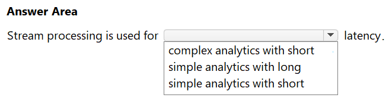

_HOTSPOT — the original ExamTopics question expects you to mark areas on the exhibit above; the correct hotspot coordinates are not published._

**Most voted:** Short and simple -> simple analytics with short latency

### Top explanations
- **AccountHatz** (6 upvotes): Short and simple -> simple analytics with short latency
- **Pey1nkh** (6 upvotes): -Simple analytics with short latency
  --> Stream processing is designed for real-time or near-real-time data processing, where data is processed as it arrives, enabling quick insights or actions. This typically involves simple analytics like filtering, aggregating, or joining streams of data.
- **1faa974** (5 upvotes [Most Recent]): Simple analytics with short latency

## Q1.218 (ID 78914)

What is a characteristic of a non-relational database?

⭕ **A.** full support for Transact-SQL
⭕ **B.** a fixed schema
✅ **C.** self-describing entities

**Correct answer:** C
**Most voted:** C

### Top explanations
- **tahsinet** (3 upvotes): Correct answer
- **ushahid** (3 upvotes [Selected Answer: C]): https://www.oreilly.com/library/view/building-scalable-and/0201729563/0201729563_ch12lev1sec4.html
- **AGTraining** (1 upvotes [Most Recent]): option c
- **OCHARIS** (1 upvotes): 13/09/2023
  correct
- **VNR25** (1 upvotes): This question appeared in the 07/07/23 exam and the answer is correct.

## Q1.219 (ID 78889)

What should you use to automatically delete blobs from Azure Blob Storage?

⭕ **A.** archive storage
⭕ **B.** the change feed
⭕ **C.** soft delete
✅ **D.** a lifecycle management policy

**Correct answer:** D
**Most voted:** D

### Top explanations
- **quocdunginfo2** (11 upvotes [Highly Voted]): D is correct. https://learn.microsoft.com/en-us/azure/storage/blobs/lifecycle-management-overview
- **reza88** (4 upvotes): Exam: 20/10/2022
- **Pranava_GCP** (3 upvotes [Selected Answer: D]): D is correct.
  Azure Storage lifecycle management offers a rule-based policy that you can use to transition blob data to the appropriate access tiers or to expire data at the end of the data lifecycle.
- **1faa974** (1 upvotes [Most Recent, Selected Answer: D]): D is correct.
- **AGTraining** (1 upvotes): OPTION d

## Q1.220 (ID 78888)

In Azure Table storage, each row in a table must be uniquely identified by which two components? Each correct answer presents part of the solution.
NOTE: Each correct selection is worth one point.

✅ **A.** a partition key
⭕ **B.** a range
✅ **C.** a row key
⭕ **D.** a timestamp

**Correct answer:** A, C
**Most voted:** AC

### Top explanations
- **Joanna0** (6 upvotes [Selected Answer: AC]): Together the PartitionKey and RowKey uniquely identify every entity within a table.
  https://learn.microsoft.com/en-us/azure/storage/tables/table-storage-overview
- **mamahani** (4 upvotes): I took the exam 12.04.2023; this question appeared,correct answer
  a partition key / a row key
- **JA2018** (4 upvotes [Selected Answer: AC]): Correct
  From: https://learn.microsoft.com/en-us/azure/storage/tables/table-storage-overview
  Properties: A property is a name-value pair. Each entity can include up to 252 properties to store data. Each entity also has three system properties that specify a partition key, a row key, and a timestamp. Entities with the same partition key can be queried more quickly, and inserted/updated in atomic operations. An entity's row key is its unique identifier within a partition.
- **AGTraining** (1 upvotes [Most Recent]): option A C
- **Mega2** (1 upvotes [Selected Answer: AC]): Right,,,, Good job

## Q1.221 (ID 78775)

HOTSPOT
Select the answer that correctly completes the sentence.
Hot Area:
[sampleXML/xmlfile-221_1.jpg]

_HOTSPOT — the original ExamTopics question expects you to mark areas on the exhibit above; the correct hotspot coordinates are not published._

**Most voted:** 1. Data visualization engineer

### Top explanations
- **jellybiscuit** (27 upvotes [Highly Voted]): Data Analyst should be the answer.
- **tadenet** (11 upvotes [Highly Voted]): I feel like wrong answers are added to keep people engaged.
- **AnnaBi** (6 upvotes): Data Analyst is the correct one
- **Joanna0** (5 upvotes): Data Analyst.
  What is a Microsoft Certified: Data Analyst Associate?
  Microsoft certified data analyst associates are subject matter experts that can design and build scalable data models, clean and transform data, and provide business value via data visualizations.
- **Tsbki** (3 upvotes): Data Analyst is the answer.

## Q1.222 (ID 82851)

You need to store event log data that is semi-structured and received as the logs occur.
What should you use?

✅ **A.** Azure Table storage
⭕ **B.** Azure Queue storage
⭕ **C.** Azure Files

**Correct answer:** A
**Most voted:** A

### Top explanations
- **Maria86** (31 upvotes [Highly Voted]): A. Azure Table storage - passed exam today with sore 1000 - and this question appeared (A was my answer)
- **tangerine141** (5 upvotes [Selected Answer: A]): A. Azure Table storage.
  Azure Table storage is a NoSQL database service that allows you to store large amounts of structured and semi-structured data in a highly scalable and cost-effective manner. It is ideal for storing event log data that is semi-structured and received as the logs occur, as it can handle large volumes of data and support flexible data models.
  Azure Queue storage is a service that allows you to store and retrieve messages that can be processed asynchronously. It is primarily used for decoupling components in a distributed application, rather than storing event log data.
  Azure Files is a fully managed cloud file share service that allows you to store and share files in the cloud. It is designed for general-purpose file sharing scenarios and is not optimized for storing event log data.
  Therefore, Azure Table storage is the best choice for storing semi-structured event log data that is received as the logs occur.
- **BaruZool** (4 upvotes): Why "sore", aren't you happy?
- **Sekharad** (3 upvotes): B is the correct answer. Azure Queue Storage is ideal to store "semi-structured" data
- **XtraWest** (3 upvotes [Selected Answer: A]): A. Azure Table Storage

## Q1.223 (ID 79442)

Which Azure Cosmos DB API should you use for a graph database?

⭕ **A.** Table
⭕ **B.** Cassandra
⭕ **C.** Core (SQL)
✅ **D.** Gremlin

**Correct answer:** D
**Most voted:** D

### Top explanations
- **catia_azure** (5 upvotes): Correct
- **JA2018** (4 upvotes [Selected Answer: D]): repeated question of similar nature/ topic
- **dennis1029** (3 upvotes): answer is D
- **AGTraining** (1 upvotes [Most Recent]): option D

## Q1.224 (ID 82498)

HOTSPOT
For each of the following statements, select Yes if the statement is true. Otherwise, select No.
NOTE: Each correct selection is worth one point.
Hot Area:
[sampleXML/xmlfile-223_1.jpg]

_HOTSPOT — the original ExamTopics question expects you to mark areas on the exhibit above; the correct hotspot coordinates are not published._

**Most voted:** Y,N,N

### Top explanations
- **studysmart** (28 upvotes [Highly Voted]): Y,N,N
  https://learn.microsoft.com/en-us/training/modules/intro-to-azure-data-lake-storage/1-introduction
  https://learn.microsoft.com/en-us/training/modules/intro-to-azure-data-factory/2-what-is-azure-data-factory
  https://learn.microsoft.com/en-us/training/modules/intro-to-azure-hdinsight/2-what-is-azure-hdinsight
- **Stuurwiel1** (22 upvotes [Highly Voted]): Y - Azure Data Lake Storage can be used as a staging area for ingested data before the data is converted into a format suitable for performing analytics. It allows you to store and analyze large amounts of data, and it is optimized for big data analytics workloads.
  N - Azure Data Factory is a cloud-based data integration service that allows you to create, schedule, and manage data pipelines. It does not use a massively parallel processing architecture by default, but allows you to perform complex data integration and transformation tasks by integrating with other Azure services.
  N - Azure HDInsight is designed for big data analytics workloads and does not enable you to build tabular models from multiple data sources to support OLAP queries. Azure Analysis Services is a service that you can use to create and manage tabular models for OLAP.
- **quocdunginfo2** (7 upvotes [Highly Voted]): Y,N,N is answer
- **urielramoss** (4 upvotes): YNN !!!!!!
- **Dusica** (3 upvotes): Y, N, N

## Q1.225 (ID 80678)

HOTSPOT
Select the answer that correctly completes the sentence.
Hot Area:
[sampleXML/xmlfile-224_1.jpg]

_HOTSPOT — the original ExamTopics question expects you to mark areas on the exhibit above; the correct hotspot coordinates are not published._

**Most voted:** duplicate but correct answer

### Top explanations
- **pallmall** (6 upvotes): duplicate but correct answer
- **MEIQIN** (4 upvotes): Repeated question
- **Tsang** (4 upvotes): Correct answer but duplicate
- **quocdunginfo2** (3 upvotes): Duplicated
- **AGTraining** (2 upvotes [Most Recent]): An elastic pool

## Q1.226 (ID 80679)

A bank has a system that manages financial transactions.
When transferring money between accounts. the system must never retrieve a value for the source account that reflects the balance before the transfer and a
value for the destination account that reflects the balance after the transfer.
Of which ACID semantic is this an example?

⭕ **A.** atomicity
⭕ **B.** durability
⭕ **C.** consistency
✅ **D.** isolation

**Correct answer:** D
**Most voted:** D

### Top explanations
- **studysmart** (42 upvotes [Highly Voted, Selected Answer: D]): Confirmed is Isolation.
  It was in 26/09/2022 exam and I scored 1000.
- **pallmall** (13 upvotes [Highly Voted]): Isn't that isolation?
- **ArchMelody** (5 upvotes): It's definitely isolation, based on official Microsoft example: https://learn.microsoft.com/en-us/training/modules/explore-core-data-concepts/5-transactional-data-processing
- **snowfox** (4 upvotes): I agreed. The answer should be D--Isolation
- **tangerine141** (3 upvotes [Selected Answer: D]): In the scenario described, the system must ensure that the balance of the source account is not retrieved until the transfer transaction is completed, and the balance of the destination account reflects the updated balance after the transfer transaction is completed. This ensures that the transfer transaction appears to execute sequentially, even if other transactions are executing concurrently.

## Q1.227 (ID 97389)

DRAG DROP
Match the terms to the appropriate descriptions.
To answer, drag the appropriate term from the column on the left to its description on the right. Each term may be used once, more than once, or not at all.
NOTE: Each correct match is worth one point.

**Exhibits**
- Exhibit 1: 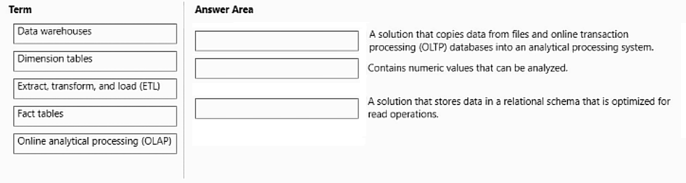

_DRAG DROP — the original ExamTopics question expects you to drag and drop items; the correct targets are not published._

**Most voted:**
- I think the correct answer is actually:
- Online analytical processing (OLAP). See first figure here: https://learn.microsoft.com/en-us/azure/architecture/data-guide/relational-data/online-analytical-processing
- Fact tables
- Data warehouses

### Top explanations
- **StressFree** (18 upvotes [Highly Voted]): Agree
  ETL
  https://learn.microsoft.com/en-us/azure/architecture/data-guide/relational-data/etl
  Fact table
  https://www.techtarget.com/searchdatamanagement/definition/fact-table#:~:text=A%20fact%20table%20stores%20quantitative,fact%20table%20can%20be%20analyzed.
  DW
  https://learn.microsoft.com/en-us/azure/architecture/data-guide/relational-data/data-warehousing
- **Yomzie** (4 upvotes): The question says, "A solution that copies data from..." meaning there is an EXTRACTION, then TRANSFORMATION of the OLTP and flat-file data, after which the data is LOADED into an Analytical System.
  OLAP is not a solution, it is a WORKLOAD type (e.g.: transactional workload, analytical workload, batch workload, streaming workload)
- **AGTraining** (2 upvotes [Most Recent]): Etl
  Fact table
  Dw
- **takusui** (2 upvotes): I think the correct answer is actually:
  Online analytical processing (OLAP). See first figure here: https://learn.microsoft.com/en-us/azure/architecture/data-guide/relational-data/online-analytical-processing
  Fact tables
  Data warehouses
  Otherwise, can someone explain to me why it is ETL instead of OLAP? It clearly says that it's taking data from files and OLTP, and sends it to an analytical processing system.

## Q1.229 (ID 96055)

A data engineer is responsible for which task?

⭕ **A.** Explore data to identify trends.
⭕ **B.** Implement policies, tools, and processes for backup and recovery plans.
⭕ **C.** Design and build analytical models.
✅ **D.** Design and implement data stores for analytical workloads.

**Correct answer:** D
**Most voted:** D

### Top explanations
- **Stuurwiel1** (15 upvotes [Highly Voted, Selected Answer: D]): D
  A data engineer collaborates with stakeholders to design and implement data-related workloads, including data ingestion pipelines, cleansing and transformation activities, and data stores for analytical workloads. They use a wide range of data platform technologies, including relational and non-relational databases, file stores, and data streams.
  https://learn.microsoft.com/en-us/training/modules/explore-roles-responsibilities-world-of-data/2-explore-job-roles
- **DataEngDP** (4 upvotes [Selected Answer: D]): A: Data Analyst
  B: Data Administrator
  C: Data Analyst
  D: Data Engineer
- **tangerine141** (4 upvotes [Selected Answer: D]): B = DBA
  D = Data Engineer
- **StressFree** (3 upvotes [Selected Answer: D]): B = DBA
  D = Data Engineer
  https://learn.microsoft.com/en-us/training/modules/explore-roles-responsibilities-world-of-data/2-explore-job-roles
- **Anuragsharma83** (2 upvotes): Correct Answer is D, every answer is wrong in this dump

## Q1.231 (ID 97440)

HOTSPOT
Select the answer that correctly completes the sentence.

**Exhibits**
- Exhibit 1: 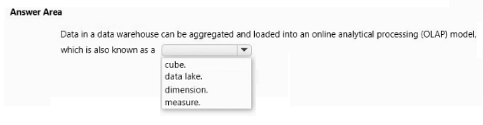

_HOTSPOT — the original ExamTopics question expects you to mark areas on the exhibit above; the correct hotspot coordinates are not published._

**Most voted:** Cube

### Top explanations
- **alexmit** (17 upvotes [Highly Voted]): Correct answer: Cube
- **98761234** (3 upvotes): Data in a data warehouse can be aggregated and loaded into an online analytical processing (OLAP) mode, which is also known as a:
  A.	cube
  B.	data lake
  C.	dimension
  D.	measure
  Suggested answer: cube.
- **AGTraining** (1 upvotes [Most Recent]): Cube correct

## Q1.232 (ID 97248)

HOTSPOT
Select the answer that correctly completes the sentence.

**Exhibits**
- Exhibit 1: 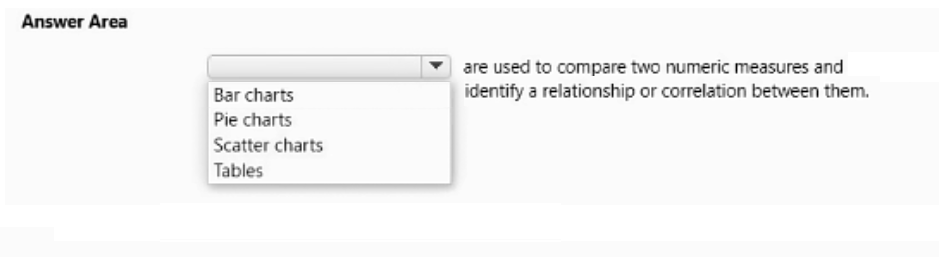

_HOTSPOT — the original ExamTopics question expects you to mark areas on the exhibit above; the correct hotspot coordinates are not published._

**Most voted:**
- Scatter Charts - A scatter chart (or scatter graph) uses dots to represent values for two different numeric variables. The position of each dot on the horizontal and vertical axis indicates values for an individual data point. Scatter plots are used to observe relationships between variables.
- so it's correct

### Top explanations
- **nalwd** (9 upvotes [Highly Voted]): Scatter Charts - A scatter chart (or scatter graph) uses dots to represent values for two different numeric variables. The position of each dot on the horizontal and vertical axis indicates values for an individual data point. Scatter plots are used to observe relationships between variables.
  so it's correct
- **mamahani** (4 upvotes): I took the exam 12.04.2023; this question appeared,correct answer
  scatter charts
- **AGTraining** (1 upvotes [Most Recent]): Scatter charts
- **Joharios** (1 upvotes): Scatter plots are useful when you want to compare two numeric measures and identify a relationship or correlation between them.
  https://learn.microsoft.com/en-us/training/modules/explore-fundamentals-data-visualization/4-data-visualizations

## Q1.234 (ID 96808)

Which file format has defined names and data types for each column and uses compressed columnar storage?

⭕ **A.** HTML
⭕ **B.** CSV
✅ **C.** Apache Parquet
⭕ **D.** JSON

**Correct answer:** C
**Most voted:** C

### Top explanations
- **KMLearn3** (7 upvotes [Highly Voted]): Key phase is "compressed columnar storage". That is about Parquet
- **nalwd** (6 upvotes): C - Correct
- **fiksarion** (2 upvotes): The file format that has defined names and data types for each column and uses compressed columnar storage is Apache Parquet.
  Apache Parquet is a columnar storage file format that is designed for efficient data storage and query processing. It stores data in a columnar format, where each column is stored separately, allowing for efficient compression and selective column reads. Parquet files also include metadata that defines the names and data types of each column, enabling schema evolution and efficient query execution. Parquet is widely used in big data processing frameworks like Apache Spark and Apache Hadoop for its performance and storage efficiency.
- **Tunderich** (1 upvotes [Most Recent]): Yes Correct
- **AGTraining** (1 upvotes): option C

## Q1.236 (ID 96057)

HOTSPOT
For each of the following statements, select Yes if the statement is true. Otherwise, select No.
NOTE: Each correct selection is worth one point.

**Exhibits**
- Exhibit 1: 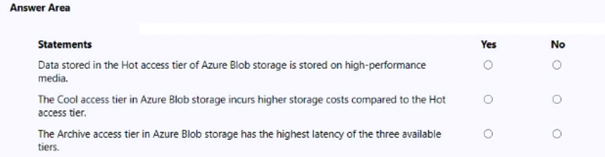

_HOTSPOT — the original ExamTopics question expects you to mark areas on the exhibit above; the correct hotspot coordinates are not published._

**Most voted:**
- The answer should be YNY
- The archive tier is an offline tier for storing data that is rarely accessed. The archive access tier has the lowest storage cost. However, this tier has higher data retrieval costs with a higher latency as compared to the hot and cool tiers.

### Top explanations
- **Tomato592** (43 upvotes [Highly Voted]): The answer should be YNY
  https://learn.microsoft.com/en-us/azure/storage/blobs/access-tiers-overview
  The archive tier is an offline tier for storing data that is rarely accessed. The archive access tier has the lowest storage cost. However, this tier has higher data retrieval costs with a higher latency as compared to the hot and cool tiers.
- **Hosard** (4 upvotes): yes
  no
  yes
- **danayeonz** (4 upvotes): The answer should be YNY!
  Hot(high performance, high cost) > Cool > Archive
- **TheLifeCollective** (3 upvotes): The answer is YNY. Archive has the highest latency of the 3 options and is also the cheapest for that reason
- **KMLearn3** (3 upvotes): Should be YNY,
  "The archive tier is an offline tier for storing data that is rarely accessed. The archive access tier has the lowest storage cost. However, this tier has higher data retrieval costs with a higher latency as compared to the hot and cool tiers."
  Source:
  https://learn.microsoft.com/en-us/azure/storage/blobs/access-tiers-overview

## Q1.237 (ID 98479)

HOTSPOT
For each of the following statements, select Yes if the statement is true. Otherwise, select No.
NOTE: Each correct selection is worth one point.

**Exhibits**
- Exhibit 1: 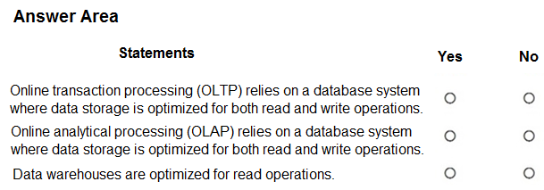

_HOTSPOT — the original ExamTopics question expects you to mark areas on the exhibit above; the correct hotspot coordinates are not published._

**Most voted:**
- Y N Y
- Online Transaction Processing (OLTP) relies on a database system where data storage is optimized for both read and write operations.

### Top explanations
- **XtraWest** (22 upvotes [Highly Voted]): Y N Y
  Online Transaction Processing (OLTP) relies on a database system where data storage is optimized for both read and write operations.
- **testdumps2017** (11 upvotes [Highly Voted]): I am going for NNY.
  This brings back memories from over a decade ago, when M$ used to put hard numbers on their definitions for OLTP: 70% writes and 30% reads.
  Following your logic, then it should be YYY because we do insert a shitload of data into OLAP (TB-sized data). But it doesn't mean it is optimized for writes.
- **ravick4u** (5 upvotes): The answer should be YNY
  OLTP is for relational database where we do both type(read/write) of operations.
- **Yomzie** (4 upvotes): NNY
  OLTP: Highly normalized tables; very efficient for writes (different tables contain DISTINCT data); less efficient for reads (to aggregate data from highly normalized tables would require TABLE JOINS).
  OLAP: Highly aggregated data; less normalized; very efficient for reads (fewer tables with likely DUPLICATE data); less efficient for writes (because data is not normalized).
- **shahrzadkhb** (3 upvotes [Most Recent]): I would go for YNY.

## Q1.238 (ID 98316)

A retail point of sale (POS) system is an example of which type of solution?

⭕ **A.** a data warehouse
⭕ **B.** online analytical processing (OLAP)
⭕ **C.** extract, transform, and load (ETL)
✅ **D.** online transaction processing (OLTP)

**Correct answer:** D
**Most voted:** D

### Top explanations
- **JessicaMingyi** (12 upvotes [Highly Voted]): oltp is the correct answer
- **Joanna0** (6 upvotes [Selected Answer: D]): OLTP!!!
- **XtraWest** (5 upvotes [Selected Answer: D]): A retail point of sale (POS) system is an example of an Online Transaction Processing (OLTP) solution.
- **BorisUK2000** (4 upvotes): I have spent 10 years designing and building POS systems and they are OLTP. You can have OLAP cubes on top of POS databases for MIS reporting
- **Pranava_GCP** (4 upvotes [Selected Answer: D]): D is correct:     got to be OLTP

## Q1.239 (ID 98879)

HOTSPOT
Select the answer that correctly completes the sentence.

**Exhibits**
- Exhibit 1: 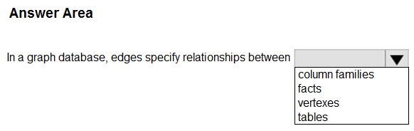

_HOTSPOT — the original ExamTopics question expects you to mark areas on the exhibit above; the correct hotspot coordinates are not published._

**Most voted:**
- A graph database is a collection of nodes (or vertices) and edges (or relationships).
- Therefore, the correct answer is Vertexes.

### Top explanations
- **danayeonz** (10 upvotes [Highly Voted]): This is correct. Node =Vertex
- **Joanna0** (6 upvotes): A graph database is a collection of nodes (or vertices) and edges (or relationships).
  Therefore, the correct answer is Vertexes.
- **AGTraining** (1 upvotes [Most Recent]): vertex

## Q1.240 (ID 99386)

You have structured data in tabular format.
What represents an individual instance of a data entity?

⭕ **A.** a column
⭕ **B.** a table
⭕ **C.** a cell
✅ **D.** a row

**Correct answer:** D
**Most voted:** D

### Top explanations
- **Joanna0** (13 upvotes [Highly Voted, Selected Answer: D]): An entity is a thing in which information needs to be known or held. A table is the object that stores a collection of entities. A row represents a single instance of an entity. A column defines a specific property of an entity.
  A row !!!
- **Joanna0** (5 upvotes [Selected Answer: D]): In a simple relational database implementation, each row of a table represents one instance of an entity type, and each field in a table represents an attribute type.
- **XtraWest** (3 upvotes [Selected Answer: D]): D. row is correct
- **Joanna0** (3 upvotes): But...
  In a simple relational database implementation, each row of a table represents one instance of an entity type, and each field in a table represents an attribute type.
- **Pranava_GCP** (2 upvotes [Selected Answer: D]): D. a row. this is correct

## Q1.241 (ID 100465)

HOTSPOT
Select the answer that correctly completes the sentence.

**Exhibits**
- Exhibit 1: 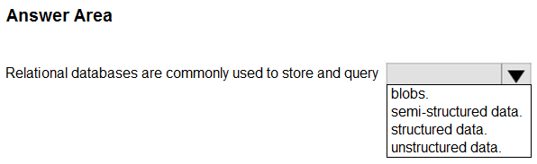

_HOTSPOT — the original ExamTopics question expects you to mark areas on the exhibit above; the correct hotspot coordinates are not published._

**Most voted:** Not provided

### Top explanations
- **eggyboy36** (9 upvotes [Highly Voted]): correct
- **AGTraining** (3 upvotes [Most Recent]): structured data
- **PsiKx** (1 upvotes): correct. structured data

## Q1.242 (ID 99090)

Which Azure SQL offering provides near-100 percent compatibility with on-premises Microsoft SQL Server instances, while providing automated updates. backups, and maintenance tasks?

✅ **A.** Azure SQL Managed Instance
⭕ **B.** SQL Server on Azure Virtual Machines
⭕ **C.** Azure SQL Database
⭕ **D.** Azure SQL Edge

**Correct answer:** A
**Most voted:** A

### Top explanations
- **Joanna0** (8 upvotes [Highly Voted, Selected Answer: A]): https://learn.microsoft.com/en-us/azure/azure-sql/managed-instance/sql-managed-instance-paas-overview?view=azuresql
- **xRiot007** (6 upvotes): These types of comments bring ZERO(0) value to the question and the website
- **mamahani** (5 upvotes): I took the exam 12.04.2023; this question appeared,correct answer
  Azure SQL Managed Instance
- **gabo** (2 upvotes): It's interesting the nobody mentioned that this is a tricky question. Ideally, SQL Server on an Azure VM provides 100% compatibility to on-prem system. But the catch here is "while providing automated updates. backups, and maintenance tasks" so it has to be Azure SQL Managed Instance. Makes sense?
- **VNR25** (2 upvotes): This question appeared in the 07/07/23 exam and the answer is correct.

## Q1.243 (ID 101024)

HOTSPOT
Select the answer that correctly completes the sentence.

**Exhibits**
- Exhibit 1: 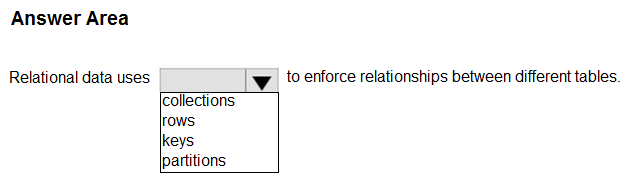

_HOTSPOT — the original ExamTopics question expects you to mark areas on the exhibit above; the correct hotspot coordinates are not published._

**Most voted:** Correct answer!

### Top explanations
- **qcmarco** (6 upvotes): Correct answer!
- **fiksarion** (2 upvotes): Relational data uses keys and relationships to enforce relationships between different tables.
  In a relational database, data is organized into tables, which consist of rows and columns. Each row represents a single record or entity, and each column represents a specific attribute or property of that record.
  Keys play a crucial role in establishing relationships between tables. A primary key is a unique identifier for each row in a table, ensuring its uniqueness and providing a way to reference that row from other tables. Foreign keys are used to create relationships between tables by linking a column in one table to the primary key column in another table.
- **AGTraining** (1 upvotes [Most Recent]): keys correct

## Q1.244 (ID 98481)

HOTSPOT
Select the answer that correctly completes the sentence.

**Exhibits**
- Exhibit 1: 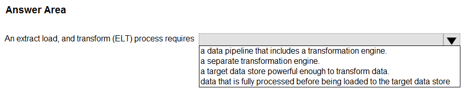

_HOTSPOT — the original ExamTopics question expects you to mark areas on the exhibit above; the correct hotspot coordinates are not published._

**Most voted:**
- Transformation engine is not needed because you will not transform the data before it is being loaded.
- I think the answer is "a target data store powerful enough to transform data", because there you will need power to perform a comples queries for business purposes.

### Top explanations
- **ravick4u** (37 upvotes [Highly Voted]): Duplicate of #32 and the answer for that question is "a target data store powerful enough to transform data"
- **Joanna0** (12 upvotes [Highly Voted]): Transformation engine is not needed because you will not transform the data before it is being loaded.
  I think the answer is "a target data store powerful enough to transform data", because there you will need power to perform a comples queries for business purposes.
- **danayeonz** (8 upvotes [Highly Voted]): Agreed. I was thinking C
- **qcmarco** (4 upvotes): Answer should be C
- **Heshybay** (3 upvotes [Most Recent]): The answer is C.
  A data pipeline that includes a transformational engine is characteristic of an ETL (Extract, Transform, Load) process.

## Q1.245 (ID 100803)

HOTSPOT
Select the answer that correctly completes the sentence.

**Exhibits**
- Exhibit 1: 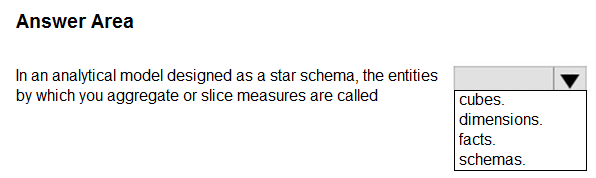

_HOTSPOT — the original ExamTopics question expects you to mark areas on the exhibit above; the correct hotspot coordinates are not published._

**Most voted:** Dimensions:- In a star schema, the entities by which you aggregate or slice measures are called dimensions. Dimensions are the descriptive attributes or perspectives of the data that provide the context for the measures (also known as facts) in the model.

### Top explanations
- **coolbru** (14 upvotes [Highly Voted]): Dimensions:- In a star schema, the entities by which you aggregate or slice measures are called dimensions. Dimensions are the descriptive attributes or perspectives of the data that provide the context for the measures (also known as facts) in the model.
  For example, in a sales data star schema, the dimensions could be time, product, store location, and customer. These dimensions provide context for the sales measures such as total sales, units sold, and revenue. By aggregating or slicing the measures by different dimensions, you can gain insights into the data from different perspectives.
- **Karbabu** (1 upvotes [Most Recent]): I think dimension is the correct option
- **fiksarion** (1 upvotes): In an analytical model designed as a star schema, the entities by which you aggregate or slice measures are called dimensions.
  A star schema is a type of data modeling technique commonly used in data warehousing and business intelligence applications. It organizes data into a central fact table surrounded by multiple dimension tables. The fact table contains measures or numerical values that represent the business metrics or facts, such as sales amount or quantity. The dimension tables contain the descriptive attributes or context information related to the facts, such as date, product, customer, or location.

## Q1.246 (ID 98484)

DRAG DROP
Match the data storage options to the appropriate types of data.
To answer, drag the appropriate data storage option from the column on the left to its data type on the right. Each data storage option may be used once, more than once, or not at all.
NOTE: Each correct match is worth one point.

**Exhibits**
- Exhibit 1: 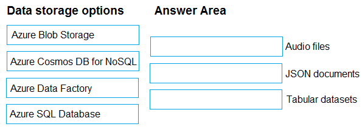

_DRAG DROP — the original ExamTopics question expects you to drag and drop items; the correct targets are not published._

**Most voted:**
- Why I think that the question is about only "data storages"?
- And I see only two data storages: 1. Azure Blob Storage where we can storage files and documents.
2. Azure SQL Database - where we can store tables and data.
- Therefore, I think that the answer should be - Azure Blob Storage, Azure Blob Storage, Azure SQL Database.

### Top explanations
- **TheLifeCollective** (48 upvotes [Highly Voted]): Answer is Blob, Cosmos DB for NoSQL and Azure SQL Database
- **tangerine141** (15 upvotes [Highly Voted]): Audio files - Azure Blob Storage
  JSON documents - Azure Cosmos DB for NoSQL
  Tabular datasets - Azure SQL Database
- **Murtuza** (3 upvotes): Azure Data Factory should not be picked as an answer in this question as it has no place here
- **Sekharad** (2 upvotes [Most Recent]): For  tabular datasets, it should be Azure SQL Database and not Azure Data Factory.
- **kamil_kluska** (2 upvotes): Cosmos is the right choice for JSON
  https://learn.microsoft.com/en-us/azure/cosmos-db/nosql/query/working-with-json

## Q1.247 (ID 98880)

HOTSPOT
For each of the following statements, select Yes if the statement is true. Otherwise, select No.
NOTE: Each correct selection is worth one point.

**Exhibits**
- Exhibit 1: 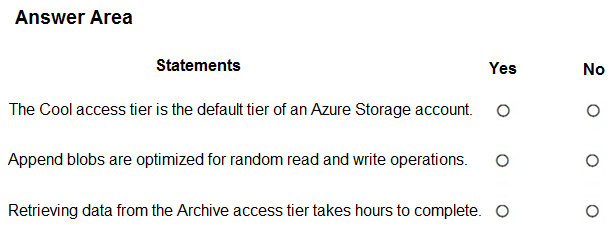

_HOTSPOT — the original ExamTopics question expects you to mark areas on the exhibit above; the correct hotspot coordinates are not published._

**Most voted:**
- For Apache Gremlin: Used for graph databases, employs the Gremlin query language.
- For MongoDB: Leverages MongoDB's query language.
- For Table: Designed for storing and querying data in tables, similar to Azure Table storage.

### Top explanations
- **Bartin8tor** (12 upvotes [Highly Voted]): NNY
  The default access tier for a new general-purpose v2 storage account is set to the hot tier by default.
  An append blob is composed of blocks and is optimized for append operations. When you modify an append blob, blocks are added to the end of the blob only, via the Append Block operation. Updating or deleting of existing blocks is not supported.
  Rehydrating a blob from the Archive tier can take several hours to complete.
- **danayeonz** (9 upvotes [Highly Voted]): Optimized for random read and write - It's Page Blob
- **Anuragsharma83** (4 upvotes): False, Fales, True
- **tangerine141** (3 upvotes): False. The default access tier of an Azure Storage account is the Hot access tier.
  False. Append blobs are optimized for sequential write operations, not random read and write operations.
  True. Retrieving data from the Archive access tier may take several hours to complete, depending on the size of the data and the retrieval options chosen.
- **Bartin8tor** (2 upvotes): https://learn.microsoft.com/en-us/azure/storage/blobs/archive-rehydrate-overview
  https://learn.microsoft.com/en-us/rest/api/storageservices/understanding-block-blobs--append-blobs--and-page-blobs

## Q1.248 (ID 98485)

HOTSPOT
Select the answer that correctly completes the sentence.

**Exhibits**
- Exhibit 1: 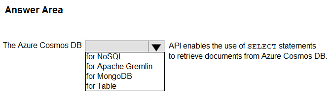

_HOTSPOT — the original ExamTopics question expects you to mark areas on the exhibit above; the correct hotspot coordinates are not published._

**Most voted:** incorrect, MongoDB API using syntax e.g. db.families.find( { id: "AdressfieldFamily" }, { children: true } ).  NoSQL API using syntax with SELECT statement, e.g. SELECT * FROM Products,  so the correct answer is A. for NoSQL API.

### Top explanations
- **NuriaIzard** (12 upvotes [Highly Voted]): The Azure Cosmos DB API for NoSQL supports querying documents using SQL. This article provides a sample document and two sample SQL queries and results / found in Microsoft tutorial
- **TheLifeCollective** (6 upvotes): Azure Cosmos DB core API is the answer but this is not in the list. Closest thing to query documents would be MongoDB API
- **Pranava_GCP** (5 upvotes): incorrect, MongoDB API using syntax e.g. db.families.find( { id: "AdressfieldFamily" }, { children: true } ).  NoSQL API using syntax with SELECT statement, e.g. SELECT * FROM Products,  so the correct answer is A. for NoSQL API.
- **Pranava_GCP** (4 upvotes): The correct answer is "for NOSQL".
  NoSQL accounts provide support for querying items using the Structured Query Language (SQL) syntax, one of the most familiar and popular query languages to query JSON objects.
  https://learn.microsoft.com/en-us/azure/cosmos-db/choose-api
- **sbd2022** (4 upvotes): correct

## Q1.249 (ID 99420)

HOTSPOT
For each of the following statements, select Yes if the statement is true. Otherwise, select No.
NOTE: Each correct selection is worth one point.

**Exhibits**
- Exhibit 1: 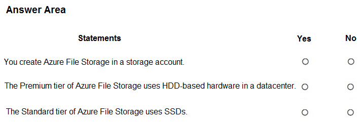

_HOTSPOT — the original ExamTopics question expects you to mark areas on the exhibit above; the correct hotspot coordinates are not published._

**Most voted:**
- Yes. Azure File Storage can be created in a storage account in Azure.
- No. The Premium tier of Azure File Storage uses SSD-based hardware in a datacenter, not HDD-based.

### Top explanations
- **tangerine141** (11 upvotes [Highly Voted]): Yes. Azure File Storage can be created in a storage account in Azure.
  No. The Premium tier of Azure File Storage uses SSD-based hardware in a datacenter, not HDD-based.
  No. The Standard tier of Azure File Storage also uses HDD-based hardware in a datacenter, not SSD-based. However, it is worth noting that both tiers of Azure File Storage offer a combination of SSDs and HDDs to optimize performance and cost.
- **Joanna0** (7 upvotes [Highly Voted]): The answers are correct.
  YNN
- **Anuragsharma83** (4 upvotes [Most Recent]): Azure Files provides a range of storage tiers that help reduce costs by allowing you to store data at the appropriate level of performance and price. At the highest level, Azure Files offers two performance tiers: standard and premium. Standard file shares are hosted on a storage system backed by hard disk drives (HDD), while premium file shares are backed by solid-state drives (SSD) for better performance. Standard file shares have several storage tiers (transaction optimized, hot, and cool) that you can seamlessly move between to maximize the data at-rest storage and transaction prices. However, you can't move between standard and premium tiers without physically migrating your data between different storage accounts
- **sbd2022** (4 upvotes): correct answer

## Q1.250 (ID 102720)

HOTSPOT
Select the answer that correctly completes the sentence.

**Exhibits**
- Exhibit 1: 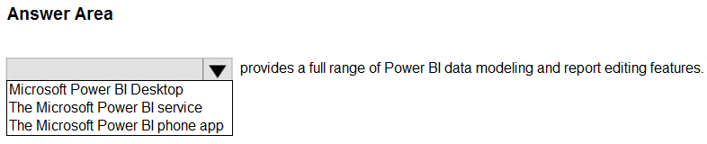

_HOTSPOT — the original ExamTopics question expects you to mark areas on the exhibit above; the correct hotspot coordinates are not published._

**Most voted:** Not provided

### Top explanations
- **Ash20231221** (9 upvotes [Highly Voted]): correct
- **Pranava_GCP** (4 upvotes): Yes,  Power BI Desktop is correct
  Desktop is a complete data analysis and report creation tool that is used to connect to, transform, visualize, and analyze your data. It includes the Query Editor, in which you can connect to many different sources of data, and combine them (often called modeling) into a data model. Then you design a report based on that data model.
- **_Paul_** (4 upvotes): Power BI Desktop is correct. https://learn.microsoft.com/en-us/power-bi/fundamentals/service-service-vs-desktop
- **AGTraining** (2 upvotes [Most Recent]): option A

## Q1.251 (ID 102168)

HOTSPOT
Select the answer that correctly completes the sentence.

**Exhibits**
- Exhibit 1: 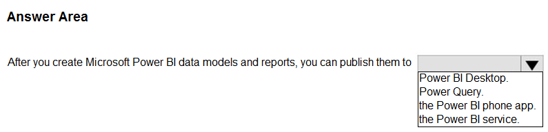

_HOTSPOT — the original ExamTopics question expects you to mark areas on the exhibit above; the correct hotspot coordinates are not published._

**Most voted:** The answer is D. the Power BI service.

### Top explanations
- **jovicj** (8 upvotes [Highly Voted]): Correct
  https://learn.microsoft.com/en-us/power-bi/create-reports/desktop-upload-desktop-files
- **Pranava_GCP** (4 upvotes): Power BI service is correct answer :
  Reports can be shared with others directly or by publishing to the Power BI service. Sharing reports requires a Power BI Pro license.
- **Ace_Defective** (1 upvotes [Most Recent]): The answer is D. the Power BI service.
  Explanation:
  Power BI Service: This is the cloud-based service where you publish and share your Power BI reports and dashboards.
  Power BI Desktop: This is where you create and edit your Power BI reports and data models.
  Power BI Mobile App: This app allows you to view and interact with your Power BI reports and dashboards on your mobile devices.
  In summary: The Power BI service is the central hub for publishing and sharing your Power BI content.
- **AGTraining** (1 upvotes): option D

## Q1.252 (ID 98483)

Which type of Azure resource supports the serverless configuration of an Azure SQL database?

⭕ **A.** SQL Server on Azure Virtual Machines
⭕ **B.** an Azure SQL Database elastic pool
✅ **C.** a single database in Azure SQL Database
⭕ **D.** Azure SQL Managed Instance

**Correct answer:** C
**Most voted:** C

### Top explanations
- **Pranava_GCP** (8 upvotes [Highly Voted, Selected Answer: C]): Serverless is a compute tier for single databases in Azure SQL Database that automatically scales compute based on workload demand and bills for the amount of compute used per second. The serverless compute tier also automatically pauses databases during inactive periods when only storage is billed and automatically resumes databases when activity returns.
- **Joanna0** (4 upvotes [Selected Answer: C]): Correct.
  https://learn.microsoft.com/en-us/azure/azure-sql/database/serverless-tier-overview?view=azuresql&tabs=general-purpose
- **ravick4u** (3 upvotes [Selected Answer: C]): similar to #99
- **subhayu.biswas12** (1 upvotes [Most Recent, Selected Answer: C]): C is correct answer
- **AGTraining** (1 upvotes): option C

## Q1.253 (ID 104005)

HOTSPOT
Select the answer that correctly completes the sentence.

**Exhibits**
- Exhibit 1: 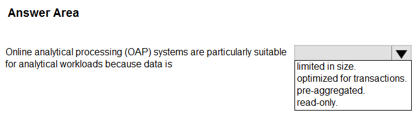

_HOTSPOT — the original ExamTopics question expects you to mark areas on the exhibit above; the correct hotspot coordinates are not published._

**Most voted:** In an OLAP system, data is typically organized in a multidimensional model so.. 'Pre-aggregated' makes more sense

### Top explanations
- **XtraWest** (10 upvotes [Highly Voted]): In an OLAP system, data is typically organized in a multidimensional model so.. 'Pre-aggregated' makes more sense
- **fiksarion** (4 upvotes): Online analytical processing (OLAP) systems are particularly suitable for analytical workloads because data is: pre-aggregated.
  OLAP systems are designed to handle complex analytical queries and provide fast query response times. They achieve this by pre-aggregating data, meaning that calculations and aggregations are performed in advance and stored in a way that allows for efficient retrieval. This pre-aggregation reduces the need for complex calculations at query time and significantly improves the performance of analytical queries.
- **AGTraining** (2 upvotes [Most Recent]): 'Pre-aggregated

## Q1.254 (ID 99081)

DRAG DROP
Match the data processing languages to the appropriate real-time analytics services.
To answer, drag the appropriate language from the column on the left to its service on the right. Each language may be used once, more than once, or not at all.
NOTE: Each correct match is worth one point.

**Exhibits**
- Exhibit 1: 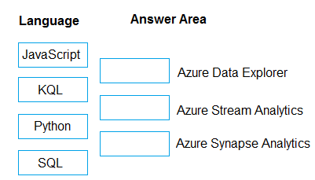

_DRAG DROP — the original ExamTopics question expects you to drag and drop items; the correct targets are not published._

**Most voted:**
- Azure Data Explorer: KQL (Kusto Query Language), which is a proprietary query language specifically designed for Azure Data Explorer. It is used to analyze and query large volumes of structured and unstructured data in real-time.
- Azure Stream Analytics: SQL, which is a standard query language for relational databases. It is used to analyze and process high-velocity, real-time streaming data from various sources, such as IoT devices, social media platforms, and other real-time data streams.
- Azure Synapse Analytics: SQL and Python. SQL is used to query and analyze structured data stored in Azure Synapse Analytics, while Python can be used for data preprocessing, machine learning, and other data science tasks.

### Top explanations
- **tangerine141** (12 upvotes [Highly Voted]): Azure Data Explorer: KQL (Kusto Query Language), which is a proprietary query language specifically designed for Azure Data Explorer. It is used to analyze and query large volumes of structured and unstructured data in real-time.
  Azure Stream Analytics: SQL, which is a standard query language for relational databases. It is used to analyze and process high-velocity, real-time streaming data from various sources, such as IoT devices, social media platforms, and other real-time data streams.
  Azure Synapse Analytics: SQL and Python. SQL is used to query and analyze structured data stored in Azure Synapse Analytics, while Python can be used for data preprocessing, machine learning, and other data science tasks.
- **gabo** (12 upvotes [Highly Voted]): where's the person with the 1000 score when you need him/her?
- **rmeng** (4 upvotes): A. KQL
  B. SQL
  C. SQL
- **tczubat** (2 upvotes): what is the answer?
- **_lene_** (2 upvotes): Azure Synapse offers a choice of several languages such as SQL, Python, .NET, Java, Scala and R, so not sure what's the answer for the last one...

## Q1.255 (ID 103911)

Which Azure Cosmos DB API should you use for a graph database?

⭕ **A.** Table
⭕ **B.** Cassandra
⭕ **C.** NoSQL
✅ **D.** Gremlin

**Correct answer:** D
**Most voted:** D

### Top explanations
- **XtraWest** (7 upvotes [Highly Voted]): Graph == Gramlin
- **Rajivjain** (2 upvotes): Duplicate 223
- **1faa974** (1 upvotes [Most Recent, Selected Answer: D]): Gramlin

## Q1.257 (ID 118326)

What is a difference between structured data and semi-structured data?

✅ **A.** Structured data has a fixed schema and semi-structured data has a flexible schema.
⭕ **B.** Only Structured data supports entities.
⭕ **C.** Structured data has a flexible schema and semi-structured data has a fixed schema.
⭕ **D.** Only Structured data supports attributes.

**Correct answer:** A
**Most voted:** A

### Top explanations
- **erwin_t82** (3 upvotes): Whereas structured data requires a fixed schema defined in advance, semi-structured data does not require a prior schema definition. For this reason, it can constantly evolve—new attributes can be added at any time.
  So therefore A is correct answer.
- **Mega2** (2 upvotes): Correct
  A. Structured data has a fixed schema, and semi-structured data has a flexible schema.
- **Kraken84** (2 upvotes): going to take the test shortly, TY
- **1faa974** (1 upvotes [Most Recent, Selected Answer: A]): A is correct

## Q1.258 (ID 112657)

HOTSPOT
For each of the following statements, select Yes if the statement is true. Otherwise, select No.
NOTE: Each correct selection is worth one point.

**Exhibits**
- Exhibit 1: 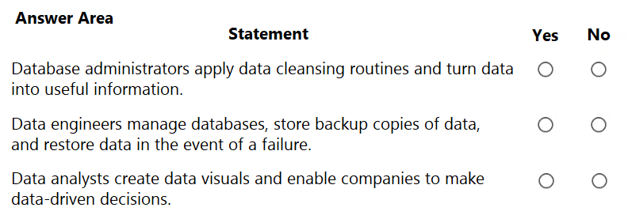

_HOTSPOT — the original ExamTopics question expects you to mark areas on the exhibit above; the correct hotspot coordinates are not published._

**Most voted:** Nope! The second option is performed by a DBA. --'

### Top explanations
- **Bruno_DBA** (11 upvotes [Highly Voted]): Nope! The second option is performed by a DBA. --'
- **Alex_96** (10 upvotes [Highly Voted]): correct!
- **Mujadidi** (3 upvotes): It should be NYY
- **DiDivision** (1 upvotes): correct
- **1faa974** (1 upvotes [Most Recent]): The responsibility for storing backup copies of data and restoring data in the event of a failure typically falls under the purview of database administrators or IT operations teams. Data engineers may be involved in designing systems that facilitate data recovery, but they are not usually the primary role responsible for backups and restores.

## Q1.259 (ID 117417)

A bank needs to ensure that after an account transfer transaction completes, the revised account balances persists even if the database system hosting the transaction becomes temporarily unavailable.
Of which ACID semantic is this an example?

⭕ **A.** durability
✅ **B.** isolation
⭕ **C.** atomicity
⭕ **D.** consistency

**Correct answer:** B
**Most voted:** B

### Top explanations
- **naronomous** (3 upvotes): Correct: when a transaction has been committed, it will remain committed. After the account transfer transaction has completed, the revised account balances are persisted so that even if the database system were to be switched off, the committed transaction would be reflected when it is switched on again. --> https://learn.microsoft.com/en-us/training/modules/explore-core-data-concepts/5-transactional-data-processing
- **Ashishn132** (2 upvotes): Answer is correct. Isolation talks about two concurrent transactions are isolated such way one transaction does not affect other other transaction
- **Erich_1970** (1 upvotes): Durability ensures that once a transaction is committed, its effects persist even in the face of system failures. The changes made by a committed transaction should be permanent.
  Example:
  After Alice's transfer to Bob is successful and the system acknowledges the completion, even if there's a power outage or system crash, the $100 transfer should still be reflected in the database once the system is restored.
- **testdumps2017** (1 upvotes): Isolation, it talks about two different transactions. Durability refers to the data being consistent after a crash recovery.
- **Yomzie** (1 upvotes [Most Recent]): Transaction Durability: Simple English.
  **The previously completed (committed) transaction must PERSIST even if there is a system crash/outage thereafter.

## Q1.260 (ID 123437)

Which statement is an example of Data Manipulation Language (DML)?

✅ **A.** INSERT
⭕ **B.** ALTER
⭕ **C.** DROP
⭕ **D.** CREATE

**Correct answer:** A
**Most voted:** A

### Top explanations
- **Anuragsharma83** (4 upvotes): DML statements allow you to query, edit, add, and remove data stored in database objects. The primary DML commands are SELECT , INSERT , DELETE , and UPDATE . Using DML statements, you can perform powerful actions on the actual data stored in your system.
- **subhayu.biswas12** (3 upvotes [Selected Answer: A]): A is correct
- **1faa974** (1 upvotes [Most Recent, Selected Answer: A]): Data Manipulation Language: INSERT, DELTE, UPDATE.
  Data Query Langugage: SELECT,
  Answer should be A.
- **Mega2** (1 upvotes [Selected Answer: A]): Correct...

## Q1.261 (ID 113657)

Which language is used to define queries in Azure Synapse Data Explorer?

⭕ **A.** Bash
⭕ **B.** PowerShell
✅ **C.** KQL
⭕ **D.** SQL

**Correct answer:** C
**Most voted:** C

### Top explanations
- **james2033** (3 upvotes [Most Recent, Selected Answer: C]): Quote "Democratizing data analytics - Data Explorer democratizes self-service, big data analytics with the intuitive Kusto Query Language (KQL) that provides the expressiveness and power of SQL with the simplicity of Excel. KQL is highly optimized for exploring raw telemetry and time series data by leveraging Data Explorer's best-in-class text indexing technology for efficient free-text and regex search, and comprehensive parsing capabilities for querying traces\text data and JSON semi-structured data including arrays and nested structures." at https://learn.microsoft.com/en-us/azure/synapse-analytics/data-explorer/data-explorer-overview#what-makes-azure-synapse-data-explorer-unique .
- **gourava143** (2 upvotes): C  -- kql

## Q1.262 (ID 113658)

HOTSPOT
Select the answer that correctly completes the sentence.

**Exhibits**
- Exhibit 1: 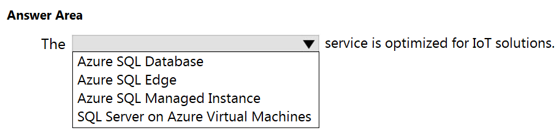

_HOTSPOT — the original ExamTopics question expects you to mark areas on the exhibit above; the correct hotspot coordinates are not published._

**Most voted:** Not provided

### Top explanations
- **FeRuch** (4 upvotes): Azure Sql Edge
- **ekden** (1 upvotes [Most Recent]): Azure SQL Edge is an optimized relational database engine geared for IoT and IoT Edge deployments.
  Source https://learn.microsoft.com/en-us/azure/azure-sql-edge/overview
- **gourava143** (1 upvotes): AZURE SQL EDGE

## Q1.263 (ID 112658)

HOTSPOT
For each of the following statements, select Yes if the statement is true. Otherwise, select No.
NOTE: Each correct selection is worth one point.

**Exhibits**
- Exhibit 1: 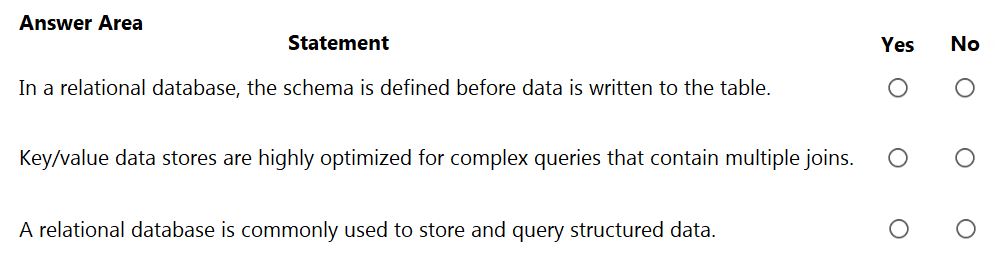

_HOTSPOT — the original ExamTopics question expects you to mark areas on the exhibit above; the correct hotspot coordinates are not published._

**Most voted:** Yes, No, Yes

### Top explanations
- **rmeng** (7 upvotes [Most Recent, Highly Voted]): YES NO YES
- **globy118** (5 upvotes): Key-value databases are designed for high performance and scalability, and are often used in situations where the data does not require complex relationships or joins. They are well suited for storing data that can be easily partitioned, such as caching data or session data. Key-value databases are simple and easy to use, but they may not be as suitable for complex queries or data relationships as other types of databases such as document or relational databases.
  https://databasetown.com/key-value-database-use-cases/
- **rmeng** (3 upvotes): YES NO YES.
  No, key/value data stores are not highly optimized for complex queries that contain multiple joins. Key/value data stores are designed for simplicity and efficiency in storing and retrieving data based on a key, typically with a focus on high-speed read and write operations for simple data access patterns.
- **Alex_96** (2 upvotes): shouldn't be YYY?

## Q1.264 (ID 118364)

HOTSPOT
Select the answer that correctly completes the sentence.

**Exhibits**
- Exhibit 1: 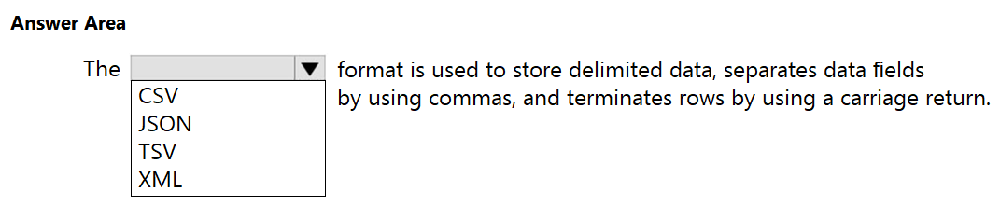

_HOTSPOT — the original ExamTopics question expects you to mark areas on the exhibit above; the correct hotspot coordinates are not published._

**Most voted:** Not provided

### Top explanations
- **Kraken84** (4 upvotes): Here is an example of a CSV file:
  Name,Age,Country
  John Doe,30,USA
  Jane Doe,25,Canada
- **Mega2** (1 upvotes [Most Recent]): Correct. CSV file.

## Q1.265 (ID 119476)

HOTSPOT
Select the answer that correctly completes the sentence.

**Exhibits**
- Exhibit 1: 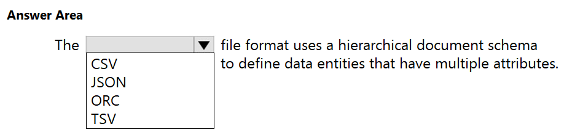

_HOTSPOT — the original ExamTopics question expects you to mark areas on the exhibit above; the correct hotspot coordinates are not published._

**Most voted:** Not provided

### Top explanations
- **Kapello10** (4 upvotes [Most Recent]): The correct ans is Json
- **Bruno_DBA** (2 upvotes): Correto, meu chapa quente!

## Q1.266 (ID 115728)

DRAG DROP
Match the Azure Cosmos DB APIs to the appropriate data structures.
To answer, drag the appropriate API from the column on the left to its data structure on the right. Each API may be used once, more than once, or not at all.
NOTE: Each correct match is worth one point.

**Exhibits**
- Exhibit 1: 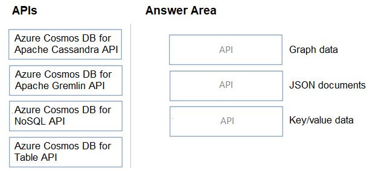

_DRAG DROP — the original ExamTopics question expects you to drag and drop items; the correct targets are not published._

**Most voted:** Correct !

### Top explanations
- **lorenzoamato** (11 upvotes [Highly Voted]): Correct !
- **J404** (4 upvotes): Yep, the given answer is correct
- **AGTraining** (3 upvotes [Most Recent]): gremlin
  nosql
  table

## Q1.267 (ID 115729)

Which Azure Cosmos DB API should you use for a graph database?

⭕ **A.** Azure Cosmos DB for Table
⭕ **B.** Azure Cosmos DB for Apache Cassandra
⭕ **C.** Azure Cosmos DB for NoSQL
✅ **D.** Azure Cosmos DB for Apache Gremlin

**Correct answer:** D
**Most voted:** D

### Top explanations
- **lorenzoamato** (4 upvotes): Correct
- **Itschaimae** (2 upvotes [Most Recent, Selected Answer: D]): GRaph = GRemlin
- **piipo** (1 upvotes [Selected Answer: D]): D is Correct
- **AGTraining** (1 upvotes): option D

## Q1.268 (ID 126482)

HOTSPOT
Select the answer that correctly completes the sentence.

**Exhibits**
- Exhibit 1: 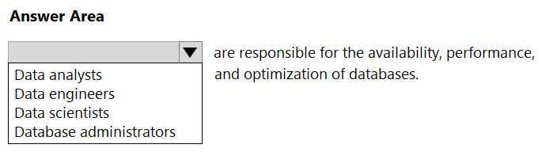

_HOTSPOT — the original ExamTopics question expects you to mark areas on the exhibit above; the correct hotspot coordinates are not published._

**Most voted:** Not provided

### Top explanations
- **QeUtPat** (5 upvotes [Most Recent]): Database Administrator
- **SgnBaiocchi** (3 upvotes): Correct: Database Administrator
- **AGTraining** (2 upvotes): option D
- **naronomous** (1 upvotes): source: https://learn.microsoft.com/en-us/training/modules/explore-roles-responsibilities-world-of-data/2-explore-job-roles

## Q1.269 (ID 126289)

DRAG DROP
Match the cloud service model to the appropriate Azure relational database service.
To answer, drag the appropriate cloud service model from the column on the left to its service on the right. Each model may be used once, more than once, or not at all.
NOTE: Each correct match is worth one point.

**Exhibits**
- Exhibit 1: 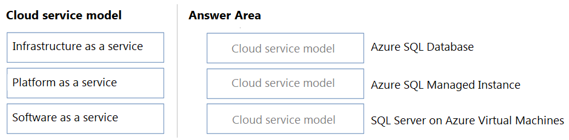

_DRAG DROP — the original ExamTopics question expects you to drag and drop items; the correct targets are not published._

**Most voted:**
- Correct answer is PAAS, PAAS, IAAS
- Azure SQL Managed Instance is of type PAAS

### Top explanations
- **Yomzie** (10 upvotes [Highly Voted]): The "contributor access" is a complete waste of money!! Not with all these wrong answers.
- **frostxyz1** (4 upvotes): PAAS,PAAS,IAAS I agree
- **rscloud** (3 upvotes): Answer is PaaS, PaaS, IaaS
- **vivek_kol** (2 upvotes [Most Recent]): Correct answer is PAAS, PAAS, IAAS
  Azure SQL Managed Instance is of type PAAS
- **vivek_kol** (2 upvotes): PAAS, PAAS, IAAS should be the correct answer

## Q1.270 (ID 126483)

A bank needs to ensure that a transaction involving debiting funds from a source account and crediting the same funds to a destination account must complete both actions. If either action falls to complete, the other action must fail.
Of which ACID semantic is this an example?

⭕ **A.** consistency
⭕ **B.** durability
✅ **C.** atomicity
⭕ **D.** isolation

**Correct answer:** C
**Most voted:** C

### Top explanations
- **Kapello10** (5 upvotes): Atomicity guarantees that each transaction is treated as a single "unit", which either succeeds completely or fails completely: if any of the statements constituting a transaction fails to complete, the entire transaction fails and the database is left unchanged
  Consistency ensures that a transaction can only bring the database from one consistent state to another, preserving database invariants: any data written to the database must be valid according to all defined rules
  Isolation ensures that concurrent execution of transactions leaves the database in the same state that would have been obtained if the transactions were executed sequentially
  Durability guarantees that once a transaction has been committed, it will remain committed even in the case of a system failure (e.g., power outage or crash).
- **Kapello10** (3 upvotes): Ans is C Atomicty
- **Kebedegn** (1 upvotes [Most Recent, Selected Answer: C]): c is right answer

## Q1.271 (ID 126484)

Blob rehydration occurs in Azure Blob storage when a blob moves between which access tiers?

⭕ **A.** Hot to Cool
⭕ **B.** Hot to Archive
⭕ **C.** Cool to Archive
✅ **D.** Archive to Cool

**Correct answer:** D
**Most voted:** D

### Top explanations
- **Gepro** (5 upvotes [Most Recent, Selected Answer: D]): While a blob is in the archive access tier, it's considered to be offline, and can't be read or modified. In order to read or modify data in an archived blob, you must first rehydrate the blob to an online tier, either the hot or cool tier.
- **SgnBaiocchi** (2 upvotes): Correct: D.
  https://learn.microsoft.com/en-us/azure/storage/blobs/archive-rehydrate-overview

## Q1.272 (ID 126485)

Which activity is most common for transactional workloads?

✅ **A.** recording small units of work events in real time
⭕ **B.** aggregating massive amounts of data
⭕ **C.** producing complex reports
⭕ **D.** performing self-service data exploration

**Correct answer:** A
**Most voted:** A

### Top explanations
- **subhayu.biswas12** (3 upvotes [Most Recent, Selected Answer: A]): Correct A : keyword is "Real Time" = Transactional workloads
- **SgnBaiocchi** (3 upvotes): Correct A : A. recording small units of work events in real time

## Q1.273 (ID 127002)

You have a banking application that transfers money in to and out of accounts.
Of which type of solution is this is an example?

✅ **A.** online transaction processing (OLTP)
⭕ **B.** online analytical processing (OLAP)
⭕ **C.** extract, transform and load (ETL)
⭕ **D.** a data warehouse

**Correct answer:** A
**Most voted:** A

### Top explanations
- **ramkaych** (2 upvotes [Most Recent, Selected Answer: A]): Yuppidiyep!
- **Prasanth_S31** (2 upvotes): very straight forward question.. ans is OLTP
- **SgnBaiocchi** (2 upvotes): Correct: A. online transaction processing (OLTP)

## Q1.274 (ID 127003)

DRAG DROP
Match the job roles to the appropriate tasks.
To answer, drag the appropriate job role from the column on the left to its task on the right. Each role may be used once, more than once, or not at all.
NOTE: Each correct match is worth one point.

**Exhibits**
- Exhibit 1: 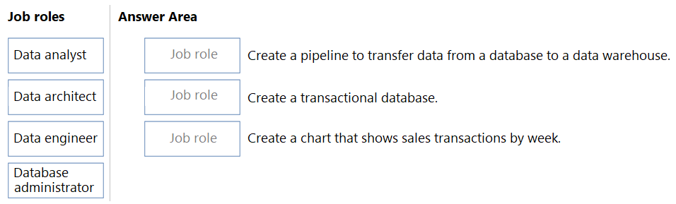

_DRAG DROP — the original ExamTopics question expects you to drag and drop items; the correct targets are not published._

**Most voted:**
2. Data Administrator
3. Data Analyst

### Top explanations
- **KumudiniChaudhari** (18 upvotes [Highly Voted]): Correct Ans:
  1. Data Engineer
  2. Data Administrator
  3. Data Analyst
  Notes:
  The job roles define differentiated tasks and responsibilities. In some organizations, the same person might perform multiple roles; so in their role as database administrator they might provision a transactional database, and then in their role as a data engineer they might create a pipeline to transfer data from the database to a data warehouse for analysis.
  https://learn.microsoft.com/en-us/training/modules/explore-roles-responsibilities-world-of-data/2-explore-job-roles
- **SgnBaiocchi** (7 upvotes [Highly Voted]): Data Engineer --> Create Pipelines --> CORRECT
  Data Analyst --> Create a chart -->CORRECT
  Data Architect --> Create a transactional DB --> INCORRECT
  Tipically a Data Architect is responsible for designing the overall structure. The DB ADMIN on the other hand implements the design created by the Data Architect.
  So DB Admin --> Create Transactional DB
- **naronomous** (5 upvotes): The job roles define differentiated tasks and responsibilities. In some organizations, the same person might perform multiple roles; so in their role as database administrator they might provision a transactional database, and then in their role as a data engineer they might create a pipeline to transfer data from the database to a data warehouse for analysis. --> SOURCE! = https://learn.microsoft.com/en-us/training/modules/explore-roles-responsibilities-world-of-data/2-explore-job-roles
  so engineer
  administrator
  analyst
- **Kebedegn** (1 upvotes [Most Recent]): I don't understand  why they answered the role of data architect is designing and managing an organization's data infrastructure, ensuring data accuracy, accessibility, and security to support strategic decision-making

## Q1.275 (ID 126487)

DRAG DROP
Match the job roles to the appropriate tasks.
To answer, drag the appropriate role from the column on the left to its task on the right. Each role may be used once, more than once, or not at all.
NOTE: Each correct match is worth one point.

**Exhibits**
- Exhibit 1: 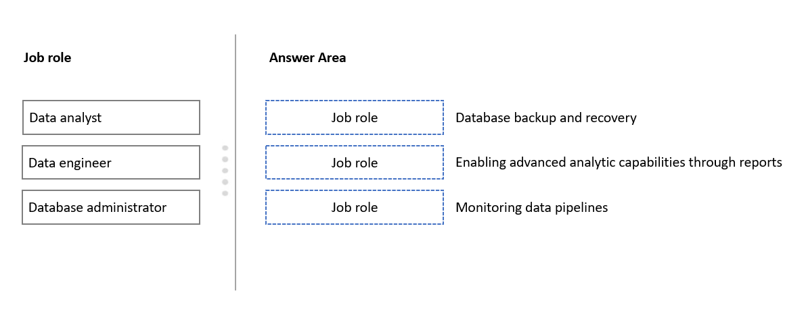

_DRAG DROP — the original ExamTopics question expects you to drag and drop items; the correct targets are not published._

**Most voted:** Not provided

### Top explanations
- **QeUtPat** (3 upvotes [Most Recent]): Correct
- **Kapello10** (3 upvotes): Correct ans

## Q1.276 (ID 155585)

You need to accept and store large quantities of IoT streaming data.
Which database solution should you use?

⭕ **A.** Azure Database for PostgreSQL
⭕ **B.** Azure Database for MariaDB
⭕ **C.** Azure Cache for Redis
✅ **D.** Azure Cosmos DB

**Correct answer:** D
**Most voted:** D

### Top explanations
- **MiloYogi** (2 upvotes [Most Recent, Selected Answer: D]): D. Azure Cosmos DB

## Q1.277 (ID 127005)

DRAG DROP
Match the job roles to the appropriate tasks.
To answer, drag the appropriate role from the column on the left to its task on the right. Each role may be used once, more than once, or not at all.
NOTE: Each correct match is worth one point.

**Exhibits**
- Exhibit 1: 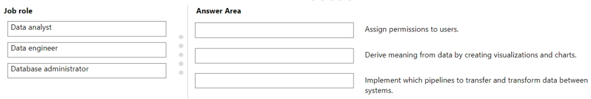

_DRAG DROP — the original ExamTopics question expects you to drag and drop items; the correct targets are not published._

**Most voted:** Not provided

### Top explanations
- **SgnBaiocchi** (7 upvotes [Most Recent, Highly Voted]): CORRECT

## Q1.278 (ID 127006)

HOTSPOT
Select the answer that correctly completes the sentence.

**Exhibits**
- Exhibit 1: 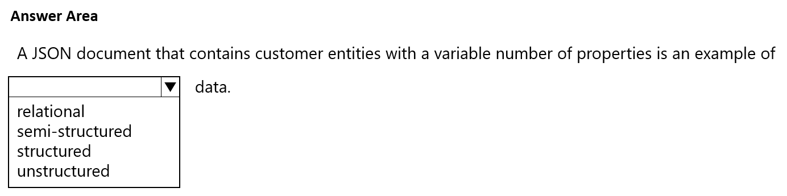

_HOTSPOT — the original ExamTopics question expects you to mark areas on the exhibit above; the correct hotspot coordinates are not published._

**Most voted:** semi-structured is correct

### Top explanations
- **lorinamuca** (8 upvotes [Most Recent, Highly Voted]): semi-structured is correct

## Q1.279 (ID 127007)

HOTSPOT
Select the answer that correctly completes the sentence.

**Exhibits**
- Exhibit 1: 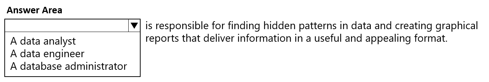

_HOTSPOT — the original ExamTopics question expects you to mark areas on the exhibit above; the correct hotspot coordinates are not published._

**Most voted:** Not provided

### Top explanations
- **imransh** (5 upvotes [Most Recent]): Correct

## Q1.280 (ID 127008)

SELECT, INSERT, and UPDATE are examples of which type of SQL statement?

⭕ **A.** Data Definition Language (DDL)
⭕ **B.** Data Control Language (DCL)
✅ **C.** Data Manipulation Language (DML)

**Correct answer:** C
**Most voted:** C

### Top explanations
- **_s3r3nd1p1t1_** (3 upvotes): yes it is
- **sakkypro** (2 upvotes): Select is not a DML, it is Data Retrieval Language... but because of Insert, Update, answer is correct..
- **iKarvan** (2 upvotes): correct
- **8014bfe** (1 upvotes [Most Recent]): Glad I'm not the only one who caught that!

## Q1.281 (ID 127009)

HOTSPOT
Select the answer that correctly completes the sentence.

**Exhibits**
- Exhibit 1: 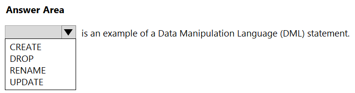

_HOTSPOT — the original ExamTopics question expects you to mark areas on the exhibit above; the correct hotspot coordinates are not published._

**Most voted:** Update

### Top explanations
- **AGTraining** (7 upvotes [Most Recent, Highly Voted]): Update

## Q1.282 (ID 127010)

HOTSPOT
For each of the following statements, select Yes if the statement is true. Otherwise, select No.
NOTE: Each correct selection is worth one point.

**Exhibits**
- Exhibit 1: 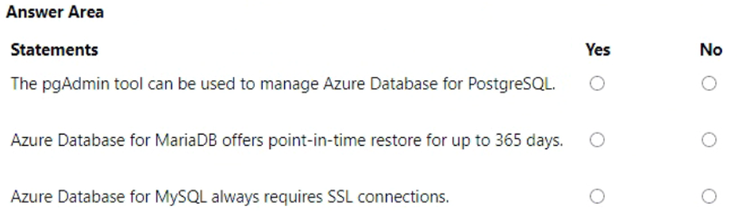

_HOTSPOT — the original ExamTopics question expects you to mark areas on the exhibit above; the correct hotspot coordinates are not published._

**Most voted:** 1_Yes.pgAdmin is a popular open-source administration and management tool for PostgreSQL databases. While it is not directly provided or managed by Azure, you can use pgAdmin to connect to and manage Azure Database for PostgreSQL instances.

### Top explanations
- **Mega2** (6 upvotes): Correct:
  1_Yes.pgAdmin is a popular open-source administration and management tool for PostgreSQL databases. While it is not directly provided or managed by Azure, you can use pgAdmin to connect to and manage Azure Database for PostgreSQL instances.
  2_ No.Azure Database for MariaDB does not offer point-in-time restore for up to 365 days. Azure Database for MariaDB provides automated backups with a retention period of up to 35 days.
  3_ No. Azure Database for MySQL does not always require SSL connections. While SSL connections are recommended for security reasons, they are not mandatory by default. You have the option to configure SSL/TLS encryption for connections to Azure Database for MySQL, but it is not enforced as a strict requirement.
- **jppdks** (6 upvotes): Yes - The pgAdmin tool can indeed be used to manage Azure Database for PostgreSQL12345.
  No - Azure Database for MariaDB offers point-in-time restore, but the backup retention period can be configured up to 35 days, not 365 days67.
  Yes - By default, Azure Database for MySQL enforces SSL connections between your server and your client applications to protect against “man in the middle” attacks
- **AGTraining** (4 upvotes): yes
  no
  no
- **Koteyko** (3 upvotes): In your explanation it says "the server is managed and maintained by Microsoft" while in
  the question the option tells about database. Also, the explanation says that "You can continue to use this tool to connect to Azure Database for PostgreSQL". I think the 1st should be Yes.
- **Joharios** (2 upvotes): NO
  NO
  NO
  Benefits of Azure Database for PostgreSQL:
  Users of PostgreSQL will be familiar with the pgAdmin tool, which you can use to manage and monitor a PostgreSQL database. You can continue to use this tool to connect to Azure Database for PostgreSQL. However, some server-focused functionality, such as performing server backup and restore, aren't available because the server is managed and maintained by Microsoft.
  https://learn.microsoft.com/en-us/training/modules/explore-provision-deploy-relational-database-offerings-azure/3-azure-database-open-source

## Q1.283 (ID 127011)

HOTSPOT
Select the answer that correctly completes the sentence.

**Exhibits**
- Exhibit 1: 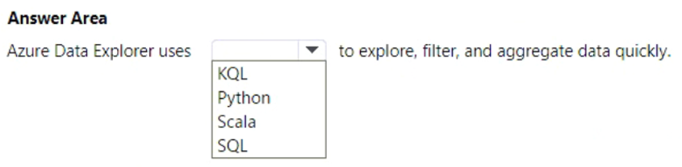

_HOTSPOT — the original ExamTopics question expects you to mark areas on the exhibit above; the correct hotspot coordinates are not published._

**Most voted:** CORRECT: Answer A

### Top explanations
- **AGTraining** (3 upvotes [Most Recent]): option A
- **Mega2** (2 upvotes): Correct, KQL is a query language specifically designed for querying and analyzing large volumes of data stored in Azure Data Explorer. It provides powerful capabilities for data exploration, filtering, aggregation, and visualization, making it well-suited for real-time analytics and log data analysis tasks.
- **SgnBaiocchi** (2 upvotes): CORRECT: Answer A

## Q1.284 (ID 127012)

HOTSPOT
Select the answer that correctly completes the sentence.

**Exhibits**
- Exhibit 1: 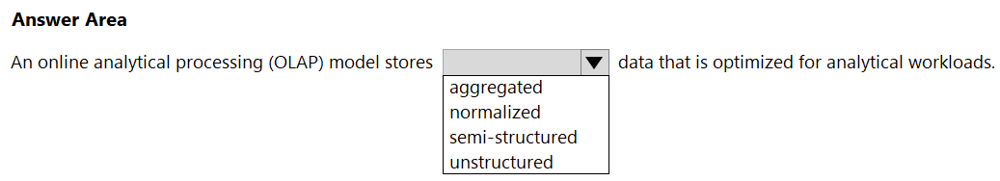

_HOTSPOT — the original ExamTopics question expects you to mark areas on the exhibit above; the correct hotspot coordinates are not published._

**Most voted:** CORRECT. Answer A : aggregated

### Top explanations
- **AGTraining** (5 upvotes [Most Recent]): Correct(Aggregated).
- **Mega2** (1 upvotes): Correct(Aggregated).
  OLAP databases are designed to facilitate complex analytical and ad-hoc queries on large datasets. In OLAP, data is typically pre-aggregated and organized into multidimensional structures such as cubes or star schemas to enable fast querying and analysis. Aggregated data allows for efficient processing of analytical queries, including operations such as slice-and-dice, drill-down, and roll-up, which are commonly performed in OLAP environments to gain insights from data.
- **SgnBaiocchi** (1 upvotes): CORRECT. Answer A : aggregated

## Q1.285 (ID 127014)

In an analytical data model, which type of table contains entities that are used to aggregate numeric values, where each entity is represented by a row with a unique key value?

⭕ **A.** bridge
⭕ **B.** dimension
✅ **C.** fact

**Correct answer:** C
**Most voted:** C

### Top explanations
- **testmaillo020** (5 upvotes [Selected Answer: C]): - Fact Table is the correct answer because it is designed to store and aggregate numeric values. The rows in the fact table represent individual transactions or events and are uniquely identified by a combination of foreign keys and sometimes a unique identifier (such as a transaction ID).
  - These numeric values (facts) are the ones aggregated to provide insights, such as total sales, average order value, or total profit, making the fact table central to quantitative analysis in an analytical data model.
- **8014bfe** (4 upvotes [Selected Answer: B]): This feels like a trick question, but with how it's worded I think the answer is B. dimension.
  Fact tables typically contain quantitative data.
  Dimensions typically contain qualitative data.
  The dimensions are often used to slice or group the quantitative data from the fact tables, though.  For example, you could use the Customer dimension to aggregate sales amounts from the Sales fact table by Customer.  This is what makes me think Dimension is actually the right answer for this question.  The "numeric values" are the misleading part.
- **_s3r3nd1p1t1_** (3 upvotes): it's B. The question is which type of table contains entities where each entity is represented by a row with a unique key value?
  [that are used to aggregate numeric values] --> this is on purpose noise
- **Mega2** (3 upvotes [Selected Answer: C]): A Fact table typically stores quantitative data, often referred to as measures or metrics, and contains foreign keys that reference related Dimension tables. Fact tables are central to a star schema or snowflake schema design, which are common schema designs used in data warehousing and OLAP environments for supporting analytical querying and reporting.
- **AccountHatz** (2 upvotes [Selected Answer: B]): Trick question

## Q1.286 (ID 127015)

In a fully denormalized database, how is data read and written for a single entity?

✅ **A.** Data is read from a single table and written to a single table.
⭕ **B.** Data is read from multiple tables and written to a single table.
⭕ **C.** Data is read from a single table and written to multiple tables.
⭕ **D.** Data is read from multiple tables and written to multiple tables.

**Correct answer:** A
**Most voted:** A

### Top explanations
- **IrenTsiporenko** (6 upvotes): Agree, for fully denormalized DB looks correct.
  But why in 214-question, for fully normalized DB we can find the same answer, marked as correct? :)
- **Mega2** (5 upvotes [Selected Answer: A]): Denormalization involves consolidating data into a single table to reduce the need for joins and simplify querying. This results in improved read performance as all the necessary data for a single entity can be retrieved from a single table without requiring joins with other tables. Similarly, when writing data, it is written to a single table without the need to update multiple tables. This approach is commonly used in data warehousing and reporting scenarios where read performance is prioritized over storage efficiency and data modification speed.
- **AGTraining** (2 upvotes [Most Recent]): option A
- **Yomzie** (2 upvotes): Because, the question says, "...for a single entity", which means for a SINGLE object.
  In a highly normalized table, say a PRODUCT table, info pertaining to the Product (ID, Description, Make, Model, Color, Manufacturing Date) would all be read from a single table, and written to a single table.
  When you have to join the querying with another entity (say, Product Sales or Orders), then a Join would be required (to aggregate information for the other entities, like SALES, ORDER, LOCATION, etc)
- **SgnBaiocchi** (1 upvotes): CORRECT. Answer: A.

## Q1.287 (ID 303584)

Which three services support Apache Spark? Each correct answer presents a complete solution.
NOTE: Each correct selection is worth one point.

⭕ **A.** Azure Data Explorer
✅ **B.** Azure Synapse Analytics
✅ **C.** Azure Databricks
⭕ **D.** Azure Stream Analytics
✅ **E.** Azure HDInsight

**Correct answer:** B, C, E
**Most voted:** BCE

### Top explanations
- **1faa974** (3 upvotes [Most Recent, Selected Answer: BCE]): BCE is correct

## Q1.288 (ID 127017)

HOTSPOT
Select the answer that correctly completed the sentence.

**Exhibits**
- Exhibit 1: 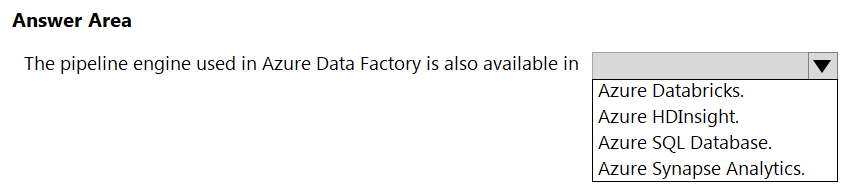

_HOTSPOT — the original ExamTopics question expects you to mark areas on the exhibit above; the correct hotspot coordinates are not published._

**Most voted:** CORRECT. Answer D: Azure Synapse Analytics

### Top explanations
- **SgnBaiocchi** (2 upvotes): CORRECT. Answer D: Azure Synapse Analytics
- **AGTraining** (1 upvotes [Most Recent]): option D
- **Mega2** (1 upvotes): Correct. Azure Synapse Analytics includes a fully integrated data processing engine that can execute data transformation activities defined in Azure Data Factory pipelines.

## Q1.289 (ID 168950)

HOTSPOT
Select the answer that correctly completes the sentence.

**Exhibits**
- Exhibit 1: 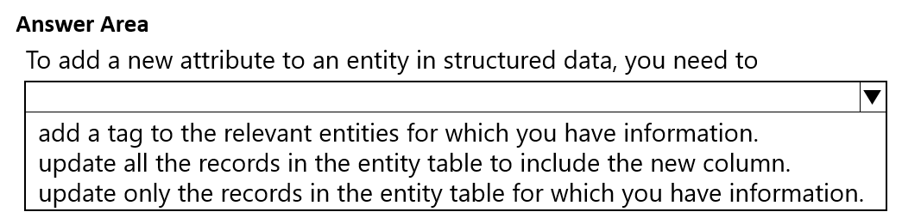

_HOTSPOT — the original ExamTopics question expects you to mark areas on the exhibit above; the correct hotspot coordinates are not published._

**Most voted:** Wrong answer, you update only the records in the entity table for which you have information.

### Top explanations
- **TejaV** (3 upvotes): Correct. Structured data requires all records updated. It could be null or blank if required.
- **1faa974** (1 upvotes [Most Recent]): Correct: The correct approach is to update the table schema to include the new column for all records. You can then selectively update the records for which you have information. This ensures that the table structure is consistent and that all records have the same attributes, even if some values are initially NULL.
- **OnlineCH** (1 upvotes): Strange question. B would be right if the statement was "To add a new attribute to an entity in structured data, you modify the table schema, and the new attribute is automatically applied to all records."
  I would go with C but ChatGPT says B is correct. However, it confirms that me as a user would not have to update anything, since the db system will create the columns (with or without default value) automatically for all records.
- **SIH007** (1 upvotes): Wrong answer, you update only the records in the entity table for which you have information.

## Q1.290 (ID 303585)

You have data in a tabular format as shown in the following table.
Of which type of data is this an example?

**Exhibits**
- Exhibit 1: 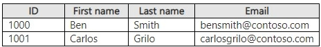

⭕ **A.** unstructured data
⭕ **B.** semi-structured data
⭕ **C.** document
✅ **D.** structured data

**Correct answer:** D
**Most voted:** D

### Top explanations
- **1faa974** (2 upvotes [Most Recent, Selected Answer: D]): D is correct.

## Q1.291 (ID 303586)

What can you use to create data ingestion pipelines?

⭕ **A.** Azure HDInsight
⭕ **B.** Azure SQL Database
✅ **C.** Azure Data Factory
⭕ **D.** Azure Cosmos DB

**Correct answer:** C
**Most voted:** C

### Top explanations
- **1faa974** (1 upvotes [Most Recent, Selected Answer: C]): Ingest and Prep: Azure Data Factory, Azure Synapse Pipelines, Azure Databricks

## Q1.292 (ID 303587)

Which service is optimized for IoT scenarios that involve streaming time series data?

⭕ **A.** SQL Server on Azure Virtual Machines
⭕ **B.** Azure SQL Managed Instance
⭕ **C.** Azure SQL Database
✅ **D.** Azure SQL Edge

**Correct answer:** D
**Most voted:** D

### Top explanations
- **1faa974** (2 upvotes [Most Recent, Selected Answer: D]): D is correct

## Q1.293 (ID 139430)

GRANT, REVOKE, and DENY are examples of which type of SQL statement?

⭕ **A.** Data Definition language (DDL)
✅ **B.** Data Control Language (DCL)
⭕ **C.** Data Manipulation Language (DML)

**Correct answer:** B
**Most voted:** B

### Top explanations
- **profesorklaus** (2 upvotes [Selected Answer: B]): B correct
- **873669** (2 upvotes): Correct answer
- **Knackadoshus** (1 upvotes [Most Recent, Selected Answer: B]): Grant gives specific privileges, revoke removes, and deny denies specific privileges…all examples of DCL

## Q1.294 (ID 303293)

Which statement is an example of Data Definition Language (DDL)?

⭕ **A.** SELECT
⭕ **B.** INSERT
✅ **C.** CREATE
⭕ **D.** MERGE

**Correct answer:** C
**Most voted:** C

### Top explanations
- **1faa974** (2 upvotes [Most Recent, Selected Answer: C]): C is correct
- **sergbs** (2 upvotes [Selected Answer: C]): correct

## Q1.295 (ID 303292)

What is the responsibility of a database administrator?

⭕ **A.** applying data cleaning routines
⭕ **B.** creating data visualizations
⭕ **C.** managing data integration processes
✅ **D.** storing backup copies of data

**Correct answer:** D
**Most voted:** D

### Top explanations
- **1faa974** (3 upvotes [Most Recent, Selected Answer: D]): D is correct
- **sergbs** (2 upvotes [Selected Answer: D]): correct

## Q1.296 (ID 302971)

HOTSPOT
Select the answer that correctly completes the sentence.

**Exhibits**
- Exhibit 1: 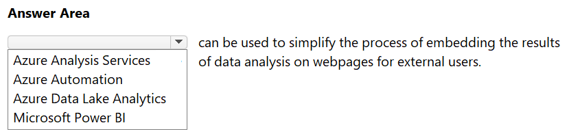

_HOTSPOT — the original ExamTopics question expects you to mark areas on the exhibit above; the correct hotspot coordinates are not published._

**Most voted:** Not provided

### Top explanations
- **1faa974** (2 upvotes [Most Recent]): Power BI is correct
- **sergbs** (2 upvotes): Power BI, correct

## Q1.297 (ID 303294)

You have the following T-SQL statement.
SELECT o.OrderNo, o.OrderDate, c.Address, c.City
FROM Order AS o
JOIN Customer AS c
ON o.Customer = c.ID;
What is the function of the ON clause?

⭕ **A.** to update data in the Customer table
✅ **B.** to match data in the Customer table to data in the Order table
⭕ **C.** to define an alias for the Customer table
⭕ **D.** to update data in the Order table

**Correct answer:** B
**Most voted:** B

### Top explanations
- **1faa974** (1 upvotes [Most Recent, Selected Answer: B]): B is correct
- **sergbs** (1 upvotes [Selected Answer: B]): correct

## Q1.298 (ID 139231)

HOTSPOT
For each of the following statements, select Yes if the statement is true. Otherwise, select No.
NOTE: Each correct selection is worth one point.

**Exhibits**
- Exhibit 1: 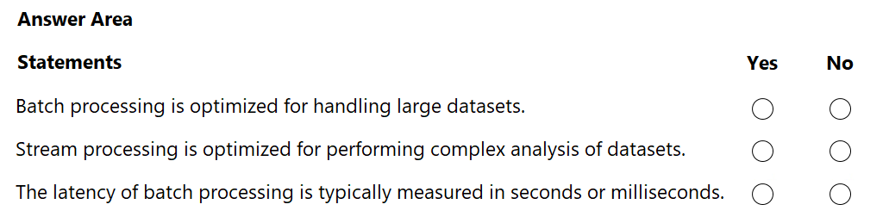

_HOTSPOT — the original ExamTopics question expects you to mark areas on the exhibit above; the correct hotspot coordinates are not published._

**Most voted:** Y,N,N is the right Ans

### Top explanations
- **jeevanss** (28 upvotes [Highly Voted]): Y,N,N is the right Ans
- **danielaestevao93** (4 upvotes): Yes
  No
  No
- **subhayu.biswas12** (4 upvotes): Y,N,N is right answer
- **Nedu1** (3 upvotes): YNN, correct and logical
- **AIEngineer1** (1 upvotes [Most Recent]): Y, N, N

## Q1.299 (ID 168171)

You have an Azure SQL database that contains tables for customers and orders.
You need to create a query that will return the orders placed by each customer.
Which two Transact-SOL statements should you include in the query? Each correct answer presents part of the solution.
NOTE: Each correct selection is worth one point.

⭕ **A.** INDEX
⭕ **B.** EXISTS
✅ **C.** JOIN
⭕ **D.** ORDERBY
✅ **E.** SELECT

**Correct answer:** C, E
**Most voted:** CE

### Top explanations
- **Roy34** (4 upvotes [Most Recent, Selected Answer: CE]): Select for listing and join for joining
- **OnlineCH** (3 upvotes [Selected Answer: CE]): SELECT * FROM Orders o JOIN Customers c ON o.CustomerId=c.Id
- **SIH007** (1 upvotes [Selected Answer: CD]): If you want to see the customers' orders you should use ORDERBY, using SELECT would not meet the requirement to return the orders by customer.

## Q1.300 (ID 140337)

HOTSPOT
Select the answer that correctly completes the sentence.

**Exhibits**
- Exhibit 1: 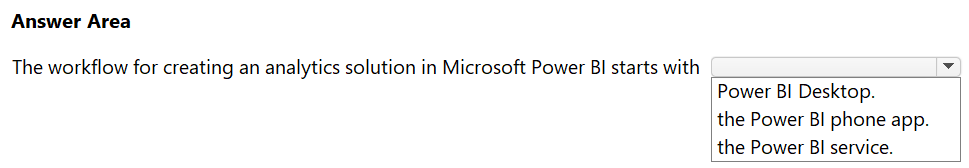

_HOTSPOT — the original ExamTopics question expects you to mark areas on the exhibit above; the correct hotspot coordinates are not published._

**Most voted:**
- Answer is correct
- Desktop- create
- Phone app - monitor/read
- service - share

### Top explanations
- **b5c93c7** (7 upvotes [Most Recent, Highly Voted]): Answer is correct
  Desktop- create
  Phone app - monitor/read
  service - share
- **subhayu.biswas12** (3 upvotes): Correct Answer
  One common workflow in Power BI begins by connecting to data sources in Power BI Desktop and building a report.
- **lakspri** (1 upvotes): the Power BI Desktop

## Q1.301 (ID 139234)

You need to implement an Azure platform as a service (PaaS) service that will host a relational database. The solution must support built-in autoscaling.
Which service should you implement?

✅ **A.** Azure SQL Database
⭕ **B.** SQL Server on Azure Virtual Machines
⭕ **C.** Azure SQL Managed Instance
⭕ **D.** Azure SQL Edge

**Correct answer:** A
**Most voted:** A

### Top explanations
- **MAKI911** (4 upvotes [Selected Answer: A]): A. Azure SQL Database
  the reason:
  Azure SQL Database is a relational database-as-a-service PaaS from Microsoft Azure, and it supports the autoscaling feature that allows system resources to be automatically scaled based on load.
- **rrgonzalez1992_111** (4 upvotes [Selected Answer: A]): I think it's A: Azure SQL Database
- **man5484** (3 upvotes [Most Recent, Selected Answer: A]): Azure SQL Database
  Correct. Azure SQL Database is a fully managed Platform as a Service (PaaS) offering for hosting relational databases. It supports built-in autoscaling to automatically adjust compute resources based on demand, making it ideal for dynamic workloads.
  SQL Server on Azure Virtual Machines
  Incorrect. This is an Infrastructure as a Service (IaaS) option where you have to manage the underlying virtual machine, database software, and scaling manually.
  Azure SQL Managed Instance
  Incorrect. While Managed Instance is a PaaS service, it does not natively support autoscaling in the same way as Azure SQL Database. You must adjust resources manually.
  Azure SQL Edge
  Incorrect. This is a lightweight database engine designed for IoT and edge computing scenarios, not for autoscaling relational database hosting.
- **gaurav3010** (2 upvotes [Selected Answer: A]): Azure SQL Database
- **chahay** (2 upvotes [Selected Answer: A]): I think it's A

## Q1.302 (ID 139978)

HOTSPOT
For each of the following statements, select Yes if the statement is true. Otherwise, select No.
NOTE: Each correct selection is worth one point.

**Exhibits**
- Exhibit 1: 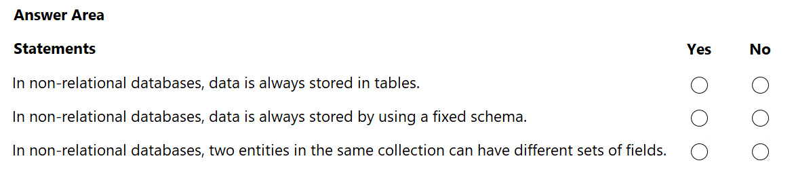

_HOTSPOT — the original ExamTopics question expects you to mark areas on the exhibit above; the correct hotspot coordinates are not published._

**Most voted:**
- No: Non-relational databases do not rely on tables. Instead, they store data in various formats such as key-value pairs, documents, graphs, or wide-column formats depending on the database type.
- No: Non-relational databases are schema-less or schema-flexible, meaning they do not require a predefined schema. This allows for greater flexibility in handling unstructured or semi-structured data.
- Yes: In document-based non-relational databases like MongoDB, entities (documents) within the same collection can have different sets of fields, providing flexibility for handling diverse data structures.

### Top explanations
- **profesorklaus** (4 upvotes): Correct
- **Ruesam** (3 upvotes): Correct
- **Sr18** (3 upvotes): Correct Answer!!! Indeed N/N/Y
- **man5484** (2 upvotes): No: Non-relational databases do not rely on tables. Instead, they store data in various formats such as key-value pairs, documents, graphs, or wide-column formats depending on the database type.
  No: Non-relational databases are schema-less or schema-flexible, meaning they do not require a predefined schema. This allows for greater flexibility in handling unstructured or semi-structured data.
  Yes: In document-based non-relational databases like MongoDB, entities (documents) within the same collection can have different sets of fields, providing flexibility for handling diverse data structures.
- **_Vijay_** (2 upvotes): Correct answer!

## Q1.303 (ID 139435)

HOTSPOT
For each of the following statements, select Yes if the statement is true. Otherwise, select No.
NOTE: Each correct selection is worth one point.

**Exhibits**
- Exhibit 1: 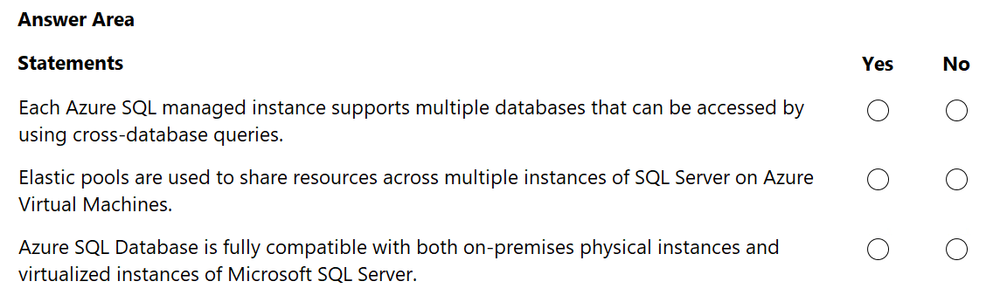

_HOTSPOT — the original ExamTopics question expects you to mark areas on the exhibit above; the correct hotspot coordinates are not published._

**Most voted:**
1. Azure SQL Managed support cross-DB queries three-part name queries
2. Elastic pools are used to manage and scale multiple databases with varying workloads on Azure SQL Database, not SQL Server on Azure Virtual Machines.
3. SQL DB Supported on both Physical & VMs (Not Azure SQL)

### Top explanations
- **Andrewwfw** (18 upvotes [Highly Voted]): Answer is YNN
  1. Azure SQL Managed support cross-DB queries three-part name queries
  2. Elastic pools are used to manage and scale multiple databases with varying workloads on Azure SQL Database, not SQL Server on Azure Virtual Machines.
  3. SQL DB Supported on both Physical & VMs (Not Azure SQL)
- **man5484** (5 upvotes): Yes: Azure SQL Managed Instance allows hosting multiple databases within the same instance. Cross-database queries are supported, enabling seamless data access between databases within the same managed instance.
  No: Elastic pools are used in Azure SQL Database to share resources across multiple databases, not across SQL Server instances on Azure VMs. Azure VMs do not use elastic pools.
  No: Azure SQL Database is highly compatible with SQL Server but not fully compatible. Some SQL Server features, such as SQL Server Agent and cross-database transactions, are not supported in Azure SQL Database. Full compatibility is achieved with Azure SQL Managed Instance, not Azure SQL Database.
- **Andrewwfw** (3 upvotes): 3. SQL Managed
- **873669** (3 upvotes): i think YYN
- **profesorklaus** (2 upvotes): Answer is YNN
  1. Azure SQL Managed Instances support multiple databases, and cross-database queries are possible within the instance.
  2. Elastic pools in Azure SQL are used to share resources across multiple Azure SQL databases, but not across SQL Server instances on Azure Virtual Machines.
  3. Azure SQL Database is a managed platform-as-a-service (PaaS) offering that doesn't have full compatibility with on-premises or virtualized SQL Server instances due to some differences in features and capabilities.

## Q1.304 (ID 139434)

You have the following data.
Which type of data is this?

**Exhibits**
- Exhibit 1: 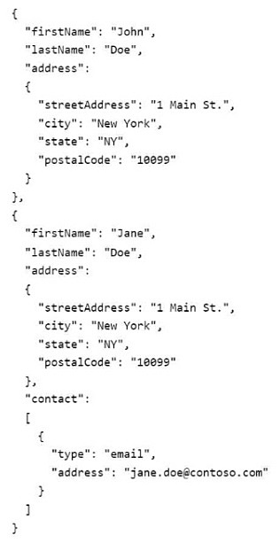

⭕ **A.** unstructured
✅ **B.** semi-structured
⭕ **C.** structured

**Correct answer:** B
**Most voted:** B

### Top explanations
- **873669** (10 upvotes [Highly Voted]): Correct answer
- **044f354** (2 upvotes [Most Recent, Selected Answer: B]): JSON, as shown here, is a classic example of semi-structured data.
  Semi-structured data has an irregular structure but still includes tags, keys, or metadata.
- **man5484** (2 upvotes): Semi-Structured
- **SaranrajG** (2 upvotes [Selected Answer: B]): Correct answer
- **_Vijay_** (2 upvotes): Semi-Structured, correct answer.

## Q1.309 (ID 325941)

Which service can be used to build extract, transform, and load (ETL) pipelines?

✅ **A.** Azure Data Factory
⭕ **B.** Azure Pipelines
⭕ **C.** Azure SQL Database
⭕ **D.** Azure Cosmos DB
⭕ **E.** Azure Databricks

**Correct answer:** A
**Most voted:** A

### Top explanations
- **3598270** (1 upvotes [Most Recent, Selected Answer: A]): Correct - Microsoft specifically identifies Azure Data Factory as the relevant service for orchestrating ETL processes.

## Q1.310 (ID 325938)

HOTSPOT
For each of the following statements, select Yes if the statement is true. Otherwise, select No.
NOTE: Each correct selection is worth one point.

**Exhibits**
- Exhibit 1: 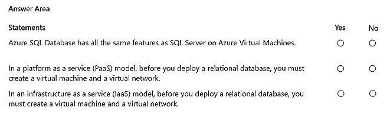

_HOTSPOT — the original ExamTopics question expects you to mark areas on the exhibit above; the correct hotspot coordinates are not published._

**Most voted:** Not provided

### Top explanations
- **3598270** (2 upvotes [Most Recent]): Agreed

## Q1.316 (ID 408456)

Which T-SQL statement should be used to instruct a database management system to use an index instead of performing a full table scan?

✅ **A.** WHERE
⭕ **B.** SELECT
⭕ **C.** UNION

**Correct answer:** A
**Most voted:** A

### Top explanations
- **Fadekemi** (2 upvotes [Most Recent, Selected Answer: A]): The WHERE clause filters rows based on a condition. When the filtered column is indexed, the SQL Server query optimizer can use that index to locate rows efficiently instead of performing a full table scan
- **msoui** (1 upvotes [Selected Answer: A]): WHERE

## Q1.322 (ID 408461)

DRAG DROP
Match the data terms to the appropriate descriptions.
To answer, drag the term from the column on the left to its description on the right. Each term may be used once, more than once, or not at all.
NOTE: Each correct match is worth one point.

**Exhibits**
- Exhibit 1: 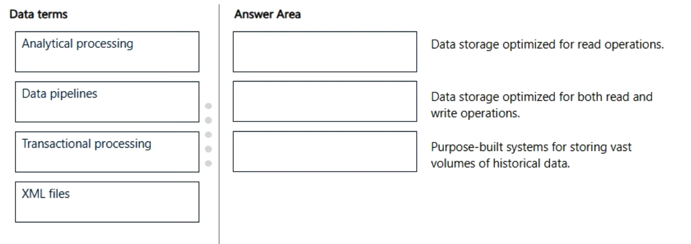

_DRAG DROP — the original ExamTopics question expects you to drag and drop items; the correct targets are not published._

**Most voted:**
- Data storage optimized for read operations → Analytical processing
- Data storage optimized for both read and write operations → Transactional processing
- Purpose-built systems for storing vast volumes of historical data → Data pipelines

### Top explanations
- **msoui** (1 upvotes [Most Recent]): Data storage optimized for read operations. → Analytical processing
  Data storage optimized for both read and write operations. → Transactional processing
  Purpose-built systems for storing vast volumes of historical data. → Data pipelines
