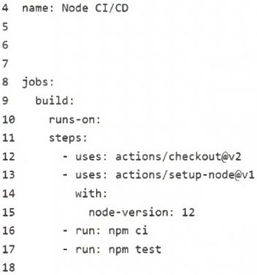
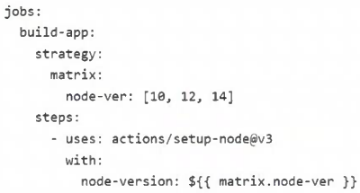
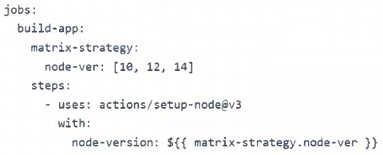
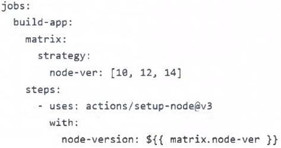
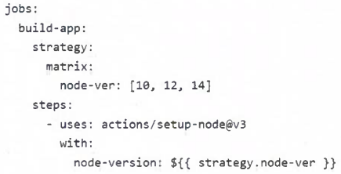
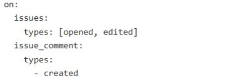
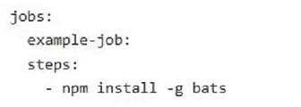
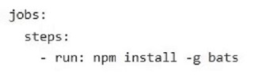
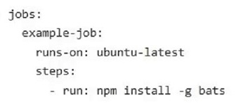
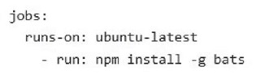

# GH-200 GitHub Actions Study Guide

_92 questions generated from ExamTopics discussions._

**Official Exam & Registration:** [Register for GH-200 on Microsoft Learn](https://learn.microsoft.com/en-us/credentials/certifications/github-actions/?practice-assessment-type=certification)

## Table of contents

- [Q1.1](#q1-1)
- [Q1.2](#q1-2)
- [Q1.3](#q1-3)
- [Q1.4](#q1-4)
- [Q1.5](#q1-5)
- [Q1.6](#q1-6)
- [Q1.7](#q1-7)
- [Q1.8](#q1-8)
- [Q1.9](#q1-9)
- [Q1.10](#q1-10)
- [Q1.11](#q1-11)
- [Q1.12](#q1-12)
- [Q1.13](#q1-13)
- [Q1.14](#q1-14)
- [Q1.15](#q1-15)
- [Q1.16](#q1-16)
- [Q1.17](#q1-17)
- [Q1.18](#q1-18)
- [Q1.19](#q1-19)
- [Q1.20](#q1-20)
- [Q1.21](#q1-21)
- [Q1.22](#q1-22)
- [Q1.23](#q1-23)
- [Q1.24](#q1-24)
- [Q1.25](#q1-25)
- [Q1.26](#q1-26)
- [Q1.27](#q1-27)
- [Q1.28](#q1-28)
- [Q1.30](#q1-30)
- [Q1.32](#q1-32)
- [Q2.1](#q2-1)
- [Q2.2](#q2-2)
- [Q2.3](#q2-3)
- [Q2.4](#q2-4)
- [Q2.5](#q2-5)
- [Q2.6](#q2-6)
- [Q2.7](#q2-7)
- [Q2.8](#q2-8)
- [Q2.9](#q2-9)
- [Q2.10](#q2-10)
- [Q2.11](#q2-11)
- [Q2.12](#q2-12)
- [Q2.13](#q2-13)
- [Q2.14](#q2-14)
- [Q2.15](#q2-15)
- [Q2.16](#q2-16)
- [Q2.17](#q2-17)
- [Q2.18](#q2-18)
- [Q2.19](#q2-19)
- [Q2.20](#q2-20)
- [Q2.21](#q2-21)
- [Q2.22](#q2-22)
- [Q2.23](#q2-23)
- [Q2.26](#q2-26)
- [Q3.1](#q3-1)
- [Q3.2](#q3-2)
- [Q3.3](#q3-3)
- [Q3.4](#q3-4)
- [Q3.5](#q3-5)
- [Q3.6](#q3-6)
- [Q3.7](#q3-7)
- [Q3.8](#q3-8)
- [Q3.9](#q3-9)
- [Q3.10](#q3-10)
- [Q3.11](#q3-11)
- [Q3.12](#q3-12)
- [Q3.13](#q3-13)
- [Q3.14](#q3-14)
- [Q3.15](#q3-15)
- [Q3.16](#q3-16)
- [Q3.17](#q3-17)
- [Q3.18](#q3-18)
- [Q3.19](#q3-19)
- [Q3.20](#q3-20)
- [Q3.21](#q3-21)
- [Q3.22](#q3-22)
- [Q3.24](#q3-24)
- [Q4.1](#q4-1)
- [Q4.2](#q4-2)
- [Q4.3](#q4-3)
- [Q4.4](#q4-4)
- [Q4.5](#q4-5)
- [Q4.6](#q4-6)
- [Q4.7](#q4-7)
- [Q4.8](#q4-8)
- [Q4.9](#q4-9)
- [Q4.10](#q4-10)
- [Q4.11](#q4-11)
- [Q4.12](#q4-12)
- [Q4.14](#q4-14)
- [Q4.15](#q4-15)
- [Q4.17](#q4-17)

## Q1.1 (ID 312765)

How should you print a debug message in your workflow?

✅ **A.** echo "::debug::Set variable myVariable to true"
⭕ **B.** echo "Set variable MyVariable to true" >> $DEBUG_MESSAGE
⭕ **C.** echo "::add-mask::Set variable myVariable to true"
⭕ **D.** echo "debug_message=Set variable myVariable to true" >> &GITHUB_OUTPUT

**Correct answer:** A
**Most voted:** A

### Top explanations
- **FarziWaliMarzi** (3 upvotes [Most Recent, Selected Answer: A]): In GitHub Actions, debug messages are written using the workflow command syntax with the ::debug:: prefix. These messages are visible when ACTIONS_STEP_DEBUG is enabled.
- **ahannora** (2 upvotes [Selected Answer: A]): A. echo "::debug::Set variable myVariable to true"
- **gobinathm** (1 upvotes [Selected Answer: A]): https://docs.github.com/en/actions/reference/workflows-and-actions/workflow-commands#setting-a-debug-message

## Q1.2 (ID 312764)

As a developer, you are designing a workflow and need to communicate with the runner machine to set environment variables, output values used by other actions, add debug messages to the output logs, and other tasks. Which of the following options should you use?

⭕ **A.** composite run step
⭕ **B.** enable debug logging
⭕ **C.** self-hosted runners
⭕ **D.** environment variables
✅ **E.** workflow commands

**Correct answer:** E
**Most voted:** E

### Top explanations
- **FarziWaliMarzi** (2 upvotes [Most Recent, Selected Answer: E]): To communicate with the runner machine for tasks such as:
  setting environment variables,
  defining output values for other actions,
  adding debug messages to logs,
  masking values, grouping logs, etc.,
  GitHub Actions uses workflow commands.
- **ahannora** (2 upvotes [Selected Answer: E]): E. Workflow commands - Special syntax (::set-output, ::set-env, ::debug, etc.) for communicating between action code and runner during execution
- **** (1 upvotes [Selected Answer: B]): I checked the official docs on this topic, and B is the correct implementation.

## Q1.3 (ID 312770)

When should you use the GITHUB_TOKEN in a workflow?

✅ **A.** when you want to make authenticated calls to the GitHub API
⭕ **B.** when you want to connect to the runner via SSH
⭕ **C.** when you want to access repository-level secrets
⭕ **D.** when you want to call an action from the marketplace

**Correct answer:** A
**Most voted:** A

### Top explanations
- **ahannora** (2 upvotes [Selected Answer: A]): Correct Answer: A
  Selected:
  A. Make authenticated calls to GitHub API - GITHUB_TOKEN provides automatic authentication for API operations like creating issues, PRs, comments, etc.
  Not Selected:
  B. Connect to runner via SSH - SSH access requires different credentials/setup, not GITHUB_TOKEN
  C. Access repository-level secrets - Secrets are accessed via ${{ secrets.SECRET_NAME }}, not GITHUB_TOKEN
  D. Call action from marketplace - Marketplace actions don't require GITHUB_TOKEN to call them; token is for API authentication within actions
- **FarziWaliMarzi** (1 upvotes [Most Recent, Selected Answer: A]): GITHUB_TOKEN is used to authenticate API requests to GitHub (for example, creating issues, commenting on pull requests, updating commit statuses), subject to the permissions configured for the workflow.
- **** (1 upvotes [Selected Answer: B]): I’m cool with B, unless someone’s got a better take based on the docs.

## Q1.4 (ID 312760)

In which of the following scenarios should you use self-hosted runners? (Each correct answer presents a complete solution. Choose two.)

⭕ **A.** when the workflow jobs must be run on Windows 10
✅ **B.** when jobs must run for longer than 6 hours
✅ **C.** when a workflow job needs to install software from the local network
⭕ **D.** when GitHub Actions minutes must be used for the workflow runs
⭕ **E.** when you want to use macOS runners

**Correct answer:** B, C
**Most voted:** BC

### Top explanations
- **4729** (2 upvotes [Selected Answer: BC]): Should be B and C, alltough Win 10 is also not listed as the supported github runners, so A is also correct imo
- **ahannora** (1 upvotes [Most Recent, Selected Answer: BC]): Correct Answers: B, C
  Selected:
  B. Jobs must run longer than 6 hours - GitHub-hosted runners have 6-hour timeout; self-hosted runners have no time limit
  C. Job needs to install software from local network - Self-hosted runners can access internal network resources that GitHub-hosted can't reach
  Not Selected:
  A. Must run on Windows 10 - GitHub-hosted runners provide Windows; use self-hosted only if specific Windows version/config needed
  D. Must use GitHub Actions minutes - Self-hosted runners don't consume GitHub Actions minutes; opposite of when you'd use them
  E. Want to use macOS runners - GitHub-hosted runners already provide macOS; no need for self-hosted unless special requirements exist
- **** (1 upvotes [Selected Answer: C]): This feels like a 50/50 between two options. I'll go with C.

## Q1.5 (ID 312768)

As a developer, you need to leverage Redis in your workflow. What is the best way to use Redis on a self-hosted Linux runner without affecting future workflow runs?

⭕ **A.** Install Redis on the hosted runner image and place it in a runner group. Specify label: in your job to target the runner group.
⭕ **B.** Set up Redis on a separate machine and reference that instance from your job.
✅ **C.** Specify container: and services: in your job definition to leverage a Redis service container.
⭕ **D.** Add a run step to your workflow, which dynamically installs and configures Redis as part of your job.

**Correct answer:** C
**Most voted:** C

### Top explanations
- **Sramsuri** (1 upvotes [Most Recent, Selected Answer: C]): C. Specify container: and services: in your job definition to leverage a Redis service container.
- **ahannora** (1 upvotes [Selected Answer: C]): Correct Answer: C
  Selected:
  C. Specify container: and services: in job definition - Service containers provide isolated Redis instance per run, automatically cleaned up after job completes
  Not Selected:
  A. Install Redis on hosted runner image - Persists across runs affecting future workflows; no isolation between jobs
  B. Set up Redis on separate machine - Requires external infrastructure management; shared state could conflict between concurrent jobs
  D. Add run step to dynamically install Redis - Requires cleanup logic; less efficient than service containers; potential conflicts between runs
- **** (1 upvotes [Selected Answer: B]): Not super confident, but I’ll go with B.

## Q1.6 (ID 312761)

You installed specific software on a Linux self-hosted runner. You have users with workflows that need to be able to select the runner based on the identified custom software. Which steps should you perform to prepare the runner and your users to run these workflows? (Each correct answer presents part of the solution. Choose two.)

⭕ **A.** Configure the webhook and network to enable GitHub to trigger workflow.
⭕ **B.** Create the group custom-software-on-linux and move the runner into the group.
✅ **C.** Inform users to identify the runner with the labels custom-software and linux.
⭕ **D.** Add the label linux to the runner.
⭕ **E.** Inform users to identify the runner based on the group.
✅ **F.** Add the label custom-software to the runner.

**Correct answer:** C, F
**Most voted:** CF

### Top explanations
- **JeeBi** (2 upvotes [Most Recent, Selected Answer: BE]): I agree with C and F.
  But you can also select a runner via group:
  https://docs.github.com/en/actions/how-tos/write-workflows/choose-where-workflows-run/choose-the-runner-for-a-job
  jobs:
  check-bats-version:
  runs-on:
  group: ubuntu-runners
  This would make B and E also an option, right?
- **ahannora** (2 upvotes [Selected Answer: CF]): Correct Answers: C, F
  Selected:
  F. Add the label custom-software to the runner - Custom label identifies this runner has the specific software installed
  C. Inform users to identify runner with labels custom-software and linux - Users specify runs-on: [custom-software, linux] to target this runner
  Not Selected:
  A. Configure webhook and network - Already done during initial runner setup; not specific to custom software scenario
  B. Create group and move runner into group - Runner groups are for access control, not for workflow targeting
  D. Add label linux to runner - Self-hosted Linux runners automatically have the self-hosted and linux labels by default
  E. Inform users to identify based on group - Workflows target runners by labels in runs-on:, not by group names
- **FarziWaliMarzi** (2 upvotes [Selected Answer: CF]): Explanation
  Self-hosted runners are selected using labels, not runner groups. Users specify labels in their workflow’s runs-on field.
  To make the runner discoverable based on the installed software, you must add a custom label (for example, custom-software) to the runner.
  Users then need to reference that label (and the OS label, such as linux) in their workflows.
  Why the other options are incorrect
  A: Webhooks/network configuration is required to run self-hosted runners at all, but it does not help users select runners based on custom software.
  B & E: Runner groups control access and permissions, not runner selection in workflows.
  D: The linux label is automatically applied to Linux self-hosted runners, so adding it manually is unnecessary.
- **4729** (1 upvotes [Selected Answer: EF]): In theory C is also correct. Alltough a label excplicitly called "custom-software" would be dumb, because we need to differentiate the "custom-software"
  With appropriate labels C and F are correct. Else I'd go with E + F
- **jv1** (1 upvotes [Selected Answer: EF]): To target a specific self-hosted runner that has unique software, you primarily use labels and runner groups. The goal is to allow users to target the runner without knowing its specific machine name.

## Q1.7 (ID 312757)

You need to trigger a workflow using the GitHub API for activity that happens outside of GitHub. Which workflow event do you use?

⭕ **A.** workflow_run
⭕ **B.** deployment
⭕ **C.** check_suite
✅ **D.** repository_dispatch

**Correct answer:** D
**Most voted:** D

### Top explanations
- **FarziWaliMarzi** (2 upvotes [Selected Answer: D]): repository_dispatch is specifically designed to trigger workflows via the GitHub API for events that occur outside of GitHub.
  You send a POST request to the GitHub API with a custom event type, and any workflow listening for repository_dispatch will run
- **4729** (2 upvotes [Selected Answer: D]): https://documentation.provar.com/documentation/devops/continuous-integration/github-actions/remote-trigger-in-github-actions/
- **ahannora** (1 upvotes [Most Recent, Selected Answer: D]): D. repository_dispatch - Custom webhook event triggered via GitHub API for external events not native to GitHub
- **** (1 upvotes [Selected Answer: C]): C is the textbook answer for this situation.

## Q1.8 (ID 312762)

In which locations can actions be referenced by workflows? (Each correct answer presents a complete solution. Choose three.)

⭕ **A.** an .action extension file in the repository
✅ **B.** a published Docker container image on Docker Hub
⭕ **C.** a public NPM registry
⭕ **D.** the runs-on: keyword of a workflow file
⭕ **E.** the repository’s Secrets settings page
✅ **F.** a separate public repository
✅ **G.** the same repository as the workflow

**Correct answer:** B, F, G
**Most voted:** BFG

### Top explanations
- **FarziWaliMarzi** (1 upvotes [Most Recent, Selected Answer: BFG]): GitHub Actions can be referenced by workflows from these locations:
  Same repository as the workflow – Local actions stored in the same repo (for example ./.github/actions/my-action).
  A separate public repository – Actions published in other public repositories (for example actions/checkout@v4).
  A published Docker container image on Docker Hub – Docker container actions can be referenced directly by image name.
- **ahannora** (1 upvotes [Selected Answer: BFG]): B. a published Docker container image on Docker Hub:You can reference Docker container actions directly from registries
  F. a separate public repository:Actions can be referenced from any public GitHub repository
  G. the same repository as the workflow:You can reference actions stored in the same repository
- **MaharshiRabari** (1 upvotes [Selected Answer: BFG]): B. a published Docker container image on Docker Hub
  F. a separate public repository
  G. the same repository as the workflow
- **0a9a335** (1 upvotes [Selected Answer: BFG]): Actions stored in the same repository as the workflow file can be referenced directly, which is common for custom actions specific to that project.
  Workflows can reference actions that are provided as Docker container images hosted on Docker Hub, allowing integration of complex tools and environments
  Actions can be referenced from any public GitHub repository, allowing the reuse of shared actions across multiple projects.
- **** (1 upvotes [Selected Answer: B]): I’m cool with B, unless someone’s got a better take based on the docs.

## Q1.9 (ID 312758)

Scheduled workflows run on the:

⭕ **A.** specified commit and branch from the workflow YAML file.
⭕ **B.** latest commit from the branch named schedule.
⭕ **C.** latest commit and branch on which the workflow was triggered.
⭕ **D.** latest commit from the branch named main.
✅ **E.** latest commit on the default or base branch.

**Correct answer:** E
**Most voted:** E

### Top explanations
- **ahannora** (2 upvotes [Most Recent, Selected Answer: E]): Correct Answer: E
  Selected:
  E. Latest commit on the default or base branch - Scheduled workflows (cron) always run on the latest commit of the default branch (usually main/master)
  Not Selected:
  A. Specified commit and branch from workflow YAML - Schedule triggers don't allow specifying commit/branch; uses default branch
  B. Latest commit from branch named schedule - No special "schedule" branch; uses repository's default branch
  C. Latest commit and branch where workflow triggered - Schedule runs aren't triggered by events on specific branches
  D. Latest commit from branch named main - Close, but technically uses whatever the default branch is (could be master, develop, etc.)
- **FarziWaliMarzi** (2 upvotes [Selected Answer: E]): GitHub explicitly defines that scheduled workflows use the default branch, not a user-specified branch or commit.
  The default branch is commonly main, but it can also be master or any other branch configured as default.
- **** (1 upvotes [Selected Answer: C]): My gut says C. It aligns with best practices.

## Q1.10 (ID 312772)

Custom environment variables can be defined at multiple levels within a workflow file including: (Each answer presents a complete solution. Choose three.)

✅ **A.** top level.
✅ **B.** step level.
⭕ **C.** default level.
⭕ **D.** runner level.
✅ **E.** job level.
⭕ **F.** stage level.

**Correct answer:** A, B, E
**Most voted:** ABE

### Top explanations
- **FarziWaliMarzi** (1 upvotes [Most Recent, Selected Answer: ABE]): A. Top level
  Applies to all jobs and steps in the workflow unless overridden.
  E. Job level
  Applies to all steps within a specific job.
  B. Step level
  Applies only to that specific step.
- **MaharshiRabari** (1 upvotes [Selected Answer: ABE]): Examples:
  A:Top-level environment variables:
  name: Example Workflow
  on: push
  env:
  GLOBAL_ENV: "This is top-level"
  jobs:
  build:
  runs-on: ubuntu-latest
  steps:
  - name: Show env
  run: echo $GLOBAL_ENV
  B: Step-level environment variables:
  jobs:
  build:
  runs-on: ubuntu-latest
  steps:
  - name: Step with custom env
  env:
  STEP_ENV: "This is step-level"
  run: echo $STEP_ENV
  E: Job-level environment variables:
  jobs:
  build:
  runs-on: ubuntu-latest
  env:
  JOB_ENV: "This is job-level"
  steps:
  - name: Print job env
  run: echo $JOB_ENV
- **** (1 upvotes [Selected Answer: A]): Absolutely A. The other options are factually incorrect.

## Q1.11 (ID 312767)

You are a DevOps engineer working on deployment workflows. You need to execute the deploy job only if the current branch name is feature-branch. Which code snippet will help you to implement the conditional execution of the job?

✅ **A.** jobs: deploy: if: github.ref_name == 'feature-branch' runs-on: ubuntu-latest steps: - uses: actions/checkout@v3
⭕ **B.** jobs: deploy: if: github.branch.name == 'feature-branch' runs-on: ubuntu-latest steps: - uses: actions/checkout@v3
⭕ **C.** jobs: deploy: if: github.ref.name == 'feature-branch' runs-on: ubuntu-latest steps: - uses: actions/checkout@v3
⭕ **D.** jobs: deploy: if: github.branch_name == 'feature-branch' runs-on: ubuntu-latest steps: - uses: actions/checkout@v3

**Correct answer:** A
**Most voted:** A

### Top explanations
- **MaharshiRabari** (3 upvotes [Selected Answer: A]): if: github.ref_name == 'feature-branch'
- **FarziWaliMarzi** (2 upvotes [Most Recent, Selected Answer: A]): To conditionally execute a job based on the branch name, GitHub Actions provides the github.ref_name context, which contains the short name of the branch or tag that triggered the workflow.
  if: github.ref_name == 'feature-branch'

## Q1.12 (ID 312773)

What are the mandatory requirements for publishing GitHub Actions to the GitHub Marketplace? (Each correct answer presents part of the solution. Choose two.)

⭕ **A.** The action can be either in a public or private repository.
✅ **B.** The action’s metadata file must be in the root directory of the repository.
✅ **C.** The action’s name cannot match a user or organization on GitHub unless the user or organization owner is publishing the action.
⭕ **D.** The name should match with one of the existing GitHub Marketplace categories.
⭕ **E.** Each repository can contain a collection of actions as long as they are under the same Marketplace category.

**Correct answer:** B, C
**Most voted:** BC

### Top explanations
- **MaharshiRabari** (2 upvotes [Selected Answer: BC]): B. The action’s metadata file must be in the root directory of the repository.
  Mandatory requirement.
  GitHub Marketplace only accepts actions when the action.yml (or action.yaml) metadata file is in the root of the repository.
  C. The action’s name cannot match a user or organization on GitHub unless the user or organization owner is publishing the action.
  Mandatory naming rule.
  Example: You cannot publish an action named actions or microsoft unless that org actually owns the repo.
- **0a9a335** (2 upvotes [Selected Answer: BC]): The mandatory requirements for publishing GitHub Actions to the GitHub Marketplace are:
  C. The action’s name cannot match a user or organization on GitHub unless the user or organization owner is publishing the action.
  B. The action’s metadata file must be in the root directory of the repository.
- **FarziWaliMarzi** (1 upvotes [Most Recent, Selected Answer: BC]): To publish a GitHub Action to the GitHub Marketplace, the following requirements are mandatory:
  B. The action’s metadata file must be in the root directory of the repository.
  The action.yml or action.yaml file must be located at the root of the repository for Marketplace publishing.
  C. The action’s name cannot match a user or organization on GitHub unless the user or organization owner is publishing the action.
  This rule prevents impersonation and name squatting in the Marketplace.
- **ahannora** (1 upvotes [Selected Answer: BC]): B. The action's metadata file must be in the root directory of the repository
  - The action.yml or action.yaml file must be in the repository's root directory
  C. The action's name cannot match a user or organization on GitHub unless the user or organization owner is publishing the action
  - Prevents name squatting and impersonation
  - Protects users and organizations from having actions published under their name by others
- **** (1 upvotes [Selected Answer: C]): Pretty sure it's C. This pattern is very common.

## Q1.13 (ID 312766)

Which of the following is the proper syntax to specify a custom environment variable named MY_VARIABLE with the value my-value?

⭕ **A.** var: MY_VARIABLE = my-value
⭕ **B.** environment: MY_VARIABLE = my-value
⭕ **C.** var: MY_VARIABLE: my-value
⭕ **D.** env: MY_VARIABLE = my-value
⭕ **E.** environment: MY_VARIABLE: my-value
✅ **F.** env: MY_VARIABLE: my-value

**Correct answer:** F
**Most voted:** F

### Top explanations
- **FarziWaliMarzi** (3 upvotes [Most Recent, Selected Answer: F]): In GitHub Actions, custom environment variables are defined using the env keyword and standard YAML key–value syntax (:), not equals (=).
  Correct syntax:
  env:
  MY_VARIABLE: my-value
- **ahannora** (1 upvotes [Selected Answer: F]): F. env:
  MY_VARIABLE: my-value
- **** (1 upvotes [Selected Answer: D]): Feels like D is the intended answer here. The wording is tricky.

## Q1.14 (ID 312769)

As a DevOps engineer, you need to define a deployment workflow that runs after the build workflow has successfully completed. Without modifying the build workflow, which trigger should you define in the deployment workflow?

⭕ **A.** repository_dispatch
⭕ **B.** workflow_dispatch
⭕ **C.** workflow_exec
✅ **D.** workflow_run

**Correct answer:** D
**Most voted:** D

### Top explanations
- **FarziWaliMarzi** (1 upvotes [Most Recent, Selected Answer: D]): To run a deployment workflow after another workflow (build) has successfully completed, without modifying the build workflow, you must use the workflow_run trigger.
  workflow_run allows one workflow to be triggered based on the completion status of another workflow.
- **** (1 upvotes [Selected Answer: D]): Leaning toward D, but I'd be interested to hear arguments for the others.

## Q1.15 (ID 312763)

Which step is using the dbserver environment variable correctly?

⭕ **A.** steps: - name: Hello world run: echo $dbserver variables: dbserver: orgserver1
⭕ **B.** steps: - name: Hello world run: echo $dbserver env: - name: dbserver value: orgserver1
⭕ **C.** steps: - name: Hello world run: echo $dbserver environment: dbserver: orgserver1
✅ **D.** steps: - name: Hello world run: echo $dbserver env: dbserver: orgserver1

**Correct answer:** D
**Most voted:** D

### Top explanations
- **ahannora** (1 upvotes [Most Recent, Selected Answer: D]): Correct Answer: D
  Selected:
  D. run: echo $dbserver with env: dbserver: orgserver1 - Correct syntax for defining environment variables at step level using env: key-value pairs
  Not Selected:
  A. variables: dbserver: orgserver1 - variables: is not valid syntax; should be env:
  B. env: - name: dbserver value: orgserver1 - env: uses key-value pairs, not list format with name/value structure
  C. environment: dbserver: orgserver1 - environment: is for deployment environments, not for setting environment variables
- **FarziWaliMarzi** (1 upvotes [Selected Answer: D]): n GitHub Actions, environment variables must be defined using the env keyword with standard YAML key–value syntax, and they are accessed in a shell using $VARIABLE_NAME.
- **** (1 upvotes [Selected Answer: D]): I’d roll with D — seems like the most solid choice.

## Q1.16 (ID 312759)

In which scenarios could the GITHUB_TOKEN be used? (Each correct answer presents a complete solution. Choose two.)

⭕ **A.** to create a repository secret
⭕ **B.** to add a member to an organization
⭕ **C.** to read from the file system on the runner
✅ **D.** to publish to GitHub Packages
✅ **E.** to create issues in the repo
⭕ **F.** to leverage a self-hosted runner

**Correct answer:** D, E
**Most voted:** DE

### Top explanations
- **FarziWaliMarzi** (2 upvotes [Most Recent, Selected Answer: DE]): D. To publish to GitHub Packages
  GITHUB_TOKEN can authenticate workflows to publish packages (for example, to GitHub Packages), subject to repository and organization permission settings.
  E. To create issues in the repo
  The token can be used with the GitHub REST or GraphQL APIs to create issues, comments, and perform other repository-scoped actions.
- **ahannora** (1 upvotes [Selected Answer: DE]): D. To publish to GitHub Packages
  - GITHUB_TOKEN has permissions to publish packages to GitHub Packages
  - Common use case for publishing npm, Docker, Maven, NuGet packages, etc.
  E. To create issues in the repo
  - GITHUB_TOKEN can create issues, comments, and interact with repository content
- **** (1 upvotes [Selected Answer: D]): 90% sure it's D. The scenario points directly to it.

## Q1.17 (ID 312774)

As a developer, which of the following snippets will enable you to run the commands npm ci and npm run build as part of a workflow?

✅ **A.** - run: | npm ci npm run build
⭕ **B.** - shell: npm ci npm run build
⭕ **C.** - run: | npm ci npm run build shell: nodejs
⭕ **D.** - run: npm ci npm run build E. - shell: | npm ci npm run build

**Correct answer:** A
**Most voted:** A

### Top explanations
- **FarziWaliMarzi** (2 upvotes [Most Recent, Selected Answer: A]): To run multiple shell commands in a single step in GitHub Actions, you must use the run keyword with a multiline (|) block.
- **ahannora** (1 upvotes [Selected Answer: A]): A. - run: |
  npm ci
  npm run build
- **** (1 upvotes [Selected Answer: C]): The answer is C. The keyword in the question is '[KEYWORD]'.

## Q1.18 (ID 312771)

What is the smallest scope for an environment variable?

⭕ **A.** the workflow settings
⭕ **B.** the workflow env mapping
⭕ **C.** a job
✅ **D.** a step

**Correct answer:** D
**Most voted:** D

### Top explanations
- **cayenne06** (1 upvotes [Most Recent, Selected Answer: D]): This lowest level is Step
- **FarziWaliMarzi** (1 upvotes [Selected Answer: D]): In GitHub Actions, environment variables can be defined at multiple scopes: workflow, job, and step. The smallest (most granular) scope is the step level, where the variable is available only to that specific step.
- **ahannora** (1 upvotes [Selected Answer: D]): the correct answer is D. a step.
- **** (1 upvotes [Selected Answer: C]): I'm gonna take a wild guess and say C. This topic is my weak spot.

## Q1.19 (ID 312785)

Which workflow event is used to manually trigger a workflow run?

⭕ **A.** status
✅ **B.** workflow_dispatch
⭕ **C.** workflow_run
⭕ **D.** create

**Correct answer:** B
**Most voted:** B

### Top explanations
- **FarziWaliMarzi** (1 upvotes [Most Recent, Selected Answer: B]): The workflow_dispatch event is used to manually trigger a GitHub Actions workflow, either from the GitHub UI, the GitHub CLI, or the GitHub REST API.
- **ahannora** (1 upvotes [Selected Answer: B]): The correct answer is B. workflow_dispatch

## Q1.20 (ID 312801)

Where should workflow files be stored to be triggered by events in a repository?

⭕ **A.** anywhere
⭕ **B.** Nowhere; they must be attached to an action in the GitHub user interface.
✅ **C.** .github/workflows/
⭕ **D.** .workflows/
⭕ **E.** .github/actions/

**Correct answer:** C
**Most voted:** C

### Top explanations
- **cayenne06** (1 upvotes [Most Recent, Selected Answer: C]): The directory is .github/workflows/
- **ahannora** (1 upvotes [Selected Answer: C]): C. .github/workflows/
- **jv1** (1 upvotes [Selected Answer: C]): For GitHub Actions to automatically detect and run your workflows based on repository events (like push, pull_request, or schedule), the workflow files must be located in the .github/workflows directory at the root of your repository.
- **MaharshiRabari** (1 upvotes [Selected Answer: C]): C. .github/workflows/
- **0a9a335** (1 upvotes [Selected Answer: D]): GitHub Actions workflow files must be stored in the .github/workflows/ directory in your repository to be automatically triggered by events (such as pushes, pull requests, or issue comments). This is the standard location where GitHub looks for workflow YAML files

## Q1.21 (ID 312820)

Your organization is managing secrets using GitHub encrypted secrets, including a secret named SuperSecret. As a developer, you need to create a version of that secret that contains a different value for use in a workflow that is scoped to a specific repository named MyRepo. How should you store the secret to access your specific version within your workflow?

⭕ **A.** Create MyRepo_SuperSecret in GitHub encrypted secrets to specify the scope to MyRepo.
⭕ **B.** Create a duplicate entry for SuperSecret in the encrypted secret store and specify MyRepo as the scope.
⭕ **C.** Create a file with the SuperSecret information in the .github/secrets folder in MyRepo.
✅ **D.** Create and access SuperSecret from the secrets store in MyRepo.

**Correct answer:** D
**Most voted:** D

### Top explanations
- **FarziWaliMarzi** (1 upvotes [Most Recent, Selected Answer: D]): To use a different value for an existing organization-level secret (SuperSecret) in a specific repository (MyRepo), you must create a repository-scoped secret with the same name in that repository.
- **MaharshiRabari** (1 upvotes [Selected Answer: D]): Explanation:
  GitHub provides encrypted secrets that can be scoped at organization level or repository level.
  If you need a secret specific to a repository, you must create that secret in the repository’s secrets store, not rely on the organization-level secret.
  This allows workflows in that repository to access the secret without affecting other repositories.
- **MaharshiRabari** (1 upvotes [Selected Answer: D]): Why the other options are wrong
  A. Create MyRepo_SuperSecret → Unnecessary; GitHub uses the same secret name per repo.
  B. Duplicate entry in org secrets and specify scope → Org secrets cannot have multiple values for the same name per repo; repository-level secrets are the correct approach.
  C. Create a file in .github/secrets → No such folder exists; secrets must be stored via GitHub’s encrypted secrets store.
- **0a9a335** (1 upvotes [Selected Answer: D]): GitHub Actions supports repository-level and organization-level secrets:
  If your organization has a secret named SuperSecret, it can be shared across multiple repositories if configured.
  If you want to use a different value of SuperSecret only in a specific repository (e.g. MyRepo), then you create a repository-scoped secret in MyRepo with the same name (SuperSecret). GitHub will automatically prioritize the repository-level secret when the workflow in that repo runs.

## Q1.22 (ID 312795)

As a developer, one of your workflows will require XCode version 11.2 hosted on macOS Catalina (i.e., v10.15). You’ve already created and configured a self-hosted runner to conform to those requirements and registered it with your organization. What else should you do to ensure that the workflow accesses the correct runner instance? (Each answer presents a complete solution. Choose three.)

⭕ **A.** Add your runner to the appropriate runner groups.
⭕ **B.** In the workflow, specify: runs-on: [ ${{groups.macos-10.15}}, ${{groups.xcode-11.2}} ].
✅ **C.** Create custom runner labels for macos-10.15 and xcode-11.2.
⭕ **D.** Create runner groups named macos-10.15 and xcode-11.2.
✅ **E.** In the workflow, specify: runs-on: [self-hosted, macos-10.15, xcode-11.2].
✅ **F.** Assign the custom labels to the self-hosted runner.

**Correct answer:** C, E, F
**Most voted:** CEF

### Top explanations
- **FarziWaliMarzi** (1 upvotes [Most Recent, Selected Answer: CEF]): To ensure a workflow uses the correct self-hosted runner (macOS 10.15 with Xcode 11.2), GitHub Actions relies on runner labels, not runner groups, for runner selection.
  The required steps are:
  C. Create custom runner labels for macos-10.15 and xcode-11.2.
  Labels are how workflows target specific runner capabilities.
  F. Assign the custom labels to the self-hosted runner.
  Without assigning the labels, the runner cannot be matched during job scheduling.
  E. In the workflow, specify:
  runs-on: [self-hosted, macos-10.15, xcode-11.2]
  This ensures the job runs only on a self-hosted runner that has both labels.
- **ahannora** (1 upvotes [Selected Answer: CEF]): The correct answers are
  C. Create custom runner labels for macos-10.15 and xcode-11.2,
  E. In the workflow, specify: runs-on: [self-hosted, macos-10.15, xcode-11.2]
  F. Assign the custom labels to the self-hosted runner.
- **MaharshiRabari** (1 upvotes [Selected Answer: CEF]): A. Add your runner to the appropriate runner groups.
  C. Create custom runner labels for macos-10.15 and xcode-11.2.
  F. Assign the custom labels to the self-hosted runner.
  AND
  To use them in the workflow, the correct runs-on syntax is:
  E. In the workflow, specify:
  runs-on: [self-hosted, macos-10.15, xcode-11.2].
  So the 3 required setup steps (to prepare the runner) are: A,C,F
  And the correct workflow configuration is: E
  If the exam forces exactly 3 answers, the correct three are:
  ✔ A
  ✔ C
  ✔ F
- **** (1 upvotes [Selected Answer: B]): I'm voting for B.

## Q1.23 (ID 312796)

Which default GitHub environment variable indicates the owner and repository name?

✅ **A.** GITHUB_REPOSITORY
⭕ **B.** GITHUB_WORKFLOW_REPO
⭕ **C.** ENV_REPOSITORY
⭕ **D.** REPOSITORY_NAME

**Correct answer:** A
**Most voted:** A

### Top explanations
- **FarziWaliMarzi** (1 upvotes [Most Recent, Selected Answer: A]): The default GitHub Actions environment variable that contains the owner and repository name (in the format owner/repository) is GITHUB_REPOSITORY.
- **ahannora** (1 upvotes [Selected Answer: A]): A. GITHUB_REPOSITORY
- **MaharshiRabari** (1 upvotes [Selected Answer: A]): GITHUB_REPOSITORY is a default GitHub Actions environment variable that returns: owner/repository
- **** (1 upvotes [Selected Answer: B]): Pretty sure it's B. This pattern is very common.

## Q1.24 (ID 312816)

You are a DevOps engineer in ABC Corp. You need to schedule your deployment workflow twice a week at 7:45 UTC every Wednesday and Saturday. What is the appropriate YAML structure?

⭕ **A.** on: cron: '45 7 * * 3,6'
⭕ **B.** on: cron: - schedule: '45 7 * * 3,6'
✅ **C.** on: schedule: - cron: '45 7 * * 3,6'
⭕ **D.** on: schedule: '45 7 * * 3,6'

**Correct answer:** C
**Most voted:** C

### Top explanations
- **FarziWaliMarzi** (1 upvotes [Most Recent, Selected Answer: C]): In GitHub Actions, scheduled workflows must be defined using the schedule event, which accepts a list of cron expressions.
  The correct YAML structure is:
  on:
  schedule:
  - cron: '45 7 * * 3,6'
- **ahannora** (1 upvotes [Selected Answer: C]): The correct answer is C. on: schedule: - cron: '45 7 * * 3,6'
- **MaharshiRabari** (1 upvotes [Selected Answer: C]): schedule: is a list (array)
  Each item must contain a cron: entry
  3,6 → Wednesday and Saturday
  Time is in UTC, so 7:45 UTC is correct
- **** (1 upvotes [Selected Answer: D]): Could be wrong, but I’m backing D. It just clicks.

## Q1.25 (ID 312776)

You need to create new workflows to deploy to an unfamiliar cloud provider. What is the fastest and safest way to begin?

⭕ **A.** Create a custom action to wrap the cloud provider's CLI.
✅ **B.** Search GitHub Marketplace for verified actions published by the cloud provider.
⭕ **C.** Use the actions/jenkins-plugin action to utilize an existing Jenkins plugin for the cloud provider.
⭕ **D.** Search GitHub Marketplace for actions created by GitHub.
⭕ **E.** Download the CLI for the cloud provider and review the associated documentation.

**Correct answer:** B
**Most voted:** B

### Top explanations
- **FarziWaliMarzi** (1 upvotes [Most Recent, Selected Answer: B]): Why this is the best option:
  Provider-published actions are typically well-maintained, documented, and security-reviewed.
  They reduce implementation time and lower the risk compared to writing or wrapping your own tooling.
- **FarziWaliMarzi** (1 upvotes [Selected Answer: B]): When deploying to an unfamiliar cloud provider, the fastest and safest approach is to use existing, verified GitHub Actions that are published and maintained by the cloud provider in the GitHub Marketplace.
- **ahannora** (1 upvotes [Selected Answer: B]): B. Search GitHub Marketplace for verified actions published by the cloud provider
  Fast:
  - No development time needed
  Safe:
  - Verified badge indicates GitHub has verified the publisher's identity
  - Published by the official cloud provider (first-party)
- **MaharshiRabari** (1 upvotes [Selected Answer: B]): Why this is the fastest and safest?
  - Verified actions are officially published by the cloud provider → trustworthy, secure, maintained.
  - They provide ready-made workflows and best practices → fastest to start.
  - No need to write custom actions or study the entire CLI first.
- **** (1 upvotes [Selected Answer: C]): Absolutely C. The other options are factually incorrect.

## Q1.26 (ID 312788)

Which scopes are available to define custom environment variables within a workflow file? (Choose three.)

✅ **A.** the entire workflow, by using env at the top level of the workflow file
⭕ **B.** all jobs being run on a single Actions runner, by using runner.env at the top of the workflow file
⭕ **C.** the entire stage, by using env at the top of the defined build stage
⭕ **D.** within the run attribute of a job step
✅ **E.** the contents of a job within a workflow, by using jobs.env
✅ **F.** a specific step within a job, by using jobs..steps[*].env

**Correct answer:** A, E, F
**Most voted:** AEF

### Top explanations
- **cayenne06** (1 upvotes [Most Recent, Selected Answer: AEF]): D is not correct because run is not an environment-variable scope in GitHub Actions.
- **FarziWaliMarzi** (1 upvotes [Selected Answer: AEF]): Why D is wrong
  D. Environment variables cannot be defined inside the run attribute itself; they must be declared using env.
- **FarziWaliMarzi** (1 upvotes [Selected Answer: AEF]): GitHub Actions allows custom environment variables to be defined at three valid scopes within a workflow file:
  A. The entire workflow, by using env at the top level of the workflow file
  Variables are available to all jobs and steps unless overridden.
  E. The contents of a job within a workflow, by using jobs..env
  Variables apply to all steps within that specific job.
  F. A specific step within a job, by using jobs..steps[*].env
  This is the smallest scope; variables apply only to that step.
- **ahannora** (1 upvotes [Selected Answer: ADF]): Correct Answers: A, D, F
  Selected:
  A. Entire workflow using env at top level - Workflow-level env: makes variables available to all jobs and steps
  D. Within the run attribute of a job step - Can set variables inline like run: export VAR=value for that step's execution
  F. Specific step using jobs..steps[*].env - Step-level env: scopes variables to that individual step only
  Not Selected:
  B. All jobs on single runner using runner.env - No runner.env syntax exists; runners don't have cross-job variable scoping
  C. Entire stage using env at build stage - GitHub Actions doesn't have "stages"; uses jobs (not Azure Pipelines terminology)
  E. Contents of job using jobs.env - Should be jobs..env, not jobs.env (missing the job identifier)
- **MaharshiRabari** (1 upvotes [Selected Answer: AEF]): Why option D is NOT correct
  D. within the run attribute of a job step
  In GitHub Actions, environment variables can only be defined using the env: block, not inside the run: block.
  Inside a run: block, you can use variables or export shell variables, but that does not create a GitHub Actions environment variable in the YAML sense.

## Q1.27 (ID 312824)

Which of the following commands will set the $FOO environment variable within a script, so that it may be used in subsequent workflow job steps?

⭕ **A.** run: echo "::set-env name=FOO::bar"
✅ **B.** run: echo "FOO=bar" >> $GITHUB_ENV
⭕ **C.** run: echo ${{ $FOO=bar }}
⭕ **D.** run: export FOO=bar

**Correct answer:** B
**Most voted:** B

### Top explanations
- **FarziWaliMarzi** (2 upvotes [Most Recent, Selected Answer: B]): To set an environment variable in one step and make it available to subsequent steps in the same job, you must write it to the special GITHUB_ENV file.
  Correct command:
  run: echo "FOO=bar" >> $GITHUB_ENV
- **MaharshiRabari** (1 upvotes [Selected Answer: B]): Why others are wrong?
  A. set-env is deprecated and disabled for security.
  GitHub removed it due to a security vulnerability.
  C. Invalid syntax
  ${{ $FOO=bar }} is not valid GitHub expression syntax.
  D. export FOO=bar only lasts inside the same step
  Environment variables set with export disappear after the step ends.

## Q1.28 (ID 312819)

Which of the following scenarios requires a developer to explicitly use the GITHUB_TOKEN or github.token secret within a workflow? (Choose two.)

⭕ **A.** passing the GITHUB_TOKEN secret to an action that requires a token as an input
⭕ **B.** making an authenticated GitHub API request
✅ **C.** checking out source code with the actions/checkout@v3 action
⭕ **D.** assigning non-default permissions to the GITHUB_TOKEN

**Correct answer:** C
**Most voted:** C

### Top explanations
- **FarziWaliMarzi** (1 upvotes [Most Recent, Selected Answer: AB]): The correct scenarios are:
  A. Passing the GITHUB_TOKEN secret to an action that requires a token as an input
  Many actions require a token input (for example, token:). In such cases, you must explicitly pass ${{ secrets.GITHUB_TOKEN }} or ${{ github.token }}.
  B. Making an authenticated GitHub API request
  When calling the GitHub REST or GraphQL APIs from a script or action, you must explicitly supply the token in the request headers.
- **** (1 upvotes [Selected Answer: C]): I’m going with C. The other options seem overly complicated or don't fit the requirements.

## Q1.30 (ID 405979)

For which type of GitHub Actions workflows should you use a self-hosted runner?

✅ **A.** workflows that require access to private internal network resources
⭕ **B.** workflows that have no specific environment configurations and must be triggered on a GitHub-hosted infrastructure
⭕ **C.** short-lived workflows that do NOT require custom dependencies
⭕ **D.** workflows that require the latest operating system and preinstalled software versions

**Correct answer:** A
**Most voted:** A

### Top explanations
- **Rajkumar1982** (1 upvotes [Most Recent, Selected Answer: A]): If you require any internal network access we should go for self hosted runners

## Q1.32 (ID 405981)

You are developing a GitHub Actions workflow that will build a .NET app.
You need to provide the workflow with access to a sensitive enterprise license. The solution must ensure that the license is NOT exposed publicly or hardcoded.
What should you do?

⭕ **A.** Use a GitHub-hosted Windows runner and expose the license via a public URL downloaded by the workflow at runtime.
⭕ **B.** Embed the license into an encrypted ZIP file stored in a repository and decrypt the file at runtime by using a hardcoded passphrase.
✅ **C.** Use GitHub Enterprise Managed User (OIDC) in a GitHub-hosted or self-hosted Windows runner to fetch the license from a third-party vault or secrets manager at runtime.
⭕ **D.** Use a GitHub-hosted Ubuntu runner and store the license in a Base64-encoded repository.

**Correct answer:** C
**Most voted:** C

### Top explanations
- **richardevan** (2 upvotes [Most Recent, Selected Answer: C]): C: Secret is stored outside the repository
  D: Wrong, Base64 is encoding not encryption and easily reversible
- **Psycho** (1 upvotes [Selected Answer: C]): Oidc is the current standard

## Q2.1 (ID 312810)

By default, which workflows can use an action stored in internal repository? (Each answer presents a complete solution. Choose two.)

⭕ **A.** selected public repositories outside of the enterprise
✅ **B.** internal repositories owned by the same organization as the enterprise
⭕ **C.** public repositories owned by the same organization as the enterprise
✅ **D.** private repositories owned by an organization of the enterprise

**Correct answer:** B, D
**Most voted:** BD

### Top explanations
- **cayenne06** (1 upvotes [Most Recent, Selected Answer: BD]): By default, an action stored in an internal repository can only be used by workflows in private or internal repositories within the same enterprise, not by public or external repositories.
- **FarziWaliMarzi** (1 upvotes [Selected Answer: BD]): B. Internal repositories owned by the same organization as the enterprise
  Internal repositories within the same organization can use actions from an internal repository by default.
  D. Private repositories owned by an organization of the enterprise
  Private repositories in the same organization can also consume actions from an internal repository.
- **ahannora** (1 upvotes [Selected Answer: BD]): B. internal repositories owned by the same organization as the enterprise
  D. private repositories owned by an organization of the enterprise
- **** (1 upvotes [Selected Answer: C]): This feels like a 50/50 between two options. I'll go with C.

## Q2.2 (ID 312791)

Which default environment variable specifies the branch or tag that triggered a workflow?

✅ **A.** GITHUB_REF
⭕ **B.** GITHUB_BRANCH
⭕ **C.** ENV_BRANCH
⭕ **D.** GITHUB_TAG

**Correct answer:** A
**Most voted:** A

### Top explanations
- **cayenne06** (1 upvotes [Most Recent, Selected Answer: A]): GITHUB_REF Contains the full reference of the branch or tag that triggered the workflow.
- **FarziWaliMarzi** (1 upvotes [Selected Answer: A]): The default GitHub Actions environment variable that specifies the branch or tag reference that triggered the workflow is GITHUB_REF.
- **ahannora** (1 upvotes [Selected Answer: A]): A. GITHUB_REF
- **** (1 upvotes [Selected Answer: B]): B is the only option that isn't immediately wrong.

## Q2.3 (ID 312837)

As a developer, you need to add the correct syntax to allow the following workflow file to be triggered by multiple types of events. Which two code blocks should you add starting at line 5? (Each correct answer presents a complete solution. Choose two.)

**Exhibits**
- Exhibit 1: 

✅ **A.** on: [push, pull_request]
⭕ **B.** on: branches: - 'main' - 'dev'
⭕ **C.** on: schedule: - cron: '*/15 * * * *' initiate: - 'main'
⭕ **D.** on: [push, commit]
✅ **E.** on: push: branches: - main release: types: - created
⭕ **F.** on: env: - 'prod' - 'qa' - 'test'

**Correct answer:** A, E
**Most voted:** AE

### Top explanations
- **FarziWaliMarzi** (1 upvotes [Most Recent, Selected Answer: AE]): To trigger a workflow on multiple types of events, you must correctly define the on: section using valid GitHub Actions events and syntax.
  ✅ A.
  on: [push, pull_request]
  This is a valid shorthand syntax to trigger the workflow on both push and pull_request events.
  ✅ E.
  on:
  push:
  branches:
  - main
  release:
  types:
  - created
  This correctly configures the workflow to trigger on:
  Pushes to the main branch
  Creation of a release
  This block clearly demonstrates multiple event types using full YAML syntax.
- **ahannora** (1 upvotes [Selected Answer: AE]): Correct Answers: A and E:
  A: on: [push, pull_request]
  - Triggers on both push and pull_request events
  - Clean, concise syntax for simple event triggers
  E: Push to the main branch, Release created events
  Triggers on:
  - push events to the main branch
  - release events when a release is created
- **MaharshiRabari** (1 upvotes [Selected Answer: AE]): Correct Answers: A and E:
  A: on: [push, pull_request]
  E: Push to the main branch, Release created events

## Q2.4 (ID 312834)

You need to make a script to retrieve workflow run logs via the API. Which is the correct API to download a workflow run log?

⭕ **A.** POST /repos/:owner/:repo/actions/runs/:run_id/logs
✅ **B.** GET /repos/:owner/:repo/actions/runs/:run_id/logs
⭕ **C.** POST /repos/:owner/:repo/actions/runs/:run_id
⭕ **D.** GET /repos/:owner/:repo/actions/artifacts/logs

**Correct answer:** B
**Most voted:** B

### Top explanations
- **FarziWaliMarzi** (1 upvotes [Most Recent, Selected Answer: B]): To download logs for a specific workflow run, GitHub provides a GET endpoint under the Actions API.
  The correct API endpoint is:
  GET /repos/{owner}/{repo}/actions/runs/{run_id}/logs
- **ahannora** (1 upvotes [Selected Answer: B]): B. GET /repos/:owner/:repo/actions/runs/:run_id/logs
- **MaharshiRabari** (1 upvotes [Selected Answer: B]): Why not others?
  A (POST) → Incorrect, this API is a GET operation, not POST.
  C (POST /runs/:run_id) → Not a valid endpoint.
  D (GET /artifacts/logs) → No such API exists.

## Q2.5 (ID 312802)

You are reaching your organization’s storage limit for GitHub artifacts and packages. What should you do to prevent the storage limit from being reached? (Each correct answer presents a complete solution. Choose two.)

⭕ **A.** Use self-hosted runners for all workflow runs.
✅ **B.** Delete artifacts from the repositories manually.
✅ **C.** Configure the artifact and log retention period.
⭕ **D.** Disable branch protections in the repository.
⭕ **E.** Configure the repo to use Git Large File Storage.

**Correct answer:** B, C
**Most voted:** BC

### Top explanations
- **0a9a335** (2 upvotes [Selected Answer: BC]): B. Delete artifacts from the repositories manually.
  C. Configure the artifact and log retention period.
- **FarziWaliMarzi** (1 upvotes [Most Recent, Selected Answer: BC]): To prevent reaching your organization’s GitHub artifacts and packages storage limits, you should actively manage how long artifacts are retained and remove those that are no longer needed.
  B. Delete artifacts from the repositories manually.
  Removing unused or obsolete artifacts immediately frees up storage space.
  C. Configure the artifact and log retention period.
  Setting shorter retention periods ensures artifacts and logs are automatically deleted after a defined time, preventing uncontrolled storage growth.
- **ahannora** (1 upvotes [Selected Answer: BC]): B. Delete artifacts from the repositories manually.
  C. Configure the artifact and log retention period.
- **ahannora** (1 upvotes [Selected Answer: B]): B. Delete artifacts from the repositories manually.
  C. Configure the artifact and log retention period.
- **MaharshiRabari** (1 upvotes [Selected Answer: BC]): Explanation:
  B. Delete artifacts manually – You can free up storage by removing old or unnecessary workflow artifacts from your repositories.
  C. Configure retention period – GitHub allows you to set how long artifacts and logs are kept (default is 90 days). Reducing the retention period helps prevent hitting storage limits automatically.

## Q2.6 (ID 312807)

While awaiting approval, how many days can a workflow be in the “Waiting” state before it automatically fails?

⭕ **A.** 30 days
✅ **B.** 60 days
⭕ **C.** 14 days
⭕ **D.** 7 days

**Correct answer:** B
**Most voted:** B

### Top explanations
- **FarziWaliMarzi** (1 upvotes [Most Recent, Selected Answer: A]): When a workflow run is waiting for approval (for example, due to environment protection rules), it can remain in the “Waiting” state for up to 30 days. If approval is not granted within that time, the workflow automatically fails.
- **** (1 upvotes [Selected Answer: B]): Let's discuss. I landed on B, but I want to be sure of the reasoning.

## Q2.7 (ID 312823)

What is the proper syntax to reference the system-provided run number variable?

⭕ **A.** ${{var.GITHUB_RUN_NUMBER}}
⭕ **B.** ${{env.GITHUB_RUN_NUMBER}}
✅ **C.** $GITHUB_RUN_NUMBER
⭕ **D.** ${{GITHUB_RUN_NUMBER}}
⭕ **E.** $github.run_number

**Correct answer:** C
**Most voted:** C

### Top explanations
- **ARH2023** (2 upvotes [Most Recent, Selected Answer: C]): Since the question asks for proper syntax (general usage in workflow step)
  the expected answer is C
- **FarziWaliMarzi** (2 upvotes [Selected Answer: B]): The system-provided run number is exposed to workflows as an environment variable named GITHUB_RUN_NUMBER. When referencing it within a GitHub Actions expression, the correct syntax is:
  ${{ env.GITHUB_RUN_NUMBER }}
- **ahannora** (1 upvotes [Selected Answer: D]): Correct Answer: D
  Selected:
  D. ${{GITHUB_RUN_NUMBER}} - Correct syntax for referencing default environment variables in workflow context expressions
  Not Selected:
  A. ${{var.GITHUB_RUN_NUMBER}} - var context is for configuration variables, not default environment variables
  B. ${{env.GITHUB_RUN_NUMBER}} - env context is for custom environment variables, not default ones (though this often works too)
  C. $GITHUB_RUN_NUMBER - Shell syntax works in run: steps but not in workflow YAML keys
  E. $github.run_number - Incorrect syntax; should use ${{ github.run_number }} with proper context and curly braces
  Claude is AI and can make mistakes. Please double-check responses.
- **MaharshiRabari** (1 upvotes [Selected Answer: C]): ${{var.GITHUB_RUN_NUMBER}} → invalid
  ${{env.GITHUB_RUN_NUMBER}} → only works if you define it manually
  ${{GITHUB_RUN_NUMBER}} → invalid
  $github.run_number → invalid

## Q2.8 (ID 312839)

How can a workflow deploy mitigate the risk of multiple workflow runs that are deploying to a single cloud environment simultaneously? (Each correct answer presents part of the solution. Choose two.)

⭕ **A.** Reference the mutex in the task performing the deployment.
⭕ **B.** Set the concurrency in the deploymentjob to 1.
✅ **C.** Specify a target environment in the deploymentjob.
✅ **D.** Specify a concurrency scope in the workflow.
⭕ **E.** Configure the mutex setting in the environment.
⭕ **F.** Pass the mutex into the deployment job.

**Correct answer:** C, D
**Most voted:** CD

### Top explanations
- **FarziWaliMarzi** (1 upvotes [Most Recent, Selected Answer: CD]): C. Specify a target environment in the deployment job → Correct. Environments ensure deployments to the same environment do not run simultaneously.
  D. Specify a concurrency scope in the workflow → Correct. Concurrency groups prevent overlapping runs within the same scope.
- **0a9a335** (1 upvotes [Selected Answer: CD]): The concurrency keyword is the most direct way to ensure that only one job or workflow run with the same group name can execute at a time
  Use environments and deployment protection rules: Define a specific environment (e.g., "production") and apply protection rules to it.

## Q2.9 (ID 312830)

Which default GitHub environment variable indicates the name of the person or app that initiated a workflow?

✅ **A.** GITHUB_ACTOR
⭕ **B.** GITHUB USER
⭕ **C.** ENV_ACTOR
⭕ **D.** GITHUB_WORKFLOW_ACTOR

**Correct answer:** A
**Most voted:** A

### Top explanations
- **FarziWaliMarzi** (1 upvotes [Most Recent, Selected Answer: A]): A. GITHUB_ACTOR → Correct. Identifies the username or app that initiated the workflow.
- **ahannora** (1 upvotes [Selected Answer: A]): A. GITHUB_ACTOR
  reference: https://docs.github.com/en/actions/reference/workflows-and-actions/variables#:~:text=by%20GitHub%20Actions.-,GITHUB_ACTOR,-The%20name%20of
- **MaharshiRabari** (1 upvotes [Selected Answer: A]): Other options are incorrect:
  B. GITHUB USER – Incorrect, this variable does not exist.
  C. ENV_ACTOR – Incorrect, not a GitHub default variable.
  D. GITHUB_WORKFLOW_ACTOR – Incorrect, this variable does not exist.

## Q2.10 (ID 312836)

As a developer, you are configuring GitHub Actions to deploy VMs to production. A member of the VMOps team must provide approval before the deployment occurs. Which of the following steps should you take? (Each correct answer presents part of the solution. Choose two.)

⭕ **A.** Navigate to the organization settings and create a Production environment with the VMOps team as a required reviewer.
✅ **B.** Specify the environment named Production in the workflow jobs that deploy to the VMs.
✅ **C.** Navigate to the repository settings and create a Production environment with the VMOps team as a required reviewer.
⭕ **D.** Add the VMs to the environment.
⭕ **E.** Specify the VMOps team as the owner of the environment.

**Correct answer:** B, C
**Most voted:** BC

### Top explanations
- **ahannora** (1 upvotes [Most Recent, Selected Answer: BC]): B. Specify the environment named Production in the workflow jobs that deploy to the VMs.
  C. Navigate to the repository settings and create a Production environment with the VMOps team as a required reviewer.
- **MaharshiRabari** (1 upvotes [Selected Answer: BC]): C — Create a Production environment with required reviewers
  GitHub environment protection rules allow you to require approvals before a job in that environment runs.
  To enable approval:
  Go to Repository → Settings → Environments
  Create Production
  Add VMOps team as a Required Reviewer
  This ensures the deployment cannot start until someone from VMOps approves.
  B — Use the environment in the workflow job:
  obs:
  deploy:
  environment: Production
  When the job reaches this step:
  GitHub pauses the deployment
  Requires approval from the VMOps team
  Only then executes the deployment job

## Q2.11 (ID 312775)

Which of the following is the lowest repository permission you need to have for downloading workflow artifacts?

⭕ **A.** Triage
⭕ **B.** Admin
⭕ **C.** Maintain
⭕ **D.** Write
✅ **E.** Read

**Correct answer:** E
**Most voted:** E

### Top explanations
- **ahannora** (1 upvotes [Most Recent, Selected Answer: E]): E. Read: Read permission provides access to view and download repository contents, including workflow artifacts
- **** (1 upvotes [Selected Answer: C]): My gut says C. It aligns with best practices.

## Q2.12 (ID 312808)

Which statement is true regarding the ability to delete a workflow run?

⭕ **A.** Admin access is required to delete a workflow run.
⭕ **B.** Pending workflow runs may be deleted.
✅ **C.** Completed workflow runs may be deleted.
⭕ **D.** Workflow runs must be older than 30 days to be deleted.

**Correct answer:** C
**Most voted:** C

### Top explanations
- **ahannora** (1 upvotes [Most Recent, Selected Answer: C]): C. Completed workflow runs may be deleted.
- **** (1 upvotes [Selected Answer: A]): Ruled out the other options because they don't meet the primary requirement. That leaves A.

## Q2.13 (ID 312838)

As a developer, how should you enable step debug logging for a workflow?

⭕ **A.** Include the following code block in your workflow: env: ACTIONS_STEP_DEBUG: true
⭕ **B.** Use the --actions-step-debug flag when calling the workflow.
⭕ **C.** Include the following code block in your workflow: defaults: ACTIONS_STEP_DEBUG: true
✅ **D.** Set the ACTIONS_STEP_DEBUG secret or variable at the repository level to true.

**Correct answer:** D
**Most voted:** D

### Top explanations
- **ahannora** (1 upvotes [Most Recent, Selected Answer: D]): Correct Answer: D
  Selected:
  D. Set ACTIONS_STEP_DEBUG secret or variable at repository level to true - Must be configured as a repository/organization secret or variable, not in workflow file
  Not Required:
  A. Include env: ACTIONS_STEP_DEBUG: true in workflow - Debug logging requires secret/variable configuration, can't be enabled via workflow env
  B. Use --actions-step-debug flag when calling workflow - No such flag exists; workflows are triggered by events, not CLI commands with flags
  C. Include in defaults: ACTIONS_STEP_DEBUG: true - defaults: is for shell settings, not for enabling debug logging features

## Q2.14 (ID 312817)

Which command can you include in your workflow file to set the output parameter for an action?

⭕ **A.** echo "action_color=purple" >> $GITHUB_ENV
⭕ **B.** echo "::debug::action_color=purple"
⭕ **C.** echo "::add-mask::$ACTI0N_C0L0R"
✅ **D.** echo "action_color=purple" >> $GITHUB_OUTPUT

**Correct answer:** D
**Most voted:** D

### Top explanations
- **ahannora** (1 upvotes [Most Recent, Selected Answer: D]): D. echo "action_color=purple" >> $GITHUB_OUTPUT
- **** (1 upvotes [Selected Answer: C]): I’m going with C because the others are clearly non-starters.

## Q2.15 (ID 312828)

As a DevOps engineer, you need to execute a deployment to different environments like development and testing based on the labels added to a pull request. The deployment should use the releases branch and trigger only when there is a change in the files under ‘apps’ folder. Which code block should be used to define the deployment workflow trigger?

⭕ **A.** on: pull_request_label: branches: - 'releases' paths: - 'apps/**'
⭕ **B.** on: pull_request: types: [labeled] branches: - 'releases/**' paths: - 'apps'
✅ **C.** on: pull_request: types: [labeled] branches: - 'releases' paths: - 'apps/**'
⭕ **D.** on: pull_request_review: types: [labeled] branches: - 'releases' paths: - 'apps/**'

**Correct answer:** C
**Most voted:** C

### Top explanations
- **ahannora** (1 upvotes [Most Recent, Selected Answer: C]): C : Correctly combines all three requirements: label trigger, specific branch, and path filtering
  Breakdown:
  pull_request: - Correct event for PR activities
  types: [labeled] - Triggers when a label is added to the PR
  branches: - 'releases' - Only triggers for PRs targeting the 'releases' branch
  paths: - 'apps/**' - Only triggers when files under 'apps' folder are changed (/** matches all files/subdirectories)
- **MaharshiRabari** (1 upvotes [Selected Answer: C]): "pull_request:" and "-apps/**" is a key
- **MaharshiRabari** (1 upvotes [Selected Answer: C]): Explanation:
  pull_request event – Triggers workflows on pull request activities.
  types: [labeled] – Ensures the workflow triggers only when a label is added to the PR.
  branches: ['releases'] – Limits the trigger to PRs targeting the releases branch.
  paths: ['apps/**'] – Ensures the workflow triggers only if files in the apps folder are changed.

## Q2.16 (ID 312800)

As a DevOps engineer, you are developing workflows to build an application. You have a requirement to create the build targeting multiple node versions. Which code block should you use to define the workflow?

✅ **A.** 
⭕ **B.** 
⭕ **C.** 
⭕ **D.** 

**Correct answer:** A
**Most voted:** A

### Top explanations
- **FarziWaliMarzi** (1 upvotes [Most Recent, Selected Answer: A]): strategy: matrix → Defines a matrix build to run multiple variations of the same job.
  matrix.node-ver: [10, 12, 14] → The job will run three times, once for each Node version.
  uses: actions/setup-node@v3 → Sets up Node.js in the runner.
  node-version: ${{ matrix.node-ver }} → Dynamically picks the Node version for each matrix job.
  This is exactly the correct approach to target multiple Node versions in GitHub Actions.
- **ahannora** (1 upvotes [Selected Answer: A]): A: correct structure for the matrix usage
- **** (1 upvotes [Selected Answer: A]): Leaning toward A, but I'd be interested to hear arguments for the others.

## Q2.17 (ID 312777)

Disabling a workflow allows you to stop a workflow from being triggered without having to delete the file from the repo. In which scenarios would temporarily disabling a workflow be most useful? (Each correct answer presents a complete solution. Choose two.)

⭕ **A.** A runner needs to have diagnostic logging enabled.
✅ **B.** A workflow error produces too many, or wrong, requests, impacting external services negatively.
⭕ **C.** A workflow is configured to run on self-hosted runners.
✅ **D.** A workflow sends requests to a service that is down.
⭕ **E.** A workflow needs to be changed from running on a schedule to a manual trigger.

**Correct answer:** B, D
**Most voted:** BD

### Top explanations
- **FarziWaliMarzi** (1 upvotes [Most Recent, Selected Answer: BD]): B. If a workflow is misbehaving and causing problems (e.g., spamming an API), temporarily disabling it prevents further damage without deleting the workflow file.
  D. If the target service is unavailable, running the workflow could produce errors or unnecessary failures. Disabling it temporarily prevents failed runs until the service is restored.
- **ahannora** (1 upvotes [Selected Answer: BD]): B. A workflow error produces too many, or wrong, requests, impacting external services negatively.
  D. A workflow sends requests to a service that is down.
  Key Point in Question → Answer Connection:
  The word "temporarily" is crucial - it indicates short-term external problems (service down, buggy code) rather than permanent configuration changes or normal operational needs.
  Disabling preserves workflow history and configuration. Use it for temporary issues you expect to resolve, not for permanent changes.
- **** (1 upvotes [Selected Answer: D]): I’m going with D because the others are clearly non-starters.

## Q2.18 (ID 312813)

Which of the following is a valid reusable workflow reference?

⭕ **A.** uses: octo-org/another-repo/workflow.yml@v1
✅ **B.** uses: octo-org/another-repo/.github/workflows/workflow.yml@v1
⭕ **C.** uses: another-repo/.github/workflows/workflow.yml@v1
⭕ **D.** uses: another-repo/workflow.yml@v1

**Correct answer:** B
**Most voted:** B

### Top explanations
- **FarziWaliMarzi** (1 upvotes [Most Recent, Selected Answer: B]): For GitHub Actions reusable workflows, the proper syntax requires the full path inside the .github/workflows directory of the target repository, along with the branch, tag, or commit ref.
  The correct format is:
  uses: //.github/workflows/@
- **ahannora** (1 upvotes [Selected Answer: B]): B. uses: octo-org/another-repo/.github/workflows/workflow.yml@v1
- **MaharshiRabari** (1 upvotes [Selected Answer: B]): Explanation
  Reusable workflows must be referenced using this format: uses: //.github/workflows/@
  Where:
  owner = GitHub org or user
  repo = repository name
  .github/workflows/ = required path
  workflow.yml = the reusable workflow file
  ref = branch, tag, or commit SHA
- **** (1 upvotes [Selected Answer: B]): Going with B, but I'm open to being convinced otherwise.

## Q2.19 (ID 312826)

What are the two ways to pass data between jobs? (Each correct answer presents part of the solution. Choose two.)

⭕ **A.** Use data storage.
⭕ **B.** Use the copy action with cache parameter to cache the data.
⭕ **C.** Use the copy action with restore parameter to restore the data from the cache.
✅ **D.** Use artifact storage.
✅ **E.** Use job outputs.
⭕ **F.** Use the copy action to save the data that should be passed in the artifacts folder.

**Correct answer:** D, E
**Most voted:** DE

### Top explanations
- **FarziWaliMarzi** (1 upvotes [Most Recent, Selected Answer: DE]): In GitHub Actions, passing data between jobs can be done in two main ways:
  Job outputs – You can define outputs in one job and reference them in another job that depends on it using needs.
  Artifacts – You can upload files as artifacts in one job and download them in another job.
- **ahannora** (1 upvotes [Selected Answer: DE]): D. Use artifact storage.
  E. Use job outputs.

## Q2.20 (ID 312809)

As a developer, you are optimizing a GitHub workflow that uses and produces many different files. You need to determine when to use caching versus workflow artifacts. Which two statements are true? (Each correct answer presents part of the solution. Choose two.)

⭕ **A.** Use artifacts to access the GitHub Package Registry and download a package for a workflow.
✅ **B.** Use caching when reusing files that change rarely between jobs or workflow runs.
⭕ **C.** Use caching to store cache entries for up to 30 days between accesses.
✅ **D.** Use artifacts when referencing files produced by a job after a workflow has ended.

**Correct answer:** B, D
**Most voted:** BD

### Top explanations
- **FarziWaliMarzi** (1 upvotes [Most Recent, Selected Answer: BD]): B. Use caching when reusing files that change rarely between jobs or workflow runs → ✅ Correct. This is exactly what caching is for.
  D. Use artifacts when referencing files produced by a job after a workflow has ended → ✅ Correct. Artifacts are meant for storing outputs beyond the workflow.
- **ahannora** (1 upvotes [Selected Answer: BD]): update: the answer is BD
- **ahannora** (1 upvotes [Selected Answer: BC]): B. Use caching when reusing files that change rarely between jobs or workflow runs.
  D. Use artifacts when referencing files produced by a job after a workflow has ended.
- **ahannora** (1 upvotes): update: the answer is BD

## Q2.21 (ID 312811)

Which syntax correctly accesses a job output (output1) of an upstream job (job1) from a dependent job within a workflow?

✅ **A.** ${{needs.job1.outputs.output1}}
⭕ **B.** ${{needs.job1.output1}}
⭕ **C.** ${{depends.job1.output1}}
⭕ **D.** ${{job1.outputs.output1}}

**Correct answer:** A
**Most voted:** A

### Top explanations
- **MaharshiRabari** (2 upvotes [Selected Answer: A]): Explanation:
  In GitHub Actions, when a job depends on another job, you access its outputs using the needs context.
  The general syntax is: ${{ needs..outputs. }}
- **FarziWaliMarzi** (1 upvotes [Most Recent, Selected Answer: A]): In GitHub Actions, to access an output of a previous job in a dependent job, you must use the needs context. The syntax is:
  ${{ needs..outputs. }}
   → the ID of the upstream job
   → the name of the output defined in that job
- **ahannora** (1 upvotes [Selected Answer: A]): A. ${{needs.job1.outputs.output1}}
  The expression ${{ needs..outputs. }} is the correct syntax in GitHub Actions for accessing an output value from a job that ran earlier in the workflow.
- **** (1 upvotes [Selected Answer: B]): Without a doubt, it's B. This came up in a recent lab I did.

## Q2.22 (ID 312829)

What is the right method to ensure users approve a workflow before the next step proceeds?

⭕ **A.** creating a branch protection rule and only allow certain users access
⭕ **B.** granting users workflow approval permissions
✅ **C.** adding users as required reviewers for an environment
⭕ **D.** granting users repository approval permission

**Correct answer:** C
**Most voted:** C

### Top explanations
- **FarziWaliMarzi** (1 upvotes [Most Recent, Selected Answer: C]): C. Adding users as required reviewers for an environment → ✅ Correct. This is the GitHub-approved method for manual approval.
- **MaharshiRabari** (1 upvotes [Selected Answer: C]): Key point: Environments + required reviewers = workflow approval gate.

## Q2.23 (ID 312793)

As a developer, you need to integrate a GitHub Actions workflow with a third-party code quality provider that uses the Checks API. How should you trigger a follow-up workflow?

⭕ **A.** Add the workflow_run webhook event as a trigger for the workflow for the code quality integration name
✅ **B.** Add the check_run webhook event as a trigger for the workflow when the code quality integration is completed
⭕ **C.** Add the pull_request webhook event as a trigger for the workflow when the code quality integration is synchronized
⭕ **D.** Add the deployment webhook event as a trigger for the workflow when the code quality integration is completed

**Correct answer:** B
**Most voted:** B

### Top explanations
- **FarziWaliMarzi** (1 upvotes [Most Recent, Selected Answer: B]): Correct. This is the appropriate trigger for workflows reacting to external tools using the Checks API.
- **MaharshiRabari** (1 upvotes [Selected Answer: B]): Key point: Use check_run to react to third-party code quality checks completing.
- **MaharshiRabari** (1 upvotes [Selected Answer: B]): Third-party code quality providers (like SonarCloud, Codecov, Codacy, etc.) typically use the GitHub Checks API to report statuses back to GitHub.
  When they finish analyzing code, they create or update a check run.
  To trigger a workflow when a check run completes, you must use:
  on:
  check_run:
  types: [completed]
- **0a9a335** (1 upvotes [Selected Answer: B]): The check_run event is specifically designed to trigger workflows when a check run (such as a third-party code quality check using the Checks API) is created, updated, or completed. It can be setup for each branch before triggering pull request.
- **** (1 upvotes [Selected Answer: C]): This seems like a trick question. I'm tentatively choosing C.

## Q2.26 (ID 405848)

What will the output be for the following event trigger block in a workflow?

**Exhibits**
- Exhibit 1: 

⭕ **A.** It throws a workflow syntax error, pointing to the types definition in issue_comment event.
⭕ **B.** It runs the workflow when an issue or issue comment in the workflow's repository is created or modified.
⭕ **C.** It runs the workflow when an issue is edited or when an issue comment created.
✅ **D.** It runs the workflow when an issue is created or edited, or when an issue or pull request comment is created.
⭕ **E.** It throws a workflow syntax error, pointing to the types definition in issues event.

**Correct answer:** D
**Most voted:** D

### Top explanations
- **czuptab** (1 upvotes [Most Recent, Selected Answer: D]): Correct answer: D. It runs the workflow when an issue is created or edited, or when an issue or pull request comment is created.
  That means:
  issues with types: [opened, edited] runs when an issue is opened or edited.
  issue_comment with types: [created] runs when a comment is created on an issue or pull request, because GitHub treats pull request comments as issue comments for this event. GitHub documents issue_comment as covering comments on both issues and pull requests, and issues as being for issue activity, not issue comments.

## Q3.1 (ID 312797)

What is the simplest action type to run a shell script?

⭕ **A.** Bash script action
✅ **B.** Composite action
⭕ **C.** JavaScript action
⭕ **D.** Docker container action

**Correct answer:** B
**Most voted:** B

### Top explanations
- **FarziWaliMarzi** (1 upvotes [Selected Answer: B]): Composite actions allow you to define a sequence of steps that can directly execute shell commands using run.
  They require no build step, no JavaScript runtime, and no container image.
  This makes them the most lightweight and straightforward option for running shell scripts.
- **FarziWaliMarzi** (1 upvotes [Most Recent]): The simplest way to run a shell script in GitHub Actions is to use a Bash script action, which is executed directly with the run keyword in a workflow step.
  Let’s briefly review each option:
  A. Bash script action
  ✅ Correct.
  This uses the built-in run: directive to execute shell commands inline.
  Example:
  - name: Run shell script
  run: |
  echo "Hello"
  ./build.sh
  No additional files or action definitions are required.
- **ahannora** (1 upvotes [Selected Answer: B]): Correct Answer: B
  Selected:
  B. Composite action - Simplest for running shell scripts; directly define run: steps in action.yml without additional tooling/languages
  Not Selected:
  A. Bash script action - Not a defined action type in GitHub Actions
  C. JavaScript action - Requires Node.js code; more complex than composite actions for simple shell scripts
  D. Docker container action - Requires Dockerfile and container setup; most complex option for simple shell scripts
- **MaharshiRabari** (1 upvotes [Selected Answer: A]): Correct Final Answer is, Bash script action:
  Allows you to directly write shell commands in runs: using: "bash", making it the simplest and most straightforward method.
  Use a composite action only when you need to combine multiple steps or actions into a reusable unit.
- **MaharshiRabari** (1 upvotes [Selected Answer: B]): When you want to run a simple shell script inside a GitHub Action, the simplest and most lightweight action type is:
  ➡️ Composite Action

## Q3.2 (ID 312833)

What is the most suitable action type for a custom action written in TypeScript?

⭕ **A.** Docker container action
⭕ **B.** Bash script action
⭕ **C.** composite run step
✅ **D.** JavaScript action

**Correct answer:** D
**Most voted:** D

### Top explanations
- **FarziWaliMarzi** (1 upvotes [Most Recent, Selected Answer: D]): TypeScript is compiled to JavaScript, and GitHub Actions executes it using Node.js.
  JavaScript actions are specifically designed for actions written in JavaScript or TypeScript.
  They integrate directly with the GitHub Actions toolkit (@actions/*).
- **MaharshiRabari** (1 upvotes [Selected Answer: D]): A JavaScript action is the recommended type for custom actions written in TypeScript or JavaScript.

## Q3.3 (ID 312818)

You are a DevOps engineer working on custom Actions development. You need to handle the errors or exceptions as part of the JavaScript based action code. What should be added to the following code block to handle errors?
const core = require('@actions/core');
try {
// action code
} catch (error) {
>
}

⭕ **A.** core.setException(error.message);
⭕ **B.** action.setError(error.message);
✅ **C.** core.setFailed(error.message);
⭕ **D.** core.action.setException(error.message);

**Correct answer:** C
**Most voted:** C

### Top explanations
- **FarziWaliMarzi** (1 upvotes [Most Recent, Selected Answer: C]): In JavaScript-based GitHub Actions, the correct way to signal a failure when an error or exception occurs is to use the @actions/core API.
  The standard and documented method is:
  core.setFailed(error.message);
  This marks the action as failed and sets the failure message in the workflow logs.
- **ahannora** (1 upvotes [Selected Answer: C]): C. core.setFailed(error.message) - Correct method from @actions/core to mark action as failed and display error message
- **** (1 upvotes [Selected Answer: C]): The answer is C.

## Q3.4 (ID 312803)

Which workflow commands send information from the runner? (Each correct answer presents a complete solution. Choose two.)

⭕ **A.** reading from environment variables
✅ **B.** setting a debug message
⭕ **C.** populating variables in a Dockerfile
✅ **D.** setting output parameters

**Correct answer:** B, D
**Most voted:** BD

### Top explanations
- **0a9a335** (2 upvotes [Selected Answer: BC]): B. setting a debug message
  and
  D. setting output parameters
- **FarziWaliMarzi** (1 upvotes [Most Recent, Selected Answer: BD]): In GitHub Actions, workflow commands are special instructions that a runner interprets to send information from the runner to GitHub Actions.
  Examples include setting outputs, setting debug messages, errors, warnings, and environment variables.
- **ahannora** (1 upvotes [Selected Answer: BD]): Correct Answers: B, D
  Selected:
  B. Setting a debug message - ::debug:: workflow command sends debug information from action/step to runner logs
  D. Setting output parameters - ::set-output:: (or newer syntax) sends output values from step to make available to later steps
  Not Selected:
  A. Reading from environment variables - Reading is receiving information, not sending information from the runner
  C. Populating variables in a Dockerfile - Dockerfile operations happen during image build, not workflow command communication with runner
- **MaharshiRabari** (1 upvotes [Selected Answer: BD]): B. setting a debug message
  Uses echo "::debug::message"
  Sends debug information from the runner to the GitHub Actions UI.
  D. setting output parameters
  Uses echo "name=value" >> $GITHUB_OUTPUT
  Sends values from the runner back to the workflow so that later steps or jobs can consume them.
- **** (1 upvotes [Selected Answer: C]): The answer is C. The keyword in the question is '[KEYWORD]'.

## Q3.5 (ID 312789)

Which of the following is the most common way to target a specific major release version?

✅ **A.** steps: - uses: actions/checkout@v3
⭕ **B.** steps: - uses: actions/checkout
⭕ **C.** steps: - uses: actions/checkout@U1673995124
⭕ **D.** steps: - uses: actions/checkout@ac593985615ec2ede58e132d2e21d2b1cbd6127c

**Correct answer:** A
**Most voted:** A

### Top explanations
- **FarziWaliMarzi** (1 upvotes [Most Recent, Selected Answer: A]): The most common and recommended way to target a specific major release version of a GitHub Action is to reference the major version tag (for example, @v3).
- **MaharshiRabari** (1 upvotes [Selected Answer: A]): **Key point:** Using **`@vX`** is the standard way to target a specific major release.
- **** (1 upvotes [Selected Answer: D]): Feels like D is the intended answer here. The wording is tricky.

## Q3.6 (ID 312790)

You are a DevOps engineer working on a custom action. You want to conditionally run a script at the start of the action, before the main entrypoint. Which code block should be used to define the metadata file for your custom action?

⭕ **A.** runs: using: 'nodel6' pre-if: github.event_name == 'push' then 'start.js' main: 'index.js'
✅ **B.** runs: using: 'nodel6' pre: 'start.js' pre-if: github.event_name == 'push' main: 'index.js'
⭕ **C.** runs: using: 'nodel6' start: 'start.js' start-if: github.event_name == 'push' main: 'index.js'
⭕ **D.** runs: using: 'nodel6' before: 'start.js' before-if: github.event_name == 'push' main: 'index.js’

**Correct answer:** B
**Most voted:** B

### Top explanations
- **FarziWaliMarzi** (1 upvotes [Most Recent, Selected Answer: B]): For JavaScript (Node.js) custom actions, GitHub supports running a script before the main entrypoint using the pre and pre-if fields in the action metadata (action.yml).
  The valid structure is:
  runs:
  using: node16
  pre: start.js
  pre-if: 
  main: index.js
- **** (1 upvotes [Selected Answer: B]): Is B the consensus here? It seems right to me.

## Q3.7 (ID 312815)

As a developer, how can you identify a JavaScript action on GitHub?

⭕ **A.** The action’s repository includes a js.yml file in the .github/workflows directory.
⭕ **B.** The action’s repository name includes the keyword “JavaScript.”
✅ **C.** The action.yml metadata file has the runs.using value set to node16.
⭕ **D.** The action.yml metadata file references a package.json file.

**Correct answer:** C
**Most voted:** C

### Top explanations
- **FarziWaliMarzi** (1 upvotes [Most Recent, Selected Answer: C]): A JavaScript action on GitHub is identified by how it is declared in its action metadata file (action.yml).
  Correct identification criterion
  JavaScript actions specify a Node.js runtime in the runs.using field.
  Example:
  runs:
  using: node16
  main: index.js
- **4729** (1 upvotes [Selected Answer: C]): https://docs.github.com/en/actions/reference/workflows-and-actions/metadata-syntax#runs-for-javascript-actions
- **MaharshiRabari** (1 upvotes [Selected Answer: C]): Why C is correct
  A JavaScript action is identified by its action.yml containing:
  runs:
  using: node16
  main: dist/index.js
  Why not D: Some JavaScript actions include package.json, but:
  Not required
  Some Docker actions or composite actions may also have it
  Not a reliable indicator
- **** (1 upvotes [Selected Answer: B]): I'll go with B.

## Q3.8 (ID 312812)

As a developer, your Actions workflow often reuses the same outputs or downloaded dependencies from one run to another. To cache dependencies for a job, you are using the GitHub cache action. Which input parameters are required for this action? (Each correct answer presents part of the solution. Choose two.)

✅ **A.** path: the file path on the runner to cache or restore
⭕ **B.** dependency: the name and version of a package to cache or restore
✅ **C.** key: the key created when saving a cache and the key used to search for a cache
⭕ **D.** restore-keys: the copy action key used with cache parameter to cache the data
⭕ **E.** cache-hit: the copy action key used with restore parameter to restore the data from the cache
⭕ **F.** ref: the ref name of the branch to access and restore a cache created

**Correct answer:** A, C
**Most voted:** AC

### Top explanations
- **FarziWaliMarzi** (1 upvotes [Most Recent, Selected Answer: AC]): When using the GitHub cache action (actions/cache) to cache dependencies, there are two required input parameters.
  The cache action requires:
  Where to store/retrieve files from
  How to identify the cache uniquely
  Required inputs
  path – The directory or files on the runner to cache or restore
  key – A unique identifier used to save and look up the cache
- **MaharshiRabari** (1 upvotes [Selected Answer: AC]): Key point: path and key are the required parameters to use the GitHub cache action.

## Q3.9 (ID 312827)

As a developer, how can you identify a composite action on GitHub?

⭕ **A.** The action’s repository name includes the keyword “composite.”
⭕ **B.** The action’s repository includes an init.sh file in the root directory.
⭕ **C.** The action’s repository includes Dockerfile and package.json files.
✅ **D.** The action.yml metadata file has the runs.using value set to composite.

**Correct answer:** D
**Most voted:** D

### Top explanations
- **FarziWaliMarzi** (1 upvotes [Most Recent, Selected Answer: D]): A composite action on GitHub is identified by how it is defined in its action metadata file (action.yml).
  Key indicator
  Composite actions are declared with:
  runs:
  using: composite
- **MaharshiRabari** (1 upvotes [Selected Answer: D]): runs:
  using: composite
  steps:
  - run: echo "hello"
  shell: bash
- **0a9a335** (1 upvotes [Selected Answer: D]): D. The action.yml metadata file has the runs.using value set to composite.

## Q3.10 (ID 312798)

What can be used to set a failed status of an action from its code?

⭕ **A.** JavaScript dist/ folder
⭕ **B.** composite run step
⭕ **C.** output variable
✅ **D.** a non-zero exit code
⭕ **E.** Dockerfile CMD
⭕ **F.** @actions/github toolkit

**Correct answer:** D
**Most voted:** D

### Top explanations
- **FarziWaliMarzi** (1 upvotes [Most Recent, Selected Answer: D]): In GitHub Actions, to mark an action as failed from its code, the standard method is to exit with a non-zero exit code.
- **MaharshiRabari** (1 upvotes [Selected Answer: D]): Key point: The simplest and universal way to fail an action is to exit with a non-zero status.
  Note: For JavaScript actions specifically, you can also use core.setFailed(), which internally sets a non-zero exit code.
- **** (1 upvotes [Selected Answer: B]): I'd bet my certification on B. It's the only logical solution presented.

## Q3.11 (ID 312831)

As a developer, you need to use GitHub Actions to deploy a microservice that requires runtime access to a secure token. This token is used by a variety of other microservices managed by different teams in different repos. To minimize management overhead and ensure the token is secure, which mechanisms should you use to store and access the token? (Each correct answer presents a complete solution. Choose two.)

⭕ **A.** Store the token as a GitHub encrypted secret in the same repo as the code. During deployment, use GitHub Actions to store the secret in an environment variable that can be accessed at runtime.
✅ **B.** Use a corporate non-GitHub secret store (e.g., HashiCorp Vault) to store the token. During deployment, use GitHub Actions to store the secret in an environment variable that can be accessed at runtime.
✅ **C.** Store the token as an organizational-level encrypted secret in GitHub. During deployment, use GitHub Actions to store the secret in an environment variable that can be accessed at runtime.
⭕ **D.** Store the token as a GitHub encrypted secret in the same repo as the code. Create a reusable custom GitHub Action to access the token by the microservice at runtime.
⭕ **E.** Store the token in a configuration file in a private repository. Use GitHub Actions to deploy the configuration file to the runtime environment.

**Correct answer:** B, C
**Most voted:** BC

### Top explanations
- **FarziWaliMarzi** (1 upvotes [Most Recent, Selected Answer: BC]): B. Use a corporate non-GitHub secret store (e.g., Vault) → ✅ Best practice for shared secrets across multiple repos. Actions can pull the token at runtime.
  C. Store the token as an org-level secret in GitHub → ✅ Also valid for shared access across multiple repositories with minimal management.
- **MaharshiRabari** (1 upvotes [Selected Answer: BC]): Key point: "External secret store like HashiCorp Vault" and "Organization-level GitHub secret"

## Q3.12 (ID 312814)

Which of the following statements are true regarding the use of GitHub Actions on a GitHub Enterprise Server instance? (Each correct answer presents a complete solution. Choose three.)

⭕ **A.** Actions created by GitHub are automatically available and cannot be disabled.
⭕ **B.** Third-party actions can be used on GitHub Enterprise Server by configuring GitHub Connect.
✅ **C.** Most GitHub-authored actions are automatically bundled for use on GitHub Enterprise Server.
⭕ **D.** Use of GitHub Actions on GitHub Enterprise Server requires a persistent internet connection.
⭕ **E.** Actions must be defined in the .github repository.
⭕ **F.** Third-party actions can be manually synchronized for use on GitHub Enterprise Server.

**Correct answer:** C
**Most voted:** C

### Top explanations
- **FarziWaliMarzi** (1 upvotes [Most Recent, Selected Answer: BCF]): B. Third-party actions can be used on GHES by configuring GitHub Connect → ✅ Correct. GHES can pull third-party actions via GitHub Connect.
  C. Most GitHub-authored actions are automatically bundled for use on GHES → ✅ Correct. They are included out-of-the-box.
  F. Third-party actions can be manually synchronized for use on GHES → ✅ Correct. For offline environments, you can mirror actions.
- **** (1 upvotes [Selected Answer: C]): My best guess is C right now, but I need to study this area more.

## Q3.13 (ID 312786)

In the following workflow file, line 5 interprets lines 3 and 4 as Python. Which of the following is a valid option to complete line 5?
1  steps:
2    - run: |
3        import os
4        print(os.environ['PATH'])
5

✅ **A.** shell: python
⭕ **B.** working-directory: .github/python
⭕ **C.** shell: bash
⭕ **D.** with: python

**Correct answer:** A
**Most voted:** A

### Top explanations
- **FarziWaliMarzi** (1 upvotes [Most Recent, Selected Answer: A]): In GitHub Actions, the run step executes commands in a shell. By default, it uses bash on Linux and pwsh on Windows. If you want the runner to interpret the commands as Python code, you must specify the shell as Python using the shell keyword.
  Example:
  steps:
  - run: |
  import os
  print(os.environ['PATH'])
  shell: python
- **** (1 upvotes [Selected Answer: A]): 100% A. I remember this specific point from the official study guide.

## Q3.14 (ID 312778)

As a developer, you need to make sure that only actions from trusted sources are available for use in your GitHub Enterprise Cloud organization. Which of the following statements are true? (Each correct answer presents a complete solution. Choose three.)

⭕ **A.** Actions can be published to an internal marketplace.
✅ **B.** GitHub-verified actions can be collectively enabled for use in the enterprise.
✅ **C.** Specific actions can individually be enabled for the organization, including version information.
✅ **D.** Actions can be restricted to only those available in the enterprise.
⭕ **E.** Individual third-party actions enabled with a specific tag will prevent updated versions of the action from introducing vulnerabilities.
⭕ **F.** Actions created by GitHub are automatically enabled and cannot be disabled.

**Correct answer:** B, C, D
**Most voted:** BCD

### Top explanations
- **Lipad** (2 upvotes [Most Recent, Selected Answer: BCD]): there is no "Internal Marketplace" in Github
- **FarziWaliMarzi** (1 upvotes [Selected Answer: ABC]): A. Actions can be published to an internal marketplace → ✅ Correct. Enterprise admins can make internal actions available.
  B. GitHub-verified actions can be collectively enabled for use in the enterprise → ✅ Correct. A convenient way to allow trusted external actions.
  C. Specific actions can individually be enabled for the organization, including version information → ✅ Correct. This allows pinning to safe versions.
- **MaharshiRabari** (1 upvotes [Selected Answer: ACD]): Explanation:
  A. Internal marketplace
  GitHub Enterprise Cloud allows you to publish approved actions to an internal marketplace, making them available to your organization while controlling which actions can be used.
  C. Enable specific actions with versions
  Administrators can approve specific actions and pin them to particular versions to reduce risk from untrusted or untested updates.
  D. Restrict actions to enterprise-approved
  You can restrict workflows to only run actions that are approved or available within your enterprise, preventing the use of unverified third-party actions.
- **0a9a335** (1 upvotes [Selected Answer: ABD]): A. Actions can be published to an internal marketplace.
  B. GitHub-verified actions can be collectively enabled for use in the enterprise.
  D. Actions can be restricted to only those available in the enterprise.
- **** (1 upvotes [Selected Answer: C]): The answer is C.

## Q3.15 (ID 312780)

As a developer, you created a JavaScript action. What is the best way to test your JavaScript action?

✅ **A.** Create a workflow that only executes your specific JavaScript action.
⭕ **B.** Package your JavaScript action inside a docker container image and run it.
⭕ **C.** Use a tool called @vercel/ncc to compile your code.
⭕ **D.** Create a workflow that includes the actions/debug-javascript action.

**Correct answer:** A
**Most voted:** A

### Top explanations
- **FarziWaliMarzi** (1 upvotes [Most Recent, Selected Answer: A]): A. Create a workflow that only executes your specific JavaScript action → ✅ Correct. This is the standard and simplest way to test your action end-to-end in a real workflow environment.
- **MaharshiRabari** (1 upvotes [Selected Answer: A]): Key point: "Testing a JavaScript action in a workflow" that runs it is the standard and reliable method.
- **** (1 upvotes [Selected Answer: D]): 90% sure it's D. The scenario points directly to it.

## Q3.16 (ID 312799)

When reviewing an action for use, what file defines its available inputs and outputs?

⭕ **A.** inputs.yml
⭕ **B.** defaults.json
⭕ **C.** workflow.yml
⭕ **D.** config.json
✅ **E.** action.yml

**Correct answer:** E
**Most voted:** E

### Top explanations
- **FarziWaliMarzi** (1 upvotes [Most Recent, Selected Answer: E]): In GitHub Actions, an action’s metadata file defines its configuration, including inputs, outputs, and how it runs.
  This file is always named:
  action.yml
- **ahannora** (1 upvotes [Selected Answer: E]): Correct Answer: E
  Selected:
  E. action.yml - Metadata file that defines action's inputs, outputs, runs configuration, and other properties (can also be action.yaml)
  Not Selected:
  A. inputs.yml - Not a standard file; inputs are defined within action.yml
  B. defaults.json - Not a standard GitHub Actions file
  C. workflow.yml - Defines workflows that use actions, not the action's own metadata
  D. config.json - Not a standard GitHub Actions configuration file
- **MaharshiRabari** (1 upvotes [Selected Answer: E]): Every GitHub Action, whether JavaScript, Docker, or composite, includes a metadata file named action.yml (or action.yaml).
  This file defines the action’s inputs, outputs, and runtime settings
- **** (1 upvotes [Selected Answer: C]): My choice is C. What are your thoughts?

## Q3.17 (ID 312794)

Which files are required for a Docker container action in addition to the source code? (Each correct answer presents a partial solution. Choose two.)

✅ **A.** action.yml
⭕ **B.** Actionfile
⭕ **C.** metadata.yml
✅ **D.** Dockerfile

**Correct answer:** A, D
**Most voted:** AD

### Top explanations
- **FarziWaliMarzi** (2 upvotes [Most Recent, Selected Answer: AD]): For a Docker container action in GitHub Actions, in addition to your source code, you must include:
  action.yml – the metadata file that defines the action, inputs, outputs, and specifies that it uses Docker.
  Dockerfile – defines the container image that runs your action code.
- **** (1 upvotes [Selected Answer: C]): After eliminating the obvious incorrect choices, C is the only one left standing.

## Q3.18 (ID 312806)

As a developer, you have configured an IP allow list on a GitHub organization. Which effects does the IP allow list have on GitHub Actions? (Each answer presents a complete solution. Choose two.)

⭕ **A.** You can use standard GitHub-hosted runners since their IP addresses are automatically allowed.
✅ **B.** You can use self-hosted runners with known IP addresses.
⭕ **C.** You must allow GitHub Actions’s IP address ranges in order to use marketplace actions.
✅ **D.** You can use GitHub-hosted larger runners since they can be configured with static IP addresses.

**Correct answer:** B, D
**Most voted:** BD

### Top explanations
- **cayenne06** (2 upvotes [Most Recent, Selected Answer: BD]): B is correct because self-hosted runners can run from your own network, with IP addresses that you control and can add to the allow list.
  D is correct because GitHub-hosted larger runners can be configured with static IP addresses, which can also be added to the allow list.
  C is not correct because the issue is not specifically about allowing GitHub Actions IP ranges to use Marketplace actions.
- **MaharshiRabari** (2 upvotes [Selected Answer: BD]): ✅ Correct and Final Answer: B and D
  Here is the explanation based on official GitHub documentation:
  ✅ B. You can use self-hosted runners with known IP addresses.
  ✔️ True — Self-hosted runners run on your own machine/server.
  If your organization has an IP allow list, GitHub must see requests coming from allowed IPs.
  Self-hosted runners have known, fixed IPs, so you can permit them.
  ✅ D. You can use GitHub-hosted larger runners since they can be configured with static IP addresses.
  ✔️ True — Large GitHub-hosted runners (premium) support static egress IPs.
  These static IPs can be added to your organization’s allow list, making them usable.
- **MaharshiRabari** (2 upvotes [Selected Answer: BC]): B. You can use self-hosted runners with known IP addresses ✅
  Self-hosted runners are inside your network, so their static IPs can be added to the allow list.
  This allows workflows to run from controlled IP addresses without exposing your organization to unknown sources.
  C. You must allow GitHub Actions’s IP address ranges in order to use marketplace actions ✅
  GitHub-hosted runners have dynamic IP addresses.
  If your organization restricts IPs, you need to allow GitHub Actions IP ranges to pull code or run marketplace actions successfully.
- **FarziWaliMarzi** (1 upvotes [Selected Answer: BC]): B. You can use self-hosted runners with known IP addresses → ✅ Correct. Self-hosted runners work well with IP allow lists.
  C. You must allow GitHub Actions’s IP address ranges in order to use marketplace actions → ✅ Correct. If workflows use actions from the marketplace, their IPs must be allowed.
- **** (1 upvotes [Selected Answer: A]): It's definitely A. This is a classic exam scenario.

## Q3.19 (ID 312779)

You have exactly one Windows x64 self-hosted runner, and it is configured with custom tools. Which syntax could you use in the workflow to target that runner?

✅ **A.** runs-on: [self-hosted, windows, x64]
⭕ **B.** self-hosted: [windows-x64]
⭕ **C.** runs-on: windows-latest
⭕ **D.** self-hosted: [windows, x64]

**Correct answer:** A
**Most voted:** A

### Top explanations
- **FarziWaliMarzi** (1 upvotes [Most Recent, Selected Answer: A]): A. runs-on: [self-hosted, windows, x64] → ✅ Correct. Standard syntax for targeting a self-hosted Windows x64 runner.
- **** (1 upvotes [Selected Answer: A]): I'm arriving at A by process of elimination.

## Q3.20 (ID 312840)

As a developer, which workflow steps should you perform to publish an image to the GitHub Container Registry? (Each correct answer represents part of the solution. Choose three).

✅ **A.** Push the image to the GitHub Container Registry.
✅ **B.** Authenticate to the GitHub Container Registry.
⭕ **C.** Use the actions/setup-docker action.
⭕ **D.** Pull the image from the GitHub Container Registry.
✅ **E.** Build the container image.

**Correct answer:** A, B, E
**Most voted:** ABE

### Top explanations
- **FarziWaliMarzi** (1 upvotes [Most Recent, Selected Answer: ABE]): A. Push the image to the GitHub Container Registry → ✅ Correct. This is the final step to publish the image.
  B. Authenticate to the GitHub Container Registry → ✅ Correct. Required for push permissions.
  E. Build the container image → ✅ Correct. You must build it before pushing.
- **MaharshiRabari** (1 upvotes [Selected Answer: ABE]): Final Answer:
  B. Authenticate to the GitHub Container Registry
  E. Build the container image
  A. Push the image to the GitHub Container Registry

## Q3.21 (ID 312822)

While writing a custom action, some behavior within the runner must be changed. Which workflow commands would set an error message in the runner’s output? (Each correct answer presents a complete solution. Choose two.)

✅ **A.** echo "::error file=main.py,line=10,col=15::There was an error"
⭕ **B.** echo "::error=There was an error::"
✅ **C.** echo "::error::There was an error"
⭕ **D.** echo "::error message=There was an error::"

**Correct answer:** A, C
**Most voted:** AC

### Top explanations
- **FarziWaliMarzi** (1 upvotes [Most Recent, Selected Answer: AC]): In GitHub Actions, workflow commands can be used to communicate from a runner to GitHub, including setting errors.
  The standard syntax for logging an error is:
  ::error [optional properties]::message
  You can optionally include file, line, col or message as properties.

## Q3.22 (ID 312804)

Which action type should be used to bundle a series of run steps into a reusable custom action?

✅ **A.** Composite action
⭕ **B.** Bash script action
⭕ **C.** Docker container action
⭕ **D.** JavaScript action

**Correct answer:** A
**Most voted:** A

### Top explanations
- **FarziWaliMarzi** (1 upvotes [Most Recent, Selected Answer: A]): Composite actions allow you to combine multiple run steps (shell commands, scripts, or other actions) into a single reusable action.
  You define them in an action.yml file with:
  runs:
  using: composite
  steps:
  - run: echo "Step 1"
  - run: echo "Step 2"
  Docker actions and JavaScript actions are for containerized code or Node.js code, not for combining arbitrary run steps.
  Bash script action is not a valid action type.
- **FarziWaliMarzi** (1 upvotes [Selected Answer: A]): Composite actions allow you to combine multiple run steps (shell commands, scripts, or other actions) into a single reusable action.
  You define them in an action.yml file with:

## Q3.24 (ID 405852)

Which workflow command would output the debug message "action successfully debugged"?

✅ **A.** echo "::debug::action successfully debugged"
⭕ **B.** echo "::debug::message=action successfully debugged"
⭕ **C.** echo "debug=action successfully debugged"
⭕ **D.** echo ":debug:action successfully debugged:"

**Correct answer:** A
**Most voted:** A

### Top explanations
- **KnutHurlen** (1 upvotes [Most Recent, Selected Answer: A]): A is correct. B will output "message=action sucesfully debugged"
- **cayenne06** (1 upvotes [Selected Answer: A]): A is the correct syntax

## Q4.1 (ID 312787)

Which choices represent best practices for publishing actions so that they can be consumed reliably? (Each correct answer presents a complete solution. Choose two.)

⭕ **A.** default branch
✅ **B.** commit SHA
⭕ **C.** repo name
✅ **D.** tag
⭕ **E.** organization name

**Correct answer:** B, D
**Most voted:** BD

### Top explanations
- **FarziWaliMarzi** (1 upvotes [Most Recent, Selected Answer: BD]): Do not rely on default branch alone – it can change over time, which can break consumers.
  Use commit SHAs or tags – these are immutable references.
  Commit SHA → pins to a specific commit (most stable).
  Tag → usually points to a release (e.g., v1) and can be updated safely for minor/patch updates.
- **ahannora** (1 upvotes [Selected Answer: BD]): Correct Answers: B, D
  Selected:
  B. Commit SHA - Immutable reference ensures exact version; most secure and reliable for production workflows
  D. Tag - Semantic versioning via tags (v1, v1.2.3) provides stable, meaningful references that can be updated deliberately
  Not Selected:
  A. Default branch - Mutable reference; consuming from @main means unpredictable changes can break workflows
  C. Repo name - Not a version reference; just identifies the action location
  E. Organization name - Not a version reference; just part of the action path identifier
- **MaharshiRabari** (1 upvotes [Selected Answer: BD]): B. Commit SHA ✅:
  uses: octo-org/my-action@c0mm1tsh4
  D. Tag ✅:
  Using tags (like v1, v1.0.0) allows you to receive stable updates while still maintaining predictable behavior.
  uses: octo-org/my-action@v1
- **** (1 upvotes [Selected Answer: C]): My gut says C. It aligns with best practices.

## Q4.2 (ID 312784)

What is a valid scenario regarding environment secrets?

⭕ **A.** configuring environment secrets for connecting to GitHub Enterprise Server
⭕ **B.** configuring environment secrets to automatically pull from Azure Key Vault
✅ **C.** ensuring a job cannot access environment secrets until approval is obtained from a required reviewer
⭕ **D.** ensuring only a specific step can access an environment secret

**Correct answer:** C
**Most voted:** C

### Top explanations
- **FarziWaliMarzi** (1 upvotes [Most Recent, Selected Answer: C]): C. ensuring a job cannot access environment secrets until approval is obtained from a required reviewer → ✅ Correct. This is a standard use case of environment secrets with required reviewers.
- **ahannora** (1 upvotes [Selected Answer: C]): C. Job cannot access environment secrets until approval from required reviewer - Environment protection rules can require manual approval before job accesses environment and its secrets
- **4729** (1 upvotes [Selected Answer: C]): C is correct
  https://docs.github.com/en/actions/reference/workflows-and-actions/deployments-and-environments#environment-secrets
- **MaharshiRabari** (1 upvotes [Selected Answer: C]): Why the other options are incorrect
  A. configuring environment secrets for connecting to GitHub Enterprise Server ❌ → Environment secrets are repository-specific, not for connecting to GitHub Enterprise Server.
  B. configuring environment secrets to automatically pull from Azure Key Vault ❌ → GitHub does not natively sync environment secrets from external vaults. You’d need custom actions or scripts.
  D. ensuring only a specific step can access an environment secret ❌ → Secrets are accessible at the job level, not step-level. You cannot restrict them to individual steps.
- **** (1 upvotes [Selected Answer: A]): I’m leaning heavily toward A on this one.

## Q4.3 (ID 312781)

What are two reasons to keep an action in its own repository instead of bundling it with other application code? (Each correct answer presents a complete solution. Choose two.)

⭕ **A.** It makes the action.yml file optional.
✅ **B.** It makes it easier for the GitHub community to discover the action.
⭕ **C.** It widens the scope of the code base for developers fixing issues and extending the action.
✅ **D.** It decouples the action’s versioning from the versioning of other application code.
⭕ **E.** It allows sharing workflow secrets with other users.

**Correct answer:** B, D
**Most voted:** BD

### Top explanations
- **FarziWaliMarzi** (1 upvotes [Most Recent, Selected Answer: BD]): B. It makes it easier for the GitHub community to discover the action → ✅ Correct.
  D. It decouples the action’s versioning from the versioning of other application code → ✅ Correct.
- **ahannora** (1 upvotes [Selected Answer: BD]): Correct Answers: B, D
  Selected:
  B. Easier for GitHub community to discover - Standalone repos can be published to GitHub Marketplace and are more discoverable
  D. Decouples action versioning from application code - Action can have independent version tags/releases separate from app lifecycle
  Not Selected:
  A. Makes action.yml file optional - action.yml is always required for composite/JavaScript/Docker actions regardless of repo structure
  C. Widens scope of code base for developers - Actually narrows scope; developers work only on action code, not mixed with app code
  E. Allows sharing workflow secrets - Secret sharing is unrelated to repository structure; controlled by org/repo/environment settings
- **** (1 upvotes [Selected Answer: A]): I checked the official docs on this topic, and A is the correct implementation.

## Q4.4 (ID 312805)

As a developer, you are authoring a workflow that will deploy to both DevCloud and TestCloud resources. Each cloud resource is accessed with a different deployment key. Which approach best allows you to use the same reusable workflow in separate jobs to target the different cloud resources?

⭕ **A.** Populate a DEPLOY_KEY repository secret with a JSON object containing DevCloud and TestCloud properties. Then specify DEPLOY_KEY.DevCloud in the secrets sections of the reusable workflow.
⭕ **B.** Use a marketplace action to conditionally parse the DEPLOY_KEY repository secret based on the cloud resource name.
✅ **C.** Store the different keys in a DEPLOY_KEY environment secret in the DevCloud and TestCloud environments. Specify DEPLOY_KEY in the secrets section of the reusable workflow.
⭕ **D.** Create repository secrets named DevCloud.DEPLOY_KEY and TestCloud.DEPLOY_KEY so that the reusable workflow parses the secrets by resource name.

**Correct answer:** C
**Most voted:** C

### Top explanations
- **FarziWaliMarzi** (1 upvotes [Most Recent, Selected Answer: C]): C. Store the different keys in a DEPLOY_KEY environment secret in the DevCloud and TestCloud environments. Specify DEPLOY_KEY in the secrets section of the reusable workflow → ✅ Correct. Clean, secure, and supports reusable workflows.
- **ahannora** (1 upvotes [Selected Answer: C]): Correct Answer: C
  Selected:
  C. Store keys in DEPLOY_KEY environment secret per environment - Each environment has its own DEPLOY_KEY; reusable workflow references same secret name, gets correct value per environment
  Not Selected:
  A. JSON object in repository secret - Secrets are strings only; can't use dot notation like DEPLOY_KEY.DevCloud to parse properties
  B. Marketplace action to parse secret conditionally - Overcomplicates; environments natively handle this use case cleanly
  D. Repository secrets with prefixed names - Reusable workflow would need logic to construct secret names; doesn't scale or maintain separation of concerns
- **** (1 upvotes [Selected Answer: B]): This seems like a trick question. I'm tentatively choosing B.

## Q4.5 (ID 312832)

GitHub-hosted runners support which capabilities? (Each correct answer presents a complete solution. Choose two.)

✅ **A.** support for Linux, Windows, and macOS
⭕ **B.** support for a variety of Linux variations including CentOS, Fedora, and Debian
⭕ **C.** requiring a payment mechanism (e.g., credit card) to use for private repositories
⭕ **D.** automatic file-system caching between workflow runs
✅ **E.** automatic patching of both the runner and the underlying OS

**Correct answer:** A, E
**Most voted:** AE

### Top explanations
- **FarziWaliMarzi** (1 upvotes [Most Recent, Selected Answer: AE]): A. support for Linux, Windows, and macOS → ✅ Correct. Officially supported.
  E. automatic patching of both the runner and the underlying OS → ✅ Correct. GitHub handles updates automatically.
- **ahannora** (1 upvotes [Selected Answer: AC]): 1:21 AMCorrect Answers: A, C
  Selected:
  A. Support for Linux, Windows, and macOS - GitHub-hosted runners offer Ubuntu, Windows Server, and macOS images
  C. Requiring payment mechanism for private repos - Free tier has limited minutes; private repos need paid plan for extended usage
  Not Selected:
  B. Variety of Linux variations (CentOS, Fedora, Debian) - Only Ubuntu-based Linux runners are provided, not other distros
  D. Automatic file-system caching between runs - No persistent filesystem; must use actions/cache for caching between runs
  E. Automatic patching of runner and OS - Runners use fixed images; updated images are new versions, not automatic patches

## Q4.6 (ID 312835)

An organization’s policies specify only local actions are allowed. How should actions be distributed for this organization?

⭕ **A.** via a repository owned by a third party
✅ **B.** via repositories owned by the organization
⭕ **C.** via the GitHub Marketplace
⭕ **D.** via the .github repository owned by the organization

**Correct answer:** B
**Most voted:** B

### Top explanations
- **FarziWaliMarzi** (1 upvotes [Most Recent, Selected Answer: D]): Both B and D are correct, BUT,
  B. via repositories owned by the organization → ✅ Correct. Actions can be placed in dedicated repos under the org and referenced locally.
  C. via the GitHub Marketplace → ❌ Marketplace actions are external; policy forbids them.
  D. via the .github repository owned by the organization → ✅ Correct. The .github repository can store shared actions for internal use.
  But D is more accurate and closer answer for GH-200 exam.
- **ahannora** (1 upvotes [Selected Answer: B]): B. via repositories owned by the organization
- **MaharshiRabari** (1 upvotes [Selected Answer: B]): B. via repositories owned by the organization ✅
  Other options are incorrect:
  A. via a third-party repo – violates local-only policy ❌
  C. via GitHub Marketplace – external source, not allowed ❌
  D. via the .github repository – allowed but not required; docs do not mandate .github ❌

## Q4.7 (ID 312841)

A single secret must be accessed by workflows in specific repositories. What is the best way to create the secret?

⭕ **A.** Create an environment secret at the organization level and leverage that environment in each of the specified repositories.
✅ **B.** Create an organization secret, specify Selected repositories as the Repository access, and select the required repositories.
⭕ **C.** Create the secret in one of the repositories, check the Share secret option, and select the required repositories.
⭕ **D.** Store the secret in a supported external key vault. Configure OpenID Connect (OIDC) to allow access to the external vault and link the secret from the external key vault in each of the specific repositories.

**Correct answer:** B
**Most voted:** B

### Top explanations
- **FarziWaliMarzi** (1 upvotes [Most Recent, Selected Answer: B]): B. Create an organization secret, specify Selected repositories as the Repository access, and select the required repositories → ✅ Correct. Simple, secure, and directly supports multiple repositories.
- **ahannora** (1 upvotes [Selected Answer: B]): Correct Answer: B
  Selected:
  B. Create organization secret with Selected repositories - Directly supports sharing one secret across specific repos via built-in access control
  Not Selected:
  A. Environment secret at org level - Environment secrets are repository-scoped, not organization-scoped
  C. Share secret option in repository - No such "Share secret" feature exists for repository secrets
  D. External key vault with OIDC - Overengineered solution when native GitHub org secrets handle this directly

## Q4.8 (ID 312792)

What are the most significant advantages of adding documentation while distributing custom actions? (Each answer presents a complete solution. Choose two.)

⭕ **A.** It generates auto completion when using the action in a workflow.
✅ **B.** It shares the description of the action to the users.
✅ **C.** It provides an example of the action.
⭕ **D.** It creates a readme.md for the consuming workflow.

**Correct answer:** B, C
**Most voted:** BC

### Top explanations
- **FarziWaliMarzi** (1 upvotes [Most Recent, Selected Answer: BC]): B. It shares the description of the action to the users → ✅ Correct. Explains the purpose of the action.
  C. It provides an example of the action → ✅ Correct. Guides users on proper usage.
- **ahannora** (1 upvotes [Selected Answer: BC]): Correct Answers: B, C
  Selected:
  B. It shares the description of the action to the users - Documentation explains what the action does and its purpose
  C. It provides an example of the action - Shows users how to actually use the action in their workflows
  Not Selected:
  A. It generates auto completion - Documentation doesn't create IDE auto-completion; that comes from action.yml metadata
  D. It creates a readme.md for consuming workflow - Documentation is for the action itself, not the workflows that use it
- **MaharshiRabari** (1 upvotes [Selected Answer: BC]): B. It shares the description of the action to the users. ✅
  C. It provides an example of the action. ✅
  Explanation:
  Documentation (README.md) explains what the action does and shows usage examples.
  It does not automatically create a README.md for the workflow that consumes the action, so D is incorrect.
- **** (1 upvotes [Selected Answer: D]): I'm voting for D.

## Q4.9 (ID 312821)

A workflow that had been working now stalls in a waiting state until failing. The workflow file process-ml.yaml has not changed and contains jobs specifying runs-on: [gpu ]. Which of the following steps would troubleshoot the issue? (Each answer presents a complete solution. Choose two.)

✅ **A.** Review the contents of the Runner_*.log files in the _diag folder.
⭕ **B.** Increase the usage limits for the GitHub-hosted runners.
✅ **C.** Check the “Set up job” step for the logs of the last successful run to determine the runner.
⭕ **D.** Update the org settings to enable GPU-based GitHub-hosted runners.
⭕ **E.** Rotate the GITHUB_TOKEN secret for the appropriate runners.

**Correct answer:** A, C
**Most voted:** AC

### Top explanations
- **FarziWaliMarzi** (1 upvotes [Most Recent, Selected Answer: AC]): A. Review the contents of the Runner_*.log files in the _diag folder → ✅ Correct. Shows why the runner didn’t pick up the job.
  C. Check the “Set up job” step for the logs of the last successful run to determine the runner → ✅ Correct. Helps confirm which runner successfully handled jobs previously.
- **ahannora** (1 upvotes [Selected Answer: AC]): Correct Answers: A, C
  Selected:
  A. Review Runner_*.log files in _diag folder - Diagnostic logs show runner connection/execution issues causing the stall
  C. Check "Set up job" step logs from last successful run - Identifies which self-hosted runner with 'gpu' label was working before
  Not Selected:
  B. Increase usage limits for GitHub-hosted runners - The workflow uses self-hosted runners (custom label 'gpu'), not GitHub-hosted
  D. Update org settings to enable GPU-based runners - GitHub doesn't offer GPU-based hosted runners; 'gpu' is a custom self-hosted runner label
  E. Rotate GITHUB_TOKEN secret - GITHUB_TOKEN is auto-generated per workflow run, not related to runner connectivity issues
- **jv1** (1 upvotes [Selected Answer: AC]): a - Self-hosted runners write diagnostic logs to the _diag folder.
  c - Looking at the most recent successful run which helps confirm whether your expected runner still exists and is functioning.

## Q4.10 (ID 312825)

Your organization needs to simplify reusing and maintaining automation in your GitHub Enterprise Cloud. Which components can be directly reused across all repositories in an organization? (Each correct answer presents a complete solution. Choose three.)

⭕ **A.** actions stored in an organizational partition in the GitHub Marketplace
⭕ **B.** custom Docker actions stored in GitHub Container Registry
✅ **C.** self-hosted runners
⭕ **D.** encrypted secrets
✅ **E.** workflow templates
✅ **F.** actions stored in private repositories in the organization

**Correct answer:** C, E, F
**Most voted:** CEF

### Top explanations
- **FarziWaliMarzi** (1 upvotes [Most Recent, Selected Answer: CEF]): ✅ C. Self-hosted runners
  You can register runners at the organization level
  They can be shared across all repositories
  Huge win for standardization and maintenance
  ✅ E. Workflow templates
  Org-level workflow templates let teams reuse standard CI/CD patterns
  Every repo can start from the same approved workflows
  This is exactly what GitHub designed them for
  ✅ F. Actions stored in private repositories in the organization
  Custom actions in a private org repo can be reused by any repo in that org
  Centralized updates = easier maintenance
- **FarziWaliMarzi** (1 upvotes [Selected Answer: DEF]): D. encrypted secrets → ✅ Correct. Organization secrets can be scoped for multiple repositories.
  E. workflow templates → ✅ Correct. Standardized workflows reusable across the org.
  F. actions stored in private repositories in the organization → ✅ Correct. These can be referenced in workflows in other org repositories.
- **ahannora** (1 upvotes [Selected Answer: CEF]): Correct Answers: C, E, F
  Selected:
  C. Self-hosted runners - Can be shared at organization level for all repos to use
  E. Workflow templates - Organization can create starter workflows available to all repos
  F. Actions stored in private repositories - Can be accessed org-wide with proper permissions
  Not Selected:
  A. Actions in organizational partition - No such partition exists in GitHub Marketplace
  B. Docker actions in Container Registry - Not a direct reuse mechanism for org-wide automation
  D. Encrypted secrets - Organization secrets exist but the question asks about maintaining automation components, not credentials
- **MaharshiRabari** (1 upvotes [Selected Answer: AEF]): The final answer is:
  ✅ A, E, F
  A. Actions stored in an organizational partition in the GitHub Marketplace
  E. Workflow templates
  F. Actions stored in private repositories in the organization
  Reason: These components can be directly reused across all repositories in a GitHub Enterprise organization.
  B, C, D are not automatically reusable across all repos.
- **MaharshiRabari** (1 upvotes [Selected Answer: BEF]): Final Answer (from GitHub official documentation):
  ✔ B. custom Docker actions stored in GitHub Container Registry
  ✔ E. workflow templates
  ✔ F. actions stored in private repositories in the organization

## Q4.11 (ID 312782)

Which of the following is the best way for an enterprise to prevent certain marketplace actions from running?

⭕ **A.** Create a list of the actions that are restricted from being used as an enterprise policy. Every other action can be run.
⭕ **B.** It is not possible; if an action is in the marketplace, its use cannot be restricted.
⭕ **C.** Create a list that is maintained as a . yml file in a . github repository specified in the enterprise. Only these actions can be run.
✅ **D.** Create a list of the actions that are allowed to run as an enterprise policy. Only these actions can be run.

**Correct answer:** D
**Most voted:** D

### Top explanations
- **FarziWaliMarzi** (1 upvotes [Most Recent, Selected Answer: D]): D. Create a list of the actions that are allowed to run as an enterprise policy. Only these actions can be run → ✅ Correct. This is the official “allow list” approach in GitHub Enterprise Cloud.
- **ahannora** (1 upvotes [Selected Answer: D]): D. Create a list of the actions that are allowed to run as an enterprise policy. Only these actions can be run.
- **** (1 upvotes [Selected Answer: D]): Not entirely sure on this, but I'll take a shot with D.

## Q4.12 (ID 312783)

When creating and managing custom actions in an enterprise setting, which of the following is considered a best practice?

✅ **A.** creating a separate repository for each action so that the version can be managed independently
⭕ **B.** creating a separate branch in application repositories that only contains the actions
⭕ **C.** creating a single repository for all custom actions so that the versions for each action are all the same
⭕ **D.** including custom actions that other teams need to reference in the same repository as application code

**Correct answer:** A
**Most voted:** A

### Top explanations
- **FarziWaliMarzi** (3 upvotes [Most Recent, Selected Answer: A]): A. creating a separate repository for each action so that the version can be managed independently → ✅ Correct.
  Each action can have its own release cycle.
  Changes to one action do not affect other actions or application code.
  Makes it easier for other teams to consume actions reliably.
- **** (1 upvotes [Selected Answer: C]): C is the textbook answer for this situation.

## Q4.14 (ID 405859)

You need to pass values from a runner to other parts of a GitHub Actions workflow.
Which two actions should you perform? Each correct answer presents a complete solution.
NOTE: Each correct selection is worth one point.

⭕ **A.** Set a debug message.
⭕ **B.** Read from the environment variables.
✅ **C.** Configure the output parameters.
✅ **D.** Create environment variables by writing to the GITHUB_ENV file.

**Correct answer:** C, D
**Most voted:** CD

### Top explanations
- **cayenne06** (1 upvotes [Most Recent, Selected Answer: CD]): C. Configure the output parameters
  Outputs let you pass values from one step to another, and even from one job to another when configured as job outputs.
  D. Write to the GITHUB_ENV file
  Writing to GITHUB_ENV creates environment variables that can be used by later steps in the same job.

## Q4.15 (ID 405860)

As a developer, what two options should you recommend to implement standards for automation reuse? Each correct answer presents a complete solution.
NOTE: Each correct answer is worth one point.

✅ **A.** Create reusable actions and workflows that can be called from other workflows.
⭕ **B.** Create a marketplace partition to publish reusable automation for the company.
⭕ **C.** Store shared corporate actions in subfolders in a defined and documented internally accessible repository.
✅ **D.** Create workflow templates and store them in the organization's .github repository.

**Correct answer:** A, D
**Most voted:** AD

### Top explanations
- **Lipad** (1 upvotes [Most Recent, Selected Answer: AD]): - reusable workflows
  - custom actions
  - Templates

## Q4.17 (ID 427642)

How should you install the bats NPM package in your workflow?

⭕ **A.** 
⭕ **B.** 
✅ **C.** 
⭕ **D.** 

**Correct answer:** C
**Most voted:** C

### Top explanations
- **mirceack** (2 upvotes [Most Recent, Selected Answer: C]): C because it defines a job identifier, specifies a runner, and places the installation command under steps: using run:
