# SC-500 Implementing End-to-End Security Controls for Cloud and AI Workloads Study Guide

_149 questions generated from ExamTopics discussions._

## Table of contents

- [Q1.1](#q1-1)
- [Q1.2](#q1-2)
- [Q1.3](#q1-3)
- [Q1.4](#q1-4)
- [Q1.5](#q1-5)
- [Q1.6](#q1-6)
- [Q1.7](#q1-7)
- [Q1.8](#q1-8)
- [Q1.9](#q1-9)
- [Q1.10](#q1-10)
- [Q1.11](#q1-11)
- [Q1.12](#q1-12)
- [Q1.13](#q1-13)
- [Q1.14](#q1-14)
- [Q1.15](#q1-15)
- [Q1.16](#q1-16)
- [Q1.17](#q1-17)
- [Q1.18](#q1-18)
- [Q1.19](#q1-19)
- [Q1.20](#q1-20)
- [Q1.21](#q1-21)
- [Q1.22](#q1-22)
- [Q1.23](#q1-23)
- [Q1.24](#q1-24)
- [Q1.25](#q1-25)
- [Q1.26](#q1-26)
- [Q1.27](#q1-27)
- [Q1.28](#q1-28)
- [Q1.29](#q1-29)
- [Q1.30](#q1-30)
- [Q1.31](#q1-31)
- [Q1.32](#q1-32)
- [Q1.33](#q1-33)
- [Q1.34](#q1-34)
- [Q1.35](#q1-35)
- [Q1.36](#q1-36)
- [Q1.37](#q1-37)
- [Q1.38](#q1-38)
- [Q1.39](#q1-39)
- [Q1.40](#q1-40)
- [Q1.41](#q1-41)
- [Q1.42](#q1-42)
- [Q1.43](#q1-43)
- [Q1.44](#q1-44)
- [Q1.45](#q1-45)
- [Q1.48](#q1-48)
- [Q1.49](#q1-49)
- [Q1.50](#q1-50)
- [Q1.51](#q1-51)
- [Q1.52](#q1-52)
- [Q1.53](#q1-53)
- [Q1.54](#q1-54)
- [Q1.55](#q1-55)
- [Q1.56](#q1-56)
- [Q1.57](#q1-57)
- [Q1.58](#q1-58)
- [Q1.59](#q1-59)
- [Q1.60](#q1-60)
- [Q1.61](#q1-61)
- [Q1.62](#q1-62)
- [Q1.63](#q1-63)
- [Q1.64](#q1-64)
- [Q1.65](#q1-65)
- [Q1.66](#q1-66)
- [Q1.68](#q1-68)
- [Q1.69](#q1-69)
- [Q1.71](#q1-71)
- [Q1.72](#q1-72)
- [Q1.73](#q1-73)
- [Q1.74](#q1-74)
- [Q1.75](#q1-75)
- [Q1.76](#q1-76)
- [Q1.77](#q1-77)
- [Q1.78](#q1-78)
- [Q1.79](#q1-79)
- [Q1.80](#q1-80)
- [Q1.81](#q1-81)
- [Q1.82](#q1-82)
- [Q1.83](#q1-83)
- [Q1.84](#q1-84)
- [Q1.85](#q1-85)
- [Q1.86](#q1-86)
- [Q1.87](#q1-87)
- [Q1.88](#q1-88)
- [Q1.89](#q1-89)
- [Q1.90](#q1-90)
- [Q1.91](#q1-91)
- [Q1.92](#q1-92)
- [Q1.93](#q1-93)
- [Q1.94](#q1-94)
- [Q1.95](#q1-95)
- [Q1.96](#q1-96)
- [Q1.97](#q1-97)
- [Q1.98](#q1-98)
- [Q1.99](#q1-99)
- [Q1.100](#q1-100)
- [Q1.101](#q1-101)
- [Q1.102](#q1-102)
- [Q1.103](#q1-103)
- [Q1.104](#q1-104)
- [Q1.105](#q1-105)
- [Q1.106](#q1-106)
- [Q1.108](#q1-108)
- [Q1.109](#q1-109)
- [Q1.110](#q1-110)
- [Q1.111](#q1-111)
- [Q1.112](#q1-112)
- [Q1.113](#q1-113)
- [Q1.115](#q1-115)
- [Q1.116](#q1-116)
- [Q1.117](#q1-117)
- [Q1.118](#q1-118)
- [Q1.119](#q1-119)
- [Q1.120](#q1-120)
- [Q1.121](#q1-121)
- [Q1.122](#q1-122)
- [Q1.125](#q1-125)
- [Q1.126](#q1-126)
- [Q1.129](#q1-129)
- [Q1.130](#q1-130)
- [Q1.133](#q1-133)
- [Q1.136](#q1-136)
- [Q1.137](#q1-137)
- [Q1.138](#q1-138)
- [Q1.140](#q1-140)
- [Q1.141](#q1-141)
- [Q1.142](#q1-142)
- [Q1.144](#q1-144)
- [Q1.148](#q1-148)
- [Q1.152](#q1-152)
- [Q1.155](#q1-155)
- [Q1.156](#q1-156)
- [Q1.157](#q1-157)
- [Q1.158](#q1-158)
- [Q1.163](#q1-163)
- [Q1.166](#q1-166)
- [Q1.173](#q1-173)
- [Q1.181](#q1-181)
- [Q1.182](#q1-182)
- [Q1.185](#q1-185)
- [Q1.186](#q1-186)
- [Q1.191](#q1-191)
- [Q1.192](#q1-192)
- [Q1.198](#q1-198)
- [Q1.200](#q1-200)
- [Q1.201](#q1-201)
- [Q1.203](#q1-203)
- [Q1.206](#q1-206)
- [Q1.207](#q1-207)

## Q1.1 (ID 414680)

HOTSPOT
Overview
Contoso, Ltd. is a consulting company that has a main office in San Francisco and a branch office in Dallas.
Contoso has a hybrid environment that contains on-premises servers connected to Azure, a Microsoft 365 E5 subscription, and an Azure subscription named Sub1.
Existing Environment. Microsoft Entra tenant
Contoso has a Microsoft Entra tenant named contoso.com that contains the users shown in the following table.
Existing Environment. On-premises environment
The on-premises network contains an Active Directory Domain Services (AD DS) forest that syncs with contoso.com. The forest contains a server named Server1 that runs Windows Server.
Existing Environment. Azure subscription
Sub1 contains the storage accounts shown in the following table.
Sub1 contains the virtual networks shown in the following table.
Sub1 contains the virtual machines shown in the following table.
The network interface of VM1 is associated with an application security group named ASG1.
Sub1 contains the resources shown in the following table.
Vault1 stores the objects shown in the following table.
Existing Environment. Privileged Identity Management (PIM) configuration
You manage privileged roles by using Privileged Identity Management (PIM). The PIM role settings are configured as shown in the following table.
Existing Environment. Microsoft Sentinel configuration
Contoso has a Microsoft Sentinel workspace that contains the following tables.
Requirements. Planned changes
Contoso plans to implement the following changes:
Integrate AKS1 with Vault1.
Enable Microsoft Entra Kerberos authentication for all supported storage.
Configure auditing for sql1 by using the Azure portal and store audit logs in a centralized location.
Requirements. Technical requirements
Contoso identifies the following technical requirements:
Protect Server1 by using file integrity monitoring.
Protect AKS1 by using Microsoft Defender for Cloud.
Configure Microsoft Sentinel to retain data for the maximum supported duration without changing the tier.
Store objects used for authentication and encryption in Vault1 and ensure that Vault1 regenerates the objects every 30 days, whenever possible.
User1 has requested to use the AI Administrator role.
Which approvers can approve the request, and how long will User1 be an AI administrator after the role is approved? To answer, select the appropriate options in the answer area.
NOTE: Each correct selection is worth one point.

**Exhibits**
- Exhibit 1: 
- Exhibit 2: 
- Exhibit 3: 
- Exhibit 4: 
- Exhibit 5: 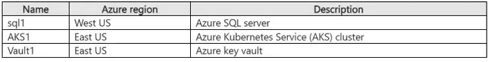
- Exhibit 6: 
- Exhibit 7: 
- Exhibit 8: 
- Exhibit 9: 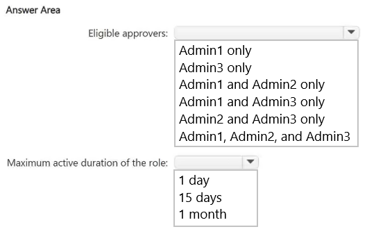

_HOTSPOT — the original ExamTopics question expects you to mark areas on the exhibit above; the correct hotspot coordinates are not published._

**Most voted:** When User1 requests to use (activate) the role, they are utilizing Just-In-Time (JIT) access. The duration they hold the role after approval is governed by the Activation maximum duration setting, which is strictly configured to 1 Day(s) for the AI Administrator role. The "Expire active assignments after: 15 Day(s)" setting would only apply if an...

### Top explanations
- **Samsamie** (3 upvotes [Most Recent]): When User1 requests to use (activate) the role, they are utilizing Just-In-Time (JIT) access. The duration they hold the role after approval is governed by the Activation maximum duration setting, which is strictly configured to 1 Day(s) for the AI Administrator role. The "Expire active assignments after: 15 Day(s)" setting would only apply if an administrator was directly assigning User1 the role as an active (standing) assignment rather than an eligible one.

## Q1.2 (ID 414681)

HOTSPOT
Overview
Contoso, Ltd. is a consulting company that has a main office in San Francisco and a branch office in Dallas.
Contoso has a hybrid environment that contains on-premises servers connected to Azure, a Microsoft 365 E5 subscription, and an Azure subscription named Sub1.
Existing Environment. Microsoft Entra tenant
Contoso has a Microsoft Entra tenant named contoso.com that contains the users shown in the following table.
Existing Environment. On-premises environment
The on-premises network contains an Active Directory Domain Services (AD DS) forest that syncs with contoso.com. The forest contains a server named Server1 that runs Windows Server.
Existing Environment. Azure subscription
Sub1 contains the storage accounts shown in the following table.
Sub1 contains the virtual networks shown in the following table.
Sub1 contains the virtual machines shown in the following table.
The network interface of VM1 is associated with an application security group named ASG1.
Sub1 contains the resources shown in the following table.
Vault1 stores the objects shown in the following table.
Existing Environment. Privileged Identity Management (PIM) configuration
You manage privileged roles by using Privileged Identity Management (PIM). The PIM role settings are configured as shown in the following table.
Existing Environment. Microsoft Sentinel configuration
Contoso has a Microsoft Sentinel workspace that contains the following tables.
Requirements. Planned changes
Contoso plans to implement the following changes:
Integrate AKS1 with Vault1.
Enable Microsoft Entra Kerberos authentication for all supported storage.
Configure auditing for sql1 by using the Azure portal and store audit logs in a centralized location.
Requirements. Technical requirements
Contoso identifies the following technical requirements:
Protect Server1 by using file integrity monitoring.
Protect AKS1 by using Microsoft Defender for Cloud.
Configure Microsoft Sentinel to retain data for the maximum supported duration without changing the tier.
Store objects used for authentication and encryption in Vault1 and ensure that Vault1 regenerates the objects every 30 days, whenever possible.
For each of the following statements, select Yes if the statement is true. Otherwise, select No.
NOTE: Each correct selection is worth one point.

**Exhibits**
- Exhibit 1: 
- Exhibit 2: 
- Exhibit 3: 
- Exhibit 4: 
- Exhibit 5: 
- Exhibit 6: 
- Exhibit 7: 
- Exhibit 8: 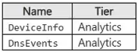
- Exhibit 9: 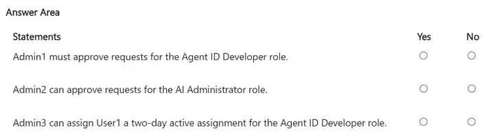

_HOTSPOT — the original ExamTopics question expects you to mark areas on the exhibit above; the correct hotspot coordinates are not published._

**Most voted:**
- Yes, I agree with the answer key: No / No / Yes. The question tests a rule for each PIM configuration.
- Maximum activation duration (1 day): applies when an eligible user activates the role on their own. It’s the length of each privileged “session.”
- Active assignment expiration (15 days): applies when an administrator assigns the role directly as active. It’s the limit on that assignment.

### Top explanations
- **denis91** (3 upvotes [Most Recent]): Yes, I agree with the answer key: No / No / Yes. The question tests a rule for each PIM configuration.
  “Admin1 must approve requests for the Agent ID Developer” = No
  For this role, approval is disabled. The eligible user activates on their own, immediately, and nobody needs to approve anything. The fact that Admin1 is a Global Admin doesn’t matter: they could be an approver, but the word “must” makes the statement false, because there is no approval step.
  “Admin2 can approve requests for the AI Administrator” = No
  Here approval is enabled, but the approvers field is empty. When no approver is set, PIM falls back to the defaults: Privileged Role Administrators and Global Administrators. So in this scenario, the approvers are Admin1 or Admin3.
  Admin2 holds the AI Administrator role, but that doesn’t make them an approver. Holding a role doesn’t give you the right to approve requests for that same role.
  “Admin3 can give User1 a two-day active assignment for the Agent ID Developer” = Yes
  This is the trick. Many people see “Maximum activation duration = 1 day” and answer No. But these are two different things:
  - Maximum activation duration (1 day): applies when an eligible user activates the role on their own. It’s the length of each privileged “session.”
  - Active assignment expiration (15 days): applies when an administrator assigns the role directly as active. It’s the limit on that assignment.
  Two days fits within 15 days, so the assignment is valid. And Admin3, as a Privileged Role Administrator, has permission to manage PIM assignments for Entra roles.
- **HC_Harms** (2 upvotes): I agree with the forst two no's.
  For the third answer I would go with yes. Why? We already have a 15 day active assigment configured. So why shouldn't we be allowed to configure it down for just two days?
  The maximum duration hours is active after(!) our 15 day (or two days in this case).
  Active assigment means, we can use this role without doing anything, no approval is needed, it's automatically active for this configured period of time.
- **LukeAR78** (1 upvotes): All 3 answers are No.
  Admin1 can approve the role, but the wording is 'must'. Admin 3 can approve as well. It's strange wording, but I would say no.
  The Third statement is also no. The Maximum activation is one day.  Expire active assignments is not the same thing.
- **Craigg** (1 upvotes): Hi Hate question like this. Either Privilege admin approver or Global admin can approve the role. Either Admin 1 or Admin 3 must approve the role, but it can be either. The question should read only Admin 1 can approve requested role.

## Q1.3 (ID 414682)

You have an Azure SQL Database logical server named Server1 that contains a database named DB1.
You need to configure authentication for Server1 to meet the following requirements:
SQL authentication cannot be used for any databases on Server1.
The solution must be enforced centrally at the server level.
What should you do?

⭕ **A.** Configure a Microsoft Entra administrator for Server1.
⭕ **B.** Enable a managed identity for Server1.
✅ **C.** Enable Microsoft Entra-only authentication for Server1.
⭕ **D.** Remove SQL logins from DB1.

**Correct answer:** C
**Most voted:** C

### Top explanations
- **Eltooth** (5 upvotes [Selected Answer: C]): C is correct answer.
  https://learn.microsoft.com/en-us/azure/azure-sql/database/authentication-azure-ad-only-authentication
- **DaniloGreg** (2 upvotes [Most Recent, Selected Answer: C]): El requisito clave es doble: bloquear SQL authentication completamente Y que sea centralizado a nivel de servidor (no por base de datos individual). La opción "Microsoft Entra-only authentication" es justo la funcionalidad diseñada para esto — es un toggle a nivel de logical server que, una vez habilitado, deshabilita SQL authentication para todas las bases de datos del servidor, sin necesidad de tocar cada base de datos por separado.
- **Samsamie** (2 upvotes [Selected Answer: C]): it said centrally, so it cannot be the db itself, choose the options with "Server" and also authentication in its option...

## Q1.4 (ID 414683)

You have a Microsoft Entra tenant that has the following configurations:
User consent for applications is disabled.
Only administrators can grant permissions to applications.
You register an application named App1 that uses delegated Microsoft Graph permissions.
You need to configure App1 to meet the following requirements:
Enable user sign-ins without interactive consent prompts.
Enable App1 to access Microsoft Graph on behalf of the signed-in user.
What should you do?

⭕ **A.** Configure enterprise applications to require user assignment and assign users to App1.
⭕ **B.** Modify the app registration to use application permissions instead of delegated permissions.
⭕ **C.** Add the required delegated Microsoft Graph permissions to the app registration and rely on user consent during sign-in.
✅ **D.** Grant admin consent to App1 for the required delegated permissions.

**Correct answer:** D
**Most voted:** D

### Top explanations
- **Eltooth** (8 upvotes [Most Recent, Highly Voted, Selected Answer: D]): D is correct answer - Grant admin consent.
  Because user consent is entirely disabled in the tenant, users cannot grant permissions themselves. An administrator must step in to grant consent on behalf of the entire organization.
  Once an administrator grants tenant-wide admin consent to the requested delegated permissions, Microsoft Entra ID considers the permissions pre-approved. Users will be able to sign in and allow App1 to act on their behalf without seeing any interactive consent prompts.

## Q1.5 (ID 414684)

You have a Microsoft Entra tenant that uses Privileged Identity Management (PIM).
You need to modify the AI Administrator role settings to meet the following requirements:
Elevated access must be evaluated by another administrator before it is granted.
Privileged access must be removed automatically after a fixed period.
Which two settings should you configure? Each correct answer presents part of the solution.
NOTE: Each correct selection is worth one point.

⭕ **A.** Expire active assignments after
✅ **B.** Require approval to activate
⭕ **C.** Require justification on activation
⭕ **D.** Expire eligible assignments after
✅ **E.** Activation maximum duration

**Correct answer:** B, E
**Most voted:** BE

### Top explanations
- **Eltooth** (4 upvotes [Most Recent, Selected Answer: BE]): B and E are correct.
  Require approval to activate - from another admin.
  Set maximum elevated privileged time.

## Q1.6 (ID 414685)

You have two management groups named MG1 and MG2 that contain multiple Azure subscriptions. The subscriptions are linked to a Microsoft Entra tenant.
You have a user named User1 and a global administrator named Admin1.
You are informed that User1 created an Azure subscription named Sub1 under the MG2 management group and is the only owner of the subscription.
You need to ensure that Admin1 can remove the Owner role from User1 for Sub1.
What should you do first?

⭕ **A.** Move Sub1 to MG1.
⭕ **B.** Assign Admin1 the User Access Administrator role for Sub1.
⭕ **C.** Instruct Admin1 to use Privileged Identity Management (PIM) to request the Security Administrator role.
✅ **D.** Instruct Admin1 to enable Access management for Azure resources.

**Correct answer:** D
**Most voted:** D

### Top explanations
- **Eltooth** (3 upvotes [Selected Answer: D]): D is correct answer.
  Elevates Global Admin Privileges: By default, a Microsoft Entra Global Administrator does not have permission to manage Azure subscriptions or management groups. Enabling the Access management for Azure resources toggle elevates the Global Administrator's access.
  Grants User Access Administrator Role: Turning this setting on automatically assigns the User Access Administrator role to the Global Admin at the absolute root management group level (/). This permission inherits down to all management groups (including MG2) and all subscriptions (including Sub1), giving Admin1 the necessary authority to modify permissions and remove User1 as an Owner.
- **volto** (1 upvotes [Most Recent]): Of course, the “Manage access to Azure resources” feature solves many access-related problems, just like root privileges in Linux ;) However, this does not comply with the principle of least privilege. If you assign user Admin1 to subscription Sub1 with the “User Access Administrator” role, that user will also be able to revoke the owner role from user User1.
  BUT...
  not in this case. If User1 creates Subscription 1 in Management Group 2, they will likely have the Owner role at the management group level, and this role will be inherited at the subscription level. This means that the “User Access Administrator” role at the subscription level is not sufficient to revoke this permission. Therefore, answer D is correct.

## Q1.7 (ID 414686)

You have a management group named MG1 that contains two subscriptions named Sub1 and Sub2.
Sub1 contains a resource group named RG-Exception and a resource group named RG1 that hosts Microsoft Foundry resources.
You need to assign an Azure policy to force new Foundry deployments in MG1 to use private endpoints. The solution must NOT restrict deployments in RG-Exception.
How should you configure the policy?

✅ **A.** Assign the policy to MG1 and exclude RG-Exception.
⭕ **B.** Assign the policy to Sub1 and RG-Exception.
⭕ **C.** Assign the policy to MG1 and RG-Exception.
⭕ **D.** Assign the policy to Sub1 and exclude RG-Exception.

**Correct answer:** A
**Most voted:** A

### Top explanations
- **Eltooth** (6 upvotes [Most Recent, Selected Answer: A]): A is correct answer.
  You need to enforce policy at MG level for all current & future subs/RGs.
  You then need to exclude RGs.

## Q1.8 (ID 414687)

You have an Azure key vault named KV1 that uses role-based access control (RBAC) authorization. KV1 stores database connection strings for an Azure App Service web app named App1.
You enable a firewall on KV1 and allow access to KV1 from only the virtual network that contains App1.
You need to ensure that App1 can retrieve secrets from KV1 without using credentials stored in the application configuration.
What should you create?

⭕ **A.** an access policy for KV1
⭕ **B.** an app registration for App1
⭕ **C.** a private endpoint for KV1
✅ **D.** a managed identity for App1

**Correct answer:** D
**Most voted:** D

### Top explanations
- **Eltooth** (6 upvotes [Most Recent, Selected Answer: D]): D id correct answer.
  Enabling a managed identity (either system-assigned or user-assigned) for App1 allows the App Service to authenticate directly against Microsoft Entra ID. The web app uses this identity to acquire an access token automatically, completely eliminating the need to store keys, passwords, or credentials in its application configuration.
  Because KV1 uses Azure role-based access control (RBAC) authorization, you can grant this managed identity the Key Vault Secrets User role. This gives App1 the precise permissions required to retrieve the database connection strings securely.

## Q1.9 (ID 414688)

DRAG DROP
You have a Microsoft Entra tenant.
You need to implement passwordless authentication. The solution must meet the following requirements:
Users can sign in without a password by using a mobile device.
New users that sign in for the first time must use a helpdesk-issued sign-in method that expires.
Which authentication method should you enable for each requirement? To answer, drag the appropriate methods to the correct requirements. Each method may be used once, more than once, or not at all. You may need to drag the split bar between panes or scroll to view content.
NOTE: Each correct selection is worth one point.

**Exhibits**
- Exhibit 1: 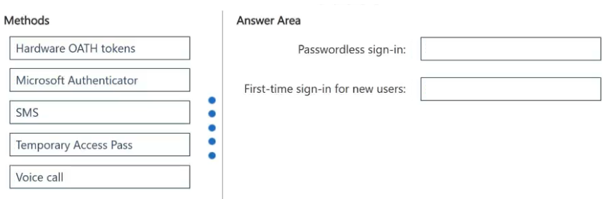

_DRAG DROP — the original ExamTopics question expects you to drag and drop items; the correct targets are not published._

**Most voted:** This one is correct and covered at the beginning of the SC-500 MATERIAL. Microsoft Auth can handle software or hardware passwordless and TAP for first time signin.

### Top explanations
- **Ayusef** (6 upvotes [Most Recent]): This one is correct and covered at the beginning of the SC-500 MATERIAL. Microsoft Auth can handle software or hardware passwordless and TAP for first time signin.

## Q1.10 (ID 414689)

You have a Microsoft Entra tenant that has user consent for applications disabled.
You register an application named App1 that requests the following Microsoft Graph delegated permissions:
User.Read
Mail.Read
You need to configure tenant permissions to meet the following requirements:
Enable users to grant consent for low-risk permissions without administrator interaction.
Ensure that applications requesting higher-privilege permissions require administrator approval.
What should you do?

⭕ **A.** Grant tenant-wide admin consent to App1.
⭕ **B.** Configure application assignments for App1.
⭕ **C.** Configure Privileged Identity Management (PIM) role assignments.
✅ **D.** Create an app consent policy.

**Correct answer:** D
**Most voted:** D

### Top explanations
- **Eltooth** (5 upvotes [Most Recent, Selected Answer: D]): App Consent Policies: In Microsoft Entra ID, creating a custom app consent policy allows you to define exactly which permissions are considered "low-risk" (such as User.Read). By pairing this policy with user consent settings, you can allow non-administrator users to consent to these specific, low-risk permissions on their own.
  Risk Differentiation: Any permissions requested by an application that fall outside of your defined low-risk app consent policy (such as Mail.Read, which allows reading a user's email and is inherently higher privilege) will automatically require administrator approval through the admin consent workflow.

## Q1.11 (ID 414690)

You have an Azure management group named MG1 that contains two subscriptions named Sub1 and Sub2. Both subscriptions are linked to a Microsoft Entra tenant that contains a security group named Group1.
You need to ensure that the members of Group1 can assign roles to the resources in Sub1 and Sub2. The solution must follow the principle of least privilege.
Which role should you assign to Group1?

⭕ **A.** Contributor at the MG1 scope
⭕ **B.** Contributor at the Sub1 and Sub2 scopes
✅ **C.** User Access Administrator at the MG1 scope
⭕ **D.** Owner at the MG1 scope

**Correct answer:** C
**Most voted:** C

### Top explanations
- **Eltooth** (6 upvotes [Selected Answer: C]): Role Capabilities: The User Access Administrator role explicitly grants the authority to manage user access to Azure resources (assigning Azure roles). It does not grant permissions to create, delete, or modify the actual resources, satisfying the principle of least privilege.
  Scope Efficiency: Assigning the role at the MG1 scope automatically inherits down to both Sub1 and Sub2 (and any future resources added under MG1). This avoids the administrative overhead of making multiple individual assignments.
- **AG_245466** (3 upvotes [Most Recent, Selected Answer: C]): The User Access Administrator role explicitly grants the authority to manage user access to Azure resources (assigning Azure roles). It does not grant permissions to create, delete, or modify the actual resources, satisfying the principle of least privilege.

## Q1.12 (ID 414691)

DRAG DROP
You have an Azure key vault named KV1 that uses role-based access control (RBAC) for data plane authorization.
You have a user named User1 and an Azure App Service web app named App1 that has a system-assigned managed identity.
You need to configure authorization to meet the following requirements:
App1 must be able to retrieve secrets from KV1.
User1 must manage the KV1 settings without accessing secret values.
The solution must follow the principle of least privilege.
Which role should you assign to each identity for KV1? To answer, drag the appropriate roles to the correct identities. Each role may be used once, more than once, or not at all. You may need to drag the split bar between panes or scroll to view content.
NOTE: Each correct selection is worth one point.

**Exhibits**
- Exhibit 1: 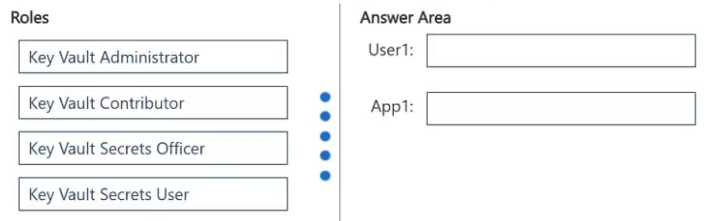

_DRAG DROP — the original ExamTopics question expects you to drag and drop items; the correct targets are not published._

**Most voted:**
- App1 (Key Vault Secrets User): This role allows the identity to read secret contents and metadata (Microsoft.KeyVault/vaults/secrets/readSecret/action). It grants only the data plane access needed to retrieve secrets without allowing any management of the Key Vault itself.
- User1 (Contributor): This management plane role allows the user to manage the Key Vault settings, access policies, and network rules (Microsoft.KeyVault/vaults/*). Crucially, because KV1 uses Azure RBAC for data plane authorization, the Contributor role does not grant permissions to read secret values, fully satisfying the requirement.

### Top explanations
- **Eltooth** (8 upvotes [Highly Voted]): App1 (Key Vault Secrets User): This role allows the identity to read secret contents and metadata (Microsoft.KeyVault/vaults/secrets/readSecret/action). It grants only the data plane access needed to retrieve secrets without allowing any management of the Key Vault itself.
  User1 (Contributor): This management plane role allows the user to manage the Key Vault settings, access policies, and network rules (Microsoft.KeyVault/vaults/*). Crucially, because KV1 uses Azure RBAC for data plane authorization, the Contributor role does not grant permissions to read secret values, fully satisfying the requirement.
- **changck** (1 upvotes): Key Vault Secrets Officer is more higher privilege than key vault secret user hence it is wrong. Key vault secret user is the correct answer for App1.
- **volto** (1 upvotes [Most Recent]): That's right, but User1's “Key Vault Contributor” role is not the same as the “Contributor” role—they are different roles.

## Q1.13 (ID 414692)

HOTSPOT
You have an Azure subscription named Sub1 that contains 50 virtual machines. Sub1 has Microsoft Defender for Cloud enabled.
Sub1 contains an Azure key vault named KV1 and an Azure policy that enforces storing all secrets in KV1.
Occasionally, the developers at your company store plaintext tokens and SSH private keys on the virtual machines.
You need to configure Defender for Cloud to detect plaintext secrets on the virtual machines. The solution must minimize administrative changes to the virtual machines.
How should you configure Defender for Cloud? To answer, select the appropriate options in the answer area.
NOTE: Each correct selection is worth one point.

**Exhibits**
- Exhibit 1: 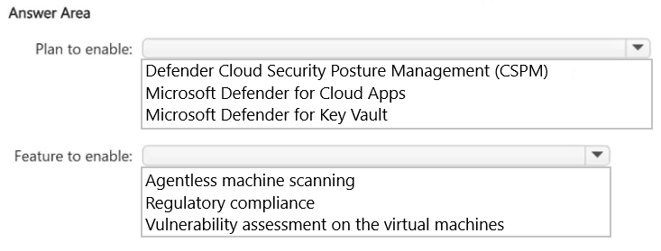

_HOTSPOT — the original ExamTopics question expects you to mark areas on the exhibit above; the correct hotspot coordinates are not published._

**Most voted:**
- CSPM
- Agentless scanning
- To configure Microsoft Defender for Cloud to detect plaintext secrets on the virtual machines while minimizing administrative changes, you should enable agentless scanning within the Defender for Servers Plan (Plan 2).
- Step-by-Step Configuration
- Navigate to the Microsoft Defender for Cloud console in the Azure portal.

### Top explanations
- **Eltooth** (4 upvotes [Most Recent]): CSPM
  Agentless scanning
  To configure Microsoft Defender for Cloud to detect plaintext secrets on the virtual machines while minimizing administrative changes, you should enable agentless scanning within the Defender for Servers Plan (Plan 2).
  Step-by-Step Configuration
  Navigate to the Microsoft Defender for Cloud console in the Azure portal.
  Click on Environment settings and select your subscription (Sub1).
  On the Defender plans tab, locate Servers and ensure it is turned On.
  Click Settings & monitoring under the Servers plan.
  Locate the Agentless scanning for machines component and toggle its status to On.
  Ensure that the Secrets scanning extension/sub-plan is enabled under the agentless scanning configuration.
  Click Save.

## Q1.14 (ID 414693)

HOTSPOT
You have an Azure subscription.
You need to create and deploy an Azure policy that meets the following requirements:
When a new virtual machine is deployed, automatically install a custom security extension.
Trigger an autogenerated remediation task for non-compliant virtual machines to install the extension.
What should you include in the policy? To answer, select the appropriate options in the answer area.
NOTE: Each correct selection is worth one point.

**Exhibits**
- Exhibit 1: 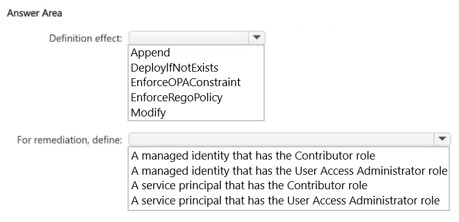

_HOTSPOT — the original ExamTopics question expects you to mark areas on the exhibit above; the correct hotspot coordinates are not published._

**Most voted:**
- DeployIfNotExists
- The policy definition must use the "DeployIfNotExists" effect. This effect checks if the custom security extension is present on the virtual machine. If the extension is missing, it marks the VM as non-compliant and provides a deployment template to install it automatically during creation or via a remediation task.

### Top explanations
- **Eltooth** (6 upvotes [Most Recent]): DeployIfNotExists
  The policy definition must use the "DeployIfNotExists" effect. This effect checks if the custom security extension is present on the virtual machine. If the extension is missing, it marks the VM as non-compliant and provides a deployment template to install it automatically during creation or via a remediation task.
  Managed Identity (Role Assignment)
  To trigger an autogenerated remediation task, the policy assignment requires a Managed Identity (System-Assigned or User-Assigned). You must grant this identity an Azure RBAC role (such as Virtual Machine Contributor) that gives it permission to install extensions on the target virtual machines

## Q1.15 (ID 414694)

Overview
Fabrikam, Inc. is a consulting company. The company has a main office in New York City and branch offices in Amsterdam and Singapore.
Existing Environment. Network environment
The on-premises network contains a datacenter in each office.
Existing Environment. Cloud environment
Fabrikam has two Azure subscriptions named Sub1 and Sub2 and a Microsoft 365 subscription that includes Microsoft 365 E5 licenses.
All the subscriptions are linked to a Microsoft Entra tenant named fabrikam.com that contains the identities shown in the following table.
The tenant contains the groups shown in the following table.
All devices are enrolled in Microsoft Intune.
Existing Environment. Sub1 Resources
Sub1 contains a resource group named RG1 that contains the resources shown in the following table.
SQLServer1 uses Microsoft SQL Server authentication.
Sub1 has an Azure Web Application Firewall (WAF) named WAF1 that has the following types of rule sets:
Bot Manager 1.1
Azure-managed Default Rule Set (DRS)
Sub1 has the following compliance standards assigned in Microsoft Defender for Cloud:
NIST SP 800-53 Rev. 4
Microsoft cloud security benchmark (MCSB)
System and Organization Controls (SOC) 2 Type 2
Existing Environment. Sub2 Resources
Sub2 contains a resource group named RG2.
Planned Changes and Requirements. Planned Changes
Fabrikam plans to implement the following changes:
Deploy the following key vaults to RG1:
AKV2 in the West Europe Azure region
AKV3 in the Central US Azure region
AKV4 in the East US Azure region
Deploy the following key vaults to RG2:
AKV5 in the East US region
Configure VM1 to read data from storage1.
Create function apps that have the following hosting plans:
Fa1: Flex Consumption hosting plan
Fa2: Consumption hosting plan
Fa3: Dedicated hosting plan
For WAF1, implement rate limiting rules based on the request location.
Enable the NIST SP 800-53 Rev. 5 compliance standard in Defender for Cloud.
Create a new storage account named storage2 that supports Azure Table storage.
Enforce multifactor authentication (MFA) when database administrators access SQLdb1.
Implement ExpressRoute circuits to the on-premises network as shown in the following table.
For RG1, create a new Privileged Identity Management (PIM) eligible role assignment that assigns the Contributor role to supported groups.
Planned Changes and Requirements.  Technical Requirements
Fabrikam has the following technical requirements:
If VM1 is deleted, the permissions for VM1 must be removed automatically.
The AKS1 managed identity must only be able to pull images from Registry1.
The ID1 managed identity must be able to push images to and pull images from Registry1.
All the data in the storage accounts must be encrypted by using Fabrikam-managed keys.
All outbound traffic from the function apps to the on-premises network must use ExpressRoute circuits.
ExpressRoute connectivity between the on-premises network and the Azure environment must be encrypted by using Layer 2 or Layer 3 encryption.
You need to implement the planned change for SQLdb1.
Which two actions should you perform? Each correct answer presents part of the solution.
NOTE: Each correct selection is worth one point.

**Exhibits**
- Exhibit 1: 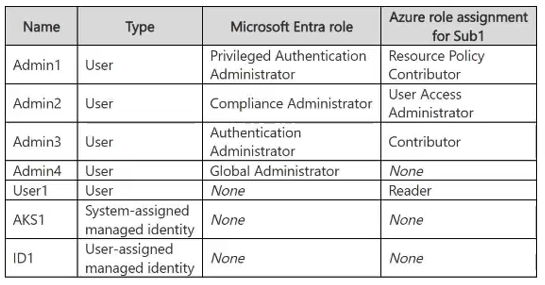
- Exhibit 2: 
- Exhibit 3: 
- Exhibit 4: 

⭕ **A.** Create a compliance policy.
✅ **B.** Configure Microsoft Entra authentication for SQLServer1.
✅ **C.** Create a Conditional Access policy.
⭕ **D.** Configure Federated client identity for SQLdb1.
⭕ **E.** Configure a user-assigned managed identity for SQLdb1.

**Correct answer:** B, C
**Most voted:** BC

### Top explanations
- **Eltooth** (4 upvotes [Most Recent, Selected Answer: BC]): B & C are correct.
  Enforcing MFA requires Entra Authentication for users to use Entra accounts over local SQL accounts and a Conditional access policy to enforce MFA.

## Q1.16 (ID 414695)

Overview
Fabrikam, Inc. is a consulting company. The company has a main office in New York City and branch offices in Amsterdam and Singapore.
Existing Environment. Network environment
The on-premises network contains a datacenter in each office.
Existing Environment. Cloud environment
Fabrikam has two Azure subscriptions named Sub1 and Sub2 and a Microsoft 365 subscription that includes Microsoft 365 E5 licenses.
All the subscriptions are linked to a Microsoft Entra tenant named fabrikam.com that contains the identities shown in the following table.
The tenant contains the groups shown in the following table.
All devices are enrolled in Microsoft Intune.
Existing Environment. Sub1 Resources
Sub1 contains a resource group named RG1 that contains the resources shown in the following table.
SQLServer1 uses Microsoft SQL Server authentication.
Sub1 has an Azure Web Application Firewall (WAF) named WAF1 that has the following types of rule sets:
Bot Manager 1.1
Azure-managed Default Rule Set (DRS)
Sub1 has the following compliance standards assigned in Microsoft Defender for Cloud:
NIST SP 800-53 Rev. 4
Microsoft cloud security benchmark (MCSB)
System and Organization Controls (SOC) 2 Type 2
Existing Environment. Sub2 Resources
Sub2 contains a resource group named RG2.
Planned Changes and Requirements. Planned Changes
Fabrikam plans to implement the following changes:
Deploy the following key vaults to RG1:
AKV2 in the West Europe Azure region
AKV3 in the Central US Azure region
AKV4 in the East US Azure region
Deploy the following key vaults to RG2:
AKV5 in the East US region
Configure VM1 to read data from storage1.
Create function apps that have the following hosting plans:
Fa1: Flex Consumption hosting plan
Fa2: Consumption hosting plan
Fa3: Dedicated hosting plan
For WAF1, implement rate limiting rules based on the request location.
Enable the NIST SP 800-53 Rev. 5 compliance standard in Defender for Cloud.
Create a new storage account named storage2 that supports Azure Table storage.
Enforce multifactor authentication (MFA) when database administrators access SQLdb1.
Implement ExpressRoute circuits to the on-premises network as shown in the following table.
For RG1, create a new Privileged Identity Management (PIM) eligible role assignment that assigns the Contributor role to supported groups.
Planned Changes and Requirements.  Technical Requirements
Fabrikam has the following technical requirements:
If VM1 is deleted, the permissions for VM1 must be removed automatically.
The AKS1 managed identity must only be able to pull images from Registry1.
The ID1 managed identity must be able to push images to and pull images from Registry1.
All the data in the storage accounts must be encrypted by using Fabrikam-managed keys.
All outbound traffic from the function apps to the on-premises network must use ExpressRoute circuits.
ExpressRoute connectivity between the on-premises network and the Azure environment must be encrypted by using Layer 2 or Layer 3 encryption.
You need to implement the planned change for storage2. The solution must meet the technical requirements for storage encryption.
What should you do?

**Exhibits**
- Exhibit 1: 
- Exhibit 2: 
- Exhibit 3: 
- Exhibit 4: 

⭕ **A.** Enable purge protection for storage2.
⭕ **B.** Create an encryption scope in storage2.
✅ **C.** Configure storage2 to use an account encryption key.
⭕ **D.** Assign an Azure role-based access control (Azure RBAC) role to storage2.

**Correct answer:** C
**Most voted:** C

### Top explanations
- **Eltooth** (6 upvotes [Selected Answer: C]): Encryption Scopes:
  Azure Storage encryption scopes allow you to manage encryption with customer-managed keys (such as Fabrikam-managed keys) at the level of individual containers or blobs within a storage account. According to the organizational requirements, you are specifically planned to create an encryption scope named Scope1 inside storage2 to meet the technical requirements for encrypting storage services.
- **ACSC** (1 upvotes [Selected Answer: B]): Custom managed keys with Encryption scopes
- **funmi007** (1 upvotes [Selected Answer: B]): Fabrikam requires all data in the storage accounts to be encrypted using Fabrikam-managed keys.
  Azure Storage encrypts data at rest by default using Microsoft-managed keys. To use customer-managed keys, you can configure encryption with a key stored in Azure Key Vault.
  An encryption scope lets you configure encryption for data within a storage account, including using a customer-managed key.
- **volto** (1 upvotes [Most Recent]): "Encryption scopes enable you to manage encryption with a key that is scoped to a container or an individual blob", not table storage. So, you must configure customer-managed keys for a storage account, it similar to answer C.

## Q1.17 (ID 414696)

You have an Azure SQL Database logical server named Server1 that contains multiple databases.
The databases contain legacy SQL authentication logins that must no longer be usable for sign-in but must NOT be removed from the databases.
You need to ensure that SQL authentication is denied for connections.
What should you do?

⭕ **A.** Run create USER ... FROM EXTERNAL PROVIDER on each database.
⭕ **B.** Create a Conditional Access policy.
✅ **C.** Enable Microsoft Entra-only authentication for Server1.
⭕ **D.** Assign the SQL Server Contributor role to Server1.

**Correct answer:** C
**Most voted:** C

### Top explanations
- **Eltooth** (5 upvotes [Most Recent, Selected Answer: C]): Microsoft Entra-only authentication disables all local SQL authentication logins at the server level for Server1. When this feature is enabled, users can only connect using Microsoft Entra (formerly Azure AD) identities. The legacy SQL logins will remain inside the databases (not removed), but any attempt to sign in using them will be strictly denied

## Q1.18 (ID 414697)

You have an Azure subscription named Sub1 that contains an Azure Database for PostgreSQL instance. Sub1 has Microsoft Defender for Cloud enabled.
You need to configure Microsoft Defender for Databases to minimize costs.
Which Defender plan should you enable?

⭕ **A.** Microsoft Defender for Servers
✅ **B.** Microsoft Defender for Open-Source Relational Databases
⭕ **C.** Microsoft Defender for SQL Servers on Machines
⭕ **D.** Microsoft Defender for Azure SQL Databases
⭕ **E.** Microsoft Defender for Storage

**Correct answer:** B
**Most voted:** B

### Top explanations
- **Eltooth** (5 upvotes [Most Recent, Selected Answer: B]): Microsoft Defender for Open-Source Relational Databases is the specific Microsoft Defender for Cloud database plan designed to provide threat detection, behavioral monitoring, and alerts for open-source database engines managed in Azure, which specifically includes Azure Database for PostgreSQL and Azure Database for MySQL.
  https://learn.microsoft.com/en-us/azure/defender-for-cloud/enable-defender-for-databases-azure
  By selecting this specific plan instead of broader machine-level plans, you protect the required database instance directly and minimize unnecessary subscription costs.

## Q1.19 (ID 414698)

You have an Azure Storage account named storage1 that contains Azure Files shares.
You have an application named App1 that uses a system-assigned managed identity to access the shares.
Administrators access the shares by using storage account keys.
You need to ensure that App1 access the shares without using the storage account keys.
What should you do on storage1?

⭕ **A.** Store the storage account access keys in Azure Key Vault and regenerate them periodically.
⭕ **B.** Set Allow storage account key access to Disabled.
⭕ **C.** Select Default to Microsoft Entra authorization in the Azure portal.
✅ **D.** Assign the Storage File Data Privileged Reader role to the managed identity of App1.

**Correct answer:** D
**Most voted:** D

### Top explanations
- **Eltooth** (8 upvotes [Highly Voted, Selected Answer: D]): D. Assign the Storage File Data Privileged Reader role to the managed identity of App1.
  https://learn.microsoft.com/en-us/azure/storage/files/storage-files-identity-assign-share-level-permissions?tabs=azure-portal
  Identity-Based Access: To allow App1 to access Azure Files shares without using storage account keys, you must configure role-based access control (RBAC) using Microsoft Entra ID. Assigning a built-in role like Storage File Data Privileged Reader (or Storage File Data SMB Share Reader/Contributor depending on the protocol) directly to App1's system-assigned managed identity allows the application to authenticate natively and securely without relying on access keys.
- **ash_niyaz** (4 upvotes [Selected Answer: D]): The scenario explicitly says administrators still access shares using storage account keys — disabling key access entirely would break that requirement.
  D is correct, To let App1's managed identity access the file shares, it needs an RBAC role scoped to Azure Files data
- **Greens** (3 upvotes [Selected Answer: D]): App1 already has a managed identity. What’s missing is authorization on the data plane. For Azure Files accessed with Entra ID tokens (OAuth over the REST API, which is how a managed identity accesses shares), Microsoft uses the “Privileged” file data roles. Once the role is assigned, App1 authenticates with its identity, and no account key is involved.
- **rameshms85** (3 upvotes [Selected Answer: B]): Disabling Storage Account Key Access: To completely enforce that applications and users access storage account resources (such as Azure Files shares) without using storage account keys, you can disable shared key authorization entirely on the storage account by setting Allow storage account key access to Disabled. This forces the storage account to exclusively rely on Microsoft Entra ID (such as managed identities) for authentication and authorization.
  https://learn.microsoft.com/en-us/azure/storage/common/shared-key-authorization-prevent?tabs=portal
- **scruzer** (3 upvotes [Selected Answer: D]): D. Assign the Storage File Data Privileged Reader role to the managed identity of App1.
  Identity-based access to Azure Files data requires an Azure RBAC data-plane role on the managed identity. Without a role assignment, the managed identity has no data access at all — being authenticated isn't enough. The "Privileged" file data roles are the ones that grant access over the share regardless of NTFS/Windows ACLs, which is what an app identity needs when there's no AD DS or Entra Domain Services identity behind it.

## Q1.20 (ID 414699)

You have an Azure subscription named Sub1 that contains a storage account named storage1. Sub1 has Microsoft Defender for Storage enabled. Defender for Storage has malware scanning enabled.
You need to configure a solution that automates the remediation of malware detected in storage1.
What should you include in the solution?

⭕ **A.** Application Insights
⭕ **B.** Azure Event Hubs
✅ **C.** Azure Event Grid
⭕ **D.** Azure Policy

**Correct answer:** C
**Most voted:** C

### Top explanations
- **Eltooth** (6 upvotes [Most Recent, Selected Answer: C]): C. Azure Event Grid.
  Event-Driven Response: Microsoft Defender for Storage malware scanning natively integrates with Azure Event Grid. When malware is detected in a blob or file, scan result events are published to an Event Grid custom topic. You can then configure downstream automation services—such as Azure Functions or Logic Apps—triggered by these Event Grid events to instantly delete, quarantine, or move the malicious files in near real-time.
  https://learn.microsoft.com/en-us/azure/defender-for-cloud/introduction-malware-scanning

## Q1.21 (ID 414700)

DRAG DROP
You have an Azure virtual network named VNet1 that contains three subnets named Subnet1, Subnet2, and Subnet3. A single network security group (NSG) named NSG1 is associated with all the subnets. You have the following virtual machines:
VM1 on Subnet1
VM2 on Subnet2
VM3 on Subnet3
You create two application security groups named ASG1 and ASG2. VM2 is a member of ASG1, and VM3 is a member of ASG2.
You need to ensure that only VM2 can connect to VM3. The solution must continue to work if the private IP address of VM2 changes.
How should you configure the inbound rule on NSG1? To answer, drag the settings to the correct configurations. Each setting may be used once, more than once, or not at all. You may need to drag the split bar between panes or scroll to view content.
NOTE: Each correct selection is worth one point.

**Exhibits**
- Exhibit 1: 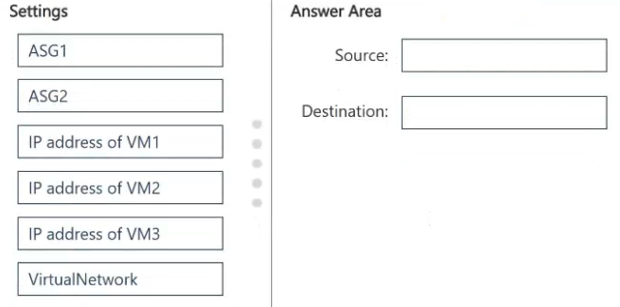

_DRAG DROP — the original ExamTopics question expects you to drag and drop items; the correct targets are not published._

**Most voted:**
- Destination: ASG2 (contains VM3)
- Action: Allow
- Dynamic IP Resolution: By assigning ASG1 as the source, Azure dynamically maps VM2's network interface card (NIC) to the rule. If VM2's private IP changes, Azure updates the underlying security rules automatically without manual intervention.
- Granular Target Enforcement: By setting the destination to ASG2, the inbound rule specifically isolates traffic targeting VM3, while keeping it separate from the other subnets and virtual machines on the same VNet.

### Top explanations
- **Eltooth** (8 upvotes [Highly Voted]): Source: ASG1 (contains VM2)
  Destination: ASG2 (contains VM3)
  Action: Allow
  Dynamic IP Resolution: By assigning ASG1 as the source, Azure dynamically maps VM2's network interface card (NIC) to the rule. If VM2's private IP changes, Azure updates the underlying security rules automatically without manual intervention.
  Granular Target Enforcement: By setting the destination to ASG2, the inbound rule specifically isolates traffic targeting VM3, while keeping it separate from the other subnets and virtual machines on the same VNet.
- **mniyas** (2 upvotes [Most Recent]): why the destination is not IP address of VM3? Here the condition is only the private Ip address changes of VM2 must not impact the rule. in that case source ASG1 is correct but destination can be ASG2 or IP address of VM3 right?

## Q1.22 (ID 414701)

You have an Azure virtual network that contains 100 virtual machines and an Azure Firewall instance named FW1.
All the traffic from the virtual machines is routed through FW1.
You need to ensure that FW1 allows access to only a URL of updates.contoso.com and blocks all other outbound traffic.
What should you use?

⭕ **A.** an inbound NAT rule
✅ **B.** an application rule
⭕ **C.** an outbound NAT rule
⭕ **D.** a network rule

**Correct answer:** B
**Most voted:** B

### Top explanations
- **scruzer** (3 upvotes [Most Recent, Selected Answer: B]): Application rules filter outbound HTTP/HTTPS traffic by FQDN, so you can allow updates.contoso.com specifically. Azure Firewall denies by default, so everything else is blocked once that rule is in place.
  The other options don’t fit:
  D. Network rule: filters by IP, port, and protocol (Layer 3/4). FQDN filtering there relies on DNS proxy resolution, so it isn’t the right tool for allowing one URL.
  A. Inbound NAT rule: this is DNAT for inbound traffic, not outbound filtering.
  C. Outbound NAT rule: this is a Load Balancer concept and doesn’t apply to Azure Firewall URL filtering.
- **Borman** (2 upvotes): No.
  Network Rules only filter by IP address, port, and protocol, not URLs.
- **mniyas** (1 upvotes [Selected Answer: BD]): D is also possible. A network rule source any vm and destination can be fqdn.
- **Jokke_GoGo** (1 upvotes [Selected Answer: B]): Application rules to filter on:
  FQDN (Fully Qualified Domain Name)
  URLs
  HTTP/HTTPS-traffic

## Q1.23 (ID 414702)

You use Azure Virtual Network Manager to manage multiple virtual networks in a network group named Group1.
You discover that the virtual machines in Group1 are accessible from the internet by using TCP port 3389.
You need to block inbound TCP 3389 from the internet across all the virtual networks in Group1. The solution must minimize administrative effort.
What should you use?

⭕ **A.** a connectivity configuration
✅ **B.** a security admin configuration
⭕ **C.** a user-defined route (UDR)
⭕ **D.** a network security group (NSG)

**Correct answer:** B
**Most voted:** B

### Top explanations
- **Eltooth** (4 upvotes [Most Recent, Selected Answer: B]): B. a security admin configuration.
  Centralised Security Governance: Azure Virtual Network Manager (AVNM) security admin configurations allow you to define high-priority security rules at scale. By creating a rule that blocks inbound TCP port 3389 from the Internet source to Any destination and applying it to Group1, the rule is automatically enforced across all virtual networks within that group. This rule takes precedence over traditional Network Security Groups (NSGs), ensuring global compliance with absolute minimal administrative effort.

## Q1.24 (ID 414703)

You have an Azure subscription.
You need to deploy an Azure virtual WAN to meet the following requirements:
Create three secured virtual hubs located in the East US, West US, and North Europe Azure regions.
Ensure that security rules sync between the regions.
What should you use?

⭕ **A.** Azure Network Function Manager
✅ **B.** Azure Firewall Manager
⭕ **C.** Azure Virtual Network Manager
⭕ **D.** Azure Front Door

**Correct answer:** B
**Most voted:** B

### Top explanations
- **Eltooth** (3 upvotes [Most Recent, Selected Answer: B]): B. Azure Firewall Manager.
  Centralised Policy Management: A secured virtual hub is an Azure Virtual WAN hub configured with an integrated Azure Firewall. Azure Firewall Manager is the centralized security management service explicitly designed to deploy, configure, and manage these secured virtual hubs.
  Rule Synchronisation: By using Azure Firewall Manager, you can create a single Azure Firewall Policy and apply it to multiple secured virtual hubs across different regions (East US, West US, and North Europe). This automatically synchronizes your security, network, and application rules across all regions simultaneously.
  https://learn.microsoft.com/en-us/azure/firewall-manager/secured-virtual-hub#create-a-secured-virtual-hub

## Q1.25 (ID 414704)

You have an Azure Storage account named storage1 that hosts a blob container named container1.
You have an Azure Functions app named app1 that uses a managed identity.
You need to configure app1 to read, write, and delete blobs in container1. The solution must follow the principle of least privilege.
What should you do?

⭕ **A.** Assign the Storage Account Contributor role to the managed identity of app1 at the scope of storage1.
⭕ **B.** Assign the Storage Blob Delegator role to the managed identity of App1 at the scope of container1.
⭕ **C.** Assign the Owner role to the managed identity of App1 at the scope of container1.
✅ **D.** Assign the Storage Blob Data Contributor role to the managed identity of App1 at the scope of container1.

**Correct answer:** D
**Most voted:** D

### Top explanations
- **goalgoal** (2 upvotes [Most Recent, Selected Answer: D]): App1 already has a managed identity—its Azure “badge.” Now that identity needs permission to work with the actual blob data.
  Storage Blob Data Contributor provides the data-plane permissions needed to read, write, and delete blobs.

## Q1.26 (ID 414705)

DRAG DROP
You have an Azure subscription named Sub1 that contains a virtual network named VNet1.
VNet1 contains multiple virtual machines, including two virtual machines named VM1 and VM2.
Sub1 is linked to a Microsoft Entra tenant named contoso.com.
A partner company has an Azure subscription named Sub2 that contains a virtual network named VNet2. VNet2 contains a virtual machine named VM3.
Sub2 is linked to a Microsoft Entra tenant named fabrikam.com.
VM1 and VM2 contain data used by an application that runs on VM3.
You need to ensure that VM3 can access VM1 and VM2. The solution must deny VM3 access to any other resources in Sub1.
What should you configure on each virtual network? To answer, drag the components to the correct virtual networks. Each component may be used once, more than once, or not at all. You may need to drag the split bar between panes or scroll to view content.
NOTE: Each correct selection is worth one point.

**Exhibits**
- Exhibit 1: 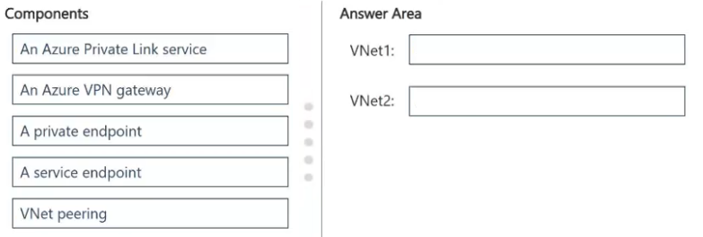

_DRAG DROP — the original ExamTopics question expects you to drag and drop items; the correct targets are not published._

**Most voted:** Not provided

### Top explanations
- **kungfumaster** (2 upvotes [Most Recent]): The options should be swapped
- **jayelamos** (2 upvotes): That's not correct
  https://learn.microsoft.com/hr-hr/azure/private-link/private-link-service-overview
  The provider creates the Private Link Service and the consumer creates a endpoint pointing to that Private Link Service.

## Q1.27 (ID 414706)

You have an Azure subscription named Sub1 that contains a storage account named storage1.
Sub1 has Microsoft Defender for Storage enabled. Defender for Storage has on-upload malware scanning enabled.
The security team at your company requires that all malicious files be processed automatically by a serverless workflow for quarantine and notification.
You need to ensure that the malware scan results trigger an automated response. The solution must minimize operational effort.
What should you configure?

✅ **A.** an Azure Event Grid subscription
⭕ **B.** diagnostic settings to send logs to a Log Analytics workspace
⭕ **C.** lifecycle management policies
⭕ **D.** an Azure Monitor alert rule

**Correct answer:** A
**Most voted:** A

### Top explanations
- **Eltooth** (3 upvotes [Selected Answer: A]): A. an Azure Event Grid subscription.
  Microsoft Defender for Storage natively publishes real-time malware scan results directly to Azure Event Grid. Creating an Event Grid subscription allows you to immediately route those events to serverless compute options like Azure Logic Apps or Azure Functions. This triggers your quarantine and notification workflows instantly with absolute minimal operational effort.
- **SchnitzelLicker** (1 upvotes [Selected Answer: A]): . Diagnostic settings to Log Analytics: This stores scan results for querying and auditing. It doesn’t trigger a workflow by itself, and using it for automation would add query and alert latency.
- **Borman** (1 upvotes [Most Recent]): It doesn't trigger, hence wrong. The Q asks for it straight: You need to ensure that the malware scan results trigger an automated response.
- **AG_245466** (1 upvotes [Selected Answer: B]): Virtual network	Component
  VNet1	An Azure Private Link service
  VNet2	A private endpoint
  Why these are correct
  - VNet1 — Azure Private Link service: Exposes a service hosted behind VNet1 privately, allowing controlled access to the application resources without exposing them publicly.
  - VNet2 — Private endpoint: Lets VM3 connect privately to the service in VNet1 through a private IP address.

## Q1.28 (ID 414707)

HOTSPOT
You have an Azure subscription that contains the following resources:
An Azure SQL Database logical server named Server1 that contains a database named DB1
An Azure SQL Managed Instance named Instance1 that contains a database named DB2
You need to configure database auditing. The solution must meet the following requirements:
Ensure that audit data is centrally available in a location that supports for KQL queries.
Minimize ongoing administrative effort as additional databases are added.
What should you configure? To answer, select the appropriate options in the answer area.
NOTE: Each correct selection is worth one point.

**Exhibits**
- Exhibit 1: 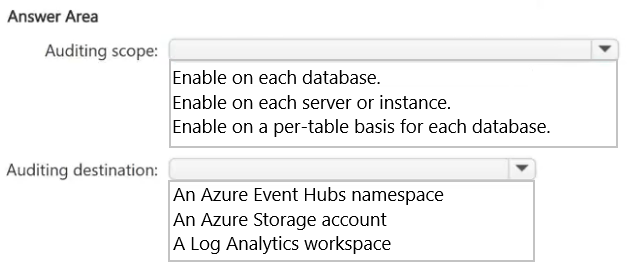

_HOTSPOT — the original ExamTopics question expects you to mark areas on the exhibit above; the correct hotspot coordinates are not published._

**Most voted:** To meet the requirements with the least administrative effort, you should configure Server-level and Instance-level auditing on Instance1, and configure both to send logs to a central Log Analytics workspace.

### Top explanations
- **Eltooth** (5 upvotes [Most Recent]): To meet the requirements with the least administrative effort, you should configure Server-level and Instance-level auditing on Instance1, and configure both to send logs to a central Log Analytics workspace.

## Q1.29 (ID 414708)

Note: This section contains one or more sets of questions with the same scenario and problem. Each question presents a unique solution to the problem. You must determine whether the solution meets the stated goals. More than one solution in the set might solve the problem. It is also possible that none of the solutions in the set solve the problem.
After you answer a question in this section, you will NOT be able to return. As a result, these questions do not appear on the Review Screen.
You have an Azure subscription that contains two virtual machines named VM1 and VM2. Each virtual machine has system-assigned managed identity enabled.
You have an Azure Storage account named storage1. Public access from all networks is enabled for storage1.
You need to ensure that VM1 and VM2 can access storage1.
Solution: You create a user-assigned managed identity, assign the identity to each virtual machine, and then add each managed identity to a role on storage1.
Does this meet the goal?

✅ **A.** Yes
⭕ **B.** No

**Correct answer:** A
**Most voted:** A

### Top explanations
- **[email protected]** (1 upvotes [Most Recent, Selected Answer: A]): What is the goal?
  "You need to ensure that VM1 and VM2 can access storage1."
  Existing situation:
  - VM1 and VM2 both have system-assigned managed identities.
  - Public access from all networks is enabled for storage1.
  Suggested solution from the question:
  You create a user-assigned managed identity, assign the identity to each virtual machine, and then add each managed identity to a role on storage1.
  Does this solution achieve the goal?
  Yes. But at what cost?
  1. It is recommended to use user-assigned managed identity if multiple VMs need to access the same resource because we can assign a single user-assigned managed identity to both VMs.
  2. If public access from all networks is enabled, anyone can read the contents of storage1 already. So there is no need to assign a role.
- **Alphazeero1** (1 upvotes [Selected Answer: A]): Yes.
  A user-assigned managed identity can be shared by VM1 and VM2 and granted access to storage1 through an appropriate role assignment. The existing system-assigned identities do not make this solution invalid.
  Important: The role must grant the required storage data access, not merely management access. Managed identities authenticate through Microsoft Entra ID and receive permissions through Azure RBAC.
  Exam tip: The question asks whether the solution works, not whether it is the simplest. Using the existing identities could avoid creating another identity, but the proposed solution still meets the goal.

## Q1.30 (ID 414709)

Note: This section contains one or more sets of questions with the same scenario and problem. Each question presents a unique solution to the problem. You must determine whether the solution meets the stated goals. More than one solution in the set might solve the problem. It is also possible that none of the solutions in the set solve the problem.
After you answer a question in this section, you will NOT be able to return. As a result, these questions do not appear on the Review Screen.
You have an Azure subscription that contains two virtual machines named VM1 and VM2. Each virtual machine has system-assigned managed identity enabled.
You have an Azure Storage account named storage1. Public access from all networks is enabled for storage1.
You need to ensure that VM1 and VM2 can access storage1.
Solution: You add each virtual machine to a role on storage1.
Does this meet the goal?

⭕ **A.** Yes
✅ **B.** No

**Correct answer:** B
**Most voted:** B

### Top explanations
- **Craigg** (4 upvotes [Selected Answer: B]): A role needs to be assigned to a managed identity not a virtual machine.
  Identity vs. Resource: In Azure, you assign roles to security principals (like a managed identity enabled on a VM), not to the virtual machine resource itself
- **Craigg** (4 upvotes [Selected Answer: B]): A role needs to be assigned to a managed identity not a virtual machine.
  Identity vs. Resource: In Azure, you assign roles to security principals (like a managed identity enabled on a VM), not to the virtual machine resource itself
- **3lVhylla** (2 upvotes [Selected Answer: B]): The solution is worded incorrectly. You can’t add a virtual machine to a role on a storage account. In Azure RBAC, you create a role assignment; you assign a role, such as Storage Blob Data Reader or Storage Blob Data Contributor, to a security principal here, each VMs system-assigned managed identity at a scope storage1. The question says to add each virtual machine to a role,  which isn’t how Azure RBAC works, so the solution doesn’t meet the goal as stated.
  For comparison, the version that would meet the goal is: You assign a role to the managed identity of each virtual machine on storage1.
- **Alphazeero1** (2 upvotes [Selected Answer: A]): A. Yes.
  Because both VMs have system-assigned managed identities, you can select each VM’s identity and assign it an appropriate role on storage1. This grants the identities access to the storage account.
  Key distinction: “Add each virtual machine to a role” means assigning the role to its managed identity, not to the VM resource itself. For storage data access, the selected role must grant the required data permissions.
- **Greens** (1 upvotes [Selected Answer: A]): Each VM has a system-assigned managed identity, which is its identity in Entra ID. When you “add the VM to a role” on storage1, you’re really assigning that role to the VM’s managed identity. With a data role such as Storage Blob Data Contributor, both VMs can access storage1. Network access is already open, because public access is enabled.

## Q1.31 (ID 414710)

Note: This section contains one or more sets of questions with the same scenario and problem. Each question presents a unique solution to the problem. You must determine whether the solution meets the stated goals. More than one solution in the set might solve the problem. It is also possible that none of the solutions in the set solve the problem.
After you answer a question in this section, you will NOT be able to return. As a result, these questions do not appear on the Review Screen.
You have an Azure subscription that contains two virtual machines named VM1 and VM2. Each virtual machine has system-assigned managed identity enabled.
You have an Azure Storage account named storage1. Public access from all networks is enabled for storage1.
You need to ensure that VM1 and VM2 can access storage1.
Solution: You add each virtual machine to a security group, and then add the security group to a role on storage1.
Does this meet the goal?

⭕ **A.** Yes
✅ **B.** No

**Correct answer:** B
**Most voted:** B

### Top explanations
- **Daverhyme07** (2 upvotes [Selected Answer: B]): Security groups are for users/service principals, not VM objects.
- **Greens** (1 upvotes [Most Recent, Selected Answer: A]): A system-assigned managed identity is a service principal in Microsoft Entra ID, and you can add service principals as members of a security group. When you assign the group an RBAC role on storage1, such as Storage Blob Data Contributor, both VMs inherit that access through their group membership. This is a common way to manage access for several identities at once.
- **3lVhylla** (1 upvotes [Selected Answer: B]): You can’t add a virtual machine to a Microsoft Entra security group directly. Group membership is made up of users, groups, devices, and service principals. A VM’s system-assigned managed identity is a service principal, so you would add the managed identity to the group, not the VM itself. The solution says “add each virtual machine to a security group,” which isn’t a valid operation.

## Q1.32 (ID 414711)

Note: This section contains one or more sets of questions with the same scenario and problem. Each question presents a unique solution to the problem. You must determine whether the solution meets the stated goals. More than one solution in the set might solve the problem. It is also possible that none of the solutions in the set solve the problem.
After you answer a question in this section, you will NOT be able to return. As a result, these questions do not appear on the Review Screen.
You have an Azure subscription that contains two virtual machines named VM1 and VM2. Each virtual machine has system-assigned managed identity enabled.
You have an Azure Storage account named storage1. Public access from all networks is enabled for storage1.
You need to ensure that VM1 and VM2 can access storage1.
Solution: You create a private endpoint on storage1.
Does this meet the goal?

⭕ **A.** Yes
✅ **B.** No

**Correct answer:** B
**Most voted:** B

### Top explanations
- **volto** (1 upvotes [Most Recent, Selected Answer: B]): For the VM to access the storage, you must assign the system-assigned managed identity to a role in the storeage. The private network applies to the network. Network traffic is now possible.

## Q1.33 (ID 414712)

Overview
Fabrikam, Inc. is a consulting company. The company has a main office in New York City and branch offices in Amsterdam and Singapore.
Existing Environment. Network environment
The on-premises network contains a datacenter in each office.
Existing Environment. Cloud environment
Fabrikam has two Azure subscriptions named Sub1 and Sub2 and a Microsoft 365 subscription that includes Microsoft 365 E5 licenses.
All the subscriptions are linked to a Microsoft Entra tenant named fabrikam.com that contains the identities shown in the following table.
The tenant contains the groups shown in the following table.
All devices are enrolled in Microsoft Intune.
Existing Environment. Sub1 Resources
Sub1 contains a resource group named RG1 that contains the resources shown in the following table.
SQLServer1 uses Microsoft SQL Server authentication.
Sub1 has an Azure Web Application Firewall (WAF) named WAF1 that has the following types of rule sets:
Bot Manager 1.1
Azure-managed Default Rule Set (DRS)
Sub1 has the following compliance standards assigned in Microsoft Defender for Cloud:
NIST SP 800-53 Rev. 4
Microsoft cloud security benchmark (MCSB)
System and Organization Controls (SOC) 2 Type 2
Existing Environment. Sub2 Resources
Sub2 contains a resource group named RG2.
Planned Changes and Requirements. Planned Changes
Fabrikam plans to implement the following changes:
Deploy the following key vaults to RG1:
AKV2 in the West Europe Azure region
AKV3 in the Central US Azure region
AKV4 in the East US Azure region
Deploy the following key vaults to RG2:
AKV5 in the East US region
Configure VM1 to read data from storage1.
Create function apps that have the following hosting plans:
Fa1: Flex Consumption hosting plan
Fa2: Consumption hosting plan
Fa3: Dedicated hosting plan
For WAF1, implement rate limiting rules based on the request location.
Enable the NIST SP 800-53 Rev. 5 compliance standard in Defender for Cloud.
Create a new storage account named storage2 that supports Azure Table storage.
Enforce multifactor authentication (MFA) when database administrators access SQLdb1.
Implement ExpressRoute circuits to the on-premises network as shown in the following table.
For RG1, create a new Privileged Identity Management (PIM) eligible role assignment that assigns the Contributor role to supported groups.
Planned Changes and Requirements.  Technical Requirements
Fabrikam has the following technical requirements:
If VM1 is deleted, the permissions for VM1 must be removed automatically.
The AKS1 managed identity must only be able to pull images from Registry1.
The ID1 managed identity must be able to push images to and pull images from Registry1.
All the data in the storage accounts must be encrypted by using Fabrikam-managed keys.
All outbound traffic from the function apps to the on-premises network must use ExpressRoute circuits.
ExpressRoute connectivity between the on-premises network and the Azure environment must be encrypted by using Layer 2 or Layer 3 encryption.
You need to implement the function apps to meet the technical requirements.
Which apps should you include in the implementation?

**Exhibits**
- Exhibit 1: 
- Exhibit 2: 
- Exhibit 3: 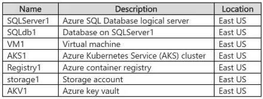
- Exhibit 4: 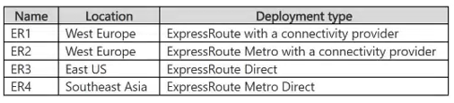

⭕ **A.** Fa1 and Fa2 only
⭕ **B.** Fa2 and Fa3 only
✅ **C.** Fa1 and Fa3 only
⭕ **D.** Fa1, Fa2, and Fa3

**Correct answer:** C
**Most voted:** C

### Top explanations
- **volto** (1 upvotes [Most Recent, Selected Answer: C]): Only Fa1 and Fa3 have outbound VNet integration.

## Q1.34 (ID 414713)

Overview
Contoso, Ltd. is a consulting company that has a main office in San Francisco and a branch office in Dallas.
Contoso has a hybrid environment that contains on-premises servers connected to Azure, a Microsoft 365 E5 subscription, and an Azure subscription named Sub1.
Existing Environment. Microsoft Entra tenant
Contoso has a Microsoft Entra tenant named contoso.com that contains the users shown in the following table.
Existing Environment. On-premises environment
The on-premises network contains an Active Directory Domain Services (AD DS) forest that syncs with contoso.com. The forest contains a server named Server1 that runs Windows Server.
Existing Environment. Azure subscription
Sub1 contains the storage accounts shown in the following table.
Sub1 contains the virtual networks shown in the following table.
Sub1 contains the virtual machines shown in the following table.
The network interface of VM1 is associated with an application security group named ASG1.
Sub1 contains the resources shown in the following table.
Vault1 stores the objects shown in the following table.
Existing Environment. Privileged Identity Management (PIM) configuration
You manage privileged roles by using Privileged Identity Management (PIM). The PIM role settings are configured as shown in the following table.
Existing Environment. Microsoft Sentinel configuration
Contoso has a Microsoft Sentinel workspace that contains the following tables.
Requirements. Planned changes
Contoso plans to implement the following changes:
Integrate AKS1 with Vault1.
Enable Microsoft Entra Kerberos authentication for all supported storage.
Configure auditing for sql1 by using the Azure portal and store audit logs in a centralized location.
Requirements. Technical requirements
Contoso identifies the following technical requirements:
Protect Server1 by using file integrity monitoring.
Protect AKS1 by using Microsoft Defender for Cloud.
Configure Microsoft Sentinel to retain data for the maximum supported duration without changing the tier.
Store objects used for authentication and encryption in Vault1 and ensure that Vault1 regenerates the objects every 30 days, whenever possible.
You need to protect the applications hosted on AKS1. The solution must meet the technical requirements.
Which Defender for Cloud plan should you enable?

**Exhibits**
- Exhibit 1: 
- Exhibit 2: 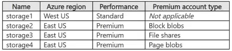
- Exhibit 3: 
- Exhibit 4: 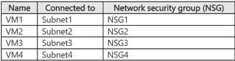
- Exhibit 5: 
- Exhibit 6: 
- Exhibit 7: 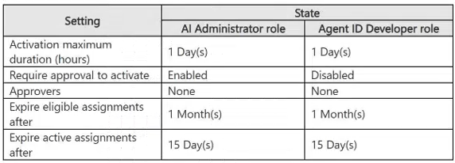
- Exhibit 8: 

⭕ **A.** Microsoft Defender for Servers
⭕ **B.** Microsoft Defender for App Service
✅ **C.** Microsoft Defender for Containers
⭕ **D.** Microsoft Defender for Resource Manager
⭕ **E.** Microsoft Defender for Storage

**Correct answer:** C
**Most voted:** C

### Top explanations
- **Craigg** (2 upvotes [Most Recent, Selected Answer: C]): Defender for App Service is strictly built to monitor the Azure App Service PaaS platform (such as Web Apps and API Apps). It looks at web transaction logs, App Service file systems, and specific PaaS-level threats. It has no visibility into Kubernetes architecture.Defender for Containers is purpose-built for Kubernetes. It understands cluster components like the API server, control plane, node operating systems, namespaces, and pods.

## Q1.35 (ID 414714)

HOTSPOT
Overview
Contoso, Ltd. is a consulting company that has a main office in San Francisco and a branch office in Dallas.
Contoso has a hybrid environment that contains on-premises servers connected to Azure, a Microsoft 365 E5 subscription, and an Azure subscription named Sub1.
Existing Environment. Microsoft Entra tenant
Contoso has a Microsoft Entra tenant named contoso.com that contains the users shown in the following table.
Existing Environment. On-premises environment
The on-premises network contains an Active Directory Domain Services (AD DS) forest that syncs with contoso.com. The forest contains a server named Server1 that runs Windows Server.
Existing Environment. Azure subscription
Sub1 contains the storage accounts shown in the following table.
Sub1 contains the virtual networks shown in the following table.
Sub1 contains the virtual machines shown in the following table.
The network interface of VM1 is associated with an application security group named ASG1.
Sub1 contains the resources shown in the following table.
Vault1 stores the objects shown in the following table.
Existing Environment. Privileged Identity Management (PIM) configuration
You manage privileged roles by using Privileged Identity Management (PIM). The PIM role settings are configured as shown in the following table.
Existing Environment. Microsoft Sentinel configuration
Contoso has a Microsoft Sentinel workspace that contains the following tables.
Requirements. Planned changes
Contoso plans to implement the following changes:
Integrate AKS1 with Vault1.
Enable Microsoft Entra Kerberos authentication for all supported storage.
Configure auditing for sql1 by using the Azure portal and store audit logs in a centralized location.
Requirements. Technical requirements
Contoso identifies the following technical requirements:
Protect Server1 by using file integrity monitoring.
Protect AKS1 by using Microsoft Defender for Cloud.
Configure Microsoft Sentinel to retain data for the maximum supported duration without changing the tier.
Store objects used for authentication and encryption in Vault1 and ensure that Vault1 regenerates the objects every 30 days, whenever possible.
You need to configure Server1 to meet the technical requirements.
What should you do? To answer, select the appropriate options in the answer area.
NOTE: Each correct selection is worth one point.

**Exhibits**
- Exhibit 1: 
- Exhibit 2: 
- Exhibit 3: 
- Exhibit 4: 
- Exhibit 5: 
- Exhibit 6: 
- Exhibit 7: 
- Exhibit 8: 
- Exhibit 9: 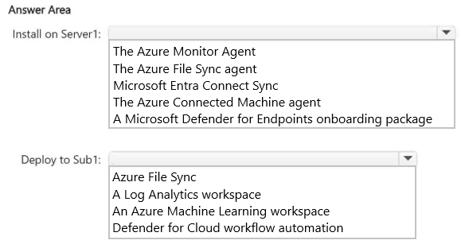

_HOTSPOT — the original ExamTopics question expects you to mark areas on the exhibit above; the correct hotspot coordinates are not published._

**Most voted:**
- The Azure Connected Machine agent
- A Log Analytics
- Server1 is an on-premises server. Before you enable Microsoft Defender for Endpoint you should first on board the machine to Azure Arc.

### Top explanations
- **Haris7** (5 upvotes): The Azure Connected Machine agent
  A Log Analytics
  Server1 is an on-premises server. Before you enable Microsoft Defender for Endpoint you should first on board the machine to Azure Arc.
- **mcdesilva74** (1 upvotes): The Azure Connected Machine agent
  A Log Analytics
  Did anyone checked that FIM deployment of Plan 2 is not possible by direct on boarding? Dam! it is complex.
- **gj3** (1 upvotes [Most Recent]): agreed
  https://learn.microsoft.com/en-us/azure/azure-arc/servers/scenario-onboard-azure-sentinel
  https://learn.microsoft.com/en-gb/azure/defender-for-cloud/endpoint-detection-response
- **Eltooth** (1 upvotes): Defender for Endpoint onboarding package
  Log Analytics Workspace
  Ensure Server1 is successfully onboarded to Microsoft Defender for Endpoint (MDE). The MDE extension is deployed automatically by default once Defender for Servers Plan 2 is active.
  Enable and Configure File Integrity Monitoring (FIM)In Defender for Cloud, navigate to Workload protections > Advanced protection (or settings under the subscription plan).Select File Integrity Monitoring.Define or select a Log Analytics workspace to record and store the change tracking events generated by Server1.Turn the FIM feature toggle to On.
  https://learn.microsoft.com/en-us/azure/defender-for-cloud/file-integrity-monitoring-overview

## Q1.36 (ID 414715)

You have an Azure Logic Apps Consumption workflow that uses a Request trigger. All supported authentication methods are enabled on the Request trigger.
You need to ensure that the endpoint accepts only OAuth-based requests. The solution must minimize costs.
What should you do?

⭕ **A.** Use OAuth 2.0 authorization.
⭕ **B.** Enable Secure Inputs and enable Secure Outputs for the Request trigger.
✅ **C.** Disable shared access signature (SAS) authentication for the Request trigger.
⭕ **D.** Deploy Azure API Management.

**Correct answer:** C
**Most voted:** C

### Top explanations
- **Eltooth** (3 upvotes [Most Recent, Selected Answer: C]): To ensure that your Azure Logic Apps Consumption workflow endpoint accepts only OAuth-based requests while minimizing costs, you must disable the default Shared Access Signature (SAS) token authentication. In Consumption workflows, authentication evaluation uses an OR logic statement; enabling OAuth does not automatically block SAS keys unless SAS is explicitly turned off.
  https://learn.microsoft.com/en-us/azure/logic-apps/logic-apps-securing-a-logic-app?tabs=azure-portal#enable-oauth-only-option

## Q1.37 (ID 414716)

You have Microsoft Security Copilot agents that authenticate by using Microsoft Entra service principals.
You receive a Microsoft Defender alert triggered by the anomalous OAuth authentication of an agent's Microsoft Entra service principal.
You need to assess the impact of the agent identity and identify which resources are affected if the identity is abused for lateral movement. The solution must minimize administrative effort.
What should you do?

⭕ **A.** From Advanced hunting, create a query against the IdentityLogonEvents table to list all the sign-ins performed by the identity.
✅ **B.** From Attack paths, select the identity and view the blast radius.
⭕ **C.** From AI Observability in Microsoft Purview Data Security Posture Management (DSPM), review the agent activity.
⭕ **D.** From Microsoft Purview Audit, query the audit logs for all the role assignments granted to the identity.
⭕ **E.** From Incidents, review incidents related to OAuth events reported by Microsoft Defender for Cloud Apps.

**Correct answer:** B
**Most voted:** B

### Top explanations
- **Eltooth** (1 upvotes [Most Recent, Selected Answer: B]): B. From Attack paths, select the identity and view the blast radius.
  Automated Visual Graph: The Attack paths feature inside Microsoft Security Exposure Management automatically generates a relationship-aware graph of your digital estate.
  Blast Radius Assessment: By selecting the compromised service principal identity and viewing its blast radius, you can instantly visualize every connected resource, asset, or downstream identity that an attacker could reach or compromise through lateral movement without manually tracing permissions.
  https://learn.microsoft.com/en-us/security-exposure-management/work-attack-paths-overview

## Q1.38 (ID 414717)

You have an Azure subscription named Sub1 that contains multiple virtual machines.
You have a Microsoft 365 E5 subscription that contains devices onboarded to Microsoft Defender for Endpoint.
You have an on-premises datacenter that contains multiple servers.
You plan to onboard all existing and future on-premises servers to Azure Arc.
You need to ensure that the Azure Arc-enabled servers are protected by using the same security features as the Microsoft 365 devices immediately after the servers are onboarded. The solution must minimize administrative effort.
What should you do?

⭕ **A.** Onboard each server to Microsoft Defender for Endpoint by using Group Policy.
⭕ **B.** Onboard each server to Microsoft Defender for Endpoint by using a local installation script.
✅ **C.** For Sub1, enable the Microsoft Defender for Servers plan in Microsoft Defender for Cloud.
⭕ **D.** Configure an Azure Policy assignment.

**Correct answer:** C
**Most voted:** C

### Top explanations
- **Eltooth** (2 upvotes [Most Recent, Selected Answer: C]): C. For Sub1, enable the Microsoft Defender for Servers plan in Microsoft Defender for Cloud.
  Native Integration: Microsoft Defender for Cloud integrates natively with Microsoft Defender for Endpoint (MDE). When you enable the Defender for Servers plan at the subscription level (Sub1), the Defender for Endpoint integration is activated by default.
  https://learn.microsoft.com/en-us/azure/defender-for-cloud/enable-defender-for-endpoint

## Q1.39 (ID 414718)

You have an Azure subscription that contains a user named User1 and an Azure Container Registry named ContReg1.
You enable content trust for ContReg1.
You need to ensure that User1 can create trusted images in ContReg1. The solution must use the principle of least privilege.
Which two roles should you assign to User1? Each correct answer presents part of the solution.
NOTE: Each correct selection is worth one point.

⭕ **A.** AcrQuarantineWriter
⭕ **B.** Contributor
⭕ **C.** AcrQuarantineReader
✅ **D.** AcrPush
✅ **E.** AcrImageSigner

**Correct answer:** D, E
**Most voted:** DE

### Top explanations
- **Eltooth** (5 upvotes [Most Recent, Selected Answer: DE]): D. AcrPush
  E. AcrImageSigner
  https://learn.microsoft.com/en-us/azure/container-registry/container-registry-content-trust#grant-image-signing-permissions
  AcrPush: This role provides the baseline data-plane permissions required to push an image to the container registry.
  AcrImageSigner: Because content trust is enabled, images must be digitally signed when pushed. The AcrImageSigner role explicitly grants the user permission to push the trust metadata and sign the image tags.

## Q1.40 (ID 414719)

You have a hybrid environment that contains the following servers:
50 Azure virtual machines that run Windows Server 2019
20 physical, on-premises servers that run Windows Server 2019
All the servers use a third-party antivirus solution that must remain active during a phased security rollout.
You need to onboard all the servers to Microsoft Defender for Endpoint by using a centralized deployment method. The solution must meet the following requirements:
Endpoint detection and response (EDR) capabilities must be enabled.
Antivirus conflicts must be prevented during onboarding.
What should you do on the servers?

⭕ **A.** Set the Microsoft Defender for Endpoint service to Disabled.
⭕ **B.** Disable Microsoft Defender Antivirus real-time protection by using Set-MpPreference.
✅ **C.** Configure the ForceDefenderPassiveMode registry value.
⭕ **D.** Enable EDR in block mode.

**Correct answer:** C
**Most voted:** C

### Top explanations
- **dmacdonald82** (2 upvotes [Selected Answer: D]): Active EDR is a requirement, so EDR in block mode would be the config
- **Eltooth** (2 upvotes [Selected Answer: C]): C. Configure the ForceDefenderPassiveMode registry value.
  To safely onboard Windows Server 2019 machines while a third-party antivirus remains active, force Microsoft Defender Antivirus into Passive Mode before onboarding to avoid critical endpoint conflicts. Unlike desktop operating systems, Windows Server 2019 does not automatically enter passive mode when a third-party antivirus is detected.
  https://learn.microsoft.com/en-us/defender-endpoint/microsoft-defender-passive-mode#configure-passive-mode
- **dmacdonald82** (2 upvotes): Aren't you missing the reqm't of making sure EDR needing to be enabled? Passive mode would disable EDR capabilities
- **volto** (1 upvotes [Most Recent, Selected Answer: C]): "Microsoft Defender for Endpoint is a comprehensive security solution designed to protect your devices from evolving threats. One of its key features enables Microsoft Defender Antivirus to coexist with non-Microsoft antimalware solutions while still providing valuable endpoint detection and response capabilities.
  Some of the key benefits of Defender Antivirus in passive mode are:
  EDR Block mode - Post-breach protection by detecting and remediating threats missed by the active antimalware solution
  Security intelligence updates - Microsoft Defender Antivirus continues to receive updates to stay aware of the latest threats.
  Data Loss Prevention (DLP) - Endpoint DLP functionalities operate normally, ensuring sensitive data is safeguarded."
- **Greens** (1 upvotes [Selected Answer: C]): On Windows Server, unlike Windows client, Microsoft Defender Antivirus does not switch to passive mode automatically when a third-party antivirus is installed. If you onboard the servers without preparing them, Defender AV can stay in active mode and conflict with the existing product.
  To prevent that, set this value before onboarding:
  HKLM\SOFTWARE\Policies\Microsoft\Windows Advanced Threat Protection
  ForceDefenderPassiveMode (DWORD) = 1
  You can push it centrally through Group Policy, Intune, or Configuration Manager, or through the Defender for Servers integration in Defender for Cloud for the Azure VMs and Arc-connected on-prem servers. In passive mode, Defender AV doesn’t perform real-time blocking, so the third-party AV keeps that job. Defender for Endpoint’s EDR still works fully, which meets both requirements.

## Q1.41 (ID 414720)

You have an Azure subscription named Sub1 that contains an Azure Kubernetes Service (AKS) cluster named cluster1 and an Azure container registry named ACR1. Sub1 has Microsoft Defender for Containers enabled, and runtime protection is active on cluster1.
The developers at your company deploy pods that have elevated privileges, and the deployments are created in cluster1.
You need to prevent pods with elevated privileges from being accepted by cluster1.
What should you do?

✅ **A.** Create an Azure policy for cluster1.
⭕ **B.** Enable agentless discovery for Kubernetes in Defender for Containers.
⭕ **C.** Configure runtime threat protection alerts for privileged container activity.
⭕ **D.** Enable vulnerability assessment for images in ACR1.

**Correct answer:** A
**Most voted:** A

### Top explanations
- **chips** (2 upvotes [Most Recent, Selected Answer: A]): Azure policy for Kubernetes can enforce admission control policies. Policies such as “Kubernetes cluster containers should only use allowed capabilities” or “Privileged containers should be avoided” can be configured with a DENY effect. This provides preventive control, not just detection.

## Q1.42 (ID 414721)

DRAG DROP
You have an Azure virtual network named VNet1 that contains an AzureBastionSubnet. VNet1 contains a subnet named Subnet1. Subnet1 contains multiple virtual machines.
You plan to deploy Azure Bastion to provide secure RDP access to the virtual machines on Subnet1. You associate a network security group (NSG) named NSG1 to AzureBastionSubnet.
You need to configure rules for NSG1. The solution must meet the following requirements:
Allow required inbound access to Azure Bastion from the internet.
Allow user access to the virtual machines by using Azure Bastion.
Which TCP ports should you allow for the NSG1 rules? To answer, drag the appropriate ports to the correct rules. Each port may be used once, more than once, or not at all. You may need to drag the split bar between panes or scroll to view content.
NOTE: Each correct selection is worth one point.

**Exhibits**
- Exhibit 1: 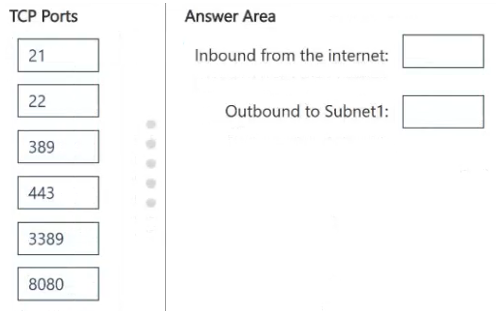

_DRAG DROP — the original ExamTopics question expects you to drag and drop items; the correct targets are not published._

**Most voted:**
- Inbound from the internet: 3389
- Outbound to subnet1: 443

### Top explanations
- **Kalzonee3611** (5 upvotes [Most Recent]): Bastion is the broker. Users connect to it, then Bastion connects to the VM.
  INBOUNDS 443
  OUTBOUND 3389
- **kungfumaster** (1 upvotes): It should be
  Inbound from the internet: 3389
  Outbound to subnet1: 443

## Q1.43 (ID 414722)

DRAG DROP
You have a Microsoft Defender XDR environment.
You have a Microsoft Power Platform environment where makers publish custom Microsoft Copilot Studio agents.
You need to enable real-time protection so that suspicious tool invocations are blocked before an agent runs actions, and related alerts appear in the Microsoft Defender portal.
What should you do? To answer, drag the appropriate actions to the correct services. Each action may be used once, more than once, or not at all. You may need to drag the split bar between panes or scroll to view content.
NOTE: Each correct selection is worth one point.

**Exhibits**
- Exhibit 1: 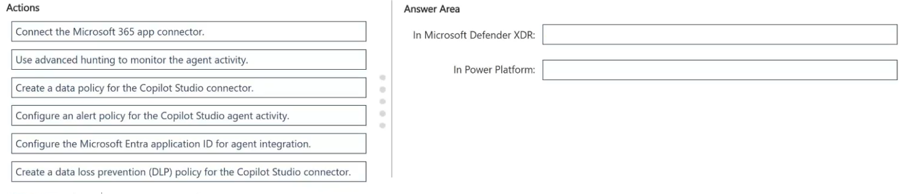

_DRAG DROP — the original ExamTopics question expects you to drag and drop items; the correct targets are not published._

**Most voted:**
- In Microsoft Defender XDR: Configure the Microsoft Entra application ID for agent integration.
- In Power Platform: Configure the Microsoft Entra application ID for agent integration.

### Top explanations
- **Eltooth** (1 upvotes): In Microsoft Defender XDR: Configure the Microsoft Entra application ID for agent integration.
  In Power Platform: Configure the Microsoft Entra application ID for agent integration.
  XDR: The Application (client) ID is registered under the security platform settings to allow Defender's AI safety framework to trace, intercept, and map real-time signals from the specific identity associated with your custom agents.
  Power Platform: The same Application (client) ID is linked within your Power Platform / Copilot Studio administration settings. This allows the Copilot environment to forward tool invocations out to Defender for runtime analysis before executing actions.
- **musiman** (1 upvotes [Most Recent]): In Microsoft Defender XDR: Connect the Microsoft 365 app connector.
  In Power Platform: Configure the Microsoft Entra application ID for agent integration.

## Q1.44 (ID 414723)

You have a Microsoft Copilot Studio agent.
A Microsoft Power Platform administrator configures external threat detection for the agent by using a Microsoft Entra application.
You need to ensure that real-time protection is enabled during agent runtime.
What should you do in the Microsoft Defender portal?

⭕ **A.** Configure Microsoft Defender for Cloud Apps session policies.
✅ **B.** Connect the Microsoft 365 app connector.
⭕ **C.** Enable Global Secure Access for Agents.
⭕ **D.** From Microsoft Sentinel, configure the Microsoft Purview data connector.

**Correct answer:** B
**Most voted:** B

### Top explanations
- **Eltooth** (2 upvotes [Selected Answer: B]): B. Connect the Microsoft 365 app connector.
  For real-time runtime threat protection to properly function for Microsoft Copilot Studio agents, Microsoft Defender needs a telemetry link to receive, parse, and process agent activity logs.According to the official Microsoft documentation, you must ensure that the Microsoft 365 app connector is connected within the Microsoft Defender portal. If it is disconnected, Defender will be unable to ingest the necessary observability data (Agent 365 logs), meaning related real-time alerts and incidents will fail to appear in your Defender dashboard.
  https://learn.microsoft.com/en-us/defender-xdr/security-for-ai/ai-agent-real-time-protection#prerequisites
- **3lVhylla** (1 upvotes [Most Recent, Selected Answer: B]): is basically the same (43) question... XDR enable, with real-time protection enabled
- **rameshms85** (1 upvotes [Selected Answer: B]): To enable telemetry ingestion, alerting, and real-time protection features for Microsoft Copilot Studio agents within the Microsoft Defender portal, you must connect the Microsoft 365 app connector (under Security for AI settings).
- **Matthiasdd** (1 upvotes [Selected Answer: A]): The Entra app registered by the Power Platform admin just sets up the trust channel between the agent and Defender. It's the session policy on the Defender for Cloud Apps side that does the actual work: it puts Defender in the middle of the agent's traffic as a proxy and blocks risky actions before they execute. that's what "real-time protection" during runtime means. The other options (M365 connector, Global Secure Access, Purview/Sentinel) are about visibility, network routing, or after-the-fact auditing, not live blocking.

## Q1.45 (ID 414724)

DRAG DROP
You have a Microsoft 365 subscription. All users have Microsoft Exchange Online mailboxes.
You use Microsoft Entra Agent ID to register and manage AI agents.
The developers at your company create the following two agents:
Agent1: An interactive agent that helps users summarize their own Exchange Online email
Agent2: An autonomous agent that sends nightly updates to a Microsoft Teams channel
You need to grant each agent access to Microsoft Graph. The solution must minimize the access scope, while meeting each agent’s operating model.
Which type of permission should you assign to each agent? To answer, drag the appropriate permission types to the correct agents. Each permission type may be used once, more than once, or not at all. You may need to drag the split bar between panes or scroll to view content.
NOTE: Each correct selection is worth one point.

**Exhibits**
- Exhibit 1: 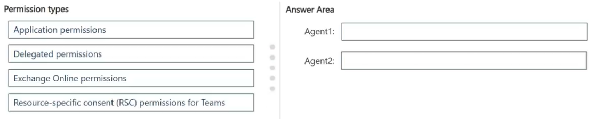

_DRAG DROP — the original ExamTopics question expects you to drag and drop items; the correct targets are not published._

**Most voted:**
- Agent1: Delegated permissions
- Agent2: Application permissions
- Delegated Permissions for Agent1: Because Agent1 is an interactive agent that helps users summarize their own emails, a user will be signed in. By using delegated permissions, the agent acts on behalf of the logged-in user and can only access the data that the specific user has permission to see.
- Application Permissions for Agent2: Because Agent2 is an autonomous agent running background jobs at night without a user present, it cannot use a signed-in user's context. It must authenticate using its own identity via application permissions to post messages directly to the Microsoft Teams channel.

### Top explanations
- **Eltooth** (4 upvotes): Agent1: Delegated permissions
  Agent2: Application permissions
  https://learn.microsoft.com/en-us/entra/agent-id/grant-agent-access-microsoft-365#how-to-manually-grant-authorization-delegated-or-application
  Delegated Permissions for Agent1: Because Agent1 is an interactive agent that helps users summarize their own emails, a user will be signed in. By using delegated permissions, the agent acts on behalf of the logged-in user and can only access the data that the specific user has permission to see.
  Application Permissions for Agent2: Because Agent2 is an autonomous agent running background jobs at night without a user present, it cannot use a signed-in user's context. It must authenticate using its own identity via application permissions to post messages directly to the Microsoft Teams channel.
- **rkrau** (1 upvotes [Most Recent]): No I go with
  Agent1: Delegated permissions
  Agent2: RSC, while Teams Resource-Specific Consent (RSC) … allows you to grant permissions to an app or agent on a per-team basis, rather than at the tenant level.and „minimize the access scope, while meeting each agent’s operating model“.

## Q1.48 (ID 414727)

HOTSPOT
You have an Azure Container Instances container group named CGI that has a DNS name of cg1.contoso.com. CG1 has the following configurations:
A Linux container named container1 that serves HTTPS over TCP port 443 and hosts an application named App1
A Linux container named contained that listens on TCP port 5000 and is accessed only by App1
A public IP address
A security review finds that external clients can reach TCP port 5000 by using the public IP address of CG1.
You need to meet the following requirements:
Ensure that the external clients can access container1 only by using TCP port 443.
Ensure that container1 can continue to access contained.
What should you configure? To answer, select the appropriate options in the answer area.
NOTE: Each correct selection is worth one point.

**Exhibits**
- Exhibit 1: 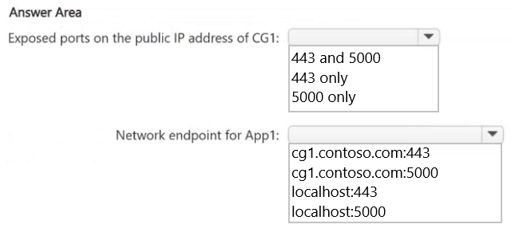

_HOTSPOT — the original ExamTopics question expects you to mark areas on the exhibit above; the correct hotspot coordinates are not published._

**Most voted:** Internal Communication: Containers in the same group share the localhost network interface. They can talk to each other on any port via localhost (or 127.0.0.1), regardless of whether that port is exposed externally. Therefore, container1 can still reach contained on port 5000 internally

### Top explanations
- **Craigg** (2 upvotes [Most Recent]): Internal Communication: Containers in the same group share the localhost network interface. They can talk to each other on any port via localhost (or 127.0.0.1), regardless of whether that port is exposed externally. Therefore, container1 can still reach contained on port 5000 internally

## Q1.49 (ID 414728)

HOTSPOT
You have an Azure subscription that contains the following servers:
200 virtual machines that run either Windows Server or Ubuntu Server
50 Azure Arc-enabled servers
You use Azure Policy to manage compliance across all the servers.
You need to enforce an organization-specific security baseline. The solution must meet the following requirements:
Customize a built-in security baseline.
Ensure that configuration changes to the servers are enforced automatically after the security baseline is deployed.
Minimize administrative effort.
What should you do? To answer, select the appropriate options in the answer area.
NOTE: Each correct selection is worth one point.

**Exhibits**
- Exhibit 1: 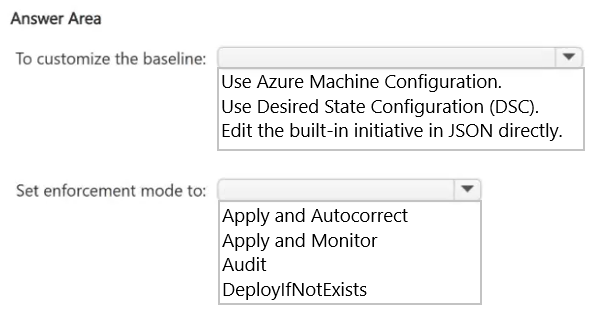

_HOTSPOT — the original ExamTopics question expects you to mark areas on the exhibit above; the correct hotspot coordinates are not published._

**Most voted:**
- To customize the baseline: Use Azure Machine Configuration.
- Set enforcement mode to: Apply and Autocorrect
- Customization Method: Azure Machine Configuration (formerly Guest Configuration) provides built-in, natively integrated customizable security baselines for both Azure Virtual Machines and Azure Arc-enabled servers under a single platform.

### Top explanations
- **Eltooth** (2 upvotes): To customize the baseline: Use Azure Machine Configuration.
  Set enforcement mode to: Apply and Autocorrect
  Customization Method: Azure Machine Configuration (formerly Guest Configuration) provides built-in, natively integrated customizable security baselines for both Azure Virtual Machines and Azure Arc-enabled servers under a single platform.
  Enforcement Mode Parameter: The question explicitly asks to ensure that server configuration changes are enforced automatically after deployment. Setting this specific policy parameter configuration to Apply and Autocorrect tells the machine-level agent to actively overwrite configuration drift and fix non-compliant server settings autonomously.
- **Eltooth** (2 upvotes [Most Recent]): While DeployIfNotExists is the overarching Azure Policy effect type used to deliver the extension, the question states Azure Policy was applied and dropdown explicitly lists configuration options that match the agent's internal compliance modes, making Apply and Autocorrect the correct setting selection for the enforcement requirement.

## Q1.50 (ID 414729)

Overview
Fabrikam, Inc. is a consulting company. The company has a main office in New York City and branch offices in Amsterdam and Singapore.
Existing Environment. Network environment
The on-premises network contains a datacenter in each office.
Existing Environment. Cloud environment
Fabrikam has two Azure subscriptions named Sub1 and Sub2 and a Microsoft 365 subscription that includes Microsoft 365 E5 licenses.
All the subscriptions are linked to a Microsoft Entra tenant named fabrikam.com that contains the identities shown in the following table.
The tenant contains the groups shown in the following table.
All devices are enrolled in Microsoft Intune.
Existing Environment. Sub1 Resources
Sub1 contains a resource group named RG1 that contains the resources shown in the following table.
SQLServer1 uses Microsoft SQL Server authentication.
Sub1 has an Azure Web Application Firewall (WAF) named WAF1 that has the following types of rule sets:
Bot Manager 1.1
Azure-managed Default Rule Set (DRS)
Sub1 has the following compliance standards assigned in Microsoft Defender for Cloud:
NIST SP 800-53 Rev. 4
Microsoft cloud security benchmark (MCSB)
System and Organization Controls (SOC) 2 Type 2
Existing Environment. Sub2 Resources
Sub2 contains a resource group named RG2.
Planned Changes and Requirements. Planned Changes
Fabrikam plans to implement the following changes:
Deploy the following key vaults to RG1:
AKV2 in the West Europe Azure region
AKV3 in the Central US Azure region
AKV4 in the East US Azure region
Deploy the following key vaults to RG2:
AKV5 in the East US region
Configure VM1 to read data from storage1.
Create function apps that have the following hosting plans:
Fa1: Flex Consumption hosting plan
Fa2: Consumption hosting plan
Fa3: Dedicated hosting plan
For WAF1, implement rate limiting rules based on the request location.
Enable the NIST SP 800-53 Rev. 5 compliance standard in Defender for Cloud.
Create a new storage account named storage2 that supports Azure Table storage.
Enforce multifactor authentication (MFA) when database administrators access SQLdb1.
Implement ExpressRoute circuits to the on-premises network as shown in the following table.
For RG1, create a new Privileged Identity Management (PIM) eligible role assignment that assigns the Contributor role to supported groups.
Planned Changes and Requirements.  Technical Requirements
Fabrikam has the following technical requirements:
If VM1 is deleted, the permissions for VM1 must be removed automatically.
The AKS1 managed identity must only be able to pull images from Registry1.
The ID1 managed identity must be able to push images to and pull images from Registry1.
All the data in the storage accounts must be encrypted by using Fabrikam-managed keys.
All outbound traffic from the function apps to the on-premises network must use ExpressRoute circuits.
ExpressRoute connectivity between the on-premises network and the Azure environment must be encrypted by using Layer 2 or Layer 3 encryption.
You need to delegate a user to implement the planned change for Defender for Cloud. The solution must follow the principle of least privilege.
Which user should you choose?

**Exhibits**
- Exhibit 1: 
- Exhibit 2: 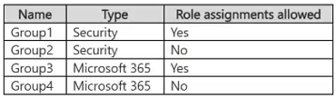
- Exhibit 3: 
- Exhibit 4: 

✅ **A.** Admin1
⭕ **B.** Admin2
⭕ **C.** Admin3
⭕ **D.** Admin4

**Correct answer:** A
**Most voted:** A

### Top explanations
- **chips** (1 upvotes [Most Recent, Selected Answer: A]): For the requirement, which is “Enable the NIST compliance”, it requires a policy assignment and it can be done by Admin 1, who has permissions for applying policies at the subscription level.

## Q1.51 (ID 414730)

You have an Azure subscription named Sub1 that contains a storage account named storage1.
Sub1 has Microsoft Defender for Storage enabled. Defender for Storage has on-upload malware scanning enabled for a monthly cap of 10,000 GB per storage account.
You use a Microsoft Sentinel workspace to monitor security events on all Azure resources.
You need to configure storage1 to use a malware scanning cap of 2,000 GB per month.
What should you do?

✅ **A.** Enable the Override Defender for Storage subscription-level settings for storage1.
⭕ **B.** From Microsoft Sentinel, modify the data collection rule (DCR) to restrict log ingestion from storage1.
⭕ **C.** Modify the malware scanning configuration of Sub1.
⭕ **D.** From the Microsoft Sentinel workspace, modify the daily cap.

**Correct answer:** A
**Most voted:** A

### Top explanations
- **Eltooth** (1 upvotes [Selected Answer: A]): Set the status of Override Defender for Storage subscription-level settings (under Advanced settings) to On. This ensures that the settings are saved only for this storage account and aren't overrun by the subscription settings.
- **Eltooth** (1 upvotes [Most Recent]): To modify the settings of malware scanning:
  To adjust the monthly threshold for malware scanning in your storage accounts, you can modify the parameter called Set limit of GB scanned per month to your desired value. This parameter determines the maximum amount of data that can be scanned for malware each month, specifically for each storage account. If you wish to allow unlimited scanning, you can uncheck this parameter. By default, the limit is set at 10,000 GB.
  https://learn.microsoft.com/en-us/azure/defender-for-cloud/advanced-configurations-for-malware-scanning#azure-portal

## Q1.52 (ID 414731)

You have an Azure subscription named Sub1 that contains multiple virtual machines. Sub1 has the Microsoft Defender Cloud Security Posture Management (CSPM) plan enabled.
You discover that Defender for Cloud fails to identify plaintext connection strings and SSH keys stored on the virtual machines.
You need to ensure that secrets can be identified on the virtual machines.
What should you do?

⭕ **A.** Configure the Defender for Cloud data connector in Microsoft Sentinel.
✅ **B.** Enable agentless machine scanning.
⭕ **C.** Deploy the Azure Monitor Agent to all the virtual machines.
⭕ **D.** Enable Microsoft Defender for Key Vault.

**Correct answer:** B
**Most voted:** B

### Top explanations
- **Eltooth** (3 upvotes [Most Recent, Selected Answer: B]): Secret Scanning Feature: Under the Defender Cloud Security Posture Management (CSPM) plan, discovering plaintext secrets—such as unencrypted database connection strings, embedded passwords, and private SSH keys stored within a machine's file system—is executed exclusively via Agentless machine scanning.
  https://learn.microsoft.com/en-us/azure/defender-for-cloud/concept-agentless-data-collection

## Q1.53 (ID 414732)

You have an Azure subscription named Sub1. Sub1 contains 20 virtual machines that run Windows Server.
Sub1 has the Microsoft Defender for Cloud Defender Cloud Security Posture Management (CSPM) plan enabled.
You need to ensure that all the virtual machines are scanned automatically for known security flaws and misconfigurations.
What should you use?

⭕ **A.** attack path analysis
⭕ **B.** Microsoft cloud security benchmark (MCSB)
⭕ **C.** cloud security explorer
⭕ **D.** just-in-time (JIT) VM access
✅ **E.** vulnerability assessment on the virtual machines

**Correct answer:** E
**Most voted:** E

### Top explanations
- **Eltooth** (2 upvotes [Selected Answer: E]): Automated Flaw Identification: To automatically inspect and scan operating systems for known security flaws (CVEs), missing security patches, and unpatched software packages, you must leverage the vulnerability assessment on the virtual machines capability.
- **Eltooth** (2 upvotes [Most Recent]): https://learn.microsoft.com/en-us/azure/defender-for-cloud/deploy-vulnerability-assessment-defender-vulnerability-management

## Q1.54 (ID 414733)

You have multiple Microsoft Security Copilot workspaces.
A user named User1 accesses Security Copilot by using the default workspace.
You create a new workspace named Workspace1 and assign a capacity to Workspace1.
You plan to route Security Copilot agent traffic to Workspace1.
You need to ensure that User1 can use embedded experiences without errors.
What should you do before switching to Workspace1?

✅ **A.** Add User1 to Workspace1.
⭕ **B.** Assign User1 the Security Operator role in Microsoft Entra.
⭕ **C.** Disassociate the capacity from the default workspace.
⭕ **D.** Create a new capacity for Workspace1.

**Correct answer:** A
**Most voted:** A

### Top explanations
- **Eltooth** (1 upvotes [Most Recent, Selected Answer: A]): In Microsoft Security Copilot, a workspace serves as a logical container that defines data storage, the linked compute capacity (SCUs), and access control lists (who has access). Because Owner and Contributor role permissions are scoped directly per workspace, User1 currently only possesses access permissions inside the default workspace.
  Before you route agent traffic and embedded experiences to Workspace1, you must explicitly grant User1 access permissions to this new boundary to prevent them from hitting authentication or access-denied errors.

## Q1.55 (ID 414734)

DRAG DROP
You have a Microsoft Defender External Attack Surface Management (Defender EASM) resource for a company named Contoso, Ltd.
You need to update the Defender EASM workflow to meet the following requirements:
Assets from a business domain that Contoso no longer owns must be removed from inventory.
Findings that do NOT App1y to confirmed inventory must NOT affect reported counts.
What should you do for each requirement? To answer, drag the appropriate actions to the correct requirements. Each action may be used once, more than once, or not at all. You may need to drag the split bar between panes or scroll to view content.
NOTE: Each correct selection is worth one point.

**Exhibits**
- Exhibit 1: 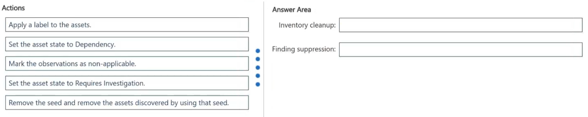

_DRAG DROP — the original ExamTopics question expects you to drag and drop items; the correct targets are not published._

**Most voted:**
- Inventory cleanup: Remove the seed and remove the assets discovered by using that seed.
- Finding suppression: Mark the observations as non-applicable.

### Top explanations
- **Eltooth** (1 upvotes [Most Recent]): Inventory cleanup: Remove the seed and remove the assets discovered by using that seed.
  Finding suppression: Mark the observations as non-applicable.

## Q1.56 (ID 414735)

You use Microsoft Security Copilot.
Security Copilot contributors currently create custom plugins for their own sessions and manage organization-wide custom plugins.
You need to prevent the contributors from managing the organization-wide custom plugins. The solution must NOT affect the contributors' ability to create custom plugins for their own sessions.
What should you select in the Plugin settings?

⭕ **A.** Contributors and Owners at the tenant scope
⭕ **B.** Owners only at the user scope
⭕ **C.** Contributors and Owners at the user scope
✅ **D.** Owners only at the tenant scope

**Correct answer:** D
**Most voted:** D

### Top explanations
- **newlife.org.pl** (1 upvotes [Most Recent, Selected Answer: D]): D) - Plugin settings have two separate options: one for custom plugins in your own sessions (user scope) and one for custom plugins for everyone in the organization (tenant scope). Setting tenant scope to “Owners only” removes contributors’ ability to manage org-wide plugins, while leaving user scope at “Owners and Contributors” keeps their ability to create plugins for their own sessions. Setting user scope to “Owners only” would break the second requirement.
  https://learn.microsoft.com/en-us/copilot/security/manage-plugins

## Q1.57 (ID 414736)

You are configuring a new Microsoft Sentinel workspace named Workspace1.
You have an external IT Service Management (ITSM) system that is NOT supported by any Microsoft Sentinel solutions in Azure Marketplace.
You need to ensure that Workspace1 creates service tickets in the ITSM system for all new security incidents.
What should you create?

✅ **A.** a playbook
⭕ **B.** a workbook
⭕ **C.** a watchlist
⭕ **D.** an analytics rule

**Correct answer:** A
**Most voted:** A

### Top explanations
- **newlife.org.pl** (1 upvotes [Most Recent, Selected Answer: A]): A. Sentinel playbooks are built on Azure Logic Apps, so they can call any external API (for example, through an HTTP action or a custom connector), even when no Sentinel solution exists in the Marketplace. Attach the playbook to an automation rule with the “When incident is created” trigger so it runs for every new incident. Workbooks visualize data, watchlists store reference data, and analytics rules create incidents but don’t call external systems.
  https://learn.microsoft.com/en-us/azure/sentinel/tutorial-respond-threats-playbook

## Q1.58 (ID 414737)

You have an Azure subscription that has Microsoft Defender for Cloud enabled.
You have an Amazon Web Services (AWS) account connected to Defender for Cloud that has the Defender Cloud Security Posture Management (CSPM) plan enabled.
You need to identify the potential impact of security incidents that exploit multiple risks reported by Defender CSPM.
What should you use?

⭕ **A.** regulatory compliance
⭕ **B.** cloud security explorer
⭕ **C.** security recommendations
✅ **D.** attack path analysis

**Correct answer:** D
**Most voted:** D

### Top explanations
- **newlife.org.pl** (1 upvotes [Most Recent, Selected Answer: D]): D. Attack path analysis is a graph-based algorithm in Defender CSPM that identifies how multiple security issues can be chained together into an attack path leading to a breach, and recommends how to break that path. It works for Azure, AWS and GCP. Cloud security explorer runs manual graph queries, security recommendations assess issues individually, and regulatory compliance tracks standards.
  https://learn.microsoft.com/en-us/azure/defender-for-cloud/how-to-manage-attack-path

## Q1.59 (ID 414738)

You have an Azure subscription that contains a resource group named RG1.
RG1 contains a Microsoft Security Copilot deployment that is integrated with a Microsoft Sentinel workspace named Workspace1.
Analysts use the Security Copilot standalone experience to retrieve incidents by using the Microsoft Sentinel plugin.
A user named User1 can sign in to Security Copilot but cannot retrieve incidents from Workspace1. You verify that User1 has only the Security Copilot Contributor role.
You need to ensure that User1 can retrieve the incidents. The solution must follow the principle of least privilege and NOT require any configuration changes to Security Copilot.
Which role should you assign to User1?

⭕ **A.** the Security Reader role in Microsoft Entra
✅ **B.** the Microsoft Sentinel Reader role for Workspace1
⭕ **C.** the Security Copilot Owner role
⭕ **D.** the Security Administrator role in Microsoft Entra
⭕ **E.** the Contributor role in Azure for RG1

**Correct answer:** B
**Most voted:** B

### Top explanations
- **Eltooth** (2 upvotes [Selected Answer: B]): B. the Microsoft Sentinel Reader role for Workspace1.
  Even though User1 has the Security Copilot Contributor role, they currently lack any permissions inside the source data repository (Workspace1) itself. Assigning User1 the Microsoft Sentinel Reader role for Workspace1 provides exactly the minimal data-plane read privileges required to look up incident data without granting unnecessary administrative permissions.
  https://learn.microsoft.com/en-us/copilot/security/manage-plugins
- **newlife.org.pl** (1 upvotes [Most Recent, Selected Answer: B]): B. Security Copilot uses on-behalf-of authentication, so it can only access data the signed-in user can access. Security Copilot roles grant access to the platform, not to the data. Microsoft docs state that to use the Sentinel plugin, you need an Azure RBAC role like Microsoft Sentinel Reader to access incidents in the workspace. Security Administrator and Contributor on RG1 are overprivileged, Security Reader in Entra doesn’t grant Sentinel workspace access, and changing Copilot roles is not allowed.
  https://learn.microsoft.com/en-us/copilot/security/authentication

## Q1.60 (ID 414739)

HOTSPOT
You have a Microsoft Sentinel workspace named Workspace1.
You hire a security consultant. You provide the consultant with a guest account named User1 in your Microsoft Entra tenant.
You need to enable User1 to assign incidents in Workspace1.
Which roles should you assign to User1? To answer, select the appropriate options in the answer area.
NOTE: Each correct selection is worth one point.

**Exhibits**
- Exhibit 1: 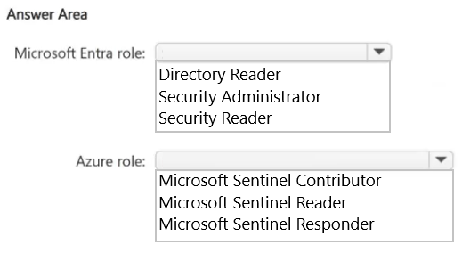

_HOTSPOT — the original ExamTopics question expects you to mark areas on the exhibit above; the correct hotspot coordinates are not published._

**Most voted:**
- In Microsoft Entra ID: Directory Reader
- In Azure: Microsoft Sentinel Responder

### Top explanations
- **Eltooth** (1 upvotes [Most Recent]): In Microsoft Entra ID: Directory Reader
  In Azure: Microsoft Sentinel Responder
  https://learn.microsoft.com/en-us/azure/sentinel/investigate-incidents

## Q1.61 (ID 414740)

HOTSPOT
You have a Microsoft Entra tenant that contains the users shown in the following table.
You use Microsoft Security Copilot.
From Microsoft Security Store, User1 attempts to deploy a partner-built agent named Agent1 and reports that the Get agent option is unavailable.
You need to identify whether Agent1 can run in Security Copilot successfully. The solution must follow the principle of least privilege.
How should you complete the deployment? To answer, select the appropriate options in the answer area.
NOTE: Each correct selection is worth one point.

**Exhibits**
- Exhibit 1: 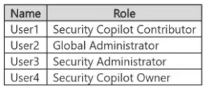
- Exhibit 2: 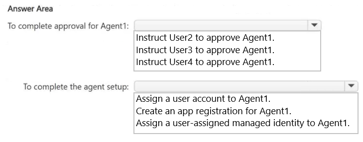

_HOTSPOT — the original ExamTopics question expects you to mark areas on the exhibit above; the correct hotspot coordinates are not published._

**Most voted:**
- To complete approval for Agent1: Instruct User2 to approve Agent1.
- To complete the agent setup: Assign a user account to Agent1.

### Top explanations
- **Eltooth** (2 upvotes): To complete approval for Agent1: Instruct User2 to approve Agent1.
  To complete the agent setup: Assign a user account to Agent1.
  https://learn.microsoft.com/en-us/copilot/security/agents-manage
- **M15tin** (1 upvotes [Most Recent]): Para completar la aprobación de Agente1:
  ✅ Indicar a Usuario4 que apruebe Agente1.
  Usuario4 tiene el rol Security Copilot Owner, que puede aprobar la implementación de agentes de socios. Esto mantiene el principio de mínimo privilegio, evitando utilizar Global Administrator o Security Administrator cuando no son necesarios.
  Para completar la configuración del agente:
  ✅ Asignar una identidad administrada asignada por el usuario a Agente1.
  Una user-assigned managed identity permite que el agente se autentique y acceda únicamente a los recursos autorizados sin almacenar credenciales en el agente.

## Q1.62 (ID 414741)

You have a Microsoft Sentinel workspace named Workspace1.
You have 100 on-premises servers that run Linux and have the Azure Monitor Agent installed.
You need to collect Syslog events from the Linux servers. The solution must meet the following requirements:
Ensure that filtering occurs before data is written to Workspace1.
Reduce ingestion costs by excluding low-value Syslog messages.
What should you include in the solution?

⭕ **A.** an Advanced Security Information Model (ASIM) parser
✅ **B.** a data collection rule (DCR)
⭕ **C.** an analytics rule
⭕ **D.** a table-level filter and split transformation

**Correct answer:** B
**Most voted:** B

### Top explanations
- **Eltooth** (1 upvotes [Most Recent, Selected Answer: B]): B. a data collection rule (DCR).
  To filter out logs before they are written to your Microsoft Sentinel workspace (Workspace1) and lower ingestions costs, you must define data routing parameters within a Data Collection Rule (DCR).
  https://learn.microsoft.com/en-us/azure/azure-monitor/vm/data-collection-syslog

## Q1.63 (ID 414742)

You have a Microsoft Sentinel workspace.
You need to collect Windows security events from 200 Azure virtual machines that run Windows Server. The solution must meet the following requirements:
Use direct agent-based data collection from each virtual machine.
Use a supported agent for new virtual machine deployments.
Which Microsoft Sentinel connector should you use?

⭕ **A.** Windows Forwarded Events
✅ **B.** Windows Security Events via AMA
⭕ **C.** Security Events via Legacy Agent
⭕ **D.** Syslog via AMA
⭕ **E.** Azure Resource Graph

**Correct answer:** B
**Most voted:** B

### Top explanations
- **M15tin** (2 upvotes [Most Recent, Selected Answer: B]): AMA (Azure Monitor Agent) permite recopilar directamente los eventos de seguridad de Windows desde cada una de las 200 máquinas virtuales y enviarlos a Microsoft Sentinel.
  AMA es el agente compatible para nuevas implementaciones y utiliza Data Collection Rules (DCR) para definir qué datos se recopilan.
- **Eltooth** (1 upvotes [Selected Answer: B]): Direct Event Collection: The Windows Security Events via AMA connector deploys the agent directly onto each of your 200 virtual machines. It streams events cleanly from the local Windows Event Log systems straight into the workspace's designated SecurityEvent storage table.
  https://learn.microsoft.com/en-us/azure/azure-monitor/vm/data-collection-windows-events

## Q1.64 (ID 414743)

Note: This section contains one or more sets of questions with the same scenario and problem. Each question presents a unique solution to the problem. You must determine whether the solution meets the stated goals. More than one solution in the set might solve the problem. It is also possible that none of the solutions in the set solve the problem.
After you answer a question in this section, you will NOT be able to return. As a result, these questions do not appear on the Review Screen.
You have a Microsoft Sentinel workspace.
You have a multi-tier Security Operations Center (SOC) team.
You need to ensure that all new security incidents are assigned immediately to the Tier 1 analysts group and flagged for triage.
Solution: You create a hunting query.
Does this meet the goal?

⭕ **A.** Yes
✅ **B.** No

**Correct answer:** B
**Most voted:** B

### Top explanations
- **Greens** (1 upvotes [Most Recent, Selected Answer: B]): Hunting queries are for proactive, manual threat searching. An analyst runs them to look for suspicious activity that hasn’t triggered an alert. They don’t act on incidents and can’t assign or tag anything.
  What meets the goal is an automation rule:
  Trigger: When incident is created
  Actions: Assign owner → Tier 1 analysts group, and Add tags → e.g. “Triage”. You could also change the status or set the severity.
  Automation rules run immediately when an incident is created, which matches the “assigned immediately” requirement. For more complex logic, an automation rule can also run a playbook (Logic App), but for simple assignment and tagging the automation rule alone is enough.
- **Eltooth** (1 upvotes [Selected Answer: B]): No
  Hunting Query Purpose: In Microsoft Sentinel, a hunting query is a manual or schedule-guided search query used by security analysts to proactively discover undetected threats across raw logs. It is not an automation or event-driven workflow engine.

## Q1.65 (ID 414744)

Note: This section contains one or more sets of questions with the same scenario and problem. Each question presents a unique solution to the problem. You must determine whether the solution meets the stated goals. More than one solution in the set might solve the problem. It is also possible that none of the solutions in the set solve the problem.
After you answer a question in this section, you will NOT be able to return. As a result, these questions do not appear on the Review Screen.
You have a Microsoft Sentinel workspace.
You have a multi-tier Security Operations Center (SOC) team.
You need to ensure that all new security incidents are assigned immediately to the Tier 1 analysts group and flagged for triage.
Solution: You create a playbook.
Does this meet the goal?

⭕ **A.** Yes
✅ **B.** No

**Correct answer:** B
**Most voted:** B

### Top explanations
- **Greens** (1 upvotes [Most Recent, Selected Answer: B]): A playbook (Logic App) can update an incident, assign an owner and add tags, but it doesn’t run by itself. A playbook has to be triggered, either manually or by an automation rule. Creating a playbook alone doesn’t make anything happen when a new incident appears.
  The intended solution is an automation rule with the trigger When incident is created and the actions Assign owner (Tier 1 group) and Add tags (e.g. “Triage”). Automation rules can do this natively, so a playbook isn’t needed. You’d only add one, called from the automation rule, for logic that automation rules can’t handle themselves, such as calling external systems or sending enriched notifications.
- **Craigg** (1 upvotes [Selected Answer: A]): This is a bad question. As its possible, but need the playbook to be assigned.
  Yes, security orchestration and automation tools (such as ServiceNow Security Incident Response or Microsoft Sentinel) can use playbooks to automatically assign, update, or route security incidents to specific tiers and groups like Tier 1 or a "New" status queue
- **Eltooth** (1 upvotes [Selected Answer: B]): No
  Lack of Independent Triggering: A playbook in Microsoft Sentinel (built on Azure Logic Apps) is an automated workflow. However, it cannot execute itself automatically when a new incident arrives unless it is explicitly called by an Automation Rule.

## Q1.66 (ID 414745)

Note: This section contains one or more sets of questions with the same scenario and problem. Each question presents a unique solution to the problem. You must determine whether the solution meets the stated goals. More than one solution in the set might solve the problem. It is also possible that none of the solutions in the set solve the problem.
After you answer a question in this section, you will NOT be able to return. As a result, these questions do not appear on the Review Screen.
You have a Microsoft Sentinel workspace.
You have a multi-tier Security Operations Center (SOC) team.
You need to ensure that all new security incidents are assigned immediately to the Tier 1 analysts group and flagged for triage.
Solution: You create an automation rule.
Does this meet the goal?

✅ **A.** Yes
⭕ **B.** No

**Correct answer:** A
**Most voted:** A

### Top explanations
- **Eltooth** (1 upvotes [Most Recent, Selected Answer: A]): Real-Time Trigger: In Microsoft Sentinel, an automation rule can be configured to run instantly using the trigger condition "When incident is created"

## Q1.68 (ID 421280)

You have an Azure subscription named Sub1 that contains a storage account named storage1. Sub1 has Microsoft Defender for Storage enabled. Defender for Storage has malware scanning enabled.
You need to configure a solution that automates the remediation of malware detected in storage1.
What should you include in the solution?

✅ **A.** Azure Logic Apps
⭕ **B.** a Log Analytics workspace
⭕ **C.** an alert rule
⭕ **D.** Azure Policy

**Correct answer:** A
**Most voted:** A

### Top explanations
- **Eltooth** (1 upvotes [Most Recent, Selected Answer: A]): A. Azure Logic Apps.
  Azure Logic Apps is the Microsoft-recommended tool for automating remediation workflows when Microsoft Defender for Storage detects malware.
  When malware is discovered, Defender for Storage sends a near-real-time event to Azure Event Grid.
  You can configure Event Grid to trigger an Azure Logic App, which can automatically execute remediation actions such as deleting the infected file, moving it to a quarantine container, or blocking access.

## Q1.69 (ID 421281)

You have a Microsoft Entra tenant that contains a user named User1.
You have an Azure Arc-enabled server named SRV1 that runs Windows Server. SRV1 is configured for Microsoft Entra sign-in.
User1 reports that when they use their Microsoft Entra credentials to sign in to SRV1 over RDP, they receive the following message:
“Your account is configured to prevent you from using this device.”
You need to ensure that User1 can sign in to SRV1 over RDP. The solution must follow the principle of least privilege.
What should you do?

⭕ **A.** Assign User1 the Virtual Machine Administrator Login role for SRV1.
⭕ **B.** Create a Conditional Access policy that requires multifactor authentication (MFA).
⭕ **C.** Add User to the local Remote Desktop Users group on SRV1.
✅ **D.** Assign User1 the Virtual Machine User Login role for SRV1.

**Correct answer:** D
**Most voted:** D

### Top explanations
- **Eltooth** (1 upvotes [Most Recent, Selected Answer: D]): Required Azure Role Assignments: It outlines that users must be explicitly granted either the Virtual Machine Administrator Login or Virtual Machine User Login role via Azure RBAC to gain remote access to the operating system
  https://learn.microsoft.com/en-us/entra/identity/devices/howto-arc-sign-in-windows

## Q1.71 (ID 421283)

You have an Azure subscription named Sub1 that contains a resource group named RG1.
RG1 contains a virtual network named VNet1 and a storage account named storage1. Several engineers are assigned the Owner role for Sub1.
You need to prevent updates to and deletions from VNet1. The solution must ensure that engineers can continue updating other resources in RG1.
Which lock should you apply?

⭕ **A.** a Read-only resource lock at the RG1 scope
⭕ **B.** a Delete resource lock at the RG1 scope
✅ **C.** a Read-only resource lock at the VNet1 scope
⭕ **D.** a Delete resource lock at the VNet1 scope

**Correct answer:** C
**Most voted:** C

### Top explanations
- **Eltooth** (1 upvotes [Most Recent, Selected Answer: C]): C. a Read-only resource lock at the VNet1 scope.
  Read-only (ReadOnly) resource locks prevent authorized users from deleting or modifying/updating a resource. Since you need to prevent both updates to and deletions from the virtual network, a Read-only lock is required.
  https://learn.microsoft.com/en-us/azure/azure-resource-manager/management/lock-resources

## Q1.72 (ID 421284)

HOTSPOT
You have a Microsoft Entra tenant that contains the users shown in the following table.
You have a location named HQ-Trusted that contains the IP address of the corporate network.
The tenant contains a Conditional Access policy named CA1 that has the following settings:
•	Assignments:
o	Users or agents:
-	Include: All users
-	Exclude: Group1
•	Target resources:
o	Resources (formerly cloud apps):
-	Include: Office 365
•	Conditions:
o	Client apps: Not configured
•	Access controls:
o	Grant:
-	Require multifactor authentication
o	Grant:
-	Require device to be marked as compliant
o	For multiple controls:
-	Require all the selected controls
The tenant contains a Conditional Access policy named CA2 that has the following settings:
•	Assignments:
o	Users or agents:
-	Include: All users
-	Exclude: Group2
•	Target resources:
o	Resources (formerly cloud apps):
-	Include: All resources
•	Conditions:
o	Locations:
-	Configure: Yes
-	Include: Any network or location
-	Exclude: HQ-Trusted
•	Access controls:
o	Grant:
-	Block access
For each of the following statements, select Yes if the statement is true. Otherwise, select No.
NOTE: Each correct selection is worth one point.

**Exhibits**
- Exhibit 1: 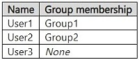
- Exhibit 2: 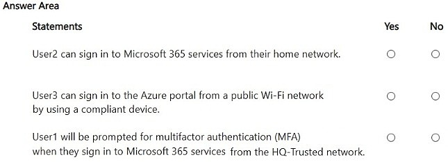

_HOTSPOT — the original ExamTopics question expects you to mark areas on the exhibit above; the correct hotspot coordinates are not published._

**Most voted:** originally I though User 3 should be yes, but the target is cloud apps and o365. This would not give access to Azure portal.

### Top explanations
- **Craigg** (1 upvotes [Most Recent]): originally I though User 3 should be yes, but the target is cloud apps and o365. This would not give access to Azure portal.

## Q1.73 (ID 421285)

You have an Azure subscription named Sub1 that is linked to a Microsoft Entra tenant named contoso.com.
Sub1 contains a Recovery Services vault named RSVault1 that stores virtual machines backups.
Your company’s security team maintains a dedicated Microsoft Entra tenant named security.contoso.com.
You need to ensure that modifying the backup settings of RSVault1 requires approval from an approver in security.contoso.com.
What should you do in contoso.com?

⭕ **A.** Enable immutability for RSVault1 and lock the immutability setting.
⭕ **B.** Create a private endpoint for RSVault1 on the virtual network.
⭕ **C.** Configure Privileged Identity Management (PIM) activation for the Backup Operator role.
✅ **D.** Enable Multi-user authorization (MUA) for RSVault1.

**Correct answer:** D
**Most voted:** D

### Top explanations
- **Eltooth** (1 upvotes [Most Recent, Selected Answer: D]): Multi-user authorization (MUA) for Azure Backup provides a security mechanism designed to protect critical backup operations (such as modifying backup policies or deleting backup data) by requiring explicit approval from a separate authorized user.
  MUA achieves this protection by linking the Recovery Services vault to an external Azure resource called a Resource Guard.
  https://learn.microsoft.com/en-us/azure/backup/multi-user-authorization-concept

## Q1.74 (ID 421286)

DRAG DROP
You have two Azure subscriptions named Sub1 and Sub2.
You have two groups named Group1 and Group2. Group1 only has access to Sub1 and Group2 only has access to Sub2.
Sub1 contains a Recovery Services vault named RSVault1 that stores virtual machine backups. RSVault1 is managed by using Group1.
You need to ensure that modifying the backup settings of RSVault1 requires approval from an approver in Group2.
What should you configure for each subscription? To answer, drag the appropriate features to the correct subscriptions. Each feature may be used once, more than once, or not at all. You may need to drag the split bar between panes or scroll to view content.
NOTE: Each correct selection is worth one point.

**Exhibits**
- Exhibit 1: 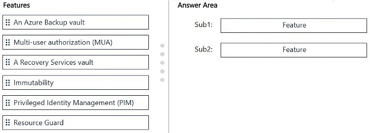

_DRAG DROP — the original ExamTopics question expects you to drag and drop items; the correct targets are not published._

**Most voted:**
- Sub1 → Multi-User Authorization (MUA): MUA is enabled on the vault—specifically, on RSVault1 in Sub1—and linked to a Resource Guard.
- Sub2 → Resource Guard: The Resource Guard is located in a space accessible only to the independent team (which includes Group2). Consequently, Group1 cannot grant itself authorization.

### Top explanations
- **rkrau** (1 upvotes [Most Recent]): Sub1 → Multi-User Authorization (MUA): MUA is enabled on the vault—specifically, on RSVault1 in Sub1—and linked to a Resource Guard.
  Sub2 → Resource Guard: The Resource Guard is located in a space accessible only to the independent team (which includes Group2). Consequently, Group1 cannot grant itself authorization.

## Q1.75 (ID 421287)

You have an Azure key vault named KV1.
You have an Azure App Service web app named App1. App1 is integrated with a virtual network named VNet1 that is linked to an Azure Private DNS zone. App1 accesses secrets stored in KV1.
You need to configure KV1 to meet the following requirements:
•	App1 must access the secrets by using a private IP address on VNet1.
•	Requests from outside VNet1 must be denied.
Which two actions should you perform for KV1? Each correct answer presents part of the solution.
NOTE: Each correct selection is worth one point.

✅ **A.** Create a private endpoint.
⭕ **B.** Add the IP addresses of App1.
✅ **C.** Disable public access.
⭕ **D.** Create an access policy.

**Correct answer:** A, C
**Most voted:** AC

### Top explanations
- **Eltooth** (1 upvotes [Most Recent, Selected Answer: AC]): A. Create a private endpoint: This allocates a private IP address from your virtual network (VNet1) to KV1. It allows App1 (which is integrated with VNet1) to route all its secrets traffic over a secure, private endpoint inside the network boundary.
  C. Disable public access: Modifying the network security configuration of KV1 to disable public network access blocks all requests coming from the public internet or outside designated private pathways, enforcing the requirement that requests from outside VNet1 must be denied.

## Q1.76 (ID 421288)

HOTSPOT
You have a Microsoft Entra tenant that contains the users shown in the following table.
The tenant contains a Conditional Access policy named CA1 that has the following settings:
•	Assignments:
o	Users or agents:
-	Include: Directory roles: Global Administrator
•	Target resources:
o	Resources (formerly cloud apps):
-	Include: All resources
•	Conditions:
o	Locations:
-	Configure: Yes
-	Include: Any network or location
•	Access controls:
o	Grant:
-	Require multifactor authentication
o	Grant:
-	Require device to be marked as compliant
o	For multiple controls:
-	Require all the selected controls
The tenant contains a Conditional Access policy named CA2 that has the following settings:
•	Assignments:
o	Users or agents:
-	Include: Users and groups: Group1
•	Target resources:
o	Resources (formerly cloud apps)
-	Include: Select resources: Office 365
•	Conditions:
o	Locations:
-	Configure: Yes
-	Include: Any network or location
•	Access controls:
o	Grant:
-	Require multifactor authentication
o	Grant:
-	Require app protection policy
o	For multiple controls:
- 	Require one of the selected controls
The users perform the following tasks:
•	User1 signs in to Microsoft 365 from a home network by using Microsoft Outlook on a noncompliant device.
•	User2 signs in to Microsoft 365 without an app protection policy by using a noncompliant device.
•	User3 signs in to the Azure portal from a home network by using a compliant device.
For each of the following statements, select Yes if the statement is true. Otherwise, select No.
NOTE: Each correct selection is worth one point.

**Exhibits**
- Exhibit 1: 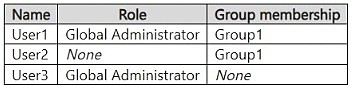
- Exhibit 2: 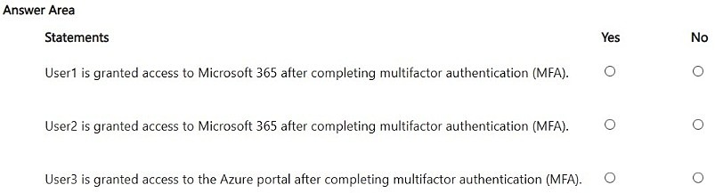

_HOTSPOT — the original ExamTopics question expects you to mark areas on the exhibit above; the correct hotspot coordinates are not published._

**Most voted:**
- No
- Yes
- Yes
- User 2 is subject to CA policy 2, it requires MFA OR App protection policy, so since MFA is complete, they satisfy the requirement. There is no requirement for a compliant device in CA policy 2.

### Top explanations
- **alashi** (6 upvotes): No
  Yes
  Yes
  User 2 is subject to CA policy 2, it requires MFA OR App protection policy, so since MFA is complete, they satisfy the requirement. There is no requirement for a compliant device in CA policy 2.
- **LukeAR78** (3 upvotes): User2 is Yes. CA2 says MFA or app protection policy. They sign in with MFA.
- **kungfumaster** (3 upvotes): correct user2 is also yes , as MFA or app protecion policy , one of the selected control required.
- **aneupa** (1 upvotes [Most Recent]): User2 is granted access to office365 after passing mfa not microsoft 365. The policy scope is office 365, the question states M365

## Q1.77 (ID 421289)

You have a virtual network named VNet1 that contains a subnet named Subnet1 and a virtual machine named VM1. VM1 uses only dynamic IP addresses from Subnet1.
You have an Azure key vault named KV1.
You enable a firewall on KV1 and allow access to KV1 from only select virtual networks and IP addresses.
VM1 receives 403 errors when it attempts to access KV1.
You need to enable VM1 to access KV1, while maintaining the current restrictions on KV1.
What should you do?

⭕ **A.** Create a routing rule on Subnet1.
⭕ **B.** Allow trusted Microsoft services to bypass the firewall on KV1.
✅ **C.** Add a Microsoft.KeyVault service endpoint for Subnet1.
⭕ **D.** Add the current IPv4 address of VM1 to the firewall allowlist of KV1.

**Correct answer:** C
**Most voted:** C

### Top explanations
- **Eltooth** (1 upvotes [Most Recent, Selected Answer: C]): When an Azure Key Vault firewall is restricted to "Selected networks," traffic originating from inside an Azure Virtual Network is blocked by default.
  To allow access from a specific subnet, you must enable a Virtual Network Service Endpoint (Microsoft.KeyVault) on that subnet (Subnet1).

## Q1.78 (ID 421290)

HOTSPOT
You are implementing security controls for an Azure Storage account by using infrastructure as code (IaC).
You deploy the following Bicep code.
For each of the following statements, select Yes if the statement is true. Otherwise, select No.
NOTE: Each correct selection is worth one point.

**Exhibits**
- Exhibit 1: 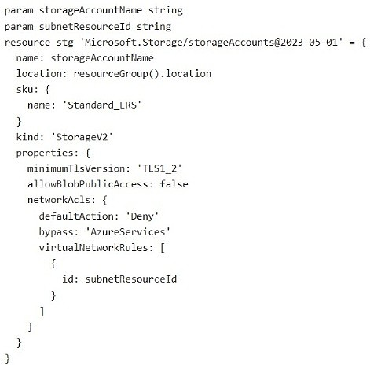
- Exhibit 2: 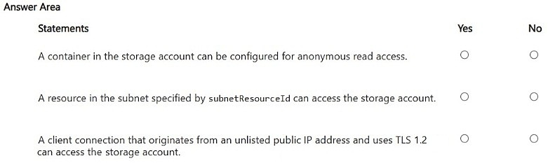

_HOTSPOT — the original ExamTopics question expects you to mark areas on the exhibit above; the correct hotspot coordinates are not published._

**Most voted:** Yes, Yes, No. The code includes Azure services, therefore, the Azure container can access it.

### Top explanations
- **chips** (1 upvotes [Most Recent]): Yes, Yes, No. The code includes Azure services, therefore, the Azure container can access it.
- **RibbingDilemma** (1 upvotes): I think you misunderstood the question. The container is part of the Storage Account and should be accessed anonymously which is forbidden by the storage accounts policy.

## Q1.79 (ID 421291)

You have a Microsoft Entra tenant that contains a group named Group1.
You plan to target Group1 to use the Microsoft Authenticator authentication method.
You need to ensure that the members in Group1 can use the Authenticator app as their primary authentication method.
What should you do?

⭕ **A.** Enable one-time passcodes in Authenticator for Group1.
⭕ **B.** Revoke the sessions for the Group1 members.
⭕ **C.** Enable Authenticator push authentication mode for Group1.
✅ **D.** Enable the Authenticator passwordless authentication method for Group1.

**Correct answer:** D
**Most voted:** D

### Top explanations
- **Eltooth** (3 upvotes [Most Recent, Selected Answer: D]): To use the Microsoft Authenticator app as a primary authentication method (rather than a secondary multi-factor verification step after entering a password), users must employ Passwordless phone sign-in.
  https://learn.microsoft.com/en-us/entra/identity/authentication/howto-authentication-passwordless-phone

## Q1.80 (ID 421292)

You have an Azure Storage account named storage1 that hosts a blob container used by an internal application.
You plan to enable a third-party workflow system to upload blobs to storage1.
You need to provide time-bound, least-privilege upload access to the third-party system.
Which authorization method should you use?

✅ **A.** Configure the workflow system to use a user delegation shared access signature (SAS).
⭕ **B.** Enable a managed identity for the workflow system and assign a role for storage1.
⭕ **C.** Enable anonymous public read access for the blob container.
⭕ **D.** Configure the workflow system to use Shared Key authorization.

**Correct answer:** A
**Most voted:** A

### Top explanations
- **Eltooth** (1 upvotes [Most Recent, Selected Answer: A]): A user delegation SAS provides:
  Time-bound access (start and expiry times).
  Least privilege permissions (for example, upload/write only).
  Access limited to a specific container or blob.
  Better security than Shared Key because it is signed with Microsoft Entra credentials rather than the storage account key.
  https://learn.microsoft.com/en-us/azure/storage/common/storage-network-security

## Q1.81 (ID 421293)

HOTSPOT
You have an Azure key vault named KV1 that uses role-based access control (RBAC) for data plane authorization.
You have multiple Azure App Service web apps that retrieve a SQL connection string stored as a secret in KV1.
You need to ensure that the web apps can access KV1. The solution must minimize the number of required identities and follow the principle of least privilege.
What should you do? To answer, select the appropriate options in the answer area.
NOTE: Each correct selection is worth one point.

**Exhibits**
- Exhibit 1: 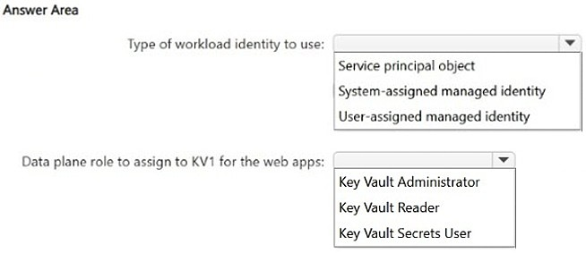

_HOTSPOT — the original ExamTopics question expects you to mark areas on the exhibit above; the correct hotspot coordinates are not published._

**Most voted:**
- User assigned
- Key Vault Secrets User

### Top explanations
- **Eltooth** (2 upvotes [Most Recent]): User assigned
  Key Vault Secrets User
  https://learn.microsoft.com/en-us/azure/key-vault/general/rbac-guide?tabs=azure-cli

## Q1.82 (ID 421294)

You have a virtual network named VNet1 that contains a subnet named Subnet1. Azure App Service is integrated with VNet1. You have an Azure SQL Database logical server named Server1 that contains a database named DB1. Server1 is accessible only by using a public IP address.
You need to ensure that Server does NOT use a public IP address and Azure App Service can still access Server1.
What should you create?

⭕ **A.** a routing table
⭕ **B.** an Azure Private Link service
✅ **C.** a private endpoint
⭕ **D.** a service endpoint

**Correct answer:** C
**Most voted:** C

### Top explanations
- **Eltooth** (1 upvotes [Most Recent, Selected Answer: C]): A Private Endpoint for Azure SQL Database assigns a private IP address from your virtual network to the Azure SQL logical server, enabling App Service (integrated with VNet1) to access the database privately.
  This allows you to disable public network access on the SQL server. Microsoft's Private Link documentation states that Private Endpoints provide private connectivity to Azure PaaS services such as Azure SQL Database.

## Q1.83 (ID 421295)

You have an Azure subscription that contains a virtual network named VNet1.
VNet1 contains an Azure VPN gateway named Gateway1 that is configured for Point-to-Site (P2S) connections.
You have a Microsoft 365 E5 subscription.
You need to configure a VPN authentication method for Gateway1. The solution must enforce Conditional Access policies during VPN sign-ins.
Which authentication method should you configure?

⭕ **A.** a custom IPsec/IKE policy
✅ **B.** Microsoft Entra authentication
⭕ **C.** certificate authentication
⭕ **D.** forced tunneling

**Correct answer:** B
**Most voted:** B

### Top explanations
- **Eltooth** (1 upvotes [Most Recent, Selected Answer: B]): Entra Authentication
  To enforce Conditional Access policies during Azure VPN Gateway Point-to-Site (P2S) sign-ins, you must use Microsoft Entra authentication (formerly Azure AD authentication).
  https://learn.microsoft.com/azure/vpn-gateway/point-to-site-entra-gateway
  https://learn.microsoft.com/azure/vpn-gateway/openvpn-azure-ad-mfa

## Q1.84 (ID 421296)

DRAG DROP
You have an Azure subscription named Sub1 that contains a storage account named storage1. storage1 hosts a blob container named container1.
Sub1 is linked to a Microsoft Entra tenant that contains a security group named Group1.
You need to ensure that Group1 can use the Azure portal to view the blobs in container1. The solution must follow the principle of least privilege.
Which roles should you assign to Group1. To answer, drag the appropriate roles to the correct objects. Each role may be used once, more than once, or not at all. You may need to drag the split bar between panes or scroll to view content.
NOTE: Each correct selection is worth one point.

**Exhibits**
- Exhibit 1: 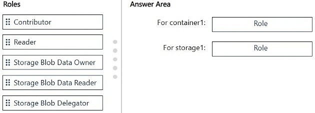

_DRAG DROP — the original ExamTopics question expects you to drag and drop items; the correct targets are not published._

**Most voted:**
- Container 1: Storage Blob Data Reader
- Storage 1: Reader

### Top explanations
- **Eltooth** (2 upvotes [Most Recent]): Container 1: Storage Blob Data Reader
  Storage 1: Reader
  To view blobs in the Azure portal using Microsoft Entra authentication, users need:
  A data access role to read blob data, such as Storage Blob Data Reader.
  The Reader role (or another ARM read role) to navigate the storage account and container in the Azure portal. Microsoft Learn states that to access blob data in the Azure portal, a user must have the Reader role in addition to a blob data access role.

## Q1.85 (ID 421297)

You have an Azure virtual network named VNet1 that contains a subnet named Subnet1.
You create a storage account named storage1.
You need to ensure that access to storage1 can be managed only by a network security group (NSG) linked to Subnet1.
What should you use?

⭕ **A.** an Azure Private link service
⭕ **B.** a service endpoint
✅ **C.** a private endpoint
⭕ **D.** a user-defined route (UDR)

**Correct answer:** C
**Most voted:** C

### Top explanations
- **Eltooth** (1 upvotes [Most Recent, Selected Answer: C]): Private Endpoint
  A Private Endpoint places a network interface with a private IP address in Subnet1. Once the storage account is accessed through the private endpoint, you can apply NSG rules to the subnet (with private endpoint network policies enabled) to control access to the storage account. The storage traffic stays within the virtual network and can be governed by the NSG.
  https://learn.microsoft.com/azure/storage/common/storage-private-endpoints

## Q1.86 (ID 421298)

DRAG DROP
You have an Azure subscription named Sub1 that contains an Azure SQL Database logical server named Server1.
Server1 contains a database named DB1.
Microsoft Defender for Cloud security alerts are being generated for Sub1.
You plan to improve investigation capabilities when Microsoft Defender for SQL raises Advanced Threat Protection alerts.
You need to ensure that the Advanced Threat Protection investigations have the audit records of DB1. The solution must include the recommended audit action groups.
How should you configure database auditing for Server1? To answer, drag the appropriate action groups to the correct requirements. Each action group may be used once, more than once, or not at all. You may need to drag the split bar between panes or scroll to view content.
NOTE: Each correct selection is worth one point.

**Exhibits**
- Exhibit 1: 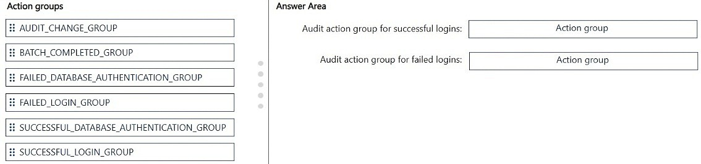

_DRAG DROP — the original ExamTopics question expects you to drag and drop items; the correct targets are not published._

**Most voted:** According to Microsoft Learn, the recommended default audit policy for Azure SQL Database consists of exactly three groups: BATCH_COMPLETED_GROUP, SUCCESSFUL_DATABASE_AUTHENTICATION_GROUP, and FAILED_DATABASE_AUTHENTICATION_GROUP. In Azure SQL Database, authentication is verified at the database level; therefore, the DATABASE_AUTHENTICATION groups are...

### Top explanations
- **rkrau** (1 upvotes [Most Recent]): According to Microsoft Learn, the recommended default audit policy for Azure SQL Database consists of exactly three groups: BATCH_COMPLETED_GROUP, SUCCESSFUL_DATABASE_AUTHENTICATION_GROUP, and FAILED_DATABASE_AUTHENTICATION_GROUP. In Azure SQL Database, authentication is verified at the database level; therefore, the DATABASE_AUTHENTICATION groups are the correct choice.
  Other options include SUCCESSFUL_LOGIN_GROUP and FAILED_LOGIN_GROUP. These server-level login groups are familiar from SQL Server and Managed Instance, but they are not the recommended choice for Azure SQL Database.

## Q1.87 (ID 421299)

You have an Azure subscription that contains the resources shown in the following table.
VM1 contains an application that accesses storage1. Another application accesses storage1 from a public IP address of xxx.xxx.xx.xx.
For storage1, you set Public network access to Enabled from selected virtual networks and IP addresses. You add an IP network rule for xxx.xxx.xx.xx.
After the configuration, only connections from xxx.xxx.xx.xx succeed.
You need to ensure that both VM1 and xxx.xxx.xx.xx.can access storage1 over the public endpoint, while preventing all other access.
What should you do?

**Exhibits**
- Exhibit 1: 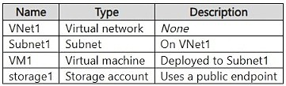

⭕ **A.** Set Public network access to Enabled from all networks.
⭕ **B.** Enable a private endpoint for storage1.
⭕ **C.** Add a public IP address to VM1.
✅ **D.** Enable the Microsoft.Storage service endpoint for Subnet1.

**Correct answer:** D
**Most voted:** D

### Top explanations
- **zurc_nosbor** (1 upvotes [Selected Answer: D]): Resposta correta: D. Enable the Microsoft.Storage service endpoint for Subnet1 ✅
  Por quê: Com o Storage em "selected networks", VMs não têm acesso automático. É preciso:
  Habilitar o service endpoint Microsoft.Storage na Subnet1
  Adicionar a regra de rede virtual no firewall do storage
  Erradas:
  A) Enabled from all networks ❌ → Libera acesso geral, viola o requisito.
  B) Private endpoint ❌ → O requisito é acesso pelo endpoint público.
  C) IP público na VM1 ❌ → Não resolve o acesso ao storage.
  PALAVRA-CHAVE:
  text
  VM + Storage "selected networks" → Service endpoint Microsoft.Storage
- **Eltooth** (1 upvotes [Most Recent, Selected Answer: D]): ✅ Answer: D. Enable the Microsoft.Storage service endpoint for Subnet1.
  When a Storage account is configured for Selected virtual networks and IP addresses, traffic from Azure VMs isn't automatically allowed. To permit access from a subnet, you must:
  Enable the Microsoft.Storage service endpoint on the subnet.
  Add a virtual network rule for that subnet on the storage account.
  https://learn.microsoft.com/azure/storage/common/storage-network-security

## Q1.88 (ID 421300)

HOTSPOT
You have three on-premises apps named App1, App2, and App3 that are configured in Microsoft Entra Private Access as shown in the following table.
You have the users shown in the following table.
The Global Secure Access client is deployed to all user devices.
For each of the following statements, select Yes if the statement is true. Otherwise, select No.
NOTE: Each correct selection is worth one point.

**Exhibits**
- Exhibit 1: 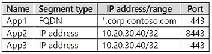
- Exhibit 2: 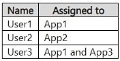
- Exhibit 3: 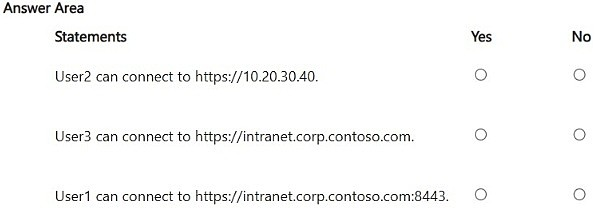

_HOTSPOT — the original ExamTopics question expects you to mark areas on the exhibit above; the correct hotspot coordinates are not published._

**Most voted:**
- No
- Yes
- No

### Top explanations
- **Eltooth** (3 upvotes [Most Recent]): No
  Yes
  No
  https://learn.microsoft.com/en-us/entra/global-secure-access/how-to-configure-per-app-access

## Q1.89 (ID 421301)

HOTSPOT
You have an Azure subscription that contains an Azure Database for PostgreSQL instance named DB1.
You plan to protect DB1 by using Microsoft Defender for Cloud.
You need to configure Defender for Cloud to detect anomalous activities and database exploitations for DB1. The solution must NOT affect any other databases.
What should you enable? To answer, select the appropriate options in the answer area.
NOTE: Each correct selection is worth one point.

**Exhibits**
- Exhibit 1: 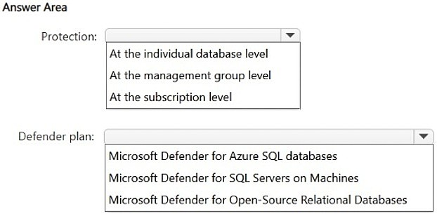

_HOTSPOT — the original ExamTopics question expects you to mark areas on the exhibit above; the correct hotspot coordinates are not published._

**Most voted:**
- Protection: At the subscription level.
- Defender plan: Microsoft Defender for Open-Source Relational Databases

### Top explanations
- **hwoccurrence** (2 upvotes [Most Recent]): Resource-level enablement is still supported for this plan. On the PostgreSQL flexible server, go to Security > Microsoft Defender for Cloud and select "Enable Microsoft Defender for PostgreSQL". That protects only that server, while enabling the plan at subscription level would automatically cover every supported database in the subscription and violate the "must NOT affect any other databases" requirement. See "Enable Defender for open-source relational databases on Azure" on Microsoft Learn. The given answer (individual database level + Open-Source Relational Databases) is correct.
- **chips** (1 upvotes): It might comes from an older model. Because since a few years ago, Microsoft Defender for Cloud can be configured at the subscription level only, and it protects all supported databases in the subscription. The plan is not configured directly on a single PostgreSQL database. Of course, exclusions can be configured for the subscription, but assignments are always done at the subscription level.
  answers should be:
  - Protection: At the subscription level.
  - Defender plan: Microsoft Defender for Open-Source Relational Databases

## Q1.90 (ID 421302)

You have an Azure subscription that contains a resource group named RG1 and has Microsoft Defender for Cloud enabled.
You connect an Amazon Web Services (AWS) account to Defender for Cloud by creating the AWS connector in RG1.
You have a Microsoft Entra group named Group1 that contains the user accounts of the security analysts at your company.
You need to ensure that the members of Group1 can view multicloud recommendations and security alerts for the connected AWS account. The solution must follow the principle of least privilege.
Which role should you assign to Group1 for RG1?

✅ **A.** Security Reader
⭕ **B.** Reader
⭕ **C.** Owner
⭕ **D.** Security Administrator

**Correct answer:** A
**Most voted:** A

### Top explanations
- **zurc_nosbor** (1 upvotes [Selected Answer: A]): Resposta: A. Security Reader
  Justificativa rápida:
  Os membros do Group1 precisam apenas visualizar recomendações multicloud e alertas de segurança do AWS conectado ao Microsoft Defender for Cloud.
  A função Security Reader concede acesso somente leitura às informações de segurança, recomendações, postura de segurança e alertas.
  Segue o princípio do menor privilégio.
  Reader não concede acesso específico aos dados de segurança do Microsoft Defender for Cloud.
  Security Administrator e Owner concedem permissões excessivas.
  Gabarito: ✅ A
  Dica de prova: 🎯
  Visualizar alertas e recomendações de segurança = Security Reader.
  Gerenciar configurações de segurança = Security Administrator.
  Gerenciar recursos Azure = Owner.
  Quando a questão mencionar "view security alerts" e "least privilege", a resposta normalmente é Security Reader.
  📚 Regra clássica da SC-500:
  Somente visualizar informações do Microsoft Defender for Cloud → Security Reader. ✅
- **Eltooth** (1 upvotes [Most Recent, Selected Answer: A]): The Security Reader role in Microsoft Defender for Cloud provides read-only access to:
  Recommendations
  Alerts
  Security policies
  Security posture/security state
  but does not allow users to make changes.
  https://learn.microsoft.com/azure/defender-for-cloud/permissions

## Q1.91 (ID 421303)

DRAG DROP
You use Azure Virtual Network Manager to manage multiple virtual networks organized into two network groups named Production and Development.
You need to configure Virtual Network Manager to meet the following requirements:
•	Allow traffic between all the virtual networks in Production.
•	Block traffic between Development and Production.
What should you use for each requirement? To answer, drag the components to the correct requirements. Each component may be used once, more than once, or not at all. You may need to drag the split bar between panes or scroll to view content.
NOTE: Each correct selection is worth one point.

**Exhibits**
- Exhibit 1: 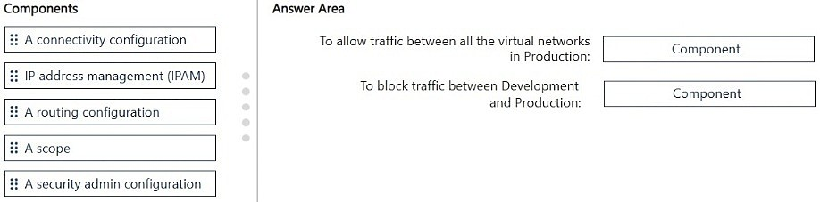

_DRAG DROP — the original ExamTopics question expects you to drag and drop items; the correct targets are not published._

**Most voted:**
- Allow traffic between all the virtual networks in Production: A connectivity configuration
- Block traffic between Development and Production: A security admin configuration

### Top explanations
- **Eltooth** (1 upvotes [Most Recent]): Allow traffic between all the virtual networks in Production: A connectivity configuration
  Block traffic between Development and Production: A security admin configuration
  https://learn.microsoft.com/azure/virtual-network-manager/concept-connectivity-configuration
  https://learn.microsoft.com/azure/virtual-network-manager/concept-security-admins

## Q1.92 (ID 421304)

You have a Microsoft Security Copilot workspace named Workspace1 that is used by Security Operations Center (SOC) analysts and security administrators.
The SOC analysts use only the Security Copilot standalone experience, and the security administrators access Security Copilot from the Microsoft Defender portal.
A new Security Copilot workspace named Workspace2 is created for the security administrators. Workspace2 is assigned a capacity of five security compute units.
You need to ensure that Security Copilot usage for the SOC analysts is allocated to Workspace1 and Security Copilot usage for the security administrators is allocated to Workspace2.
What should you do?

✅ **A.** Configure Workspace2 for embedded agent traffic.
⭕ **B.** Increase the capacity of Workspace2.
⭕ **C.** Assign the Workspace1 capacity to Workspace2.
⭕ **D.** Configure Workspace1 for embedded agent traffic.

**Correct answer:** A
**Most voted:** A

### Top explanations
- **Eltooth** (2 upvotes [Most Recent, Selected Answer: A]): SOC analysts use the Security Copilot standalone experience → should continue using Workspace1.
  Security administrators access Security Copilot through the Microsoft Defender portal → this is an embedded experience.
  To ensure that usage from embedded experiences (Defender portal) is charged against Workspace2, you configure Workspace2 for embedded agent traffic. This routes the Security Copilot consumption generated from embedded experiences to Workspace2 while leaving standalone users on Workspace1.
  https://learn.microsoft.com/security/copilot/experiences-security-copilot
- **zurc_nosbor** (1 upvotes [Selected Answer: A]): Resposta: A. Configure Workspace2 for embedded agent traffic.
  Justificativa rápida:
  Os SOC Analysts usam apenas a experiência standalone do Security Copilot, portanto continuarão consumindo capacidade do Workspace1.
  Os Security Administrators acessam o Security Copilot a partir do Microsoft Defender portal, que utiliza embedded experience (embedded agent traffic).
  Para que o consumo dos administradores seja cobrado no Workspace2, é necessário configurar o Workspace2 para embedded agent traffic.
  Gabarito: ✅ A
  Dica de prova: 🎯
  Standalone Experience → usa o workspace atribuído ao usuário.
  Embedded Experience (Defender, Intune, Purview, Entra) → usa o workspace configurado para embedded agent traffic.
  Quando a questão pede separar o consumo entre equipes que usam standalone e embedded, a resposta normalmente envolve embedded agent traffic.
  📚 Regra clássica do Security Copilot:
  SOC Analysts (Standalone) → Workspace1
  Security Admins (Defender Portal/Embedded) → Workspace2 (embedded agent traffic) ✅

## Q1.93 (ID 421305)

HOTSPOT
You need to deploy the Phishing Triage Agent in Microsoft Security Copilot to manage phishing incidents in Microsoft Defender XDR.
The solution must meet the following requirements:
•	Manage the phishing incidents.
•	Enable the Phishing Triage Agent.
•	Follow the principle of least privilege.
Which roles should you assign? To answer, select the appropriate options in the answer area.
NOTE: Each correct selection is worth one point.

**Exhibits**
- Exhibit 1: 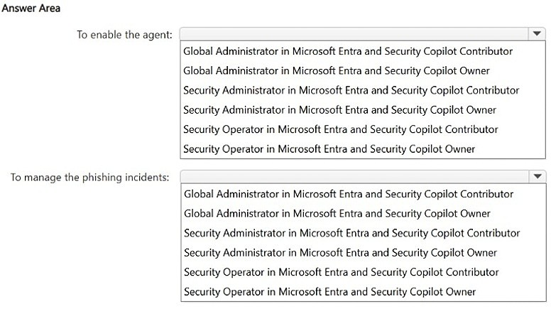

_HOTSPOT — the original ExamTopics question expects you to mark areas on the exhibit above; the correct hotspot coordinates are not published._

**Most voted:**
- To enable the agent: Security Administrator in Microsoft Entra and Security Copilot Owner
- To manage the phishing incidents: Security Operator in Microsoft Entra and Security Copilot Contributor

### Top explanations
- **Eltooth** (5 upvotes): To enable the agent: Security Administrator in Microsoft Entra and Security Copilot Owner
  To manage the phishing incidents: Security Operator in Microsoft Entra and Security Copilot Contributor
  Microsoft Learn states that managing agent settings (set up, pause, remove the agent, and manage the agent identity) requires the Security Administrator role in Microsoft Entra ID.
  Because enabling/deploying an agent is a workspace-level administrative task, the least-privileged Security Copilot workspace role is Security Copilot Owner rather than Contributor. Owners can configure workspace resources and agents, while Contributors are intended for using and contributing within the workspace.
- **Eltooth** (3 upvotes [Most Recent]): Managing incidents is an operational SOC task rather than a workspace administration task. The least-privileged Entra role is Security Operator, combined with Security Copilot Contributor for working with Security Copilot capabilities. This avoids granting broader Security Administrator permissions.
  https://learn.microsoft.com/en-us/defender-xdr/phishing-triage-agent

## Q1.94 (ID 421306)

You create a new Microsoft Sentinel workspace named Workspace1.
Workspace1 ingests Azure Firewall logs that are used only occasionally during investigations.
You need to retain the logs for seven years at the lowest cost. The solution must ensure that investigators can search the retained data when needed.
What should you do?

⭕ **A.** Archive the logs to an Azure Storage account.
✅ **B.** Configure the table in Workspace1 that stores the logs to use the data lake tier.
⭕ **C.** Configure the table in Workspace1 that stores the logs to use the analytics tier.
⭕ **D.** Increase the analytics retention period of Workspace1 to seven years.

**Correct answer:** B
**Most voted:** B

### Top explanations
- **Eltooth** (1 upvotes [Most Recent, Selected Answer: B]): Answer: B. Configure the table in Workspace1 that stores the logs to use the data lake tier.
  Microsoft Sentinel's Data Lake tier is designed for long-term, low-cost retention of security data while still allowing investigators to query and search the retained data when needed. The Analytics tier is intended for active SOC operations, detections, hunting, and frequent queries at a higher cost.
  https://learn.microsoft.com/azure/sentinel/manage-data-overview

## Q1.95 (ID 421307)

DRAG DROP
You have a Microsoft Defender External Attack Surface Management (Defender EASM) resource that discovers internet-facing assets for a company named Contoso, Ltd.
You need to classify the assets to meet the following requirements:
•	Third-party infrastructure assets must be tracked separately from assets owned by Contoso.
•	Assets with unconfirmed ownership must remain outside the owned inventory until ownership is verified.
How should you classify the assets? To answer, drag the appropriate asset states to the correct assets. Each state may be used once, more than once, or not at all. You may need to drag the split bar between panes or scroll to view content.
NOTE: Each correct selection is worth one point.

**Exhibits**
- Exhibit 1: 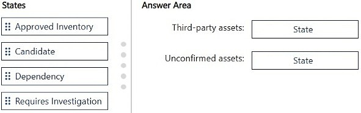

_DRAG DROP — the original ExamTopics question expects you to drag and drop items; the correct targets are not published._

**Most voted:** Candidate:: An asset that has some relationship to your organization's known seed assets, but which doesn't have a strong enough connection to immediately label it Approved Inventory. You must manually review these candidate assets to determine ownership.

### Top explanations
- **Eltooth** (2 upvotes): Dependency
  Candidate (based on current scanned only status).
- **Eltooth** (1 upvotes [Most Recent]): Candidate: 	An asset that has some relationship to your organization's known seed assets, but which doesn't have a strong enough connection to immediately label it Approved Inventory. You must manually review these candidate assets to determine ownership.
  Requires Investigation: 	A state similar to the Candidate state, but this value is applied to assets that require manual investigation to validate. The state is determined based on our internally generated confidence scores that assess the strength of detected connections between assets. It doesn't indicate the infrastructure's exact relationship to the organization, but it flags the asset for more review to determine how it should be categorized.

## Q1.96 (ID 421308)

You have a Microsoft Sentinel-enabled Log Analytics workspace named Workspace1.
Your company receives JSON security events from a software as a service (SaaS) application.
You plan to create a custom Microsoft Sentinel data connector.
You need to prepare Workspace1 for the incoming JSON data.
What should you do first?

⭕ **A.** Configure a diagnostic setting for the SaaS application.
⭕ **B.** Install a built-in Microsoft Sentinel data connector.
✅ **C.** Create a custom log table in Workspace1.
⭕ **D.** Create an analytics rule in Microsoft Sentinel.

**Correct answer:** C
**Most voted:** C

### Top explanations
- **Eltooth** (1 upvotes [Most Recent, Selected Answer: C]): C. Create a custom log table in Workspace1.
  For a custom Microsoft Sentinel data connector that will ingest JSON data from a SaaS application, the destination table must exist (or be defined) in the Log Analytics workspace before mapping and ingesting the incoming data.

## Q1.97 (ID 421309)

DRAG DROP
You have an Azure subscription named Sub1. Sub1 contains 60 virtual machines that run either Window Server or Linux.
All the Windows Server virtual machines host line-of-business (LOB) applications and all the Linux virtual machines host backend databases.
You need to enable malware protection for the virtual machines.
Which Microsoft Defender for Cloud plan should you enable for each type of virtual machine? To answer, drag the appropriate plans to the correct virtual machine types. Each plan may be used once, more than once, or not at all. You may need to drag the split bar between panes or scroll to view content.
NOTE: Each correct selection is worth one point.

**Exhibits**
- Exhibit 1: 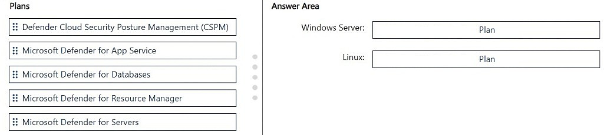

_DRAG DROP — the original ExamTopics question expects you to drag and drop items; the correct targets are not published._

**Most voted:**
- Windows Server: Microsoft Defender for Servers
- Linux: Microsoft Defender for Servers

### Top explanations
- **Eltooth** (1 upvotes [Most Recent]): Windows Server: Microsoft Defender for Servers
  Linux: Microsoft Defender for Servers
  The requirement is malware protection for both Windows Server and Linux virtual machines.
  Microsoft Defender for Servers protects both Windows and Linux VMs and includes integration with Microsoft Defender for Endpoint, providing threat and malware protection capabilities.
  https://learn.microsoft.com/azure/defender-for-cloud/tutorial-enable-servers-plan

## Q1.98 (ID 421310)

You have an Azure subscription that has the Microsoft Defender for Cloud Foundational Cloud Security Posture Management (CSPM) plan enabled.
You have an Amazon Web Services (AWS) account connected to Defender for Cloud for posture management.
In Defender for Cloud, security recommendations for the resources in Azure and AWS have a risk level of Not evaluated.
You need to ensure that Defender for Cloud assigns a risk level to the recommendations.
What should you do?

⭕ **A.** Onboard all the virtual machines in the AWS account to Azure Arc.
⭕ **B.** Enable Microsoft Defender for Servers Plan 2.
⭕ **C.** Assign the CIS AWS Foundations v3.0.0 standard to the AWS account.
✅ **D.** Enable the Defender CSPM plan.

**Correct answer:** D
**Most voted:** D

### Top explanations
- **Eltooth** (3 upvotes [Most Recent, Selected Answer: D]): Enable the Defender CSPM plan.
  The subscription currently has only Foundational CSPM enabled.
  Microsoft Learn states that risk prioritization and the assignment of recommendation risk levels (Critical, High, Medium, Low) are supported only with the Defender Cloud Security Posture Management (Defender CSPM) plan. With Foundational CSPM, recommendations are available, but risk-prioritization features aren't evaluated, causing recommendations to appear as Not evaluated.

## Q1.99 (ID 421311)

You have an Azure subscription.
You plan to map an online infrastructure and perform vulnerability scanning for the following:
•	ASNs
•	Hostnames
•	IP addresses
•	SSL certificates
What should you use?

⭕ **A.** Microsoft Defender for Identity
✅ **B.** Microsoft Defender External Attack Surface Management (Defender EASM)
⭕ **C.** Microsoft Defender for Endpoint
⭕ **D.** Microsoft Defender for Cloud

**Correct answer:** B
**Most voted:** B

### Top explanations
- **Eltooth** (1 upvotes [Selected Answer: B]): B. Microsoft Defender External Attack Surface Management (Defender EASM)
  https://learn.microsoft.com/azure/external-attack-surface-management/
- **Eltooth** (1 upvotes [Most Recent]): Microsoft Defender External Attack Surface Management (Defender EASM) is specifically designed to continuously discover, inventory, map, and assess an organization's internet-facing attack surface. It includes asset types such as:
  ASNs (Autonomous System Numbers)
  Hosts/Hostnames
  IP addresses and IP blocks
  SSL certificates
  Domains
  Web infrastructure
  and provides visibility into vulnerabilities, exposures, misconfigurations, and unknown internet-exposed assets.

## Q1.100 (ID 421312)

You have a Microsoft Entra tenant that contains the users shown in the following table.
You have a Microsoft Security Copilot workspace.
From Microsoft Security Store, you plan to deploy a partner-built agent named Agent1 that requires access to Microsoft Intune.
When User1 selects Agent1, the Get agent option is unavailable.
You need to enable User1 to complete the agent setup. The solution must follow the principle of least privilege.
What should you do first?

**Exhibits**
- Exhibit 1: 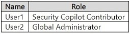

⭕ **A.** From Security Copilot, create an agent identity for Agent1.
⭕ **B.** From Security Copilot, configure the required data source for Agent1.
⭕ **C.** Assign User1 the AI Administrator role in Microsoft Entra.
⭕ **D.** Assign User1 the Agent ID Administrator role in Microsoft Entra.
✅ **E.** Instruct User2 to approve the agent setup.

**Correct answer:** E
**Most voted:** E

### Top explanations
- **Greens** (1 upvotes [Most Recent, Selected Answer: E]): Agent1 needs access to Microsoft Intune, so setting it up requires admin consent for the Microsoft Graph / Intune permissions the agent requests. That consent is granted at the tenant level, and a Security Copilot Contributor can’t give it. That’s why the Get agent option is greyed out for User1.
  User2 is a Global Administrator and can review and approve those permissions. After that, User1 can complete the setup with their existing role. This follows least privilege because User1 doesn’t receive a new, broad Entra role just for a one-time approval.
- **rRick** (1 upvotes [Selected Answer: E]): The solution must follow the principle of least privilege.
- **LukeAR78** (1 upvotes [Selected Answer: D]): D the question clearly states that 'You need to enable User1 to complete the agent setup.' Instruct User2 to approve agent setup doesn't fulfil that requirement. You need to give user1 the correct role.
- **Eltooth** (1 upvotes [Selected Answer: E]): Instruct User2 to approve agent setup as this is the least privilege role available.

## Q1.101 (ID 421313)

You use Microsoft Security Copilot.
Users are assigned either the Security Copilot Contributor role or the Security Copilot Owner role.
A contributor enables a custom plugin that is NOT approved, and some Security Copilot features in embedded experiences no longer function.
You need to ensure that plugins affecting all users can only be added by owners.
What should you do in the Plugin settings?

⭕ **A.** Select Contributors and Owners to configure which users can add custom plugins at the user scope.
⭕ **B.** Select Contributors and Owners to configure which users can add custom plugins at the workspace scope.
✅ **C.** Select Owners only to configure which users can add custom plugins at the workspace scope.
⭕ **D.** Select Owners only to configure which users can add custom plugins at the user scope.

**Correct answer:** C
**Most voted:** C

### Top explanations
- **Eltooth** (1 upvotes [Most Recent, Selected Answer: C]): C. Select Owners only to configure which users can add custom plugins at the workspace scope.
  The problem is that a Contributor enabled an unapproved custom plugin and it affected all users.
  Microsoft Learn distinguishes between:
  User scope: Plugins available only to the individual user.
  Workspace (organization/tenant) scope: Plugins available to everyone in the workspace.
  Setting the permission for the workspace scope to Owners only ensures standard Contributors can no longer enable unapproved, tenant-wide custom plugins that disrupt embedded experiences for everyone.
  https://learn.microsoft.com/en-us/copilot/security/manage-plugins

## Q1.102 (ID 421314)

You plan to deploy Microsoft 365 Copilot.
You discover that Copilot can access sensitive information in your Microsoft SharePoint Online libraries.
You need to automatically identify which SharePoint Online content has been shared between all internal users.
What should you create?

⭕ **A.** a Microsoft Purview data loss prevention (DLP) policy in audit mode for SharePoint Online
⭕ **B.** a Microsoft Purview Data Security Posture Management (DSPM) remediation action
⭕ **C.** a Conditional Access policy that requires multifactor authentication (MFA) for SharePoint Online
✅ **D.** a SharePoint Advanced Management (SAM) Data access governance report

**Correct answer:** D
**Most voted:** D

### Top explanations
- **Eltooth** (1 upvotes [Selected Answer: D]): Data Access Governance (DAG) reports are a feature of the SharePoint Advanced Management (SAM) add-on. They are explicitly designed to help administrators identify potential "oversharing" risks before or during a Microsoft 365 Copilot deployment.
  https://learn.microsoft.com/en-us/sharepoint/data-access-governance-reports
- **Eltooth** (1 upvotes [Most Recent]): Within the DAG dashboard, you can specifically run a snapshot report for "Sites and files shared via special SharePoint groups". This report generates a detailed breakdown of all files and content that have been shared with wide corporate scopes, specifically targeting the "Everyone except external users" (internal broad sharing) or "Everyone" groups. This makes it the ideal tool to surface items that all internal employees can query using Copilot.

## Q1.103 (ID 421315)

You have an Azure subscription that contains the virtual machines shown in the following table.
All the virtual networks are peered.
You deploy Azure Bastion to VNET2.
Which virtual machines can be protected by the bastion host?

**Exhibits**
- Exhibit 1: 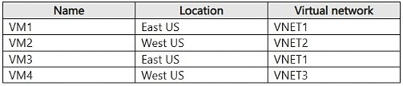

⭕ **A.** VM2 only
⭕ **B.** VM2 and VM4 only
⭕ **C.** VM1, VM2, and VM3 only
✅ **D.** VM1, VM2, VM3, and VM4

**Correct answer:** D
**Most voted:** D

### Top explanations
- **Eltooth** (1 upvotes [Selected Answer: D]): Azure Bastion supports centralized deployment, meaning a single Bastion host can provide secure connectivity to virtual machines residing across different virtual networks, provided they are interconnected via Virtual Network Peering.
  https://learn.microsoft.com/en-us/azure/bastion/vnet-peering
- **Eltooth** (1 upvotes [Most Recent]): Because the prompt specifies that "All the virtual networks are peered," the Bastion host residing in VNET2 can communicate across the private Azure backbone to reach the targets inside VNET1 and VNET3. Therefore, all four virtual machines (VM1, VM2, VM3, and VM4) can be protected and accessed through this single Bastion instance.

## Q1.104 (ID 421316)

You have a Microsoft Foundry project that contains a model deployment named Deployment1.
Deployment1 contains an agent named Agent1 that uses an existing default guardrail configuration.
You discover that Agent1 generates tool calls that contain harmful language.
You need to ensure that Agent1 responses containing harmful content are prevented from running. The solution must prevent changes to the configuration of Deployment1.
What should you do?

⭕ **A.** Create an automatic evaluation of the dataset of Agent1.
✅ **B.** Create a custom guardrail and assign it directly to Agent1.
⭕ **C.** Fine-tune the model of Deployment1.
⭕ **D.** Create a red teaming run for Agent1.

**Correct answer:** B
**Most voted:** B

### Top explanations
- **Eltooth** (1 upvotes [Most Recent, Selected Answer: B]): Microsoft Foundry guardrails support multiple intervention points, including:
  User input
  Tool call (Preview)
  Tool response
  Output
  A guardrail can inspect an agent's proposed tool call and block execution when harmful content is detected.
  By creating a custom guardrail and assigning it directly to Agent1, you can enforce tool-call filtering without modifying the underlying model deployment configuration (Deployment1).
  https://learn.microsoft.com/azure/foundry/guardrails/guardrails-overview

## Q1.105 (ID 421317)

You have a Microsoft 365 tenant that has Microsoft 365 Copilot enabled for a pilot group.
Users frequently generate responses based on Microsoft Teams chats and Microsoft SharePoint Online sites.
You use Microsoft Purview Data Security Posture Management (DSPM) to identify oversharing risks and create policies based on the recommendations.
You need to manage and edit the policies created by DSPM.
Which Microsoft Purview solution should you use?

⭕ **A.** Communication Compliance
✅ **B.** Data Loss Prevention
⭕ **C.** Insider Risk Management
⭕ **D.** Information Protection

**Correct answer:** B
**Most voted:** B

### Top explanations
- **Eltooth** (1 upvotes [Most Recent, Selected Answer: B]): Microsoft Purview DSPM provides recommendations and can create one-click policies based on identified risks. For Microsoft 365 Copilot oversharing scenarios, DSPM specifically provides recommendations that create Data Loss Prevention (DLP) policies and Insider Risk Management policies. After a DSPM recommendation creates a policy, you manage and edit that policy in the corresponding Purview solution.
  https://learn.microsoft.com/en-us/purview/deploymentmodels/depmod-dspm-intro

## Q1.106 (ID 421318)

You have an Azure Functions app named App1 that uses an HTTP trigger, runs on an Elastic Premium plan, and uses virtual network integration.
A partner application sends requests to App1 from a public IP address of xxx.xxx.xxx.xx.
You need to ensure that the requests are accepted from only xxx.xxx.xxx.xx.
What should you do?

⭕ **A.** Deploy an Azure Bastion host.
⭕ **B.** Create a private endpoint for App1 and disable public network access.
⭕ **C.** Apply a network security group (NSG) to a dedicated subnet for virtual network integration.
✅ **D.** Configure an inbound access restriction on App1.
⭕ **E.** Deploy an Azure NAT Gateway.

**Correct answer:** D
**Most voted:** D

### Top explanations
- **Eltooth** (1 upvotes [Most Recent, Selected Answer: D]): Configure an inbound access restriction on App1.
  By default, an app accepts all public traffic. Azure App Service and Azure Functions have a built-in networking feature called Access Restrictions (effectively an IP firewall for the app). Configuring an inbound access restriction with an Allow rule for the specific public IP address (xxx.xxx.xxx.xx) creates an implicit Deny All rule for every other IP address on the internet. This ensures that only the partner application can successfully invoke the HTTP trigger.
  https://learn.microsoft.com/en-us/azure/app-service/app-service-ip-restrictions

## Q1.108 (ID 421320)

You have a Microsoft Entra tenant that uses Microsoft Entra Agent ID.
You have multiple Microsoft Foundry agents that have agent identities assigned.
You discover that one of the identities is flagged as high risk due to unusual sign-in activity.
You need to ensure that agent access to resources is restricted automatically based on risk.
What should you create?

⭕ **A.** a Privileged Identity Management (PIM) activation policy
⭕ **B.** an Access review for the identities
✅ **C.** a Conditional Access policy for the identities
⭕ **D.** a Microsoft Entra role assignment policy

**Correct answer:** C
**Most voted:** C

### Top explanations
- **Eltooth** (1 upvotes [Most Recent, Selected Answer: C]): Microsoft Entra ID Protection for Agents monitors the behavioral patterns and sign-in telemetry of autonomous AI agents (such as those created in Microsoft Foundry or Copilot Studio) that possess an immutable Microsoft Entra Agent ID. When an anomalous activity flags an agent identity as high risk, you use Conditional Access policies explicitly targeted at agent identities to act as a real-time Zero Trust enforcement engine.
  https://learn.microsoft.com/en-us/entra/id-protection/concept-risky-agents

## Q1.109 (ID 421321)

You have an Azure subscription named Sub1 that contains multiple virtual machines and an Azure key vault named KV1.
Each virtual machine has a system-assigned managed identity. Sub1 has Microsoft Defender for Servers enabled. Defender for Servers has agentless scanning enabled.
Some virtual machines use managed disks that are encrypted by using customer-managed keys stored in KV1.
You discover that the affected virtual machines fail to return agentless scanning results in Microsoft Defender for Cloud.
You need to ensure that agentless scanning can analyze the virtual machines.
What should you do?

⭕ **A.** Assign each virtual machine managed identity the Key Vault Reader role for KV1.
⭕ **B.** Enable Microsoft Defender for Key Vault for Sub1.
✅ **C.** Assign the scanning service the Key Vault Crypto Service Encryption User role for KV1.
⭕ **D.** Enable just-in-time (JIT) VM access for the affected virtual machines.
⭕ **E.** Assign the scanning service the Key Vault Secrets User role for KV1.

**Correct answer:** C
**Most voted:** C

### Top explanations
- **Eltooth** (4 upvotes [Most Recent, Selected Answer: C]): For CMK-encrypted disks, you must grant the Defender for Cloud scanning service access to the key in Key Vault. The required Azure RBAC role is:
  Key Vault Crypto Service Encryption Userhttps://learn.microsoft.com/azure/defender-for-cloud/enable-agentless-scanning-vms
- **mcdesilva74** (1 upvotes [Selected Answer: C]): Microsoft’s documentation on server-side encryption with customer-managed keys. Azure encrypts managed disks with AES-256 using a DEK, then wraps that DEK with your CMK from Key Vault. Microsoft explicitly calls this envelope encryption.

## Q1.110 (ID 421322)

You have an Azure API Management instance named APIM1.
You have a partner company that accesses an API in APIM1 by using subscription keys.
A backend API key is stored in a named value in APIM1.
Microsoft Defender for Cloud generates the following recommendation: “API Management secret named values should be stored in Azure Key Vault.”
You need to address the recommendation.
What should you do first?

⭕ **A.** Enable the Microsoft Defender for APIs plan.
✅ **B.** Enable a managed identity for APIM1.
⭕ **C.** Mark the existing named value as a secret.
⭕ **D.** Replace the backend API key with a subscription key.

**Correct answer:** B
**Most voted:** B

### Top explanations
- **Eltooth** (2 upvotes [Most Recent, Selected Answer: B]): To store a named value as a Key Vault reference, Azure API Management must first have a system-assigned or user-assigned managed identity that can authenticate to Azure Key Vault. Enabling the managed identity is therefore the first prerequisite step before you can move the secret from APIM into Key Vault.

## Q1.111 (ID 421323)

You have an Azure virtual machine named VM1. A network security group (NSG) named NSG1 is linked to the network adapter of VM1.
VM1 allows inbound RDP (TCP 3389) from an on-premises network.
You need to reduce exposure on VM1. The solution must ensure that required RDP access is allowed for only a maximum of four hours.
What should you do?

⭕ **A.** Create a Conditional Access policy.
⭕ **B.** Deploy an Azure Bastion host.
⭕ **C.** Add a security rule to NSG1.
✅ **D.** Enable just-in-time (JIT) VM access for VM1.

**Correct answer:** D
**Most voted:** D

### Top explanations
- **zurc_nosbor** (1 upvotes [Most Recent, Selected Answer: D]): A resposta correta é a D. Enable just-in-time (JIT) VM access for VM1.   Resumo:❌ A. Conditional Access policy: Controla autenticação e identidades, não portas de rede no NSG.   ❌ B. Azure Bastion host: Permite conexão RDP via browser, mas não gere limite de tempo automático por sessão.   ❌ C. Security rule no NSG1: As regras do NSG são estáticas e não expiram automaticamente após 4 horas.   ✅ D. Enable just-in-time (JIT) VM access: O JIT bloqueia a porta RDP no NSG e abre-a apenas sob solicitação por um tempo limitado (ex: no máximo 4 horas).

## Q1.112 (ID 421324)

HOTSPOT
Overview
Fabrikam, Inc. is a consulting company. The company has a main office in New York City and branch offices in Amsterdam and Singapore.
Existing Environment. Network environment
The on-premises network contains a datacenter in each office.
Existing Environment. Cloud environment
Fabrikam has two Azure subscriptions named Sub1 and Sub2 and a Microsoft 365 subscription that includes Microsoft 365 E5 licenses.
All the subscriptions are linked to a Microsoft Entra tenant named fabrikam.com that contains the identities shown in the following table.
The tenant contains the groups shown in the following table.
All devices are enrolled in Microsoft Intune.
Existing Environment. Sub1 Resources
Sub1 contains a resource group named RG1 that contains the resources shown in the following table.
SQLServer1 uses Microsoft SQL Server authentication.
Sub1 has an Azure Web Application Firewall (WAF) named WAF1 that has the following types of rule sets:
•	Bot Manager 1.1
•	Azure-managed Default Rule Set (DRS)
Sub1 has the following compliance standards assigned in Microsoft Defender for Cloud:
•	NIST SP 800-53 Rev. 4
•	Microsoft cloud security benchmark (MCSB)
•	System and Organization Controls (SOC) 2 Type 2
Existing Environment. Sub2 Resources
Sub2 contains a resource group named RG2.
Planned Changes and Requirements. Planned Changes
Fabrikam plans to implement the following changes:
•	Deploy the following key vaults to RG1:
o	AKV2 in the West Europe Azure region
o	AKV3 in the Central US Azure region
o	AKV4 in the East US Azure region
•	Deploy the following key vaults to RG2:
o	AKV5 in the East US region
•	Configure VM1 to read data from storage1.
•	Create function apps that have the following hosting plans:
o	Fa1: Flex Consumption hosting plan
o	Fa2: Consumption hosting plan
o	Fa3: Dedicated hosting plan
•	For WAF1, implement rate limiting rules based on the request location.
•	Enable the NIST SP 800-53 Rev. 5 compliance standard in Defender for Cloud.
•	Create a new storage account named storage2 that supports Azure Table storage.
•	Enforce multifactor authentication (MFA) when database administrators access SQLdb1.
•	Implement ExpressRoute circuits to the on-premises network as shown in the following table.
•	For RG1, create a new Privileged Identity Management (PIM) eligible role assignment that assigns the Contributor role to supported groups.
Planned Changes and Requirements.  Technical Requirements
Fabrikam has the following technical requirements:
•	If VM1 is deleted, the permissions for VM1 must be removed automatically.
•	The AKS1 managed identity must only be able to pull images from Registry1.
•	The ID1 managed identity must be able to push images to and pull images from Registry1.
•	All the data in the storage accounts must be encrypted by using Fabrikam-managed keys.
•	All outbound traffic from the function apps to the on-premises network must use ExpressRoute circuits.
•	ExpressRoute connectivity between the on-premises network and the Azure environment must be encrypted by using Layer 2 or Layer 3 encryption.
You need to configure the AKS1 and ID1 managed identities to meet the technical requirements. The solution must follow the principle of least privilege.
Which role should you assign to each identity? To answer, select the appropriate options in the answer area.
NOTE: Each correct selection is worth one point.

**Exhibits**
- Exhibit 1: 
- Exhibit 2: 
- Exhibit 3: 
- Exhibit 4: 
- Exhibit 5: 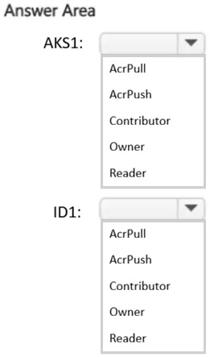

_HOTSPOT — the original ExamTopics question expects you to mark areas on the exhibit above; the correct hotspot coordinates are not published._

**Most voted:**
- AKS1 → AcrPull: The case study states, "The identity managed by AKS1 must only be able to pull images from Registry1." The AcrPull role allows precisely that—pulling images, and nothing more.
- ID1 → AcrPush: The requirement here is that it "must be able to push images to Registry1 and pull images from it." According to Microsoft Learn, the AcrPush role includes both push and pull permissions. An additional AcrPull role is not required.

### Top explanations
- **rkrau** (1 upvotes [Most Recent]): Correct answer
  AKS1 → AcrPull: The case study states, "The identity managed by AKS1 must only be able to pull images from Registry1." The AcrPull role allows precisely that—pulling images, and nothing more.
  ID1 → AcrPush: The requirement here is that it "must be able to push images to Registry1 and pull images from it." According to Microsoft Learn, the AcrPush role includes both push and pull permissions. An additional AcrPull role is not required.
  The "Reader" role only provides visibility of the registry resource and does not permit pulling images. The "Contributor" and "Owner" roles would grant far too much access.

## Q1.113 (ID 421325)

Overview
Fabrikam, Inc. is a consulting company. The company has a main office in New York City and branch offices in Amsterdam and Singapore.
Existing Environment. Network environment
The on-premises network contains a datacenter in each office.
Existing Environment. Cloud environment
Fabrikam has two Azure subscriptions named Sub1 and Sub2 and a Microsoft 365 subscription that includes Microsoft 365 E5 licenses.
All the subscriptions are linked to a Microsoft Entra tenant named fabrikam.com that contains the identities shown in the following table.
The tenant contains the groups shown in the following table.
All devices are enrolled in Microsoft Intune.
Existing Environment. Sub1 Resources
Sub1 contains a resource group named RG1 that contains the resources shown in the following table.
SQLServer1 uses Microsoft SQL Server authentication.
Sub1 has an Azure Web Application Firewall (WAF) named WAF1 that has the following types of rule sets:
•	Bot Manager 1.1
•	Azure-managed Default Rule Set (DRS)
Sub1 has the following compliance standards assigned in Microsoft Defender for Cloud:
•	NIST SP 800-53 Rev. 4
•	Microsoft cloud security benchmark (MCSB)
•	System and Organization Controls (SOC) 2 Type 2
Existing Environment. Sub2 Resources
Sub2 contains a resource group named RG2.
Planned Changes and Requirements. Planned Changes
Fabrikam plans to implement the following changes:
•	Deploy the following key vaults to RG1:
o	AKV2 in the West Europe Azure region
o	AKV3 in the Central US Azure region
o	AKV4 in the East US Azure region
•	Deploy the following key vaults to RG2:
o	AKV5 in the East US region
•	Configure VM1 to read data from storage1.
•	Create function apps that have the following hosting plans:
o	Fa1: Flex Consumption hosting plan
o	Fa2: Consumption hosting plan
o	Fa3: Dedicated hosting plan
•	For WAF1, implement rate limiting rules based on the request location.
•	Enable the NIST SP 800-53 Rev. 5 compliance standard in Defender for Cloud.
•	Create a new storage account named storage2 that supports Azure Table storage.
•	Enforce multifactor authentication (MFA) when database administrators access SQLdb1.
•	Implement ExpressRoute circuits to the on-premises network as shown in the following table.
•	For RG1, create a new Privileged Identity Management (PIM) eligible role assignment that assigns the Contributor role to supported groups.
Planned Changes and Requirements.  Technical Requirements
Fabrikam has the following technical requirements:
•	If VM1 is deleted, the permissions for VM1 must be removed automatically.
•	The AKS1 managed identity must only be able to pull images from Registry1.
•	The ID1 managed identity must be able to push images to and pull images from Registry1.
•	All the data in the storage accounts must be encrypted by using Fabrikam-managed keys.
•	All outbound traffic from the function apps to the on-premises network must use ExpressRoute circuits.
•	ExpressRoute connectivity between the on-premises network and the Azure environment must be encrypted by using Layer 2 or Layer 3 encryption.
You implement the planned changes for the key vaults.
To which key vaults can you restore AKV1 backups?

**Exhibits**
- Exhibit 1: 
- Exhibit 2: 
- Exhibit 3: 
- Exhibit 4: 

⭕ **A.** AKV4 only
✅ **B.** AKV3 and AKV4 only
⭕ **C.** AKV4 and AKV5 only
⭕ **D.** AKV2, AKV3, and AKV4 only
⭕ **E.** AKV2, AKV3, AKV4, and AKV5

**Correct answer:** B
**Most voted:** B

### Top explanations
- **hwoccurrence** (5 upvotes [Selected Answer: B]): A key vault backup blob can only be restored into a key vault in the same Azure subscription and the same Azure geography as the source. AKV1 is in Sub1 (East US), so AKV3 (Central US) and AKV4 (East US) qualify because both are in RG1/Sub1 and in the United States geography. AKV5 is in East US but in RG2, which belongs to Sub2, so the different subscription blocks the restore. AKV2 is in the same subscription but in West Europe, a different geography.
- **Eltooth** (1 upvotes [Most Recent, Selected Answer: C]): Key vault backup creates an encrypted blob that cannot be decrypted outside of Azure. To restore and use this data, the target key vault must satisfy two strict criteria:
  1. It must be within the same Azure subscription.
  2. It must be within the same Azure geography.
  The answer don't allow for AKV3, AKV4 and AKV5 so unless its different on the exam .go with C (AKV4 and AKV5).

## Q1.115 (ID 421327)

Overview
Fabrikam, Inc. is a consulting company. The company has a main office in New York City and branch offices in Amsterdam and Singapore.
Existing Environment. Network environment
The on-premises network contains a datacenter in each office.
Existing Environment. Cloud environment
Fabrikam has two Azure subscriptions named Sub1 and Sub2 and a Microsoft 365 subscription that includes Microsoft 365 E5 licenses.
All the subscriptions are linked to a Microsoft Entra tenant named fabrikam.com that contains the identities shown in the following table.
The tenant contains the groups shown in the following table.
All devices are enrolled in Microsoft Intune.
Existing Environment. Sub1 Resources
Sub1 contains a resource group named RG1 that contains the resources shown in the following table.
SQLServer1 uses Microsoft SQL Server authentication.
Sub1 has an Azure Web Application Firewall (WAF) named WAF1 that has the following types of rule sets:
•	Bot Manager 1.1
•	Azure-managed Default Rule Set (DRS)
Sub1 has the following compliance standards assigned in Microsoft Defender for Cloud:
•	NIST SP 800-53 Rev. 4
•	Microsoft cloud security benchmark (MCSB)
•	System and Organization Controls (SOC) 2 Type 2
Existing Environment. Sub2 Resources
Sub2 contains a resource group named RG2.
Planned Changes and Requirements. Planned Changes
Fabrikam plans to implement the following changes:
•	Deploy the following key vaults to RG1:
o	AKV2 in the West Europe Azure region
o	AKV3 in the Central US Azure region
o	AKV4 in the East US Azure region
•	Deploy the following key vaults to RG2:
o	AKV5 in the East US region
•	Configure VM1 to read data from storage1.
•	Create function apps that have the following hosting plans:
o	Fa1: Flex Consumption hosting plan
o	Fa2: Consumption hosting plan
o	Fa3: Dedicated hosting plan
•	For WAF1, implement rate limiting rules based on the request location.
•	Enable the NIST SP 800-53 Rev. 5 compliance standard in Defender for Cloud.
•	Create a new storage account named storage2 that supports Azure Table storage.
•	Enforce multifactor authentication (MFA) when database administrators access SQLdb1.
•	Implement ExpressRoute circuits to the on-premises network as shown in the following table.
•	For RG1, create a new Privileged Identity Management (PIM) eligible role assignment that assigns the Contributor role to supported groups.
Planned Changes and Requirements.  Technical Requirements
Fabrikam has the following technical requirements:
•	If VM1 is deleted, the permissions for VM1 must be removed automatically.
•	The AKS1 managed identity must only be able to pull images from Registry1.
•	The ID1 managed identity must be able to push images to and pull images from Registry1.
•	All the data in the storage accounts must be encrypted by using Fabrikam-managed keys.
•	All outbound traffic from the function apps to the on-premises network must use ExpressRoute circuits.
•	ExpressRoute connectivity between the on-premises network and the Azure environment must be encrypted by using Layer 2 or Layer 3 encryption.
You need to implement the planned change for WAF1. The solution must minimize administrative effort.
What should you do?

**Exhibits**
- Exhibit 1: 
- Exhibit 2: 
- Exhibit 3: 
- Exhibit 4: 

⭕ **A.** Create an Azure policy.
⭕ **B.** Modify the Bot Manager 1.1 rule set.
✅ **C.** Add a custom rule.
⭕ **D.** Modify the Azure-managed DRS.

**Correct answer:** C
**Most voted:** C

### Top explanations
- **Eltooth** (1 upvotes [Most Recent, Selected Answer: C]): Custom Rules for Rate Limiting: Azure Web Application Firewall (WAF) allows you to create custom rules that incorporate both Rate Limiting and Geo-location matches concurrently.
  https://learn.microsoft.com/en-us/azure/web-application-firewall/ag/rate-limiting-configure

## Q1.116 (ID 421328)

HOTSPOT
Overview
Fabrikam, Inc. is a consulting company. The company has a main office in New York City and branch offices in Amsterdam and Singapore.
Existing Environment. Network environment
The on-premises network contains a datacenter in each office.
Existing Environment. Cloud environment
Fabrikam has two Azure subscriptions named Sub1 and Sub2 and a Microsoft 365 subscription that includes Microsoft 365 E5 licenses.
All the subscriptions are linked to a Microsoft Entra tenant named fabrikam.com that contains the identities shown in the following table.
The tenant contains the groups shown in the following table.
All devices are enrolled in Microsoft Intune.
Existing Environment. Sub1 Resources
Sub1 contains a resource group named RG1 that contains the resources shown in the following table.
SQLServer1 uses Microsoft SQL Server authentication.
Sub1 has an Azure Web Application Firewall (WAF) named WAF1 that has the following types of rule sets:
•	Bot Manager 1.1
•	Azure-managed Default Rule Set (DRS)
Sub1 has the following compliance standards assigned in Microsoft Defender for Cloud:
•	NIST SP 800-53 Rev. 4
•	Microsoft cloud security benchmark (MCSB)
•	System and Organization Controls (SOC) 2 Type 2
Existing Environment. Sub2 Resources
Sub2 contains a resource group named RG2.
Planned Changes and Requirements. Planned Changes
Fabrikam plans to implement the following changes:
•	Deploy the following key vaults to RG1:
o	AKV2 in the West Europe Azure region
o	AKV3 in the Central US Azure region
o	AKV4 in the East US Azure region
•	Deploy the following key vaults to RG2:
o	AKV5 in the East US region
•	Configure VM1 to read data from storage1.
•	Create function apps that have the following hosting plans:
o	Fa1: Flex Consumption hosting plan
o	Fa2: Consumption hosting plan
o	Fa3: Dedicated hosting plan
•	For WAF1, implement rate limiting rules based on the request location.
•	Enable the NIST SP 800-53 Rev. 5 compliance standard in Defender for Cloud.
•	Create a new storage account named storage2 that supports Azure Table storage.
•	Enforce multifactor authentication (MFA) when database administrators access SQLdb1.
•	Implement ExpressRoute circuits to the on-premises network as shown in the following table.
•	For RG1, create a new Privileged Identity Management (PIM) eligible role assignment that assigns the Contributor role to supported groups.
Planned Changes and Requirements.  Technical Requirements
Fabrikam has the following technical requirements:
•	If VM1 is deleted, the permissions for VM1 must be removed automatically.
•	The AKS1 managed identity must only be able to pull images from Registry1.
•	The ID1 managed identity must be able to push images to and pull images from Registry1.
•	All the data in the storage accounts must be encrypted by using Fabrikam-managed keys.
•	All outbound traffic from the function apps to the on-premises network must use ExpressRoute circuits.
•	ExpressRoute connectivity between the on-premises network and the Azure environment must be encrypted by using Layer 2 or Layer 3 encryption.
You need to implement the planned change for the PIM role assignment.
Which users can perform the planned change, and for which groups? To answer, select the appropriate options in the answer area.
NOTE: Each correct selection is worth one point.

**Exhibits**
- Exhibit 1: 
- Exhibit 2: 
- Exhibit 3: 
- Exhibit 4: 
- Exhibit 5: 

_HOTSPOT — the original ExamTopics question expects you to mark areas on the exhibit above; the correct hotspot coordinates are not published._

**Most voted:**
- Users: Admin2 only — User Access Administrator can create PIM assignments for Azure resources. Contributor cannot, and Global Administrator needs to elevate access first.
- Groups: Group1 and Group2 only — Both are security groups. “Role assignments allowed” applies to Microsoft Entra roles, not Azure resource roles. Microsoft 365 groups aren’t supported.

### Top explanations
- **hwoccurrence** (4 upvotes): Users: Admin2 only. Groups: Group1 and Group2 only.
  Creating a PIM eligible assignment for an Azure resource role requires permission to write role assignments at the scope (Owner, User Access Administrator or RBAC Administrator), which only Admin2 has on Sub1. Admin3's Contributor role can't grant access, and Admin4's Global Administrator role grants no Azure resource permissions unless access is elevated first. The "role assignments allowed" (isAssignableToRole) setting only applies to Microsoft Entra roles; for Azure resource roles any security group can be assigned, so both Group1 and Group2 qualify. Microsoft 365 groups (Group3 and Group4) can't be assigned Azure RBAC roles, regardless of the role-assignable setting.
- **MarioMK** (2 upvotes): Users: Admin2 only — User Access Administrator can create PIM assignments for Azure resources. Contributor cannot, and Global Administrator needs to elevate access first.
  Groups: Group1 and Group2 only — Both are security groups. “Role assignments allowed” applies to Microsoft Entra roles, not Azure resource roles. Microsoft 365 groups aren’t supported.
- **aneupa** (1 upvotes [Most Recent]): Admin 2only for obvious reasons
  group 1 and group 3, you can assign pim roles to a m365 group given that it is enabled

## Q1.117 (ID 421329)

Overview
Contoso, Ltd. is a consulting company that has a main office in San Francisco and a branch office in Dallas.
Contoso has a hybrid environment that contains on-premises servers connected to Azure, a Microsoft 365 E5 subscription, and an Azure subscription named Sub1.
Existing Environment. Microsoft Entra tenant
Contoso has a Microsoft Entra tenant named contoso.com that contains the users shown in the following table.
Existing Environment. On-premises environment
The on-premises network contains an Active Directory Domain Services (AD DS) forest that syncs with contoso.com. The forest contains a server named Server1 that runs Windows Server.
Existing Environment. Azure subscription
Sub1 contains the storage accounts shown in the following table.
Sub1 contains the virtual networks shown in the following table.
Sub1 contains the virtual machines shown in the following table.
The network interface of VM1 is associated with an application security group named ASG1.
Sub1 contains the resources shown in the following table.
Vault1 stores the objects shown in the following table.
Existing Environment. Privileged Identity Management (PIM) configuration
You manage privileged roles by using Privileged Identity Management (PIM). The PIM role settings are configured as shown in the following table.
Existing Environment. Microsoft Sentinel configuration
Contoso has a Microsoft Sentinel workspace that contains the following tables.
Requirements. Planned changes
Contoso plans to implement the following changes:
•	Integrate AKS1 with Vault1.
•	Enable Microsoft Entra Kerberos authentication for all supported storage.
•	Configure auditing for sql1 by using the Azure portal and store audit logs in a centralized location.
Requirements. Technical requirements
Contoso identifies the following technical requirements:
•	Protect Server1 by using file integrity monitoring.
•	Protect AKS1 by using Microsoft Defender for Cloud.
•	Configure Microsoft Sentinel to retain data for the maximum supported duration without changing the tier.
•	Store objects used for authentication and encryption in Vault1 and ensure that Vault1 regenerates the objects every 30 days, whenever possible.
For which storage accounts can you implement the planned changes for storage?

**Exhibits**
- Exhibit 1: 
- Exhibit 2: 
- Exhibit 3: 
- Exhibit 4: 
- Exhibit 5: 
- Exhibit 6: 
- Exhibit 7: 
- Exhibit 8: 

⭕ **A.** storage1, storage2, storage3, and storage4
⭕ **B.** storage1, storage2, and storage4 only
⭕ **C.** storage2 and storage4 only
✅ **D.** storage1 and storage3 only
⭕ **E.** storage2, storage3, and storage4 only
⭕ **F.** storage1 only

**Correct answer:** D
**Most voted:** D

### Top explanations
- **Eltooth** (2 upvotes [Most Recent, Selected Answer: D]): Only storage 1 (Standard - GPv1 & GPv2) and storage 3 (Azure Files SMB) can support Microsoft Entra Kerberos authentication so answer is D.
  https://learn.microsoft.com/azure/storage/files/storage-files-active-directory-overviewhttps://learn.microsoft.com/azure/storage/files/storage-files-identity-auth-hybrid-identities-enable

## Q1.118 (ID 421330)

Contoso, Ltd. is a consulting company that has a main office in San Francisco and a branch office in Dallas.
Contoso has a hybrid environment that contains on-premises servers connected to Azure, a Microsoft 365 E5 subscription, and an Azure subscription named Sub1.
Existing Environment. Microsoft Entra tenant
Contoso has a Microsoft Entra tenant named contoso.com that contains the users shown in the following table.
Existing Environment. On-premises environment
The on-premises network contains an Active Directory Domain Services (AD DS) forest that syncs with contoso.com. The forest contains a server named Server1 that runs Windows Server.
Existing Environment. Azure subscription
Sub1 contains the storage accounts shown in the following table.
Sub1 contains the virtual networks shown in the following table.
Sub1 contains the virtual machines shown in the following table.
The network interface of VM1 is associated with an application security group named ASG1.
Sub1 contains the resources shown in the following table.
Vault1 stores the objects shown in the following table.
Existing Environment. Privileged Identity Management (PIM) configuration
You manage privileged roles by using Privileged Identity Management (PIM). The PIM role settings are configured as shown in the following table.
Existing Environment. Microsoft Sentinel configuration
Contoso has a Microsoft Sentinel workspace that contains the following tables.
Requirements. Planned changes
Contoso plans to implement the following changes:
•	Integrate AKS1 with Vault1.
•	Enable Microsoft Entra Kerberos authentication for all supported storage.
•	Configure auditing for sql1 by using the Azure portal and store audit logs in a centralized location.
Requirements. Technical requirements
Contoso identifies the following technical requirements:
•	Protect Server1 by using file integrity monitoring.
•	Protect AKS1 by using Microsoft Defender for Cloud.
•	Configure Microsoft Sentinel to retain data for the maximum supported duration without changing the tier.
•	Store objects used for authentication and encryption in Vault1 and ensure that Vault1 regenerates the objects every 30 days, whenever possible.
You need to implement the planned changes for sql1.
Which storage accounts can you use?

**Exhibits**
- Exhibit 1: 
- Exhibit 2: 
- Exhibit 3: 
- Exhibit 4: 
- Exhibit 5: 
- Exhibit 6: 
- Exhibit 7: 
- Exhibit 8: 

✅ **A.** storage1 only
⭕ **B.** storage3 only
⭕ **C.** storage1 and storage3 only
⭕ **D.** storage2, storage3, and storage4 only
⭕ **E.** storage1, storage2, storage3, and storage4

**Correct answer:** A
**Most voted:** A

### Top explanations
- **Craigg** (1 upvotes [Most Recent, Selected Answer: A]): 1. Regional Alignment: When deploying auditing through the Azure portal, the chosen storage account must be in the same region as your database and server. Since sql1 is in West US, the storage destination must also be in West US.
  2. Account Support: Azure SQL Auditing natively writes logs to general-purpose Standard accounts

## Q1.119 (ID 421331)

Overview
Contoso, Ltd. is a consulting company that has a main office in San Francisco and a branch office in Dallas.
Contoso has a hybrid environment that contains on-premises servers connected to Azure, a Microsoft 365 E5 subscription, and an Azure subscription named Sub1.
Existing Environment. Microsoft Entra tenant
Contoso has a Microsoft Entra tenant named contoso.com that contains the users shown in the following table.
Existing Environment. On-premises environment
The on-premises network contains an Active Directory Domain Services (AD DS) forest that syncs with contoso.com. The forest contains a server named Server1 that runs Windows Server.
Existing Environment. Azure subscription
Sub1 contains the storage accounts shown in the following table.
Sub1 contains the virtual networks shown in the following table.
Sub1 contains the virtual machines shown in the following table.
The network interface of VM1 is associated with an application security group named ASG1.
Sub1 contains the resources shown in the following table.
Vault1 stores the objects shown in the following table.
Existing Environment. Privileged Identity Management (PIM) configuration
You manage privileged roles by using Privileged Identity Management (PIM). The PIM role settings are configured as shown in the following table.
Existing Environment. Microsoft Sentinel configuration
Contoso has a Microsoft Sentinel workspace that contains the following tables.
Requirements. Planned changes
Contoso plans to implement the following changes:
•	Integrate AKS1 with Vault1.
•	Enable Microsoft Entra Kerberos authentication for all supported storage.
•	Configure auditing for sql1 by using the Azure portal and store audit logs in a centralized location.
Requirements. Technical requirements
Contoso identifies the following technical requirements:
•	Protect Server1 by using file integrity monitoring.
•	Protect AKS1 by using Microsoft Defender for Cloud.
•	Configure Microsoft Sentinel to retain data for the maximum supported duration without changing the tier.
•	Store objects used for authentication and encryption in Vault1 and ensure that Vault1 regenerates the objects every 30 days, whenever possible.
You need to configure Microsoft Sentinel to meet the technical requirements.
To what should you set Analytics retention for DnsEvents?

**Exhibits**
- Exhibit 1: 
- Exhibit 2: 
- Exhibit 3: 
- Exhibit 4: 
- Exhibit 5: 
- Exhibit 6: 
- Exhibit 7: 
- Exhibit 8: 

✅ **A.** 2 years
⭕ **B.** 12 years
⭕ **C.** 180 days
⭕ **D.** 1 year
⭕ **E.** 6 years

**Correct answer:** A
**Most voted:** A

### Top explanations
- **Eltooth** (1 upvotes [Selected Answer: A]): The maximum supported retention for data in the Analytics tier is 2 years (730 days). Data in the Analytics tier remains fully available for Microsoft Sentinel features such as analytics rules, hunting, workbooks, and investigations.
  https://learn.microsoft.com/en-us/azure/sentinel/manage-data-overview#how-data-tiers-and-retention-work
- **Eltooth** (1 upvotes [Most Recent]): "Analytics retention: In this "hot" state, data is fully available for real-time analytics, including high-performance queries, analytics rules, and threat hunting. By default, Microsoft Sentinel and Microsoft Defender XDR retain data in this tier for 30 days. You can extend the retention period of all tables to up to two years at a prorated monthly long-term retention charge. You can extend the retention period of Microsoft Sentinel solution tables to 90 days for free."

## Q1.120 (ID 421332)

Overview
Contoso, Ltd. is a consulting company that has a main office in San Francisco and a branch office in Dallas.
Contoso has a hybrid environment that contains on-premises servers connected to Azure, a Microsoft 365 E5 subscription, and an Azure subscription named Sub1.
Existing Environment. Microsoft Entra tenant
Contoso has a Microsoft Entra tenant named contoso.com that contains the users shown in the following table.
Existing Environment. On-premises environment
The on-premises network contains an Active Directory Domain Services (AD DS) forest that syncs with contoso.com. The forest contains a server named Server1 that runs Windows Server.
Existing Environment. Azure subscription
Sub1 contains the storage accounts shown in the following table.
Sub1 contains the virtual networks shown in the following table.
Sub1 contains the virtual machines shown in the following table.
The network interface of VM1 is associated with an application security group named ASG1.
Sub1 contains the resources shown in the following table.
Vault1 stores the objects shown in the following table.
Existing Environment. Privileged Identity Management (PIM) configuration
You manage privileged roles by using Privileged Identity Management (PIM). The PIM role settings are configured as shown in the following table.
Existing Environment. Microsoft Sentinel configuration
Contoso has a Microsoft Sentinel workspace that contains the following tables.
Requirements. Planned changes
Contoso plans to implement the following changes:
•	Integrate AKS1 with Vault1.
•	Enable Microsoft Entra Kerberos authentication for all supported storage.
•	Configure auditing for sql1 by using the Azure portal and store audit logs in a centralized location.
Requirements. Technical requirements
Contoso identifies the following technical requirements:
•	Protect Server1 by using file integrity monitoring.
•	Protect AKS1 by using Microsoft Defender for Cloud.
•	Configure Microsoft Sentinel to retain data for the maximum supported duration without changing the tier.
•	Store objects used for authentication and encryption in Vault1 and ensure that Vault1 regenerates the objects every 30 days, whenever possible.
You need to meet the technical requirements for Vault1.
Which object can you use?

**Exhibits**
- Exhibit 1: 
- Exhibit 2: 
- Exhibit 3: 
- Exhibit 4: 
- Exhibit 5: 
- Exhibit 6: 
- Exhibit 7: 
- Exhibit 8: 

✅ **A.** Certificate2
⭕ **B.** Key1
⭕ **C.** Certificate1
⭕ **D.** Secret1

**Correct answer:** A
**Most voted:** A

### Top explanations
- **Jacksoms** (4 upvotes [Selected Answer: A]): Ans: A
  Exam tip: When a question says "regenerate every X days, whenever possible", look for an enabled certificate with an appropriate lifetime/renewal policy.
- **JulieDog** (3 upvotes [Selected Answer: A]): The key to this question is the Vault1 object table, not simply knowing that Key Vault keys support rotation. Why Certificate2: Certificate2 is enabled in the scenario.
  A certificate can be used for authentication and cryptographic operations.
  Azure Key Vault certificates support automatic renewal through certificate lifetime actions. Microsoft documents autoRenew as a supported certificate policy action.
  The other enabled candidate, Secret1, can hold authentication credentials, but secrets don't have the same native Key Vault rotation-policy mechanism; automated secret rotation requires an external mechanism such as Event Grid/Azure Functions.
- **Eltooth** (3 upvotes [Selected Answer: D]): Only the enabled secret and enabled certificate can be configured for automatic regeneration, while the disabled key and disabled certificate cannot until they are enabled.
  Certificate2  (A) and Secret1(D).
- **Roman_Rabodzey** (2 upvotes [Most Recent, Selected Answer: A]): The correct answer is A. Certificate2
  A Key Vault certificate is suitable for authentication/encryption scenarios and, importantly, supports automatic renewal. Microsoft describes certificates as being built on keys and secrets and having an automated renewal capability.
  So Certificate2 is:
  - Certificate → suitable for authentication/encryption
  - Enabled → can actually be used
  - Supports automatic renewal → meets the "regenerates every 30 days, whenever possible" requirement
- **Cloud9friendship** (1 upvotes [Selected Answer: D]): The reason Certificate2 is not the best answer comes from the specific wording:
  "Store objects used for authentication and encryption in Vault1 and ensure that Vault1 regenerates the objects every 30 days, whenever possible."
  Although both Certificate2 and Secret1 were enabled, while other objects were disabled. However, Certificate2's automatic regeneration depends on certificate issuer and renewal configuration, whereas Secret1 can be regenerated/rotated through the vault's configured process in the scenario.

## Q1.121 (ID 421333)

Overview
Contoso, Ltd. is a consulting company that has a main office in San Francisco and a branch office in Dallas.
Contoso has a hybrid environment that contains on-premises servers connected to Azure, a Microsoft 365 E5 subscription, and an Azure subscription named Sub1.
Existing Environment. Microsoft Entra tenant
Contoso has a Microsoft Entra tenant named contoso.com that contains the users shown in the following table.
Existing Environment. On-premises environment
The on-premises network contains an Active Directory Domain Services (AD DS) forest that syncs with contoso.com. The forest contains a server named Server1 that runs Windows Server.
Existing Environment. Azure subscription
Sub1 contains the storage accounts shown in the following table.
Sub1 contains the virtual networks shown in the following table.
Sub1 contains the virtual machines shown in the following table.
The network interface of VM1 is associated with an application security group named ASG1.
Sub1 contains the resources shown in the following table.
Vault1 stores the objects shown in the following table.
Existing Environment. Privileged Identity Management (PIM) configuration
You manage privileged roles by using Privileged Identity Management (PIM). The PIM role settings are configured as shown in the following table.
Existing Environment. Microsoft Sentinel configuration
Contoso has a Microsoft Sentinel workspace that contains the following tables.
Requirements. Planned changes
Contoso plans to implement the following changes:
•	Integrate AKS1 with Vault1.
•	Enable Microsoft Entra Kerberos authentication for all supported storage.
•	Configure auditing for sql1 by using the Azure portal and store audit logs in a centralized location.
Requirements. Technical requirements
Contoso identifies the following technical requirements:
•	Protect Server1 by using file integrity monitoring.
•	Protect AKS1 by using Microsoft Defender for Cloud.
•	Configure Microsoft Sentinel to retain data for the maximum supported duration without changing the tier.
•	Store objects used for authentication and encryption in Vault1 and ensure that Vault1 regenerates the objects every 30 days, whenever possible.
You need to implement the planned change for the AKS1 integration.
What should you configure for AKS1?

**Exhibits**
- Exhibit 1: 
- Exhibit 2: 
- Exhibit 3: 
- Exhibit 4: 
- Exhibit 5: 
- Exhibit 6: 
- Exhibit 7: 
- Exhibit 8: 

⭕ **A.** application scaling
⭕ **B.** a workload identity
✅ **C.** Secrets Store CSI Driver
⭕ **D.** Kubernetes role-based access control (Kubernetes RBAC)

**Correct answer:** C
**Most voted:** C

### Top explanations
- **Eltooth** (1 upvotes [Most Recent, Selected Answer: C]): To integrate AKS with Azure Key Vault so that pods can access secrets, keys, and certificates stored in Key Vault, you configure the Azure Key Vault provider for the Secrets Store CSI Driver. Microsoft Learn describes this as the integration mechanism between Azure Key Vault and AKS.
  https://learn.microsoft.com/en-us/azure/aks/csi-secrets-store-driver?pivots=azure-cli-create

## Q1.122 (ID 433411)

HOTSPOT
You have an Azure subscription that contains the custom roles shown in the following table.
In the Azure portal, you plan to create new custom roles by cloning existing roles. The new roles will be configured as shown in following table.
Which roles can you clone to create each new role? To answer, select the appropriate options in the answer area.
NOTE: Each correct selection is worth one point.

**Exhibits**
- Exhibit 1: 
- Exhibit 2: 
- Exhibit 3: 

_HOTSPOT — the original ExamTopics question expects you to mark areas on the exhibit above; the correct hotspot coordinates are not published._

**Most voted:**
- Role3 (Entra) → Role1 only: Microsoft Learn states verbatim: “You can clone the baseline permissions from a custom role but you can’t clone a built-in role.” Therefore, only the existing custom Entra role, Role1, can be used for a new Entra role.
- Role4 (Azure) → Role2 and built-in Azure roles only: With Azure RBAC, you can clone an existing role in the portal, regardless of whether it is a built-in or a custom role.

### Top explanations
- **rkrau** (1 upvotes [Most Recent]): Answer correct
  Role3 (Entra) → Role1 only: Microsoft Learn states verbatim: “You can clone the baseline permissions from a custom role but you can’t clone a built-in role.” Therefore, only the existing custom Entra role, Role1, can be used for a new Entra role.
  Role4 (Azure) → Role2 and built-in Azure roles only: With Azure RBAC, you can clone an existing role in the portal, regardless of whether it is a built-in or a custom role.
- **azuretrainer1** (1 upvotes): Role1 and built-in Microsoft Entra roles only and Role2 and built-in Azure roles only
  Role3 (Microsoft Entra Role): Role1 and built-in Microsoft Entra roles only (or the respective option matching custom Microsoft Entra role cloning which allows cloning from existing custom Microsoft Entra roles like Role1 and Microsoft Entra built-in roles, but not Azure built-in roles since Entra ID and Azure RBAC are separate directory/control planes).
  Role4 (Azure Role): Role2 and built-in Azure roles only (allowing cloning from existing custom Azure roles like Role2 and built-in Azure roles).

## Q1.125 (ID 433383)

HOTSPOT
You have an Azure subscription that contains an Azure key vault. The role assignments for the key vault are shown in the following exhibit.
Use the drop-down menus to select the answer choice that completes each statement based on the information presented in the graphic.
NOTE: Each correct selection is worth one point.

**Exhibits**
- Exhibit 1: 
- Exhibit 2: 

_HOTSPOT — the original ExamTopics question expects you to mark areas on the exhibit above; the correct hotspot coordinates are not published._

**Most voted:**
- Role	Keys	Secrets	Certificates
- Key Vault Crypto Officer	Full	None	None
- Key Vault Secrets Officer	None	Full	None
- Key Vault Certificates Officer	None	None	Full
- Key Vault Administrator	Full	Full	Full

### Top explanations
- **mcdesilva74** (1 upvotes [Most Recent]): Role	Keys	Secrets	Certificates
  Key Vault Crypto Officer	Full	None	None
  Key Vault Secrets Officer	None	Full	None
  Key Vault Certificates Officer	None	None	Full
  Key Vault Administrator	Full	Full	Full

## Q1.126 (ID 433390)

HOTSPOT
You have an Azure subscription that contains the resources shown in the following table.
Transparent Data Encryption (TDE) is disabled on SQL1.
You assign policies to the resource groups as shown in the following table.
You plan to deploy Azure SQL databases by using an Azure Resource Manager (ARM) templates. The databases will be configured as shown in the following table.
For each of the following statements, select Yes if the statement is true. Otherwise, select No.
NOTE: Each correct selection is worth one point.

**Exhibits**
- Exhibit 1: 
- Exhibit 2: 
- Exhibit 3: 
- Exhibit 4: 

_HOTSPOT — the original ExamTopics question expects you to mark areas on the exhibit above; the correct hotspot coordinates are not published._

**Most voted:** Yes, Yes, No

### Top explanations
- **techman243** (4 upvotes): Yes, Yes, No
  SQL1 will have TDE enabled automatically. SQL1 is in RG3. Since RG3 has a DeployIfNotExists policy for TDE, Azure Policy will remediate the resource and enable TDE automatically.
- **azuretrainer1** (1 upvotes [Most Recent]): No, Yes, Yes
  SQL1 will have TDE enabled automatically: No — Because Azure Policy with a standard Audit or Modify effect flags or modifies configurations, but standard Transparent Data Encryption (TDE) policies typically use Audit or Deny, or require manual remediation rather than automatically enabling it on pre-existing databases unless specifically assigned with a DeployIfNotExists effect.   The deployment of SQL2 will fail: Yes — Because if an Azure Policy with a Deny effect is assigned (requiring TDE to be enabled), attempting to deploy or update SQL2 with TDE disabled will cause the deployment to be blocked and fail.   SQL3 will be deployed and marked as noncompliant: Yes — Because if the policy assignment uses an Audit effect, SQL3 will successfully deploy with TDE disabled, but it will immediately be flagged and reported as noncompliant in Microsoft Defender for Cloud / Azure Policy dashboards.

## Q1.129 (ID 433360)

You have an Azure subscription that contains a managed identity named Identity1 and the Azure key vaults shown in the following table.
KeyVault1 contains an access policy that grants Identity1 the following key permissions:
•	Get
•	List
•	Wrap
•	Unwrap
You need to provide Identity1 with the same permissions for KeyVault2. The solution must use the principle of least privilege.
Which role should you assign to Identity1?

**Exhibits**
- Exhibit 1: 

⭕ **A.** Key Vault Reader
⭕ **B.** Key Vault Crypto User
✅ **C.** Key Vault Crypto Service Encryption User
⭕ **D.** Key Vault Crypto Officer

**Correct answer:** C
**Most voted:** C

### Top explanations
- **techman243** (2 upvotes [Selected Answer: B]): B: Key Vault Crypto User
  This role contains Get, List, Encrypt, Decrypt, Sign, Verify, Wrap Key and Unwrap Key which is more than is required but less than Officer role and so follows least privileged requirements.
  Key Vault Service Encryption User does not contain the "List" permission and so does not meet the minimum permissions required. It only contains Get, Wrap and Unwrap.
- **M15tin** (1 upvotes [Most Recent, Selected Answer: C]): El rol integrado Key Vault Crypto Service Encryption User está diseñado para escenarios de cifrado de servicios y concede los permisos criptográficos necesarios para leer metadatos de claves y realizar wrap/unwrap, sin otorgar capacidades administrativas innecesarias.
- **3lVhylla** (1 upvotes [Selected Answer: C]): is referring to LEAST PRIVILEDGE, so OFFICER is a great violation of what the question is requiring...so the question is C
- **Craigg** (1 upvotes [Selected Answer: D]): Key Vault Crypto Service Encryption User: This is a specialized internal role usually assigned to managed identities for Azure built-in services (like Azure Storage or Azure SQL) to encrypt data at rest. It only allows get, wrap, and unwrap, but does not grant list permissions.
  Only Officer can do all 4 takes.

## Q1.130 (ID 433373)

HOTSPOT
You have a Microsoft Entra tenant that contains the users shown in the following table.
From Microsoft Entra Privileged Identity Management (PIM), you configure the settings for the Security Administrator role as shown in the following exhibit.
From PIM, you assign the Security Administrator role to the following groups:
Group1: Active assignment type, permanently assigned
Group2: Eligible assignment type, permanently eligible
For each of the following statements, select Yes if the statement is true. Otherwise, select No.
NOTE: Each correct selection is worth one point.

**Exhibits**
- Exhibit 1: 
- Exhibit 2: 
- Exhibit 3: 

_HOTSPOT — the original ExamTopics question expects you to mark areas on the exhibit above; the correct hotspot coordinates are not published._

**Most voted:**
- User1 has five hours to activate the Security Administrator role: No — Because the image explicitly shows the Activation maximum duration (hours) is 5 hour(s), which defines the length of time the role remains active once turned on, not the window of time allowed to initiate the activation request.
- If User2 activates the Security Administrator role, the user will be assigned the role immediately: Yes — Because the policy settings for Require approval to activate and On activation, require are both set to None, allowing immediate assignment upon activation.
- User3 can activate the Security Administrator role: Yes — Because User3 is a member of both groups (Group1 and Group2), qualifying them for role activation under the PIM policy configuration.

### Top explanations
- **azuretrainer1** (2 upvotes [Most Recent]): Incorrect answer:
  User1 has five hours to activate the Security Administrator role: No — Because the image explicitly shows the Activation maximum duration (hours) is 5 hour(s), which defines the length of time the role remains active once turned on, not the window of time allowed to initiate the activation request.
  If User2 activates the Security Administrator role, the user will be assigned the role immediately: Yes — Because the policy settings for Require approval to activate and On activation, require are both set to None, allowing immediate assignment upon activation.
  User3 can activate the Security Administrator role: Yes — Because User3 is a member of both groups (Group1 and Group2), qualifying them for role activation under the PIM policy configuration.

## Q1.133 (ID 433362)

Note: This section contains one or more sets of questions with the same scenario and problem. Each question presents a unique solution to the problem. You must determine whether the solution meets the stated goals. More than one solution in the set might solve the problem. It is also possible that none of the solutions in the set solve the problem.
After you answer a question in this section, you will NOT be able to return. As a result, these questions do not appear on the Review Screen.
You have an Azure subscription that contains two virtual machine named VM1 and VM2 and a storage account named storage1.
An application runs on VM1 and VM2. The application is being migrated from storage account key authentication to Microsoft Entra authentication.
You review the current configuration and identify the following:
•	VM1 and VM2 each have a system-assigned managed identity.
•	Each application instance requests tokens by using only the local system-assigned managed identity.
•	Network access to storage1 from VM1 and VM2 is allowed.
•	No Azure RBAC data roles are assigned to the managed identities on storage1.
You need to enable the application on VM1 and VM2 to read and write blob data in storage1 by using Microsoft Entra authentication without changing how the application requests tokens.
Solution: You add the system-assigned managed identities of VM1 and VM2 to a Microsoft Entra security group, and assign the group the Storage Blob Data Contributor role scoped to storage1.

⭕ **A.** Yes
✅ **B.** No

**Correct answer:** B
**Most voted:** B

### Top explanations
- **M15tin** (1 upvotes [Most Recent, Selected Answer: B]): ✅ Asignar Storage Blob Data Contributor directamente a las identidades administradas de VM1 y VM2 funciona.
  ❌ Intentar agregar las identidades administradas asignadas por el sistema de VM1 y VM2 a un grupo de seguridad de Microsoft Entra no es una solución válida para este escenario.
  Por tanto, el enfoque correcto es conceder el rol de datos directamente a cada identidad administrada
- **oztech** (1 upvotes [Selected Answer: B]): For System-Assigned identities, the only valid approach is to assign the Storage Blob Data Contributor role to each VM's identity individually.

## Q1.136 (ID 433364)

HOTSPOT
You have an Azure subscription that contains a resource group named RG1. RG1 contains a storage account named storage1.
You have two custom Azure roles named Role1 and Role2 that are scoped to RG1.
The permissions for Role1 are shown in the following JSON code.
The permissions for Role2 are shown in the following JSON code.
You assign the roles to the users shown in the following table.
For each of the following statements, select Yes if the statement is true. Otherwise, select No.
NOTE: Each correct selection is worth one point.

**Exhibits**
- Exhibit 1: 
- Exhibit 2: 
- Exhibit 3: 
- Exhibit 4: 

_HOTSPOT — the original ExamTopics question expects you to mark areas on the exhibit above; the correct hotspot coordinates are not published._

**Most voted:**
- Why No: Role1 typically grants control-plane access (such as reading storage account settings, configuration, and managing keys) but lacks data-plane permissions. Without specific data actions (like Storage Blob Data Reader), a user cannot read blobs, tables, or files inside storage1.
- Why Yes: Role2 provides the necessary data-plane permissions (or data contributor/reader permissions) required to access and read the actual data payloads stored within storage1.
- Why Yes: Since User3 is assigned both Role1 and Role2, they inherit the combined benefits of both control-plane management (needed to interact with Azure Backup vaults and storage resources) and data-plane access

### Top explanations
- **azuretrainer1** (1 upvotes [Most Recent]): Explanation of the Choices:
  User1 (Role1):
  Why No: Role1 typically grants control-plane access (such as reading storage account settings, configuration, and managing keys) but lacks data-plane permissions. Without specific data actions (like Storage Blob Data Reader), a user cannot read blobs, tables, or files inside storage1.
  User2 (Role2):
  Why Yes: Role2 provides the necessary data-plane permissions (or data contributor/reader permissions) required to access and read the actual data payloads stored within storage1.
  User3 (Role1 + Role2):
  Why Yes: Since User3 is assigned both Role1 and Role2, they inherit the combined benefits of both control-plane management (needed to interact with Azure Backup vaults and storage resources) and data-plane access (needed to perform restorations of data contents).

## Q1.137 (ID 433477)

HOTSPOT
You have the Azure key vaults shown in the following table.
KV1 stores a secret named Secret1 and a key named Key1.
You back up Secret1 and Key1.
To which key vaults can you restore each backup. To answer, select the appropriate options in the answer area.
NOTE: Each correct selection is worth one point.

**Exhibits**
- Exhibit 1: 
- Exhibit 2: 

_HOTSPOT — the original ExamTopics question expects you to mark areas on the exhibit above; the correct hotspot coordinates are not published._

**Most voted:**
- Same Subscription: The target key vault must reside in the exact same Azure subscription where the backup was created.
- Same Geography (Region doesn't matter): You can restore the backup to a different Azure region as long as that region belongs to the same geography (e.g., restoring from West US to East US, both of which are in the United States geography

### Top explanations
- **Craigg** (1 upvotes [Most Recent]): Key Restoration Rules
  • Same Subscription: The target key vault must reside in the exact same Azure subscription where the backup was created.
  • Same Geography (Region doesn't matter): You can restore the backup to a different Azure region as long as that region belongs to the same geography (e.g., restoring from West US to East US, both of which are in the United States geography

## Q1.138 (ID 433372)

You have an Azure key vault named Vault1 that stores the resources shown in the following table.
Which resources support the creation of a rotation policy?

**Exhibits**
- Exhibit 1: 

⭕ **A.** Key1 only
⭕ **B.** Cert1 only
⭕ **C.** Key1 and Secret1 only
✅ **D.** Key1 and Cert1 only
⭕ **E.** Secret1 and Cert1 only
⭕ **F.** Key1, Secret1, and Cert1

**Correct answer:** D
**Most voted:** D

### Top explanations
- **Ernsqk23** (1 upvotes [Most Recent, Selected Answer: D]): In some older exam materials, it was simplified by stating that the Rotation Policy applied only to keys. Microsoft later added auto-rotation capabilities for certificates.
  https://learn.microsoft.com/en-us/azure/key-vault/certificates/tutorial-rotate-certificates

## Q1.140 (ID 433391)

HOTSPOT
You have an Azure Container Registry.
You add role assignments for Registry1 as shown in the following table.
Which users can upload images to Registry1 and which users can download images from Registry1? To answer, select the appropriate options in the answer area.
NOTE: Each correct selection is worth one point.

**Exhibits**
- Exhibit 1: 
- Exhibit 2: 

_HOTSPOT — the original ExamTopics question expects you to mark areas on the exhibit above; the correct hotspot coordinates are not published._

**Most voted:**
- Use case: Assign to identities that need to manage registries, but don't require role assignment permissions.
- Permissions: Full access to all registry control plane operations, except role assignment permissions.

### Top explanations
- **skalolaz** (1 upvotes [Most Recent]): Contributor
  Use case: Assign to identities that need to manage registries, but don't require role assignment permissions.
  Permissions: Full access to all registry control plane operations, except role assignment permissions.
  Control plane permissions:
  Same as Owner, except for managing or performing role assignments for registries. Only permissions for viewing and listing role assignments for a registry are granted.
  Note: to manage or perform role assignments for registries, the Role Based Access Control Administrator role is required. This less privileged role is recommended in lieu of the Owner role for managing role assignments.
  Data plane permissions:
  None - ABAC-enabled registries don't have data plane permissions for the built-in Contributor role.
  https://learn.microsoft.com/en-us/azure/container-registry/container-registry-rbac-built-in-roles-directory-reference?tabs=registries-configured-with-rbac-registry-abac-repository-permissions#privileged-roles
- **azuretrainer1** (1 upvotes): Based on the role assignments in the table, here is the breakdown of permissions for each user regarding Registry1:User1 has the AcrPush role, which allows uploading (pushing) images. (Note: In legacy/standard RBAC modes, AcrPush includes pull capabilities or data-plane push actions, but fundamentally grants write/push permissions).User2 has the AcrPull role, which allows downloading (pulling) images.   User3 has the AcrImageSigner role, which is used for content trust signing, not general image uploading or downloading.User4 has the Contributor role, which grants full control over the registry resources, allowing both uploading and downloading of images.

## Q1.141 (ID 433368)

HOTSPOT
You have an Azure subscription named Subscription1 that contains the resources shown in the following table.
You create a custom RBAC role in Subscription1 by using the following JSON file.
You assign Role1 to User1 on RG1.
For each of the following statements, select Yes if the statement is true. Otherwise, select No.
NOTE: Each correct selection is worth one point.

**Exhibits**
- Exhibit 1: 
- Exhibit 2: 
- Exhibit 3: 

_HOTSPOT — the original ExamTopics question expects you to mark areas on the exhibit above; the correct hotspot coordinates are not published._

**Most voted:** Based on the custom role definition assigned to User1 on RG1 (which typically includes */read and Microsoft.Compute/* permissions), here are the evaluations for each statement:User1 can add VM1 to VNET1: No (VNET management falls under Microsoft.Network, which is not granted by the custom compute role).User1 can start and stop App1: No (App Service web...

### Top explanations
- **azuretrainer1** (1 upvotes [Most Recent]): Based on the custom role definition assigned to User1 on RG1 (which typically includes */read and Microsoft.Compute/* permissions), here are the evaluations for each statement:User1 can add VM1 to VNET1: No (VNET management falls under Microsoft.Network, which is not granted by the custom compute role).User1 can start and stop App1: No (App Service web apps fall under Microsoft.Web, not Microsoft.Compute).User1 can start and stop cont1: Yes (Azure Container Instances fall under Microsoft.Containerest / container management which is part of compute or allowed depending on the precise JSON actions, or alternatively: wait, container instances fall under container provider. Let's look closely at standard Microsoft custom role permissions where virtual machines and container instances are managed under compute or container instance namespaces).Let's organize the exact expected answers typically found in this exam scenario:StatementSelect Yes / NoUser1 can add VM1 to VNET1NoUser1 can start and stop App1NoUser1 can start and stop cont1Yes (or depending on exact JSON actions; typically container instances can be managed if container actions are included, but verify standard key mapping: */read, Microsoft.Compute/*).

## Q1.142 (ID 433427)

HOTSPOT
You have a Microsoft Entra tenant named contoso.com that contains the users shown in the following table.
You add enterprise applications to contoso.com as shown in the following table.
You need to identify which users can grant admin consent for App1 and App2.
Which users should you identify for each application? To answer, select the appropriate options in the answer area.
NOTE: Each correct selection is worth one point.

**Exhibits**
- Exhibit 1: 
- Exhibit 2: 
- Exhibit 3: 

_HOTSPOT — the original ExamTopics question expects you to mark areas on the exhibit above; the correct hotspot coordinates are not published._

**Most voted:**
- Granting tenant-wide admin consent requires a privileged Entra role. Owning the app or being assigned to it isn’t enough. The roles that can grant admin consent are:
- Global Administrator
- Privileged Role Administrator
- Cloud Application Administrator
- Application Administrator

### Top explanations
- **mcdesilva74** (1 upvotes [Most Recent]): Granting tenant-wide admin consent requires a privileged Entra role. Owning the app or being assigned to it isn’t enough. The roles that can grant admin consent are:
  Global Administrator
  Privileged Role Administrator
  Cloud Application Administrator
  Application Administrator

## Q1.144 (ID 433416)

You have an Azure subscription that is linked to a Microsoft Entra tenant.
From the Azure portal, you register an enterprise application.
Which additional resource will be created in Microsoft Entra ID?

⭕ **A.** a managed identity
⭕ **B.** a user account
✅ **C.** a service principal
⭕ **D.** an X.509 certificate

**Correct answer:** C
**Most voted:** C

### Top explanations
- **joeytrib** (1 upvotes [Most Recent, Selected Answer: C]): When you register a new application in Microsoft Entra ID, a service principal is automatically created for the app registration.
  https://learn.microsoft.com/en-us/entra/identity-platform/howto-create-service-principal-portal

## Q1.148 (ID 433508)

HOTSPOT
You have a Microsoft Entra tenant that contains the users shown in the following table.
In Microsoft Entra Privileged Identity Management, the Role settings for the Contributor role are configured as shown in the exhibit.
You assign users the Contributor role on May 1 as shown in the following table.
For each of the following statements, select Yes if the statement is true. Otherwise, select No.
NOTE: Each correct selection is worth one point.

**Exhibits**
- Exhibit 1: 
- Exhibit 2: 
- Exhibit 3: 
- Exhibit 4: 

_HOTSPOT — the original ExamTopics question expects you to mark areas on the exhibit above; the correct hotspot coordinates are not published._

**Most voted:** Not provided

### Top explanations
- **Craigg** (1 upvotes [Most Recent]): User 1 is no as MFA is Disabled.
  User 2 is yes as they have active assignment so MFA being disable is not a factor.
  User 3 is no outside date

## Q1.152 (ID 433714)

HOTSPOT
You have a network security group (NSG) bound to an Azure subnet.
You run Get-AzNetworkSecurityRuleConfig and receive the output shown in the following exhibit.
Use the drop-down menus to select the answer choice that completes each statement based on the information presented in the graphic.
NOTE: Each correct selection is worth one point.

**Exhibits**
- Exhibit 1: 
- Exhibit 2: 

_HOTSPOT — the original ExamTopics question expects you to mark areas on the exhibit above; the correct hotspot coordinates are not published._

**Most voted:** Not provided

### Top explanations
- **azuretrainer1** (1 upvotes [Most Recent]): Able to connect to East US 2
  HTTPS traffic to Storage in East US 2 matches the Allow rule at priority 104 before reaching the Deny rule at 105. Traffic to other Azure Storage regions is denied.

## Q1.155 (ID 433357)

You have an Azure subscription that contains an Azure API Management instance named ContosoAPI1.
ContosoAPI1 is configured with the Basic v2 pricing tier.
You need to configure SSL 3.0 support for ContosoAPI1.
What should you do first in the Azure portal?

⭕ **A.** From Certificates, add a certificate.
✅ **B.** From Pricing tier, change the pricing tier.
⭕ **C.** From Protocols + ciphers, select a backend protocol.
⭕ **D.** From APIs, add an API tag.

**Correct answer:** B
**Most voted:** B

### Top explanations
- **Craigg** (1 upvotes [Most Recent, Selected Answer: B]): As SSL 3.0 is depreciated you need to change to Classic Teir to enable

## Q1.156 (ID 433399)

You have an Azure subscription that contains a virtual network named VNet1. The subscription contains an Azure App Service web app named App1.
You have an Azure Front Door profile named AFD1 that has an Azure Web Application Firewall (WAF) policy.
You need to ensure that all inbound traffic to App1 is filtered through AFD1.
What should you do?

⭕ **A.** Configure Microsoft Entra application proxy.
⭕ **B.** For App1, enable virtual network integration.
✅ **C.** For App1, configure the HTTP headers filter settings.
⭕ **D.** For VNet1, configure network security group (NSG) rules.

**Correct answer:** C
**Most voted:** C

### Top explanations
- **M15tin** (1 upvotes [Most Recent, Selected Answer: C]): C. Para la aplicación App1, configure los ajustes del filtro de encabezados HTTP.
  Explicación: Azure App Service permite configurar restricciones de acceso mediante encabezados HTTP para aceptar únicamente solicitudes que provengan de Azure Front Door.
  Se puede utilizar el encabezado X-Azure-FDID para identificar las solicitudes provenientes de tu perfil específico de Azure Front Door y bloquear el tráfico directo hacia App1.

## Q1.157 (ID 433370)

You have an Azure subscription that contains the resources shown in the following table.
App1 uses Function1, SQL1, and storage1.
You need to secure the traffic between App1, Function1, SQL1, and storage1, by using private endpoints.
With which resources can App1 communicate by using a private endpoint?

**Exhibits**
- Exhibit 1: 

⭕ **A.** SQL1 only
⭕ **B.** storage1 only
⭕ **C.** Function1 only
✅ **D.** SQL1 and storage1 only
⭕ **E.** storage1 and Function1 only
⭕ **F.** storage1, SQL1, and Function1

**Correct answer:** D
**Most voted:** D

### Top explanations
- **M15tin** (1 upvotes [Most Recent, Selected Answer: D]): D. Solo SQL1 y Storage1.
  Con las características específicas de los recursos:
  - SQL1 (Azure SQL Managed Instance): admite Private Endpoint.
  - Storage1 (Storage Account): admite Private Endpoint.
  - Function1 (Azure Functions Consumption): no admite Private Endpoint de entrada en el plan Consumption tradicional.

## Q1.158 (ID 433644)

HOTSPOT
You have an Azure subscription that is linked to a Microsoft Entra tenant. The tenant contains the groups shown in the following table.
The tenant contains the users shown in the following table.
The subscription contains the Azure SQL servers shown in the following table.
The servers are configured for Microsoft Entra-only authentication.
For each of the following statements, select Yes if the statement is true. Otherwise, select No.
NOTE: Each correct selection is worth one point.

**Exhibits**
- Exhibit 1: 
- Exhibit 2: 
- Exhibit 3: 
- Exhibit 4: 

_HOTSPOT — the original ExamTopics question expects you to mark areas on the exhibit above; the correct hotspot coordinates are not published._

**Most voted:**
- I would say its Y,Y,N.
- User2 is a member of Group2, and Group2 is a member of Group1 (Nested Group).
- sqlsvr2 has Group1 configured as the Microsoft Entra Admin.

### Top explanations
- **oztech** (2 upvotes [Most Recent]): I would say its Y,Y,N.
  User2 is a member of Group2, and Group2 is a member of Group1 (Nested Group).
  sqlsvr2 has Group1 configured as the Microsoft Entra Admin.
  According to official Microsoft Entra documentation, nested group memberships do not grant access to shared resources assigned to the parent group. Only direct members of the assigned parent group (Group1, such as User1) receive access.
  Therefore, User2 does not inherit the admin permissions on sqlsvr2 and cannot alter the schema of DB2.
  Reference: https://learn.microsoft.com/en-us/entra/fundamentals/concept-learn-about-groups

## Q1.163 (ID 433440)

You have an Azure subscription that contains an Azure SQL Database logical server named SQL1 and an Azure virtual machine named VM1. VM1 uses a private IP address only.
The Firewall and virtual networks settings for SQL1 are shown in the following exhibit.
You need to ensure that VM1 can connect to SQL1. The solution must use the principle of least privilege.
What should you do on the SQL1 Firewall and virtual network settings?

**Exhibits**
- Exhibit 1: 

⭕ **A.** Set Allow Azure services and resources to access this server to Yes.
⭕ **B.** Create a new firewall rule.
✅ **C.** Add an existing virtual network.
⭕ **D.** Set Connection Policy to Proxy.

**Correct answer:** C
**Most voted:** C

### Top explanations
- **M15tin** (1 upvotes [Most Recent, Selected Answer: C]): C. Agregar una red virtual existente.
  Explicación:
  VM1 utiliza únicamente una dirección IP privada, por lo que no puede conectarse a SQL1 mediante una regla de firewall basada en IP pública.
  Debes configurar una regla de red virtual (VNet rule) en SQL1 para permitir el acceso desde la subred donde se encuentra VM1.

## Q1.166 (ID 433375)

HOTSPOT
You have an Azure subscription that contains a blob container named cont1. Cont1 has the access policies shown in the following exhibit.
Use the drop-down menus to select the answer choice that completes each statement based on the information presented in the graphic.
NOTE: Each correct selection is worth one point.

**Exhibits**
- Exhibit 1: 
- Exhibit 2: 

_HOTSPOT — the original ExamTopics question expects you to mark areas on the exhibit above; the correct hotspot coordinates are not published._

**Most voted:** When counting container policy limits: a container can have 5 stored access policies (1 exists, so 4 more), and one time-based retention plus one legal hold for immutability (time-based already exists, so 1 more, the legal hold).

### Top explanations
- **SchnitzelLicker** (1 upvotes [Most Recent]): When counting container policy limits: a container can have 5 stored access policies (1 exists, so 4 more), and one time-based retention plus one legal hold for immutability (time-based already exists, so 1 more, the legal hold).
- **3lVhylla** (1 upvotes): policy you can add 4 ,and immutable just 1

## Q1.173 (ID 433439)

HOTSPOT
You have an Azure subscription that contains two users named User1 and User2 and the blob containers shown in the following table.
Policy1 is configured as shown in the following exhibit.
You assign the roles for storagte1 as shown in the following table.
The storage1 account has the following shared access signature (SAS) named SAS1:
Dates are in MM/DD/YYYY format.
For each of the following statements, select Yes if the statement is true. Otherwise, select No.
NOTE: Each correct selection is worth one point.

**Exhibits**
- Exhibit 1: 
- Exhibit 2: 
- Exhibit 3: 
- Exhibit 4: 
- Exhibit 5: 

_HOTSPOT — the original ExamTopics question expects you to mark areas on the exhibit above; the correct hotspot coordinates are not published._

**Most voted:**
- User1 can write to container2 on December 5, 2025: No
- User2 can write to container1 on December 20, 2025: No
- User1 can read from container2 on January 10: No

### Top explanations
- **Greens** (1 upvotes [Most Recent]): 1. User1 can write to container2 on December 5, 2025: No
  User1 is a Storage Blob Data Reader therefore has only read-only access to blob data
  2. User2 can write to container1 on December 20, 2025: No
  Container1 has a pre-defined policy1 which only allows read access
  3. User1 can read from container2 on January 10: No
  The date exceeds the permitted range of the Shared Access Signature (SAS)
- **mcdesilva74** (1 upvotes): 1. User1 can write to container2 on December 5, 2025: No
  The date is inside the SAS window, but the allowed resource type is only Container, not Object. Container-level access covers operations such as listing blobs or managing the container. Writing a blob is an object-level operation, so Write, Add, and Create don’t apply to blobs under this SAS.
  2. User2 can write to container1 on December 20, 2025: No
  This fails for the same resource-type reason. Policy1 doesn’t help. Stored access policies only work with service SAS tokens, and SAS1 is an account SAS, so Policy1’s read-only permission and start time play no part in it. The Contributor role is also irrelevant, because a SAS authenticates with the account key and not with Azure RBAC.
  3. User1 can read from container2 on January 10: No
  The SAS expired on 12/31/2025, so it’s invalid whether the year in the statement is 2025 or 2026. User1’s role doesn’t matter for the same reason.
  The uncertainty: I’m not sure the question author intended the resource-type trap. If the author only meant the date and policy to matter, the answer would be Yes, Yes, No. I chose No, No, No because the exhibit deliberately lists resource types as “Container” only. If you have the official answer, check which of the two it gives. Statement 3 is No either way.

## Q1.181 (ID 435201)

You have an Azure subscription that contains a resource group named RG1 and is linked to a Microsoft Entra tenant.
RG1 contains 10 virtual machines, a virtual network named VNET1, and a network security group (NSG) named NSG1.
The tenant contains a security group named ServerAdmins. Members of the ServerAdmins group are able to access the virtual machines by using requests access.
What should you configure?

⭕ **A.** a just in time (JIT) VM access policy in Microsoft Defender for Cloud
✅ **B.** a Microsoft Entra Privileged Identity Management (PIM) role assignment
⭕ **C.** an Azure policy assigned to RG1
⭕ **D.** an Azure Bastion host on VNET1

**Correct answer:** B
**Most voted:** B

### Top explanations
- **M15tin** (1 upvotes [Most Recent, Selected Answer: A]): “Los miembros del grupo ServerAdmins pueden acceder a las máquinas virtuales mediante solicitudes de acceso.”
  Just-in-time (JIT) VM access de Microsoft Defender for Cloud está diseñado precisamente para proteger los puertos de administración de las VM, como RDP 3389 y SSH 22, manteniéndolos bloqueados y permitiendo que usuarios autorizados soliciten acceso temporal.
- **M15tin** (1 upvotes [Selected Answer: B]): El requisito clave es que los miembros de ServerAdmins puedan obtener acceso a las máquinas virtuales mediante solicitudes de acceso.
  Microsoft Entra PIM permite:
  Configurar a los miembros de ServerAdmins como elegibles para un rol de Azure, en lugar de asignárselo permanentemente.
  Exigir que el usuario solicite/active el rol cuando necesite administrar las VM.
  Configurar aprobación, MFA, justificación y duración limitada de la activación.
  Por ejemplo, hacer que ServerAdmins sea elegible para Virtual Machine Administrator Login sobre RG1.

## Q1.182 (ID 435451)

HOTSPOT
You have a file named File1.yaml that contains the following contents.
You create an Azure container instance named container1 by using File1.yaml.
You need to identify where you can access the values of Variable1 and Variable2.
What should you identify? To answer, select the appropriate options in the answer area.
NOTE: Each correct selection is worth one point.

**Exhibits**
- Exhibit 1: 
- Exhibit 2: 

_HOTSPOT — the original ExamTopics question expects you to mark areas on the exhibit above; the correct hotspot coordinates are not published._

**Most voted:**
- Variable1 usa value: 'Value1'. Es una variable de entorno normal, por lo que su valor puede verse desde el contenedor y también en la configuración de Azure.
- Variable2 usa secureValue: 'Value2'. Es una variable de entorno segura. Azure no expone el valor en las propiedades del contenedor después de configurarlo, pero dentro de container1 está disponible como variable de entorno.
- Variable: Selección
- Variable1: Can be accessed from inside container1 and the Azure portal
- Variable2: Can be accessed from inside container1 only

### Top explanations
- **M15tin** (1 upvotes [Most Recent]): En File1.yaml:
  Variable1 usa value: 'Value1'. Es una variable de entorno normal, por lo que su valor puede verse desde el contenedor y también en la configuración de Azure.
  Variable2 usa secureValue: 'Value2'. Es una variable de entorno segura. Azure no expone el valor en las propiedades del contenedor después de configurarlo, pero dentro de container1 está disponible como variable de entorno.
  Respuesta final:
  Variable	Selección
  Variable1	Can be accessed from inside container1 and the Azure portal
  Variable2	Can be accessed from inside container1 only

## Q1.185 (ID 433379)

DRAG DROP
You have an Azure subscription that contains the following Azure App Service web app:
Name: WebApp1
App Service plan: Free
You need to configure WebApp1 to use an App Service managed certificate. The solution must minimize costs.
Which three actions should you perform in sequence? To answer, move the appropriate actions from the list of actions to the answer area and arrange them in the correct order.

**Exhibits**
- Exhibit 1: 

_DRAG DROP — the original ExamTopics question expects you to drag and drop items; the correct targets are not published._

**Most voted:**
- El nivel Free no admite los requisitos necesarios para usar un App Service Managed Certificate con un dominio personalizado.
- Debes escalar al nivel Basic, que es la opción de menor costo de las mostradas que admite esta funcionalidad.
- Después debes asociar un dominio personalizado a WebApp1.

### Top explanations
- **M15tin** (1 upvotes [Most Recent]): El nivel Free no admite los requisitos necesarios para usar un App Service Managed Certificate con un dominio personalizado.
  Debes escalar al nivel Basic, que es la opción de menor costo de las mostradas que admite esta funcionalidad.
  Después debes asociar un dominio personalizado a WebApp1.
  Finalmente, puedes crear el certificado administrado para ese dominio.

## Q1.186 (ID 433404)

You have an Azure subscription that uses Microsoft Defender for Cloud.
You have an Amazon Web Services (AWS) account.
You need to ensure that when you deploy a new AWS Elastic Compute Cloud (EC2) instance, the Microsoft Defender for Servers agent installs automatically.
What should you configure first?

✅ **A.** the native cloud connector
⭕ **B.** the Azure Connected Machine agent
⭕ **C.** the classis cloud connector
⭕ **D.** the Azure Monitor agent

**Correct answer:** A
**Most voted:** A

### Top explanations
- **M15tin** (1 upvotes [Most Recent, Selected Answer: A]): Para integrar una cuenta de AWS con Microsoft Defender for Cloud y permitir que las nuevas instancias Amazon EC2 reciban automáticamente los componentes necesarios de Defender for Servers, primero debes configurar el conector nativo de la nube (native cloud connector).

## Q1.191 (ID 433388)

HOTSPOT
You have an Azure subscription that contains a Microsoft Sentinel workspace.
Microsoft Sentinel is configured to ingest logs from several Azure workloads. A third-party service management platform is used to manage incidents.
You need to identify which Microsoft Sentinel components to configure to meet the following requirements:
•	When Microsoft Sentinel identifies a threat, an incident must be created.
•	A ticket must be logged in the service management platform when an incident is created in Microsoft Sentinel.
Which component should you identify for each requirement? To answer, select the appropriate options in the answer area.
NOTE: Each correct selection is worth one point.

**Exhibits**
- Exhibit 1: 

_HOTSPOT — the original ExamTopics question expects you to mark areas on the exhibit above; the correct hotspot coordinates are not published._

**Most voted:**
- Analytics: las reglas de análisis de Microsoft Sentinel detectan amenazas a partir de los datos ingeridos y pueden configurarse para generar alertas y crear incidentes.
- Playbooks: son flujos de automatización basados en Azure Logic Apps. Pueden ejecutarse cuando se crea un incidente y realizar acciones externas, como crear un ticket en ServiceNow u otra plataforma ITSM.

### Top explanations
- **M15tin** (1 upvotes [Most Recent]): Analytics: las reglas de análisis de Microsoft Sentinel detectan amenazas a partir de los datos ingeridos y pueden configurarse para generar alertas y crear incidentes.
  Playbooks: son flujos de automatización basados en Azure Logic Apps. Pueden ejecutarse cuando se crea un incidente y realizar acciones externas, como crear un ticket en ServiceNow u otra plataforma ITSM.

## Q1.192 (ID 435366)

You have an Azure subscription that uses Microsoft Defender for Cloud.
You have accounts for the following cloud services:
•	Alibaba Cloud
•	Amazon Web Services (AWS)
•	Google Cloud Platform (GCP)
What can you add to Defender for Cloud?

⭕ **A.** AWS only
⭕ **B.** Alibaba Cloud and AWS only
⭕ **C.** Alibaba Cloud and GCP only
✅ **D.** AWS and GCP only
⭕ **E.** Alibaba Cloud, AWS, and GCP

**Correct answer:** D
**Most voted:** D

### Top explanations
- **M15tin** (1 upvotes [Most Recent, Selected Answer: D]): Microsoft Defender for Cloud admite conectores multicloud nativos para:
  Amazon Web Services (AWS) ✅
  Google Cloud Platform (GCP) ✅
  Alibaba Cloud ❌ No se admite como conector multicloud.

## Q1.198 (ID 433956)

HOTSPOT
Your company uses cloud based resources from the following platforms:
•	Azure
•	Amazon Web Services (AWS)
•	Google Cloud Platform (GCP)
You plan to implement Microsoft Defender for Cloud.
On which platforms can you use Defender for Cloud to protect containers and storage? To answer, select the appropriate options in the answer area.
NOTE: Each correct selection is worth one point.

**Exhibits**
- Exhibit 1: 

_HOTSPOT — the original ExamTopics question expects you to mark areas on the exhibit above; the correct hotspot coordinates are not published._

**Most voted:**
- Defender for Containers proporciona protección para cargas de trabajo de contenedores/Kubernetes en Azure Kubernetes Service (AKS), Amazon EKS y Google Kubernetes Engine (GKE).
- Defender for Storage está diseñado para recursos de Azure Storage. No proporciona el plan equivalente de protección de almacenamiento para Amazon S3 o Google Cloud Storage.

### Top explanations
- **M15tin** (1 upvotes [Most Recent]): Defender for Containers proporciona protección para cargas de trabajo de contenedores/Kubernetes en Azure Kubernetes Service (AKS), Amazon EKS y Google Kubernetes Engine (GKE).
  Defender for Storage está diseñado para recursos de Azure Storage. No proporciona el plan equivalente de protección de almacenamiento para Amazon S3 o Google Cloud Storage.

## Q1.200 (ID 433916)

HOTSPOT
You have an Azure subscription.
You configure Microsoft Sentinel to use multiple data sources.
You need to create analytic rules that meet the following requiremets:
Rule1: Automatically match Common Event Format (CEF) logs and syslog data with domain, IP address, and URL indicators.
Rule2: Use Microsoft proprietary algorithms.
Which type of detection should you use for each rule? To answer, select the appropriate options in the answer area.
NOTE: Each correct selection is worth one point.

**Exhibits**
- Exhibit 1: 

_HOTSPOT — the original ExamTopics question expects you to mark areas on the exhibit above; the correct hotspot coordinates are not published._

**Most voted:**
- Rule1: Threat intelligence
- Rule2: Machine learning (ML) behavioral analytics
- Rule1: Microsoft’s documentation describes the Microsoft Threat Intelligence rule as matching CEF logs, Syslog data and Windows DNS events against Microsoft threat intelligence indicators: domains, IPs and URLs. That’s an exact match.
- Rule2: Microsoft’s documentation describes ML behavioral analytics templates as “based on proprietary Microsoft machine learning algorithms,” so you can’t see the internal logic or change how they work.

### Top explanations
- **SchnitzelLicker** (2 upvotes [Most Recent]): Rule1: Threat intelligence
  Rule2: Machine learning (ML) behavioral analytics
  Rule1: Microsoft’s documentation describes the Microsoft Threat Intelligence rule as matching CEF logs, Syslog data and Windows DNS events against Microsoft threat intelligence indicators: domains, IPs and URLs. That’s an exact match.
  Rule2: Microsoft’s documentation describes ML behavioral analytics templates as “based on proprietary Microsoft machine learning algorithms,” so you can’t see the internal logic or change how they work.

## Q1.201 (ID 433539)

You have an Azure subscription that contains the resources shown in the following table.
You plan to use Microsoft Defender for Cloud.
Which resources can be protected by using Microsoft Defender for Cloud?

**Exhibits**
- Exhibit 1: 

⭕ **A.** VM1 and VNET1 only
⭕ **B.** VM1 and storage1 only
⭕ **C.** VM1, storage1, and Vault1 only
⭕ **D.** VM1, VNET1, and storage1 only
✅ **E.** VM1, VNET1, storage1, and Vault1

**Correct answer:** E
**Most voted:** E

### Top explanations
- **Ernsqk23** (1 upvotes [Most Recent, Selected Answer: C]): 130
  I believe the answer is correct.
  The network does not have a CWPP and is not protected; only its security posture is evaluated.
- **M15tin** (1 upvotes [Selected Answer: E]): Microsoft Defender for Cloud puede proporcionar protección y administración de la postura de seguridad para distintos tipos de recursos de Azure, incluidos:
  VM1 (Virtual Machine) ✅ mediante Defender for Servers.
  VNET1 (Virtual Network) ✅ Defender for Cloud evalúa configuraciones y postura de seguridad de recursos de red.
  storage1 (Storage Account) ✅ mediante Defender for Storage.
  Vault1 (Key Vault) ✅ mediante Defender for Key Vault.
- **azuretrainer1** (1 upvotes [Selected Answer: E]): Resource	Defender for Cloud capability
  VM1	Microsoft Defender for Servers
  VNET1	Cloud security posture management and network security recommendations
  storage1	Microsoft Defender for Storage
  Vault1	Microsoft Defender for Key Vault

## Q1.203 (ID 434147)

You have an Azure subscription that contains the resources shown in the following table.
You plan to implement Microsoft Defender for Cloud.
Which resources can be protected by using Defender for Cloud?

**Exhibits**
- Exhibit 1: 

⭕ **A.** VM1 only
⭕ **B.** VM1 and storage1 only
⭕ **C.** Vault1 and storage1 only
⭕ **D.** VM1, Vailt1, and storage1 only
✅ **E.** Vnet1, VM1, Vault1, and storage1

**Correct answer:** E
**Most voted:** E

### Top explanations
- **M15tin** (1 upvotes [Most Recent, Selected Answer: E]): Microsoft Defender for Cloud puede evaluar/proteger estos tipos de recursos. En particular, VM1, Vault1 y storage1 cuentan con planes específicos de Defender, mientras que VNet1 puede formar parte de las evaluaciones y recomendaciones de postura de seguridad de Defender for Cloud.

## Q1.206 (ID 433620)

HOTSPOT
You have a Microsoft Sentinel workspace that has the following data connectors:
•	Microsoft Entra ID Protection
•	Azure Firewall
•	Common Event Format (CEF)
You need to ensure that data is being ingested from each connector.
From the Logs query window, which table should you query for each connector? To answer, select the appropriate options in the answer area.
NOTE: Each correct selection is worth one point.

**Exhibits**
- Exhibit 1: 

_HOTSPOT — the original ExamTopics question expects you to mark areas on the exhibit above; the correct hotspot coordinates are not published._

**Most voted:**
- Microsoft Entra ID Protection → SecurityAlert: las alertas de Identity Protection ingeridas por Sentinel se almacenan en la tabla SecurityAlert.
- Azure Firewall → AzureDiagnostics: los registros de Azure Firewall se consultan en AzureDiagnostics.
- CEF → CommonSecurityLog: los dispositivos y soluciones que envían eventos mediante Common Event Format (CEF) almacenan estos eventos en CommonSecurityLog.

### Top explanations
- **M15tin** (1 upvotes [Most Recent]): Microsoft Entra ID Protection → SecurityAlert: las alertas de Identity Protection ingeridas por Sentinel se almacenan en la tabla SecurityAlert.
  Azure Firewall → AzureDiagnostics: los registros de Azure Firewall se consultan en AzureDiagnostics.
  CEF → CommonSecurityLog: los dispositivos y soluciones que envían eventos mediante Common Event Format (CEF) almacenan estos eventos en CommonSecurityLog.

## Q1.207 (ID 433707)

DRAG DROP
You use Microsoft Security Copilot.
You need to update Plugin settings. The solution must meet the following requirements:
•	Allow contributors to use custom plug-ins without affecting other users.
•	Limit publishing of custom plug-ins for other users to Owners only.
Which Plugin settings option should you configure for each requirement? To answer, drag the appropriate settings to the correct requirements. Each setting may be used once, more than once, or not at all. You may need to drag the split bar between panes or scroll to view content.
NOTE: Each correct selection is worth one point.

**Exhibits**
- Exhibit 1: 

_DRAG DROP — the original ExamTopics question expects you to drag and drop items; the correct targets are not published._

**Most voted:**
- User-scoped custom plug-ins: permite que un usuario, incluido un colaborador, agregue y utilice complementos personalizados solo para su propio uso, sin hacerlos disponibles para el resto del área de trabajo.
- Workspace-scoped custom plug-ins: controla los complementos personalizados disponibles para todos los miembros del workspace. La publicación de estos puede restringirse a los owners.

### Top explanations
- **M15tin** (1 upvotes [Most Recent]): User-scoped custom plug-ins: permite que un usuario, incluido un colaborador, agregue y utilice complementos personalizados solo para su propio uso, sin hacerlos disponibles para el resto del área de trabajo.
  Workspace-scoped custom plug-ins: controla los complementos personalizados disponibles para todos los miembros del workspace. La publicación de estos puede restringirse a los owners.
